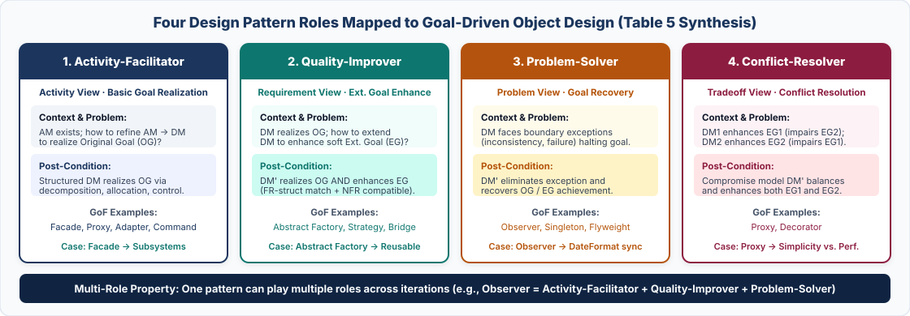
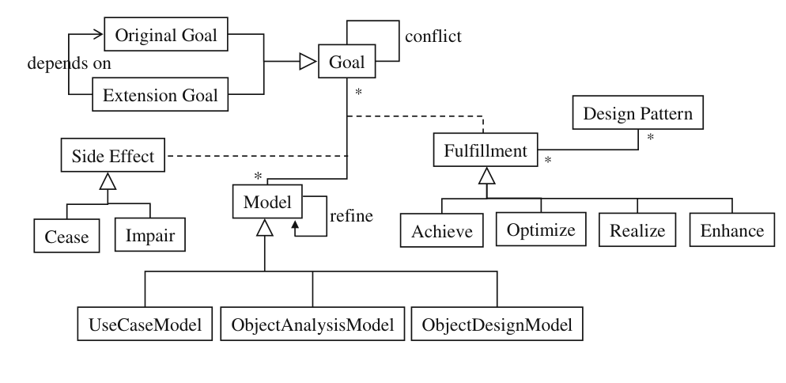
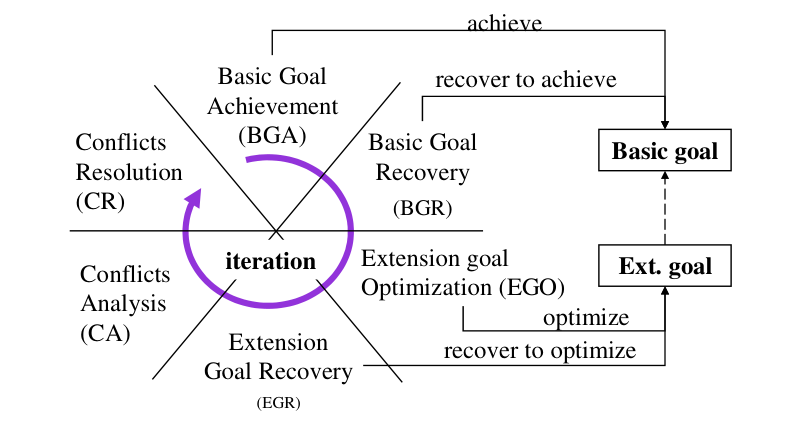
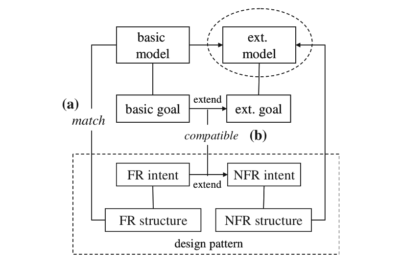
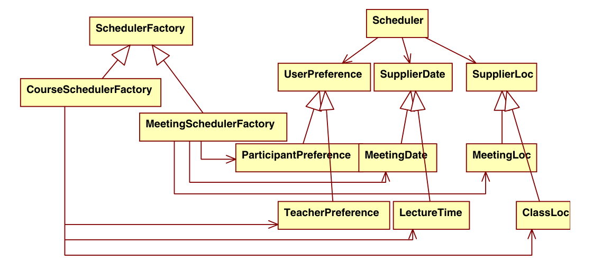
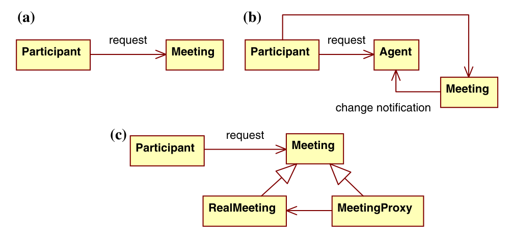

<!-- _class: lead -->

Software &amp; Systems Modeling (SoSyM) · Vol. 8, pp. 67–84 · 2009

# Object-Oriented Design: A Goal-Driven and Pattern-Based Approach

Bridging User Requirements and Design Patterns via a <strong>Four-Role Pattern Classification</strong> (Activity-Facilitator, Quality-Improver, Problem-Solver, Conflict-Resolver) Integrated into an <strong>Iterative Goal-Driven Process</strong>

<strong>Nien-Lin Hsueh</strong>a,*, <strong>Jong-Yih Kuo</strong>b, and <strong>Ching-Chiuan Lin</strong>a 
a Department of Information Engineering and Computer Science, Feng Chia University, Taichung, Taiwan 
b Department of Computer Science and Information Engineering, National Taipei University of Technology, Taipei, Taiwan 
<code>nlhsueh@fcu.edu.tw</code> · <code>yjkuo@csie.ntut.edu.tw</code> · <code>cclin@ocit.edu.tw</code>

DOI: 10.1007/s10270-007-0063-y · Published online July 2007 · Vol. 8 (2009) · Supported by NSC Taiwan Grant NSC94-2213-E-035-041

<!--
Bibliographic & Research Overview:
This regular paper (Hsueh, Kuo, & Lin, Software & Systems Modeling 8:67-84, 2009; DOI 10.1007/s10270-007-0063-y; communicated by Prof. Franck Barbier) extends the authors' prior Goal-Driven Use Case (GDUC) methodology (Lee & Xue 1999; Lee, Xue, & Kuo 2001) from requirements elicitation into systematic object-oriented design by integrating a multi-view classification of design patterns.

Core Contributions:
1. Multi-View Pattern Classification: Re-analyzes GoF design patterns across four functional/design roles—Activity-Facilitator, Quality-Improver, Problem-Solver, and Conflict-Resolver—showing that a single pattern (e.g., Observer) can assume multiple roles across iterations.
2. Goal Framework & 6-Activity Iterative Process: Formalizes goals along three facets (competence, view, content), distinguishes Original vs. Extension goals, and embeds pattern application into six recurring activities (BGA, BGR, EGO, EGR, CA, CR) spanning Requirement Modeling, Object Analysis, and Object Design.
3. End-to-End Benchmark Demonstration: Applies the full methodology to the classic Meeting Scheduler benchmark (Facade, Observer, Abstract Factory, Proxy) and summarizes pattern applicability via Context-Problem-Post-condition triples (Table 5).
-->

---

## Outline

1

<a href="#3">Motivation &amp; Research Objectives</a> The gap between user requirements and low-level patterns; 4 core features &amp; benchmark.

2

<a href="#5">Multi-View Pattern Analysis (4 Roles)</a> Activity-Facilitator, Quality-Improver, Problem-Solver, Conflict-Resolver &amp; guide.

3

<a href="#8">Goal Framework &amp; Iterative Process</a> Faceted goals, satisfaction/interactions, 3 phases, and 6 generic iterative activities.

4

<a href="#10">Meeting Scheduler Case Study</a> End-to-end derivation using Facade, Observer, Abstract Factory, and Proxy patterns.

5

<a href="#13">Related Work Positioning</a> Comparing code-transformation, quality-driven refactoring, and NFR-pattern methodologies.

6

<a href="#14">Conclusion &amp; Pattern-Based MDD</a> Three key engineering benefits, Table 5 synthesis, and future Model-Driven roadmap.

<strong>Core Thesis:</strong> Conventional pattern catalogs describe low-level object mechanics (inheritance, delegation), leaving a wide chasm from user requirements. Classifying patterns by <strong>design role</strong> and driving them via <strong>explicit goals</strong> makes OO design systematic, traceable, and conflict-aware.

<!--
Paper Architecture Overview:
- Section 1 (Introduction, pp. 67-68): Diagnoses the shortcomings of structure-driven pattern selection (e.g., Jeon et al.) and NFR-only pattern methods (Gross & Yu), and motivates the Meeting Scheduler benchmark.
- Section 2 (Analysis of Design Patterns, pp. 68-74): Defines the four pattern roles (Tables 1-4, Figs. 1-3).
- Section 3 (Goal-Driven and Pattern-Based Development, pp. 74-81): Introduces the Goal Framework (Fig. 4), 6-activity iterative process (Fig. 5), and walks through Requirement Modeling (Fig. 6), Object Analysis (Fig. 7), and Object Design (Figs. 8-13), culminating in Table 5.
- Section 4 (Related Work, pp. 81-82): Surveys three research streams and positions the contribution.
- Section 5 (Conclusion, p. 82): Summarizes findings and outlines Pattern-Based MDD integration.
-->

---

## 1. Motivation: The Requirement–Pattern Gap

<h3>Limitations of Existing Approaches</h3>
<ul>
<li><strong>Structure-Driven Selection (e.g., Jeon et al.):</strong> Selects patterns based on legacy code compatibility rather than user requirements—risking patterns that <strong>impair stakeholder needs</strong>.</li>
<li><strong>NFR-Only Frameworks (e.g., Gross &amp; Yu):</strong> Limited exclusively to non-functional soft goals and lacks a de facto standard modeling language (UML), hindering large-scale industrial adoption.</li>
<li><strong>Low-Level Catalog Descriptions:</strong> GoF patterns emphasize object mechanics (delegation, sample code), making pattern discovery heavily dependent on personal experience.</li>
</ul>

<h3>Four Pillars of Our Approach</h3>
<ul>
<li><strong>1. New Pattern Classification:</strong> Categorizes patterns into 4 design roles to build a searchable design library.</li>
<li><strong>2. Pattern-Based Transformation:</strong> Bridges analysis models to design models, enhances NFRs, and resolves conflicting requirements.</li>
<li><strong>3. Goal-Driven Traceability:</strong> Extends GDUC to derive requirements, analyze FR/NFR interactions, and capture design rationale in UML.</li>
<li><strong>4. Iterative Conflict Mitigation:</strong> Runs 6 goal-driven activities per iteration until phase milestones are met.</li>
</ul>

<strong>Three Expected Engineering Benefits:</strong> (1) Making it easy to <strong>meet requirements</strong>, (2) helping <strong>resolve design conflicts</strong>, and (3) systematically <strong>improving design quality</strong>.

<!--
Detailed Motivation (Section 1, pp. 67-68):
While Gamma et al.'s (1994) design patterns capture proven OO experience, applying them correctly remains difficult and error-prone as pattern catalogs expand. Automated code-transformation tools (Budinsky et al. 1996; Eden et al. 1997; Jeon et al. 2002) focus on syntactic precursors in legacy code, potentially producing structurally "clean" yet requirement-violating designs. Conversely, Gross & Yu (2001) connect patterns to Chung et al.'s NFR framework, but omit functional design activities, boundary exceptions, and standard UML integration.

This paper bridges the gap by combining multi-view pattern analysis with the authors' Goal-Driven Use Case (GDUC) framework in standard UML.
-->

---

## 1. Core Objectives &amp; Benchmark Domain

Goal 1

Bridge Requirements &amp; Patterns via Multi-View Roles

Analyze design patterns from activity, requirement, problem, and tradeoff perspectives so developers can systematically discover the right pattern at the right phase.

Goal 2

Integrate Patterns into Goal-Driven Iterative Development

Couple goal realization, enhancement, recovery, and conflict resolution with standard UML modeling across Requirement Modeling, Object Analysis, and Object Design.

Goal 3

Validate on the Meeting Scheduler Benchmark (Potts et al., 1994)

Demonstrate how vague, contradictory mission statements evolve into a conflict-free, reusable, high-quality OO design model using GoF patterns.

<strong>Why Meeting Scheduler?</strong> Widely adopted by the requirements engineering community (Potts et al. 1994; van Lamsweerde et al. 1994) because it naturally exhibits competing functional goals, soft quality goals (convenience, reusability, performance), and side-effect design conflicts.

<!--
Benchmark Rationale & Scope (Section 1, p. 68):
The authors select the Meeting Scheduler problem for two explicit reasons:
1. Community benchmark status: Its requirements typify real-world systems and allow direct comparison with prior RE literature.
2. Rich conflict structure: Turning a vague, contradictory mission statement into a rigorous specification exercises all six activities of the iterative goal-driven process.

Note on GoF Patterns (Footnote 2, p. 69):
GoF patterns are used throughout as well-known exemplars; the four-role classification is extensible so organizations can register domain-specific or architectural patterns under the same taxonomy.
-->

---

## 2. Multi-View Analysis: Four Design Pattern Roles

<strong>Non-Exclusive Classification:</strong> We do <em>not</em> alter pattern structure or semantics; we provide a <strong>multi-role lens</strong>. A single pattern like <code>Observer</code> can act as Activity-Facilitator (initial decomposition), Quality-Improver (decoupling), or Problem-Solver (view consistency) in different iterations.

<!--
Four-Role Pattern Taxonomy (Section 2, pp. 68-74):
Rather than forcing each pattern into a single rigid bucket (as in Creational/Structural/Behavioral), Hsueh et al. classify patterns by the engineering purpose they serve in an OO design lifecycle:
1. Activity-Facilitator (Activity View): Assists recurring design tasks bridging analysis to design.
2. Quality-Improver (Requirement View): Separates FR-intent from NFR-intent to elevate soft quality attributes.
3. Problem-Solver (Problem View): Handles non-trivial functional design problems and boundary exceptions.
4. Conflict-Resolver (Tradeoff View): Resolves side-effect conflicts where two design alternatives mutually impair competing soft goals.
-->

---

## 2. Roles 1 &amp; 2: Activity-Facilitator &amp; Quality-Improver

<h3>Activity-Facilitator Examples (Table 1)</h3>

| Design Activity | Pattern | Facilitation Mechanism |
| :--- | :--- | :--- |
| <strong>Decomposition</strong> | <code>Facade</code> / <code>Observer</code> | Encapsulate subsystem interface; decouple entity &amp; boundary |
| <strong>Object Allocation</strong> | <code>Remote / Virtual Proxy</code> | Hide remote address; lazy on-demand creation |
| <strong>Access Control</strong> | <code>Protection Proxy</code> / <code>Iterator</code> | Filter unauthorized access; shield composite internals |
| <strong>Control Flow</strong> | <code>Monitor</code> / <code>Command</code> | Synchronize concurrency; centralize request flow |
| <strong>Composition</strong> | <code>Adapter</code> | Glue incompatible COTS component interfaces |

<h3>Quality-Improver Examples (Table 2)</h3>

| Pattern | FR-Intent (What) | NFR-Intent (Quality Gain) |
| :--- | :--- | :--- |
| <strong>Observer</strong> | Notify dependents on state change | Auto-notify without concrete types (<strong>↓ coupling</strong>) |
| <strong>Abstract Factory</strong> | Create/use related product objects | Create without concrete classes (<strong>↑ reusability</strong>) |
| <strong>Strategy</strong> | Use algorithm for a problem | Swap algorithms; factor superclass (<strong>↑ extensibility</strong>) |
| <strong>Bridge</strong> | Separate abstraction &amp; impl. | Vary both independently (<strong>↓ coupling</strong>) |
| <strong>Mediator</strong> | Set of objects communicate | Encapsulate interactions (<strong>↓ coupling</strong>) |

<strong>FR-Structure vs. NFR-Structure (Fig. 1):</strong> For a Quality-Improver, <code>FR-intent</code> is realized by a simple <code>FR-structure</code> (e.g., Client directly creates ProductA1/B1), while <code>NFR-intent</code> is realized by an extended <code>NFR-structure</code> (introducing <code>AbstractFactory</code>).

<!--
Deep Dive on Activity-Facilitator & Quality-Improver (Sections 2.1-2.2, Tables 1-2, Fig. 1):
- Activity-Facilitator (Section 2.1): Draws from Bruegge & Dutoit's (2000) recurring system design activities (decomposition, object allocation, access control, control flow, component composition). Organizations may extend this list for their target architecture or language.
- Quality-Improver (Section 2.2): Non-functional requirements are notoriously subjective, relative, and interacting (Chung et al. 2000; Ebert 1998). Following Winn & Calder (2002) and paralleling Huston's (2001) non-pattern vs. pattern contrast, every Quality-Improver splits its intent into FR-intent (basic functional solution) and NFR-intent (qualified non-functional enhancement). Table 2 catalogs 11 GoF patterns (Observer, Abstract Factory, Command, Strategy, Iterator, Bridge, Chain of Responsibility, Mediator, Memento, Template Method, Visitor).
-->

---

## 2. Roles 3 &amp; 4: Problem-Solver, Conflict-Resolver &amp; Guide

<h3>Problem-Solver (Table 3) &amp; Conflict-Resolver</h3>
<ul class="small-text">
<li><strong>Problem-Solver (Functional Exceptions):</strong> Solves non-trivial functional or boundary problems—e.g., <code>Observer</code> (view inconsistency), <code>Singleton</code> (single instance across subclass hierarchy), <code>Command</code> (undoable requests), <code>Flyweight</code> (high-volume storage cost).</li>
<li><strong>Conflict-Resolver (Side-Effect Tradeoffs):</strong> Conflicts from competing resources or divergent expectations can be arbitrated, but <strong>side-effect conflicts</strong> require structural compromise:
  <ul>
  <li><code>Proxy</code> (Fig. 2): Resolves <strong>Simplicity vs. Performance</strong> by giving Agent &amp; RealSubject a common <code>Subject</code> interface.</li>
  <li><code>Decorator</code> (Fig. 3): Resolves <strong>Simplicity vs. Scalability</strong> by blending inheritance and composition (avoiding subclass explosion).</li>
  </ul>
</li>
</ul>

<h3>Role Classification Guideline (Table 4)</h3>

| Pattern Role | Diagnostic Questions |
| :--- | :--- |
| <strong>Activity-Facilitator</strong> | Facilitates a specific recurring design activity (basic or quality-improvement)? |
| <strong>Quality-Improver</strong> | Improves NFRs? Which concrete quality property (reusability, extensibility, encapsulation)? |
| <strong>Conflict-Resolver</strong> | Resolves conflicting requirements? What are the competing alternatives &amp; conflict root? |
| <strong>Problem-Solver</strong> | Solves technically hard design problems or prevents exceptions (not basic/quality/tradeoff)? |

<strong>Diagnostic Discipline:</strong> If a candidate pattern cannot name a specific quality property, it is <em>not</em> a Quality-Improver (e.g., <code>Singleton</code> addresses a functional instantiation constraint ➔ classified strictly as a <strong>Problem-Solver</strong>).

<!--
Deep Dive on Conflict-Resolver & Problem-Solver (Sections 2.3-2.5, Figs. 2-3, Tables 3-4):
- Conflict-Resolver (Section 2.3): Builds on Lee, Xue, & Kuo (2001), which categorizes conflict roots into competing resources, divergent expectations, and side effects. Side-effect conflicts are hardest because the conflicting requirements share no common resource.
  * Fig. 2 (Proxy): Direct Client -> RealSubject gives Simplicity++ / Performance--; adding a separate Agent gives Performance++ / Simplicity-- (Client must know both); Proxy introduces a shared Subject abstraction achieving Simplicity+ / Performance+.
  * Fig. 3 (Decorator): Pure inheritance gives Simplicity++ / Scalability-- (subclass explosion A, B1, B2, AB1, AB2, AB1B2); pure composition gives Scalability++ / Simplicity-- (Basic must know all extensions); Decorator combines inheritance + composition for Simplicity+ / Scalability+.
- Problem-Solver (Section 2.4): Focuses on functional correctness and exception prevention (model inconsistency, data corruption, connection failure). Table 3 lists Observer, Singleton, Adapter, Command, Composite, Flyweight, and Interpreter.
-->

---

## 3. Goal Framework &amp; Faceted Classification

<ul>
<li><strong>Three Goal Facets (GDUC):</strong>
  <ul>
  <li><strong>Competence:</strong> <code>Rigid</code> (must be fully satisfied) vs. <code>Soft</code> (satisfied to a degree).</li>
  <li><strong>View:</strong> <code>Actor-specific</code> vs. <code>System-specific</code>.</li>
  <li><strong>Content:</strong> <code>Functional</code> (operation sequence) vs. <code>Non-functional</code> (qualifying constraint).</li>
  </ul>
</li>
<li><strong>Original vs. Extension Goals:</strong> An <strong>Original Goal (OG)</strong> is rigid + actor-specific + functional (e.g., <code>MeetingRequestSatisfied</code>). An <strong>Extension Goal (EG)</strong> is soft, system-specific, or non-functional and depends on an OG (e.g., <code>MaxConvenientSchedule</code>, <code>ReusableScheduler</code>).</li>
<li><strong>Goal Satisfaction &amp; Interactions:</strong> Use cases <em>achieve/optimize/recover</em> goals; object models <em>realize/enhance/recover</em> them. Two goals <strong>conflict</strong> if raising one's satisfaction decreases the other's (side effect: <em>impair</em> or <em>cease</em>).</li>
</ul>

Fig. 4. Unified Goal Framework connecting Original/Extension Goals, Models, Fulfillment, Side Effects, and Design Patterns.

<!--
Goal Framework Semantics (Section 3.1 & Fig. 4):
Fig. 4 models the meta-relationships in UML:
- Goal specializes into Original Goal and Extension Goal (which depends on an Original Goal); Goals may conflict with each other.
- Model refines across three abstraction levels: UseCaseModel -> ObjectAnalysisModel -> ObjectDesignModel.
- Fulfillment (association class between Goal and Model, supported by Design Patterns) specializes into Achieve, Optimize (for UseCaseModel), Realize, and Enhance (for Object Models).
- Side Effect (association class) specializes into Cease (halts goal achievement) and Impair (reduces satisfaction degree).

Two Interaction Levels (Section 3.1.3):
- Model-level interaction: Conflicting (one increases, other decreases), Cooperative (both increase or both decrease), or Irrelevant (unchanged).
- System-level interaction: Aggregated across all models.
- Three Conflict Types: Interaction conflicts (stakeholder requirements in Req Modeling), Structural conflicts (differing entity/attribute representations in Object Analysis), and Design conflicts (incompatible architectural tradeoffs in Object Design).
-->

---

## 3. Three-Phase Iterative Process &amp; Six Generic Activities

Fig. 5. Six generic goal-driven activities executed cyclically within each development phase.

<h3>Three Milestone-Driven Phases</h3>
<ol>
<li><strong>Requirement Modeling:</strong> Define scope via goal-driven use cases (basic &amp; alternative courses) and resolve <em>interaction conflicts</em>.</li>
<li><strong>Object Analysis:</strong> Transform use cases into a domain object analysis model (Fig. 7) and resolve <em>structural conflicts</em> (via generalization).</li>
<li><strong>Object Design:</strong> Transform analysis model into solution model via <strong>4 design pattern roles</strong> and resolve <em>design conflicts</em>.</li>
</ol>

<strong>Six Generic Activities per Iteration:</strong> (1) <code>BGA</code> Basic Goal Achievement ➔ (2) <code>BGR</code> Basic Goal Recovery ➔ (3) <code>EGO</code> Extension Goal Optimization ➔ (4) <code>EGR</code> Extension Goal Recovery ➔ (5) <code>CA</code> Conflict Analysis ➔ (6) <code>CR</code> Conflict Resolution (triggers next iteration if new side effects arise).

<!--
Iterative Process Mechanics (Section 3.2 & Fig. 5):
Borrowing milestone discipline from the Unified Process (Jacobson et al. 1999), each of the three phases runs one or more iterations of the six generic activities until its phase milestone is satisfied:
- BGA & BGR target Basic/Original Goals (happy path + exception recovery).
- EGO & EGR target Extension Goals (soft-goal optimization/enhancement + exception recovery).
- CA & CR detect and resolve side-effect conflicts. Crucially, introducing a conflict-resolution alternative (an alternative use case or a refined design model) starts a NEW iteration because the resolution itself may introduce new exceptions or secondary conflicts.
-->

---

## 4. Case Study I: Meeting Scheduler Requirements &amp; Analysis

<h3>Phase 1: Requirement Modeling (Fig. 6)</h3>
<ul class="small-text">
<li><strong>BGA (Original Goal):</strong> <code>MeetingRequestSatisfied</code> ➔ original use case <em>plan a meeting</em> (basic course).</li>
<li><strong>BGR (Recovery):</strong> Append alternative course to handle <em>strong date conflicts</em>.</li>
<li><strong>EGO / EGR (Extension Goals):</strong> Create <code>&lt;&lt;extends&gt;&gt;</code> use case <em>make a convenient schedule</em> for <code>MaxConvenientSchedule</code>; recover by extending date range or soliciting preference dates.</li>
<li><strong>CA &amp; CR (Interaction Conflicts):</strong>
  <ul>
  <li><em>keep appropriate performance</em> ceases negotiation ➔ impairs <code>MaxConvenientSchedule</code>.</li>
  <li><em>accommodate important meetings</em> cancels existing meetings ➔ impairs <code>MeetingRequestSatisfied</code> ➔ resolved by excluding occupied dates from the new meeting's range.</li>
  </ul>
</li>
</ul>

<h3>Phase 2: Object Analysis (Fig. 7)</h3>
<ul class="small-text">
<li><strong>Incremental Domain Modeling:</strong> Extract domain classes (<code>Meeting</code>, <code>Initiator</code>, <code>Participant</code>, <code>MeetingDate</code>, <code>DateRange</code>, <code>Location</code>, <code>Room</code>, <code>Equipment</code>, <code>Agenda</code>) and interactions via sequence diagrams.</li>
<li><strong>Extension Constraints Attached:</strong> Annotate domain model with soft-goal constraints:
  <ul>
  <li><code>{the scheduler should be as reusable as possible}</code></li>
  <li><code>{the date should be as convenient as possible}</code></li>
  </ul>
</li>
<li><strong>Structural Conflict Resolution:</strong> When different use cases model the same concept as an entity vs. an attribute, unify via <strong>generalization</strong> (e.g., <code>DateConflict</code> ➔ <code>WeakConflict</code> / <code>StrongConflict</code>; <code>Participant</code> ➔ <code>ImportantParticipant</code> / <code>ActiveParticipant</code>).</li>
</ul>

<strong>Handoff to Object Design:</strong> Phase 2 produces a precise domain Analysis Model (AM) carrying explicit goal annotations—setting the stage for pattern-guided transformation into a software Design Model (DM).

<!--
Detailed Walkthrough of Phases 1 & 2 (Sections 3.3-3.4, Figs. 6-7):
- Requirement Modeling (Fig. 6a-f): Illustrates incremental construction from U1 (original use case achieving G1) -> alternative courses a1..a3 recovering G1 -> U2 (extension use case optimizing G2) -> U3 impairing G2 -> U4 substituting for U3 to resolve the conflict.
- Object Analysis (Fig. 7): Bridges problem space to solution space. Notice that Fig. 7 explicitly embeds OCL/text constraints representing extension goals directly onto the domain class diagram so they remain visible when transitioning to Phase 3 (Object Design).
-->

---

## 4. Case Study II: Pattern-Driven Object Design Steps

<ul>
<li><strong>1. Realizing Basic Goals (Activity-Facilitator):</strong> Decompose analysis model into <code>MeetingDomain</code>, <code>MeetingBrowser</code>, and <code>MeetingDatePersistency</code> subsystems using <strong>Facade</strong> (<code>MeetingController</code> + <code>MeetingManager</code>, Fig. 8) to realize <code>MeetingRequestSatisfied</code>.</li>
<li><strong>2. Recovering Basic Goals (Problem-Solver):</strong> Goal <code>SupportVariousDateFormat</code> suffers view inconsistency across <code>DateFormat1</code> &amp; <code>DateFormat2</code> ➔ apply <strong>Observer</strong> (Fig. 9) so <code>MeetingDate</code> auto-notifies all views via <code>update()</code>.</li>
<li><strong>3. Enhancing Extension Goals (Quality-Improver):</strong> Fig. 10 shows the dual selection rule:
  <ul>
  <li><strong>(a) Structural Match:</strong> Basic model matches pattern's <code>FR-structure</code>.</li>
  <li><strong>(b) Intent Compatibility:</strong> Goal extension (<code>OG ➔ EG</code>) is compatible with pattern's intent extension (<code>FR ➔ NFR</code>).</li>
  </ul>
</li>
</ul>

Fig. 10. Dual matching condition for applying a Quality-Improver pattern: (a) FR-structure match &amp; (b) intent-extension compatibility.

<!--
Object Design Transformation Logic (Section 3.5, Figs. 8-11):
- Basic Design Issue -> Activity-Facilitator: Facade (Fig. 8) hides subsystem complexity behind MeetingController/MeetingManager.
- Boundary Exception -> Problem-Solver: Observer (Fig. 9) resolves data-view synchronization failures when supporting multiple date formats.
- Quality Issue -> Quality-Improver (Fig. 10): Provides a systematic heuristic for selecting a pattern to extend a Basic Model into an Extended Model:
  (a) Match: The basic model's classes and relationships map to the roles and constraints of the pattern's FR-structure (e.g., Fig. 11 shows MeetingScheduler directly using ParticipantPreference, MeetingDate, MeetingLoc—matching Abstract Factory's Client -> product family).
  (b) Compatible: The quality objective of OG -> EG (e.g., enhancing reusability) aligns with the pattern's FR-intent -> NFR-intent (decreasing coupling -> higher reusability).
  Note: The authors deliberately keep "match" and "compatible" heuristic rather than rigidly formal because pattern design requires human architectural judgment.
-->

---

## 4. Case Study III: Abstract Factory &amp; Proxy in Action

Fig. 12. <strong>Quality-Improver (Abstract Factory):</strong> Enhances <code>ReusableSchedule</code> across Meeting &amp; Course scheduling domains.

Fig. 13. <strong>Conflict-Resolver (Proxy):</strong> Resolves <code>SimpleDesign</code> (a) vs. <code>EfficientRequest</code> (b) via shared <code>Meeting</code> interface (c).

<strong>Concrete Design Payoff:</strong> (Left) <code>Scheduler</code> delegates product-family creation to <code>SchedulerFactory</code>, enabling zero-change reuse from Meeting Scheduling to Course Scheduling (<code>TeacherPreference</code>, <code>LectureTime</code>, <code>ClassLoc</code>). (Right) <code>MeetingProxy</code> caches status locally for fast remote queries while shielding <code>Participant</code> behind the unified <code>Meeting</code> abstraction.

<!--
Detailed Case Study Outcomes (Section 3.5, Figs. 12-13):
1. Abstract Factory (Fig. 12): Enhances the extension goal ReusableSchedule (RS) associated with MeetingRequestSatisfied (MRS). Instead of instantiating concrete classes directly, Scheduler operates on abstract products (UserPreference, SupplierDate, SupplierLoc) created by concrete factories: MeetingSchedulerFactory (ParticipantPreference, MeetingDate, MeetingLoc) or CourseSchedulerFactory (TeacherPreference, LectureTime, ClassLoc).
2. Proxy (Fig. 13): Addresses the original goal DecentralizedRequest (remote status queries) with two conflicting soft goals—SimpleDesign and EfficientRequest:
   - Model (a): Direct client-server connection preserves SimpleDesign but impairs EfficientRequest (unnecessary remote calls even when status is unchanged).
   - Model (b): Local Agent caches status and receives change notifications, boosting EfficientRequest but impairing SimpleDesign (Participant must know both Agent and remote Meeting).
   - Model (c): Proxy pattern abstracts RealMeeting and MeetingProxy under a common Meeting interface, preserving fast local queries while keeping Participant simple.
-->

---

## 5. Related Work Positioning (Section 4)

| Research Stream | Representative Works | Primary Focus | Key Limitation Addressed by Our Work |
| :--- | :--- | :--- | :--- |
| <strong>1. Automatic Code Transformation</strong> | Budinsky et al. (1996); Eden et al. (1997); Jeon et al. (2002); France et al. (2004) | Script/meta-program/Prolog-based code generation &amp; UML pattern specs | Selects patterns from <strong>program structure</strong> rather than user requirements; greenfield or syntax-only focus |
| <strong>2. Quality-Driven Re-Engineering</strong> | O'Cinneide &amp; Nixon (1999); Tahvildari &amp; Kontogiannis (2002); Khriss et al. (2000); Huston (2001) | Behavior-preserving mini-transformations, NFR legacy refactoring, metric compatibility | Precursors tied to legacy code structure; pattern-selection rationale or forward-design guidance missing |
| <strong>3. Pattern-Based Methodology</strong> | Gross &amp; Yu (2001); Chung, Cooper &amp; Yi (2003) | Linking soft goals (NFR framework) to design patterns | Narrowly limited to <strong>NFRs only</strong>; lacks standard UML modeling &amp; conflict-resolution lifecycle |
| <strong>This Study (SoSyM 2009)</strong> | <strong>Hsueh, Kuo &amp; Lin (2009)</strong> | <strong>Goal-driven + 4-role pattern-based OO design in UML</strong> | Covers <strong>all 4 design roles</strong>, standard UML, iterative conflict resolution &amp; full requirement traceability |

<strong>Positioning Summary:</strong> Our methodology sits in Stream 3 (bridging user requirements and pattern technology) while extending it beyond NFR-only soft goals to full lifecycle OO design in standard UML.

<!--
Detailed Comparison with Literature (Section 4, pp. 81-82):
- Category 1 (Automatic Transformation): COGENT (Budinsky) assumes greenfield code generation; Eden's meta-programs apply micro-pattern operators; Jeon's Prolog rules detect structural candidate spots but ignore whether a pattern impairs user requirements; France et al. (2004) provide rigorous UML SPS/IPS metamodels (which directly inspired the authors' subsequent 2008 JSS quantitative verification work!).
- Category 2 (Quality Re-Engineering): O'Cinneide's precursors and Tahvildari's primitive transformations (abstraction, encapsulation, build relation, extension) restructure legacy code; Khriss et al.'s refinement schemas trace high-to-low UML models without solving pattern selection; Huston (2001) compares non-pattern vs. pattern metric scores.
- Category 3 (Methodology): Gross & Yu (2001) and Chung et al. (2003) refine NFR soft goals into patterns (e.g., Strategy, Wrapper), prioritizing user needs over code automation. Hsueh et al. generalize this paradigm to all four design roles within an iterative UML process.
-->

---

## 6. Synthesis, Conclusion &amp; Future Work

<h3>Context–Problem–Post-Condition Synthesis (Table 5)</h3>
<ul class="small-text">
<li><strong>Activity-Facilitator:</strong> Context <code>AM</code> ➔ Problem <em>how to refine AM to DM realizing OG?</em> ➔ Post-condition <code>DM</code> realizes <code>OG</code>.</li>
<li><strong>Quality-Improver:</strong> Context <code>DM</code> realizes <code>OG</code> ➔ Problem <em>how to enhance EG?</em> ➔ Post-condition <code>DM'</code> realizes <code>OG</code> &amp; enhances <code>EG</code>.</li>
<li><strong>Problem-Solver:</strong> Context <code>DM</code> has exception halting goal ➔ Post-condition <code>DM'</code> eliminates exception &amp; recovers goal.</li>
<li><strong>Conflict-Resolver:</strong> Context <code>DM1</code> (EG1+, EG2−) vs. <code>DM2</code> (EG2+, EG1−) ➔ Post-condition <code>DM'</code> enhances both <code>EG1</code> &amp; <code>EG2</code>.</li>
</ul>

<h3>Core Takeaways &amp; Future MDD Roadmap</h3>
<ul class="small-text">
<li><strong>1. Requirement-Anchored Design:</strong> Every pattern application is justified by an explicit goal (realization, enhancement, recovery, or conflict resolution).</li>
<li><strong>2. Continuous Iterative Refinement:</strong> Each iteration's output model becomes the explicit context for applying patterns in the next iteration.</li>
<li><strong>3. Future Work — Pattern-Based MDD:</strong> Integrate our goal-driven analysis models with <strong>Model-Driven Development (MDD)</strong> to automatically transform conceptual, conflict-laden models into realizable, qualified, conflict-free executable models.</li>
</ul>

<strong>Research Lineage:</strong> The four-role taxonomy and FR/NFR-structure duality established here directly laid the theoretical foundation for the authors' quantitative QMOOD/QIE pattern verification work (<em>JSS 2008</em>).

<!--
Conclusion & Future Work (Sections 3.6 & 5, pp. 80-82):
- Table 5 Characterization: Adapting Alexander's (1977) "solution to a problem in a context," Hsueh et al. characterize pattern applicability by Context, Problem, and Post-condition (focusing on goal-model interaction outcomes rather than low-level solution code).
- Iterative Feedback Loop: Models built in iteration k provide the structural context for discovering and applying patterns in iteration k+1, naturally accommodating emergent exceptions and side-effect conflicts.
- Pattern-Based MDD (Section 5): Citing Uhl (2003) and France et al. (2003), the authors outline integrating goal-driven pattern selection with automated PIM-to-PSM model transformations.
-->

---

<!-- _class: closing -->

# Thank You for Your Attention!

Object-Oriented Design: A Goal-Driven and Pattern-Based Approach

<strong>Nien-Lin Hsueh*</strong> · <code>nlhsueh@fcu.edu.tw</code> &nbsp;|&nbsp; <strong>Ching-Chiuan Lin</strong> · <code>cclin@ocit.edu.tw</code> 
<strong>Jong-Yih Kuo</strong> · <code>yjkuo@csie.ntut.edu.tw</code> 
Feng Chia University &amp; National Taipei University of Technology, Taiwan 
Software &amp; Systems Modeling (SoSyM), Vol. 8, pp. 67–84, 2009 · DOI: 10.1007/s10270-007-0063-y · Grant: NSC94-2213-E-035-041

<!--
Archival Citation Metadata:
- Title: Object-oriented design: A goal-driven and pattern-based approach
- Authors: Nien-Lin Hsueh (Feng Chia University, corresponding author), Jong-Yih Kuo (National Taipei University of Technology), Ching-Chiuan Lin (Feng Chia University)
- Venue: Software & Systems Modeling (SoSyM), Vol. 8, pp. 67-84, 2009 (Published online July 21, 2007, Springer-Verlag)
- DOI: 10.1007/s10270-007-0063-y
- Grant: National Science Council (Taiwan) NSC94-2213-E-035-041
- Keywords: Design pattern, Object-oriented design, Software quality, Goal-driven requirement engineering
-->

