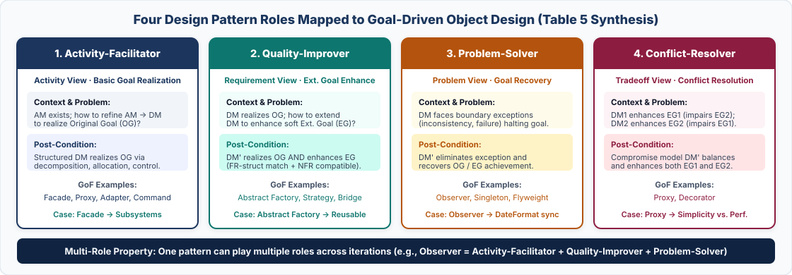
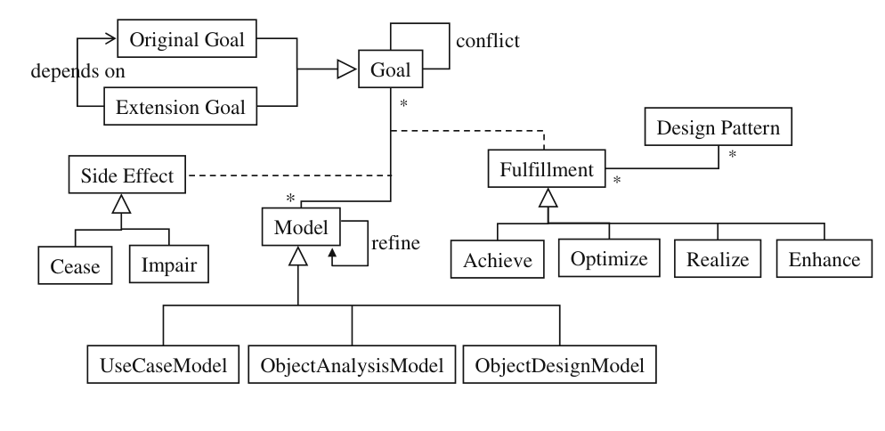
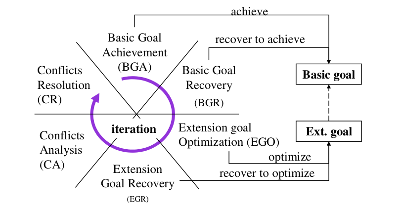
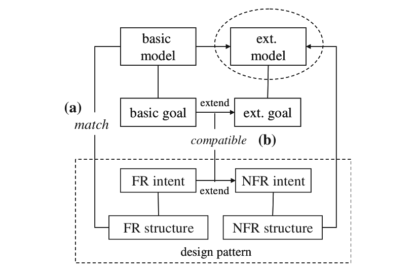
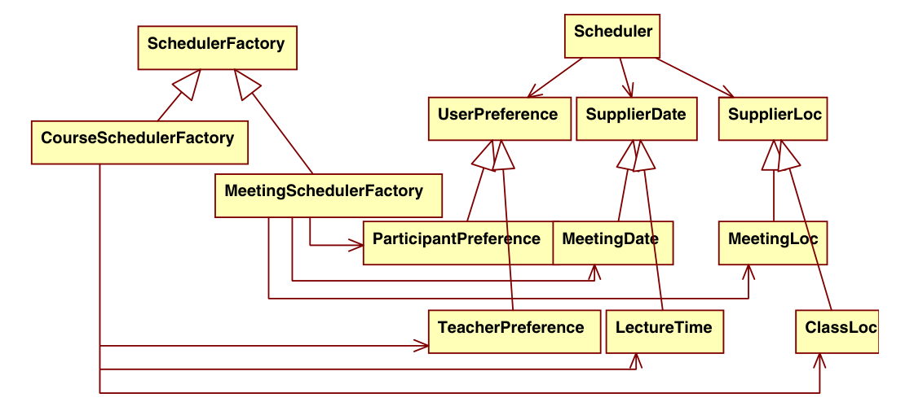
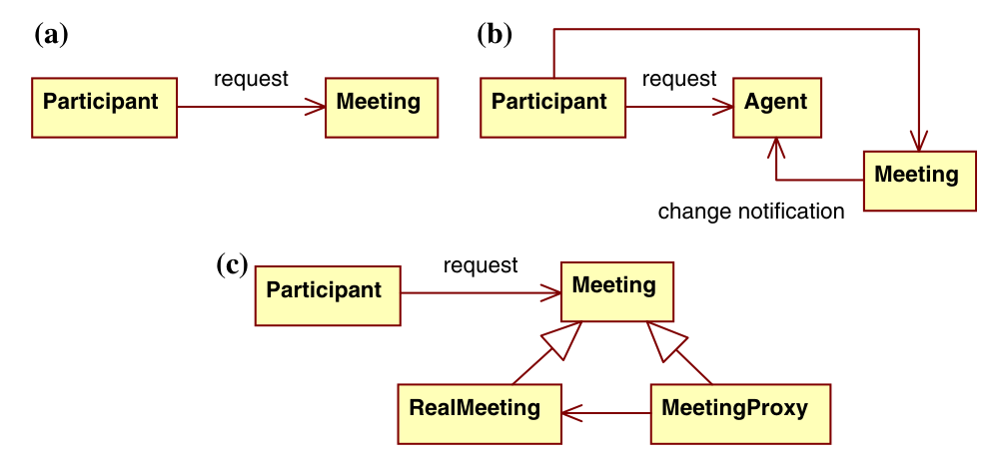

<!-- _class: lead -->

Software &amp; Systems Modeling (SoSyM) · 第 8 卷 67–84 頁 · 2009

# 物件導向設計：一種目標驅動且基於設計模式之方法

Object-Oriented Design: A Goal-Driven and Pattern-Based Approach

透過<strong>設計模式四大角色分類</strong>（活動促成者、品質改進者、問題解決者、衝突協調者）整合至<strong>迭代式目標驅動開發流程</strong>，系統化銜接使用者需求與物件導向設計

<strong>薛念林（Nien-Lin Hsueh）</strong>a,*、<strong>郭忠義（Jong-Yih Kuo）</strong>b、<strong>林清泉（Ching-Chiuan Lin）</strong>a 
a 逢甲大學資訊工程學系 · b 國立臺北科技大學資訊工程系 
<code>nlhsueh@fcu.edu.tw</code> · <code>yjkuo@csie.ntut.edu.tw</code> · <code>cclin@ocit.edu.tw</code>

DOI: 10.1007/s10270-007-0063-y · 2007 年 7 月線上刊出 · 第 8 卷（2009）· 國科會計畫補助 NSC94-2213-E-035-041

<!--
論文書目與核心定位：
本論文發表於 Software & Systems Modeling（SoSyM, Vol. 8, pp. 67-84, 2009；2007 年 7 月線上發表），由逢甲大學薛念林（通訊作者）、林清泉與臺北科大郭忠義共同撰寫。研究延伸作者團隊先前提出之「目標驅動使用案例（GDUC）」需求工程方法（Lee & Xue 1999；Lee, Xue, & Kuo 2001），進一步將設計模式的多視角分析整合至物件導向設計階段。

三大原創貢獻：
1. 設計模式多視角四大角色分類：從活動、需求、問題、權衡四維度剖析 GoF 設計模式，提出「活動促成者、品質改進者、問題解決者、衝突協調者」四種角色，並指出單一模式（如 Observer）可跨迭代扮演多重角色。
2. 目標框架與六活動迭代流程：以三面向（能力、視角、內容）區分原始目標與延伸目標，將設計模式系統化嵌入需求塑模、物件分析與物件設計三階段的六項通用迭代活動（BGA、BGR、EGO、EGR、CA、CR）。
3. 會議排程系統端對端實例驗證：完整示範 Facade、Observer、Abstract Factory、Proxy 等模式如何協同實現需求、提升可重用性並化解設計衝突，並以「情境—問題—後置條件」彙整適用性（表 5）。
-->

---

## 簡報大綱

1

<a href="#3">研究動機與研究目標</a> 使用者需求與低階模式之鴻溝、四大方法特色與基準案例選擇。

2

<a href="#5">設計模式多視角分析（四大角色）</a> 活動促成者、品質改進者、問題解決者、衝突協調者與分類指引。

3

<a href="#8">目標框架與三階段迭代流程</a> 三面向目標分類、目標滿足與互動關係，以及六項通用迭代活動。

4

<a href="#10">會議排程系統端對端案例</a> 從需求與分析模型演進至 Facade、Observer、Abstract Factory 與 Proxy 設計。

5

<a href="#13">相關研究文獻定位</a> 比較自動程式碼轉換、品質驅動重構與 NFR 模式開發方法論。

6

<a href="#14">結論與模式導向 MDD 展望</a> 表 5 適用性總結、三大工程效益與未來模型驅動開發整合藍圖。

<strong>核心論點：</strong>傳統設計模式目錄偏重低階物件技巧（繼承、委派、範例碼），與高階使用者需求之間存在巨大鴻溝。透過<strong>角色分類</strong>與<strong>目標驅動</strong>，開發者能在正確階段系統化選用模式並保留完整設計理由。

<!--
論文結構導覽：
- 第 1 節（緒論，pp. 67-68）：剖析結構導向模式轉換與純 NFR 框架之侷限，引出目標驅動整合方法與會議排程基準案例。
- 第 2 節（設計模式分析，pp. 68-74）：定義四大角色並以 GoF 模式舉例說明（表 1-4、圖 1-3）。
- 第 3 節（目標驅動與模式基礎開發，pp. 74-81）：建立目標框架（圖 4）、六活動迭代流程（圖 5），逐步示範需求塑模（圖 6）、物件分析（圖 7）與物件設計（圖 8-13），最後於表 5 彙整。
- 第 4 節（相關研究，pp. 81-82）：比較三大研究脈絡。
- 第 5 節（結論，p. 82）：總結研究價值並展望模式導向 MDD。
-->

---

## 1. 研究動機：需求與設計模式之間的鴻溝

<h3>既有研究方法之核心侷限</h3>
<ul>
<li><strong>結構導向選用（如 Jeon et al.）：</strong>僅依遺留程式碼結構相容性挑選設計模式，忽略使用者需求，甚至可能<strong>損害原本的系統需求</strong>。</li>
<li><strong>純 NFR 框架（如 Gross &amp; Yu）：</strong>僅能處理非功能性軟目標，且未採用業界標準塑模語言（UML），不利於大型系統導入。</li>
<li><strong>低階目錄描述門檻高：</strong>GoF 傳統四段式描述偏重實作細節，隨著模式數量暴增，開發者難以從需求端有效檢索合適模式。</li>
</ul>

<h3>本研究方法之四大核心特色</h3>
<ul>
<li><strong>1. 全新模式角色分類：</strong>依設計用途劃分四大角色，建立需求導向之設計模式知識庫。</li>
<li><strong>2. 模式輔助模型轉換：</strong>引導分析模型轉化為設計模型、強化非功能需求並化解需求衝突。</li>
<li><strong>3. 目標驅動可追蹤性：</strong>延伸 GDUC 以標準 UML 導出需求、分析功能／非功能互動並記錄設計理由。</li>
<li><strong>4. 迭代式風險緩解：</strong>每回合執行六項目標驅動活動，逐步消除衝突風險直至達成階段里程碑。</li>
</ul>

<strong>三大工程效益：</strong>（1）使系統更易<strong>滿足使用者需求</strong>、（2）有效<strong>解決設計衝突</strong>、（3）系統化<strong>提升軟體設計品質</strong>。

<!--
研究動機深層解析（第 1 節，pp. 67-68）：
自動化模式套用研究（Budinsky et al. 1996；Eden et al. 1997；Jeon et al. 2002）雖能減輕重構負擔，但因未考慮需求目標，常陷入「結構優雅卻不符需求」的盲區；而 Gross & Yu（2001）雖從 NFR 軟目標出發，卻缺乏標準 UML 支援且無法涵蓋功能分解與例外處理。本研究透過「四角色分類 + GDUC 迭代流程」填補此一空白。
-->

---

## 1. 研究目標與會議排程基準案例

目標 1

以多視角角色分類橋接需求與設計模式

從活動、需求、問題與權衡四種視角重新解析設計模式，協助開發者在正確的開發階段快速找出適用模式。

目標 2

整合模式應用至目標驅動 UML 迭代流程

在需求塑模、物件分析與物件設計三階段中，將目標實現、強化、復原與衝突解決與標準 UML 模型緊密結合。

目標 3

以會議排程系統基準案例完整驗證（Potts et al., 1994）

示範如何將模糊且相互矛盾的任務描述，透過 GoF 設計模式逐步演化為高品質、可重用且無衝突的物件設計模型。

<strong>為何選用會議排程系統（Meeting Scheduler）？</strong>此問題為需求工程社群公認之經典基準（Potts et al. 1994；van Lamsweerde et al. 1994），天然涵蓋功能目標、多項軟目標（便利性、可重用性、效能）與典型副作用設計衝突。

<!--
基準案例選擇理由（第 1 節，p. 68）：
1. 社群共通基準：其需求結構能代表真實世界資訊系統的典型挑戰。
2. 充分考驗衝突處理：將模糊且具內在矛盾的任務陳述轉化為嚴謹規格，能完整展示本研究六項迭代活動與四類設計模式角色的協同運作。
註：文中以廣為人知的 GoF 設計模式作為範例，企業亦可依此分類框架擴充自訂領域模式。
-->

---

## 2. 設計模式多視角分析：四大角色架構

<strong>非互斥多重角色特性：</strong>本方法<em>不改變</em>設計模式原有的結構或語意，而是提供<strong>多維分析視角</strong>。單一模式如 <code>Observer</code> 可在不同迭代中分別扮演活動促成者（系統分解）、品質改進者（降低耦合）或問題解決者（防止資料不一致）。

<!--
設計模式四大角色分類架構（第 2 節，pp. 68-74）：
相較於 GoF 傳統的「建立型／結構型／行為型」分類，本研究從軟體生命週期中的設計任務出發，提出四種功能導向角色：
1. 活動促成者（Activity-Facilitator，活動視角）：支援分析轉設計之常見設計活動。
2. 品質改進者（Quality-Improver，需求視角）：分離功能意圖與非功能意圖，強化軟目標品質。
3. 問題解決者（Problem-Solver，問題視角）：克服邊界例外與非平凡功能性設計難題。
4. 衝突協調者（Conflict-Resolver，權衡視角）：化解由副作用引發之設計替代方案衝突。
-->

---

## 2. 角色一與二：活動促成者與品質改進者

<h3>活動促成者範例（表 1）</h3>

| 設計活動 | 設計模式 | 促成機制 |
| :--- | :--- | :--- |
| <strong>系統分解</strong> | <code>Facade</code> / <code>Observer</code> | 以統一介面封裝子系統；解耦實體與邊界物件 |
| <strong>物件配置</strong> | <code>Remote / Virtual Proxy</code> | 隱藏遠端位址；按需延遲建立以最佳化效能 |
| <strong>存取控制</strong> | <code>Protection Proxy</code> / <code>Iterator</code> | 過濾不當存取；保護複合物件內部結構 |
| <strong>控制流程</strong> | <code>Monitor</code> / <code>Command</code> | 同步化並行方法執行；集中化請求控制流 |
| <strong>元件組合</strong> | <code>Adapter</code> | 轉換不相容 COTS 元件介面作為黏合層 |

<h3>品質改進者範例（表 2）</h3>

| 設計模式 | 功能意圖（FR-Intent） | 非功能意圖（NFR-Intent） |
| :--- | :--- | :--- |
| <strong>Observer</strong> | 狀態變更時通知相關物件 | 不需知悉觀察者具體型別（<strong>↓ 耦合度</strong>） |
| <strong>Abstract Factory</strong> | 建立／使用一組相關產品 | 不指定具體型別即可建立（<strong>↑ 可重用性</strong>） |
| <strong>Strategy</strong> | 以演算法解決特定問題 | 易於替換演算法並抽取共用邏輯（<strong>↑ 擴充性</strong>） |
| <strong>Bridge</strong> | 物件具抽象與實作兩面 | 令抽象與實作獨立變化（<strong>↓ 耦合度</strong>） |
| <strong>Mediator</strong> | 一組物件相互通訊 | 封裝互動關係（<strong>↓ 耦合度</strong>） |

<strong>FR 結構 vs. NFR 結構（圖 1）：</strong>品質改進者以簡潔的 <code>FR-structure</code> 實現基本功能（例如 Client 直接使用 ProductA1/B1），再透過延伸的 <code>NFR-structure</code>（引入 <code>AbstractFactory</code>）強化非功能品質。

<!--
活動促成者與品質改進者詳解（第 2.1-2.2 節、表 1-2、圖 1）：
- 活動促成者（第 2.1 節）：對應 Bruegge & Dutoit（2000）的五大系統設計活動（分解、配置、存取控制、控制流、元件組合），協助縮短分析模型與可執行系統間的落差。
- 品質改進者（第 2.2 節）：非功能需求具有主觀性、相對性與交互影響性（Chung et al. 2000）。本研究將每個品質改進者的意圖拆解為 FR-intent（做什麼）與 NFR-intent（對品質屬性的延伸貢獻），表 2 共分析 11 個 GoF 模式（含 Command、Iterator、Chain of Responsibility、Memento、Template Method、Visitor）。
-->

---

## 2. 角色三與四：問題解決者、衝突協調者與分類指引

<h3>問題解決者（表 3）與衝突協調者</h3>
<ul class="small-text">
<li><strong>問題解決者（功能與例外）：</strong>處理非平凡功能難題與邊界例外——如 <code>Observer</code>（視圖不一致）、<code>Singleton</code>（類別階層僅限單一實例）、<code>Command</code>（支援復原）、<code>Flyweight</code>（大量物件記憶體成本）。</li>
<li><strong>衝突協調者（副作用權衡）：</strong>資源競爭或期望分歧可透過仲裁化解，但<strong>副作用衝突</strong>須仰賴結構折衷：
  <ul>
  <li><code>Proxy</code>（圖 2）：以共用 <code>Subject</code> 介面化解<strong>簡潔性 vs. 效能</strong>衝突。</li>
  <li><code>Decorator</code>（圖 3）：結合繼承與組合化解<strong>簡潔性 vs. 擴充性</strong>衝突（避免子類別爆炸）。</li>
  </ul>
</li>
</ul>

<h3>模式角色判定指引（表 4）</h3>

| 模式角色 | 基礎與進階診斷問題 |
| :--- | :--- |
| <strong>活動促成者</strong> | 是否能促進特定設計活動？屬基礎設計或品質改善活動？ |
| <strong>品質改進者</strong> | 如何強化非功能需求？具體對應哪項品質屬性（擴充、重用、封裝）？ |
| <strong>衝突協調者</strong> | 如何化解需求衝突？有哪些替代方案、其設計性質與衝突根源為何？ |
| <strong>問題解決者</strong> | 如何解決技術困難之設計問題或預防例外（且非屬前三類問題）？ |

<strong>分類嚴謹性原則：</strong>若無法明確指出模式所對應之品質屬性，便<em>不歸類</em>為品質改進者——例如 <code>Singleton</code> 旨在解決類別階層單一實例化之功能難題，故歸類為<strong>問題解決者</strong>。

<!--
衝突協調者與問題解決者詳解（第 2.3-2.5 節、圖 2-3、表 3-4）：
- 衝突協調者（第 2.3 節）：承襲 Lee, Xue, & Kuo（2001）對衝突根源之分類（資源競爭、期望分歧、副作用）。副作用衝突因雙方缺乏共同利害標的而最難處理，且頻繁出現於設計階段：
  * 圖 2（Proxy）：直連 RealSubject 具簡潔性++ / 效能--；外加獨立 Agent 具效能++ / 簡潔性--；Proxy 抽象出共用 Subject 達成簡潔性+ / 效能+。
  * 圖 3（Decorator）：純靜態繼承造成子類別組合爆炸（簡潔性++ / 擴充性--）；純物件組合使 Basic 複雜化（擴充性++ / 簡潔性--）；Decorator 混合繼承與組合達成雙贏（簡潔性+ / 擴充性+）。
- 問題解決者（第 2.4 節）：表 3 彙整 Observer、Singleton、Adapter、Command、Composite、Flyweight、Interpreter 七種模式。
-->

---

## 3. 目標框架與三面向目標分類

<ul>
<li><strong>GDUC 三面向分類（第 3.1.1 節）：</strong>
  <ul>
  <li><strong>能力（Competence）：</strong><code>剛性目標（Rigid）</code>須完全滿足 vs. <code>軟性目標（Soft）</code>依程度滿足。</li>
  <li><strong>視角（View）：</strong><code>參與者導向（Actor）</code> vs. <code>系統導向（System）</code>。</li>
  <li><strong>內容（Content）：</strong><code>功能性（Functional）</code> vs. <code>非功能性（Non-functional）</code>。</li>
  </ul>
</li>
<li><strong>原始目標 vs. 延伸目標：</strong>同時具備剛性、參與者導向與功能性者稱為<strong>原始目標（OG）</strong>（如 <code>MeetingRequestSatisfied</code>）；具軟性、系統導向或非功能性且依附於 OG 者為<strong>延伸目標（EG）</strong>（如 <code>MaxConvenientSchedule</code>、<code>ReusableScheduler</code>）。</li>
<li><strong>目標滿足與互動：</strong>使用案例<em>達成／最佳化／復原</em>目標；物件模型<em>實現／強化／復原</em>目標。若提升甲目標滿足度會導致乙目標下降（副作用：<em>阻斷</em>或<em>損害</em>），兩者即構成<strong>衝突</strong>。</li>
</ul>

圖 4. 整合原始／延伸目標、三階段模型、滿足關係、副作用與設計模式之目標框架。

<!--
目標框架語意細節（第 3.1 節與圖 4）：
圖 4 以 UML 類別圖定義目標與模型間的後設關係：
- Goal 特化為 Original Goal 與 Extension Goal（相依於 Original Goal），且目標之間可存在 conflict 關聯。
- Model 依開發進程逐步精煉（refine）：UseCaseModel -> ObjectAnalysisModel -> ObjectDesignModel。
- Fulfillment（Goal 與 Model 間之關聯類別，並由 Design Pattern 支援）區分為 Achieve、Optimize（使用案例層）與 Realize、Enhance（物件模型層）。
- Side Effect 區分為 Cease（中止達成）與 Impair（削弱滿足度）。

互動層級與衝突型態（第 3.1.3 節）：
- 互動關係分為「模型層級」與「系統層級」（彙總所有模型互動），型態包含衝突、正向／負向合作與無關。
- 三類衝突依序發生於三階段：互動衝突（需求階段）、結構衝突（物件分析階段）、設計衝突（物件設計階段）。
-->

---

## 3. 三階段迭代流程與六項通用活動

圖 5. 各開發階段內循環執行之六項通用目標驅動活動。

<h3>里程碑驅動之三大開發階段</h3>
<ol>
<li><strong>需求塑模階段：</strong>以目標驅動使用案例（基本與替代流程）界定系統範疇，並解決<em>互動衝突</em>。</li>
<li><strong>物件分析階段：</strong>將使用案例轉化為領域物件分析模型（圖 7），並以一般化解決<em>結構衝突</em>。</li>
<li><strong>物件設計階段：</strong>運用<strong>四大設計模式角色</strong>將分析模型轉化為設計模型，並解決<em>設計衝突</em>。</li>
</ol>

<strong>每回合六項通用活動：</strong>（1）<code>BGA</code> 基本目標達成 ➔（2）<code>BGR</code> 基本目標復原 ➔（3）<code>EGO</code> 延伸目標最佳化 ➔（4）<code>EGR</code> 延伸目標復原 ➔（5）<code>CA</code> 衝突分析 ➔（6）<code>CR</code> 衝突解決（若產生新副作用則啟動下一回合迭代）。

<!--
迭代流程運作機制（第 3.2 節與圖 5）：
比照統一流程（Unified Process, Jacobson et al. 1999）的里程碑控管精神，每個階段均可歷經一至多回合的六項通用活動，直至滿足該階段里程碑：
- BGA 與 BGR 聚焦原始基本目標（正常流程與例外復原）。
- EGO 與 EGR 聚焦延伸軟目標（品質最佳化／強化與例外復原）。
- CA 與 CR 偵測並化解副作用衝突；當引入替代使用案例或折衷設計模型時，因新設計本身可能引發新例外或次級衝突，系統將自然進入下一輪迭代持續精煉。
-->

---

## 4. 案例研究（一）：會議排程系統之需求與分析階段

<h3>階段一：需求塑模（圖 6）</h3>
<ul class="small-text">
<li><strong>BGA（原始目標）：</strong><code>MeetingRequestSatisfied</code> ➔ 建立原始使用案例<em>規劃會議（plan a meeting）</em>基本流程。</li>
<li><strong>BGR（基本復原）：</strong>附加替代流程以處理<em>強烈日期衝突</em>例外。</li>
<li><strong>EGO / EGR（延伸目標）：</strong>建立 <code>&lt;&lt;extends&gt;&gt;</code> 延伸使用案例<em>產生便利時程</em>最佳化 <code>MaxConvenientSchedule</code>；若條件不滿足則擴大日期區間或請參與者補充偏好日期。</li>
<li><strong>CA &amp; CR（互動衝突）：</strong>
  <ul>
  <li><em>維持適當效能</em>會中止協商 ➔ 損害 <code>MaxConvenientSchedule</code>。</li>
  <li><em>容納重要會議</em>可能取消既有會議 ➔ 損害 <code>MeetingRequestSatisfied</code> ➔ 改以排除既有會議日期區間來化解衝突。</li>
  </ul>
</li>
</ul>

<h3>階段二：物件分析（圖 7）</h3>
<ul class="small-text">
<li><strong>漸進式領域塑模：</strong>由使用案例萃取領域類別（<code>Meeting</code>、<code>Initiator</code>、<code>Participant</code>、<code>MeetingDate</code>、<code>DateRange</code>、<code>Location</code>、<code>Room</code>、<code>Equipment</code>、<code>Agenda</code>），並以循序圖描述物件互動。</li>
<li><strong>內嵌延伸目標約束：</strong>於分析模型中直接標註軟目標條件：
  <ul>
  <li><code>{the scheduler should be as reusable as possible}</code></li>
  <li><code>{the date should be as convenient as possible}</code></li>
  </ul>
</li>
<li><strong>結構衝突解決：</strong>當不同使用案例對同一概念分別建模為實體與屬性時，透過<strong>一般化（Generalization）</strong>加以統一（如 <code>DateConflict</code> ➔ <code>WeakConflict</code> / <code>StrongConflict</code>）。</li>
</ul>

<strong>銜接物件設計：</strong>階段二產出帶有明確目標註記的精確領域分析模型（AM），作為階段三導入設計模式轉化為設計模型（DM）的基礎。

<!--
會議排程案例前兩階段詳解（第 3.3-3.4 節、圖 6-7）：
- 需求塑模（圖 6a-f）：逐步建構原始使用案例 U1、替代流程 a1-a3、延伸使用案例 U2，並偵測 U3 對 G2 的損害，改以替代使用案例 U4 取代 U3。
- 物件分析（圖 7）：圖 7 完整呈現會議排程系統之領域類別、關聯與多重性，同時將延伸目標以大括號約束直接標示在模型上，確保非功能需求不會在進入設計階段時遺失。
-->

---

## 4. 案例研究（二）：模式驅動之物件設計步驟

<ul>
<li><strong>1. 實現基本目標（活動促成者）：</strong>套用 <strong>Facade</strong> 模式（<code>MeetingController</code> 與 <code>MeetingManager</code>，圖 8），將分析模型分解為 <code>MeetingDomain</code>、<code>MeetingBrowser</code> 與 <code>MeetingDatePersistency</code> 子系統以實現 <code>MeetingRequestSatisfied</code>。</li>
<li><strong>2. 復原基本目標（問題解決者）：</strong>實現 <code>SupportVariousDateFormat</code> 時面臨多視圖資料不一致問題 ➔ 套用 <strong>Observer</strong> 模式（圖 9），令 <code>MeetingDate</code> 自動透過 <code>update()</code> 同步所有日期格式視圖。</li>
<li><strong>3. 強化延伸目標（品質改進者）：</strong>圖 10 定義雙重推薦條件：
  <ul>
  <li><strong>(a) 結構匹配（Match）：</strong>基本模型符合模式之 <code>FR-structure</code>。</li>
  <li><strong>(b) 意圖相容（Compatible）：</strong>目標延伸（<code>OG ➔ EG</code>）與模式意圖延伸（<code>FR ➔ NFR</code>）處理相同品質議題。</li>
  </ul>
</li>
</ul>

圖 10. 套用品質改進者模式之雙重判準：(a) FR 結構匹配與 (b) 目標／意圖延伸相容。

<!--
物件設計階段轉換機制（第 3.5 節、圖 8-11）：
- 基礎設計議題 -> 活動促成者：以 Facade（圖 8）降低子系統間相依性。
- 邊界例外議題 -> 問題解決者：以 Observer（圖 9）確保 DateFormat1 與 DateFormat2 在日期變更時保持一致。
- 品質強化議題 -> 品質改進者（圖 10）：提供系統化選用準則——在會議排程系統中，圖 11 顯示 MeetingScheduler 直接使用 ParticipantPreference、MeetingDate、MeetingLoc 一組物件，與 Abstract Factory 之 FR-structure 匹配；而 ReusableSchedule 之可重用性延伸亦與 Abstract Factory 降低耦合之意圖相容，故推薦套用 Abstract Factory。作者刻意保留「匹配」與「相容」為啟發式判準，以尊重架構師的專業判斷。
-->

---

## 4. 案例研究（三）：Abstract Factory 與 Proxy 實戰應用

圖 12. <strong>品質改進者（Abstract Factory）：</strong>透過 <code>SchedulerFactory</code> 強化 <code>ReusableSchedule</code>，跨領域重用於會議與課程排程。

圖 13. <strong>衝突協調者（Proxy）：</strong>以共用 <code>Meeting</code> 介面化解 <code>SimpleDesign</code> (a) 與 <code>EfficientRequest</code> (b) 之衝突 (c)。

<strong>具體設計成效：</strong>（左）<code>Scheduler</code> 透過抽象工廠建立產品家族，只需新增 <code>CourseSchedulerFactory</code>（<code>TeacherPreference</code>、<code>LectureTime</code>、<code>ClassLoc</code>）即可無縫重用於課程排程。（右）<code>MeetingProxy</code> 在本地快取狀態以加速遠端查詢，同時隱藏代理細節以維持 <code>Participant</code> 設計簡潔。

<!--
會議排程設計成果解析（第 3.5 節、圖 12-13）：
1. Abstract Factory（圖 12）：將 Scheduler 與具體領域類別解耦，使其僅相依於抽象介面 UserPreference、SupplierDate、SupplierLoc，具體實例化則交由 MeetingSchedulerFactory 或 CourseSchedulerFactory 負責，具體落實 ReusableSchedule 延伸目標。
2. Proxy（圖 13）：針對原始目標 DecentralizedRequest（遠端查詢會議狀態），兩項軟目標 SimpleDesign 與 EfficientRequest 產生典型副作用衝突：
   - 模型 (a) 直連遠端伺服器：維持簡潔但每次皆須遠端存取，損害效能。
   - 模型 (b) 增設本地 Agent 快取並接收變更通知：提升效能但 Participant 須同時認識 Agent 與遠端 Meeting，損害簡潔。
   - 模型 (c) 套用 Proxy 模式：將 RealMeeting 與 MeetingProxy 抽象化為共同介面 Meeting，兼顧本地快速查詢與用戶端設計簡潔。
-->

---

## 5. 相關研究文獻比較與定位（第 4 節）

| 研究脈絡分類 | 代表性文獻 | 核心技術焦點 | 本研究補強之關鍵缺口 |
| :--- | :--- | :--- | :--- |
| <strong>1. 自動程式碼模式轉換</strong> | Budinsky et al. (1996)；Eden et al. (1997)；Jeon et al. (2002)；France et al. (2004) | 腳本／後設程式／Prolog 推論自動生成模式碼、UML 模式規格 | 依<strong>程式結構</strong>選用模式而非使用者需求；偏重綠地開發或語法層面 |
| <strong>2. 品質驅動遺留重構</strong> | O'Cinneide &amp; Nixon (1999)；Tahvildari &amp; Kontogiannis (2002)；Khriss et al. (2000)；Huston (2001) | 保持行為之微型轉換、NFR 遺留重構、度量指標相容性分析 | 前置條件受限於遺留程式碼結構；缺乏正向設計階段之選用理由指引 |
| <strong>3. 模式基礎開發方法論</strong> | Gross &amp; Yu (2001)；Chung, Cooper &amp; Yi (2003) | 透過 NFR 框架將軟目標精煉對應至設計模式 | 侷限於<strong>非功能需求</strong>；缺乏標準 UML 建模與完整衝突解決生命週期 |
| <strong>本研究（SoSyM 2009）</strong> | <strong>薛念林、郭忠義、林清泉（2009）</strong> | <strong>目標驅動 ＋ 四角色模式基礎 UML 物件設計</strong> | 完整涵蓋<strong>四大設計角色</strong>、標準 UML、迭代衝突解決與全程需求可追蹤性 |

<strong>學術定位：</strong>本研究隸屬第三類（橋接使用者需求與設計模式之開發方法論），並將範疇從單純 NFR 軟目標大幅拓展至全生命週期四角色設計與標準 UML 整合。

<!--
相關研究深度比較（第 4 節，pp. 81-82）：
- 第一類：COGENT（Budinsky）預設綠地開發；Eden 的後設程式專注原始碼操作；Jeon 的 Prolog 推論規則忽略模式是否損害需求；France et al.（2004）提出 UML SPS/IPS 後設模型規格（亦成為本團隊 2008 JSS 量化驗證研究之重要基石）。
- 第二類：O'Cinneide 與 Tahvildari 著重遺留程式碼重構；Khriss 的精煉綱要解決高階至低階模型追蹤，但未處理「如何挑選正確模式」；Huston（2001）比較套用模式前後之度量分數。
- 第三類：Gross & Yu 與 Chung 等人重視需求分析而非自動化轉換；本研究沿此方向進一步納入四種模式角色與標準 UML 迭代流程。
-->

---

## 6. 總結、結論與模式導向 MDD 展望

<h3>情境—問題—後置條件彙整（表 5）</h3>
<ul class="small-text">
<li><strong>活動促成者：</strong>情境 <code>AM</code> ➔ 問題<em>如何將 AM 精煉為實現 OG 之 DM？</em> ➔ 後置條件 <code>DM</code> 實現 <code>OG</code>。</li>
<li><strong>品質改進者：</strong>情境 <code>DM</code> 已實現 <code>OG</code> ➔ 問題<em>如何強化 EG？</em> ➔ 後置條件 <code>DM'</code> 同時實現 <code>OG</code> 並強化 <code>EG</code>。</li>
<li><strong>問題解決者：</strong>情境 <code>DM</code> 發生阻礙目標之例外 ➔ 後置條件 <code>DM'</code> 消除例外並復原目標。</li>
<li><strong>衝突協調者：</strong>情境 <code>DM1</code>（EG1+、EG2−）與 <code>DM2</code>（EG2+、EG1−）互斥 ➔ 後置條件 <code>DM'</code> 同時強化 <code>EG1</code> 與 <code>EG2</code>。</li>
</ul>

<h3>核心貢獻與未來研究藍圖</h3>
<ul class="small-text">
<li><strong>1. 需求錨定之模式應用：</strong>每次套用設計模式皆具明確目標依據（實現、強化、復原或衝突協調），設計理由全程可追蹤。</li>
<li><strong>2. 持續迭代精煉機制：</strong>前一回合建構之設計模型自動成為下一回合發掘與套用設計模式之上下文情境。</li>
<li><strong>3. 未來方向——模式導向 MDD：</strong>整合本方法與<strong>模型驅動開發（MDD）</strong>，自動將具內在衝突之概念草稿模型轉化為可實現、高品質且無衝突之可執行模型。</li>
</ul>

<strong>研究脈絡延續：</strong>本文奠定之四大角色分類與 FR／NFR 結構二元觀點，直接催生了作者團隊後續之設計模式品質量化驗證研究（<em>JSS 2008</em>）。

<!--
結論與未來研究（第 3.6 節與第 5 節，pp. 80-82）：
- 表 5 特性化定義：借鏡 Alexander（1977）模式定義，將模式適用性改以「情境（Context）—問題（Problem）—後置條件（Post-condition）」表示，聚焦於套用不同角色模式後對目標與模型互動之實質影響。
- 模式導向 MDD（第 5 節）：引用 Uhl（2003）與 France et al.（2003），規劃將目標驅動分析模型結合平台無關至平台相依之自動化模式轉換技術。
-->

---

<!-- _class: closing -->

# 感謝聆聽！敬請指教

物件導向設計：一種目標驅動且基於設計模式之方法

<strong>薛念林（Nien-Lin Hsueh）*</strong> · <code>nlhsueh@fcu.edu.tw</code> &nbsp;|&nbsp; <strong>林清泉（Ching-Chiuan Lin）</strong> · <code>cclin@ocit.edu.tw</code> 
<strong>郭忠義（Jong-Yih Kuo）</strong> · <code>yjkuo@csie.ntut.edu.tw</code> 
逢甲大學資訊工程學系 · 國立臺北科技大學資訊工程系 
Software &amp; Systems Modeling (SoSyM), Vol. 8, pp. 67–84, 2009 · DOI: 10.1007/s10270-007-0063-y · 補助編號：NSC94-2213-E-035-041

<!--
論文典藏書目資訊：
- 篇名：Object-oriented design: A goal-driven and pattern-based approach
- 作者：薛念林（Nien-Lin Hsueh，逢甲大學，通訊作者）、郭忠義（Jong-Yih Kuo，國立臺北科技大學）、林清泉（Ching-Chiuan Lin，逢甲大學）
- 期刊：Software & Systems Modeling (SoSyM), Vol. 8, pp. 67-84, 2009（2007 年 7 月 21 日線上刊出，Springer-Verlag）
- DOI：10.1007/s10270-007-0063-y
- 計畫補助：國科會（NSC）NSC94-2213-E-035-041
- 關鍵詞：Design pattern、Object-oriented design、Software quality、Goal-driven requirement engineering
-->

