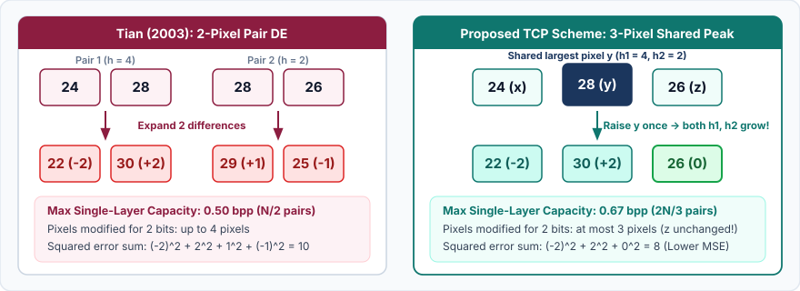
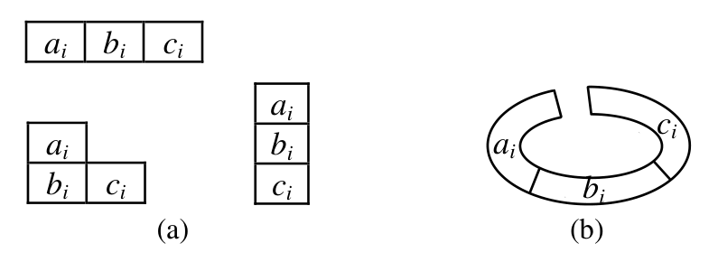
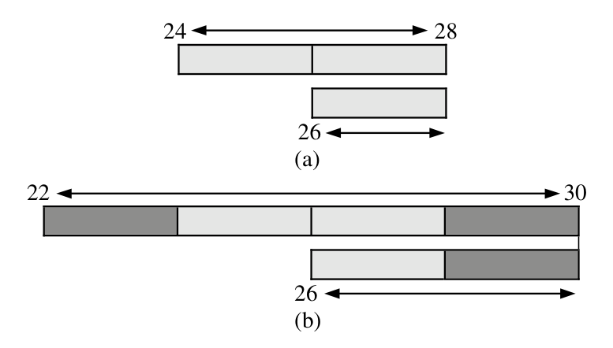
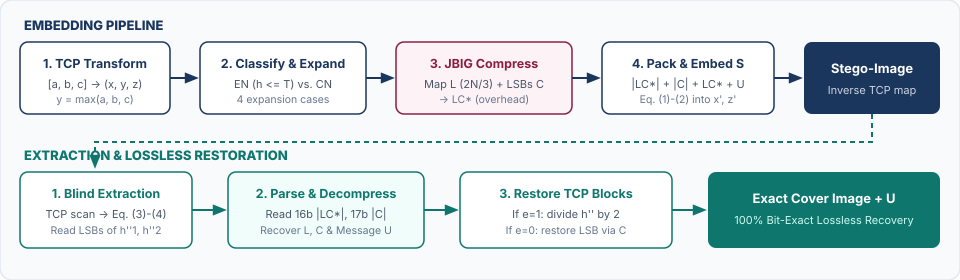
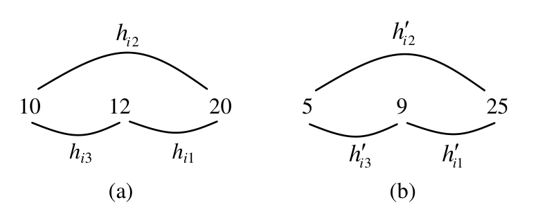
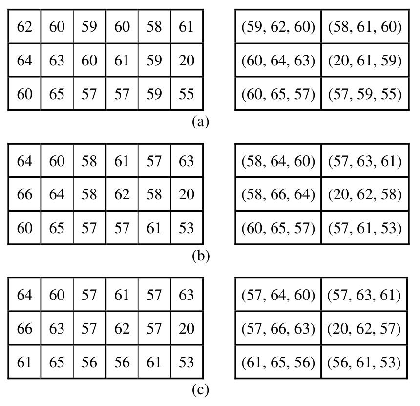
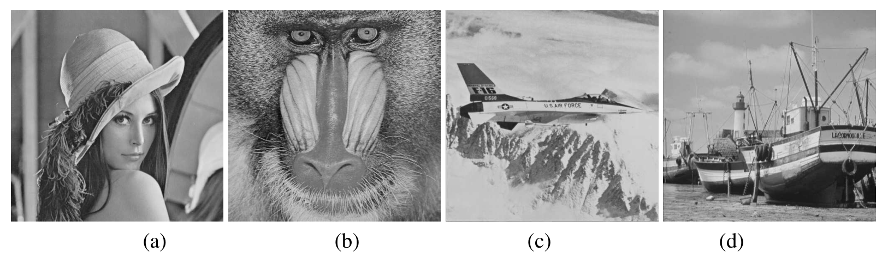
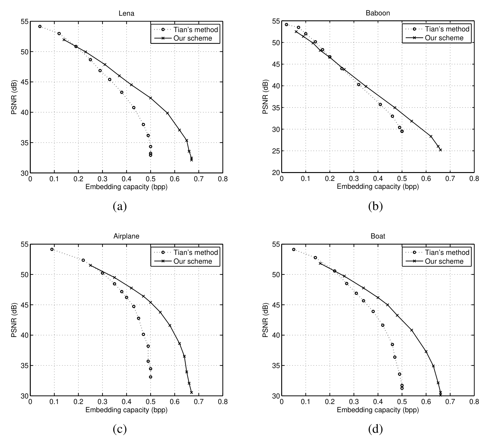

<!-- _class: lead -->

Fundamenta Informaticae · IOS Press · 2009

# Reversible Data Hiding Based on Three-Circular-Pixel Difference Expansion

Expanding two pixel differences simultaneously via a shared largest central pixel in 3-pixel circular blocks to boost single-layer capacity to <strong>0.67 bpp</strong> while reducing image distortion

<strong>Ching-Chiuan Lin*</strong> · Dept. of Information Management, Overseas Chinese Institute of Technology · <code>cclin@ocit.edu.tw</code> 
<strong>Shun-Ping Yang</strong> · Dept. of Information Technology, Overseas Chinese Institute of Technology · <code>ysp@ocit.edu.tw</code> 
<strong>Nien-Lin Hsueh</strong> · Dept. of Information Engineering and Computer Science, Feng Chia University · <code>nlhsueh@fcu.edu.tw</code>

<!--
Bibliographic & Research Overview:
This paper (Lin, Yang, & Hsueh; Fundamenta Informaticae, IOS Press, preprint dated 2008 / published 2009, pp. 1–15) presents a spatial-domain reversible data hiding (RDH) scheme based on three-circular-pixel (TCP) difference expansion.

Core Innovation:
In J. Tian's seminal 2003 Difference Expansion (DE) algorithm, an image is partitioned into non-overlapping 2-pixel pairs, capping single-layer capacity at 0.50 bits per pixel (bpp) and modifying up to four pixels to expand two differences. By grouping pixels into 3-pixel circular blocks and selecting the largest pixel as the shared central anchor, raising the central pixel expands two differences simultaneously—between the largest and smallest pixels, and between the largest and middle pixels. This increases the number of embeddable pixel pairs from N/2 to floor(2N/3) (up to 0.67 bpp per layer) while modifying at most three pixels instead of four, yielding lower mean square error (MSE) and higher PSNR across standard 512x512 benchmark images.
-->

---

## Outline

1

<a href="#3">Motivation &amp; DE Background</a> Reversible watermarking needs, prior RDH families, and Tian's 2-pixel DE bottlenecks.

2

<a href="#5">TCP Block &amp; Dual Expansion</a> Circular block transformation, shared largest pixel anchor, and MSE reduction.

3

<a href="#6">Proposed TCP Scheme</a> Architecture, expandability rules, 4-case embedding, symmetry, and threshold <code>T ≥ 1</code>.

4

<a href="#9">Extraction &amp; Walkthrough</a> Blind LSB extraction, JBIG location-map decoding, and complete 3×6 image trace.

5

<a href="#11">Experimental Results</a> 512×512 benchmarks, PSNR vs. capacity against Tian, and threshold <code>T</code> trade-offs.

6

<a href="#14">Conclusions</a> Synthesis of capacity, visual quality, and lossless reversibility guarantees.

<!--
Structural Map of the Paper:
- Section 1 (Introduction, pp. 2–3): Motivates lossless cover-image restoration in sensitive domains (such as medical diagnosis) and surveys four RDH paradigms: LSB compression (Fridrich et al.), generalized LSB quantization residual compression (Celik et al.), difference expansion (Tian and derivatives), and histogram shifting (Ni et al., Lin et al.).
- Section 2 (Difference Expansion, p. 3): Reviews Tian's 2003 integer difference expansion and its overflow/location-map constraint.
- Section 3 (The Proposed Scheme, pp. 3–11): Introduces TCP block transformation (3.1), formal embedding algorithm and central-pixel symmetry (3.2), blind extraction and threshold restriction 1 <= T <= 127 (3.3), and a worked 3x6 image walkthrough (3.4).
- Section 4 (Experimental Results, pp. 11–14): Evaluates the Java implementation on Lena, Baboon, Airplane, and Boat against Tian's method, plus JBIG compression ratios across T = 1..127 (Table 1).
- Section 5 (Conclusions, pp. 13–14): Summarizes the dual-difference expansion principle and lossless recovery mechanism.
-->

---

## 1. Motivation & Reversible Data Hiding Landscape

<h3>Why Reversibility Matters</h3>
<ul class="small-text">
<li><strong>Zero-Tolerance Domains</strong>: In medical diagnosis or military imagery, even subtle permanent watermark distortion can cause incorrect diagnosis and is unacceptable.</li>
<li><strong>Core Technical Challenge</strong>: Identify redundant host space that does <em>not</em> overlap image semantics, maximizing both <strong>embedding capacity (bpp)</strong> and <strong>visual quality (PSNR)</strong>.</li>
</ul>

<h3>Proposed TCP Breakthrough</h3>
<ul class="small-text">
<li>Partition the image into non-overlapping <strong>3-pixel blocks</strong> transformed into <strong>Three-Circular-Pixel (TCP)</strong> blocks.</li>
<li>Raising the <strong>largest pixel</strong> expands <strong>two differences at once</strong> (largest–smallest and largest–middle).</li>
<li>Increases embeddable pairs to <strong>2/3 of total pixels</strong> (0.67 bpp/layer) with fewer modified pixels.</li>
</ul>

| RDH Paradigm | Representative Works | Core Redundancy Mechanism | Main Limitation |
|---|---|---|---|
| **LSB Compression** | Fridrich et al. (2001, 2002) | Losslessly compress bit-planes (LSB) | Capacity strictly bounded by compression ratio |
| **Generalized LSB** | Celik et al. (2005) | Quantize `Qx = q × ⌊x/q⌋`, compress residual `r` | Depends heavily on residual compressibility |
| **Histogram Shifting** | Ni et al. (2006); Lin et al. (2008) | Shift bins between peak `M` and zero `m` | Low single-pass capacity if peak `M` is small |
| **Difference Expansion** | Tian (2003); Alattar (2004); Thodi & Rodriguez (2007) | Double pixel difference `h' = 2h` to free LSB | 2-pixel pairs cap single layer at 0.50 bpp; higher MSE |

<!--
Theoretical Context & Prior Art (Section 1):
Reversible (lossless) data hiding requires exact bit-for-bit restoration of the original host image after secret message extraction.
1. Fridrich et al. [1, 2] compress the least significant bit (LSB) planes losslessly to create space; payload depends entirely on spatial compressibility.
2. Celik et al. [3] generalize this by quantizing each pixel x to Qx = q * floor(x/q), compressing the residual r = x mod q, converting compressed residual + payload into q-ary symbols s_i, and embedding via Qs = Qx + s_i (extracted via s_i = Qs mod q).
3. Ni et al. [12] shift pixel values between a histogram peak M and minimum point m by 1, then embed 0/1 at M. Because raw pixel histograms rarely have very high peaks, Lin et al. [13] improved this by shifting differences in non-overlapping 2-pixel blocks.
4. Tian [4] pioneered Difference Expansion (DE) in 2003, inspiring prediction-based variants such as Chang & Lu [6] (difference from average of preceding pixels) and Thodi & Rodriguez [7] (prediction-error expansion). The TCP scheme directly generalizes Tian's spatial pair expansion to 3-pixel circular blocks with a shared peak pixel.
-->

---

## 1.2 Tian's Difference Expansion (DE) & Its Bottlenecks

<h3>Tian's 2-Pixel DE Example</h3>

Given <code>(x, y) = (30, 33)</code>, difference <code>h = -3</code> expands to <code>h' = -6</code> via <code>x' = 30 + ⌊-3/2⌋ = 28</code>, <code>y' = 33 - ⌊(-3+1)/2⌋ = 34</code>. Embed bit <code>b</code> via <code>x'' = x' + b</code>; extract <code>b = |x'' - y'| mod 2</code> and restore <code>h = ⌊(x'' - y')/2⌋</code>.

<h3>Two Key Bottlenecks of 2-Pixel DE</h3>
<ul class="small-text">
<li><strong>0.50 bpp Capacity Ceiling</strong>: Pairing pixels into disjoint 2-pixel blocks yields only <code>⌊N/2⌋</code> pairs per layer.</li>
<li><strong>4-Pixel Modification Cost</strong>: Expanding two differences modifies up to 4 pixels, inflating MSE and requiring a compressed <code>⌊N/2⌋</code>-bit location map for overflow (e.g., <code>x=235, y=250</code>).</li>
</ul>

<!--
Detailed Analysis of Tian's DE (Section 2):
In Tian's DE [4], expanding the difference h = x - y between two pixels doubles it to h' = 2h, guaranteeing an even integer whose LSB is 0. Embedding a message bit b in {0, 1} sets x'' = x' + b.
During extraction, the decoder recovers b = |x'' - y'| mod 2 and h = floor((x'' - y')/2), then restores:
- x = x'' - b - floor(h/2) = 30
- y = y' + floor((h + 1)/2) = 33.

Overflow & Location Map:
For extreme pixel pairs such as (235, 250), expanding h = -15 would push y' beyond 255 (over-saturation). Thus, Tian requires a binary location map of size floor(N/2) bits indicating which pairs were expanded, losslessly compressed before embedding.

Why TCP Improves on Both Axes:
In the worked comparison (24, 28) and (28, 26), Tian expands them independently into (22, 30) and (29, 25)—modifying all 4 pixels with squared error (-2)^2 + 2^2 + 1^2 + (-1)^2 = 10. TCP treats (24, 28, 26) as one 3-pixel block sharing central peak 28, expanding it to (22, 30, 26)—leaving pixel 26 untouched with squared error (-2)^2 + 2^2 + 0^2 = 8.
-->

---

## 2. TCP Block Transformation & Dual Difference Expansion

Fig. 1. Transformation from raw blocks <code>[ai, bi, ci]</code> to a TCP block.

<h3>Circular Ordering &amp; Tie-Breaking</h3>
<ul class="small-text">
<li>Raw block <code>[ai, bi, ci]</code> is cyclically rotated into <code>(xi, yi, zi)</code> so that <code>yi ≥ xi</code> and <code>yi ≥ zi</code>.</li>
<li><code>xi</code> is logically left of <code>yi</code>; <code>zi</code> is logically right.</li>
<li><strong>Example</strong>: <code>[18, 15, 26]</code>, <code>[15, 26, 18]</code>, <code>[26, 18, 15]</code> all map to TCP <code>(15, 26, 18)</code>.</li>
<li><strong>Boundary tie</strong>: If two maxima tie (<code>[26', 20, 26]</code>), the earlier-visited pixel becomes <code>yi</code> ➔ <code>(26, 26', 20)</code>.</li>
</ul>

Fig. 2. Dual expansion of <code>(24, 28, 26)</code> ➔ <code>(22, 30, 26)</code>.

<h3>Worked Dual Expansion &amp; Embedding</h3>
<ul class="small-text">
<li><code>hi1 = 28 - 24 = 4</code>, <code>hi2 = 28 - 26 = 2</code> (<code>hi1 ≥ hi2</code>).</li>
<li>Expand: <code>x'i = 24 - ⌊4/2⌋ = 22</code>, <code>y'i = 28 + ⌊5/2⌋ = 30</code>, <code>z'i = 30 - 2×2 = 26</code> (unchanged!).</li>
<li>Embed <code>b1=0, b2=1</code> ➔ <code>(22, 30, 25)</code>; decode <code>h''i1=8, h''i2=5</code> ➔ <code>b1=0, b2=1</code> and exact recovery <code>(24, 28, 26)</code>.</li>
</ul>

<!--
TCP Block Definition & Dual Expansion Mechanics (Sections 3 & 3.1):
A raw 3-pixel block [a_i, b_i, c_i] (scanned left-to-right, top-to-bottom) can take 1x3, 3x1, or L-shaped layouts (Fig. 1a). Arranging its three pixels on a directed circle (Fig. 1b) preserves cyclic adjacency while letting the largest pixel y_i act as the logical center, flanked by x_i (logically left) and z_i (logically right).

Tie-Breaking Rule for Exact Reversibility:
When y_i = x_i or y_i = z_i, the pixel visited earlier in scan order is uniquely designated as y_i (e.g., [26', 20, 26] maps to (26, 26', 20)). This deterministic canonicalization ensures both encoder and decoder construct identical TCP tuples.

Worked Numerical Verification (Section 3.1):
For (24, 28, 26), h_i1 = 4 >= h_i2 = 2. Expanding h_i1 symmetrically moves x_i down by floor(4/2)=2 to 22 and y_i up by floor(5/2)=2 to 30. Then z'_i = y'_i - 2*h_i2 = 30 - 4 = 26 remains completely unmodified!
Embedding b_1 = 0, b_2 = 1 subtracts b_1 from x'_i and b_2 from z'_i to produce (22, 30, 25).
At the receiver: h''_i1 = 30 - 22 = 8 (LSB 0), h''_i2 = 30 - 25 = 5 (LSB 1); original differences h_i1 = floor(8/2) = 4, h_i2 = floor(5/2) = 2; restored pixels x_i = 22 + 2 + 0 = 24, y_i = 30 - 2 = 28, z_i = 28 - 2 = 26.
Note also the paper's additional MSE examples: (24, 28, 23) -> (23, 31, 21), (24, 28, 25) -> (22, 30, 24), and (24, 28, 24) -> (22, 30, 22)—all achieving lower MSE than two separate Tian pairs.
-->

---

## 3. Proposed Scheme: End-to-End Architecture & Expandability

<h3>Expandability Conditions (No Overflow/Underflow)</h3>
<ul class="small-text">
<li><code>hi1 = yi - xi</code> is <strong>expandable</strong> if: (1) <code>hi1 ≥ hi2</code>, <code>yi + ⌊(hi1+1)/2⌋ ≤ 255</code>, and <code>xi - ⌊hi1/2⌋ - 1 ≥ 0</code>; OR (2) <code>hi2 > hi1</code> and <code>hi2</code> is expandable; OR (3) <code>hi2</code> is not expandable and condition (1)'s bounds hold.</li>
<li><strong>Key Lemma</strong>: If the larger difference is expandable, the smaller difference is <em>automatically</em> expandable (since <code>xi ≤ zi</code> when <code>hi1 ≥ hi2</code>).</li>
</ul>

<h3>Changeability &amp; Set Partitioning</h3>
<ul class="small-text">
<li><code>hi1</code> is <strong>changeable</strong> if <code>(yi - xi) mod 2 = 1</code> or <code>xi > 0</code> (symmetrically for <code>hi2</code> with <code>zi</code>).</li>
<li>Every expandable difference is also changeable.</li>
<li>Threshold <code>1 ≤ T ≤ 127</code> partitions differences into:
  <ul>
    <li><code>EN</code>: all expandable differences with <code>h ≤ T</code></li>
    <li><code>CN</code>: all changeable differences with <code>h ∉ EN</code></li>
  </ul>
</li>
</ul>

<!--
Formal Expandability & Changeability Theory (Section 3.2):
For an 8-bit grayscale block [a_i, b_i, c_i] in [0, 255], expanding a difference and then subtracting a message bit b in {0, 1} must never cause underflow (< 0) or overflow (> 255).
The `- 1` term in `x_i - floor(h_i1/2) - 1 >= 0` explicitly reserves headroom for embedding b_1 = 1 after expansion.

Crucial Structural Property:
Suppose h_i1 >= h_i2, which implies x_i <= z_i. If h_i1 is expandable, then y'_i <= 255 and x'_i - 1 >= 0. Because z'_i = y'_i - 2*h_i2 >= y'_i - 2*h_i1 = x'_i, we automatically have z'_i - 1 >= x'_i - 1 >= 0. Therefore, expandability of the larger difference guarantees expandability of the smaller difference in the same TCP block!

Why Changeability Requires `(y_i - x_i) mod 2 = 1` or `x_i > 0`:
To replace the LSB of a non-expanded difference h'_i1 without exceeding [0, 255]: if h'_i1 is odd, flipping its LSB to 0 adds 1 to x'_i (safe since x'_i < y'_i <= 255). If h'_i1 is even, flipping its LSB to 1 subtracts 1 from x'_i, which is only safe if x'_i > 0. Hence an unchangeable difference occurs solely when h'_i1 is even AND x'_i = 0.
-->

---

## 3.2 Embedding Process: 4 Cases & Bitstream Packing

<h3>Step 2: Pixel Adjustment (4 Cases per Block)</h3>

| Case | Condition | Adjusted TCP Block <code>(x'i, y'i, z'i)</code> |
|---|---|---|
| **2.1a** | `h_i1, h_i2 ∈ EN`, `h_i1 ≥ h_i2` | `x_i - ⌊h_i1/2⌋`, `y_i + ⌊(h_i1+1)/2⌋`, `y'_i - 2h_i2` |
| **2.1b** | `h_i1, h_i2 ∈ EN`, `h_i1 < h_i2` | `y'_i - 2h_i1`, `y_i + ⌊(h_i2+1)/2⌋`, `z_i - ⌊h_i2/2⌋` |
| **2.2** | `h_i1 ∈ EN`, `h_i2 ∉ EN` | `x_i - ⌊h_i1/2⌋`, `y_i + ⌊(h_i1+1)/2⌋`, `z_i` |
| **2.3** | `h_i1 ∉ EN`, `h_i2 ∈ EN` | `x_i`, `y_i + ⌊(h_i2+1)/2⌋`, `z_i - ⌊h_i2/2⌋` |
| **2.4** | `h_i1 ∉ EN`, `h_i2 ∉ EN` | `x_i`, `y_i`, `z_i` (unchanged) |

<strong>Location Map <code>L</code> &amp; Control Bits <code>C</code></strong>: <code>L</code> has fixed length <code>⌊2N/3⌋</code> bits (<code>e2i = 1</code> iff <code>hi1 ∈ EN</code>; <code>e2i+1 = 1</code> iff <code>hi2 ∈ EN</code>). <code>C</code> stores original LSBs of all changeable differences in <code>CN</code>.

<h3>Steps 5–8: Compression &amp; Blind LSB Embedding</h3>
<ol class="small-text">
<li><strong>Compress Overhead</strong>: Losslessly compress <code>L</code> and <code>C</code> via JBIG into <code>LC*</code>.</li>
<li><strong>Assemble Bitstream</strong>: <code>S = |LC*| ⊕ |C| ⊕ LC* ⊕ U</code> (16 bits for <code>|LC*|</code>, 17 bits for <code>|C|</code>, plus user payload <code>U</code>).</li>
<li><strong>Embed into Changeable Pairs</strong> (Eqs. 1–2):</li>
</ol>

x''i = x'i + 1 - bi1 &nbsp; if h'i1 mod 2 = 1 
x''i = x'i - bi1 &nbsp;&nbsp;&nbsp;&nbsp;&nbsp; if h'i1 mod 2 = 0 and x'i &gt; 0 
x''i = x'i &nbsp;&nbsp;&nbsp;&nbsp;&nbsp;&nbsp;&nbsp;&nbsp;&nbsp;&nbsp;&nbsp; otherwise (unchangeable)

Symmetrically for <code>z''i</code> using bit <code>b</code> (where <code>b = bi1</code> if <code>h'i1</code> is unchangeable, else <code>b = bi2</code>). Finally, inverse-map <code>(x''i, y'i, z''i)</code> to stego-block <code>[a'i, b'i, c'i]</code>.

<!--
Complete 8-Step Embedding Algorithm (Section 3.2):
1. Partition the N-pixel cover image into non-overlapping 3-pixel blocks and transform each block i into TCP form (x_i, y_i, z_i).
2. Classify each difference into EN (expandable with h <= T) or CN (changeable and not in EN), and expand pixels according to the four mutually exclusive cases (2.1 through 2.4).
3. Populate location map L of fixed size floor(2N/3) bits: e_{2i} = 1 if h_i1 in EN (else 0), e_{2i+1} = 1 if h_i2 in EN (else 0).
4. Compute post-expansion differences h'_i1 = y'_i - x'_i and h'_i2 = y'_i - z'_i. Collect the original LSBs of all changeable differences belonging to CN into list C.
5. Losslessly compress L and C together using JBIG to produce LC*. Because |L| = floor(2N/3) is known to the decoder from the image dimensions, only |LC*| (16 bits) and |C| (17 bits) need to be stored in the header.
6. Concatenate S = |LC*| || |C| || LC* || U.
7. Blindly replace the LSBs of all changeable differences (both expanded EN and non-expanded CN) using Equations (1) and (2). Notice that if h'_i1 is even (as for every expanded difference), x''_i = x'_i - b_i1 increases the difference by b_i1; if h'_i1 is odd (a CN difference), x''_i = x'_i + 1 - b_i1 leaves x'_i unchanged when b_i1 = 1 and increments x'_i by 1 when b_i1 = 0, setting the new difference's LSB directly to b_i1.
8. Inverse-rotate each stego TCP block (x''_i, y'_i, z''_i) back into its raw spatial order [a'_i, b'_i, c'_i].
-->

---

## 3.3 Central-Pixel Symmetry & Threshold `T ≥ 1` Constraint

Fig. 3. Selecting the smallest pixel (10) vs. largest pixel (20) yields identical expanded block <code>[5, 9, 25]</code>.

<h3>Duality of Largest vs. Smallest Anchor</h3>

For <code>[10, 12, 20]</code>, <code>hi2 = hi1 + hi3 = 8 + 2 = 10</code>. Expanding <code>hi2</code> to <code>20</code> automatically scales both <code>hi1 ➔ 16</code> and <code>hi3 ➔ 4</code>, producing <code>[5, 9, 25]</code> regardless of whether 20 (largest) or 10 (smallest) is chosen as center.

<h3>Why <code>T = 0</code> Is Strictly Forbidden</h3>

The threshold must satisfy <strong><code>1 ≤ T ≤ 127</code></strong>. If <code>T = 0</code> were allowed, embedding into a non-expanded block could alter which pixel is the largest, breaking TCP canonicalization at the decoder!

<h3>Counterexample When <code>T = 0</code></h3>
<ul class="small-text">
<li>Original raw block: <code>[ai, bi, ci] = [29, 29, 30]</code> ➔ TCP <code>(29, 30, 29)</code> with <code>hi1 = 1, hi2 = 1 ∈ CN</code>.</li>
<li>Embed bits <strong>"10"</strong> via Eqs. (1)–(2) ➔ <code>(29, 30, 30)</code>, i.e., raw stego-block <code>[30, 29, 30]</code>.</li>
<li><strong>Decoder failure</strong>: Earlier-visited <code>30</code> (first pixel) is now chosen as <code>y'i</code> ➔ TCP <code>(30, 30, 29)</code> ➔ extracts <strong>"01" ≠ "10"</strong>!</li>
<li>Requiring <code>T ≥ 1</code> ensures all <code>h = 1</code> expandable blocks are expanded to <code>h' = 2</code>, preventing tie collisions.</li>
</ul>

<!--
Mathematical Properties & Edge-Case Rigor (Sections 3.2 & 3.3):
1. Central-Pixel Symmetry (Fig. 3, pp. 7–8):
Given raw block [10, 12, 20], the largest-pixel TCP representation is (12, 20, 10) with h_i1 = 8, h_i2 = 10. Expanding gives h'_i1 = 16, h'_i2 = 20 and (x'_i, y'_i, z'_i) = (9, 25, 5), which maps back to [5, 9, 25].
If instead the smallest pixel (10) is chosen as the central anchor, the differences are h_i2 = 20 - 10 = 10 and h_i3 = 12 - 10 = 2. Because h_i2 = h_i1 + h_i3, doubling h_i2 = 20 = 2*h_i1 + 2*h_i3 yields h'_i3 = 4 and the exact same raw expanded block [5, 9, 25]. Thus, choosing the largest pixel is without loss of generality.

2. Proof of the 1 <= T <= 127 Constraint (Section 3.3, p. 10):
If T = 0, then differences of h = 1 are NOT expanded (they stay in CN). When a block [29, 29, 30] has two differences of 1 and embeds bits "10", Eq. (2) adds 1 to z'_i = 29 (since h'_i2 = 1 is odd and b_2 = 0), turning z''_i into 30. Now a'_i = 30 ties with c'_i = 30, and because a'_i is visited before c'_i, the decoder's tie-breaking rule selects a'_i as y'_i instead of c'_i, rotating the TCP tuple to (30, 30, 29) and inverting the extracted bits to "01". Enforcing T >= 1 eliminates this ambiguity.
-->

---

## 3.4 Blind Extraction & Lossless Restoration Process

<h3>Steps 1–5: Blind Bitstream Extraction</h3>
<ol class="small-text">
<li>Divide stego-image into 3-pixel blocks in identical scan order and transform each into stego TCP block <code>(x''i, y'i, z''i)</code>.</li>
<li>Compute <code>h''i1 = y'i - x''i</code> and <code>h''i2 = y'i - z''i</code>.</li>
<li>Extract bits blindly via Equations (3)–(4):</li>
</ol>

bi1 = 1 &nbsp;&nbsp;&nbsp;&nbsp;&nbsp;&nbsp;&nbsp; if h''i1 mod 2 = 1 
bi1 = 0 &nbsp;&nbsp;&nbsp;&nbsp;&nbsp;&nbsp;&nbsp; if h''i1 mod 2 = 0 and x''i &gt; 0 
bi1 = nothing &nbsp; otherwise (and likewise for bi2, z''i)

<ol start="4" class="small-text">
<li>Concatenate bits into <code>S</code>; parse <code>|LC*|</code> (16b) and <code>|C|</code> (17b); decompress <code>LC*</code> into <code>L</code> (<code>⌊2N/3⌋</code> bits) and <code>C</code>; recover secret message <code>U</code>.</li>
</ol>

<h3>Step 6: Exact Pixel Restoration via <code>L</code> &amp; <code>C</code></h3>

Compute <code>hi1 = ⌊(y'i - x''i)/2⌋</code> and <code>hi2 = ⌊(y'i - z''i)/2⌋</code>, then restore:

| Location Bits | Restoration Formula |
|---|---|
| `e_2i=1, e_2i+1=1` (`h_i1 ≥ h_i2`) | `x_i = x''_i + ⌊h_i1/2⌋ + b_i1` `y_i = y'_i - ⌊(h_i1+1)/2⌋`, `z_i = y_i - h_i2` |
| `e_2i=1, e_2i+1=1` (`h_i1 < h_i2`) | `y_i = y'_i - ⌊(h_i2+1)/2⌋`, `x_i = y_i - h_i1` `z_i = z''_i + ⌊h_i2/2⌋ + b_i2` |
| `e_2i=1, e_2i+1=0` | Restore `x_i, y_i` as above; restore `z_i` via `c_2i+1` (`±1` if `c ≠ b_i2`) |
| `e_2i=0, e_2i+1=1` | Restore `y_i, z_i` as above; restore `x_i` via `c_2i` (`±1` if `c ≠ b_i1`) |
| `e_2i=0, e_2i+1=0` | `y_i = y'_i`; restore `x_i, z_i` via control bits `c_2i, c_2i+1` |

<!--
Lossless Decoding & Restoration Mechanics (Section 3.3, pp. 8–10):
A major strength of the TCP scheme is that extraction of the raw bitstream S is completely blind to which differences were expanded vs. merely changeable: every expanded difference (EN) is guaranteed to be changeable in the stego-image.
Once S is assembled, the decoder reads the fixed-width length headers |LC*| and |C|, extracts LC*, and invokes the JBIG decoder to recover:
- L: the exact location map of length floor(2N/3) bits, distinguishing expanded pairs (e = 1) from non-expanded pairs (e = 0).
- C: the exact original LSBs of all changeable differences in CN.

In Step 6, the restoration is driven by the pair with the larger difference:
- When both pairs were expanded (Case 6.1), the larger difference restores the largest pixel y_i and the smallest pixel (x_i or z_i) first; once y_i is known, the remaining middle pixel is recovered immediately by subtracting the halved smaller difference (z_i = y_i - h_i2 or x_i = y_i - h_i1).
- For any non-expanded changeable difference (Cases 6.2–6.4), comparing the original control bit c with the extracted bit b tells whether the pixel was shifted by +1 (if c = 1, b = 0 -> subtract 1), -1 (if c = 0, b = 1 -> add 1), or unchanged (c = b). Thus, the host image is recovered with 0 bit error.
-->

---

## 3.5 Complete 3×6 Image Walkthrough (`T = 4`)

Fig. 4. (a) Original 3×6 image; (b) Expanded differences; (c) Stego-image.

<h3>1. Embedding Trace (6 Blocks, <code>T = 4</code>)</h3>
<ul class="small-text">
<li><strong>Block 0</strong>: <code>[62, 60, 59]</code> ➔ TCP <code>(59, 62, 60)</code>, <code>h01=3, h02=2 ≤ 4</code> ➔ expands to <code>(58, 64, 60)</code>.</li>
<li><strong>Non-expandable pairs</strong>: Block 3's first pair <code>(20, 62, 58)</code> (<code>h=42</code>) and both pairs of Block 4 <code>(60, 65, 57)</code> (<code>h=5, 8</code>).</li>
<li><strong>Overhead</strong>: <code>L = (111111010011)2</code>, <code>C = (010)2</code> ➔ compressed <code>LC* = (0101)2</code>.</li>
<li><strong>Bitstream</strong>: <code>S = (100, 011, 0101, 10)2</code> (<code>|LC*|=4</code>, <code>|C|=3</code>, <code>U=10</code>) embedded into 12 changeable pairs ➔ Fig. 4(c).</li>
</ul>

<h3>2. Extraction &amp; Restoration Trace</h3>
<ul class="small-text">
<li>From stego Block 0 <code>(57, 64, 60)</code>: <code>(64-57) mod 2 = 1</code>, <code>(64-60) mod 2 = 0</code> ➔ extracts <strong>"10"</strong>.</li>
<li>Decompress <code>LC*</code> ➔ recovers <code>L</code>, <code>C</code>, and message <code>U = (10)2</code>.</li>
<li>Restore Block 0 (<code>e0=e1=1</code>, <code>h01=3 ≥ h02=2</code>): <code>x0 = 57+⌊3/2⌋+1 = 59</code>, <code>y0 = 64-⌊4/2⌋ = 62</code>, <code>z0 = 62-2 = 60</code> ➔ <code>[62, 60, 59]</code>.</li>
</ul>

<!--
Step-by-Step Numerical Trace (Section 3.4, pp. 10–11):
Figure 4 demonstrates the full lifecycle on a 3-row x 6-column image (18 pixels = 6 three-pixel blocks, 12 pixel pairs) with threshold T = 4:
- Block 0: [62, 60, 59] -> TCP (59, 62, 60) -> expanded (58, 64, 60) -> embeds "10" -> stego (57, 64, 60) -> raw [64, 60, 57].
- Block 1: [60, 58, 61] -> TCP (58, 61, 60) -> expanded (57, 63, 61) -> embeds "00" -> stego (57, 63, 61) -> raw [61, 57, 63].
- Block 2: [64, 63, 60] -> TCP (60, 64, 63) -> expanded (58, 66, 64) -> embeds "11" -> stego (57, 66, 63) -> raw [66, 63, 57].
- Block 3: [61, 59, 20] -> TCP (20, 61, 59): h_31 = 41 > 4 (CN, e_6 = 0), h_32 = 2 <= 4 (EN, e_7 = 1) -> expanded (20, 62, 58) -> embeds "01" -> stego (20, 62, 57) -> raw [62, 57, 20]. Note that h'_31 = 62 - 20 = 42 (even, LSB = 0 saved in C).
- Block 4: [60, 65, 57] -> TCP (60, 65, 57): h_41 = 5 > 4, h_42 = 8 > 4 (both CN, e_8 = e_9 = 0; LSBs 1, 0 saved in C) -> embeds "01" -> stego (61, 65, 56).
- Block 5: [57, 59, 55] -> TCP (57, 59, 55) -> expanded (57, 61, 53) -> embeds "10" -> stego (56, 61, 53).

All 12 bits of S = (100 011 0101 10)_2 are embedded, extracted blindly, and every pixel is restored bit-for-bit to Fig. 4(a).
-->

---

## 4. Experimental Setup & Benchmark Dataset

Fig. 5. Standard 512×512 (8-bit grayscale) test images: (a) Lena; (b) Baboon; (c) Airplane; (d) Boat.

<h3>Implementation &amp; Protocol</h3>
<ul class="small-text">
<li><strong>Platform</strong>: Both the proposed TCP scheme and Tian's DE baseline [4] implemented in <strong>Java</strong> on Windows.</li>
<li><strong>Image Size</strong>: <code>512 × 512</code> (<code>N = 262,144</code> pixels, 8 bits/pixel) ➔ <code>⌊2N/3⌋ = 174,762</code> pixel pairs per layer.</li>
<li><strong>Payload &amp; Compression</strong>: Random bitstream <code>U</code> via <code>⌊Math.random() + 0.5⌋</code>; <code>L</code> and <code>C</code> compressed by <strong>JBIG</strong>; 16 bits for <code>|LC*|</code> and 17 bits for <code>|C|</code>.</li>
</ul>

<h3>Quality &amp; Capacity Metrics</h3>

MSE = (1 / N) × Σi=0..N-1 (xi - x''i)2 
PSNR = 10 × log10(2552 / MSE) dB

<ul class="small-text">
<li><strong>Single-Layer Ceiling</strong>: Up to <strong>0.67 bpp</strong> (vs. 0.50 bpp in Tian's method).</li>
<li><strong>Capacity Metric</strong>: Measured over expandable pairs <code>|E|</code> in <code>EN</code>, sweeping threshold <code>T ∈ [1, 127]</code>.</li>
</ul>

<!--
Experimental Methodology (Section 4, pp. 11–12):
To ensure a strictly controlled comparison, the authors implemented both the proposed TCP scheme and Tian's 2003 DE method in Java on the same Windows machine and evaluated them on four canonical 512x512 8-bit grayscale images spanning smooth to highly textured content:
- Lena (smooth portraits + moderate edges)
- Baboon (highly textured fur/whiskers—stress test for difference expansion)
- Airplane (large smooth sky/fuselage regions)
- Boat (mixed smooth water and fine mast details)

Overhead Encoding Details:
For N = 262,144 pixels, the location map L has a constant size of floor(2 * 262,144 / 3) = 174,762 bits, so |L| does not need to be transmitted. Only |LC*| (16 bits) and |C| (17 bits)—33 bits of fixed header—are prepended to LC* and the random user payload U. Both L and C are jointly compressed with JBIG before embedding.
-->

---

## 4.2 Visual Quality vs. Embedding Capacity (TCP vs. Tian)

Fig. 6. PSNR (dB) vs. embedding capacity (bpp) for (a) Lena, (b) Baboon, (c) Airplane, and (d) Boat.

Up to 0.67 bpp

Single-layer embedding capacity (33% higher ceiling than Tian's 0.50 bpp limit).

Higher PSNR at Every Capacity

TCP strictly dominates Tian's rate-distortion curve across all four benchmark images.

<h3>Key Empirical Findings</h3>
<ul class="small-text">
<li><strong>Smooth Images (Lena, Airplane, Boat)</strong>: TCP achieves ~40–52 dB at low-to-medium payloads and extends well past 0.60 bpp where Tian saturates at 0.50 bpp.</li>
<li><strong>Complex Texture (Baboon)</strong>: Even on high-frequency fur textures, TCP sustains higher PSNR and reaches ~0.65 bpp vs. Tian's ~0.48 bpp ceiling.</li>
<li><strong>Why It Wins</strong>: Sharing the central largest pixel reduces total modified pixels per 2 embedded bits from 4 to at most 3.</li>
</ul>

<!--
Rate-Distortion Comparison Analysis (Section 4, Fig. 6, pp. 12–13):
Figure 6 plots PSNR (dB) against embedding capacity (bpp) for single-layer embedding across all four 512x512 test images:
- Lena (Fig. 6a): TCP stays strictly above Tian's curve from ~0.14 bpp up to 0.666 bpp (32.13 dB at T=127), whereas Tian's curve terminates below 0.50 bpp.
- Baboon (Fig. 6b): Because Baboon has large pixel differences, PSNR drops more rapidly with capacity in both schemes; nevertheless, TCP maintains a clear PSNR advantage at equal capacity and extends total capacity beyond 0.65 bpp.
- Airplane (Fig. 6c) & Boat (Fig. 6d): Both confirm consistent gains in both visual fidelity and maximum single-layer capacity.

Note on Capacity Definition in Fig. 6:
As explicitly noted in Section 4 (p. 12), the horizontal axis of Fig. 6 plots the gross embedding space |E| offered by expandable pixel pairs in EN (normalized by N = 262,144 pixels), while Table 1 separately breaks down the JBIG-compressed overhead |LC*| to determine net user payload.
-->

---

## 4.3 Threshold `T` Trade-Off & JBIG Overhead Analysis (Lena)

<strong>Table 1 (Excerpt)</strong>: TCP performance on <code>512×512</code> Lena (<code>|L| = 174,762</code> bits):

| `T` | `\|E\|` (bits) | `\|C\|` (bits) | `\|LC*\|` (bits) | PSNR (dB) | Net Space? |
|---:|---:|---:|---:|---:|---|
| 1 | 36,820 | 137,942 | 299,336 | **51.94** | Overhead > `\|E\|` |
| 4 | 97,395 | 77,367 | 266,736 | 46.02 | Overhead > `\|E\|` |
| 7 | 129,941 | 44,821 | 189,000 | 42.35 | Overhead > `\|E\|` |
| **8** | **136,386** | **38,376** | **169,368** | **41.56** | **Net positive (`T ≥ 8`)** |
| 10 | 145,439 | 29,323 | 137,280 | 40.36 | +37,482 bits net |
| 20 | 163,575 | 11,187 | 66,296 | 37.07 | +108,466 bits net |
| 50 | 173,096 | 1,666 | 14,888 | 33.57 | +159,874 bits net |
| **127** | **174,585** | **177** | **2,512** | **32.13** | **69.6× JBIG ratio** |

<h3>JBIG Compression Dynamics</h3>
<ul class="small-text">
<li><strong>Large <code>T</code> (e.g., <code>T = 127</code>)</strong>: Nearly all pairs are expanded (<code>L</code> is mostly <code>1</code>s; <code>|C| = 177</code>). JBIG achieves a <strong>69.6×</strong> compression ratio: <code>(174,762 + 177) / 2,512 = 69.6</code>.</li>
<li><strong>Small <code>T</code> (<code>T &lt; 8</code>)</strong>: <code>L</code> is fragmented with mixed <code>0/1</code>s and <code>|C|</code> is large, causing <code>|LC*| &gt; 174,762</code> (total changeable space). Thus <strong><code>T &gt; 7</code></strong> is required on Lena to embed user payload <code>U</code>.</li>
</ul>

<h3>Honest Edge Case: High-Contrast Blocks</h3>

In rare sharp-edge blocks such as <code>(40, 80, 76)</code>, TCP expands to <code>(20, 100, 92)</code> (squared error = 1056), whereas Tian expands <code>(40, 80)</code> and <code>(80, 76)</code> to <code>(20, 100)</code> and <code>(82, 74)</code> (squared error = 808). Because natural images are predominantly smooth, such blocks are rare and overall PSNR strongly favors TCP.

<!--
Quantitative Analysis of Table 1 & Edge-Case Discussion (Sections 3.4 & 4, pp. 11–14):
Table 1 provides the exact empirical trade-off between threshold T, expandable space |E|, non-expanded changeable LSB count |C|, JBIG-compressed overhead |LC*|, and visual quality (PSNR) on 512x512 Lena (total changeable pairs |E| + |C| = 174,762):
- At T = 1..7, |LC*| exceeds 174,762 bits (e.g., 299,336 bits at T = 1 and 189,000 bits at T = 7), meaning the JBIG-compressed overhead alone exceeds the total changeable capacity of the image.
- At T = 8, |LC*| drops to 169,368 bits (< 174,762), leaving 5,394 bits (minus 33 header bits) for user payload U at 41.56 dB PSNR.
- By T = 20, net user capacity surpasses 108k bits (~0.41 bpp net) at 37.07 dB; by T = 127, |LC*| shrinks to just 2,512 bits (69.6x compression ratio), yielding >172,000 net user bits (~0.66 bpp net) at 32.13 dB.

Transparent MSE Boundary Analysis (p. 11):
When h_i1 >> h_i2 (e.g., (40, 80, 76) with h_i1 = 40, h_i2 = 4), lifting y_i by +20 forces z'_i = 100 - 8 = 92 (a +16 shift on z_i), producing higher local MSE than Tian. The authors explicitly acknowledge this case and explain why natural image smoothness keeps it statistically negligible.
-->

---

## 5. Conclusions & Key Contributions

0.67 bpp

Single-layer capacity ceiling (<code>⌊2N/3⌋</code> pairs), a <strong>33% gain</strong> over Tian's 0.50 bpp 2-pixel DE.

≤ 3 Pixels

Modified to expand two differences simultaneously via the shared largest pixel <code>yi</code>.

69.6× JBIG

Location-map + control-bit compression ratio at <code>T = 127</code> on Lena, enabling high net payload.

<h3>Methodological Contributions</h3>
<ul class="small-text">
<li><strong>TCP Block Transformation</strong>: Canonical cyclic mapping with deterministic tie-breaking and proven largest/smallest central-pixel duality.</li>
<li><strong>Guaranteed Reversibility</strong>: Restoring the larger-difference pair recovers <code>yi</code> and the smallest pixel first, then directly derives the remaining middle pixel.</li>
</ul>

<h3>Practical Takeaways</h3>
<ul class="small-text">
<li><strong>Strict Threshold Bounds</strong>: <code>1 ≤ T ≤ 127</code> prevents max-pixel ambiguity; <code>T ≥ 8</code> ensures positive net user payload on Lena under JBIG compression.</li>
<li><strong>Empirical Dominance</strong>: Outperforms Tian's DE in both PSNR and embedding capacity across smooth and textured 512×512 images.</li>
</ul>

<!--
Summary of Conclusions (Section 5, pp. 13–14):
The Three-Circular-Pixel (TCP) difference expansion scheme advances spatial-domain reversible data hiding through three coupled mechanisms:
1. Shared-Peak Dual Expansion: Increasing the largest pixel in a 3-pixel circular block expands two differences simultaneously, reducing pixel modifications per embedded bit pair and lifting single-layer capacity to 2/3 bpp.
2. Deterministic Reversibility: By enforcing 1 <= T <= 127 and restoring the larger difference first, the decoder recovers the largest and smallest pixels exactly and derives the third pixel from its halved difference without ambiguity.
3. Empirical Superiority: Across Lena, Baboon, Airplane, and Boat, TCP consistently surpasses Tian's 2003 DE baseline in both visual quality (PSNR) and embedding capacity.
-->

---

<!-- _class: closing -->

# Thank You for Your Attention!

Reversible Data Hiding Based on Three-Circular-Pixel Difference Expansion

<strong>Ching-Chiuan Lin*</strong> · <code>cclin@ocit.edu.tw</code> (Overseas Chinese Institute of Technology) 
<strong>Shun-Ping Yang</strong> · <code>ysp@ocit.edu.tw</code> (Overseas Chinese Institute of Technology) 
<strong>Nien-Lin Hsueh</strong> · <code>nlhsueh@fcu.edu.tw</code> (Feng Chia University) 
Fundamenta Informaticae · IOS Press · 2009 (pp. 1–15)

<!--
Reference & Archival Metadata:
- Title: Reversible Data Hiding Based on Three-Circular-Pixel Difference Expansion
- Authors: Ching-Chiuan Lin (corresponding author, cclin@ocit.edu.tw), Shun-Ping Yang (ysp@ocit.edu.tw), and Nien-Lin Hsueh (nlhsueh@fcu.edu.tw)
- Affiliations: The Overseas Chinese Institute of Technology (Taichung 40721, Taiwan) and Department of Information Engineering and Computer Science, Feng Chia University (Taichung 40724, Taiwan)
- Venue: Fundamenta Informaticae, IOS Press, 2009 (preprint header XX (2008) 1-15)
- Keywords: Difference expansion, information hiding, reversible data hiding, steganography
-->

