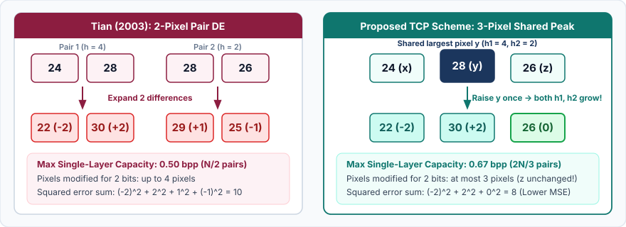
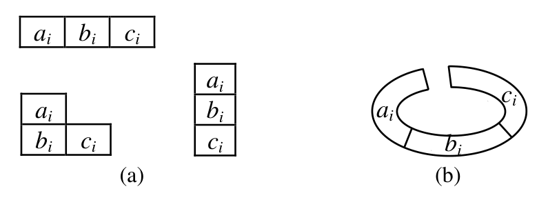
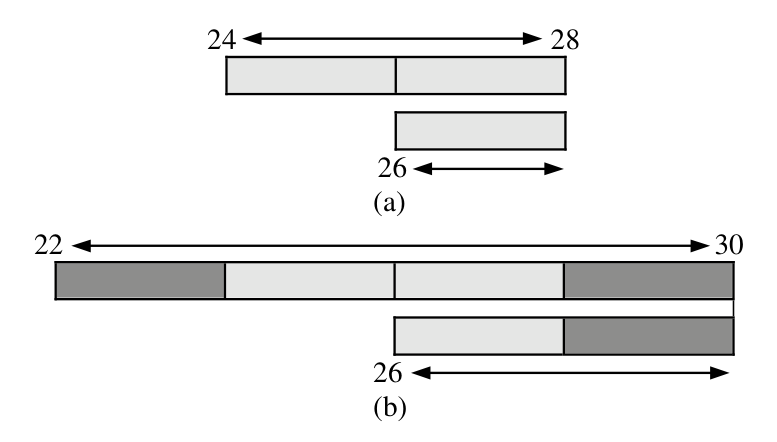
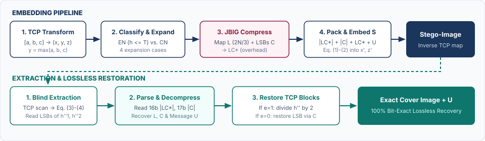
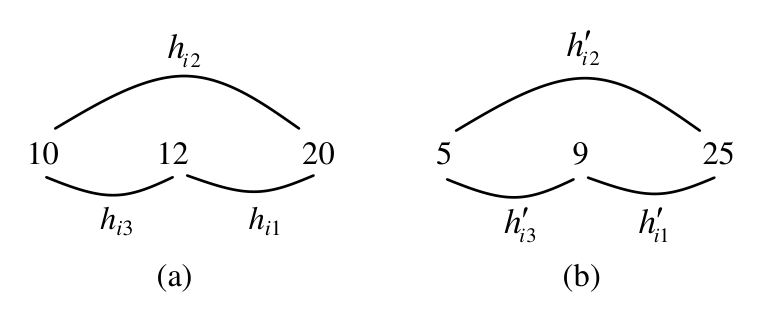
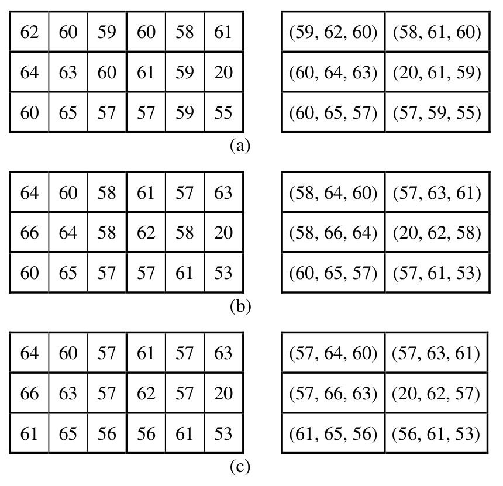
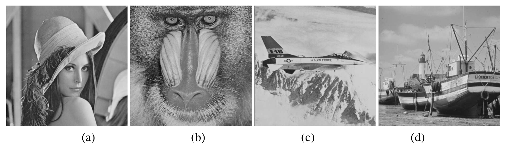
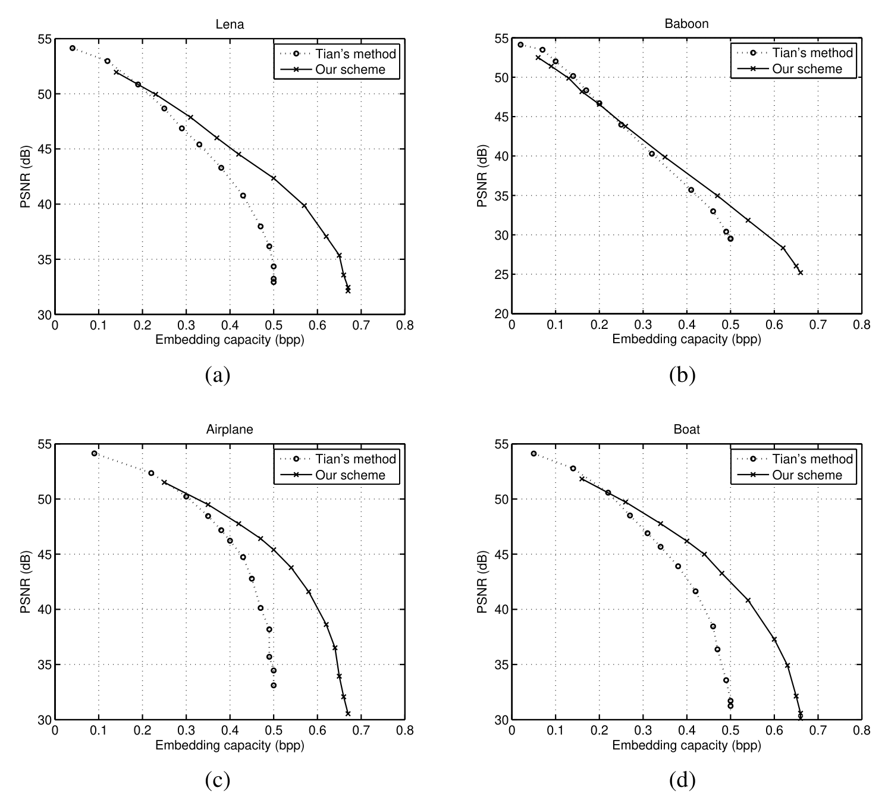

<!-- _class: lead -->

Fundamenta Informaticae · IOS Press · 2009

# 基於三環像素差值擴張之可逆式資訊隱藏方法

Reversible Data Hiding Based on Three-Circular-Pixel Difference Expansion

於三像素環狀區塊中共用最大中心像素並同步擴張兩個差值，將單層藏量上限提升至 <strong>0.67 bpp</strong>，同時顯著降低影像失真

<strong>林慶泉（Ching-Chiuan Lin）*</strong> · 僑光技術學院資訊管理系 · <code>cclin@ocit.edu.tw</code> 
<strong>楊舜評（Shun-Ping Yang）</strong> · 僑光技術學院資訊科技系 · <code>ysp@ocit.edu.tw</code> 
<strong>薛念林（Nien-Lin Hsueh）</strong> · 逢甲大學資訊工程學系 · <code>nlhsueh@fcu.edu.tw</code>

<!--
論文背景與核心貢獻總覽：
本論文（林慶泉、楊舜評、薛念林；發表於 Fundamenta Informaticae，IOS Press，預印本標註 2008／正式刊登 2009，頁 1–15）提出一種空間域「三環像素（Three-Circular-Pixel, TCP）」差值擴張可逆式資訊隱藏技術。

核心創新：
在 Tian (2003) 經典的差值擴張（DE）演算法中，影像被切分為不重疊的兩像素對，導致單層藏量上限受限於 0.50 bpp，且每擴張兩個差值最多需更動 4 個像素。本研究將影像劃分為三像素環狀區塊，並以區塊內最大值像素作為共享中心錨點；當調高此最大值像素時，其與最小值及中間值像素的「兩個差值」會同步擴大。此設計將可用像素對數量由 N/2 提升至 floor(2N/3)（單層上限 0.67 bpp），且最多僅修改 3 個像素，有效降低均方誤差（MSE）並全面提升 PSNR 與藏量表現。
-->

---

## 簡報大綱

1

<a href="#3">研究動機與差值擴張背景</a> 可逆式浮水印需求、既有技術分類，以及 Tian 兩像素差值擴張的瓶頸。

2

<a href="#5">TCP 區塊轉換與雙差值擴張</a> 環狀區塊排序規則、共享最大像素核心概念與 MSE 降低機制。

3

<a href="#6">系統架構與嵌藏演算法</a> 端對端流程、可擴張與可更動條件、四類擴張公式與門檻 <code>T ≥ 1</code> 限制。

4

<a href="#9">盲萃取還原與完整範例</a> 盲 LSB 萃取、JBIG 位置圖解壓縮，以及 3×6 影像逐步推演。

5

<a href="#11">實驗結果與效能分析</a> 512×512 標準影像測試、與 Tian 方法之 PSNR／藏量比較及門檻 <code>T</code> 權衡。

6

<a href="#14">結論與核心價值</a> 藏量、影像品質與無失真還原保證之綜合總結。

<!--
論文結構導讀：
- 第一節（Introduction，頁 2–3）：說明醫療診斷等零失真領域對可逆式隱藏的需求，並系統性回顧四大技術路線：LSB 壓縮（Fridrich 等）、廣義 LSB 量化殘差壓縮（Celik 等）、差值擴張（Tian 及其衍伸研究）與直方圖平移（Ni 等、Lin 等）。
- 第二節（Difference Expansion，頁 3）：以實例回顧 Tian (2003) 兩像素差值擴張與溢位位置圖（Location Map）需求。
- 第三節（The Proposed Scheme，頁 3–11）：詳述 TCP 區塊定義與雙差值擴張（3.1）、正式嵌藏流程與中心像素對稱性（3.2）、盲萃取還原與門檻 1 <= T <= 127 限制證明（3.3），以及 3x6 影像完整範例（3.4）。
- 第四節（Experimental Results，頁 11–14）：以 Java 實作比較 Lena、Baboon、Airplane、Boat 四張 512x512 灰階影像之 PSNR 與藏量曲線，並透過 Table 1 分析不同門檻 T 下的 JBIG 壓縮率。
- 第五節（Conclusions，頁 13–14）：總結三環像素雙差值擴張的理論優勢與實證成果。
-->

---

## 1. 研究動機與可逆式資訊隱藏技術版圖

<h3>為何需要「可逆式」隱藏？</h3>
<ul class="small-text">
<li><strong>零容忍失真場域</strong>：在醫療診斷或軍事影像中，傳統浮水印造成的永久性畫質損傷可能導致誤診，完全不可接受。</li>
<li><strong>核心技術課題</strong>：如何在不破壞原圖資訊的前提下尋找冗餘空間，同時兼顧<strong>高藏量（bpp）</strong>與<strong>高視覺品質（PSNR）</strong>。</li>
</ul>

<h3>本論文 TCP 方案之突破</h3>
<ul class="small-text">
<li>將影像切分為不重疊之<strong>三像素區塊</strong>，轉換為<strong>三環像素（TCP）區塊</strong>。</li>
<li>調高區塊內<strong>最大值像素</strong>可同步擴大<strong>兩個差值</strong>（最大－最小與最大－中間）。</li>
<li>可用像素對數提升至<strong>總像素數的 2/3</strong>（單層 0.67 bpp），且修改像素更少。</li>
</ul>

| 技術流派 | 代表文獻 | 冗餘空間產生機制 | 主要限制 |
|---|---|---|---|
| <strong>LSB 壓縮法</strong> | Fridrich et al. (2001, 2002) | 無失真壓縮最低有效位元平面 | 藏量完全受限於位元平面壓縮率 |
| <strong>廣義 LSB 量化法</strong> | Celik et al. (2005) | 量化 <code>Qx = q × ⌊x/q⌋</code> 並壓縮殘差 <code>r</code> | 高度依賴量化殘差之可壓縮性 |
| <strong>直方圖平移法</strong> | Ni et al. (2006)；Lin et al. (2008) | 平移峰值 <code>M</code> 與谷值 <code>m</code> 間之像素或差值 | 若峰值點 <code>M</code> 像素數少，單層藏量偏低 |
| <strong>差值擴張法（DE）</strong> | Tian (2003)；Alattar (2004)；Thodi (2007) | 倍增像素差值 <code>h' = 2h</code> 騰出 LSB | 兩像素對單層上限 0.50 bpp，MSE 較高 |

<!--
理論背景與文獻脈絡（第一節）：
可逆式（無失真）資訊隱藏要求接收端在萃取秘密訊息後，能位元精確地還原原始掩護影像。
1. Fridrich 等 [1, 2] 透過無失真壓縮 LSB 位元平面騰出藏入空間，藏量取決於影像紋理壓縮效率。
2. Celik 等 [3] 提出廣義 LSB 修改：先對像素 x 量化為 Qx = q * floor(x/q)，將殘差 r = x mod q 壓縮後連同秘密訊息轉為 q 進位符號 s_i，再以 Qs = Qx + s_i 嵌入，萃取時取 s_i = Qs mod q 並解壓殘差還原。
3. Ni 等 [12] 利用影像直方圖峰值 M 與零值點 m 平移像素；因單純灰階峰值有限，Lin 等 [13] 改採兩像素區塊差值直方圖平移以擴大藏量。
4. Tian [4] 於 2003 年開創差值擴張（DE），後續 Chang & Lu [6] 與 Thodi & Rodriguez [7] 透過預測誤差減少擴張失真。本論文則從區塊拓撲結構切入，以三環像素共享中心峰值突破兩像素對的容量與失真雙重瓶頸。
-->

---

## 1.2 Tian 差值擴張法（DE）與其雙重瓶頸

<h3>Tian 兩像素差值擴張實例</h3>

給定像素對 <code>(x, y) = (30, 33)</code>，差值 <code>h = -3</code> 擴張為 <code>h' = -6</code>：計算 <code>x' = 30 + ⌊-3/2⌋ = 28</code>、<code>y' = 33 - ⌊(-3+1)/2⌋ = 34</code>。嵌入位元 <code>b</code> 得 <code>x'' = x' + b</code>；萃取 <code>b = |x'' - y'| mod 2</code> 並由 <code>h = ⌊(x'' - y')/2⌋</code> 還原原像素。

<h3>兩像素架構的兩大瓶頸</h3>
<ul class="small-text">
<li><strong>0.50 bpp 單層上限</strong>：每 2 個像素僅形成 1 個差值對，全圖最多僅有 <code>⌊N/2⌋</code> 對可藏入空間。</li>
<li><strong>4 像素修改成本</strong>：擴張兩個差值最多需修改 4 個像素，拉高 MSE；且遇溢位（如 <code>235, 250</code>）須附帶壓縮後之 <code>⌊N/2⌋</code> 位元位置圖。</li>
</ul>

<!--
Tian 差值擴張細節解析（第二節）：
在 Tian (2003) 方法中，兩像素差值 h = x - y 經擴張後成為偶數 h' = 2h，其最低位元（LSB）固定為 0，構成可逆藏入空間。嵌入訊息位元 b in {0, 1} 時更新 x'' = x' + b。
還原階段先求 b = |x'' - y'| mod 2 與原差值 h = floor((x'' - y')/2)，再代入：
- x = x'' - b - floor(h/2) = 30
- y = y' + floor((h + 1)/2) = 33。

溢位與位置圖問題：
若像素值接近邊界（如 x=235, y=250），直接擴張將導致像素值超過 255（過飽和）。因此必須維護一張長度為 floor(N/2) 位元的位置圖記錄各像素對是否擴張，並於嵌入前無失真壓縮。

TCP 方案之對比優勢：
如上方向量圖所示，針對 (24, 28) 與 (28, 26) 兩組差值，Tian 方法分別擴張為 (22, 30) 與 (29, 25)，四個像素全數改動，平方誤差總和為 (-2)^2 + 2^2 + 1^2 + (-1)^2 = 10；TCP 將三像素 (24, 28, 26) 共用中心最大值 28，擴張後得 (22, 30, 26)，第三像素 26 完全不動，平方誤差降至 8。
-->

---

## 2. TCP 區塊轉換與雙差值同步擴張

圖 1：原始三像素區塊 <code>[ai, bi, ci]</code> 轉換為 TCP 環狀區塊。

<h3>環狀排序與同值優先規則</h3>
<ul class="small-text">
<li>原始區塊 <code>[ai, bi, ci]</code> 依循環順序旋轉為 <code>(xi, yi, zi)</code>，使中心 <code>yi ≥ xi</code> 且 <code>yi ≥ zi</code>。</li>
<li><code>xi</code> 位於 <code>yi</code> 邏輯左側，<code>zi</code> 位於邏輯右側。</li>
<li><strong>轉換實例</strong>：<code>[18, 15, 26]</code>、<code>[15, 26, 18]</code>、<code>[26, 18, 15]</code> 皆對應 TCP <code>(15, 26, 18)</code>。</li>
<li><strong>邊界同值規則</strong>：若最大值重複（如 <code>[26', 20, 26]</code>），先拜訪者為 <code>yi</code> ➔ <code>(26, 26', 20)</code>。</li>
</ul>

圖 2：<code>(24, 28, 26)</code> 雙差值擴張為 <code>(22, 30, 26)</code> 示意。

<h3>雙差值擴張與嵌藏範例</h3>
<ul class="small-text">
<li><code>hi1 = 28 - 24 = 4</code>、<code>hi2 = 28 - 26 = 2</code>（<code>hi1 ≥ hi2</code>）。</li>
<li>擴張計算：<code>x'i = 24 - ⌊4/2⌋ = 22</code>、<code>y'i = 28 + ⌊5/2⌋ = 30</code>、<code>z'i = 30 - 2×2 = 26</code>（未更動！）。</li>
<li>嵌入 <code>b1=0, b2=1</code> ➔ <code>(22, 30, 25)</code>；解碼 <code>h''i1=8, h''i2=5</code> ➔ 萃取 <code>0, 1</code> 並無誤還原 <code>(24, 28, 26)</code>。</li>
</ul>

<!--
TCP 區塊定義與雙差值擴張機制（第三節與 3.1 節）：
原始三像素區塊 [a_i, b_i, c_i] 依由左至右、由上而下掃描（可採 1x3、3x1 或 L 型排列，見圖 1a）。將三像素排列於有向環上（圖 1b），以最大值像素 y_i 為邏輯中心，x_i 為邏輯左鄰、z_i 為邏輯右鄰。

決定性同值判定規則：
當 y_i = x_i 或 y_i = z_i 時，嚴格規定「掃描順序較早者」為中心像素 y_i（例如 [26', 20, 26] 轉為 (26, 26', 20)）。此規範確保編碼端與解碼端產生完全一致的 TCP 元組。

數值驗證流程（3.1 節）：
對於 (24, 28, 26)，因 h_i1 = 4 >= h_i2 = 2，先對較大差值 h_i1 進行對稱擴張：x'_i = 24 - 2 = 22、y'_i = 28 + 2 = 30，再由 z'_i = y'_i - 2*h_i2 = 30 - 4 = 26 求得第三像素，剛好維持 26 不變。
嵌入位元 b_1 = 0, b_2 = 1 時自 x'_i 與 z'_i 分別減去 b_1, b_2 得偽裝區塊 (22, 30, 25)。接收端計算 h''_i1 = 8、h''_i2 = 5，取 mod 2 得 b_1 = 0, b_2 = 1，取 floor(/2) 得原差值 4 與 2，即可精確還原 (24, 28, 26)。文中另列舉 (24, 28, 23)、(24, 28, 25)、(24, 28, 24) 等區塊，其 MSE 皆顯著低於 Tian 兩組雙像素區塊。
-->

---

## 3. 系統架構與可擴張／可更動條件

<h3>可擴張條件（防止溢位與下溢）</h3>
<ul class="small-text">
<li><code>hi1 = yi - xi</code> <strong>可擴張</strong>若滿足：(1) <code>hi1 ≥ hi2</code>、<code>yi + ⌊(hi1+1)/2⌋ ≤ 255</code> 且 <code>xi - ⌊hi1/2⌋ - 1 ≥ 0</code>；或 (2) <code>hi2 > hi1</code> 且 <code>hi2</code> 可擴張；或 (3) <code>hi2</code> 不可擴張且 (1) 之上下界成立。</li>
<li><strong>關鍵性質</strong>：只要較大差值可擴張，同區塊之較小差值<strong>必然可擴張</strong>（因 <code>hi1 ≥ hi2 ➔ xi ≤ zi</code>）。</li>
</ul>

<h3>可更動條件與集合劃分</h3>
<ul class="small-text">
<li><code>hi1</code> <strong>可更動</strong>若 <code>(yi - xi) mod 2 = 1</code> 或 <code>xi > 0</code>（<code>hi2</code> 對應 <code>zi</code> 亦同）。</li>
<li>所有可擴張差值皆必然為可更動差值。</li>
<li>利用門檻 <code>1 ≤ T ≤ 127</code> 劃分為兩集合：
  <ul>
    <li><code>EN</code>：所有滿足 <code>h ≤ T</code> 之可擴張差值</li>
    <li><code>CN</code>：所有不屬於 <code>EN</code> 之可更動差值</li>
  </ul>
</li>
</ul>

<!--
形式化可擴張與可更動理論（3.2 節）：
針對 8-bit 灰階像素（範圍 0..255），擴張差值並再減去訊息位元 b in {0, 1} 後，絕對不可發生小於 0（下溢）或大於 255（溢位）。條件式中 `x_i - floor(h_i1/2) - 1 >= 0` 的 `- 1` 正是為後續嵌入位元 `1` 預留安全邊際。

重要結構推論：
若 h_i1 >= h_i2，則必有 x_i <= z_i。當較大差值 h_i1 可擴張時，代表 y'_i <= 255 且 x'_i - 1 >= 0；由於 z'_i = y'_i - 2*h_i2 >= y'_i - 2*h_i1 = x'_i，故 z'_i - 1 >= x'_i - 1 >= 0 必然成立，因此較小差值 h_i2 自動保證可擴張。

可更動（Changeable）條件之意義：
若對未擴張的差值 h'_i1 進行 LSB 置換：當 h'_i1 為奇數時，將其 LSB 改為 0 只需把 x'_i 加 1（因 x'_i < y'_i <= 255，必不溢位）；當 h'_i1 為偶數時，將 LSB 改為 1 需把 x'_i 減 1，故僅在 x'_i > 0 時合法。唯有「差值為偶數且 x'_i = 0」時才不可更動。
-->

---

## 3.2 嵌藏演算法：四類擴張與位元流封裝

<h3>步驟 2：各區塊像素擴張調整（四類情況）</h3>

| 情況 | 條件 | 擴張後 TCP 區塊 <code>(x'i, y'i, z'i)</code> |
|---|---|---|
| <strong>2.1a</strong> | <code>hi1, hi2 ∈ EN</code>, <code>hi1 ≥ hi2</code> | <code>xi - ⌊hi1/2⌋</code>, <code>yi + ⌊(hi1+1)/2⌋</code>, <code>y'i - 2hi2</code> |
| <strong>2.1b</strong> | <code>hi1, hi2 ∈ EN</code>, <code>hi1 &lt; hi2</code> | <code>y'i - 2hi1</code>, <code>yi + ⌊(hi2+1)/2⌋</code>, <code>zi - ⌊hi2/2⌋</code> |
| <strong>2.2</strong> | <code>hi1 ∈ EN</code>, <code>hi2 ∉ EN</code> | <code>xi - ⌊hi1/2⌋</code>, <code>yi + ⌊(hi1+1)/2⌋</code>, <code>zi</code> |
| <strong>2.3</strong> | <code>hi1 ∉ EN</code>, <code>hi2 ∈ EN</code> | <code>xi</code>, <code>yi + ⌊(hi2+1)/2⌋</code>, <code>zi - ⌊hi2/2⌋</code> |
| <strong>2.4</strong> | <code>hi1 ∉ EN</code>, <code>hi2 ∉ EN</code> | <code>xi</code>, <code>yi</code>, <code>zi</code>（維持原值） |

<strong>位置圖 <code>L</code> 與控制位元 <code>C</code></strong>：<code>L</code> 固定長度為 <code>⌊2N/3⌋</code> 位元（<code>e2i=1</code> 表 <code>hi1 ∈ EN</code>）；<code>C</code> 記錄所有屬於 <code>CN</code> 之可更動差值原始 LSB。

<h3>步驟 5–8：JBIG 壓縮與盲 LSB 嵌入</h3>
<ol class="small-text">
<li><strong>壓縮輔助資訊</strong>：以 JBIG 無失真壓縮 <code>L</code> 與 <code>C</code> 為 <code>LC*</code>。</li>
<li><strong>串接位元流</strong>：<code>S = |LC*| ⊕ |C| ⊕ LC* ⊕ U</code>（16 位元存 <code>|LC*|</code>、17 位元存 <code>|C|</code>，後接秘密訊息 <code>U</code>）。</li>
<li><strong>寫入可更動像素對</strong>（式 1–2）：</li>
</ol>

x''i = x'i + 1 - bi1 &nbsp; 若 h'i1 mod 2 = 1 
x''i = x'i - bi1 &nbsp;&nbsp;&nbsp;&nbsp;&nbsp; 若 h'i1 mod 2 = 0 且 x'i &gt; 0 
x''i = x'i &nbsp;&nbsp;&nbsp;&nbsp;&nbsp;&nbsp;&nbsp;&nbsp;&nbsp;&nbsp;&nbsp; 其他（不可更動）

<code>z''i</code> 對稱處理（若 <code>h'i1</code> 不可更動則嵌入 <code>bi1</code>，否則嵌入 <code>bi2</code>）。最後將 <code>(x''i, y'i, z''i)</code> 逆轉換回原始空間位置 <code>[a'i, b'i, c'i]</code>。

<!--
完整八步驟嵌藏演算法詳解（3.2 節）：
1. 將 N 像素原圖劃分為不重疊三像素區塊並轉換為 TCP 區塊 (x_i, y_i, z_i)。
2. 依門檻 T 將各差值歸類至 EN 或 CN，並按表列四類互斥情況（2.1 至 2.4）更新像素值。
3. 建立長度固定為 floor(2N/3) 位元的位置圖 L：若 h_i1 in EN 則設 e_{2i} = 1（否則 0），h_i2 對應 e_{2i+1}。
4. 計算調整後差值 h'_i1, h'_i2，收集所有屬於 CN 之可更動差值原始 LSB 存入控制串列 C。
5. 以 JBIG 無失真壓縮 L 與 C 成為 LC*。因 |L| = floor(2N/3) 可由影像尺寸直接推算，不需額外紀錄，僅需 16 位元儲存 |LC*| 與 17 位元儲存 |C|。
6. 串接完整位元流 S = |LC*| || |C| || LC* || U。
7. 依據式 (1) 與式 (2)，將 S 的位元盲目覆寫至所有可更動差值（涵蓋已擴張的 EN 與未擴張的 CN）的 LSB：若 h'_i1 為偶數，減去 b_i1 使新差值 LSB 等於 b_i1；若 h'_i1 為奇數，改為加上 (1 - b_i1)，同樣精確將新差值 LSB 設為 b_i1。
8. 將各偽裝 TCP 區塊 (x''_i, y'_i, z''_i) 逆向旋轉回原始掃描座標，輸出偽裝影像。
-->

---

## 3.3 中心像素對稱性與門檻 `T ≥ 1` 限制證明

圖 3：以最小像素（10）或最大像素（20）為中心，擴張結果皆為 <code>[5, 9, 25]</code>。

<h3>最大／最小中心像素對偶性</h3>

給定 <code>[10, 12, 20]</code>，最大差值滿足 <code>hi2 = hi1 + hi3 = 8 + 2 = 10</code>。將 <code>hi2</code> 擴張為 <code>20</code> 時，<code>hi1 ➔ 16</code> 與 <code>hi3 ➔ 4</code> 同步倍增，故選最大或最小像素當中心結果完全等價。

<h3>為何嚴禁設定 <code>T = 0</code>？</h3>

門檻必須滿足 <strong><code>1 ≤ T ≤ 127</code></strong>。若允許 <code>T = 0</code>，對未擴張區塊嵌入位元可能改變區塊內最大值像素的位置，導致解碼端 TCP 旋轉錯位！

<h3><code>T = 0</code> 失效反例推演</h3>
<ul class="small-text">
<li>原始區塊 <code>[ai, bi, ci] = [29, 29, 30]</code> ➔ TCP <code>(29, 30, 29)</code>，且 <code>hi1 = 1, hi2 = 1 ∈ CN</code>。</li>
<li>嵌入位元 <strong>「10」</strong> ➔ <code>(29, 30, 30)</code>，逆轉換回偽裝區塊 <code>[30, 29, 30]</code>。</li>
<li><strong>解碼失敗</strong>：接收端依先拜訪優先規則，誤將第一像素 <code>30</code> 當作 <code>y'i</code> ➔ TCP 變為 <code>(30, 30, 29)</code> ➔ 萃取出錯誤位元 <strong>「01」≠「10」</strong>！</li>
<li>強制 <code>T ≥ 1</code> 使所有可擴張之 <code>h = 1</code> 均先擴張為 <code>2</code>，徹底杜絕同值搶位。</li>
</ul>

<!--
數學性質與邊界條件嚴謹證明（3.2 與 3.3 節）：
1. 中心像素對偶性（圖 3，頁 7–8）：
給定原始區塊 [10, 12, 20]，以最大值 20 為中心得 TCP (12, 20, 10)，h_i1 = 8, h_i2 = 10；擴張後 h'_i1 = 16, h'_i2 = 20，得 (9, 25, 5)，還原空間排列為 [5, 9, 25]。
若改以最小值 10 為邏輯中心，兩差值為 h_i2 = 20 - 10 = 10 與 h_i3 = 12 - 10 = 2。因線性關係 h_i2 = h_i1 + h_i3 成立，倍增 h_i2 至 20 必然同時將 h_i3 擴張至 4，產生完全相同的像素 [5, 9, 25]。故論文選定最大值為中心不失一般性。

2. 門檻 1 <= T <= 127 之必要性證明（3.3 節，頁 10）：
當 T = 0 時，差值 h = 1 不會被擴張而落入 CN。若對 [29, 29, 30] 嵌入位元「10」，因 h'_i2 = 1 為奇數且嵌入位元為 0，式 (2) 會將 z'_i = 29 加 1 變為 30，使偽裝區塊成為 [30, 29, 30]。此時第一與第三像素並列最大，解碼端按掃描順序誤判第一像素為 y'_i，導致提取位元反轉為「01」。限定 T >= 1 即可完全消除此結構歧義。
-->

---

## 3.4 盲萃取與無失真還原流程

<h3>步驟 1–5：盲位元流萃取</h3>
<ol class="small-text">
<li>依相同掃描順序將偽裝影像切分為三像素區塊，轉換為偽裝 TCP 區塊 <code>(x''i, y'i, z''i)</code>。</li>
<li>計算 <code>h''i1 = y'i - x''i</code> 與 <code>h''i2 = y'i - z''i</code>。</li>
<li>依式（3）與式（4）盲目萃取位元：</li>
</ol>

bi1 = 1 &nbsp;&nbsp;&nbsp;&nbsp; 若 h''i1 mod 2 = 1 
bi1 = 0 &nbsp;&nbsp;&nbsp;&nbsp; 若 h''i1 mod 2 = 0 且 x''i &gt; 0 
bi1 = 無 &nbsp;&nbsp;&nbsp; 其他（bi2 與 z''i 對稱處理）

<ol start="4" class="small-text">
<li>串接所有位元得 <code>S</code>；讀取 16 位元 <code>|LC*|</code> 與 17 位元 <code>|C|</code>；JBIG 解壓 <code>LC*</code> 還原 <code>L</code>（<code>⌊2N/3⌋</code> 位元）與 <code>C</code>，並取出秘密訊息 <code>U</code>。</li>
</ol>

<h3>步驟 6：依據 <code>L</code> 與 <code>C</code> 精確還原原圖</h3>

先求 <code>hi1 = ⌊(y'i - x''i)/2⌋</code> 與 <code>hi2 = ⌊(y'i - z''i)/2⌋</code>，再分況還原：

| 位置圖位元 | 像素還原公式 |
|---|---|
| <code>e2i=1, e2i+1=1</code> (<code>hi1 ≥ hi2</code>) | <code>xi = x''i + ⌊hi1/2⌋ + bi1</code> <code>yi = y'i - ⌊(hi1+1)/2⌋</code>, <code>zi = yi - hi2</code> |
| <code>e2i=1, e2i+1=1</code> (<code>hi1 &lt; hi2</code>) | <code>yi = y'i - ⌊(hi2+1)/2⌋</code>, <code>xi = yi - hi1</code> <code>zi = z''i + ⌊hi2/2⌋ + bi2</code> |
| <code>e2i=1, e2i+1=0</code> | <code>xi, yi</code> 同上；<code>zi</code> 依 <code>c2i+1</code> 修正（<code>c ≠ bi2</code> 時 <code>±1</code>） |
| <code>e2i=0, e2i+1=1</code> | <code>yi, zi</code> 同上；<code>xi</code> 依 <code>c2i</code> 修正（<code>c ≠ bi1</code> 時 <code>±1</code>） |
| <code>e2i=0, e2i+1=0</code> | <code>yi = y'i</code>；<code>xi, zi</code> 均依控制位元 <code>c2i, c2i+1</code> 還原 |

<!--
無失真解碼與像素還原機制（3.3 節，頁 8–10）：
TCP 方案在萃取階段的一大優點是「完全盲萃取」：由於所有在嵌藏階段被擴張的差值（EN）在偽裝影像中必定仍滿足可更動條件，解碼器無須事先知道位置圖 L，即可透過式 (3)–(4) 掃描全圖直接萃取出完整位元流 S。
取得 S 後，解碼器先解析固定長度的 |LC*|（16 位元）與 |C|（17 位元），再以 JBIG 解壓縮 LC* 得到：
- L：長度固定為 floor(2N/3) 位元的位置圖，用以區分已擴張（e=1）與未擴張（e=0）差值。
- C：所有 CN 差值在覆寫前的原始 LSB。

步驟 6 之還原邏輯以「較大差值」為核心驅動：
- 當雙差值皆擴張（6.1）時，由較大差值率先還原中心最大值 y_i 與最小值像素（x_i 或 z_i）；一旦 y_i 確定，剩餘之中間像素直接由 y_i 減去折半後的較小差值即可無誤求得。
- 凡未擴張的可更動差值（6.2–6.4），只需比對控制位元 c 與萃取位元 b：若 c=1, b=0 則減 1；若 c=0, b=1 則加 1；相同則不變。全圖可達 100% 位元精確還原。
-->

---

## 3.5 完整 3×6 影像逐步推演範例（`T = 4`）

圖 4：(a) 原始 3×6 影像；(b) 差值擴張結果；(c) 嵌入後偽裝影像。

<h3>1. 嵌藏推演（共 6 區塊，<code>T = 4</code>）</h3>
<ul class="small-text">
<li><strong>區塊 0</strong>：<code>[62, 60, 59]</code> ➔ TCP <code>(59, 62, 60)</code>，<code>h01=3, h02=2 ≤ 4</code> ➔ 擴張為 <code>(58, 64, 60)</code>。</li>
<li><strong>不可擴張對</strong>：區塊 3 第一對 <code>(20, 62, 58)</code>（<code>h=42</code>）及區塊 4 兩對 <code>(60, 65, 57)</code>（<code>h=5, 8</code>）。</li>
<li><strong>輔助資訊</strong>：<code>L = (111111010011)2</code>、<code>C = (010)2</code> ➔ 壓縮得 <code>LC* = (0101)2</code>。</li>
<li><strong>位元流</strong>：<code>S = (100, 011, 0101, 10)2</code>（<code>|LC*|=4</code>, <code>|C|=3</code>, <code>U=10</code>）依序寫入 12 組可更動對 ➔ 圖 4(c)。</li>
</ul>

<h3>2. 萃取與還原驗證</h3>
<ul class="small-text">
<li>偽裝區塊 0 <code>(57, 64, 60)</code>：<code>(64-57) mod 2 = 1</code>、<code>(64-60) mod 2 = 0</code> ➔ 萃取 <strong>「10」</strong>。</li>
<li>解壓 <code>LC*</code> 還原 <code>L</code>、<code>C</code> 與秘密訊息 <code>U = (10)2</code>。</li>
<li>還原區塊 0（<code>e0=e1=1</code>, <code>h01=3 ≥ h02=2</code>）：<code>x0 = 57+⌊3/2⌋+1 = 59</code>、<code>y0 = 64-⌊4/2⌋ = 62</code>、<code>z0 = 62-2 = 60</code> ➔ <code>[62, 60, 59]</code>。</li>
</ul>

<!--
3x6 影像逐區塊數值追蹤（3.4 節，頁 10–11）：
圖 4 以一張 3 列 x 6 行（共 18 像素、6 個三像素區塊、12 組像素對）的小型灰階影像演示門檻 T = 4 的完整生命週期：
- 區塊 0：[62, 60, 59] -> TCP (59, 62, 60) -> 擴張 (58, 64, 60) -> 嵌入 "10" -> 偽裝 (57, 64, 60) -> 原始排列 [64, 60, 57]。
- 區塊 1：[60, 58, 61] -> TCP (58, 61, 60) -> 擴張 (57, 63, 61) -> 嵌入 "00" -> 偽裝 (57, 63, 61) -> [61, 57, 63]。
- 區塊 2：[64, 63, 60] -> TCP (60, 64, 63) -> 擴張 (58, 66, 64) -> 嵌入 "11" -> 偽裝 (57, 66, 63) -> [66, 63, 57]。
- 區塊 3：[61, 59, 20] -> TCP (20, 61, 59)：h_31 = 41 > 4（CN，e_6 = 0）、h_32 = 2 <= 4（EN，e_7 = 1）-> 擴張 (20, 62, 58) -> 嵌入 "01" -> 偽裝 (20, 62, 57)。注意 h'_31 = 62 - 20 = 42 為偶數，其原始 LSB = 0 存入 C。
- 區塊 4：[60, 65, 57] -> TCP (60, 65, 57)：h_41 = 5 > 4、h_42 = 8 > 4（皆為 CN，e_8 = e_9 = 0，原始 LSB 1, 0 存入 C）-> 嵌入 "01" -> 偽裝 (61, 65, 56)。
- 區塊 5：[57, 59, 55] -> TCP (57, 59, 55) -> 擴張 (57, 61, 53) -> 嵌入 "10" -> 偽裝 (56, 61, 53)。

最終 12 位元完整位元流 S 被盲萃取並解壓，全部 18 個像素與圖 4(a) 逐一吻合，無任何失真。
-->

---

## 4. 實驗環境與標準測試影像集

圖 5：四張標準 512×512（8-bit 灰階）測試影像：(a) Lena；(b) Baboon；(c) Airplane；(d) Boat。

<h3>實作平台與實驗配置</h3>
<ul class="small-text">
<li><strong>實作環境</strong>：於 Windows 個人電腦以 <strong>Java</strong> 實作本論文 TCP 方法與 Tian (2003) 基準方法 [4]。</li>
<li><strong>影像規格</strong>：<code>512 × 512</code>（<code>N = 262,144</code> 像素，每像素 8 位元），單層提供 <code>⌊2N/3⌋ = 174,762</code> 組像素對。</li>
<li><strong>訊息與壓縮</strong>：以 Java <code>⌊Math.random() + 0.5⌋</code> 產生隨機秘密位元流 <code>U</code>；<code>L</code> 與 <code>C</code> 採 <strong>JBIG</strong> 無失真壓縮，標頭以 16 位元存 <code>|LC*|</code>、17 位元存 <code>|C|</code>。</li>
</ul>

<h3>品質與藏量評估指標</h3>

MSE = (1 / N) × Σi=0..N-1 (xi - x''i)2 
PSNR = 10 × log10(2552 / MSE) dB

<ul class="small-text">
<li><strong>單層理論上限</strong>：高達 <strong>0.67 bpp</strong>（相較 Tian 方法僅 0.50 bpp）。</li>
<li><strong>評測方式</strong>：掃描門檻 <code>T ∈ [1, 127]</code>，量測可擴張集合 <code>EN</code> 提供之藏量 <code>|E|</code> 與對應 PSNR 曲線。</li>
</ul>

<!--
實驗設計與對照控制（第四節，頁 11–12）：
為確保公平比較，作者於同一 Windows 平台以 Java 實作本論文方法與 Tian [4] 差值擴張法，並選用四張具代表性的 512x512 8-bit 灰階標準影像：
- Lena（平滑人像與適度邊緣）
- Baboon（高頻毛髮與鬍鬚紋理，檢驗高複雜度影像之極限）
- Airplane（大面積平滑天空與機身）
- Boat（水面平滑區與船桅細節並存）

標頭與壓縮開銷細節：
對於 N = 262,144 像素之影像，位置圖 L 長度恆為 floor(2 * 262,144 / 3) = 174,762 位元，解碼端可由影像長寬直接推知，故僅需 16 + 17 = 33 位元標頭記錄 |LC*| 與 |C|，將 L 與 C 合併交由 JBIG 壓縮後串接秘密訊息 U 一併嵌入。
-->

---

## 4.2 視覺品質與藏量比較（TCP vs. Tian）

圖 6：Tian 方法與本方案之藏量（bpp）對 PSNR（dB）比較：(a) Lena、(b) Baboon、(c) Airplane、(d) Boat。

高達 0.67 bpp

單層最大藏量較 Tian 方法的 0.50 bpp 上限大幅提升 <strong>33%</strong>。

全區間 PSNR 全面領先

四張測試影像在相同藏量下，本方案之 PSNR 曲線皆穩定高於 Tian 方法。

<h3>核心實驗觀察</h3>
<ul class="small-text">
<li><strong>平滑影像（Lena、Airplane、Boat）</strong>：中低藏量下維持 40–52 dB 高畫質，高藏量區間可延伸至 0.60–0.67 bpp，突破 Tian 的 0.50 bpp 天花板。</li>
<li><strong>複雜紋理（Baboon）</strong>：即便在高頻紋理影像上，TCP 仍具明顯畫質優勢，最大藏量達約 0.65 bpp（Tian 僅約 0.48 bpp）。</li>
<li><strong>勝出關鍵</strong>：共用中心最大值像素使每藏入 2 位元所需修改之像素上限由 4 個降為 3 個。</li>
</ul>

<!--
率失真（Rate-Distortion）效能分析（第四節，圖 6，頁 12–13）：
圖 6 呈現四張 512x512 影像在單層嵌藏下的 PSNR（dB）與藏量（bpp）對比曲線：
- Lena（圖 6a）：TCP 曲線從約 0.14 bpp 一路領先至 0.666 bpp（T=127 時為 32.13 dB），而 Tian 方法在 0.50 bpp 前即已觸頂。
- Baboon（圖 6b）：高紋理影像雖使兩種方法之 PSNR 隨藏量下降較快，但 TCP 在同等藏量下持續保持較高 PSNR，且藏量延伸超越 0.65 bpp。
- Airplane（圖 6c）與 Boat（圖 6d）：皆展現一致的畫質與藏量雙重優勢。

圖表橫軸定義備註：
論文第四節（頁 12）明確說明，圖 6 橫軸之 embedding capacity 係指可擴張集合 EN 所提供之總藏量空間 |E| 除以總像素數 N；而扣除 JBIG 壓縮後輔助資訊 |LC*| 之淨藏量分析則詳列於表 1。
-->

---

## 4.3 門檻 `T` 權衡與 JBIG 壓縮開銷分析（Lena）

<strong>表 1（精選）</strong>：<code>512×512</code> Lena 影像於不同門檻 <code>T</code> 之效能（<code>|L| = 174,762</code> bits）：

| `T` | `\|E\|` (bits) | `\|C\|` (bits) | `\|LC*\|` (bits) | PSNR (dB) | 淨可用空間 |
|---:|---:|---:|---:|---:|---|
| 1 | 36,820 | 137,942 | 299,336 | <strong>51.94</strong> | 開銷 > 總可更動空間 |
| 4 | 97,395 | 77,367 | 266,736 | 46.02 | 開銷 > 總可更動空間 |
| 7 | 129,941 | 44,821 | 189,000 | 42.35 | 開銷 > 總可更動空間 |
| <strong>8</strong> | <strong>136,386</strong> | <strong>38,376</strong> | <strong>169,368</strong> | <strong>41.56</strong> | <strong>開始具淨藏量（<code>T ≥ 8</code>）</strong> |
| 10 | 145,439 | 29,323 | 137,280 | 40.36 | +37,482 bits 淨空間 |
| 20 | 163,575 | 11,187 | 66,296 | 37.07 | +108,466 bits 淨空間 |
| 50 | 173,096 | 1,666 | 14,888 | 33.57 | +159,874 bits 淨空間 |
| <strong>127</strong> | <strong>174,585</strong> | <strong>177</strong> | <strong>2,512</strong> | <strong>32.13</strong> | <strong>69.6× JBIG 壓縮率</strong> |

<h3>JBIG 壓縮動態與門檻門檻效應</h3>
<ul class="small-text">
<li><strong>大門檻（如 <code>T = 127</code>）</strong>：絕大多數像素對皆擴張，<code>L</code> 幾乎全為 <code>1</code> 且 <code>|C| = 177</code>，JBIG 壓縮率高達 <strong>69.6×</strong>：<code>(174,762 + 177) / 2,512 = 69.6</code>。</li>
<li><strong>小門檻（<code>T &lt; 8</code>）</strong>：<code>L</code> 中 <code>0/1</code> 交錯且 <code>|C|</code> 龐大，導致 <code>|LC*| &gt; 174,762</code>，全圖空間反被輔助資訊耗盡；故 Lena 需設 <strong><code>T &gt; 7</code></strong> 方能藏入秘密訊息。</li>
</ul>

<h3>例外邊界探討：高反差區塊</h3>

在極端反差區塊如 <code>(40, 80, 76)</code> 中，TCP 擴張為 <code>(20, 100, 92)</code>（平方誤差 1056），略高於 Tian 拆為 <code>(40, 80)</code> 與 <code>(80, 76)</code> 之結果 <code>(20, 100)</code>、<code>(82, 74)</code>（平方誤差 808）。惟自然影像以平滑區塊為主，此類例外極為罕見，整體 PSNR 仍大幅勝出。

<!--
表 1 量化解讀與例外案例討論（3.4 與第四節，頁 11–14）：
表 1 精確揭示了 Lena（512x512，總可更動對數 |E| + |C| = 174,762）在不同門檻 T 下的權衡曲線：
- 當 T = 1..7 時，JBIG 壓縮後的 |LC*| 介於 299,336 至 189,000 位元，皆超過全圖總可更動空間 174,762 位元，無法再容納使用者訊息 U。
- 自 T = 8 起，|LC*| 降至 169,368 位元，開始釋出正淨藏量（同時保有 41.56 dB 高 PSNR）。
- 當 T = 20 時，淨使用者藏量突破 108k 位元（約 0.41 bpp 淨藏量），PSNR 為 37.07 dB；當 T = 127 時，|LC*| 僅佔 2,512 位元（壓縮比 69.6 倍），淨藏量超過 172,000 位元（約 0.66 bpp），PSNR 維持 32.13 dB。

誠實揭露局部 MSE 例外（頁 11）：
當同一 TCP 區塊中 h_i1 遠大於 h_i2（如 (40, 80, 76)，h_i1 = 40、h_i2 = 4），調高中心像素 y_i 達 +20 時，為維持 h'_i2 = 8 必須將 z_i 由 76 拉升至 92（位移 +16），導致該局部區塊 MSE 高於 Tian 方法。作者在文中主動剖析此現象，並指出自然影像的空間平滑特性使整體效能仍顯著優於基準法。
-->

---

## 5. 結論與核心研究貢獻

0.67 bpp

單層最大藏量上限（<code>⌊2N/3⌋</code> 對），較 Tian 兩像素差值擴張（0.50 bpp）提升 <strong>33%</strong>。

≤ 3 像素

透過共用最大中心像素 <code>yi</code> 同步擴張兩組差值，有效降低影像失真與 MSE。

69.6× JBIG

<code>T = 127</code> 時位置圖與控制位元壓縮比，使絕大部分擴張空間轉化為淨藏量。

<h3>方法論創新</h3>
<ul class="small-text">
<li><strong>TCP 環狀區塊轉換</strong>：提出具決定性同值判定規則的環狀映射，並證明最大與最小中心像素之擴張對偶性。</li>
<li><strong>嚴謹無失真還原</strong>：優先還原較大差值組之最大與最小像素，再透過較小差值精確推回中間像素，確保 0 誤差復原。</li>
</ul>

<h3>實務應用啟示</h3>
<ul class="small-text">
<li><strong>門檻規範明確</strong>：理論上須滿足 <code>1 ≤ T ≤ 127</code> 以避免最大值歧義；實務上於 Lena 需 <code>T ≥ 8</code> 確保 JBIG 壓縮後具正淨藏量。</li>
<li><strong>全面實證優勢</strong>：於平滑與高紋理標準測試影像上，視覺品質與嵌藏容量皆全面超越 Tian 方法。</li>
</ul>

<!--
結論綜整（第五節，頁 13–14）：
本研究提出的三環像素（TCP）差值擴張可逆式資訊隱藏技術，透過三項互補設計突破經典兩像素差值擴張的限制：
1. 共用峰值雙差值擴張：調高三像素環狀區塊內的最大值像素，即可同步擴大兩組差值，既減少每對位元修改之像素數量，亦將單層藏量上限推升至總像素數的三分之二（0.67 bpp）。
2. 決定性可逆機制：在 1 <= T <= 127 門檻規範下，先還原較大差值所對應之最大值與最小值像素，再計算剩餘像素與最大值之差即可精確復原原始區塊。
3. 實證效能驗證：在 Lena、Baboon、Airplane 與 Boat 四張標準影像上，TCP 方案在 PSNR 視覺品質與藏量上限兩項指標上皆顯著優於 Tian (2003) 基準方法。
-->

---

<!-- _class: closing -->

# 感謝您的聆聽！

基於三環像素差值擴張之可逆式資訊隱藏方法 
Reversible Data Hiding Based on Three-Circular-Pixel Difference Expansion

<strong>林慶泉（Ching-Chiuan Lin）*</strong> · <code>cclin@ocit.edu.tw</code>（僑光技術學院資訊管理系） 
<strong>楊舜評（Shun-Ping Yang）</strong> · <code>ysp@ocit.edu.tw</code>（僑光技術學院資訊科技系） 
<strong>薛念林（Nien-Lin Hsueh）</strong> · <code>nlhsueh@fcu.edu.tw</code>（逢甲大學資訊工程學系） 
Fundamenta Informaticae · IOS Press · 2009（pp. 1–15）

<!--
論文索引與聯絡資訊備忘：
- 論文篇名：Reversible Data Hiding Based on Three-Circular-Pixel Difference Expansion
- 作者群：林慶泉（Ching-Chiuan Lin，通訊作者，cclin@ocit.edu.tw）、楊舜評（Shun-Ping Yang，ysp@ocit.edu.tw）、薛念林（Nien-Lin Hsueh，nlhsueh@fcu.edu.tw）
- 所屬機構：僑光技術學院（臺中 40721）、逢甲大學資訊工程學系（臺中 40724）
- 發表期刊：Fundamenta Informaticae, IOS Press, 2009（預印本頁眉標註 XX (2008) 1-15）
- 關鍵詞：Difference expansion, information hiding, reversible data hiding, steganography
-->

