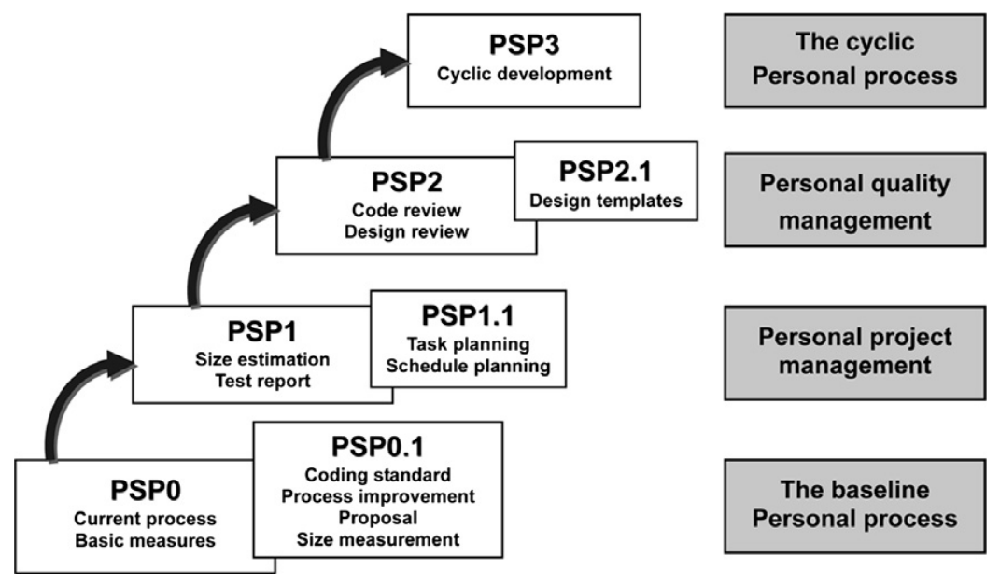
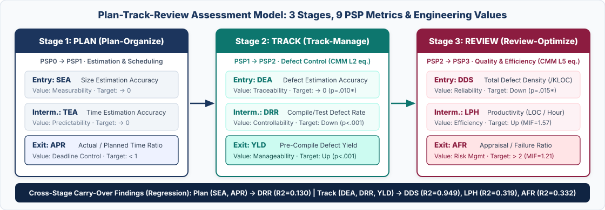
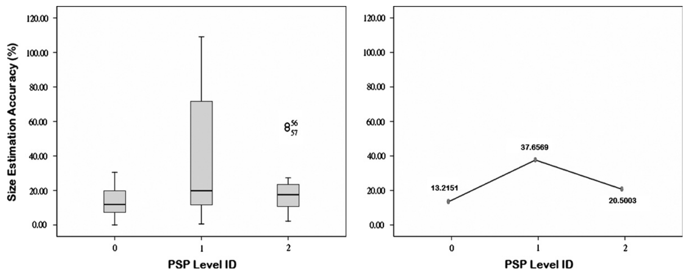
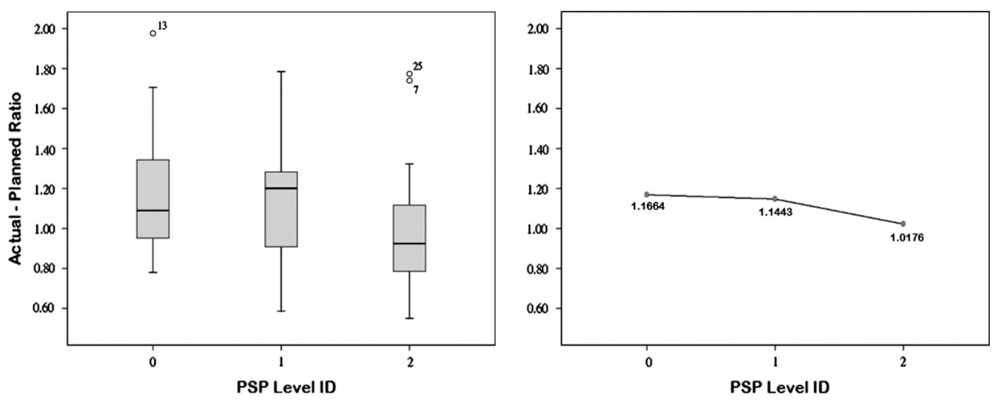
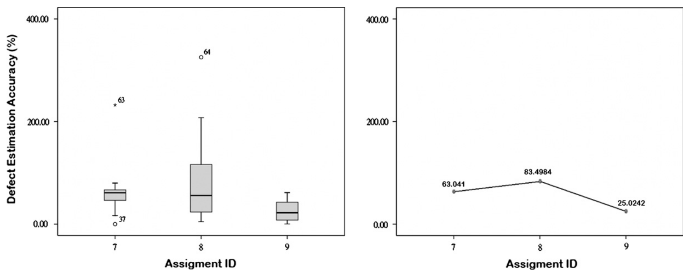
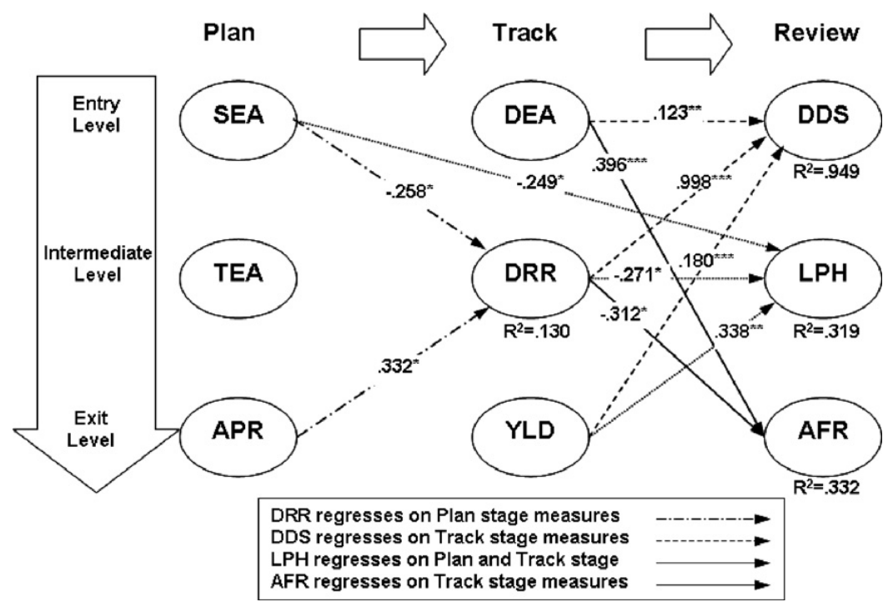

<!-- _class: lead -->

Information and Software Technology (IST) · Vol. 53, pp. 137–148 · 2011

# Assessing PSP Effect in Training Disciplined Software Development: A Plan–Track–Review Model

Linking Core <strong>Software Engineering Values</strong> with <strong>9 Pertinent PSP Metrics</strong> Through a Unified Stage-Wise Assessment Framework, Dual Mean/Median Analysis, and Cross-Stage Path Modeling

<strong>Wen-Hsiang Shen</strong>a, <strong>Nien-Lin Hsueh</strong>a, and <strong>Wei-Mann Lee</strong>b,* 
a Department of Information Engineering and Computer Science, Feng Chia University, Taichung, Taiwan 
b Department of Information Technology, The Overseas Chinese University, Taichung, Taiwan 
<code>shen@ocu.edu.tw</code> · <code>nlhsueh@fcu.edu.tw</code> · <code>dwl@ocu.edu.tw</code>

DOI: 10.1016/j.infsof.2010.09.004 · Received Nov 2009 · Accepted Sep 2010 · Published 2011 (Elsevier B.V.)

<!--
Bibliographic & Research Context:
This paper (Shen, Hsueh, & Lee, Information and Software Technology 53 (2011) 137-148; doi:10.1016/j.infsof.2010.09.004) addresses a long-standing gap in Personal Software Process (PSP) education and empirical software process improvement (SPI): while Humphrey's PSP (introduced at SEI in 1995) is widely credited with improving estimation accuracy, software quality, early defect detection, and productivity, the literature lacked a systematic, easily adoptable assessment model linking PSP metrics to core software engineering values.

Core Contributions:
1. Proposes the stage-wise Plan-Track-Review assessment model mapping 9 pertinent PSP metrics (SEA, TEA, APR; DEA, DRR, YLD; DDS, LPH, AFR) to engineering values (measurability, predictability, controllability, manageability, reliability, efficiency).
2. Introduces a stricter absolute-value estimation accuracy formulation and a unified 6-step assessment procedure combining mean-based parametric tests (t-test, ANOVA) with outlier-resistant median improvement factors (MIF) and external benchmarks (Hayes & Over 1997; Wesslen 2000).
3. Empirically validates the framework on 16 graduate students completing all 10 Humphrey assignments (160 programs) in an 18-week course, uncovering strong Track-stage quality gains, weak Plan-stage estimation gains, and statistically significant cross-stage carry-over effects via regression and quasi path analysis.
-->

---

## Outline

1

<a href="#3">Motivation &amp; Research Questions</a> Why PSP effect assessment is fragmented, methodological quandaries, and 3 core RQs.

2

<a href="#5">Plan–Track–Review Framework</a> PSP life cycle phases, 9 pertinent metrics mapped to engineering values, and 6-step procedure.

3

<a href="#8">Empirical Study Design</a> 18-week graduate PSP course (N = 16, 160 assignments), 3 datasets, and strict data auditing.

4

<a href="#9">Empirical Findings &amp; Path Analysis</a> Box/line trends, ANOVA, cross-stage regressions (R2 up to 0.949), and external benchmarks.

5

<a href="#13">Discussion, Survey &amp; Industrial Use</a> Student adoption gap (80% code review vs. 20% size logging), PROBE friction, and tailoring.

6

<a href="#14">Threats to Validity &amp; Conclusion</a> Internal/external validity controls, key takeaways, and future replication agenda.

<strong>Central Finding Preview:</strong> PSP training significantly improves <strong>defect controllability, manageability, and reliability</strong> (Track &amp; Review stages, <code>p ≤ 0.015</code>), whereas <strong>project size/time predictability</strong> (Plan stage) requires a longer learning curve—yet earlier stages measurably carry over into later quality and efficiency outcomes.

<!--
Structural Map of the Paper:
- Section 1 (Introduction, pp. 137-138): Motivates the need for a unified PSP assessment framework and states the three guiding research questions.
- Section 2 (Theoretical Framework, pp. 138-140): Connects PSP to CMM/ISO9001, decomposes the PSP life cycle into Plan-Organize, Track-Manage, and Review-Optimize stages, defines the 9 metrics (Tables 1-2), and resolves 3 assessment quandaries (Table 3).
- Section 3 (Methodology, pp. 140-141): Details the Fall 2008 empirical course setting (16 graduate students, 10 Humphrey assignments), absolute-value normalization, t-test/ANOVA, regression/path analysis, and the 6-step procedure.
- Section 4 (Result Findings, pp. 142-145): Presents Figs. 2-6 trends, Table 4 ANOVA, Table 5 regressions, Fig. 7 quasi path diagram, and Table 6 benchmarked summary report.
- Section 5 (Discussion, pp. 146-147) & Appendix A (Tables 7-8): Examines validity threats, inconsistent estimation results, instructor observations, survey responses, and industrial adaptation.
- Section 6 (Conclusion, p. 147): Synthesizes contributions and calls for replications.
-->

---

## 1. Motivation &amp; Methodological Quandaries

<h3>Promise vs. Friction of PSP Training</h3>
<ul>
<li><strong>Proven SPI Benefits:</strong> Better estimation accuracy, fewer defects, earlier defect detection, and higher productivity in academia and industry.</li>
<li><strong>Adoption Friction:</strong> Tedious manual logging, error-prone data (~5% defective in prior studies), heavy instructor workload, and steep 2-week training cost.</li>
<li><strong>Fragmented Assessment:</strong> Project-management studies isolate estimation metrics, while quality studies isolate defect metrics—lacking a holistic engineering-value view.</li>
</ul>

<h3>Three Assessment Quandaries</h3>
<ul>
<li><strong>1. Group vs. Individual &amp; Range:</strong> PSP3 uses only 1 assignment (10A), making <code>PSP0 vs. PSP2</code> more logical than <code>PSP0 vs. PSP3</code>.</li>
<li><strong>2. Inconsistent Accuracy Formulas:</strong> Humphrey uses <code>(Actual − Planned) / Planned</code>; Hayes reverses the sign; Prechelt uses <code>Actual / Planned</code>. Signed sums let +200% and −300% cancel out!</li>
<li><strong>3. Mixed Criteria:</strong> Statistical significance vs. experiential thresholds (e.g., <code>AFR &gt; 2</code>, <code>YLD ≥ 40%</code>) vs. Median Improvement Factors (MIF).</li>
</ul>

<strong>Key Methodological Shift:</strong> This study adopts a <strong>stricter absolute-value accuracy formula</strong> (<code>|Actual − Planned| / Planned</code>) combined with <strong>both mean-based tests and median-based benchmarks</strong> to prevent sign cancellation and outlier distortion.

<!--
Detailed Context from Sections 1 & 2.5:
Since Watts Humphrey introduced PSP at the SEI in 1995, empirical studies (Ferguson et al. 1997; Hayes & Over 1997; Wesslen 2000) have demonstrated substantial SPI gains. However, widespread diffusion remains constrained by manual logging overhead (Johnson & Disney 1999 reported ~5% defective PSP data, with <10% logging errors), privacy concerns, and inconsistent evaluation protocols across studies.

Three Core Assessment Quandaries (Section 2.5):
1. Level & Range Selection: PSP0, PSP1, and PSP2 aggregate multiple assignments (1A-3A, 4A-6A, 7A-9A), whereas PSP3 contains only a single cyclic-integration assignment (10A). Comparing PSP0 to PSP2 via repeated-measures aggregate means improves statistical power (Dyba et al. 2006) and avoids single-assignment noise.
2. Formula Sign Cancellation: Under Humphrey's signed formula (Actual - Planned)/Planned, a 300% overestimate (-300%) and a 200% underestimate (+200%) sum to -100% rather than 500% total error. Converting SEA, TEA, and DEA to absolute values enforces a stricter industrial standard (first noted by Hayes 1997, applied by Wesslen 2000) where approaching zero unambiguously means improvement.
3. Criteria Harmonization: Combining directional tendency criteria (Table 3), parametric t-test/ANOVA significance, and Hayes' Median Improvement Factor (reflecting >50% of trainees) provides both rigorous testing and intuitive peer/external feedback.
-->

---

## 1. Research Questions

RQ 1

Systematic Framing &amp; Software Engineering Goals

In what way should the PSP effect issue be approached, and exactly what software engineering goals can be reached by PSP training?

RQ 2

Engineering Values &amp; Pertinent Metric Selection

Which software engineering values and PSP metrics should be used to assess the said PSP effect across life cycle stages?

RQ 3

Accurate Measurement &amp; Actionable Feedback

How can these measures be assessed accurately and later interpreted with meaningful feedback for PSP instructors and students?

<strong>Alignment with Industrial Standards (Section 2.1):</strong> Like CMM and ISO 9001 ("say what you do; do what you say"), PSP operationalizes individual process discipline across 4 of 6 critical SPI factors: <strong>budgeting, scheduling, quality, and productivity</strong> (while customer and employee satisfaction belong to long-term TSP/TQM).

<!--
Research Scope & Theoretical Grounding (Sections 1 & 2.1):
The three RQs directly structure the paper's contributions:
- RQ1 is answered by organizing PSP's evolutionary life cycle into three progressive stages (Plan-Organize, Track-Manage, Review-Optimize) analogous to Boehm's spiral model and Deming's PDCA cycle.
- RQ2 is answered by distilling Humphrey's three primitive measures (size, time, defects) into nine pertinent derived metrics mapped to six core engineering values (Table 1) and stratified into Entry, Intermediate, and Exit indicators per stage (Table 2).
- RQ3 is answered by the unified 6-step assessment procedure (Section 3.5) and the dual mean/median summary report (Table 6), which benchmarks individual/class outcomes against both internal peer medians and external academic/industrial norms (Wesslen 2000; Hayes & Over 1997).

Note on Excluded Factors (Section 2.3):
Individual coding ability, prior SE knowledge, and review rate (LOC reviewed/hour) are deliberately excluded because prior literature found them either statistically insignificant in SPI assessment or hardly trainable within a single PSP cycle.
-->

---

## 2. PSP Life Cycle Phases &amp; Stage-Wise View

<ul>
<li><strong>Plan–Organize (PSP0 ➔ PSP1):</strong> Define requirements, coding standards, size/time estimation (PROBE), and schedule planning. Fosters <strong>measurability &amp; predictability</strong>.</li>
<li><strong>Track–Manage (PSP1 ➔ PSP2):</strong> Track defect counts, types, and injection/removal phases during coding, compile, and test. Fosters <strong>traceability, controllability &amp; manageability</strong> (individual CMM Level 2 equivalent).</li>
<li><strong>Review–Optimize (PSP2 ➔ PSP3):</strong> Institutionalize design/code reviews and postmortems. Fosters <strong>process reliability &amp; efficiency</strong> (path toward CMM Level 5 equivalent).</li>
</ul>

Separating <strong>Track</strong> and <strong>Review</strong> lets educators isolate defect-tracking discipline from review-driven optimization effects.

Fig. 1. Evolutionary PSP life cycle phases from PSP0 to PSP3 (Shen et al., 2011).

<!--
Evolution of PSP Life Cycle (Section 2.2 & Fig. 1):
Fig. 1 depicts Humphrey's four-level PSP progression:
- PSP0 (Baseline Personal Process): Current process, time/defect recording logs, defect type standard. PSP0.1 adds coding standard, size measurement, and Process Improvement Proposal (PIP).
- PSP1 (Personal Planning Process): Adds size estimation (PROBE) and test report. PSP1.1 adds task planning and schedule planning.
- PSP2 (Personal Quality Management): Adds code reviews and design reviews (checklists). PSP2.1 adds design templates.
- PSP3 (Cyclic Personal Process): Scales to larger programs through cyclic development and integration.

Theoretical Analogy (Section 2.4):
Compared to Hayes' finer life cycle segmentation, the Plan-Track-Review abstraction is simpler and mirrors Boehm's spiral model as well as Deming's Plan-Do-Study-Act (PDSA) / Hamilton's Plan-Do-Check-Act (PDCA) quality cycles. It also helps delineate credit among trainers, trainees, and PSP as a training instrument.
-->

---

## 2. The Plan–Track–Review Assessment Model

<strong>Gradual Progression (Table 2):</strong> Each stage defines an <strong>Entry</strong>, <strong>Intermediate</strong>, and <strong>Exit</strong> indicator. <code>APR</code> (researcher-developed, adapted from Prechelt's ratio and Humphrey's earned value) captures deadline adherence as the Plan-stage exit metric; <code>AFR</code> concludes the full PSP cycle.

<!--
Detailed Metric Definitions & Engineering Values (Section 2.3 & Tables 1-2):
All 9 metrics derive from Humphrey's 3 basic measures (size, time, defects):
1. Plan Stage:
   - SEA (Entry): Size Estimation Accuracy -> Ability to measure software size -> Measurability.
   - TEA (Intermediate): Time Estimation Accuracy -> Ability to predict development time -> Predictability.
   - APR (Exit): Actual time to Planned time Ratio -> Ability to meet project deadline -> Predictability / Controllability (newly introduced in this study, aligned with Humphrey's earned value and Boehm's COCOMO/GOALS).
2. Track Stage:
   - DEA (Entry): Defect Estimation Accuracy -> Ability to predict defect frequency -> Predictability / Traceability.
   - DRR (Intermediate): Defect Removal Rate in compile and test phases -> Ability to decrease defects in compile/test -> Controllability.
   - YLD (Exit): Yield (% of defects injected before first compile that are removed before first compile) -> Ability to control defects pre-compile -> Manageability.
3. Review Stage:
   - DDS (Entry): Total defects removed per KLOC -> Ability to decrease defect density -> Reliability.
   - LPH (Intermediate): Total new & changed LOC divided by total development hours -> Ability to increase productivity -> Efficiency.
   - AFR (Exit): Appraisal-to-Failure Ratio (design + code review time / compile + test time) -> Ability to manage risk -> Reliability / Efficiency.
-->

---

## 2. Tendency Criteria &amp; 6-Step Unified Procedure

<h3>Tendency Criteria (Table 3)</h3>

| Expected Tendency | PSP Metrics | Interpretation |
| :--- | :--- | :--- |
| <strong>Approaching 0</strong> | <code>SEA</code>, <code>TEA</code>, <code>DEA</code> | Normalized via <code>|Actual − Planned| / Planned</code> |
| <strong>Decreasing</strong> | <code>DRR</code>, <code>DDS</code> | Fewer compile/test &amp; total defects/KLOC |
| <strong>Increasing</strong> | <code>YLD</code>, <code>LPH</code> | Higher pre-compile yield &amp; LOC/hr |
| <strong>Less than 1</strong> | <code>APR</code> | Completed within planned schedule |
| <strong>Greater than 2</strong> | <code>AFR</code> | Review effort &gt; 2× failure/rework effort |

<h3>Unified 6-Step Assessment Procedure</h3>
<ol class="small-text">
<li><strong>Choose Interval Range:</strong> Prefer phase ranges (<code>PSP0 ➔ PSP2</code>) over single assignments; use <code>7A–9A</code> for PSP2-only metrics (<code>DEA</code>, <code>AFR</code>).</li>
<li><strong>Apply Statistical Tests:</strong> Run paired t-test and one-way ANOVA (with Post-Hoc comparisons).</li>
<li><strong>Check Expected Tendency:</strong> Compare direction against Table 3 (uni-directional after absolute normalization).</li>
<li><strong>Judge Improvement:</strong> Weigh both directional trend and statistical significance.</li>
<li><strong>Compute MIF:</strong> Calculate Median Improvement Factor for internal peer &amp; external norm benchmarking.</li>
<li><strong>Interpret in Engineering Values:</strong> Translate numeric results into actionable learner/class strengths &amp; weaknesses.</li>
</ol>

<!--
Important Interpretive Caution (Section 3.5):
Because SEA, TEA, and DEA are converted to absolute values, a numerically "decreasing" value signifies movement toward zero—which represents an IMPROVEMENT in accuracy, not a "decreased accuracy."

Interval Range Logic (Sections 3.1 & 3.3):
- Dataset 1 (PSP0 to PSP2): Tests 7 variables (SEA, TEA, APR, DRR, YLD, DDS, LPH) using aggregate phase means to boost statistical power.
- Dataset 2 (Assignments 7A to 9A): Tests DEA and AFR, which only exist starting in PSP2 (when design/code reviews and defect estimation are introduced). Assignment 10A (PSP3) is excluded from t-test/ANOVA because it introduces cyclic integration.
- Dataset 3 (All 4 phases, PSP0-PSP3, n = 64 phase-level observations = 16 students x 4 phases): Used for cross-stage multiple regression and quasi path analysis.
-->

---

## 3. Empirical Study Design &amp; Data Integrity

16 Students

13 Master's + 3 Doctoral students in a dedicated 18-week graduate PSP course (Fall 2008).

160 Programs

All 16 students completed Humphrey's 10 assignments (14 in Java, 2 in C++; ~1 week apart).

0 Errors

Zero defect-injection vs. defect-removal consistency errors across all 160 audited submissions.

<h3>18-Week Course &amp; Dual-Analysis Setup</h3>
<ul class="small-text">
<li><strong>Weeks 1–4:</strong> Baseline PSP concepts, logging methods, and coding standards.</li>
<li><strong>Weeks 5–14:</strong> 10 programming assignments spanning <code>PSP0</code> through <code>PSP3</code>.</li>
<li><strong>Weeks 15–18:</strong> Report generation, feedback, and post-course adoption survey.</li>
<li><strong>Dual Visualization:</strong> Box plots (medians &amp; outlier whiskers) + line charts (group aggregate means).</li>
</ul>

<h3>Ethical &amp; Validity Controls</h3>
<ul class="small-text">
<li><strong>No Performance Penalty:</strong> Students had no prior knowledge of the study and were assured honest effort guaranteed passing—preventing "intentional" data falsification.</li>
<li><strong>Certified PSP Trainer:</strong> Strictly checked every submission for calculation, omission, or transfer errors.</li>
<li><strong>Outlier Cross-Check:</strong> Backup IQR-filtered datasets confirmed findings were not driven by outliers.</li>
</ul>

<!--
Study Context & Realism (Section 3.1 & 5.1.1):
More than two-thirds of the 16 graduate students held part-time jobs while carrying other coursework, making the schedule pressure reasonably representative of general software development (though distinct from full-time industrial teams).

Data Integrity Verification (Section 5.1.1):
Following Paulk et al. (2009), the authors verified internal consistency by checking total defects injected against total defects removed on every assignment. Zero inconsistencies were detected across all 160 submissions, mitigating the classic ~5% PSP logging defect threat noted by Johnson & Disney (1999).

Statistical Methods (Sections 3.2-3.4):
1. Descriptive: Paired box-plots (median & IQR) and mean line charts.
2. Inferential: Paired t-tests (PSP0 vs. PSP2; 7A vs. 9A) and one-way ANOVA with Post-Hoc tests to separate learning effects from process effects (Wesslen 2000).
3. Structural: Forward-stage multiple regression (each later-stage variable regressed on all earlier-stage variables across n = 64 phase observations) synthesized into a quasi path analysis diagram (analogous to PLS in Green et al. 2005).
-->

---

## 4. Results I: Plan Stage Trends (SEA, TEA, APR)

Fig. 2. Size Estimation Accuracy (SEA): Box plot (left) &amp; mean trend (right) from PSP0 to PSP2.

Fig. 4. Actual-to-Planned Time Ratio (APR): Steady convergence toward 1.0 from PSP0 to PSP2.

<strong>Plan Stage Diagnosis:</strong> <strong>SEA worsened</strong> in mean (<code>13.2% ➔ 20.5%</code>, MIF = <code>0.67</code>) with wide dispersion at PSP1 when PROBE was first introduced. <strong>TEA</strong> improved only marginally (<code>29.8% ➔ 26.2%</code>, n.s.). In contrast, <strong>APR</strong> steadily converged toward 1.0 (<code>1.16 ➔ 1.01</code>, MIF = <code>1.10</code>), showing improved schedule adherence once PSP1 planning tools took effect.

<!--
Detailed Interpretation of Plan Stage Results (Section 4.1 & Figs. 2-4):
- SEA (Fig. 2): Contrary to much of the PSP literature, absolute size estimation error increased from 13.2% (PSP0) to 20.5% (PSP2). The box plot reveals loosely dispersed estimates at PSP1—precisely when students transitioned from intuitive guessing to the formal PROBE size estimation method. In industrial contexts, such dispersion can cause severe cost estimation errors (Lederer & Prasad 2000).
- TEA (Fig. 3, summarized): Mean absolute time estimation error declined slightly from 29.8% to 26.2% (MIF = 1.14), with condensed boxes indicating consistent student behavior, though not statistically significant.
- APR (Fig. 4): Actual-to-planned time ratio declined steadily from 1.16 to 1.01 (approaching the <= 1.0 deadline target), leveraging schedule planning introduced at PSP1.
- Why didn't SEA/TEA reach significance? Confirmatory checks ruled out (a) the absolute-value formula, (b) outliers (IQR-trimmed backup datasets yielded identical conclusions), and (c) logging errors (survey Q2-Q4 avg 3.8-4.0/5). The authors attribute this to limited real-world coding experience and the longer learning curve required for PROBE estimation compared to defect-control skills.
-->

---

## 4. Results II: Track &amp; Review Trends and ANOVA

Fig. 5. Defect Estimation Accuracy (DEA) across 7A–9A (PSP2): steep error reduction from 63.6% to 25.0%.

<h3>Significant One-Way ANOVA (Table 4)</h3>

| Variable | Interval | df | F | p-value |
| :--- | :--- | :---: | :---: | :---: |
| <strong>DDS</strong> (Defect Density) | PSP0–PSP2 | (2, 45) | 9.106 | <strong>&lt; 0.001</strong> |
| <strong>YLD</strong> (Pre-Compile Yield) | PSP0–PSP2 | (2, 45) | 35.637 | <strong>&lt; 0.001</strong> |
| <strong>DRR</strong> (Compile/Test Rate) | PSP0–PSP2 | (2, 45) | 12.634 | <strong>&lt; 0.001</strong> |
| <strong>DEA</strong> (Defect Est. Acc.) | 7A–9A | (2, 45) | 3.978 | <strong>0.026</strong> |

<strong>Quality Dominates:</strong> All 4 statistically significant ANOVA results are <strong>quality/defect variables</strong>. Post-Hoc tests confirmed incremental quality gains across PSP0–PSP2 and significant DEA improvement in the <code>7A–9A</code> pair.

<!--
Detailed Analysis of Track & Review Trends & ANOVA (Sections 4.1-4.2, Figs. 5-6, Table 4):
- DEA (Fig. 5) & AFR (Fig. 6): Both exist only in PSP2 and PSP3, so they are evaluated across assignments 7A-9A. DEA error dropped dramatically from 63.6% to 25.0% (MIF = 2.79, t-test p = 0.010; ANOVA F(2,45) = 3.978, p = 0.026). AFR improved slightly (1.12 -> 1.15, MIF = 1.21, n.s.).
- Inverse Pattern Between DEA and AFR: The box plots for 7A and 9A are compact for DEA but wider for AFR, while 8A shows the exact opposite, and the mean line chart of DEA is roughly the mirror image of AFR. Because all three assignments occurred within PSP2 (constant process treatment), these fluctuations reflect coding experience differences, review rates, or learning effects rather than process changes.
- ANOVA Summary (Table 4): Out of 9 metrics, exactly 4 achieved statistically significant differences: YLD (F = 35.637, p < 0.001), DRR (F = 12.634, p < 0.001), DDS (F = 9.106, p < 0.001), and DEA (F = 3.978, p = 0.026). None of the Plan-stage estimation metrics (SEA, TEA, APR) reached ANOVA significance between PSP0 and PSP2.
-->

---

## 4. Results III: Cross-Stage Regression &amp; Path Analysis

Fig. 7. Quasi path analysis of significant cross-stage flows (n = 64 phase observations; *p &lt; .05, **p &lt; .01, ***p &lt; .001).

<h3>Significant Regression Models (Table 5)</h3>

| Dependent | R2 | p-value | Significant Predictors |
| :--- | :---: | :---: | :--- |
| <strong>DDS</strong> | <strong>0.949</strong> | &lt; 0.001 | <code>+0.162 YLD + 0.997 DRR + 0.221 DEA − 4.156</code> |
| <strong>AFR</strong> | <strong>0.332</strong> | 0.001 | <code>+0.009 DEA − 0.004 DRR + 0.407</code> |
| <strong>LPH</strong> | <strong>0.319</strong> | 0.001 | <code>+0.093 YLD − 0.083 DRR + 0.148 SEA + 33.04</code> |
| <strong>DRR</strong> | <strong>0.130</strong> | 0.038 | <code>+54.656 APR − 0.501 SEA + 22.242</code> |

<strong>Carry-Over Effect Verified:</strong> Decreasing compile/test defect rate (<code>DRR</code>) reduces total defect density (<code>DDS</code>, 94.9% variance explained) while boosting both <strong>productivity (<code>LPH</code>)</strong> and <strong>review efficiency (<code>AFR</code>)</strong>. Plan-stage <code>APR</code> and <code>SEA</code> also significantly predict Track-stage <code>DRR</code>.

<!--
Cross-Stage Regression & Quasi Path Analysis Details (Sections 4.3-4.4, Table 5, Fig. 7):
Using Dataset 3 (all 4 PSP phases x 16 students = 64 observations), each later-stage variable was regressed strictly on all earlier-stage variables to test forward carry-over effects:
- Eq. (3): AFR = 0.009*DEA - 0.004*DRR + 0.407 (R^2 = 0.332, p = 0.001). Defect estimation and compile/test defect rate significantly shape appraisal-to-failure ratio.
- Eq. (4): LPH = 0.093*YLD - 0.083*DRR + 0.148*SEA + 33.04 (R^2 = 0.319, p = 0.001). Higher pre-compile yield and lower compile/test defects raise productivity.
- Eq. (5): DDS = 0.162*YLD + 0.997*DRR + 0.221*DEA - 4.156 (R^2 = 0.949, p < 0.001). All three Track-stage variables (and zero Plan-stage variables) explain 94.9% of total defect density variance.
- Eq. (6): DRR = 54.656*APR - 0.501*SEA + 22.242 (R^2 = 0.130, p = 0.038). Demonstrates a statistically significant carry-over from Plan to Track, though the modest R^2 (13%) indicates missing individual factors (e.g., prior coding knowledge and experience).
- Limitations in Fig. 7: TEA remains a dangling node with no significant outgoing paths, and a few paths (e.g., positive SEA -> LPH coefficient) appear intuitively paradoxical and merit larger-sample investigation.
-->

---

## 4. Benchmarked PSP Assessment Summary (Table 6)

| Stage | Metric | Mean Trend (This Study) | t-test p | MIF (This Study) | Wesslén (2000) (Academic) | Hayes &amp; Over (1997) (Industry) |
| :--- | :---: | :---: | :---: | :---: | :---: | :---: |
| <strong>Plan</strong> | <code>SEA</code> | 13.2 ➔ 20.5 | – | (0.67) | 2.1 | 2.5 |
| <strong>Plan</strong> | <code>TEA</code> | 29.8 ➔ 26.2 | – | 1.14 | 3.0 | 1.75 |
| <strong>Plan</strong> | <code>APR</code> | 1.16 ➔ 1.01 | – | 1.10 | – | – |
| <strong>Track</strong> | <code>DEA</code> | 63.6 ➔ 25.0 | <strong>0.010*</strong> | <strong>2.79</strong> | – | – |
| <strong>Track</strong> | <code>DRR</code> | 119.2 ➔ 43.6 | <strong>&lt; 0.001**</strong> | <strong>3.02</strong> | – | – |
| <strong>Track</strong> | <code>YLD</code> | 5.7% ➔ 47.9% | <strong>&lt; 0.001**</strong> | <strong>42.7%</strong> | 39% | 50% |
| <strong>Review</strong> | <code>DDS</code> | 121.8 ➔ 70.9 | <strong>0.015*</strong> | <strong>1.83</strong> | 2.0 | 2.5 |
| <strong>Review</strong> | <code>LPH</code> | 23.1 ➔ 24.9 | – | 1.57 | (0.86) | No gain/loss |
| <strong>Review</strong> | <code>AFR</code> | 1.12 ➔ 1.15 | – | 1.21 | – | – |

<strong>Holistic Verdict:</strong> Over 50% of students improved (<code>MIF &gt; 1</code>) on <strong>8 of 9 engineering goals</strong> (all except SEA). Stage-wise performance was <strong>strong in Track</strong>, <strong>moderate in Review</strong>, and <strong>weak in Plan</strong>—closely aligning with Wesslén's graduate cohort (YLD 42.7% vs. 39%; DDS MIF 1.83 vs. 2.0).

<!--
External Benchmarking & Stage-Wise Engineering Interpretation (Section 4.5 & Table 6):
- Track Stage (Strong): All three metrics achieved statistical significance—DEA (63.6% -> 25.0%, p = 0.010, MIF = 2.79), DRR (119.2 -> 43.6 defects/KLOC in compile/test, p < 0.001, MIF = 3.02), and YLD (5.7% -> 47.9%, p < 0.001, median 42.7% surpassing Wesslen's 39% and approaching Hayes' 50%). Sub-metrics DRRC (compile) and DRRT (test) showed identical improvements.
- Review Stage (Moderate): DDS improved significantly (121.8 -> 70.9 defects/KLOC, p = 0.015, MIF = 1.83 vs. Wesslen 2.0 and Hayes 2.5). LPH rose modestly (23.1 -> 24.9 LOC/hr, MIF = 1.57, outperforming Wesslen's 0.86 and Hayes' neutral result). AFR improved slightly (1.12 -> 1.15, MIF = 1.21) but remained below Humphrey's > 2 target.
- Plan Stage (Weak): Only APR showed a clear downward convergence (1.16 -> 1.01, MIF = 1.10); TEA improved slightly (MIF = 1.14); SEA regressed (MIF = 0.67).
-->

---

## 5. Discussion: Student Survey &amp; Practical Implications

<h3>Post-Course Survey: Value vs. Adoption (Appendix A)</h3>

| PSP Practice (Tables 7–8) | Perceived Important | Committed to Adopt |
| :--- | :---: | :---: |
| <strong>Code Review</strong> | <strong>86.7%</strong> | <strong>80.0%</strong> |
| <strong>Design Review</strong> | 80.0% | <strong>73.3%</strong> |
| <strong>Planning &amp; Scheduling</strong> | 80.0% | 66.7% |
| <strong>Effort (Time) Estimation</strong> | 73.3% | 66.7% |
| <strong>Design Template</strong> | 73.3% | 60.0% |
| <strong>Postmortem</strong> | <strong>86.7%</strong> | 33.3% |
| <strong>Effort (Time) Log</strong> | 73.3% | 33.3% |
| <strong>Size Measurement</strong> | 60.0% | <strong>20.0%</strong> |

Overall helpfulness: <strong>4.7 / 5.0</strong> (course quality) &amp; <strong>4.5 / 5.0</strong> (future job).

<h3>Educational &amp; Industrial Recommendations</h3>
<ul class="small-text">
<li><strong>Automate Logging:</strong> The sharp gap between perceived value and adoption of size/time logs highlights the urgency of lightweight tools (e.g., LEAP, HackyStat, Eclipse PSP plugins).</li>
<li><strong>Graduate-Level Placement:</strong> Full PSP fits graduate courses better than undergraduates who lack coding/project maturity; partial PSP works in other CS courses if logging is simplified.</li>
<li><strong>Industrial Tailoring:</strong> Replace Humphrey's math exercises with realistic library-based company tasks covering all 3 Plan–Track–Review stages.</li>
<li><strong>Add a "Customer Proxy":</strong> Engage an external proxy 2–4 times for acceptance testing, and focus industrial tracking on <strong>exit metrics</strong> (<code>APR</code>, <code>YLD</code>, <code>AFR</code>).</li>
</ul>

<!--
Instructor Observations & Survey Insights (Sections 5.3-5.4 & Appendix A Tables 7-8):
- Table 7 (1-5 Likert scale): Students strongly understood PSP topics (4.3), felt capable of logging (4.0), rated logging accuracy at 3.8, and overwhelmingly agreed PSP helped produce quality work in the course (4.7; 66.7% gave 5/5) and in future jobs (4.5), with 4.1 intent to apply PSP concepts.
- Table 8 (Perceived Importance vs. Future Adoption): Reveals a striking "manual overhead chasm." While 86.7% valued postmortems and 73.3% valued time logs, only 33.3% committed to adopting them, and only 20% committed to size measurement. Conversely, 80.0% committed to Code Review and 73.3% to Design Review—validating the model's emphasis on AFR.
- PROBE Difficulty: Even graduate students struggled with PROBE size/effort estimation, demanding heavy instructor coaching.
- Industrial Adaptation (Section 5.4): Full 2-week or 10-assignment PSP is rarely feasible in industry. Tailored assignments using real external libraries, an external customer proxy (Honig 2008) to catch requirement-level defects, flexible metric weights, and periodic refresher training are recommended.
-->

---

## 5. Threats to Validity &amp; 6. Conclusion

<h3>Threats to Validity (Section 5.1)</h3>
<ul class="small-text">
<li><strong>Internal Validity:</strong> Mitigated via zero-penalty grading, blind study design, instructor auditing (0/160 defect-balance errors), and IQR outlier cross-checks alongside median-based MIF reporting.</li>
<li><strong>External Validity:</strong> Cohort size is modest (<code>N = 16</code> students; <code>n = 64</code> phase observations for regression/path analysis), mitigated by subject homogeneity and external benchmarking against Hayes (<code>n = 298</code>) and Wesslén (<code>n = 131</code>).</li>
<li><strong>Construct &amp; Generalization:</strong> Further replications are needed to separate short-term vs. long-term PSP retention and capture missing individual factors (coding expertise).</li>
</ul>

<h3>Core Contributions &amp; Takeaways</h3>
<ul class="small-text">
<li><strong>1. Plan–Track–Review Model:</strong> Maps 9 pertinent PSP metrics to 6 software engineering values across Entry/Intermediate/Exit tiers.</li>
<li><strong>2. Rigorous Dual Assessment:</strong> Absolute-value normalization + 6-step procedure combining t-test/ANOVA with peer &amp; external MIF norms.</li>
<li><strong>3. Empirical Reality Check:</strong> PSP rapidly builds <strong>defect controllability &amp; reliability</strong> (<code>p ≤ 0.015</code>), moderately aids <strong>efficiency</strong>, and requires longer training for <strong>size/time estimation</strong>—with verified cross-stage carry-over effects.</li>
</ul>

<strong>Future Agenda:</strong> Refine the Plan–Track–Review model with individual-capability covariates, distinguish short-term vs. long-term SPI retention, and replicate across diverse academic and industrial cohorts.

<!--
Synthesis of Validity & Conclusions (Sections 5.1 & 6):
- Internal Validity: Addresses Wohlin et al.'s (1999) four validity categories, specifically guarding against logging errors (Johnson & Disney 1999), outlier skew (Paulk et al. 2009), and intentional data inflation.
- External Validity: While N = 16 limits broad statistical generalization, the homogeneous graduate sample and 64 phase-level observations provide a credible initial validation of the Plan-Track-Review structure, especially when triangulated against Wesslen (n = 131) and Hayes & Over (n = 298).
- Practical Takeaway: The generated Table 6 summary report equips both PSP instructors and trainees with an interpretable dashboard anchored in internal peer medians and external academic/industrial standards.
-->

---

<!-- _class: closing -->

# Thank You for Your Attention!

Assessing PSP Effect in Training Disciplined Software Development: A Plan–Track–Review Model

<strong>Wen-Hsiang Shen</strong> · <code>shen@ocu.edu.tw</code> &nbsp;|&nbsp; <strong>Nien-Lin Hsueh</strong> · <code>nlhsueh@fcu.edu.tw</code> 
<strong>Wei-Mann Lee*</strong> · <code>dwl@ocu.edu.tw</code> 
Feng Chia University &amp; The Overseas Chinese University, Taichung, Taiwan 
Information and Software Technology, Vol. 53, pp. 137–148, 2011 · DOI: 10.1016/j.infsof.2010.09.004

<!--
Archival Citation Metadata:
- Title: Assessing PSP effect in training disciplined software development: A Plan-Track-Review model
- Authors: Wen-Hsiang Shen (Feng Chia University), Nien-Lin Hsueh (Feng Chia University), Wei-Mann Lee (The Overseas Chinese University, corresponding author)
- Venue: Information and Software Technology (IST), Vol. 53, Issue 2, pp. 137-148, 2011 (Elsevier B.V.)
- DOI: 10.1016/j.infsof.2010.09.004
- Keywords: Personal software process (PSP), Software process improvement (SPI), Effect assessment, Plan-Track-Review
-->

