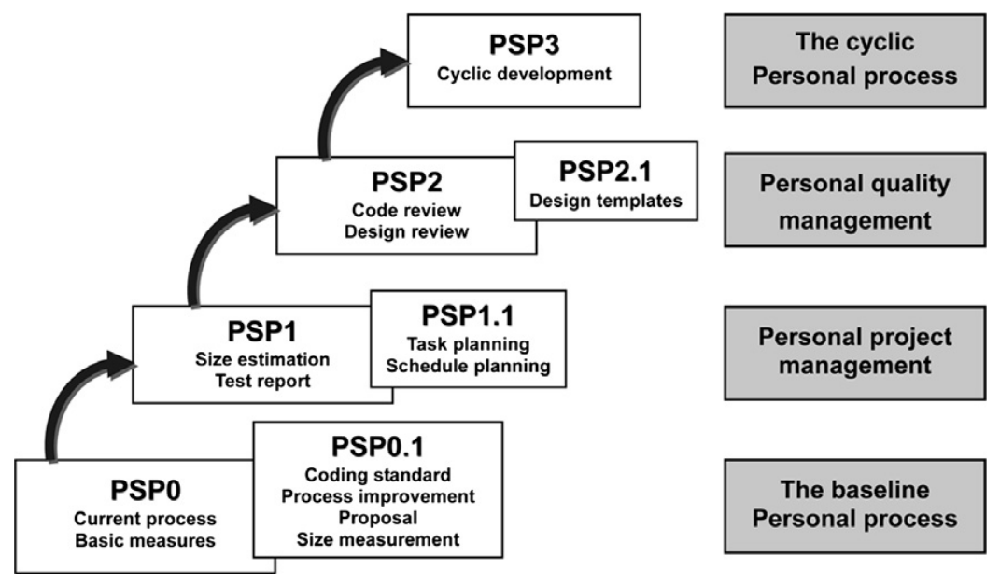
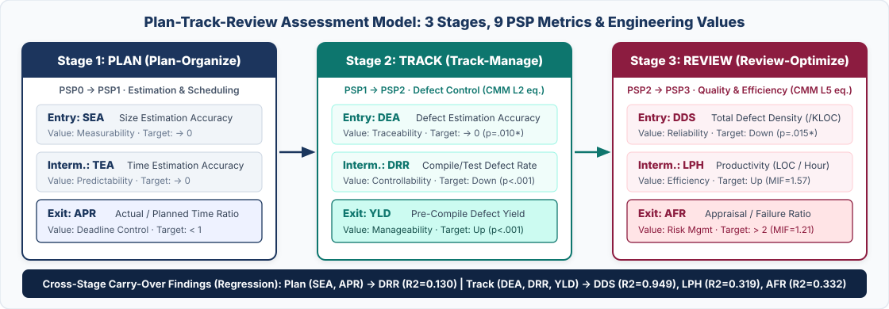
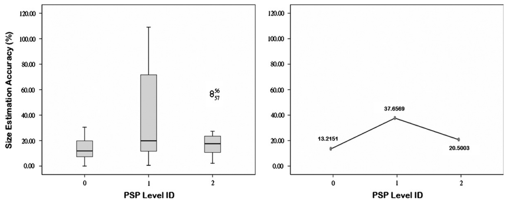
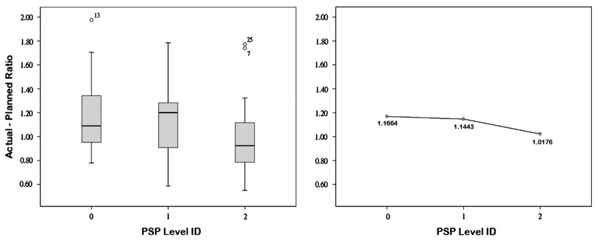
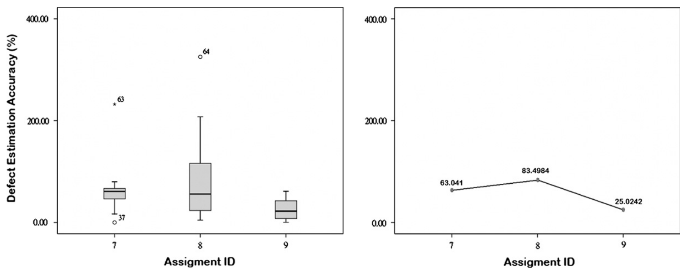
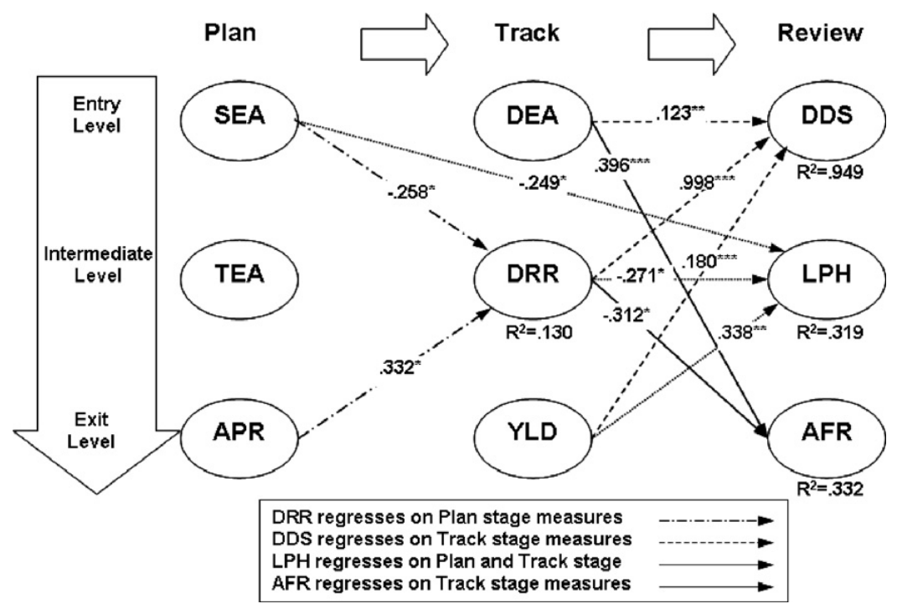

<!-- _class: lead -->

Information and Software Technology (IST) · 第 53 卷 137–148 頁 · 2011

# 評估 PSP 訓練紀律化軟體開發之成效：Plan–Track–Review 評估模型

Assessing PSP Effect in Training Disciplined Software Development: A Plan–Track–Review Model

串聯核心<strong>軟體工程價值</strong>與<strong>九項關鍵 PSP 度量指標</strong>，結合階段式評估框架、平均數／中位數雙軌分析與跨階段路徑模型

<strong>沈文祥（Wen-Hsiang Shen）</strong>a、<strong>薛念林（Nien-Lin Hsueh）</strong>a、<strong>李維曼（Wei-Mann Lee）</strong>b,* 
a 逢甲大學資訊工程學系 · b 僑光科技大學資訊科技系 
<code>shen@ocu.edu.tw</code> · <code>nlhsueh@fcu.edu.tw</code> · <code>dwl@ocu.edu.tw</code>

DOI: 10.1016/j.infsof.2010.09.004 · 2009 年 11 月收稿 · 2010 年 9 月接受 · 2011 年刊出（Elsevier B.V.）

<!--
論文書目與研究背景：
本論文發表於 Information and Software Technology（IST, Vol. 53, pp. 137-148, 2011），由逢甲大學沈文祥、薛念林與僑光科技大學李維曼（通訊作者）共同撰寫。研究聚焦於個人軟體流程（Personal Software Process, PSP）在培養紀律化軟體開發能力上的成效評估問題。

核心研究貢獻：
1. 透過系統性文獻回顧建構「Plan-Track-Review」三階段評估模型，將九項關鍵 PSP 度量指標（SEA、TEA、APR；DEA、DRR、YLD；DDS、LPH、AFR）與可量測性、可預測性、可控性、可管理性、可靠性及效率等軟體工程價值完整對應。
2. 採用更嚴格的絕對值估算準確度公式與統一六步驟評估程序，結合平均數參數檢定（t 檢定與 ANOVA）及抗極端值之中位數改進因子（MIF），並對照外部學術與業界基準（Wesslen 2000；Hayes & Over 1997）。
3. 以 18 週研究所 PSP 專課（16 位研究生、160 份完整作業）進行實證，發現 Track 階段品質控制成效顯著、Plan 階段規模估算需較長學習曲線，並透過迴歸與準路徑分析證實前期階段對後期品質與效率具跨階段延續效應。
-->

---

## 簡報大綱

1

<a href="#3">研究動機與研究問題</a> PSP 評估碎片化現象、三大方法論困境與三項核心研究問題。

2

<a href="#5">Plan–Track–Review 評估框架</a> PSP 生命週期階段、九項指標對應工程價值與六步驟統一程序。

3

<a href="#8">實證研究設計與資料稽核</a> 18 週研究所課程（N = 16、160 份作業）、三組資料集與零錯誤檢核。

4

<a href="#9">實證結果與路徑分析</a> 箱形／折線趨勢、ANOVA、跨階段迴歸（R2 高達 0.949）與外部基準比較。

5

<a href="#13">討論、問卷調查與業界應用</a> 學生採納落差（程式碼審查 80% vs. 規模量測 20%）、PROBE 門檻與裁剪建議。

6

<a href="#14">研究效度威脅與結論</a> 內外部效度控制、核心貢獻總結與後續複製研究展望。

<strong>核心發現預覽：</strong>PSP 訓練對軟體工程師的<strong>缺陷可控性、流程可管理性與產品可靠性</strong>（Track 與 Review 階段，<code>p ≤ 0.015</code>）具高度正向顯著成效；相對地，<strong>專案規模與時程可預測性</strong>（Plan 階段）需更長學習週期，但前期階段表現仍顯著影響後期品質與生產力。

<!--
論文結構導覽：
- 第 1 節（緒論，pp. 137-138）：指出既有 PSP 成效評估缺乏系統性機制，提出三項核心研究問題。
- 第 2 節（理論架構，pp. 138-140）：連結 PSP 與 CMM/ISO9001 標準，將 PSP 生命週期劃分為 Plan-Organize、Track-Manage、Review-Optimize 三階段，定義九項核心指標（表 1、表 2）並剖析三大評估困境（表 3）。
- 第 3 節（研究方法，pp. 140-141）：說明 2008 年秋季研究所課程設計、絕對值正規化公式、t 檢定／ANOVA、迴歸與準路徑分析，以及統一六步驟評估程序。
- 第 4 節（研究結果，pp. 142-145）：呈現圖 2-6 趨勢圖、表 4 ANOVA、表 5 迴歸模型、圖 7 準路徑圖與表 6 綜合評估報表。
- 第 5 節（討論，pp. 146-147）與附錄 A（表 7-8）：探討效度威脅、估算不顯著原因、教學觀察、學生問卷與業界導入策略。
- 第 6 節（結論，p. 147）：總結學術與教學價值，呼籲更多實證複製研究。
-->

---

## 1. 研究動機與評估方法論困境

<h3>PSP 訓練的效益與推廣阻力</h3>
<ul>
<li><strong>已驗證之 SPI 效益：</strong>提升專案估算準確度、降低缺陷數、提早發現缺陷並提升生產力，適用大學部、研究所與業界。</li>
<li><strong>實務導入摩擦：</strong>人工記錄繁瑣、資料易出錯（既有研究約 5% 有誤）、教師批改負荷重，且完整兩週訓練對業界成本偏高。</li>
<li><strong>評估視角碎片化：</strong>專案管理研究偏重估算指標，軟體品質研究偏重缺陷指標，缺乏連結<strong>工程價值</strong>的整體評估模型。</li>
</ul>

<h3>既有文獻之三大評估困境</h3>
<ul>
<li><strong>1. 比較範圍與層級：</strong>PSP3 僅含 1 份作業（10A），因此以 <code>PSP0 vs. PSP2</code> 階段彙總平均比較更具統計合理性。</li>
<li><strong>2. 估算準確度公式不一致：</strong>Humphrey 用 <code>(實際 − 計畫) / 計畫</code>，Hayes 符號相反，Prechelt 用比值；含正負號加總會導致高估 −300% 與低估 +200% 相互抵銷！</li>
<li><strong>3. 判定門檻分歧：</strong>統計顯著性、經驗門檻（如 <code>AFR &gt; 2</code>、<code>YLD ≥ 40%</code>）與中位數改進因子（MIF）各行其是。</li>
</ul>

<strong>本研究之方法論突破：</strong>採用更嚴格的<strong>絕對值估算準確度公式</strong>（<code>|實際 − 計畫| / 計畫</code>），並結合<strong>平均數檢定與中位數基準</strong>，徹底避免正負抵銷與極端值扭曲。

<!--
動機與方法論困境深層解析（第 1 節與第 2.5 節）：
自 1995 年 Humphrey 於 SEI 提出 PSP 以來，大量研究證實其軟體流程改善（SPI）潛力，但推廣始終受限於繁瑣記錄導致動機下降與資料真實性受損（Johnson & Disney 1999 指出約 5% 資料有缺陷）。

三大評估困境細節：
1. 區間選擇：PSP0 至 PSP2 各包含多份作業（1A-3A、4A-6A、7A-9A），而 PSP3 僅有單一循環整合練習 10A。採階段彙總平均（repeated measures）比較 PSP0 與 PSP2 可顯著提升統計檢定力（Dyba et al. 2006）。
2. 正負抵銷陷阱：若學生在某作業高估 300%（-300%）而在另一作業低估 200%（+200%），傳統有號公式會算出 -100%，掩蓋了總計 500% 的偏離誤差。改採絕對值（Hayes 1997 首提、Wesslen 2000 實作）符合工業界嚴格標準，且使「趨近於零」成為一致的改善方向。
3. 多元基準整合：同時結合趨勢準則（表 3）、參數統計顯著性與代表過半數學生表現的中位數改進因子（MIF），兼顧嚴謹檢定與直覺化教學回饋。
-->

---

## 1. 核心研究問題

RQ 1

系統化評估途徑與軟體工程目標

應採取何種方式探討 PSP 訓練成效議題？PSP 訓練究竟能達成哪些明確的軟體工程目標？

RQ 2

軟體工程價值與關鍵指標選取

應選用哪些軟體工程價值與對應的 PSP 度量指標，方能完整評估各階段的訓練成效？

RQ 3

精確評估方法與有意義之教學回饋

如何精確評估這些指標，並將分析結果轉譯為對 PSP 教師與學生皆具參考價值的具體回饋？

<strong>與工業界標準對齊（第 2.1 節）：</strong>比照 CMM 與 ISO 9001「說你所做、做你所說」之核心精神，PSP 能在個人層級直接落實關鍵 SPI 六大要素中的四項：<strong>預算、時程、品質與生產力</strong>（顧客與員工滿意度則屬長期 TSP/TQM 範疇）。

<!--
研究範疇與理論定位（第 1 節與第 2.1 節）：
三項研究問題與全文架構一一對應：
- RQ1：將 PSP 演進式生命週期收斂為 Plan-Organize、Track-Manage、Review-Optimize 三大階段，與 Boehm 螺旋模型及 Deming PDCA 品質循環高度呼應。
- RQ2：從 Humphrey 的三項基礎度量（規模、時間、缺陷）篩選出九項核心衍生指標，逐一對應六大軟體工程價值（表 1），並依階段分層為入門、中階、結業指標（表 2）。
- RQ3：提出六步驟統一評估程序（第 3.5 節）與雙軌綜合報表（表 6），同時對照班級內部同儕中位數與外部學術／業界常模。

排除指標說明（第 2.3 節）：
個人程式設計能力、先備軟體工程知識與審查速率（LOC/hr）因既有文獻顯示其在 SPI 評估中不顯著，或難以在單一 PSP 週期內訓練養成，故排除於本評估模型之外。
-->

---

## 2. PSP 生命週期與階段式視角

<ul>
<li><strong>計畫—組織階段（PSP0 ➔ PSP1）：</strong>建立需求定義、程式規範、規模／時間估算（PROBE）與時程規劃，培養<strong>可量測性與可預測性</strong>。</li>
<li><strong>追蹤—管理階段（PSP1 ➔ PSP2）：</strong>記錄編碼、編譯與測試期間的缺陷數量、類型與注入／移除階段，培養<strong>可追蹤性、可控性與可管理性</strong>（對應個人版 CMM Level 2）。</li>
<li><strong>審查—最佳化階段（PSP2 ➔ PSP3）：</strong>落實設計審查、程式碼審查與事後檢討，培養<strong>流程可靠性與效率</strong>（邁向 CMM Level 5 最佳化層級）。</li>
</ul>

刻意區隔 <strong>Track（追蹤）</strong>與 <strong>Review（審查）</strong>兩階段，有助於釐清缺陷管控紀律與審查驅動最佳化各自帶來的成效。

圖 1. PSP 生命週期演進階段（PSP0 至 PSP3；引自 Shen et al., 2011）。

<!--
PSP 生命週期演進細節（第 2.2 節與圖 1）：
圖 1 展示 Humphrey 所定義的四層 PSP 演進架構：
- PSP0（基準個人流程）：現有開發流程、時間與缺陷記錄表、缺陷類型標準；PSP0.1 加入程式規範、規模量測與流程改善提案（PIP）。
- PSP1（個人規劃流程）：引入 PROBE 規模估算與測試報告；PSP1.1 加入任務與時程規劃。
- PSP2（個人品質管理）：引入程式碼審查與設計審查檢核表；PSP2.1 加入設計樣板。
- PSP3（循環個人流程）：透過循環式增量整合擴展至較大型程式開發。

與既有文獻對照（第 2.4 節）：
相較於 Hayes 的細粒度分段，Plan-Track-Review 模型更為精簡直覺，不僅呼應 Hilburn 的教學階段劃分，更有助於在成效歸因時釐清教師、學員與 PSP 工具本身之貢獻。
-->

---

## 2. Plan–Track–Review 三階段評估模型

<strong>漸進式三層指標設計（表 2）：</strong>每階段均配置<strong>入門（Entry）</strong>、<strong>中階（Intermediate）</strong>與<strong>結業（Exit）</strong>指標。本研究新納入之 <code>APR</code>（實耗／計畫時間比，借鏡 Prechelt 與 Humphrey 實獲值概念）作為計畫階段結業指標；<code>AFR</code> 則總結整體 PSP 品質效率。

<!--
九項 PSP 指標定義與工程價值對應（第 2.3 節、表 1 與表 2）：
九項指標皆由規模、時間、缺陷三項基礎度量衍生：
1. Plan 階段：
   - SEA（入門）：規模估算準確度 -> 衡量軟體規模之能力 -> 可量測性（Measurability）。
   - TEA（中階）：時間估算準確度 -> 預測開發時間之能力 -> 可預測性（Predictability）。
   - APR（結業）：實際／計畫時間比 -> 如期達成專案期限之能力 -> 可預測性／可控性（本研究自建）。
2. Track 階段：
   - DEA（入門）：缺陷估算準確度 -> 預測缺陷頻率之能力 -> 可預測性／可追蹤性。
   - DRR（中階）：編譯與測試階段缺陷移除率 -> 降低編譯與測試缺陷之能力 -> 可控性（Controllability）。
   - YLD（結業）：產出率（首次編譯前注入且於編譯前移除之缺陷比例） -> 編譯前控制缺陷之能力 -> 可管理性（Manageability）。
3. Review 階段：
   - DDS（入門）：總缺陷密度（每千行程式碼移除缺陷數） -> 降低缺陷密度之能力 -> 可靠性（Reliability）。
   - LPH（中階）：生產力（新增與修改 LOC 除以總開發小時） -> 提升生產力之能力 -> 效率（Efficiency）。
   - AFR（結業）：評估失敗比（設計與程式審查時間佔編譯與測試時間之比例） -> 管理風險之能力 -> 可靠性／效率。
-->

---

## 2. 趨勢判定準則與統一六步驟評估程序

<h3>九項指標趨勢判定準則（表 3）</h3>

| 預期改善趨勢 | 對應指標 | 判定意涵 |
| :--- | :--- | :--- |
| <strong>趨近於 0</strong> | <code>SEA</code>、<code>TEA</code>、<code>DEA</code> | 採 <code>|實際 − 計畫| / 計畫</code> 絕對值正規化 |
| <strong>持續下降</strong> | <code>DRR</code>、<code>DDS</code> | 編譯測試缺陷率與總缺陷密度降低 |
| <strong>持續上升</strong> | <code>YLD</code>、<code>LPH</code> | 編譯前缺陷攔截率與每小時產出提升 |
| <strong>小於 1</strong> | <code>APR</code> | 於計畫時程內如期完工 |
| <strong>大於 2</strong> | <code>AFR</code> | 審查投入時間達除錯重工時間兩倍以上 |

<h3>統一六步驟評估程序（第 3.5 節）</h3>
<ol class="small-text">
<li><strong>擇定評估區間：</strong>優先採階段區間（<code>PSP0 ➔ PSP2</code>）；僅出現於 PSP2 之 <code>DEA</code>、<code>AFR</code> 採 <code>7A–9A</code>。</li>
<li><strong>執行統計檢定：</strong>進行成對 t 檢定與單因子 ANOVA（輔以事後多重比較）。</li>
<li><strong>比對預期趨勢：</strong>檢核變動方向是否符合表 3（絕對值化後全數具單向一致性）。</li>
<li><strong>綜合判定改善：</strong>同時權衡趨勢方向與 t 檢定統計顯著性。</li>
<li><strong>計算中位數改進因子（MIF）：</strong>建立班級同儕內部基準並對照外部常模。</li>
<li><strong>轉譯工程價值回饋：</strong>依表 1 轉化為個人或班級之強弱項診斷報告。</li>
</ol>

<!--
指標解讀注意事項（第 3.5 節）：
由於 SEA、TEA、DEA 均已轉換為絕對值誤差，數值呈現「下降趨勢」代表趨近於零，亦即估算準確度「提升」，切勿望文生義誤判為準確度下降。

三組資料集切分邏輯（第 3.1 與 3.3 節）：
- 第一組資料集（PSP0 至 PSP2）：檢定 SEA、TEA、APR、DRR、YLD、DDS、LPH 七項指標，利用階段彙總平均提高統計檢定力。
- 第二組資料集（作業 7A 至 9A）：檢定僅於 PSP2 起存在之 DEA 與 AFR；作業 10A（PSP3）因涉及循環整合效應，不納入 t 檢定與 ANOVA。
- 第三組資料集（涵蓋 PSP0–PSP3 四階段，共 16 人 × 4 階段 = 64 筆階段觀測值）：用於跨階段多元迴歸與準路徑分析。
-->

---

## 3. 實證研究設計與資料完整性控管

16 位研究生

13 位碩士生與 3 位博士生修習 18 週專屬 PSP 研究所課程（2008 年秋季班）。

160 份作業

全員完成 Humphrey 10 份標準程式作業（14 人用 Java、2 人用 C++，每週 1 份）。

0 筆錯誤

全數 160 份作業之缺陷注入與移除總數稽核完全一致，零資料不一致錯誤。

<h3>18 週課程安排與雙軌視覺分析</h3>
<ul class="small-text">
<li><strong>第 1–4 週：</strong>PSP 基礎觀念、時間／缺陷記錄方法與程式規範建立。</li>
<li><strong>第 5–14 週：</strong>實作 <code>PSP0</code> 至 <code>PSP3</code> 共 10 份程式作業與課堂討論。</li>
<li><strong>第 15–18 週：</strong>產出個人分析報表、教師回饋與課後採納意願問卷。</li>
<li><strong>雙軌圖表檢核：</strong>箱形圖（顯示中位數與極端值鬚線）搭配折線圖（群體平均趨勢）。</li>
</ul>

<h3>研究倫理與資料效度控管</h3>
<ul class="small-text">
<li><strong>無績效懲罰機制：</strong>學生事前不知情且只要誠實完成十份作業即保證及格，杜絕「刻意美化數據」之失真威脅。</li>
<li><strong>認證 PSP 教師逐份稽核：</strong>嚴格檢查每份作業的計算、遺漏與轉錄錯誤。</li>
<li><strong>極端值交叉驗證：</strong>另建排除 IQR 極端值之備份資料集交叉檢核，確認結論不受離群值左右。</li>
</ul>

<!--
研究情境與代表性（第 3.1 與 5.1.1 節）：
受測學生逾三分之二有兼職工作且幾乎皆同時修習其他課程，時間壓力情境相當貼近一般軟體開發實務（雖與全職業界專案仍有差異）。

資料品質稽核（第 5.1.1 節）：
依循 Paulk 等人（2009）建議，本研究逐份比對「總注入缺陷數」與「總移除缺陷數」，在全部 160 份作業中未發現任何資料不一致錯誤，有效克服 Johnson & Disney（1999）指出的 PSP 記錄失真風險。

統計分析設計（第 3.2-3.4 節）：
1. 描述統計：以箱形圖與平均數折線圖雙軌並陳，防止極端值誤導平均趨勢判讀。
2. 推論統計：成對 t 檢定與單因子 ANOVA（含 Post-Hoc 檢定），協助區辨學習效應與流程效應（Wesslen 2000）。
3. 結構關係：以各後期指標為依變數、所有前期階段指標為自變數建立多元迴歸模型，再繪製準路徑分析圖（類比 Green et al. 2005 之偏最小平方法）。
-->

---

## 4. 實證結果（一）：計畫階段趨勢（SEA、TEA、APR）

圖 2. 規模估算準確度（SEA）：PSP0 至 PSP2 之箱形圖（左）與平均趨勢圖（右）。

圖 4. 實際／計畫時間比（APR）：PSP0 至 PSP2 穩定收斂至 1.0 附近。

<strong>計畫階段診斷：</strong><strong>SEA 並未改善</strong>（平均誤差由 <code>13.2% ➔ 20.5%</code>，MIF = <code>0.67</code>），且在 PSP1 初次導入 PROBE 時離散度明顯擴大；<strong>TEA</strong> 僅微幅下降（<code>29.8% ➔ 26.2%</code>，未達顯著）。相對地，<strong>APR</strong> 穩定收斂（<code>1.16 ➔ 1.01</code>，MIF = <code>1.10</code>），顯示時程規劃工具已初見成效。

<!--
計畫階段結果深入解析（第 4.1 節與圖 2-4）：
- SEA（圖 2）：與多數既有文獻不同，學生絕對規模估算誤差不降反升（13.2% -> 20.5%）。箱形圖顯示 PSP1 階段盒身明顯擴張，反映學生剛從直覺猜測轉用正式 PROBE 規模估算工具時的不穩定性；在業界情境中，此類誤差可能導致嚴重的成本低估（Lederer & Prasad 2000）。
- TEA（圖 3，文中摘要）：平均時間估算誤差自 29.8% 微降至 26.2%（MIF = 1.14），盒身緊湊但未達統計顯著。
- APR（圖 4）：自 1.16 穩步降至 1.01，逼近「小於 1（準時完工）」目標，顯示 PSP1 引入之時程規劃有助於控制交期。
- 為何 SEA/TEA 不顯著（第 5.2 節）？驗證分析已排除：(1) 絕對值公式效應、(2) 極端值干擾（IQR 備份資料集結果一致）、(3) 記錄錯誤（問卷 Q2-Q4 平均 3.8-4.0/5）。作者歸因於學生缺乏實務開發經驗，且規劃估算能力較品質控管需要更長的學習曲線。
-->

---

## 4. 實證結果（二）：追蹤與審查趨勢及 ANOVA 檢定

圖 5. 缺陷估算準確度（DEA）於 7A–9A（PSP2）之顯著改善：誤差由 63.6% 驟降至 25.0%。

<h3>顯著單因子 ANOVA 摘要（表 4）</h3>

| 指標變數 | 評估區間 | 自由度 | F 值 | p 值 |
| :--- | :--- | :---: | :---: | :---: |
| <strong>DDS</strong>（總缺陷密度） | PSP0–PSP2 | (2, 45) | 9.106 | <strong>&lt; 0.001</strong> |
| <strong>YLD</strong>（編譯前產出率） | PSP0–PSP2 | (2, 45) | 35.637 | <strong>&lt; 0.001</strong> |
| <strong>DRR</strong>（編譯測試缺陷率） | PSP0–PSP2 | (2, 45) | 12.634 | <strong>&lt; 0.001</strong> |
| <strong>DEA</strong>（缺陷估算準確度） | 7A–9A | (2, 45) | 3.978 | <strong>0.026</strong> |

<strong>品質改善最為突出：</strong>全數四項達 ANOVA 統計顯著之指標皆屬<strong>軟體品質與缺陷控管</strong>維度；事後檢定證實 PSP0 至 PSP2 品質呈漸進式提升，且 DEA 於 <code>7A–9A</code> 區間顯著進步。

<!--
追蹤與審查趨勢及 ANOVA 解析（第 4.1-4.2 節、圖 5-6 與表 4）：
- DEA（圖 5）與 AFR（圖 6）：此二指標自 PSP2 始出現，故以 7A-9A 為評估區間。DEA 誤差由 63.6% 大幅下降至 25.0%（t 檢定 p = 0.010、ANOVA F = 3.978, p = 0.026、MIF = 2.79）；AFR 則呈小幅上升（1.12 -> 1.15, MIF = 1.21）。
- DEA 與 AFR 的反向鏡像現象：圖 5（DEA）與圖 6（AFR）在 7A、9A 與 8A 的盒身大小恰呈相反分佈，折線趨勢亦近乎互為倒影。因三份作業皆處於相同 PSP2 流程階段，此現象源於程式經驗差異、審查速率或學習效應，而非流程處理變動。
- ANOVA 檢定結果（表 4）：九項指標中僅四項達顯著水準，依 F 值排序為 YLD（35.637）、DRR（12.634）、DDS（9.106）與 DEA（3.978），顯示短期 PSP 訓練對品質與缺陷控管之立竿見影效果遠勝於專案規模與時間估算。
-->

---

## 4. 實證結果（三）：跨階段迴歸與準路徑分析

圖 7. 跨階段顯著路徑流向圖（n = 64 階段觀測值；*p &lt; .05、**p &lt; .01、***p &lt; .001）。

<h3>顯著多元迴歸模型摘要（表 5）</h3>

| 依變數 | R2 | p 值 | 顯著預測迴歸方程式 |
| :--- | :---: | :---: | :--- |
| <strong>DDS</strong> | <strong>0.949</strong> | &lt; 0.001 | <code>+0.162 YLD + 0.997 DRR + 0.221 DEA − 4.156</code> |
| <strong>AFR</strong> | <strong>0.332</strong> | 0.001 | <code>+0.009 DEA − 0.004 DRR + 0.407</code> |
| <strong>LPH</strong> | <strong>0.319</strong> | 0.001 | <code>+0.093 YLD − 0.083 DRR + 0.148 SEA + 33.04</code> |
| <strong>DRR</strong> | <strong>0.130</strong> | 0.038 | <code>+54.656 APR − 0.501 SEA + 22.242</code> |

<strong>跨階段延續效應獲得驗證：</strong>當編譯測試缺陷率（<code>DRR</code>）下降時，總缺陷密度（<code>DDS</code>，解釋力高達 94.9%）同步降低，並顯著推升<strong>生產力（<code>LPH</code>）</strong>與<strong>審查效益（<code>AFR</code>）</strong>；計畫階段之 <code>APR</code> 與 <code>SEA</code> 亦顯著影響追蹤階段之 <code>DRR</code>。

<!--
跨階段迴歸與準路徑分析深入解讀（第 4.3-4.4 節、表 5 與圖 7）：
本研究利用第三組資料集（16 位學生 × 4 個 PSP 階段 = 64 筆觀測值），嚴格限定僅以後期階段變數對所有前期階段變數進行迴歸分析，以檢驗階段間之前置影響力：
- 式 (3) AFR（R^2 = 0.332, p = 0.001）：受追蹤階段之 DEA 與 DRR 顯著預測。
- 式 (4) LPH（R^2 = 0.319, p = 0.001）：受 YLD、DRR 及 SEA 顯著影響；編譯前產出率愈高、編譯測試缺陷率愈低，開發效率愈高。
- 式 (5) DDS（R^2 = 0.949, p < 0.001）：追蹤階段全數三項指標（DEA、DRR、YLD）共同解釋 94.9% 變異，而計畫階段指標均未直接進入，凸顯整體軟體品質高度奠基於追蹤階段的缺陷管控表現。
- 式 (6) DRR（R^2 = 0.130, p = 0.038）：受計畫階段 APR 與 SEA 顯著預測，證明 Plan -> Track 確實存在延續效應；但偏低的 R^2（13%）也暗示計畫階段仍遺漏個人開發經驗與知識等關鍵因子。
- 模型觀察限制：圖 7 中 TEA 成為孤立節點（無顯著外連路徑），且少數路徑（如 SEA -> LPH 正係數）呈現直覺悖論，有待更大樣本進一步釐清。
-->

---

## 4. PSP 成效綜合評估報表與外部基準比較（表 6）

| 階段 | 指標 | 平均數趨勢（本研究） | t 檢定 p 值 | 中位數 MIF（本研究） | Wesslén (2000)（學術常模） | Hayes &amp; Over (1997)（業界常模） |
| :--- | :---: | :---: | :---: | :---: | :---: | :---: |
| <strong>Plan</strong> | <code>SEA</code> | 13.2 ➔ 20.5 | – | (0.67) | 2.1 | 2.5 |
| <strong>Plan</strong> | <code>TEA</code> | 29.8 ➔ 26.2 | – | 1.14 | 3.0 | 1.75 |
| <strong>Plan</strong> | <code>APR</code> | 1.16 ➔ 1.01 | – | 1.10 | – | – |
| <strong>Track</strong> | <code>DEA</code> | 63.6 ➔ 25.0 | <strong>0.010*</strong> | <strong>2.79</strong> | – | – |
| <strong>Track</strong> | <code>DRR</code> | 119.2 ➔ 43.6 | <strong>&lt; 0.001**</strong> | <strong>3.02</strong> | – | – |
| <strong>Track</strong> | <code>YLD</code> | 5.7% ➔ 47.9% | <strong>&lt; 0.001**</strong> | <strong>42.7%</strong> | 39% | 50% |
| <strong>Review</strong> | <code>DDS</code> | 121.8 ➔ 70.9 | <strong>0.015*</strong> | <strong>1.83</strong> | 2.0 | 2.5 |
| <strong>Review</strong> | <code>LPH</code> | 23.1 ➔ 24.9 | – | 1.57 | (0.86) | 無增減 |
| <strong>Review</strong> | <code>AFR</code> | 1.12 ➔ 1.15 | – | 1.21 | – | – |

<strong>整體評估結論：</strong>超過半數學生（<code>MIF &gt; 1</code>）在 <strong>9 項軟體工程目標中的 8 項</strong>皆獲得改善（僅 SEA 例外）。分階段表現呈現<strong>追蹤階段優異、審查階段中等、計畫階段偏弱</strong>，與 Wesslén 研究所學術常模高度吻合（YLD 42.7% vs. 39%；DDS MIF 1.83 vs. 2.0）。

<!--
綜合報表與外部基準對照解析（第 4.5 節與表 6）：
- Track 階段（表現優異）：三項指標全數達統計顯著——DEA（63.6% -> 25.0%, p = 0.010, MIF = 2.79）、DRR（119.2 -> 43.6 缺陷/KLOC, p < 0.001, MIF = 3.02）與 YLD（5.7% -> 47.9%, p < 0.001, 中位數 42.7% 優於 Wesslen 的 39% 並逼近 Hayes 業界水準 50%）。細分編譯（DRRC）與測試（DRRT）子指標亦呈現一致改善。
- Review 階段（表現中等）：DDS 顯著降低（121.8 -> 70.9, p = 0.015, MIF = 1.83）；LPH 小幅成長（23.1 -> 24.9 LOC/hr, MIF = 1.57，優於 Wesslen 的 0.86 與 Hayes 的持平）；AFR 略增至 1.15（MIF = 1.21），但尚未達 > 2 之理想門檻。
- Plan 階段（表現偏弱）：僅 APR 呈現穩定收斂（1.16 -> 1.01, MIF = 1.10），TEA 僅微幅改善（MIF = 1.14），SEA 則倒退（MIF = 0.67）。
-->

---

## 5. 討論：學生問卷回饋與教學／業界導入建議

<h3>課後問卷：認知重要性 vs. 未來採納意願（附錄 A）</h3>

| PSP 技術項目（表 7–8） | 認知重要性 | 承諾未來採用 |
| :--- | :---: | :---: |
| <strong>程式碼審查（Code Review）</strong> | <strong>86.7%</strong> | <strong>80.0%</strong> |
| <strong>設計審查（Design Review）</strong> | 80.0% | <strong>73.3%</strong> |
| <strong>計畫與排程（Planning）</strong> | 80.0% | 66.7% |
| <strong>工時估算（Effort Est.）</strong> | 73.3% | 66.7% |
| <strong>設計樣板（Design Template）</strong> | 73.3% | 60.0% |
| <strong>事後檢討（Postmortem）</strong> | <strong>86.7%</strong> | 33.3% |
| <strong>工時日誌（Effort Log）</strong> | 73.3% | 33.3% |
| <strong>規模量測（Size Meas.）</strong> | 60.0% | <strong>20.0%</strong> |

整體助益評分：<strong>4.7 / 5.0</strong>（課程品質）與 <strong>4.5 / 5.0</strong>（未來職場）。

<h3>教育課程與業界實務建議</h3>
<ul class="small-text">
<li><strong>工具自動化減負：</strong>規模與工時記錄之「高認同、低採納」落差，凸顯導入自動化收集工具（如 LEAP、HackyStat、Eclipse 外掛）的迫切性。</li>
<li><strong>課程分層配置：</strong>完整 PSP 宜開設於研究所階段（大學生缺乏實務與程式經驗）；其他資工課程可在簡化記錄前提下採部分導入。</li>
<li><strong>業界專案裁剪：</strong>以貼近企業實務、善用外部函式庫的任務取代 Humphrey 數學題，縮短週期但須涵蓋 Plan–Track–Review 三階段。</li>
<li><strong>導入「顧客代理人」：</strong>於專案期間介入 2–4 次協助驗收測試，且業界評核應優先聚焦各階段<strong>結業指標</strong>（<code>APR</code>、<code>YLD</code>、<code>AFR</code>）。</li>
</ul>

<!--
教師觀察與問卷深度分析（第 5.3-5.4 節與附錄 A 表 7-8）：
- 表 7（五點量表）：學生高度理解 PSP 課程內容（4.3）、具填寫日誌能力（4.0）、自評日誌準確度 3.8，並高度肯定 PSP 對課程品質（4.7，66.7% 給滿分）與未來職場（4.5）之幫助，未來採用概念意願達 4.1。
- 表 8（認知重要性 vs. 承諾採用率）：揭示顯著的「人工記錄鴻溝」——高達 86.7% 認為事後檢討重要、73.3% 認為工時日誌重要，卻僅 33.3% 願於未來持續採用，規模量測採納率更低至 20%。反觀程式碼審查（80.0%）與設計審查（73.3%）獲得極高承諾，呼應本研究將 AFR 列為核心結業指標的觀點。
- PROBE 教學瓶頸：即使對研究生而言，PROBE 估算仍具高度挑戰，教師須耗費大量心力輔導除錯。
- 業界導入對策（第 5.4 節）：PSP 本身缺乏終端產品驗收機制，故建議納入外部「顧客代理人（customer proxy）」（Honig 2008）定期驗收，並依企業需求彈性設定各指標權重與定期回訓。
-->

---

## 5. 研究效度威脅與 6. 結論

<h3>研究效度威脅與對策（第 5.1 節）</h3>
<ul class="small-text">
<li><strong>內部效度：</strong>透過無績效懲罰、事後不知情收案、教師逐份稽核（160 份作業 0 錯誤），並採 IQR 備份驗證與抗極端值中位數（MIF）雙軌報表加以嚴密控管。</li>
<li><strong>外部效度：</strong>受測人數精簡（<code>N = 16</code>；迴歸與路徑分析為 <code>n = 64</code> 筆階段觀測），但透過高同質性樣本及與 Hayes（<code>n = 298</code>）、Wesslén（<code>n = 131</code>）大樣本外部基準對照提升詮釋力。</li>
<li><strong>推論與延續性：</strong>模型廣泛推論仍需更大規模複製研究，以釐清短期與長期 PSP 保留效應並納入個人先備能力因子。</li>
</ul>

<h3>核心貢獻與關鍵啟示</h3>
<ul class="small-text">
<li><strong>1. Plan–Track–Review 評估模型：</strong>系統化對應九項關鍵 PSP 指標與六大軟體工程價值，區分入門／中階／結業層級。</li>
<li><strong>2. 嚴謹雙軌評估程序：</strong>結合絕對值正規化、六步驟流程、參數檢定與內外部中位數基準，提供師生具體診斷回饋。</li>
<li><strong>3. 實證真相檢視：</strong>PSP 能快速強化<strong>缺陷可控性與產品可靠性</strong>（<code>p ≤ 0.015</code>）、中度提升<strong>效率</strong>，而<strong>規模／時間估算</strong>則需長期養成，且前期階段確具跨階段延續影響力。</li>
</ul>

<strong>未來研究方向：</strong>納入個人開發經驗等遺漏變數以精進 Plan–Track–Review 模型、區辨短期與長期訓練留存效益，並推動跨校與業界之實證複製研究。

<!--
效度威脅與結論總結（第 5.1 節與第 6 節）：
- 內部效度：對照 Wohlin 等人（1999）四類效度威脅，特別防範人工記錄錯誤（Johnson & Disney 1999）、極端值偏誤（Paulk et al. 2009）與刻意數據造假。
- 外部效度：儘管受限於緊湊的高等教育課綱導致樣本數有限（N = 16），64 筆階段觀測值與大型外部常模對照已為 Plan-Track-Review 模型提供扎實的初步驗證。
- 實務價值：表 6 綜合評估報表讓教師與學生得以同時依據「業界標準、學術標準與班級同儕標準」檢視紀律化軟體開發的養成進度。
-->

---

<!-- _class: closing -->

# 感謝聆聽！敬請指教

評估 PSP 訓練紀律化軟體開發之成效：Plan–Track–Review 評估模型

<strong>沈文祥（Wen-Hsiang Shen）</strong> · <code>shen@ocu.edu.tw</code> &nbsp;|&nbsp; <strong>薛念林（Nien-Lin Hsueh）</strong> · <code>nlhsueh@fcu.edu.tw</code> 
<strong>李維曼（Wei-Mann Lee）*</strong> · <code>dwl@ocu.edu.tw</code> 
逢甲大學資訊工程學系 · 僑光科技大學資訊科技系 
Information and Software Technology, Vol. 53, pp. 137–148, 2011 · DOI: 10.1016/j.infsof.2010.09.004

<!--
論文典藏書目資訊：
- 篇名：Assessing PSP effect in training disciplined software development: A Plan-Track-Review model
- 作者：沈文祥（Wen-Hsiang Shen，逢甲大學）、薛念林（Nien-Lin Hsueh，逢甲大學）、李維曼（Wei-Mann Lee，僑光科技大學，通訊作者）
- 期刊：Information and Software Technology (IST), Vol. 53, pp. 137-148, 2011 (Elsevier B.V.)
- DOI：10.1016/j.infsof.2010.09.004
- 關鍵詞：Personal software process (PSP)、Software process improvement (SPI)、Effect assessment、Plan-Track-Review
-->

