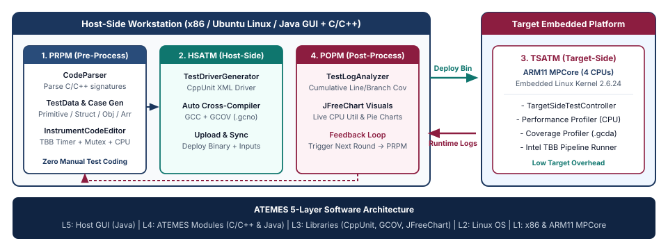
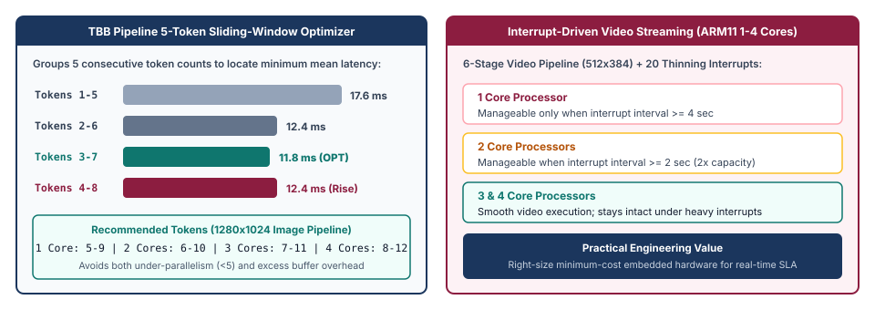
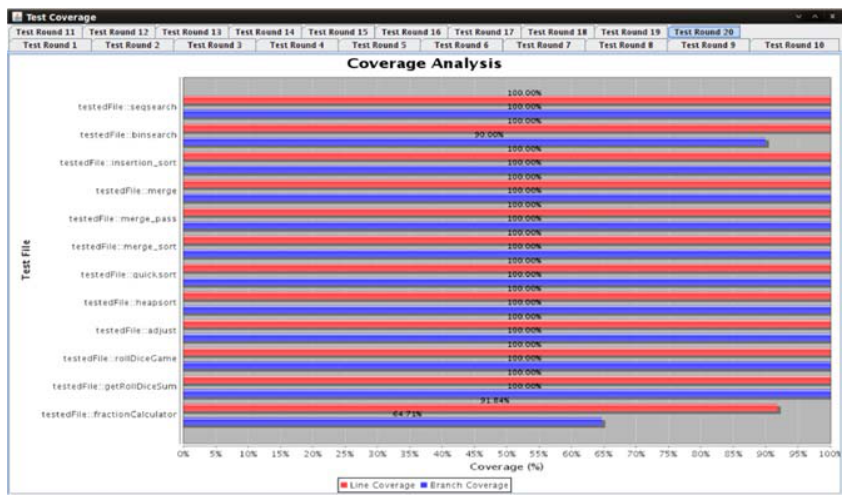
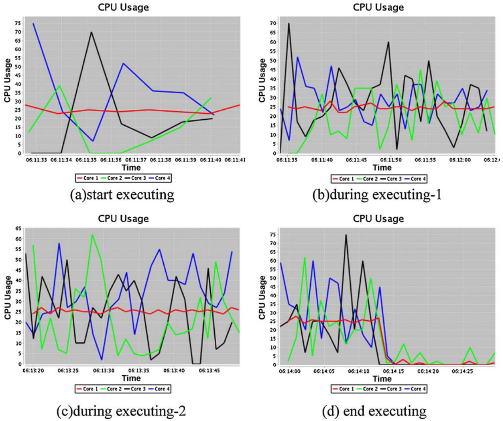
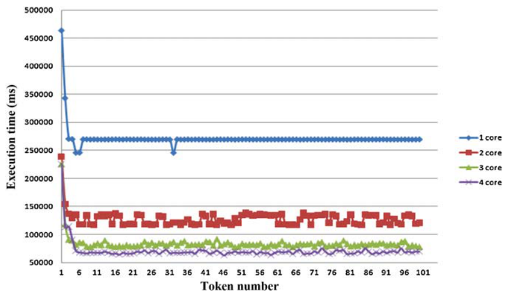
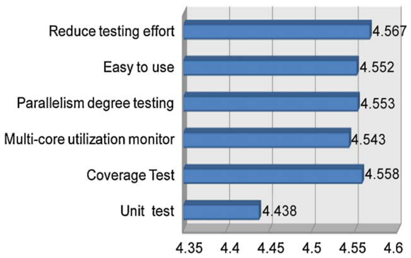

<!-- _class: lead -->

The Journal of Systems and Software (JSS) · Vol. 85, pp. 43–60 · 2012

# Automatic Testing Environment for Multi-Core Embedded Software — ATEMES

Host–Target Automated Multi-Round Cross-Testing for <strong>Complex C/C++ Unit Testing</strong>, <strong>GCOV Coverage</strong>, <strong>ARM11 Multi-Core Profiling</strong>, and <strong>Intel TBB Pipeline Token Optimization</strong>

<strong>Chorng-Shiuh Koonga,*</strong>, <strong>Chihhsiong Shihb</strong>, <strong>Pao-Ann Hsiungc</strong>, <strong>Hung-Jui Laia</strong>, <strong>Chih-Hung Changd</strong>, <strong>William C. Chub</strong>, <strong>Nien-Lin Hsuehe</strong>, and <strong>Chao-Tung Yangb</strong> 
a National Taichung Univ. · b Tunghai Univ. · c National Chung Cheng Univ. · d Hsiuping Inst. of Tech. · e Feng Chia Univ., Taiwan

DOI: 10.1016/j.jss.2011.08.030 · Supported by NSC 97-2218-E-142-001, 98-2220-E-142-001, 99-2220-E-142-001, and 99-2220-E-029-001

<!--
Paper Metadata & Archival Context:
- Full Title: Automatic testing environment for multi-core embedded software—ATEMES
- Publication: The Journal of Systems and Software (JSS), Vol. 85, Issue 1, pp. 43–60, 2012 (Received Apr 2, 2010; Revised Jul 7, 2011; Accepted Aug 29, 2011; Available online Sep 10, 2011; Elsevier; DOI: 10.1016/j.jss.2011.08.030).
- Authors: Chorng-Shiuh Koong (Corresponding author, NTCU), Chihhsiong Shih (Tunghai Univ.), Pao-Ann Hsiung (CCU), Hung-Jui Lai (NTCU), Chih-Hung Chang (Hsiuping), William C. Chu (Tunghai Univ.), Nien-Lin Hsueh (Feng Chia Univ.), and Chao-Tung Yang (Tunghai Univ.).
- Core Premise: Presents ATEMES, an end-to-end host–target automatic cross-testing environment validated on an ARM11 MPCore (4-CPU) embedded platform that generates complex C/C++ test inputs/cases/drivers, automates multi-round GCOV coverage, monitors per-core CPU utilization in real time, and auto-tunes Intel TBB pipeline token parameters.
-->

---

## Presentation Outline

1

<a href="#3">Motivation &amp; Competitive Landscape</a> Six multi-core embedded testing challenges and 12-feature comparison against prior tools.

2

<a href="#5">ATEMES Architecture (4 Modules &amp; 5 Layers)</a> Host–target cross-testing across PRPM, HSATM, TSATM, and POPM on x86 &amp; ARM11.

3

<a href="#6">Automated Generation &amp; TBB Optimization</a> Complex C/C++ data/driver generation, multi-round GCOV, and 5-token sliding-window tuning.

4

<a href="#8">Experiments 1–4: Coverage, Unit, CPU &amp; TBB</a> ARM11 MPCore validation: 100% coverage convergence, 4-core profiling, and TBB tokens.

5

<a href="#11">Experiments 5–6: Usability &amp; Interrupts</a> N = 30 user study (α = 0.928, mean 4.533/5) and real-time 512×384 video interrupt response.

6

<a href="#13">Discussion, Limitations &amp; Conclusion</a> Engineering trade-offs, manual oracle/coverage limits, and ART/web-regression roadmap.

<!--
Structural Map of the Paper:
- Section 1 (Introduction, pp. 43–44): Defines the six fundamental challenges of multi-core embedded testing and introduces ATEMES's host–target cross-testing solution.
- Section 2 (Related Work, pp. 44–45): Critiques JaBUTi/ME (Delamaro et al., 2006), Justitia (Ki et al., 2008), and Cho & Choi (2008) for lacking full automation and multi-round testing.
- Section 3 (Automatic Testing Mechanism, pp. 45–49): Presents recursive complex-type test data generation (Fig. 1), CppUnit test case/driver generation (Figs. 2–4), cumulative GCOV coverage (Figs. 5–7), and TBB 5-token sliding-window optimization (Figs. 8–11).
- Section 4 (ATEMES Tool Design, pp. 49–54): Details the 4 modules (PRPM, HSATM, TSATM, POPM), 5-layer architecture (Fig. 13), class/sequence diagrams, and 12-step multi-round workflow (Fig. 29).
- Section 5 (Experiments 1–6, pp. 54–58): Empirical evaluations on ARM11 MPCore (4 CPUs): Coverage (Exp 1), Unit Testing (Exp 2), CPU Utilization (Exp 3), TBB Parallelism (Exp 4), Usability (Exp 5), and Interrupt Response Time (Exp 6).
- Section 6 (Conclusion, pp. 58–59): Summarizes Table 7 competitive matrix, limitations, and future directions.
-->

---

## 1. Motivation: Six Challenges in Multi-Core Embedded Testing

<h3>1. Repetitive Manual Effort</h3>

Most unit tools only generate empty skeletons or primitive types—forcing engineers to hand-code complex C/C++ structs, objects, and test drivers.

<h3>2. Embedded Constraints</h3>

Tight memory, storage, and CPU budgets prohibit running heavy instrumentation, parsing, and visualization directly on target hardware.

<h3>3. Parallelism Tuning</h3>

In Intel TBB pipelines, too few tokens starve multi-core CPUs while too many waste buffers—manual trial-and-error is slow and imprecise.

<h3>4. Coverage Sufficiency</h3>

Single-round manual inputs rarely achieve high line and branch coverage without automated multi-round feedback loops.

<h3>5. Synchronization &amp; Races</h3>

Interrupt-driven multi-core tasks risk race conditions on shared data, demanding instrumented mutex protection and core-level monitoring.

<h3>6. High-Level Reliability</h3>

Tools must prove real-world usability, low adoption threshold, and measurable effort reduction for practicing test engineers.

<!--
Problem Decomposition (Section 1, pp. 43–44):
- The paper explicitly frames multi-core embedded software testing around six interlocking issues (Issues 1–6) and maps each ATEMES mechanism directly to them:
  - Issue (1) -> Recursive complex-type data generator + automatic CppUnit test case/driver synthesis.
  - Issues (2) & (3) -> Host–target cross-testing + automated multi-round TBB token-number benchmarking.
  - Issues (1) & (4) -> Automated multi-round GCOV coverage accumulation with live host visualization.
  - Issues (3) & (5) -> Instrumented C++ mutex locks shielding shared performance data + ARM Linux per-core utilization syscalls + interrupt-interval response testing.
  - Issue (6) -> Structured 44-item usability and reliability assessment with N = 30 graduate subjects.
-->

---

## 1. Related Work &amp; Feature Comparison (Table 7)

### Gaps in Prior Embedded Testing Tools
- **JaBUTi/ME (Delamaro et al., 2006):** Mobile Java coverage tool; offloads to desktop, but **no automatic test input/case generation**.
- **Justitia (Ki et al., 2008):** Emulator-based interface testing; requires **deep embedded expertise** and lacks multi-round testing.
- **Cho &amp; Choi (2008):** Host–target XML wizard tool; **cannot auto-generate** test scripts/drivers or run multi-round loops.

<strong>ATEMES Advantage:</strong> Satisfies <strong>12 / 12</strong> capabilities—uniquely uniting complex C/C++ types, auto drivers, multi-round coverage, live visuals, TBB tuning, and interrupt testing.

| Capability (Table 7) | **ATEMES** | Putrycz | Alexandrov | Thies |
| :--- | :---: | :---: | :---: | :---: |
| Pure software solution | **Yes** | Yes | Yes | Yes |
| Auto multi-round testing | **Yes** | — | — | — |
| Auto generate test driver | **Yes** | — | — | — |
| Auto generate test data / cases | **Yes** | Yes | — | — |
| Complex data structures | **Yes** | — | — | — |
| Parallel / TBB perf. testing | **Yes** | — | Yes | Yes |
| Test result visualization | **Yes** | Yes | Yes | — |
| Runtime result presentation | **Yes** | — | — | — |
| Cross-platform testing | **Yes** | Yes | — | — |
| Multi-core platform support | **Yes** | — | Yes | Yes |
| Interrupt performance test | **Yes** | — | — | — |
| Coverage testing | **Yes** | — | — | — |

<!--
Competitive Positioning (Section 2 & Table 7, pp. 44–45, 59):
- Table 7 benchmarks ATEMES against three contemporary software-based testing/parallel-analysis suites (Erik Putrycz, Alexei Alexandrov, and William Thies) across 12 dimensions.
- Five capabilities are completely unique to ATEMES: (1) automatic multi-round testing, (2) automatic test driver generation, (3) complex C/C++ data structure support in automated unit testing, (4) live runtime result presentation, and (5) combined interrupt performance + coverage testing on multi-core embedded hardware.
-->

---

## 2. ATEMES Architecture: 4 Modules &amp; 5 Layers

<strong>Closed-Loop Multi-Round Cross-Testing (12 Steps, Fig. 29):</strong> <code>PRPM</code> parses &amp; instruments C/C++ source ➔ <code>HSATM</code> builds CppUnit driver, cross-compiles with GCOV, and uploads binary ➔ <code>TSATM</code> executes on ARM11 &amp; streams logs ➔ <code>POPM</code> analyzes/visualizes &amp; triggers next round until threshold is met.

<!--
System Architecture & Module Responsibilities (Section 4, Figs. 12–29, pp. 49–54):
- ATEMES cleanly separates heavy analysis/UI on an x86 Ubuntu workstation from lightweight execution on the embedded ARM11 MPCore target:
  1. PRPM (Pre-Processing Module): Code Manager + CodeParser + UnitTestCaseGenerator + InstrumentCodeEditor (injects mutex locks, TBB timers, and CPU utilization probes).
  2. HSATM (Host-Side Auto-Testing Module): TestDriverGenerator (CppUnit XML driver) + AutomaticTestHost (cross-compilation with GCC/GCOV flags and deployment to target).
  3. TSATM (Target-Side Auto-Testing Module): TargetSideTestController + Profiler Manager (Performance Profiler + Test Coverage Profiler writing .gcda/.gcov and CPU logs).
  4. POPM (Post-Processing Module): TestLogManager + TestLogAnalyzer + PaintChart (JFreeChart real-time visualization + feedback signal to PRPM/HSATM).
- Five software layers (Fig. 13): Hardware (x86 / ARM11 MPCore) -> Linux OS -> Libraries (CppUnit, GCOV, JFreeChart) -> ATEMES Modules (C/C++ & Java) -> Host GUI (Java).
-->

---

## 3. Core Algorithms: Complex Data, Drivers &amp; Multi-Round Coverage

<h3>🧬 Complex C/C++ Data &amp; CppUnit Generation</h3>
<ul class="small-text">
<li><strong>Code Parsing:</strong> Extracts <code>Function-List</code>, <code>Struct-List</code>, <code>Object-List</code>, and <code>Parameter-List</code> automatically.</li>
<li><strong>Recursive Data Synthesis (Fig. 1):</strong> Handles <strong>primitive</strong> (int/float/char), <strong>array</strong> (dimension-aware volume), <strong>struct</strong>, and <strong>object</strong> types by recursively decomposing attributes to primitives.</li>
<li><strong>Auto CppUnit Case &amp; Driver (Figs. 2–4):</strong> Instruments variable declarations, loop readers, <code>CPPUNIT_ASSERT</code> checks, and XML driver orchestration—supporting both <strong>automatic</strong> (crash/segfault) and <strong>semi-automatic</strong> (oracle-verified) modes.</li>
</ul>

<h3>🔄 Multi-Round Cumulative GCOV Coverage</h3>
<ul class="small-text">
<li><strong>Auto-Instrumentation:</strong> <code>HSATM</code> injects GCC GCOV flags producing executable + <code>*.gcno</code>, uploaded to ARM11.</li>
<li><strong>Cumulative Flag Union (Figs. 5–7):</strong> After each round, target returns <code>*.gcda</code> / <code>.gcov</code>. <code>POPM</code> maintains a binary <code>flag[i]</code> vector:</li>
<li><code>flag[i] = 1</code> if line/branch <code>i</code> executed in <strong>current round OR any prior round</strong> (<code>totalCoverage</code> log).</li>
<li><strong>Adaptive Loop:</strong> Repeats test generation &amp; cross-execution until user-defined coverage threshold is satisfied, updating charts live.</li>
</ul>

<!--
Automated Generation & Coverage Algorithms (Sections 3.1 & 3.2, Figs. 1–7, pp. 45–48):
- Automatic vs. Semi-Automatic Unit Testing: In fully automatic mode, ATEMES generates inputs, test cases, and drivers with zero user input and records runtime exceptions or segmentation faults (without checking semantic output values). In semi-automatic mode, the engineer supplies expected output oracles, and CPPUNIT_ASSERT verifies functional correctness.
- Complex Type Handling (e.g., binsearch() taking a struct array + two ints in Fig. 3): Recursively inspects Struct-List and Object-List to emit file-reading loops for every primitive leaf field—eliminating tedious boilerplate.
- Multi-Round Coverage Union: Because embedded memory is limited, executing smaller batches per round and merging binary execution flags on the host (POPM) steadily accumulates line and branch coverage without exhausting target RAM.
-->

---

## 3. Parallelism Tuning: TBB 5-Token Sliding-Window &amp; Interrupts

<strong>Zero-Guesswork TBB Tuning (Figs. 8–11):</strong> ATEMES auto-instruments TBB timers, replaces <code>ppline.run(int)</code> with sweeping token counts (1..100), and averages <strong>5-token sliding windows</strong> to pinpoint the optimal range (e.g., 3–7 tokens at 11.8 ms before latency rises at 4–8).

<!--
Intel TBB Pipeline Performance & Interrupt Testing Mechanism (Section 3.3 & 5.7, Figs. 8–11, pp. 48–49):
- In Intel Threading Building Blocks (TBB), pipeline token count controls maximum in-flight concurrency: too few tokens under-utilize multi-core CPUs, whereas excessive tokens inflate buffer allocation and scheduling overhead.
- ATEMES automatically instruments target TBB code with TBB timers and C++ mutexes (to prevent race conditions on shared metrics), sweeps token numbers across multi-round runs on ARM11, and computes rolling 5-token means (empirically found to smooth single-run noise best). When the rolling mean hits a local minimum and begins rising (e.g., 17.6 ms -> 12.4 ms -> 11.8 ms -> 12.4 ms), ATEMES recommends that optimal 5-token window.
- Similarly, for interrupt-driven real-time systems, ATEMES auto-generates test drivers sweeping core count, interrupt interval, and interrupt count (20 sequential interrupts per interval) to empirically determine minimum hardware core requirements.
-->

---

## 4. Exp 1–2: Multi-Round Coverage &amp; Unit Testing on ARM11

### Experimental Platform
- **Host:** Intel Core 2 Duo P8400 · Ubuntu 9.10
- **Target:** **ARM11 MPCore Baseboard (4 CPUs)** · Linux 2.6.24

### Exp 1: Coverage (13 Data-Structure Functions)
- Random inputs (3 sets/round × 20 rounds); ~0.9–1.0 s/round.
- **11 of 12 tabulated functions** hit **100% line coverage** (e.g., `quicksort` 26% ➔ 100% by Rd 2; `heapsort` 100% by Rd 10; `rollDiceGame` 100% by Rd 9).
- `fractionCalculator` plateaued at **92% line / 65% branch** (random testing limit).

### Exp 2: Semi-Automatic Unit Testing (6 Programs)
- **30 test cases** across 6 homework programs (Table 3):
  - **67% Success (20)** · **16.5% Failure (5)** · **16.5% Error (5)** (caught segfaults in `insertionsort` &amp; out-of-range in `getSubString`).

Fig. 30 from paper: Live host-side line &amp; branch coverage visualization across rounds.

<!--
Experiments 1 & 2 Details (Sections 5.1 & 5.2, Tables 1–3, Figs. 30–31, pp. 54–55):
- Experiment 1 (Tables 1–2): Evaluated 13 data-structure functions (mostly struct-array inputs) across 20 automated rounds on ARM11 MPCore. Execution time per round remained tightly bounded at 889–1,006 ms. Functions like merge, adjust, and getRollDiceSum reached 100% line & branch coverage in Round 1; seqsearch, merge_pass, merge_sort, and quicksort converged by Round 2; insertion_sort by Round 5; rollDiceGame by Round 9; heapsort by Round 10. Only binsearch (100% line, 90% branch) and fractionCalculator (92% line, 65% branch) did not reach 100% branch coverage, motivating Adaptive Random Testing (ART) in future work.
- Experiment 2 (Table 3, Fig. 31): Six student data-structure programs (5 test cases each = 30 total) demonstrated automated fault categorization into Success (20, 67%), Assertion Failure (5, 16.5% in electricityTariff, factorial, fractionCalculator), and Runtime Error (5, 16.5%: 2 out-of-range exceptions in getSubString and 3 segmentation faults in insertionsort).
-->

---

## 4. Exp 3: Real-Time Multi-Core CPU Utilization Monitoring

Fig. 32 from paper: Live JFreeChart tracking of ARM11 Core 1–4 utilization over time.

### Workload &amp; Profiling Setup
- **Target Program:** Multi-threaded 2D matrix multiplication (**256 × 128** multiplied by **128 × 256**).
- ATEMES auto-instrumented ARM Linux CPU-utilization probes and streamed real-time core telemetry from ARM11 back to the host GUI.

### Per-Core Utilization Summary (Table 4)
| CPU Core | Average (%) | Max (%) | Min (%) |
| :--- | :---: | :---: | :---: |
| **Core 1** | 25.06% | 28% | 22% |
| **Core 2** | **18.98%** | 62% | 0% |
| **Core 3** | 29.93% | **76%** | 0% |
| **Core 4** | **31.06%** | 75% | 0% |

<strong>Load-Imbalance Diagnosis:</strong> Live per-core profiling exposes that Core 1 stays steady (22–28%) while Cores 3 &amp; 4 peak at 75–76% and Core 2 dips to 18.98%—guiding thread scheduling optimization.

<!--
Experiment 3 Multi-Core Telemetry (Section 5.3, Table 4, Fig. 32, pp. 55–56):
- Observing how an embedded multi-threaded application actually utilizes physical cores on target hardware is essential for diagnosing load imbalance and OS scheduler bottlenecks.
- Fig. 32(a)–(d) captures four sequential snapshots during the 256x128 * 128x256 matrix multiplication run on the 4-core ARM11 MPCore board.
- Table 4 reveals asymmetric utilization: Core 4 leads in average load (31.06%, max 75%), followed by Core 3 (29.93%, max 76%), Core 1 (25.06%, very narrow 22–28% band), and Core 2 (lowest average 18.98%, max 62%).
-->

---

## 4. Exp 4: Intel TBB Pipeline Parallelism Benchmark

### 4-Stage Parallel Image Processing Pipeline
- **Input:** **1280 × 1024** image.
- **Stages:** `Read Image` (seq) ➔ **`Gradient` (parallel)** ➔ **`Smooth` (parallel)** ➔ `Output Image` (seq).
- **Automated Sweep:** ATEMES generated **100 token datasets (1–100)** and executed multi-round cross-testing across **1, 2, 3, and 4 CPU cores**.

### Recommended Token Windows (Table 5)
| Active ARM11 Cores | 1 Core | 2 Cores | 3 Cores | 4 Cores |
| :--- | :---: | :---: | :---: | :---: |
| **Optimal Token Range** | **5–9** | **6–10** | **7–11** | **8–12** |

<strong>Key Finding:</strong> Below 5 tokens, execution efficiency drops sharply; above the recommended window, speedup saturates while memory/buffer overhead rises unnecessarily.

Fig. 33 from paper: Execution latency vs. token count (1–100) across 1–4 ARM11 cores.

<!--
Experiment 4 TBB Parallelism Findings (Section 5.4, Table 5, Fig. 33, p. 56):
- Automating 100 token configurations × 4 core settings = 400 embedded benchmark runs without manual code edits or recompilation demonstrates ATEMES's practical value for parallel performance engineering.
- Fig. 33 confirms monotonic scaling with core count (4 cores fastest, 1 core slowest) and a clear knee around 5–12 tokens: each additional core shifts the optimal 5-token window upward by +1 token (5–9 for 1 core, 6–10 for 2 cores, 7–11 for 3 cores, 8–12 for 4 cores).
-->

---

## 4. Exp 5: Usability &amp; Reliability Assessment (N = 30)

Fig. 34 from paper: Mean Likert ratings (1–5 scale) across all 6 evaluation dimensions.

### Study Protocol &amp; Scale Reliability (Table 6)
- **Participants:** **30 graduate CS/IS students** (2-hour hands-on trial covering unit, coverage, CPU monitor, and TBB tasks).
- **Instrument:** **44 Likert items** (1–5) across **4 functional** + **2 non-functional** dimensions (Ease of Use, Effort Reduction).

4.533 / 5.0

Overall Mean Rating (Variance = 0.012)

α = 0.928

Cronbach's Alpha (&gt; 0.70 high internal consistency)

### Constructive User Feedback
- **Praised:** Zero manual test-driver coding, live runtime visuals, low learning threshold, strong effort reduction.
- **Improvement Requests:** More polished GUI aesthetics, higher stability, web-based result persistence, and user manuals.

<!--
Experiment 5 Usability & Reliability Analysis (Section 5.5, Table 6, Fig. 34, p. 57):
- To address Issue (6) (high-level reliability & acceptability), 30 graduate students executed all four core ATEMES workflows over a 2-hour lab session using data structure, matrix multiplication, and image processing programs.
- Reliability verification: Cronbach's alpha = 0.928 (standardized alpha = 0.927 across 44 items), far exceeding the 0.70 threshold and confirming high internal consistency.
- All six dimensions scored above 4.5 / 5.0 (overall mean 4.533, variance 0.012). The authors transparently note that graduate students with limited prior exposure to automated multi-core testing may exhibit strong positive novelty effects, and document four concrete user-requested improvements (UI aesthetics, stability, web storage of results, and operation manuals).
-->

---

## 4. Exp 6: Interrupt-Driven Video Streaming Response Time

<h3>🎥 Real-Time 6-Stage TBB Video Pipeline</h3>
<ul class="small-text">
<li><strong>Workload:</strong> Streaming video frames (<strong>512 × 384</strong>) processed in 6 stages: (1) Read stream ➔ (2) Salt-and-pepper noise reduction ➔ (3) Morphological opening ➔ (4) Noise removal &amp; rotation ➔ (5) Laplacian edge detection ➔ (6) Write stream (Stages 2–6 parallelized via TBB).</li>
<li><strong>Interrupt Stress Test:</strong> Whenever an external interrupt fires, the interrupt handler executes <strong>image thinning</strong>.</li>
<li><strong>Automation:</strong> ATEMES auto-generated drivers firing <strong>20 sequential interrupts</strong> per interval across <strong>1 to 4 ARM11 cores</strong>.</li>
</ul>

<h3>⏱️ Core Count vs. Sustainable Interrupt Rate</h3>
<table>
<thead>
<tr><th>ARM11 Cores</th><th>Sustainable Interval</th><th>Observed System Behavior</th></tr>
</thead>
<tbody>
<tr><td><strong>1 Core</strong></td><td><strong>≥ 4 sec</strong></td><td>Handles load only at ≥ 4 s; degrades under tighter intervals</td></tr>
<tr><td><strong>2 Cores</strong></td><td><strong>≥ 2 sec</strong></td><td>Doubles interrupt tolerance; manageable at ≥ 2 s</td></tr>
<tr><td><strong>3 Cores</strong></td><td><strong>Smooth</strong></td><td>Video streaming stays intact &amp; responsive under interrupts</td></tr>
<tr><td><strong>4 Cores</strong></td><td><strong>Smooth</strong></td><td>Consistent low response time with maximum headroom</td></tr>
</tbody>
</table>

<strong>Hardware Right-Sizing:</strong> Enables embedded architects to pick the <strong>lowest-budget multi-core CPU</strong> guaranteed to meet real-time interrupt SLAs without weeks of manual benchmarking.

<!--
Experiment 6 Interrupt Response Evaluation (Section 5.7, Figs. 35–40, pp. 58–59):
- Real-time embedded products must balance bill-of-materials (BOM) cost against strict interrupt response deadlines.
- Using ATEMES's multi-round driver generator (requiring only that the tester identify the interrupt handler function name), the authors benchmarked a 6-stage TBB video-streaming pipeline under 20 sequential image-thinning interrupts across varying interrupt intervals and 1–4 ARM11 cores (Figs. 37–40).
- Results establish exact hardware feasibility thresholds: 1 core requires intervals >= 4 s, 2 cores sustain >= 2 s, and 3–4 cores keep video streaming smooth and unaffected—turning a traditionally manual, error-prone capacity-planning task into an automated push-button experiment.
-->

---

## 5. Discussion: Strengths, Trade-Offs &amp; Limitations

<h3>✅ Key Engineering Contributions</h3>
<ul class="small-text">
<li><strong>End-to-End Automation:</strong> Parses C/C++, generates complex struct/object/array inputs, synthesizes CppUnit cases/drivers, cross-compiles, deploys, and visualizes live—with <strong>zero manual test code</strong>.</li>
<li><strong>Resource-Aware Cross-Testing:</strong> Keeps heavy host tools off constrained ARM11 hardware while capturing genuine target-side execution and per-core telemetry.</li>
<li><strong>Parallelism &amp; SLA Guidance:</strong> Automates TBB token tuning and interrupt-interval capacity planning across 1–4 cores.</li>
<li><strong>High User Acceptance:</strong> Validated at <strong>4.533 / 5.0</strong> (α = 0.928) across 30 users.</li>
</ul>

<h3>⚠️ Acknowledged System Limitations</h3>
<ul class="small-text">
<li><strong>Manual Unit-Test Oracle:</strong> Fully automatic mode detects crashes/segfaults, but verifying expected return values still requires manual oracle input in semi-automatic mode.</li>
<li><strong>Coverage Criteria Scope:</strong> Current GCOV integration supports <strong>line and branch coverage</strong> only (excluding MC/DC or path coverage).</li>
<li><strong>Random Input Saturation:</strong> Pure random generation plateaued on complex branches (<code>fractionCalculator</code> at 65% branch coverage).</li>
<li><strong>UI &amp; Web Persistence:</strong> Desktop Java GUI needs aesthetic polish, stability hardening, and web-based archival of regression histories.</li>
</ul>

<!--
Critical Evaluation & Threats to Validity (Sections 5.6 & 6, pp. 57–59):
- The authors candidly identify two structural limitations in Section 6: (1) semantic unit testing still requires human-supplied expected outputs (the classic test-oracle problem), and (2) structural coverage is currently bounded to GCOV line and branch metrics.
- Additionally, Experiment 1's plateau on fractionCalculator illustrates the theoretical limitation of uniform random testing on narrow branch predicates, motivating the shift to Adaptive Random Testing (ART) or concolic/symbolic methods.
- Despite these boundaries, ATEMES fills a major practical void by integrating unit, coverage, multi-core profiling, TBB tuning, and interrupt testing inside a single pure-software cross-testing environment.
-->

---

## 5. Conclusion &amp; Future Research Directions

<strong>Core Contribution:</strong> <strong>ATEMES</strong> delivers a unified, pure-software <strong>host–target automatic testing environment</strong> for multi-core embedded C/C++ software—achieving up to <strong>100% multi-round coverage</strong>, real-time <strong>4-core ARM11 profiling</strong>, automated <strong>Intel TBB token optimization</strong>, and <strong>4.533 / 5.0</strong> user satisfaction while eliminating manual test-driver coding.

<strong>🎯 1. Adaptive Random Testing (ART)</strong> Replace pure random input synthesis with ART and smarter constraint-aware generators to break branch-coverage plateaus.

<strong>🌐 2. Web-Based Regression Suite</strong> Integrate web persistence and full regression testing to archive multi-version embedded test logs and polish UI stability.

<strong>🧵 3. Deep Race-Condition Testing</strong> Expand multi-core analysis with automated multi-thread race-condition detection and broader parallel pipeline benchmarks.

<!--
Conclusion & Future Roadmap (Section 6, p. 59):
- ATEMES demonstrates that a pure-software host–target architecture can simultaneously solve developer productivity (zero manual test coding for complex C/C++ types), embedded resource limits (host offload + lightweight target profiler), and multi-core tuning (TBB 5-token window + interrupt core sizing).
- Three future directions explicitly prioritized by the authors:
  1. More precise test-data generation algorithms (moving beyond basic random testing toward Adaptive Random Testing).
  2. Full regression testing integrated with web technology for persistent result storage and team collaboration.
  3. Broader multi-core concurrency verification, specifically dedicated multi-thread race condition testing and expanded pipeline efficiency testing.
-->

---

<!-- _class: closing -->

# Thank You for Your Attention!

Automatic Testing Environment for Multi-Core Embedded Software — ATEMES

<strong>Chorng-Shiuh Koonga,*</strong> (<code>csko@mail.ntcu.edu.tw</code>) · <strong>Chihhsiong Shihb</strong> · <strong>Pao-Ann Hsiungc</strong> · <strong>Hung-Jui Laia</strong> 
<strong>Chih-Hung Changd</strong> · <strong>William C. Chub</strong> · <strong>Nien-Lin Hsuehe</strong> · <strong>Chao-Tung Yangb</strong> 
a NTCU · b Tunghai Univ. · c CCU · d Hsiuping Inst. of Tech. · e Feng Chia Univ., Taiwan 
The Journal of Systems and Software (JSS), Vol. 85, pp. 43–60, 2012 · DOI: 10.1016/j.jss.2011.08.030

<!--
Archival Citation & Funding Metadata:
- Citation: Chorng-Shiuh Koong, Chihhsiong Shih, Pao-Ann Hsiung, Hung-Jui Lai, Chih-Hung Chang, William C. Chu, Nien-Lin Hsueh, and Chao-Tung Yang, "Automatic testing environment for multi-core embedded software—ATEMES," The Journal of Systems and Software (JSS), Vol. 85, pp. 43–60, 2012.
- DOI: 10.1016/j.jss.2011.08.030
- Grants: National Science Council, Taiwan R.O.C., grants NSC 97-2218-E-142-001, NSC 98-2220-E-142-001, NSC 99-2220-E-142-001, and NSC 99-2220-E-029-001.
- Keywords: Automatic testing, Embedded software testing, Coverage testing, Unit testing, Cross-testing, Multi-core embedded software testing, TBB testing.
-->

