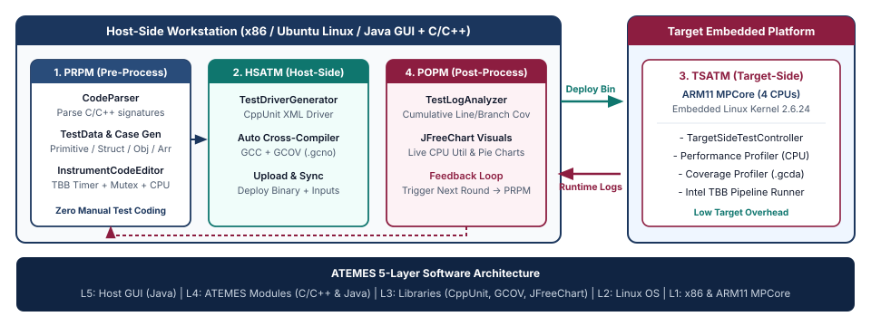
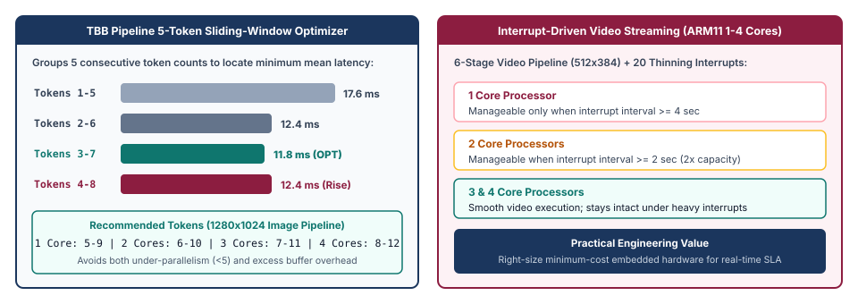
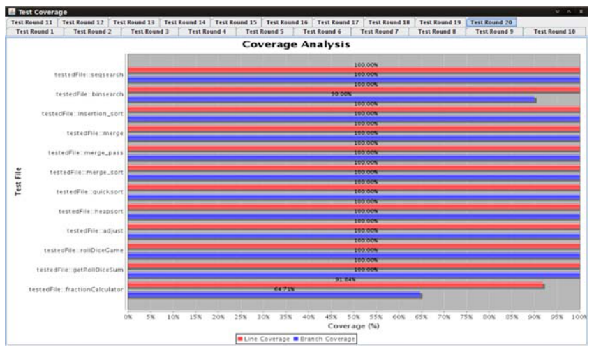
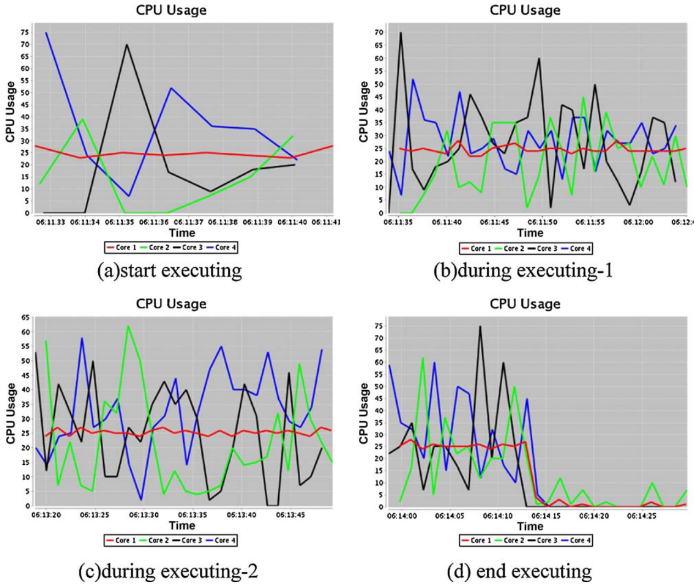
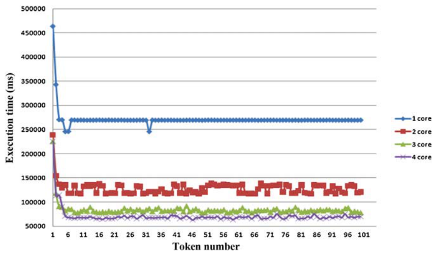
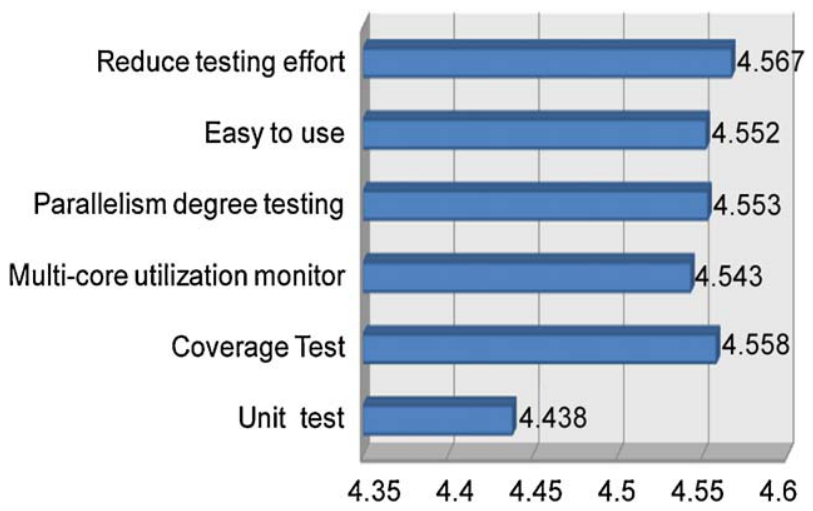

<!-- _class: lead -->

The Journal of Systems and Software (JSS) · 第 85 卷，pp. 43–60 · 2012

# 多核心嵌入式軟體自動化測試環境 — ATEMES

Automatic testing environment for multi-core embedded software — ATEMES

主機—目標端多回合交叉測試架構：整合 <strong>C/C++ 複合型別單元測試</strong>、<strong>GCOV 覆蓋率</strong>、<strong>ARM11 多核心監控</strong>與 <strong>Intel TBB 管線 Token 參數最佳化</strong>

<strong>孔崇旭a,*</strong>、<strong>石志雄b</strong>、<strong>熊博安c</strong>、<strong>賴泓叡a</strong>、<strong>張志宏d</strong>、<strong>朱正忠b</strong>、<strong>薛念林e</strong>、<strong>楊朝棟b</strong> 
a 國立臺中教育大學 · b 東海大學 · c 國立中正大學 · d 修平技術學院 · e 逢甲大學

DOI: 10.1016/j.jss.2011.08.030 · 國科會補助計畫：NSC 97-2218-E-142-001、98-2220-E-142-001、99-2220-E-142-001、99-2220-E-029-001

<!--
論文基本資訊與研究定位：
- 篇名：Automatic testing environment for multi-core embedded software—ATEMES（多核心嵌入式軟體自動化測試環境）
- 發表期刊：The Journal of Systems and Software (JSS), Vol. 85, pp. 43–60, 2012（Elsevier，DOI: 10.1016/j.jss.2011.08.030）。
- 作者群：孔崇旭（通訊作者，台中教大）、石志雄（東海）、熊博安（中正）、賴泓叡（台中教大）、張志宏（修平）、朱正忠（東海）、薛念林（逢甲）、楊朝棟（東海）。
- 核心立意：針對多核心嵌入式軟體測試之六大痛點，建構主機—目標端純軟體自動化測試環境 ATEMES，於 ARM11 MPCore 四核心實機上驗證複合型別 C/C++ 測試自動生成、多回合 GCOV 覆蓋率、即時多核心 CPU 監控、Intel TBB 管線 Token 最佳化與中斷回應效能評估。
-->

---

## 簡報大綱

1

<a href="#3">研究動機與競品功能比較</a> 多核心嵌入式軟體測試的六大挑戰，以及與既有工具之 12 項能力對照。

2

<a href="#5">ATEMES 系統架構（四模組與五層）</a> 跨 x86 主機與 ARM11 目標端之 PRPM、HSATM、TSATM 與 POPM 協同設計。

3

<a href="#6">自動化生成與 TBB 平行調校演算法</a> 複合型別 C/C++ 資料／驅動生成、累積 GCOV 覆蓋率與 5-Token 滑動視窗最佳化。

4

<a href="#8">實驗 1–4：覆蓋率、單元、多核心與 TBB</a> ARM11 四核心實測：100% 覆蓋率收斂、核心負載剖析與 TBB 推薦 Token 範圍。

5

<a href="#11">實驗 5–6：可用性評估與即時中斷測試</a> 30 位研究生實證問卷（α = 0.928、均分 4.533）與 512×384 視訊中斷回應測試。

6

<a href="#13">討論、研究限制與結論</a> 工程權衡、Oracle 與覆蓋率限制，以及 ART 與網頁回歸測試未來藍圖。

<!--
論文結構導覽：
- 第 1 節（緒論，pp. 43–44）：歸納多核心嵌入式測試六大挑戰，提出 ATEMES 之主機—目標端交叉測試架構。
- 第 2 節（相關研究，pp. 44–45）：評析 JaBUTi/ME、Justitia 與 Cho & Choi 等嵌入式測試工具之自動化不足。
- 第 3 節（自動化測試機制，pp. 45–49）：詳述遞迴複合型別資料生成（Fig. 1）、CppUnit 案例與驅動生成（Figs. 2–4）、多回合累積覆蓋率（Figs. 5–7）及 TBB 5-Token 滑動視窗分析（Figs. 8–11）。
- 第 4 節（系統工具設計，pp. 49–54）：說明四大模組（PRPM、HSATM、TSATM、POPM）、五層架構（Fig. 13）與 12 步驟多回合測試流程（Fig. 29）。
- 第 5 節（六大實驗，pp. 54–58）：於 ARM11 MPCore（4 CPUs）執行覆蓋率、單元測試、多核心 CPU 監控、TBB 平行基準、可用性問卷與中斷回應時間測試。
- 第 6 節（結論，pp. 58–59）：呈現 Table 7 綜合功能比較表、系統限制與未來方向。
-->

---

## 1. 研究動機：多核心嵌入式軟體測試的六大挑戰

<h3>1. 繁重重複的人工作業</h3>

多數單元測試工具僅能產生空框架或基本型別，測試工程師被迫手動撰寫 C/C++ 結構、物件與測試驅動程式。

<h3>2. 嵌入式資源極度受限</h3>

嵌入式硬體的記憶體、儲存空間與運算能力有限，無法直接承擔繁重的程式碼解析、插樁與視覺化負荷。

<h3>3. 多核心平行度難調校</h3>

Intel TBB 管線的 Token 數過少會限制平行度，過多則浪費緩衝記憶體；人工反覆試誤耗時且不精準。

<h3>4. 覆蓋率難以充分達標</h3>

單回合手動輸入測資效率低落，缺乏自動化多回合回饋機制來持續推進程式碼列與分支覆蓋率。

<h3>5. 資料同步與競爭危害</h3>

中斷驅動的多核心程式容易在共享資料上發生競爭條件（Race Condition），須透過鎖定機制與核心監控確保測試正確。

<h3>6. 高階可靠度與易用性</h3>

測試環境本身須具備低學習門檻與實證可信度，方能真正減輕工程師負擔並提升實務採用意願。

<!--
六大問題拆解與對應解方（第 1 節，pp. 43–44）：
- 論文明確界定多核心嵌入式測試之六大挑戰，並將 ATEMES 核心機制一一對應：
  - 挑戰 (1) ➔ 遞迴複合型別資料生成 + CppUnit 測試案例／驅動自動合成。
  - 挑戰 (2)(3) ➔ 主機—目標端交叉測試卸載 + Intel TBB 多回合 Token 自動基準最佳化。
  - 挑戰 (1)(4) ➔ 多回合 GCOV 覆蓋率自動累積與主機端即時視覺化。
  - 挑戰 (3)(5) ➔ 自動插樁 C++ Mutex 保護共享統計資料 + ARM Linux 系統呼叫監控各核心使用率 + 中斷間隔回應測試。
  - 挑戰 (6) ➔ 針對 30 位受測者執行 44 題六構面可用性與信度實證評估。
-->

---

## 1. 相關研究與系統功能比較（Table 7）

### 既有嵌入式測試工具之缺口
- <strong>JaBUTi/ME（Delamaro et al., 2006）：</strong>支援行動 Java 覆蓋率並採主機卸載，但<strong>無法自動生成測試資料與案例</strong>。
- <strong>Justitia（Ki et al., 2008）：</strong>基於模擬器的介面錯誤偵測，仰賴<strong>高階嵌入式專家</strong>且缺乏多回合自動化測試。
- <strong>Cho &amp; Choi（2008）：</strong>主從式 XML 精靈工具，仍須<strong>手動撰寫測試腳本與驅動程式</strong>。

<strong>ATEMES 全面領先：</strong>於 Table 7 之 <strong>12 項功能全數具備</strong>，獨創整合複合型別、自動驅動、多回合覆蓋、即時視覺化、TBB 調校與中斷效能測試。

| 功能指標（Table 7） | **ATEMES** | Putrycz | Alexandrov | Thies |
| :--- | :---: | :---: | :---: | :---: |
| 純軟體解決方案 | **Yes** | Yes | Yes | Yes |
| 自動多回合測試 | **Yes** | — | — | — |
| 自動生成測試驅動程式 | **Yes** | — | — | — |
| 自動生成測試資料／案例 | **Yes** | Yes | — | — |
| 支援複合資料結構 | **Yes** | — | — | — |
| 支援平行／TBB 效能測試 | **Yes** | — | Yes | Yes |
| 測試結果視覺化 | **Yes** | Yes | Yes | — |
| 執行期即時結果呈現 | **Yes** | — | — | — |
| 跨平台交叉測試 | **Yes** | Yes | — | — |
| 支援多核心平台 | **Yes** | — | Yes | Yes |
| 支援中斷效能測試 | **Yes** | — | — | — |
| 支援覆蓋率測試 | **Yes** | — | — | — |

<!--
競品定位分析（第 2 節與 Table 7，pp. 44–45, 59）：
- Table 7 將 ATEMES 與三位代表性學者之純軟體測試／平行分析工具（Erik Putrycz、Alexei Alexandrov、William Thies）進行 12 項能力比對。
- ATEMES 具備五項他者皆無之獨特能力：（1）自動多回合測試、（2）自動測試驅動生成、（3）複合 C/C++ 資料結構自動測試、（4）執行期即時結果呈現、（5）多核心中斷效能與覆蓋率整合測試。
-->

---

## 2. ATEMES 系統架構：四大模組與五層堆疊

<strong>閉迴路多回合交叉測試（12 步驟，Fig. 29）：</strong><code>PRPM</code> 解析並插樁 C/C++ 原始碼 ➔ <code>HSATM</code> 生成 CppUnit 驅動、加入 GCOV 交叉編譯並上傳 ➔ <code>TSATM</code> 於 ARM11 執行並回傳日誌 ➔ <code>POPM</code> 即時分析視覺化並觸發下一回合直到達標。

<!--
系統架構與模組職責（第 4 節，Figs. 12–29，pp. 49–54）：
- ATEMES 將繁重解析與圖形介面留於 x86 Ubuntu 工作站，僅於 ARM11 MPCore 目標板部署輕量執行器：
  1. PRPM（前處理模組）：含 Code Manager、CodeParser、UnitTestCaseGenerator 與 InstrumentCodeEditor（自動插樁 Mutex 鎖定、TBB 計時器與核心使用率探針）。
  2. HSATM（主機端自動測試模組）：含 TestDriverGenerator（產生 CppUnit XML 驅動）與 AutomaticTestHost（自動交叉編譯與上傳）。
  3. TSATM（目標端自動測試模組）：於 ARM11 驅動 TargetSideTestController 與 Profiler Manager（收集 CPU 效能與 .gcda/.gcov 覆蓋日誌）。
  4. POPM（後處理模組）：解析日誌、以 JFreeChart 即時繪圖並動態回饋給 PRPM/HSATM 啟動下一回合。
- 五層軟體堆疊（Fig. 13）：硬體層（x86 / ARM11）➔ Linux OS ➔ 函式庫層（CppUnit、GCOV、JFreeChart）➔ ATEMES 應用層（C/C++ 與 Java）➔ 主機 GUI 層（Java）。
-->

---

## 3. 核心演算法：複合型別生成、驅動合成與多回合覆蓋率

<h3>🧬 複合 C/C++ 測資與 CppUnit 自動生成</h3>
<ul class="small-text">
<li><strong>語法解析：</strong>自動抽取目標程式之 <code>Function-List</code>、<code>Struct-List</code>、<code>Object-List</code> 與 <code>Parameter-List</code>。</li>
<li><strong>遞迴複合型別合成（Fig. 1）：</strong>完整支援<strong>基本型別</strong>、<strong>陣列</strong>（自動計算維度資料量）、<strong>結構（struct）</strong>與<strong>物件（object）</strong>，遞迴展開至底層基本型別生成測資。</li>
<li><strong>自動案例與驅動（Figs. 2–4）：</strong>自動插樁變數宣告、迴圈讀檔、<code>CPPUNIT_ASSERT</code> 斷言與 XML 輸出驅動；支援<strong>全自動</strong>（偵測崩潰／區段錯誤）與<strong>半自動</strong>（比對預期輸出）雙模式。</li>
</ul>

<h3>🔄 多回合累積式 GCOV 覆蓋率演算</h3>
<ul class="small-text">
<li><strong>自動編譯插樁：</strong><code>HSATM</code> 交叉編譯時自動注入 GCOV 參數，產出執行檔與 <code>*.gcno</code> 並上傳至 ARM11。</li>
<li><strong>累積旗標聯集（Figs. 5–7）：</strong>每回合結束後回傳 <code>*.gcda</code> 與 <code>.gcov</code>，<code>POPM</code> 維護二元 <code>flag[i]</code> 陣列：</li>
<li>凡第 <code>i</code> 列／分支於<strong>本回合或任一先前回合</strong>（<code>totalCoverage</code>）曾執行，即設為 <code>1</code>。</li>
<li><strong>自動迴圈控制：</strong>持續迭代生成新測資並跨端執行，直到達預設覆蓋率門檻，同時即時更新圖表。</li>
</ul>

<!--
自動化生成與覆蓋率演算法（第 3.1 與 3.2 節，Figs. 1–7，pp. 45–48）：
- 全自動 vs. 半自動單元測試：全自動模式完全無須人工介入，專責捕捉目標程式之執行期例外與 Segmentation Fault；半自動模式則允許測試工程師輸入預期結果（Oracle），由自動生成的 CPPUNIT_ASSERT 判斷功能正確性。
- 以 Fig. 3 的 binsearch()（參數包含結構陣列與兩個整數）為例，演算法能自動展開結構內部欄位並生成對應讀檔迴圈，大幅節省撰寫 C/C++ 測試樣板的時間。
- 多回合聯集累積機制讓每回合僅須於目標板執行少量測資，再由主機端彙整總覆蓋率，有效避開嵌入式記憶體限制。
-->

---

## 3. 平行度最佳化：TBB 5-Token 滑動視窗與中斷測試

<strong>免試誤 TBB 參數調校（Figs. 8–11）：</strong>ATEMES 自動插樁 TBB 計時器並替換 <code>ppline.run(int)</code> 進行 1..100 Token 掃描，以<strong>每 5 個 Token 為一組之滑動平均</strong>精準定位最佳區間（如 Token 3–7 達最低均時 11.8 ms，至 4–8 開始回升）。

<!--
Intel TBB 平行管線與中斷測試演算法（第 3.3 與 5.7 節，Figs. 8–11，pp. 48–49）：
- Intel TBB 管線（Pipeline）的 Token 數直接決定並行度：過小導致多核心閒置，過大則徒增緩衝區與排程負擔。
- ATEMES 自動插樁計時器與 C++ Mutex（避免多執行緒統計資料競爭），跨多回合掃描 Token 數並計算 5-Token 滑動平均延遲（例如 1–5 為 17.6 ms、2–6 為 12.4 ms、3–7 降至 11.8 ms、4–8 回升至 12.4 ms），自動推薦最低延遲區間（3–7）。
- 在中斷效能測試中，ATEMES 則自動掃描核心數、中斷間隔與中斷次數（每間隔連續觸發 20 次中斷），協助系統架構師以實測數據評估硬體規格。
-->

---

## 4. 實驗 1–2：ARM11 多回合覆蓋率與單元測試

### 實機軟硬體測試環境
- <strong>主機端：</strong>Intel Core 2 Duo P8400 · Ubuntu 9.10
- <strong>目標端：</strong><strong>ARM11 MPCore 開發板（4 顆 CPU）</strong> · Linux 2.6.24

### 實驗一：多回合覆蓋率（13 個資料結構函式）
- 每回合隨機生成 3 組測資、執行 20 回合；單回合耗時約 0.9–1.0 秒。
- <strong>表格所列 12 函式中 11 個達 100% 列覆蓋率</strong>（如 <code>quicksort</code> 第 2 回合 26% ➔ 100%；<code>heapsort</code> 第 10 回合達 100%）。
- <code>fractionCalculator</code> 停滯於 <strong>92% 列 / 65% 分支</strong>（隨機測試極限）。

### 實驗二：半自動單元測試（6 支課程程式）
- 共 <strong>30 個測試案例</strong>（Table 3）：<strong>67% 通過（20）</strong>、<strong>16.5% 斷言失敗（5）</strong>、<strong>16.5% 執行錯誤（5）</strong>（成功抓出 <code>insertionsort</code> 區段錯誤與 <code>getSubString</code> 越界例外）。

論文 Fig. 30：主機端即時呈現各回合列覆蓋率與分支覆蓋率變化圖表。

<!--
實驗 1 與 2 數據深入解析（第 5.1 與 5.2 節，Tables 1–3，Figs. 30–31，pp. 54–55）：
- 實驗一（Tables 1–2）：針對 13 支資料結構程式（多含結構陣列參數）於 ARM11 上進行 20 回合隨機測試，每回合總耗時穩定介於 889–1,006 ms。merge、adjust、getRollDiceSum 首回合即達 100% 列與分支覆蓋；seqsearch、merge_pass、merge_sort、quicksort 第 2 回合收斂至 100%；insertion_sort 第 5 回合、rollDiceGame 第 9 回合、heapsort 第 10 回合達標。僅 binsearch（分支 90%）與 fractionCalculator（列 92%、分支 65%）未能觸及深層條件分支，成為後續導入適應性隨機測試（ART）的直接依據。
- 實驗二（Table 3，Fig. 31）：六支程式共 30 筆案例清楚區分為通過（20 筆，67%）、斷言失敗（5 筆，16.5%）與執行期例外／區段錯誤（5 筆，16.5%）。
-->

---

## 4. 實驗 3：即時多核心 CPU 使用率監控

論文 Fig. 32：JFreeChart 即時呈現 ARM11 四個核心於不同時間點之負載變化。

### 測試負載與監控機制
- <strong>受測程式：</strong>多執行緒二維陣列乘法（<strong>256 × 128</strong> 乘以 <strong>128 × 256</strong>）。
- ATEMES 自動插樁 ARM Linux 核心使用率監控碼，於目標端執行期間即時回傳各核心數據至主機端繪製折線圖。

### 四核心使用率統計（Table 4）
| CPU 核心 | 平均使用率 (%) | 最大值 (%) | 最小值 (%) |
| :--- | :---: | :---: | :---: |
| **Core 1** | 25.06% | 28% | 22% |
| **Core 2** | **18.98%** | 62% | 0% |
| **Core 3** | 29.93% | **76%** | 0% |
| **Core 4** | **31.06%** | 75% | 0% |

<strong>負載不均診斷價值：</strong>即時視覺化清楚揭露 Core 1 維持平穩（22–28%），而 Core 3、4 峰值達 75–76%、Core 2 平均僅 18.98%，協助工程師快速定位多執行緒排程瓶頸。

<!--
實驗 3 多核心遙測分析（第 5.3 節，Table 4，Fig. 32，pp. 55–56）：
- Fig. 32(a)–(d) 記錄矩陣乘法執行過程中四個連續時間點的 ARM11 四核心負載分布。
- Table 4 數據顯示顯著的核心負載差異：Core 4 平均最高（31.06%，峰值 75%）、Core 3 次之（29.93%，峰值 76%）、Core 1 極度平穩（25.06%，區間 22–28%），而 Core 2 平均最低（18.98%，峰值 62%）。這讓開發者能直觀檢驗作業系統排程與執行緒切分是否充分發揮四核心效能。
-->

---

## 4. 實驗 4：Intel TBB 管線平行度基準測試

### 四階段平行影像處理管線
- <strong>輸入影像：</strong><strong>1280 × 1024</strong> 影像處理任務。
- <strong>四個管線階段：</strong><code>讀取影像</code>（循序）➔ <strong><code>梯度運算</code>（平行）</strong> ➔ <strong><code>平滑濾波</code>（平行）</strong> ➔ <code>輸出影像</code>（循序）。
- <strong>自動化掃描：</strong>ATEMES 自動產生 <strong>100 組 Token 數（1–100）</strong>，於 <strong>1 至 4 核心</strong>組態下連續自動交叉執行。

### 各核心數推薦 Token 區間（Table 5）
| 啟用 ARM11 核心數 | 1 核心 | 2 核心 | 3 核心 | 4 核心 |
| :--- | :---: | :---: | :---: | :---: |
| **系統推薦 Token 數** | **5–9** | **6–10** | **7–11** | **8–12** |

<strong>實證規律：</strong>Token 數小於 5 時效能顯著偏低；超過推薦區間後效能趨於飽和且徒增系統負擔。每增加 1 顆核心，最佳 Token 視窗平滑上移 1 格。

論文 Fig. 33：1 至 4 顆 ARM11 核心下，不同 Token 數（1–100）之 TBB 管線執行效能。

<!--
實驗 4 TBB 平行基準剖析（第 5.4 節，Table 5，Fig. 33，p. 56）：
- 本實驗全自動完成 100 組 Token × 4 種核心組態 = 400 次實機效能測試，完全無須人工修改原始碼或手動重新編譯。
- Fig. 33 驗證兩項關鍵現象：（1）核心數越多，整體影像處理延遲越低；（2）Token 數存在明確效能拐點——低於 5 導致核心閒置，高於 12 則無顯著加速卻增加緩衝區壓力。Table 5 給出精準推薦範圍（1 核心 5–9、2 核心 6–10、3 核心 7–11、4 核心 8–12）。
-->

---

## 4. 實驗 5：系統可用性與信度實證評估（N = 30）

論文 Fig. 34：六大評估構面之李克特量表（1–5 分）平均滿意度。

### 實驗設計與量表信度（Table 6）
- <strong>受測對象：</strong><strong>30 位資訊科學相關研究所學生</strong>（進行 2 小時實機操作，完整演練單元、覆蓋、多核心監控與 TBB 基準測試）。
- <strong>問卷結構：</strong>共 <strong>44 題</strong>（1–5 分量表），涵蓋 <strong>4 項功能構面</strong>與 <strong>2 項非功能構面</strong>（易用性、減少測試負擔）。

4.533 / 5.0

全量表總平均分（變異數 = 0.012）

α = 0.928

Cronbach's Alpha（遠高於 0.70 高信度門檻）

### 受測者質性回饋與改進建議
- <strong>高度肯定：</strong>免寫測試程式、即時視覺化回饋、低操作門檻與顯著節省工時。
- <strong>改進建議：</strong>強化介面美觀度、提升系統穩定性、支援結果儲存於網站、補充操作手冊。

<!--
實驗 5 可用性與信度分析（第 5.5 節，Table 6，Fig. 34，p. 57）：
- 為回應研究挑戰 (6)，30 位研究生在 2 小時內以資料結構、矩陣乘法與影像處理三類範例程式全面試用 ATEMES。
- 內部一致性檢定：全 44 題 Cronbach's α = 0.928（標準化 α = 0.927），總平均達 4.533 / 5.0（變異數 0.012），六個構面均分皆突破 4.5 分。
- 作者亦客觀討論效度考量：研究生過去較少接觸多核心嵌入式自動化測試工具，因此免手寫程式的自動化特性帶來極高接受度；同時忠實記錄四項待改進回饋（GUI 美觀、穩定度、網頁儲存與操作說明文件）。
-->

---

## 4. 實驗 6：多核心中斷驅動視訊串流回應時間

<h3>🎥 六階段即時 TBB 視訊處理管線</h3>
<ul class="small-text">
<li><strong>主程式負載：</strong>處理 <strong>512 × 384</strong> 視訊串流，分為六階段：（1）讀取串流 ➔（2）去除胡椒鹽雜訊 ➔（3）影像開運算（侵蝕與膨脹）➔（4）去雜訊與旋轉 ➔（5）Laplacian 邊緣偵測 ➔（6）輸出串流（第 2–6 階段由 TBB 管線平行執行）。</li>
<li><strong>外部中斷負載：</strong>每次中斷觸發時，中斷處理常式執行<strong>影像細化（Image Thinning）</strong>。</li>
<li><strong>自動化壓力測試：</strong>ATEMES 自動生成驅動程式，針對每組中斷時間間隔於 <strong>1–4 顆核心</strong>連續發送 <strong>20 次中斷事件</strong>。</li>
</ul>

<h3>⏱️ 核心數與可承受中斷頻率對照</h3>
<table>
<thead>
<tr><th>ARM11 核心數</th><th>可穩定處理間隔</th><th>實測視訊執行表現</th></tr>
</thead>
<tbody>
<tr><td><strong>1 核心</strong></td><td><strong>≥ 4 秒</strong></td><td>中斷間隔 ≥ 4 秒方能負荷；過密則延遲惡化</td></tr>
<tr><td><strong>2 核心</strong></td><td><strong>≥ 2 秒</strong></td><td>中斷承受能力倍增，間隔 ≥ 2 秒可穩定負荷</td></tr>
<tr><td><strong>3 核心</strong></td><td><strong>順暢無影響</strong></td><td>視訊串流維持平順，不受外部中斷干擾</td></tr>
<tr><td><strong>4 核心</strong></td><td><strong>順暢無影響</strong></td><td>回應時間最低且具備最充裕之即時餘裕</td></tr>
</tbody>
</table>

<strong>低成本硬體選型利器：</strong>免除耗時的人工重複量測，協助嵌入式團隊精準評估滿足外部中斷 SLA 所需的<strong>最低預算核心數</strong>。

<!--
實驗 6 中斷回應時間評估（第 5.7 節，Figs. 35–40，pp. 58–59）：
- 嵌入式產品量產時常面臨硬體成本與即時中斷服務水準（SLA）的雙重壓力。
- 測試工程師僅須在 ATEMES 中指定中斷處理函式名稱，系統即自動生成包含核心數、中斷間隔與中斷次數（20 次）的測試驅動並跨端執行（Figs. 37–40）。
- 實驗定量指出：1 核心須中斷間隔 >= 4 秒、2 核心可縮短至 >= 2 秒，而 3 或 4 核心則可確保 512×384 六階段視訊管線在高頻中斷下依然流暢無阻。
-->

---

## 5. 討論：核心優勢、工程權衡與研究限制

<h3>✅ 核心工程優勢</h3>
<ul class="small-text">
<li><strong>零手寫程式全自動閉迴路：</strong>涵蓋語法解析、複合 C/C++ 資料合成、CppUnit 驅動生成、交叉編譯、遠端部署與即時視覺化。</li>
<li><strong>資源友善之主從交叉測試：</strong>將繁重運算留於 x86 主機，同時於真實 ARM11 多核心板取得精確覆蓋與 CPU 遙測。</li>
<li><strong>定量平行與硬體選型指引：</strong>自動化 TBB 5-Token 最佳化與中斷回應壓測，顯著降低多核心調校門檻。</li>
<li><strong>高度使用者信度：</strong>N = 30 實測總分達 <strong>4.533 / 5.0</strong>（α = 0.928）。</li>
</ul>

<h3>⚠️ 論文坦承之系統限制</h3>
<ul class="small-text">
<li><strong>單元測試 Oracle 仍須人工輸入：</strong>全自動模式可捕捉崩潰與區段錯誤，但功能正確性比對仍仰賴半自動人工輸入預期輸出。</li>
<li><strong>覆蓋率準則範圍：</strong>目前 GCOV 整合僅支援<strong>列覆蓋率與分支覆蓋率</strong>，尚未涵蓋路徑或 MC/DC 覆蓋。</li>
<li><strong>純隨機測資之收斂瓶頸：</strong>面對深層條件分支（如 <code>fractionCalculator</code> 停在 65% 分支覆蓋），純隨機生成難以突破。</li>
<li><strong>介面與雲端持久化：</strong>桌面 Java GUI 仍須改善美觀度、穩定性與網頁化歷史紀錄保存。</li>
</ul>

<!--
綜合討論與研究限制（第 5.6 與 6 節，pp. 57–59）：
- 作者於結論中務實指出兩項核心技術限制：（1）單元測試之預期輸出驗證仍須人工介入（經典 Test Oracle 問題），（2）覆蓋率僅限於列覆蓋與分支覆蓋。
- 實驗一中 fractionCalculator 的分支覆蓋停滯亦說明純隨機輸入在複雜條件判斷上的天花板，直接指向未來導入適應性隨機測試（ART）之必要性。
- 整體而言，ATEMES 以純軟體架構整合五大測試功能，大幅超越既有單點嵌入式工具。
-->

---

## 5. 結論與未來研究方向

<strong>核心貢獻總結：</strong><strong>ATEMES</strong> 建構了一套完整的純軟體 <strong>多核心嵌入式自動化交叉測試環境</strong>，於 ARM11 四核心實機驗證 <strong>最高 100% 多回合覆蓋率</strong>、即時 <strong>四核心負載剖析</strong>、自動 <strong>Intel TBB Token 調校</strong>、<strong>中斷硬體規格評估</strong>與 <strong>4.533 / 5.0</strong> 高使用者滿意度，徹底免除手寫測試驅動程式的繁重負擔。

<strong>🎯 1. 導入適應性隨機測試（ART）</strong> 以 ART 與更精準之輸入生成演算法取代純隨機測試，突破複雜函式分支覆蓋率瓶頸。

<strong>🌐 2. 網頁化完整回歸測試</strong> 結合網頁技術擴充完整回歸測試與雲端歷史報告儲存，並強化操作介面穩定度與使用手冊。

<strong>🧵 3. 深化多執行緒競爭條件測試</strong> 全面擴展多核心並發缺陷偵測（Race Condition Testing）與更廣泛的平行管線效能基準。

<!--
結論與未來研究藍圖（第 6 節，p. 59）：
- ATEMES 透過主機—目標端四模組閉迴路架構，同時化解了嵌入式資源受限、C/C++ 複合型別測試繁瑣與多核心平行參數調校三大難題。
- 論文明確提出三大後續研發方向：
  1. 發展更精準之自動測資與案例生成演算法（如 Adaptive Random Testing）。
  2. 結合網頁技術打造完整回歸測試與結果雲端歸檔系統。
  3. 深化多核心嵌入式軟體專屬測試項目，包含多執行緒競爭條件（Race Condition）自動化測試與平行管線效能分析。
-->

---

<!-- _class: closing -->

# 感謝聆聽 · 敬請指教！

多核心嵌入式軟體自動化測試環境 — ATEMES 
Automatic testing environment for multi-core embedded software — ATEMES

<strong>孔崇旭a,*</strong>（<code>csko@mail.ntcu.edu.tw</code>） · <strong>石志雄b</strong> · <strong>熊博安c</strong> · <strong>賴泓叡a</strong> 
<strong>張志宏d</strong> · <strong>朱正忠b</strong> · <strong>薛念林e</strong> · <strong>楊朝棟b</strong> 
a 國立臺中教育大學 · b 東海大學 · c 國立中正大學 · d 修平技術學院 · e 逢甲大學 
The Journal of Systems and Software (JSS), Vol. 85, pp. 43–60, 2012 · DOI: 10.1016/j.jss.2011.08.030

<!--
引用資訊與計畫致謝：
- 引用格式：Chorng-Shiuh Koong, Chihhsiong Shih, Pao-Ann Hsiung, Hung-Jui Lai, Chih-Hung Chang, William C. Chu, Nien-Lin Hsueh, and Chao-Tung Yang, "Automatic testing environment for multi-core embedded software—ATEMES," The Journal of Systems and Software (JSS), Vol. 85, pp. 43–60, 2012.
- DOI：10.1016/j.jss.2011.08.030
- 補助計畫：國科會專題研究計畫 NSC 97-2218-E-142-001、NSC 98-2220-E-142-001、NSC 99-2220-E-142-001、NSC 99-2220-E-029-001。
- 關鍵詞：自動測試、嵌入式軟體測試、覆蓋率測試、單元測試、交叉測試、多核心嵌入式測試、TBB 測試。
-->

