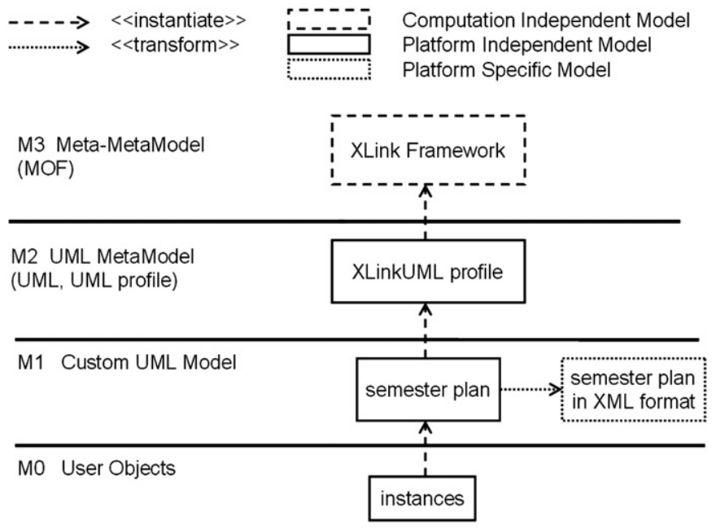
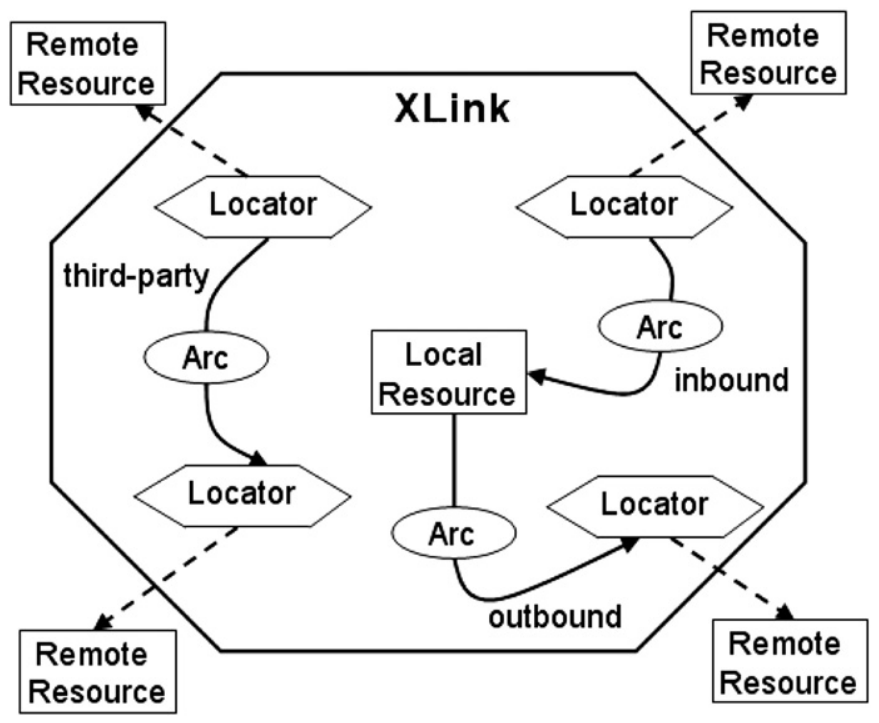
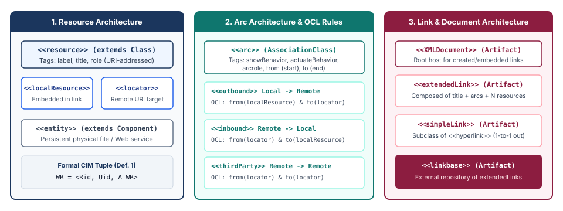
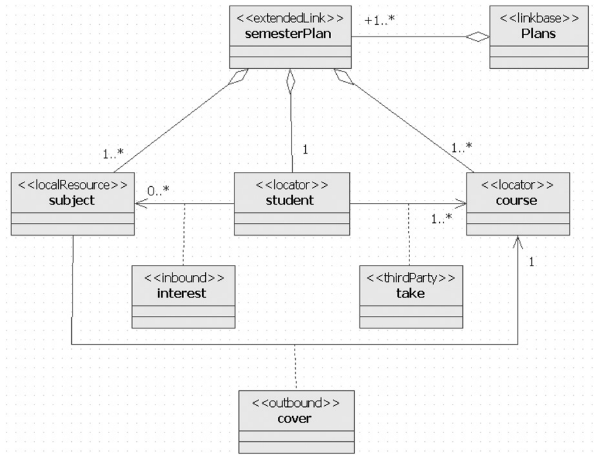
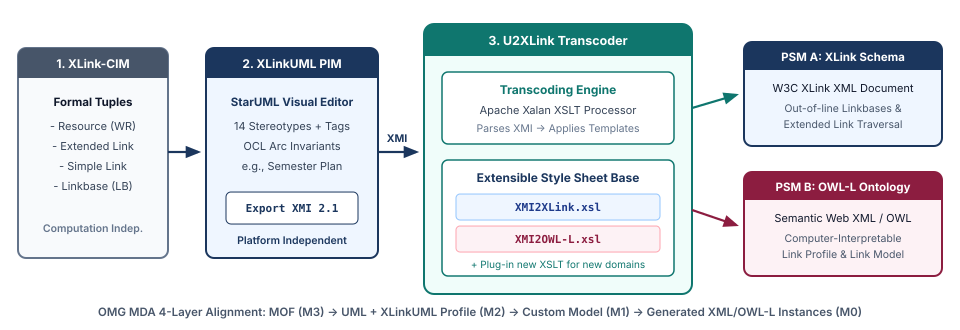
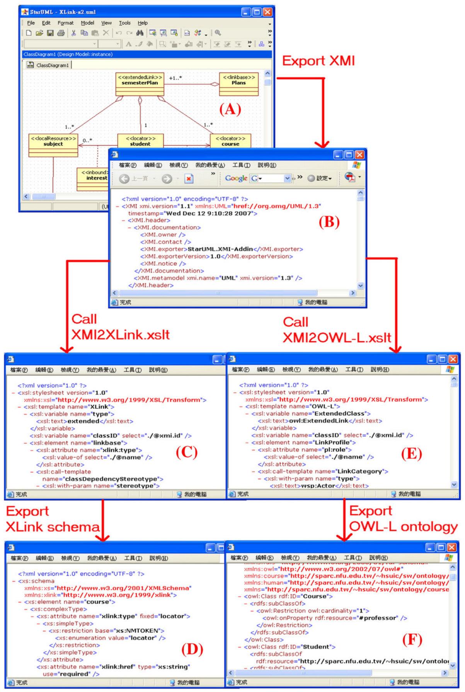

<!-- _class: lead -->

Computer Standards &amp; Interfaces (CSI) · Vol. 36, pp. 648–656 · 2014

# MDA-Based Visual Modeling Approach for Resources Link Relationships Using UML Profile

Bridging Conceptual Software Modeling and Multi-Domain Web/Cloud Resource Linking via <strong>XLink-CIM</strong>, the <strong>XLinkUML Profile</strong>, and the <strong>XSLT-Powered U2XLink Transcoder</strong>

<strong>I-Ching Hsua,*</strong>, <strong>Der-Hong Tingb</strong>, and <strong>Nien-Lin Hsuehb</strong> 
a Dept. of Computer Science and Information Engineering, National Formosa University, Yunlin, Taiwan 
b Dept. of Information Engineering and Computer Science, Feng-Chia University, Taichung, Taiwan

DOI: 10.1016/j.csi.2013.08.017 · Supported by National Science Council, Taiwan R.O.C., under Contract No. NSC 97-2221-E-150-039

<!--
Paper Metadata & Archival Context:
- Full Title: MDA-based visual modeling approach for resources link relationships using UML profile
- Publication: Computer Standards & Interfaces (CSI), Vol. 36, pp. 648–656, 2014 (Received Aug 2, 2010; Revised & Accepted Aug 30, 2013; Available online Sep 5, 2013; Elsevier; DOI: 10.1016/j.csi.2013.08.017).
- Authors: I-Ching Hsu (Corresponding author, National Formosa University, hsuic@nfu.edu.tw), Der-Hong Ting (Feng-Chia University), and Nien-Lin Hsueh (Feng-Chia University).
- Core Premise: Introduces an OMG Model Driven Architecture (MDA) pipeline that formalizes W3C XLink concepts as a Computation Independent Model (XLink-CIM), extends UML 2.x into a reusable Platform Independent Model (XLinkUML profile), and automates transformation via XMI + Apache Xalan XSLT (U2XLink Transcoder) into both W3C XLink schemas and semantic OWL-L ontologies.
-->

---

## Presentation Outline

1

<a href="#3">Motivation &amp; Research Objectives</a> Why XML editors fall short for XLink/Cloud resource linking, and our three MDA goals.

2

<a href="#5">Related Work</a> XLink/linkbase studies, OWL-L semantic linking, and OMG/domain-specific UML profiles.

3

<a href="#6">MDA Four-Layer Architecture &amp; XLink-CIM</a> Aligning MOF/UML/Models and formalizing Resource, Extended Link, Simple Link, and Linkbase.

4

<a href="#8">XLinkUML Profile &amp; OCL Constraints</a> 14 UML stereotypes across Resource, Arc, and Link architectures with formal OCL invariants.

5

<a href="#10">Case Study &amp; U2XLink Prototype System</a> Student Semester Plan modeling in StarUML and automated XSLT generation to XLink &amp; OWL-L.

6

<a href="#13">Discussion, Limitations &amp; Conclusion</a> Extensibility of XSLT style sheets, Semantic Web OWL roadmap, and key engineering takeaways.

<!--
Structural Map of the Paper:
- Section 1 (Introduction, pp. 648–649): Identifies the lack of conceptual/visual modeling in XML editors for XLink & Cloud resource discovery, introduces OWL-L, and frames the 3 MDA contributions.
- Section 2 (Related Work, p. 649): Surveys XLink/linkbase systems (XConnector, Xspect, XLinkProxy, xlinkit, OWL-L) and UML profiles (CORBA, EDOC, UTP, UWE, WebML, MDD access control, OLAP).
- Section 3 (MDA-based Approach, pp. 649–650): Presents the OMG 4-layer metamodeling architecture (M3 MOF, M2 UML/Profile, M1 PIM, M0 PSM instances, Fig. 1).
- Section 4 (XLink Framework, pp. 650–651): Gives four formal mathematical tuple definitions (Definitions 1–4) and XLink-CIM (Fig. 2).
- Sections 5 & 6 (XLinkUML Profile, pp. 651–653): Defines the 14 stereotypes (Table 1), tagged values, Resource/Arc/Link diagrams (Figs. 3–6), and three OCL arc invariants.
- Section 7 (Semester Plan Example, p. 653): Demonstrates modeling student, subject, course, semesterPlan, and Plans (Fig. 7).
- Section 8 (Prototype & XSLT Generation, pp. 653–655): Details StarUML -> XMI -> U2XLink Transcoder (Xalan + XMI2XLink / XMI2OWL-L) in Figs. 8–9.
- Section 9 (Conclusions, pp. 655–656): Summarizes contributions and future OWL ontology deduction work.
-->

---

## 1. Motivation: The Modeling Gap in Web &amp; Cloud Resource Linking

<h3>🌐 Why XLink &amp; OWL-L Matter</h3>
<ul class="small-text">
<li><strong>Unstructured Web &amp; Cloud Discovery:</strong> Finding and publishing distributed Web and Cloud resources is difficult without explicit link metadata.</li>
<li><strong>W3C XLink Advantage:</strong> Supports <strong>out-of-line links</strong> (separating content from external linkbases), multi-resource links, and inbound/third-party arcs.</li>
<li><strong>Syntax vs. Semantics Gap:</strong> Standard XLink focuses on XML syntax rather than computer-interpretable semantics—motivating our prior <strong>OWL-L</strong> ontology (link profile + link model).</li>
</ul>

<h3>⚠️ Limitations of Current XML Tooling</h3>
<ul class="small-text">
<li><strong>No Conceptual Visual Modeling:</strong> Conventional XML editors force developers to hand-craft verbose XML tags directly.</li>
<li><strong>Low Reuse &amp; Poor Productivity:</strong> Lack of high-level abstractions makes multi-domain XLink applications error-prone and hard to maintain.</li>
<li><strong>UML Extension Needed:</strong> Standard UML is the de facto software engineering notation, yet lacks native constructs for XLink resources, traversal arcs, and linkbases.</li>
</ul>

<strong>Core Thesis:</strong> Applying OMG's <strong>Model Driven Architecture (MDA)</strong> with a lightweight <strong>UML Profile</strong> enables developers to model resource link relationships visually once (PIM) and automatically generate multiple XML/Semantic Web targets (PSM).

<!--
Problem Statement & Context (Section 1, pp. 648–649):
- In Web and Cloud computing environments, two symmetric problems arise: providers struggle to publish services cleanly, and users struggle to discover useful resources. W3C XLink addresses structural linking via out-of-line linkbases, while the authors' earlier OWL-L (CSI 2009) adds semantic interpretability (Link Profile for agent discovery; Link Model for agent exploitation).
- However, writing raw XLink or OWL-L in XML editors lacks software engineering rigor—there is no visual conceptual layer, causing inefficient development and low reuse.
- OMG offers two UML extension mechanisms: heavy MOF metamodel extension (defining a brand-new metamodel) vs. lightweight UML Profiles (stereotypes, tagged values, constraints). Choosing a UML Profile preserves compatibility with off-the-shelf UML tools like StarUML and Web engineering frameworks (UWE, WebML).
-->

---

## 1. Research Objectives &amp; Three Core Contributions

<h3>🏛️ 1. MDA Methodology</h3>

Establish a systematic <strong>CIM ➔ PIM ➔ PSM</strong> software engineering methodology for modeling Web and Cloud resource link relationships (<strong>XLink-CIM</strong>).

<h3>🧩 2. XLinkUML Profile</h3>

Design a reusable UML 2.x profile (<strong>14 stereotypes</strong>, tagged values, and <strong>OCL invariants</strong>) extending UML metaclasses for visual XLink modeling.

<h3>⚙️ 3. U2XLink Transcoder</h3>

Implement an extensible <strong>XMI + XSLT (Apache Xalan)</strong> prototype that automatically generates both <strong>XLink schemas</strong> and <strong>OWL-L ontologies</strong> from StarUML.

4 Layers

OMG MDA alignment: M3 (MOF) ➔ M2 (Profile) ➔ M1 (PIM) ➔ M0 (XML/OWL-L)

14 Stereotypes

Covering Resource, Arc (with 3 OCL rules), and Link/Linkbase modeling

2+ PSM Targets

Plug-in XSLT architecture: XMI2XLink &amp; XMI2OWL-L (zero engine rewrite)

<!--
Summary of Contributions (Section 1, p. 649):
1. Conceptual & Methodological: Formalizes the W3C XLink specification into a Computation Independent Model (XLink-CIM) grounded in four mathematical tuple definitions, lifting XLink out of raw XML syntax.
2. Modeling Language Extension: Packages the XLinkUML profile so it can be imported into standard UML tools and integrated with Web Engineering profiles (UWE, Topic Maps, GUI Layout, WebML).
3. Extensible Code Generation: Because each target domain is encapsulated as an XSLT stylesheet inside the Style Sheet Base, supporting a new XLink application domain only requires adding a new XSLT stylesheet without modifying the Xalan-based Transcoding Engine.
-->

---

## 2. Related Work: XLink Systems &amp; UML Profiles

<h3>🔗 XLink, Linkbases &amp; Semantic Linking</h3>
<ul class="small-text">
<li><strong>Out-of-Line Link Separation:</strong> Content resides in XML documents while link structures are maintained independently in external <strong>linkbases</strong>.</li>
<li><strong>Hypermedia &amp; Link Servers:</strong> <code>XConnector</code> (multimedia sync), <code>Xspect</code> (open hypermedia), <code>XLinkProxy</code> (external linkbases), and <code>xlinkit</code> (consistency checking &amp; smart link generation).</li>
<li><strong>Intelligent Semantic Linking:</strong> Prior work by Kao &amp; Hsu (2007) and Hsu (2009, <code>OWL-L</code> / <code>SXRS</code>) integrated Semantic Web ontologies for dynamic link generation and recommendation.</li>
</ul>

<h3>📐 Domain-Specific UML Profiles &amp; MDA</h3>
<ul class="small-text">
<li><strong>OMG Standard Profiles:</strong> UML Profile for CORBA, EDOC (Enterprise Distributed Object Computing), and UML Testing Profile (UTP).</li>
<li><strong>Web &amp; Knowledge Engineering:</strong> UML profiles for Web frameworks (Fuentes &amp; Vallecillo), Web 2.0 mashups &amp; context-aware apps (Hsu, 2012–2013), and knowledge-based systems (Abdullah et al., 2007).</li>
<li><strong>MDA &amp; OCL Precision:</strong> Access control MDD with OCL (Fink et al., 2006), platform-independent OLAP + DB generation (Pardillo &amp; Mazón, 2012).</li>
<li><strong>Gap Addressed:</strong> No prior UML profile + MDA pipeline bridged visual UML modeling directly to both <strong>XLink</strong> and <strong>OWL-L</strong>.</li>
</ul>

<!--
Positioning Against Prior Literature (Section 2, p. 649):
- XLink research established rich linking mechanisms (XConnector, Xspect, XLinkProxy, xlinkit) and semantic extensions (OWL-L, SXRS), yet focused on runtime link servers or XML/OWL schemas rather than visual software modeling.
- Meanwhile, UML profiling has proven effective across distributed systems (CORBA, EDOC), testing (UTP), security (RBAC/access control with OCL), data warehouses (OLAP), and Web 2.0 engineering.
- This paper bridges the two communities by defining a formal, OCL-constrained UML profile specifically for XLink resource link relationships within an OMG MDA workflow.
-->

---

## 3. OMG Four-Layer MDA Architecture for XLink

Fig. 1 from paper: Four-layer OMG MDA metamodeling stack (M3 ➔ M0).

### Mapping XLink Across M3 ➔ M0
- **M3 — Meta-Metamodel (`MOF`):** Universal language defining modeling languages (UML, CWM).
- **M2 — Metamodel (`UML + XLinkUML Profile`):** Extends standard UML metaclasses with XLink stereotypes, tagged values, and OCL constraints derived from **XLink-CIM**.
- **M1 — Model (`PIM`):** Developers visually construct domain models (e.g., *Semester Plan*) using the XLinkUML profile—completely platform-independent.
- **M0 — Real Objects (`PSM & Instances`):** XSLT transforms exported XMI into platform-specific **XLink XML schemas** and **OWL-L ontologies**.

<!--
OMG Four-Layer Metamodeling Alignment (Section 3, Fig. 1, pp. 649–650):
- MDA separates concerns into three viewpoints: CIM (environment & requirements without structural/processing details), PIM (platform-agnostic model), and PSM (platform-specific realization).
- Fig. 1 grounds this workflow in OMG's 4-layer hierarchy:
  - M3: Meta-Object Facility (MOF) specifies UML itself.
  - M2: UML metamodel tailored via the XLinkUML profile package (stereotypes, tagged values, constraints).
  - M1: Domain-specific PIMs built by developers (such as the Semester Plan model) and transformed into XLink/OWL-L PSMs via XSLT.
  - M0: Concrete runtime XML documents, linkbases, and Web/Cloud resource instances.
-->

---

## 4. Formal XLink-CIM Definitions

### Four Formal Tuples (Definitions 1–4)
1. **Resource (Def. 1):** `WR = &lt;Rid, Uid, AWR&gt;`
   - URI identifier `Rid`, owner `Uid`, attributes `AWR` (Web pages, services, hosts, devices).
2. **Extended Link (Def. 2):** `EL = &lt;La, Lo, Ra, In, Ou, Tp, Ar&gt;`
   - Remote **Locators** `La`, **Local Resources** `Lo`, role `Ra`, arc role `Ar`, and directed traversal arcs: **Inbound** (`In`), **Outbound** (`Ou`), **Third-Party** (`Tp`).
3. **Simple Link (Def. 3):** `SL = &lt;La, Ra, Ou, Ar&gt;`
   - Restricted 2-resource subset (local start ➔ remote end; outbound only).
4. **Linkbase (Def. 4):** `LB = &lt;ELs, ALB&gt;`
   - XML link repository aggregating extended links (`In` &amp; `Tp`).

Fig. 2 from paper: Abstract conceptual structure of XLink-CIM.

<!--
Formal XLink-CIM Specification (Section 4, Definitions 1–4, Fig. 2, pp. 650–651):
- Extended links can be modeled as directed graphs where participating resources (Locators = remote resources; Local Resources = embedded resources) are nodes and traversal rules (arcs) are directed edges:
  - Outbound arc: local starting resource -> remote ending resource.
  - Inbound arc: remote starting resource -> local ending resource.
  - Third-party arc: remote starting resource -> remote ending resource (neither endpoint is local).
- Simple links have no internal structure and support only a single outbound arc between a local starting resource and a remote ending resource.
- Linkbases (Def. 4) collect sets of extended links into standalone XML repositories, enabling centralized management of inbound and third-party links separated from the linked documents themselves.
-->

---

## 5. XLinkUML Profile: Three Sub-Architectures

<strong>Modular Package Design (Fig. 3):</strong> Packaged as a standard UML Profile, <code>XLinkUML</code> can be directly imported into existing Web Engineering methodologies including <strong>UWE</strong>, <strong>Topic Maps</strong>, <strong>GUI Layout modeling</strong>, and <strong>WebML</strong>.

<!--
XLinkUML Profile Design (Sections 5 & 6, Figs. 3–6, pp. 651–653):
- The profile extends UML 2.x using three standard extension mechanisms: Stereotypes (specializing metaclasses), Tagged Values (typed metadata properties on stereotypes), and Constraints (formal OCL invariants).
- Resource Architecture (Section 5.1, Fig. 4): <<resource>> extends Class (tags: label, title, role) with subclasses <<localResource>> and <<locator>>; <<entity>> extends Component to represent persistent physical files or remote services.
- Arc Architecture (Section 6, Fig. 5): <<arc>> extends AssociationClass (so an arc acts simultaneously as both a UML Association and a Class holding tags: showBehavior, actuateBehavior, arcrole, from, to), specialized into <<inbound>>, <<outbound>>, and <<thirdParty>>.
- Link Architecture (Section 6.1, Fig. 6): <<XMLDocument>>, <<linkbase>>, <<extendedLink>>, <<simpleLink>>, and <<hyperlink>> extend Artifact; <<extendedLink>> aggregates title, arc, and resource elements.
-->

---

## 5. UML-to-XLink Mapping &amp; Formal OCL Invariants

### Complete 14-Stereotype Mapping (Table 1)
| Stereotype | UML Base | XLink Construct |
| :--- | :--- | :--- |
| `«resource»` / `«localResource»` / `«locator»` | Class | URI resource / embedded / remote URI |
| `«entity»` | Component | Persistent physical file for a resource |
| `«arc»` / `«inbound»` / `«outbound»` / `«thirdParty»` | AssociationClass | Directed traversal rules between endpoints |
| `«title»` | Class | Human-readable label for a link |
| `«XMLDocument»` | Artifact | Root XML-based document |
| `«simpleLink»` / `«hyperlink»` | Artifact | 2-resource outbound link / human link |
| `«extendedLink»` / `«linkbase»` | Artifact | Multi-resource link / external repository |

### Formal OCL Arc Constraints (Section 6)

<strong>1. Outbound Arc (Local ➔ Remote):</strong> 
<code>context outbound inv:</code> 
<code>self.from.oclIsTypeOf(localResource) and self.to.oclIsTypeOf(locator)</code>

<strong>2. Inbound Arc (Remote ➔ Local):</strong> 
<code>context inbound inv:</code> 
<code>self.from.oclIsTypeOf(locator) and self.to.oclIsTypeOf(localResource)</code>

<strong>3. Third-Party Arc (Remote ➔ Remote):</strong> 
<code>context thirdParty inv:</code> 
<code>self.from.oclIsTypeOf(locator) and self.to.oclIsTypeOf(locator)</code>

<!--
Precise Metamodel Semantics (Table 1 & Section 6, pp. 651–653):
- Extending AssociationClass for <<arc>> is a pivotal modeling choice: plain UML Associations cannot carry rich typed properties and enumerations cleanly, whereas AssociationClass allows each traversal edge to carry showBehavior (show enumeration), actuateBehavior (actuate enumeration), arcrole, start (from), and end (to) tags.
- The three OCL invariants enforce W3C XLink structural validity at modeling time inside the UML tool—preventing illegal arc endpoint combinations (e.g., an outbound arc mistakenly targeting a local resource) before code generation even begins.
- Note: The original PDF prints "form" as a minor typo for "from" in the OCL block; semantically it denotes the starting resource attribute of an arc.
-->

---

## 6. Case Study: Student Semester Plan in XLinkUML

Fig. 7 from paper: Visual PIM of a student's Semester Plan using XLinkUML stereotypes.

### Domain Semantics &amp; Stereotype Assignment
- **`Plans` (`«linkbase»`):** Repository aggregating one or more `semesterPlan` extended links.
- **`semesterPlan` (`«extendedLink»`):** Associates **exactly 1 `student`** with **≥ 1 `subject`** and **≥ 1 `course`**.
- **Participating Resources:**
  - `student` &amp; `course` ➔ **`«locator»`** (remote URI resources).
  - `subject` ➔ **`«localResource»`** (embedded local resource).
- **Three Validated Arcs (Satisfying OCL):**
  - `interest` (`«inbound»`): `student` (remote) ➔ `subject` (local).
  - `cover` (`«outbound»`): `subject` (local) ➔ `course` (remote).
  - `take` (`«thirdParty»`): `student` (remote) ➔ `course` (remote).

<!--
Concrete Walkthrough of the Semester Plan PIM (Section 7, Fig. 7, pp. 653–654):
- This case study demonstrates all three XLink arc types simultaneously within one cohesive academic domain: a student specifies subjects of interest and enrolls in courses covering those chosen subjects.
- Notice how every single arc obeys its corresponding OCL invariant from Section 6:
  - interest (<<inbound>>): starts at remote <<locator>> student, ends at <<localResource>> subject.
  - cover (<<outbound>>): starts at <<localResource>> subject, ends at remote <<locator>> course.
  - take (<<thirdParty>>): connects two remote <<locator>> resources (student -> course) without either being local to the linkbase.
- Multiplicity constraints (1 student, 1..* subject, 1..* course) are captured visually in standard UML class-diagram notation.
-->

---

## 7. Prototype System: U2XLink Transcoder Pipeline

<h3>1. Visual Modeling</h3>

Model resource links graphically in <strong>StarUML</strong> using the imported <code>XLinkUML</code> profile and export standard <strong>XMI</strong>.

<h3>2. XSLT Transcoding</h3>

<strong>U2XLink Transcoder</strong> invokes <strong>Apache Xalan</strong> to apply stylesheets from the extensible <strong>Style Sheet Base</strong>.

<h3>3. Dual PSM Output</h3>

<code>XMI2XLink</code> outputs W3C <strong>XLink Schema</strong>; <code>XMI2OWL-L</code> outputs semantic <strong>OWL-L Ontology</strong> XML.

<!--
Prototype Architecture & Extensibility (Section 8, Fig. 8, pp. 653–654):
- The prototype integrates two core components: the XLinkUML profile (implemented in open-source StarUML) and the U2XLink Transcoder.
- Standard XMI (XML Metadata Interchange) acts as the tool-neutral bridge, decoupling the visual UML editor from the backend transcoder so any XMI-compliant UML tool can plug in.
- Inside U2XLink Transcoder, the Transcoding Engine runs Apache Xalan (XSLT processor) over a modular Style Sheet Base containing XMI2XLink and XMI2OWL-L.
- Key architectural advantage: Adding a brand-new target platform or XML/RDF dialect requires ONLY authoring a new XSLT stylesheet—zero changes to the UML profile or Java/Xalan engine.
-->

---

## 7. Automated Multi-Target Generation Demo

### End-to-End Transformation Flow (Fig. 9)
- **(A) Visual UML PIM:** Developer draws the Semester Plan diagram in **StarUML** with `«locator»`, `«localResource»`, `«extendedLink»`, and arc stereotypes.
- **(B) XMI Export:** StarUML serializes the full UML model and tagged values into a standard **XMI** document.
- **(C ➔ D) XLink Schema PSM:** Applying `XMI2XLink` transforms XMI into a valid W3C **XLink XML schema** ready for hypermedia/linkbase engines.
- **(E ➔ F) OWL-L Ontology PSM:** Applying `XMI2OWL-L` transforms the **exact same XMI** into a computer-interpretable **OWL-L ontology** for intelligent Web/Cloud agents.

<strong>Model Once, Generate Many:</strong> A single visual PIM drives both syntactic XML linking and semantic Web reasoning without manual XML coding.

Fig. 9 from paper: Live StarUML PIM (A) ➔ XMI (B) ➔ XLink Schema (C–D) &amp; OWL-L (E–F).

<!--
Code Generation Walkthrough (Section 8, Fig. 9, pp. 654–655):
- Fig. 9 validates the entire MDA round-trip on the Semester Plan example inside the implemented prototype.
- Panels (A)–(B) show the graphical StarUML editor exporting structured XMI metadata; Panels (C)–(D) show the XMI2XLink stylesheet generating W3C XLink XML elements (extended links, locators, resources, and arcs); Panels (E)–(F) show the XMI2OWL-L stylesheet transforming the identical XMI source into OWL-L classes and properties.
- This concrete dual-target proof-of-concept demonstrates MDA's core promise: shielding domain modelers from syntactic XML/OWL verbosity while guaranteeing structural consistency across heterogeneous target platforms.
-->

---

## 8. Discussion: Strengths, Trade-Offs &amp; Scope

<h3>✅ Architectural Strengths</h3>
<ul class="small-text">
<li><strong>Zero-Code Extensibility:</strong> Encapsulating each target domain in an XSLT stylesheet lets teams add new output formats (e.g., RDFa, JSON-LD, Cloud service registries) cleanly.</li>
<li><strong>Standards Compliance:</strong> Built strictly on OMG standards (<strong>MOF, UML 2.x, OCL, XMI</strong>) and W3C standards (<strong>XLink, XSLT, OWL</strong>).</li>
<li><strong>Ecosystem Composability:</strong> Lightweight UML Profile packaging allows seamless import into UWE, WebML, or enterprise UML tools beyond StarUML.</li>
<li><strong>Early Error Prevention:</strong> OCL invariants catch invalid inbound/outbound/third-party arc definitions at design time.</li>
</ul>

<h3>⚠️ Limitations &amp; Open Challenges</h3>
<ul class="small-text">
<li><strong>One-Way Transformation:</strong> Current U2XLink Transcoder performs forward PIM ➔ PSM generation without automated reverse engineering (XML ➔ UML).</li>
<li><strong>Limited Semantic Reasoning:</strong> While OWL-L output enables machine interpretability, dynamic rule deduction and OWL reasoner integration remain future work.</li>
<li><strong>XMI Dialect Variance:</strong> Real-world UML tools occasionally emit subtle XMI schema differences that require XSLT adapter tuning.</li>
<li><strong>Empirical User Study:</strong> Paper demonstrates functional feasibility via prototype rather than controlled developer productivity experiments.</li>
</ul>

<!--
Critical Evaluation & Engineering Trade-Offs (Sections 8 & 9, pp. 654–656):
- Choosing XSLT over imperative Java/MOF-to-Text code generators keeps transformation rules declarative, XML-native, and easy to inspect or swap per domain.
- However, XSLT transformations are unidirectional (forward engineering) and sensitive to XMI version/vendor quirks (e.g., StarUML vs. Enterprise Architect vs. Papyrus).
- Furthermore, while the paper demonstrates syntactic and structural correctness through the Semester Plan case study and StarUML/Xalan prototype, quantifying developer time savings and defect reduction across large industrial linkbases remains an open empirical opportunity.
-->

---

## 8. Conclusion &amp; Future Research Directions

<strong>Core Contribution:</strong> We bridged software engineering and Web/Cloud resource linking through an <strong>OMG MDA pipeline</strong>—formalizing <strong>XLink-CIM</strong>, designing the OCL-constrained <strong>XLinkUML profile</strong> in StarUML, and implementing the extensible <strong>XSLT-based U2XLink Transcoder</strong> to automatically generate both <strong>XLink schemas</strong> and <strong>OWL-L ontologies</strong>.

<strong>🧠 1. Full OWL Ontology Reasoning</strong> Extend XLinkUML with richer OWL semantics to deduce new adaptation rules and intelligent link behaviors automatically.

<strong>☁️ 2. Cloud Service Discovery</strong> Apply visual XLinkUML + OWL-L linkbases to publish, compose, and discover distributed Cloud computing resources.

<strong>🔄 3. Round-Trip &amp; Empirical Eval</strong> Support bidirectional XLink ➔ UML reverse synchronization and conduct controlled usability trials with Web engineers.

<!--
Conclusion & Future Roadmap (Section 9, pp. 655–656):
- Summary: Rather than editing raw, error-prone XML linkbases by hand, Web and Cloud developers can visually model complex multi-resource link topologies in standard UML, enforce traversal correctness via OCL invariants, and automatically transcode XMI into platform-specific XLink schemas or OWL-L ontologies.
- Future Direction Explicitly Identified by Authors: Extending the XLinkUML profile with Semantic Web OWL ontologies to deduce novel adaptation rules and enable higher-level agent intelligence over modeled XLink applications.
-->

---

<!-- _class: closing -->

# Thank You for Your Attention!

MDA-Based Visual Modeling Approach for Resources Link Relationships Using UML Profile

<strong>I-Ching Hsua,*</strong> (<code>hsuic@nfu.edu.tw</code>) · <strong>Der-Hong Tingb</strong> · <strong>Nien-Lin Hsuehb</strong> 
a Dept. of Computer Science and Information Engineering, National Formosa University, Yunlin, Taiwan 
b Dept. of Information Engineering and Computer Science, Feng-Chia University, Taichung, Taiwan 
Computer Standards &amp; Interfaces (CSI), Vol. 36, pp. 648–656, 2014 · DOI: 10.1016/j.csi.2013.08.017

<!--
Archival Citation & Funding Metadata:
- Citation: I-Ching Hsu, Der-Hong Ting, and Nien-Lin Hsueh, "MDA-based visual modeling approach for resources link relationships using UML profile," Computer Standards & Interfaces, Vol. 36, pp. 648–656, 2014.
- DOI: 10.1016/j.csi.2013.08.017
- Grant: National Science Council of the Republic of China, Taiwan, Contract No. NSC 97-2221-E-150-039.
- Keywords: UML profile, MDA, XLink, Software engineering, Cloud computing.
-->

