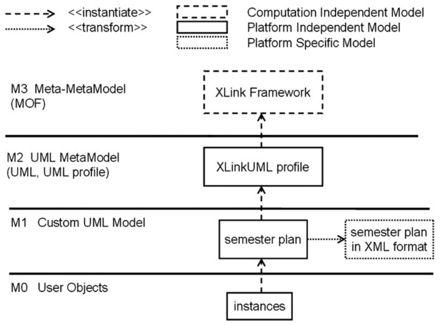
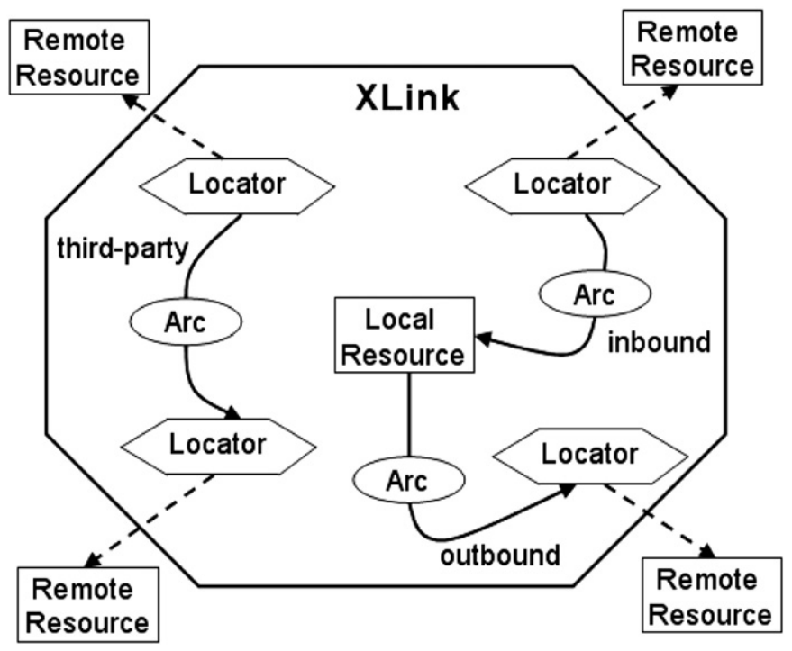
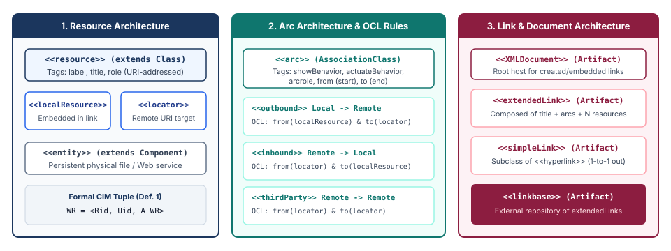
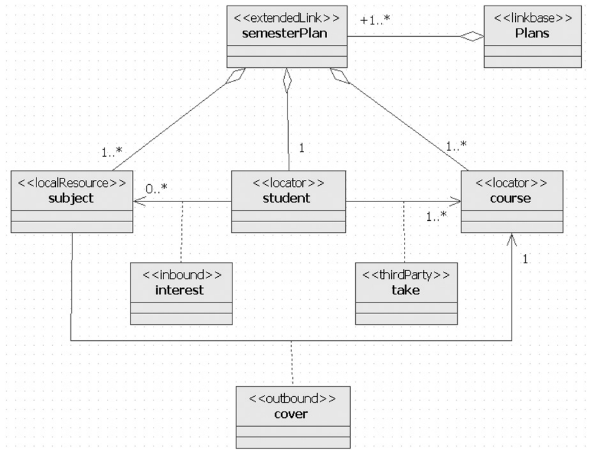
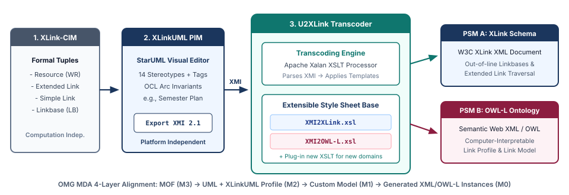
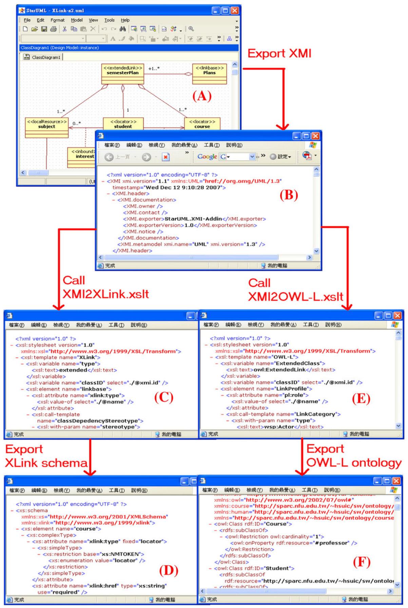

<!-- _class: lead -->

Computer Standards &amp; Interfaces (CSI) · 第 36 卷，pp. 648–656 · 2014

# 基於 MDA 與 UML Profile 之資源連結關係視覺化塑模方法

MDA-based visual modeling approach for resources link relationships using UML profile

結合 <strong>XLink-CIM</strong>、<strong>XLinkUML Profile</strong> 與 <strong>XSLT 驅動之 U2XLink 轉碼器</strong>，實現跨領域網頁與雲端資源連結之視覺化塑模與自動化文件生成

<strong>許藝競a,*</strong>（通訊作者）、<strong>丁德宏b</strong>、<strong>薛念林b</strong> 
a 國立虎尾科技大學資訊工程系 · b 逢甲大學資訊工程學系

DOI: 10.1016/j.csi.2013.08.017 · 國科會補助計畫：NSC 97-2221-E-150-039

<!--
論文基本資訊與研究定位：
- 篇名：MDA-based visual modeling approach for resources link relationships using UML profile（基於 MDA 與 UML Profile 之資源連結關係視覺化塑模方法）
- 發表期刊：Computer Standards & Interfaces (CSI), Vol. 36, pp. 648–656, 2014（Elsevier，DOI: 10.1016/j.csi.2013.08.017）。
- 作者群：許藝競（通訊作者，國立虎尾科技大學資工系，hsuic@nfu.edu.tw）、丁德宏（逢甲大學資工系）、薛念林（逢甲大學資工系）。
- 核心立意：導入 OMG 模型驅動架構（MDA），先將 W3C XLink 抽象定義為運算獨立模型（XLink-CIM），進而設計輕量級 UML 擴充設定檔（XLinkUML Profile）作為平台獨立模型（PIM），最後透過 StarUML 匯出 XMI 並由 Apache Xalan XSLT 轉碼器（U2XLink Transcoder）自動產出 XLink Schema 與 OWL-L 語意本體文件。
-->

---

## 簡報大綱

1

<a href="#3">研究動機與目標</a> 既有 XML 編輯器缺乏概念視覺化塑模的痛點，以及三大 MDA 研究貢獻。

2

<a href="#5">相關文獻回顧</a> XLink 與連結庫研究、OWL-L 語意連結，以及 OMG 與領域專屬 UML Profile。

3

<a href="#6">MDA 四層架構與 XLink-CIM</a> 對應 MOF/UML/模型四層堆疊，並形式化定義資源、延伸連結、簡易連結與連結庫。

4

<a href="#8">XLinkUML Profile 與 OCL 限制式</a> 涵蓋資源、弧線與連結架構之 14 個原型標籤（Stereotypes）與 OCL 驗證規則。

5

<a href="#10">案例展示與 U2XLink 原型系統</a> 於 StarUML 建構學生學期計畫模型，並展示 XMI 轉 XLink 與 OWL-L 自動生成。

6

<a href="#13">討論、限制與結論</a> XSLT 樣式表擴充優勢、語意網 OWL 推理藍圖與關鍵軟體工程啟示。

<!--
論文結構導覽：
- 第 1 節（緒論，pp. 648–649）：指出現行 XML 編輯器缺乏 XLink 概念塑模、雲端資源探索困難與 OWL-L 語意需求，提出三項 MDA 貢獻。
- 第 2 節（相關研究，p. 649）：回顧 XLink 系統（XConnector、Xspect、XLinkProxy、xlinkit、OWL-L）與 UML Profile 應用（CORBA、EDOC、UTP、UWE、WebML、存取控制、OLAP）。
- 第 3 節（MDA 方法，pp. 649–650）：以 Fig. 1 闡釋 OMG 四層後設塑模架構（M3 MOF、M2 UML/Profile、M1 PIM、M0 PSM 實例）。
- 第 4 節（XLink 框架，pp. 650–651）：以四個形式化元組定義（Definitions 1–4）與 Fig. 2 建構 XLink-CIM。
- 第 5、6 節（XLinkUML Profile，pp. 651–653）：定義 14 個 Stereotype（Table 1）、資源／弧線／連結架構圖（Figs. 3–6）與三條 OCL 弧線限制式。
- 第 7 節（學期計畫案例，p. 653）：以 Fig. 7 具體展示 student、subject、course、semesterPlan 與 Plans 之視覺化塑模。
- 第 8 節（原型與 XSLT 自動生成，pp. 653–655）：以 Figs. 8–9 呈現 StarUML ➔ XMI ➔ U2XLink Transcoder（Xalan + XMI2XLink / XMI2OWL-L）流程。
- 第 9 節（結論，pp. 655–656）：總結系統成效並提出整合 OWL 本體推理之未來方向。
-->

---

## 1. 研究動機：網頁與雲端資源連結的塑模缺口

<h3>🌐 為何需要 XLink 與 OWL-L？</h3>
<ul class="small-text">
<li><strong>分散式資源探索瓶頸：</strong>全球資訊網與雲端運算資源龐雜無結構，服務提供者難以發布資源，使用者亦難以發掘可用服務。</li>
<li><strong>W3C XLink 優勢：</strong>支援<strong>外部連結（out-of-line links）</strong>，將文件內容與連結庫（linkbase）分離，並可表達多資源與第三方（third-party）連結。</li>
<li><strong>語法與語意落差：</strong>傳統 XLink 偏重 XML 語法格式而缺乏電腦可詮釋語意，因此團隊先前提出 <strong>OWL-L</strong>（含 Link Profile 與 Link Model）。</li>
</ul>

<h3>⚠️ 現行 XML 開發工具的三大限制</h3>
<ul class="small-text">
<li><strong>缺乏概念與視覺化塑模：</strong>現行 XML 編輯器迫使開發者直接手寫繁瑣的底層 XML 標籤。</li>
<li><strong>低重用性與高出錯率：</strong>缺乏高階抽象模型，導致跨領域 XLink 應用開發效率低落且難以維護。</li>
<li><strong>標準 UML 尚缺領域語彙：</strong>UML 雖為最廣泛採用之軟體工程標準，但原生元素不足以精確表達 XLink 的資源、弧線與連結庫語意。</li>
</ul>

<strong>核心主張：</strong>採用 OMG <strong>模型驅動架構（MDA）</strong>搭配輕量級 <strong>UML Profile</strong>，讓開發者僅需視覺化塑模一次（PIM），即可自動轉換產出跨平台 XML 與語意網文件（PSM）。

<!--
問題背景與研究動機（第 1 節，pp. 648–649）：
- 在網頁與雲端運算情境中，資源連結常面臨「提供者難發布、使用者難搜尋」的雙重困境。W3C XLink 透過外部連結庫分離內容與連結拓撲，而作者先前於 CSI 2009 提出的 OWL-L 更進一步賦予連結機器可讀之語意。
- 然而，直接於文字型 XML 編輯器撰寫 XLink 或 OWL-L 缺乏軟體工程塑模支援。
- OMG 提供兩種擴充 UML 的機制：重量級 MOF 後設模型擴充（重新定義新後設模型）與輕量級 UML Profile（透過 Stereotype、Tagged Value 與 Constraint 客製化既有 UML）。選用 UML Profile 可直接相容 StarUML 等主流工具並融入 UWE、WebML 等既有網頁工程流程。
-->

---

## 1. 研究目標與三大核心貢獻

<h3>🏛️ 1. MDA 系統化塑模方法</h3>

建立完整 <strong>CIM ➔ PIM ➔ PSM</strong> 軟體工程流程，並以形式化元組定義 <strong>XLink-CIM</strong>，將資源連結設計提升至概念層次。

<h3>🧩 2. XLinkUML Profile 擴充</h3>

設計可重用之 UML 2.x Profile（含 <strong>14 個 Stereotypes</strong>、標籤值與 <strong>OCL 限制式</strong>），使標準 UML 工具支援視覺化 XLink 塑模。

<h3>⚙️ 3. U2XLink 自動轉碼原型</h3>

以 <strong>XMI + XSLT（Apache Xalan）</strong>實作可擴充轉碼器，自 StarUML 模型自動生成 <strong>XLink Schema</strong> 與 <strong>OWL-L 本體</strong>。

4 層架構

嚴謹對齊 OMG MDA：M3（MOF）➔ M2（Profile）➔ M1（PIM）➔ M0（XML/OWL-L）

14 個原型標籤

完整涵蓋資源架構、弧線架構（含 3 條 OCL 規則）與連結／連結庫架構

2+ 目標平台

外掛式 XSLT 樣式表庫：XMI2XLink 與 XMI2OWL-L（擴充新領域免改引擎）

<!--
三大核心貢獻解析（第 1 節，p. 649）：
1. 方法論層面：將 W3C XLink 規範抽象化為四組數學定義（XLink-CIM），消除底層 XML 語法雜訊。
2. 語言擴充層面：將 XLinkUML Profile 封裝為標準 UML Package，便於導入主流 UML 編輯器與既有 Web Engineering 方法論。
3. 工程擴充性層面：每個目標應用領域對應一份獨立的 XSLT 樣式表；當未來需要支援新領域文件時，只需於 Style Sheet Base 新增一份 XSLT 即可，無須更動 Xalan 轉碼引擎核心程式碼。
-->

---

## 2. 相關文獻回顧：XLink 技術與 UML Profile

<h3>🔗 XLink、連結庫與語意連結研究</h3>
<ul class="small-text">
<li><strong>內容與連結分離：</strong>XLink 透過外部連結庫（linkbase）集中管理連結中繼資料，大幅提升跨文件連結之維護彈性。</li>
<li><strong>超媒體與連結伺服器：</strong><code>XConnector</code>（多媒體同步）、<code>Xspect</code>（開放超媒體轉換）、<code>XLinkProxy</code>（外部連結庫代理）與 <code>xlinkit</code>（一致性檢核與智慧連結生成）。</li>
<li><strong>智慧語意連結：</strong>Kao &amp; Hsu（2007）與 Hsu（2009，<code>OWL-L</code> / <code>SXRS</code>）導入語意網本體，實現動態超連結推論與推薦。</li>
</ul>

<h3>📐 領域專屬 UML Profile 與 MDA 應用</h3>
<ul class="small-text">
<li><strong>OMG 官方標準 Profile：</strong>CORBA Profile、企業分散式物件運算（EDOC）與 UML 測試設定檔（UTP）。</li>
<li><strong>網頁與知識工程：</strong>網頁框架文件化（Fuentes &amp; Vallecillo）、Web 2.0 混搭與情境感知應用（Hsu, 2012–2013）及知識系統塑模（Abdullah et al., 2007）。</li>
<li><strong>MDA 結合 OCL：</strong>分散式存取控制政策 MDD（Fink et al., 2006）、平台獨立 OLAP 與資料庫綱要自動生成（Pardillo &amp; Mazón, 2012）。</li>
<li><strong>研究缺口：</strong>既有文獻尚未建立能同時自動產出 <strong>XLink</strong> 與 <strong>OWL-L</strong> 之視覺化 UML Profile 與 MDA 管線。</li>
</ul>

<!--
文獻對照與研究定位（第 2 節，p. 649）：
- 既有 XLink 研究專注於超媒體同步、連結代理與語意連結推論，但多半停留在 XML/OWL 實作層級，缺乏標準化的軟體工程視覺化塑模工具。
- 另一方面，UML Profile 與 MDA 已被證實能有效連結領域專家與實作平台（涵蓋中介軟體、測試、安全存取控制、資料倉儲與 Web 2.0）。
- 本論文結合兩大領域，以 OCL 強化語意約束，填補 XLink 視覺化概念塑模與多目標自動化產碼的關鍵缺口。
-->

---

## 3. OMG 四層 MDA 架構於 XLink 塑模之應用

論文 Fig. 1：OMG 四層模型驅動架構（M3 ➔ M0）於資源連結塑模之對應關係。

### M3 至 M0 四層後設塑模對應
- <strong>M3 — 後設後設模型層（<code>MOF</code>）：</strong>定義 UML、CWM 等各種塑模語言之通用抽象語言。
- <strong>M2 — 後設模型層（<code>UML + XLinkUML Profile</code>）：</strong>依 <strong>XLink-CIM</strong> 擴充既有 UML 後設類別，定義領域專屬語法與語意。
- <strong>M1 — 模型層（<code>PIM</code>）：</strong>軟體開發者以 XLinkUML Profile 視覺化繪製特定應用（如「學期計畫」）之平台獨立模型。
- <strong>M0 — 實體物件層（<code>PSM 與文件實例</code>）：</strong>透過 XSLT 將 XMI 自動轉換為平台相關之 <strong>XLink XML 文件</strong>與 <strong>OWL-L 本體</strong>。

<!--
OMG 四層架構整合詳解（第 3 節，Fig. 1，pp. 649–650）：
- MDA 將系統開發拆分為三個視角：CIM（運算獨立模型，聚焦環境與需求）、PIM（平台獨立模型，不含特定實作技術細節）與 PSM（平台相關模型，結合特定平台實作規範）。
- Fig. 1 清楚呈現四層對齊關係：
  - M3（MOF）定義 M2（UML 與 XLinkUML Profile）；
  - M2 規範 M1（開發者建立之客製化 UML PIM，例如 Semester Plan 模型）；
  - M1 經由 XSLT 轉碼為 XLink PSM，進而產出 M0 層級之真實連結規格與應用程式碼。
-->

---

## 4. XLink-CIM 之四項形式化數學定義

### 核心概念元組定義（Definitions 1–4）
1. <strong>資源（Def. 1）：</strong><code>WR = &lt;Rid, Uid, AWR&gt;</code>
   - URI 唯一識別碼 <code>Rid</code>、擁有者 <code>Uid</code>、屬性清單 <code>AWR</code>（涵蓋網頁、程式、主機、網頁服務等）。
2. <strong>延伸連結（Def. 2）：</strong><code>EL = &lt;La, Lo, Ra, In, Ou, Tp, Ar&gt;</code>
   - 遠端定位資源 <strong>Locator</strong>（<code>La</code>）、<strong>本地資源</strong>（<code>Lo</code>）、角色 <code>Ra</code>、弧線角色 <code>Ar</code>，以及三類有向弧：<strong>內向弧</strong>（<code>In</code>）、<strong>外向弧</strong>（<code>Ou</code>）、<strong>第三方弧</strong>（<code>Tp</code>）。
3. <strong>簡易連結（Def. 3）：</strong><code>SL = &lt;La, Ra, Ou, Ar&gt;</code>
   - 僅含兩個參與資源（本地起點 ➔ 遠端終點），僅支援單向 <code>Ou</code>。
4. <strong>連結庫（Def. 4）：</strong><code>LB = &lt;ELs, ALB&gt;</code>
   - 彙整多組延伸連結（內向與第三方連結）之 XML 儲存庫。

論文 Fig. 2：高階抽象之 XLink-CIM 概念框架圖。

<!--
XLink-CIM 形式化規格（第 4 節，Definitions 1–4，Fig. 2，pp. 650–651）：
- 延伸連結本質上是一張有向圖（Directed Graph）：參與連結的資源（遠端 Locator 與本地 Local Resource）為節點，描述遍歷方向與行為的弧線（Arc）為有向邊：
  - 外向弧（Outbound）：起點為本地資源、終點為遠端資源。
  - 內向弧（Inbound）：起點為遠端資源、終點為本地資源。
  - 第三方弧（Third-party）：起點與終點皆為遠端資源，使連結能完全獨立於受連結文件之外存在。
- 簡易連結（Simple Link）為延伸連結之受限子集，無內部結構且僅支援外向遍歷。
- 連結庫（Linkbase）作為集中管理延伸連結的 XML 容器，大幅簡化大型網站與雲端服務之連結維護。
-->

---

## 5. XLinkUML Profile：三大核心子架構

<strong>模組化套件封裝（Fig. 3）：</strong><code>XLinkUML</code> 以標準 UML Package 形式實作，可直接匯入現有網頁工程方法論，包括 <strong>UWE</strong>、<strong>Topic Maps</strong>、<strong>GUI 版面塑模</strong>與 <strong>WebML</strong>。

<!--
XLinkUML Profile 三大子架構（第 5 與 6 節，Figs. 3–6，pp. 651–653）：
- 本 Profile 運用 UML 標準三大擴充機制：原型標籤（Stereotypes）、標籤值（Tagged Values）與限制式（Constraints）。
- 資源架構（第 5.1 節，Fig. 4）：<<resource>> 擴充 Class（含 label、title、role 三標籤），衍生 <<localResource>> 與 <<locator>> 兩子類；<<entity>> 擴充 Component 代表實體持久化檔案。
- 弧線架構（第 6 節，Fig. 5）：<<arc>> 擴充 AssociationClass，使其兼具關聯線與類別特性（可攜帶 showBehavior、actuateBehavior、arcrole、from、to 標籤與列舉型別），並衍生 <<inbound>>、<<outbound>>、<<thirdParty>>。
- 連結架構（第 6.1 節，Fig. 6）：<<XMLDocument>>、<<linkbase>>、<<extendedLink>>、<<simpleLink>> 與 <<hyperlink>> 擴充 Artifact，並以 <<create>> 與 <<embed>> 關聯至 XML 文件。
-->

---

## 5. UML 與 XLink 對應表及 OCL 形式化限制式

### 14 個 Stereotype 完整對應（Table 1）
| UML 原型標籤 | 擴充元類別 | 對應之 XLink 建構元素 |
| :--- | :--- | :--- |
| `«resource»` / `«localResource»` / `«locator»` | Class | 網際資源 / 本地嵌入資源 / 遠端 URI 資源 |
| `«entity»` | Component | 資源對應之實體持久化檔案 |
| `«arc»` / `«inbound»` / `«outbound»` / `«thirdParty»` | AssociationClass | 資源間遍歷方向與行為規則 |
| `«title»` | Class | 連結之人類可讀標題標籤 |
| `«XMLDocument»` | Artifact | 承載連結之 XML 根文件 |
| `«simpleLink»` / `«hyperlink»` | Artifact | 雙資源外向簡易連結 / 人類超連結 |
| `«extendedLink»` / `«linkbase»` | Artifact | 多資源延伸連結 / 外部連結庫 |

### 弧線端點型別之 OCL 不變式（第 6 節）

<strong>1. 外向弧（本地 ➔ 遠端）：</strong> 
<code>context outbound inv:</code> 
<code>self.from.oclIsTypeOf(localResource) and self.to.oclIsTypeOf(locator)</code>

<strong>2. 內向弧（遠端 ➔ 本地）：</strong> 
<code>context inbound inv:</code> 
<code>self.from.oclIsTypeOf(locator) and self.to.oclIsTypeOf(localResource)</code>

<strong>3. 第三方弧（遠端 ➔ 遠端）：</strong> 
<code>context thirdParty inv:</code> 
<code>self.from.oclIsTypeOf(locator) and self.to.oclIsTypeOf(locator)</code>

<!--
後設模型精確語意（Table 1 與第 6 節，pp. 651–653）：
- 讓 <<arc>> 擴充 UML 的 AssociationClass 是極具巧思的設計：一般關聯線無法攜帶完整屬性與列舉型別，而 AssociationClass 讓每條連結弧能同時表達拓撲方向與 XLink 的 showBehavior、actuateBehavior、arcrole 等行為屬性。
- 三條 OCL（Object Constraint Language）限制式確保模型在視覺化繪製階段即滿足 W3C XLink 的端點型別合法性，避免錯誤的外向／內向／第三方弧線流入後續 XSLT 產碼階段。
- 註：原文 PDF 之 OCL 程式碼將 from 誤植為 form，本簡報依語意（起始資源端點）精確呈現。
-->

---

## 6. 應用案例：以 XLinkUML 塑模「學生學期計畫」

論文 Fig. 7：採用 XLinkUML Profile 繪製之學生學期計畫視覺化模型（PIM）。

### 領域語意與 Stereotype 配置
- <strong>`Plans`（<code>«linkbase»</code>）：</strong>外部連結庫，由至少一個 <code>semesterPlan</code> 實例組成。
- <strong>`semesterPlan`（<code>«extendedLink»</code>）：</strong>關聯<strong>剛好 1 位 <code>student</code></strong>、<strong>至少 1 個 <code>subject</code></strong> 與<strong>至少 1 門 <code>course</code></strong>。
- <strong>參與資源分類：</strong>
  - <code>student</code> 與 <code>course</code> ➔ <strong><code>«locator»</code></strong>（遠端 URI 資源）。
  - <code>subject</code> ➔ <strong><code>«localResource»</code></strong>（本地嵌入資源）。
- <strong>三條通過 OCL 驗證之弧線：</strong>
  - <code>interest</code>（<code>«inbound»</code>）：<code>student</code>（遠端）➔ <code>subject</code>（本地）。
  - <code>cover</code>（<code>«outbound»</code>）：<code>subject</code>（本地）➔ <code>course</code>（遠端）。
  - <code>take</code>（<code>«thirdParty»</code>）：<code>student</code>（遠端）➔ <code>course</code>（遠端）。

<!--
學期計畫案例深入解析（第 7 節，Fig. 7，pp. 653–654）：
- 此案例完整涵蓋 XLink 的三種弧線類型：每位學生擁有自己的學期計畫，指定感興趣的主題（subject），並修習涵蓋這些主題的課程（course）。
- 三條弧線逐一對應第 6 節的 OCL 規則：
  - interest（<<inbound>>）由遠端 locator（student）指向本地 localResource（subject）；
  - cover（<<outbound>>）由本地 localResource（subject）指向遠端 locator（course）；
  - take（<<thirdParty>>）連接兩個遠端 locator（student ➔ course），展現外部連結庫串聯第三方資源的威力。
- 透過標準 UML 類別圖多重性（1 與 1..*），資源數量約束一目了然。
-->

---

## 7. 原型系統架構：U2XLink 轉碼器管線

<h3>1. 視覺化塑模與匯出</h3>

於開源 <strong>StarUML</strong> 匯入 <code>XLinkUML</code> Profile 繪製資源連結圖，並匯出標準 <strong>XMI</strong> 檔案。

<h3>2. XSLT 引擎轉碼</h3>

<strong>U2XLink 轉碼器</strong>驅動 <strong>Apache Xalan</strong> 處理器，套用 <strong>Style Sheet Base</strong> 中之轉換樣式表。

<h3>3. 雙重 PSM 自動生成</h3>

<code>XMI2XLink</code> 產出標準 <strong>XLink Schema</strong>；<code>XMI2OWL-L</code> 產出語意化 <strong>OWL-L 本體</strong>文件。

<!--
原型系統與 XSLT 擴充架構（第 8 節，Fig. 8，pp. 653–654）：
- 原型系統由兩大核心組成：實作於 StarUML 的 XLinkUML Profile，以及負責模型轉換的 U2XLink Transcoder。
- 採用 OMG 標準 XMI（XML Metadata Interchange）作為中介交換格式，使前端視覺化工具與後端轉碼器解耦，具備跨 UML 工具移植能力。
- U2XLink Transcoder 內部整合 Apache Xalan XSLT 處理器（Transcoding Engine）與樣式表庫（Style Sheet Base，現有 XMI2XLink 與 XMI2OWL-L 兩份樣式表）。
- 架構最大亮點在於「高擴充性」：當開發新領域 XLink 應用時，只需於樣式表庫新增對應 XSLT 檔案，完全無須修改核心引擎。
-->

---

## 7. 多目標文件自動化生成實作展示

### 端到端轉換步驟實證（Fig. 9）
- <strong>（A）視覺化 UML PIM：</strong>開發者於 <strong>StarUML</strong> 中繪製學期計畫類別圖，標註 <code>«locator»</code>、<code>«localResource»</code>、<code>«extendedLink»</code> 與弧線原型。
- <strong>（B）匯出標準 XMI：</strong>StarUML 將完整圖形模型與標籤值輸出為統一格式之 <strong>XMI</strong> 文件。
- <strong>（C ➔ D）生成 XLink Schema（PSM）：</strong>套用 <code>XMI2XLink</code> 樣式表，自動產出可供連結伺服器解析的 <strong>W3C XLink XML 綱要</strong>。
- <strong>（E ➔ F）生成 OWL-L 本體（PSM）：</strong>對<strong>同一份 XMI</strong> 套用 <code>XMI2OWL-L</code>，自動轉出電腦可詮釋之 <strong>OWL-L 語意本體</strong>。

<strong>一次塑模、多端產碼：</strong>單一視覺化 PIM 同時驅動語法層 XML 連結與語意層 OWL-L 本體，徹底免除手寫 XML 錯誤。

論文 Fig. 9：StarUML 視覺化模型 (A) ➔ XMI (B) ➔ XLink Schema (C–D) 與 OWL-L 本體 (E–F)。

<!--
自動化產碼實證（第 8 節，Fig. 9，pp. 654–655）：
- Fig. 9 以實際系統截圖展示學期計畫案例的完整 MDA 轉換鏈：
  - (A) StarUML 編輯器中之視覺化 PIM；
  - (B) 匯出之標準 XMI 文件；
  - (C)–(D) 經 XMI2XLink 樣式表轉譯產生之 XLink XML Schema；
  - (E)–(F) 經 XMI2OWL-L 樣式表轉譯產生之 OWL-L 語意本體 XML。
- 此實作驗證了模型驅動開發的核心價值：開發者專注於高階領域概念與關聯拓撲，由標準化轉碼管線確保不同目標平台文件之一致性與正確性。
-->

---

## 8. 討論：架構優勢、工程權衡與研究限制

<h3>✅ 架構優勢與工程價值</h3>
<ul class="small-text">
<li><strong>零程式碼擴充目標領域：</strong>以聲明式 XSLT 封裝各目標語法，未來新增 RDFa、JSON-LD 或雲端服務註冊表僅需擴充樣式表。</li>
<li><strong>高度遵循國際標準：</strong>全面建構於 OMG（<strong>MOF、UML 2.x、OCL、XMI</strong>）與 W3C（<strong>XLink、XSLT、OWL</strong>）開放標準之上。</li>
<li><strong>生態系可組合性：</strong>輕量級 Profile 套件可直接與 UWE、WebML 等既有網頁塑模方法論整合。</li>
<li><strong>設計期防呆驗證：</strong>透過 OCL 不變式於繪圖階段即攔截非法內向／外向／第三方弧線。</li>
</ul>

<h3>⚠️ 現有局限與開放挑戰</h3>
<ul class="small-text">
<li><strong>單向正向轉換：</strong>現行 U2XLink 僅支援 PIM ➔ PSM 正向產碼，尚未實作 XML/OWL-L 反向同步回 UML 之雙向工程。</li>
<li><strong>本體推理尚未整合：</strong>雖已支援產出 OWL-L 文件，但結合語意推理機自動推導調適規則仍待後續研究。</li>
<li><strong>XMI 工具方言差異：</strong>不同商用或開源 UML 工具匯出之 XMI 細節偶有差異，跨工具部署需微調 XSLT 模板。</li>
<li><strong>實證使用者評估：</strong>本論文以案例與原型驗證可行性，尚未針對開發團隊進行對照組生產力實驗。</li>
</ul>

<!--
工程權衡與限制剖析（第 8 與 9 節，pp. 654–656）：
- 採用 XSLT 取代命令式程式碼產生器，使轉換規則維持 XML 原生、聲明式且易於維運；但亦帶來單向轉換與不同 UML 工具 XMI 輸出格式微小差異的挑戰。
- 此外，論文聚焦於標準化建模語言定義與原型實作驗證；若能於後續針對大型企業或雲端連結庫進行實證開發效率與錯誤率評估，將更具說服力。
-->

---

## 8. 結論與未來研究方向

<strong>核心貢獻總結：</strong>本研究成功將軟體工程標準導入網頁與雲端資源連結開發——形式化定義 <strong>XLink-CIM</strong>、於 StarUML 實作具 OCL 驗證之 <strong>XLinkUML Profile</strong>，並透過可擴充之 <strong>XSLT U2XLink 轉碼器</strong>自動生成 <strong>XLink Schema</strong> 與 <strong>OWL-L 語意本體</strong>，顯著提升 XML 應用之重用性與開發品質。

<strong>🧠 1. 深化 OWL 本體推論</strong> 以語意網核心語言 OWL 擴充 XLinkUML Profile，自動推演新的連結調適規則與智慧導覽行為。

<strong>☁️ 2. 雲端服務發現與組合</strong> 將視覺化 XLinkUML 與 OWL-L 連結庫應用於雲端資源發布、服務探索與跨雲應用組合。

<strong>🔄 3. 雙向同步與實證評測</strong> 擴充反向工程以支援既有 XML 連結庫匯入視覺模型，並對網頁工程師展開對照組易用性評估。

<!--
結論與未來展望（第 9 節，pp. 655–656）：
- 總結：透過 OMG MDA 與 UML Profile，開發者得以擺脫手寫繁雜 XML 標籤的低效模式，在熟悉的視覺化 UML 工具中設計複雜的多資源連結架構，並由 U2XLink 自動產出跨平台規格。
- 作者於結論中明確指出之未來方向：進一步整合語意網主流本體語言 OWL（Web Ontology Language），賦予所塑模之 XLink 應用更高階的推理與自動調適智慧。
-->

---

<!-- _class: closing -->

# 感謝聆聽 · 敬請指教！

基於 MDA 與 UML Profile 之資源連結關係視覺化塑模方法 
MDA-based visual modeling approach for resources link relationships using UML profile

<strong>許藝競a,*</strong>（<code>hsuic@nfu.edu.tw</code>） · <strong>丁德宏b</strong> · <strong>薛念林b</strong> 
a 國立虎尾科技大學資訊工程系 · b 逢甲大學資訊工程學系 
Computer Standards &amp; Interfaces (CSI), Vol. 36, pp. 648–656, 2014 · DOI: 10.1016/j.csi.2013.08.017

<!--
引用資訊與計畫致謝：
- 引用格式：I-Ching Hsu, Der-Hong Ting, and Nien-Lin Hsueh, "MDA-based visual modeling approach for resources link relationships using UML profile," Computer Standards & Interfaces, Vol. 36, pp. 648–656, 2014.
- DOI：10.1016/j.csi.2013.08.017
- 補助計畫：國科會專題研究計畫 NSC 97-2221-E-150-039。
- 關鍵詞：UML profile、MDA、XLink、軟體工程（Software engineering）、雲端運算（Cloud computing）。
-->

