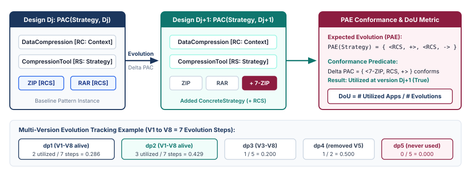
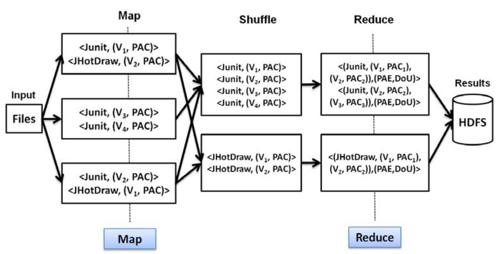
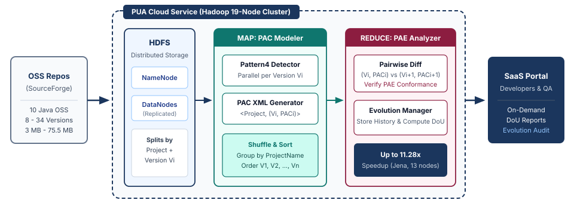
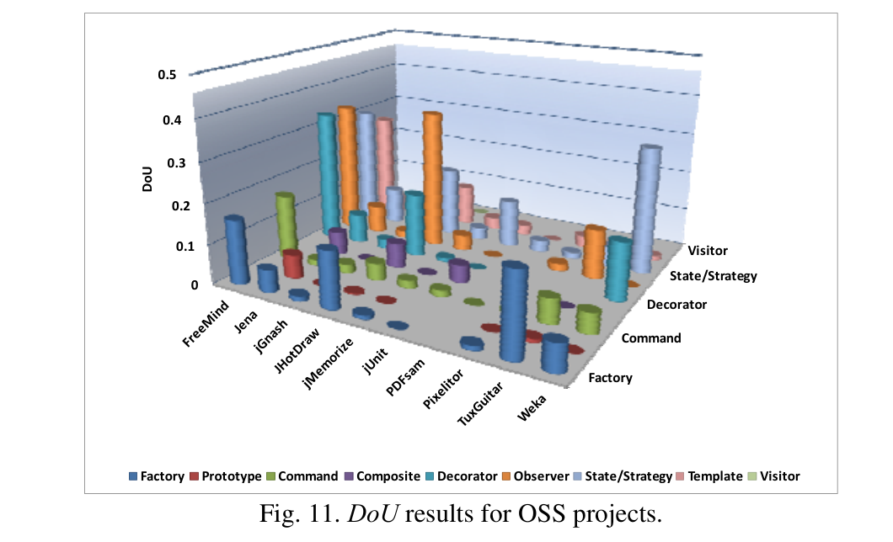
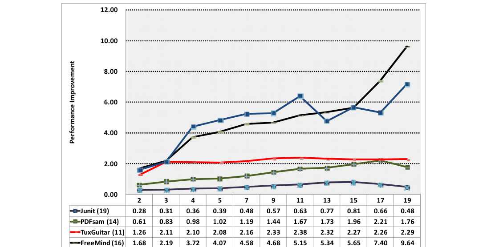
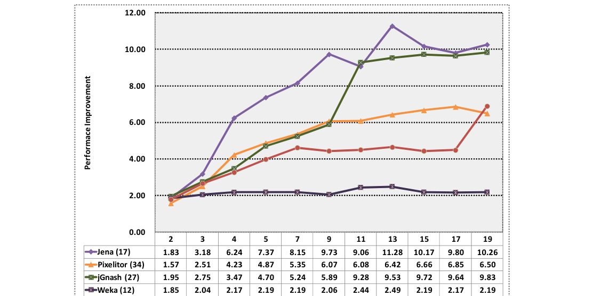

<!-- _class: lead -->

Journal of Information Science and Engineering (JISE) · Vol. 31, No. 3, pp. 1051–1070 · 2015

# A Cloud Service Implementation for Evaluating Design Pattern in Software Evolution

Scaling Automated Design Pattern Utilization Analysis (<strong>PAC / PAE / DoU</strong>) Across Multi-Version Open-Source Repositories via <strong>Hadoop HDFS &amp; MapReduce</strong>

<strong>Der-Hong Ting1</strong>, <strong>Nien-Lin Hsueh1,+</strong>, <strong>Chao-Tung Yang2</strong>, and <strong>Chin-Hung Chang3</strong> 
1 Dept. of Information Engineering and Computer Science, Feng Chia University, Taichung, Taiwan 
2 Dept. of Computer Science, Tunghai University · 3 Dept. of Information Management, Hsiuping Univ. of Science and Technology

DOI: 10.1688/JISE.2015.31.3.15 · Supported by NSC 101-2221-E-035-027 and MOST 103-2627-M-035-003, Taiwan R.O.C.

<!--
Paper Metadata & Archival Context:
- Full Title: A Cloud Service Implementation for Evaluating Design Pattern in Software Evolution
- Publication: Journal of Information Science and Engineering (JISE), Vol. 31, No. 3, pp. 1051–1070, 2015 (Received Oct 16, 2013; Revised Feb 26 & May 24, 2014; Accepted Jun 19, 2014; Communicated by Ce-Kuen Shieh; DOI: 10.1688/JISE.2015.31.3.15).
- Authors: Der-Hong Ting (Ph.D. student, FCU), Nien-Lin Hsueh (Corresponding author, Associate Professor, FCU), Chao-Tung Yang (Professor, Tunghai University), and Chin-Hung Chang (Associate Professor, Hsiuping University of Science and Technology).
- Core Premise: Builds upon the authors' earlier COMPSACW 2011 Pattern Utilization Analyzer (PUA) by migrating single-node, multi-version design pattern utilization evaluation onto an Apache Hadoop (HDFS + MapReduce) Software-as-a-Service (SaaS) cloud architecture to achieve >10x computation speedup on large open-source software (OSS) histories.
-->

---

## Presentation Outline

1

<a href="#3">Motivation &amp; Research Objectives</a> Why single-node pattern evolution analysis fails at OSS scale, and our SaaS cloud goals.

2

<a href="#5">Background &amp; Related Work</a> Empirical design pattern studies, detection tools (Pattern4), and Hadoop HDFS/MapReduce.

3

<a href="#6">Formal Utilization Model (PAC / PAE / DoU)</a> Defining Pattern Application Context, Expected Evolution, and Degree of Utilization.

4

<a href="#7">MapReduce &amp; PUA Cloud Architecture</a> Parallelizing Pattern4 detection (Map) and pairwise version conformance (Reduce).

5

<a href="#9">Empirical Evaluation on 10 OSS Projects</a> 19-node Hadoop cluster benchmarks: DoU distribution and up to 11.28× speedup.

6

<a href="#13">Discussion, Limitations &amp; Conclusion</a> Disk I/O vs. CPU trade-offs, pattern effectiveness insights, and quality-cloud vision.

<!--
Structural Map of the Paper:
- Section 1 (Introduction, pp. 1051–1053): Motivates design pattern roles (quality-improver, activity-facilitator, problem-solver, conflict-resolver), exposes the single-node PUA runtime bottleneck (Table 1), and states the three research contributions.
- Section 2 (Background & Related Work, pp. 1053–1056): Contrasts prior single-version or survey-based pattern studies (Vokac, Prechelt, Aversano, Tsantalis, Dong, Zhang & Budgen) and summarizes Hadoop HDFS & MapReduce master/slave architecture.
- Section 3 (Utilization Evaluation, pp. 1056–1059): Formalizes PAC(dp, D), PAE(dp), utilization predicate delta(dp, Dj+1), and DoU with a Strategy compression running example and 8-version timeline.
- Section 4 (Cloud Service Design, pp. 1059–1062): Details the legacy 4-step web PUA, the new Map/Shuffle/Reduce key-value formulation, and the 3-module PUA Cloud Service architecture.
- Section 5 (Experiment, pp. 1062–1068): Evaluates 10 Java OSS projects (5 small, 5 large) across 2 to 19 Hadoop nodes, reporting both DoU results and speedup ratios.
- Section 6 (Conclusion, p. 1068): Synthesizes the SaaS software quality evaluation cloud paradigm.
-->

---

## 1. Motivation: The Scalability Bottleneck in Pattern Evolution

### Why Evaluate Patterns Across Versions?
- Design patterns play four roles: **quality-improver**, **activity-facilitator**, **problem-solver**, and **conflict-resolver** (Hsueh et al., 2009).
- Most quality-improver patterns target **maintainability**—making future additions/removals easier.
- Checking whether a deployed pattern actually **fulfills its design intent** requires analyzing **consecutive versions** across software evolution.

### The Practical Compute Wall
- Legacy **PUA** (single-node web tool) runs graph-similarity detection (`Pattern4`) sequentially per version.
- Analyzing **12 versions of jMemorize** takes **~3 hours**; **26 versions of jGnash** takes **15.4 hours**!
- Developers will not wait hours to inspect pattern ROI.

| OSS Project | Versions | Min Size (KB) | Max Size (KB) | Single-Node PUA Time |
| :--- | :---: | :---: | :---: | :---: |
| **JUnit** | 19 | 91 | 248 | 0.7 min |
| **FreeMind** | 16 | 70 | 2,536 | 15.4 min |
| **JHotDraw** | 8 | 414 | 2,079 | 33.3 min |
| **jMemorize** | 12 | 1,791 | 4,075 | **169.3 min (~2.8 h)** |

<strong>Scale of Open-Source Data (SourceForge, Q1 2013):</strong> Over <strong>324,000 OSS projects</strong> and <strong>3.4M developers</strong>—valuable empirical design knowledge remains locked unless quality analysis runs <strong>on demand</strong> in the cloud.

<!--
Theoretical & Practical Motivation (Section 1, Table 1):
- In earlier work (Hsueh et al., SoSyM 2009), design patterns were classified into four perspectives: activity-facilitator, quality-improver, problem-solver, and conflict-resolver. For example, Observer acts simultaneously as a quality-improver (reducing Subject-Observer coupling), activity-facilitator (aiding decomposition), and problem-solver (preventing data inconsistency).
- In COMPSACW 2011, the authors introduced "utilization of deployed design patterns"—the degree of conformance between consecutive version changes and the pattern's intended extensibility.
- Table 1 illustrates the severe computational bottleneck of single-machine analysis: while tiny JUnit (91–248 KB) completes in 0.7 minutes, execution time grows super-linearly with source code size (FreeMind 15.4 min, JHotDraw 33.3 min, jMemorize 169.3 min). Later in Table 5, Weka (477.37 min) and jGnash (926.66 min) take 8 to 15+ hours on a single node, rendering interactive developer feedback infeasible.
-->

---

## 1. Research Objectives & Three Core Contributions

<h3>☁️ 1. SaaS Quality Cloud</h3>

Transform the single-node <strong>Pattern Utilization Analyzer (PUA)</strong> into a scalable <strong>Hadoop HDFS + MapReduce</strong> cloud service (SaaS) delivering <strong>&gt;10× speedup</strong> on large OSS codebases.

<h3>📊 2. Large-Scale OSS Validation</h3>

Empirically verify the cloud evaluation architecture across <strong>10 well-known Java OSS projects</strong> (170 total version snapshots, up to 75.5 MB total source) on a <strong>19-node cluster</strong>.

<h3>🔍 3. Evolution-Aware Monitoring</h3>

Provide programmers an automated, on-demand method to quantify whether deployed GoF patterns genuinely contribute to <strong>software maintainability</strong> over time.

11.28×

Peak speedup on large OSS (Jena, 13 nodes: 120.0 ➔ 10.64 min)

9.64×

Peak speedup on small OSS (FreeMind, 19 nodes: 15.40 ➔ 1.60 min)

0.350

Highest observed DoU (Observer pattern in JHotDraw)

<!--
Research Goals & Contributions (Section 1, p. 1053):
1. Engineering Contribution: Designing and implementing a Hadoop-based SaaS assessment service that parallelizes both pattern detection (Map phase) and pairwise evolution conformance checking (Reduce phase), achieving over 10x speedup on large repositories compared to legacy single-node PUA.
2. Empirical Contribution: Benchmarking both pattern utilization (DoU across 9 GoF pattern categories) and distributed scalability (2 to 19 nodes) across 10 long-lived Java OSS projects harvested from SourceForge.
3. Methodological Contribution: Establishing an automated longitudinal quality-monitoring pipeline that shifts design pattern evaluation from static single-snapshot inspection to continuous evolution tracking.
-->

---

## 2. Background & Related Work

<h3>📚 Design Pattern Quality &amp; Detection</h3>
<ul class="small-text">
<li><strong>Defect Correlation (Vokac, 2004):</strong> Observer &amp; Singleton correlate with larger, more fault-prone structures; Factory Method is compact and less fault-prone.</li>
<li><strong>Maintenance Experiments (Prechelt et al., 2001):</strong> Controlled paper exercises showed Decorator eases certain maintenance changes.</li>
<li><strong>Crosscutting Concerns (Aversano et al., 2009):</strong> Pattern-induced scattering can increase defect counts despite maintainability gains.</li>
<li><strong>Automated Detection:</strong> <strong>Tsantalis et al. (2006)</strong> graph-similarity scoring (<code>Pattern4</code>); <strong>Dong et al. (2007)</strong> matrix-based <code>DP-Miner</code> (static only).</li>
<li><strong>Research Gap:</strong> Prior work evaluates <strong>single versions</strong> or relies on manual questionnaires—lacking automated multi-version utilization analysis.</li>
</ul>

<h3>🐘 Hadoop Distributed Infrastructure</h3>
<ul class="small-text">
<li><strong>HDFS (Master/Slave Storage):</strong> Single <code>NameNode</code> manages namespace &amp; block mapping; distributed <code>DataNodes</code> store replicated blocks across commodity Linux machines for fault tolerance and high-throughput I/O.</li>
<li><strong>MapReduce Framework:</strong> Splits input datasets into independent chunks processed in parallel by <code>Map</code> tasks, sorts/shuffles intermediate keys, and aggregates in <code>Reduce</code> tasks.</li>
<li><strong>Data Locality Scheduling:</strong> Master <code>JobTracker</code> dispatches work to slave <code>TaskTrackers</code> co-located on the same <code>DataNode</code> (or same rack) to minimize network transfer.</li>
</ul>

<!--
Literature Positioning & Infrastructure Rationale (Section 2, pp. 1053–1056):
- Empirical studies on design patterns (Vokac 2004, Prechelt et al. 2001, Ng et al. 2012, Chen & Huang 2009, Aversano et al. 2009, and Zhang & Budgen's 2012 SLR) reveal mixed effects: patterns do not automatically guarantee lower defect density or easier maintenance unless actually exercised during evolution.
- Detection tools such as Tsantalis et al.'s similarity-scoring algorithm (Pattern4, TSE 2006) can detect modified patterns from Java bytecode/source, making it the underlying detector chosen for PUA, whereas DP-Miner (Dong et al., 2007) lacks support for pattern deviations.
- Because analyzing N versions of an OSS repository is embarrassingly parallel across versions during pattern detection (Map) and naturally grouped by project for consecutive-version comparison (Reduce), Apache Hadoop (HDFS + MapReduce) provides a natural, fault-tolerant, commodity-hardware foundation.
-->

---

## 3. Formal Utilization Model: PAC, PAE &amp; DoU

<h3>1. Context — PAC</h3>

<code>PAC(dp, D) = { &lt;element, r&gt; }</code> Maps each code element in design <code>D</code> to its pattern role <code>r</code> (e.g., <code>RC</code>, <code>RS</code>, <code>RCS</code>).

<h3>2. Evolution — PAE</h3>

<code>PAE(dp) = { &lt;role, op&gt; }</code> Expected role operations <code>op ∈ {+, -}</code>. Strategy expects adding/removing <code>RCS</code>.

<h3>3. Utilization — DoU</h3>

<code>δ(dp, Dj+1)</code> holds iff <code>ΔPAC</code> conforms to <code>PAE(dp)</code>. <code>DoU = # utilized / # evolutions</code>

<!--
Formal Definitions (Section 3, Equations 1–6, Figs. 4–6):
- Eq. (1) Pattern Application Context: PAC(dp, D) = {<element, r>}. For the Strategy compression example (Eq. 2), PAC(Strategy, D) = {<DataCompression, RC>, <CompressionTool, RS>, <RAR, RCS>, <ZIP, RCS>}.
- Eq. (3) Pattern Application Evolution: PAE(dp) = {<role, operator>}, where operator is add (+) or delete (-). For Strategy (Eq. 4), PAE(Strategy) = {<RCS, +>, <RCS, ->}, capturing its intent to add or remove concrete algorithms without modifying Context.
- Eq. (5) Utilized Pattern Application: delta(dp, Dj+1) <=> exists Dj such that Delta(PAC(dp, Dj), PAC(dp, Dj+1)) conforms to PAE(dp). Adding "7-ZIP" as a new ConcreteStrategy in Dj+1 satisfies this predicate.
- Eq. (6) Degree of Utilization: DoU = (# of utilized applications) / (# of pattern evolutions), where # of evolutions = (alive versions - 1). In Fig. 6's 8-version illustration (V1–V8), dp1 achieves 2/7, dp2 achieves 3/7, dp3 (deployed at V3) achieves 1/5, dp4 (removed after 2 evolutions) achieves 1/2, and unutilized dp5 gets 0/5.
-->

---

## 4. MapReduce Design for Distributed PUA

### Three-Phase Distributed Pipeline
1. **Map Phase (`PAC Modeler`):**
   - Splits OSS snapshots by `(ProjectName, Version)`.
   - Parallel map tasks fetch source files from **HDFS**, run **`Pattern4`**, and pack detected roles into **PAC XML**.
   - Emits: `listm(Key, Value) = &lt;ProjectName, (Vi, PACi)&gt;`
2. **Shuffle &amp; Sort Phase:**
   - Groups all emitted PAC XML records by `ProjectName` and sorts chronologically by version `Vi`.
3. **Reduce Phase (`PAE Analyzer`):**
   - Streams consecutive pairs `(Vi, PACi)` and `(Vi+1, PACi+1)` (with `Vi+1 = Null` at last version).
   - Emits: `listr = &lt;(ProjectName, (Vi, PACi), (Vi+1, PACi+1)), PAE&gt;` and stores **DoU** in the database.

Fig. 9 from paper: MapReduce decomposition across Map, Shuffle, and Reduce phases.

<!--
MapReduce Formulation (Section 4.1 & 4.2, Equations 7–8, Figs. 7–9):
- Legacy Web PUA (Fig. 7) executed four sequential steps on one machine: (1) download OSS versions from SourceForge, (2) run Tsantalis's Pattern4 detector, (3) serialize PAC to XML (Fig. 8: pattern name, role name, code element location), and (4) compare consecutive PACs against PAE to compute DoU.
- Because Step 2 (Pattern4 graph-similarity detection) dominates >95% of runtime, the MapReduce design parallelizes Step 2 & 3 across cluster nodes in the Map phase (Eq. 7: list_m<ProjectName, (Vi, PAC)>).
- The Shuffle phase exploits Hadoop's built-in grouping and sorting to align versions V1..Vn per project without custom synchronization code.
- The Reduce phase (Eq. 8) performs lightweight pairwise XML diffing between adjacent versions Vi and Vi+1 to evaluate PAE conformance and persist longitudinal DoU statistics.
-->

---

## 4. PUA Cloud Service Architecture (SaaS Workflow)

<h3>Step 1: OSS Ingestion</h3>

Collect multi-version Java OSS archives from <strong>SourceForge</strong> and import versioned snapshots directly into <strong>HDFS</strong>.

<h3>Step 2: Cloud Analysis</h3>

<strong>PAC Modeler</strong> (Map) detects patterns via <code>Pattern4</code>; <strong>PAE Analyzer</strong> (Reduce) verifies consecutive-version conformance.

<h3>Step 3: SaaS DoU Delivery</h3>

<strong>Evolution Manager</strong> stores history and returns per-pattern <strong>DoU reports</strong> on demand to developers.

<!--
System Architecture of PUA Cloud Service (Section 4.3, Fig. 10):
- The refactored PUA Cloud Service retains three logical modules mapped cleanly onto Hadoop:
  1. PAC Modeler: Executes inside Map tasks to invoke the Pattern Detection Tool (Pattern4) on HDFS-resident source archives and construct per-version PAC XMLs.
  2. PAE Analyzer: Executes inside Reduce tasks to check Delta PAC conformance against PAE rules across consecutive releases.
  3. Evolution Manager: Aggregates utilization counts, manages persistent storage, and serves client-facing DoU analytics as a Software-as-a-Service (SaaS) endpoint.
- Decoupling storage (HDFS) from compute (MapReduce) allows elastic horizontal scaling as new versions or additional OSS projects are onboarded.
-->

---

## 5. Experimental Setup: 19-Node Cluster &amp; 10 OSS Projects

### Cluster Hardware &amp; Software (Table 2)
- **Cluster Scale:** **19 nodes** (evaluated at 2, 3, 4, 5, 7, 9, 11, 13, 15, 17, and 19 nodes)
- **CPUs:** Intel Core i5 650 (3.20 GHz) &amp; Core 2 Duo E7600 (3.06 GHz)
- **Memory:** 4 GB DDR3 (2 GB × 2) per node
- **OS &amp; Platform:** Ubuntu 10.4 · **Apache Hadoop 0.21**

<strong>Grouping Threshold (Table 3):</strong> Projects with total multi-version size <strong>≤ 10,000 KB</strong> are classified as <strong>Small Systems (5)</strong>; those <strong>&gt; 10,000 KB</strong> are <strong>Large Systems (5)</strong>.

| Group | OSS Project | # Ver. | Version Span | Total Size (KB) |
| :--- | :--- | :---: | :---: | :---: |
| Small | **JUnit** | 19 | 3.4.0–4.10.0 | 3,079 |
| Small | **PDFsam** | 14 | 1.0.0–2.2.1 | 4,818 |
| Small | **TuxGuitar** | 11 | 0.2–1.2 | 6,706 |
| Small | **FreeMind** | 16 | 0.0.2–0.9.0 | 8,774 |
| Small | **JHotDraw** | 8 | 5.2–7.6 | 8,977 |
| Large | **Pixelitor** | 34 | 0.1.0–1.1.2 | 26,022 |
| Large | **jMemorize** | 12 | 0.7.0–1.3.0 | 31,584 |
| Large | **Jena** | 17 | 2.0–2.6.4 | 37,388 |
| Large | **Weka** | 13 | 3.0.1–3.7.5 | 50,611 |
| Large | **jGnash** | 26 | 1.0.1–1.10.5 | **75,505** |

<!--
Experimental Context & Benchmark Selection (Section 5.1, Tables 2–3):
- Ten diverse, long-lived Java OSS projects were selected from SourceForge spanning GUI frameworks (JHotDraw), unit testing (JUnit), mind mapping (FreeMind), semantic web (Jena), personal finance (jGnash), flashcards (jMemorize), PDF utilities (PDFsam), image editing (Pixelitor), music tablature (TuxGuitar), and machine learning (Weka).
- Total benchmark corpus spans 170 version snapshots totaling ~253.5 MB of source code, with individual versions ranging from 70 KB (FreeMind 0.0.2) up to 6,246 KB (Weka 3.7.5).
- Splitting at 10,000 KB total size cleanly separates I/O-sensitive small repositories from compute-bound large repositories, enabling controlled analysis of Hadoop's overhead vs. parallelism payoff.
-->

---

## 5. Finding 1: Degree of Utilization (DoU) Across 10 OSS Projects

Fig. 11 from paper: DoU across 9 GoF pattern categories and 10 Java OSS projects.

### Key Empirical Pattern Insights
- **Lower Than Expected Overall:** Maximum DoU across all 10 projects is only **~0.35**, showing many deployed patterns remain static over releases.
- **Peak Utilization:** **Observer in JHotDraw** reaches the highest DoU at **0.350**.
- **Top Performing Project:** **FreeMind** exhibits consistently high utilization—**Decorator, Observer, and State/Strategy** all exceed **0.30** (while Prototype, Composite, and Visitor are absent).
- **Domain-Specific Patterns:**
  - **TuxGuitar:** Factory Method plays the dominant role.
  - **Weka &amp; PDFsam:** State/Strategy is the highest (or sole) utilized pattern.
  - **JUnit &amp; Pixelitor:** Very low or N/A DoU values.

<!--
DoU Empirical Findings (Section 5.2, Fig. 11, pp. 1064):
- Nine GoF quality-improver pattern categories were evaluated: Factory Method, Prototype, Command, Composite, Decorator, Observer, State/Strategy (grouped due to identical static class structure in Pattern4), Template Method, and Visitor.
- Deployment frequency vs. actual utilization diverges significantly: Command, Template Method, and State/Strategy are the most frequently deployed, whereas Visitor is the least deployed. However, Observer and State/Strategy exhibit the highest actual utilization (DoU).
- Practical takeaway for software architects: Observer may not be programmers' most frequently deployed pattern, yet when applied it delivers strong evolutionary flexibility; State/Strategy is both popular and genuinely utilized. Conversely, deploying patterns that sit at DoU ≈ 0 introduces structural complexity without evolutionary payoff.
-->

---

## 5. Finding 2: Cloud Speedup for Small OSS Systems

### Execution Time &amp; Speedup (Table 4)
| Project | Legacy PUA | Node×2 | Node×11 | Node×19 | Peak Speedup |
| :--- | :---: | :---: | :---: | :---: | :---: |
| **JUnit** | **0.74** | 2.65 | 1.17 | 1.54 | 0.81× (N15) |
| **PDFsam** | 1.65 | 2.69 | 0.99 | 0.94 | 2.21× (N17) |
| **TuxGuitar** | 12.34 | 9.79 | **5.18** | 5.39 | 2.38× (N11) |
| **FreeMind** | 15.40 | 9.18 | 2.99 | **1.60** | **9.64× (N19)** |
| **JHotDraw** | 33.29 | 20.96 | 5.20 | **4.64** | **7.18× (N19)** |

<strong>Hadoop Overhead on Tiny Codebases:</strong> For tiny <strong>JUnit</strong> (0.74 min) and <strong>PDFsam</strong> at 2 nodes, HDFS/JobTracker startup &amp; disk I/O exceed computation savings. Once total size approaches 8–9 MB (FreeMind, JHotDraw), speedup surges to <strong>7.18×–9.64×</strong>.

Fig. 14 from paper: Speedup ratio (PUA / Cloud) across 2–19 Hadoop nodes for small systems.

<!--
Small OSS System Benchmarks (Section 5.3, Table 4, Figs. 12 & 14):
- Performance improvement ratio is defined as T_PUA / T_Cloud(k nodes). For FreeMind (16 versions), legacy PUA takes 15.40 min; 2 nodes cut it to 9.18 min (1.68x), and 19 nodes reduce it to 1.60 min (9.64x).
- JHotDraw (8 versions, 8,977 KB) drops from 33.29 min to 4.64 min at 19 nodes (7.18x). Note mild non-monotonicity between 11–17 nodes caused by scheduling variance and heterogeneous CPU nodes (i5 vs. Core 2 Duo).
- JUnit (total 3,079 KB across 19 tiny versions) never beats single-node PUA (0.74 min vs. best 0.91 min at 15 nodes, ratio 0.81x) because Hadoop job initialization, HDFS block distribution, and task scheduling latency outweigh sub-minute pattern detection.
-->

---

## 5. Finding 3: Cloud Speedup for Large OSS Systems

Fig. 15 from paper: Speedup ratio across 2–19 Hadoop nodes for large systems (&gt;10,000 KB).

### Execution Time &amp; Speedup (Table 5, mins)
| Project | Legacy PUA | Node×4 | Node×13 | Node×19 | Peak Speedup |
| :--- | :---: | :---: | :---: | :---: | :---: |
| **Pixelitor** | 47.46 | 11.23 | 7.39 | 7.31 | 6.85× (N17) |
| **jMemorize** | 169.32 | 51.77 | 36.44 | **24.57** | **6.89× (N19)** |
| **Jena** | 120.00 | 19.22 | **10.64** | 11.70 | **11.28× (N13)** |
| **Weka** | 477.37 | 219.51 | **191.80** | 218.19 | 2.49× (N13) |
| **jGnash** | **926.66** | 266.82 | 97.23 | **94.27** | **9.83× (N19)** |

<strong>Practical Impact:</strong> Analyzing 26 versions of <strong>jGnash</strong> drops from <strong>15.4 hours to 1.57 hours (9.83×)</strong>; <strong>Jena</strong> drops from <strong>2 hours to 10.6 minutes (11.28×)</strong>!

<!--
Large OSS System Benchmarks (Section 5.3, Table 5, Figs. 13 & 15):
- All five large repositories (>10,000 KB) achieve dramatic runtime reductions:
  - Jena (17 versions, 37.4 MB): 120.00 min -> 10.64 min at 13 nodes (11.28x peak speedup, best overall).
  - jGnash (26 versions, 75.5 MB): 926.66 min (15.4 h) -> 94.27 min (1.57 h) at 19 nodes (9.83x).
  - jMemorize (12 versions, 31.6 MB): 169.32 min -> 24.57 min at 19 nodes (6.89x).
  - Pixelitor (34 versions, 26.0 MB): 47.46 min -> 6.93 min at 17 nodes (6.85x).
  - Weka (13 versions, 50.6 MB): 477.37 min -> 191.80 min at 13 nodes (2.49x). Why is Weka's speedup capped around ~2.5x? Because Weka has a single massive latest version (6,246 KB)—a straggler Map task whose single-node Pattern4 runtime bounds total job completion time (Amdahl's Law at version-level granularity).
-->

---

## 6. Discussion: Pattern Effectiveness &amp; Cloud Trade-Offs

<h3>🧩 Design Pattern Utilization Insights</h3>
<ul class="small-text">
<li><strong>Most Deployed vs. Most Utilized:</strong> Command, Template Method, and State/Strategy are deployed most often (Visitor least), while <strong>Observer and State/Strategy</strong> achieve the highest DoU.</li>
<li><strong>Hidden Gem — Observer:</strong> Less frequently deployed than Command/Template, yet consistently yields high evolutionary flexibility when present.</li>
<li><strong>Dual Winner — State/Strategy:</strong> Both widely favored by programmers and highly utilized during real-world maintenance.</li>
<li><strong>Actionable Governance:</strong> DoU lets teams spot over-engineered, zero-utilization patterns early.</li>
</ul>

<h3>⚖️ Cloud Scaling &amp; Limitations</h3>
<ul class="small-text">
<li><strong>Disk I/O vs. CPU Bound:</strong> Tiny projects (JUnit, PDFsam) are dominated by HDFS data-fetch and scheduling overhead; larger systems amortize overhead and scale strongly.</li>
<li><strong>Version-Level Stragglers (Weka):</strong> Because Map parallelism is per-version, a single giant release (6.25 MB) creates a long-tail straggler limiting speedup to 2.49×.</li>
<li><strong>Detection Dependency:</strong> Accuracy depends on <code>Pattern4</code>'s static graph-similarity scoring (which merges State and Strategy).</li>
<li><strong>Elastic Horizon:</strong> Scaling from 19 nodes to thousands of cloud nodes enables real-time OSS-wide quality analytics.</li>
</ul>

<!--
Critical Discussion & Threats to Validity (Section 5.4, pp. 1067–1068):
- Pattern Utilization Takeaways: The divergence between deployment count and DoU underscores why static pattern counting is insufficient for quality assessment—measuring whether the pattern's intended extension points (PAE) are actually exercised across versions reveals genuine maintainability value.
- Systems Engineering Trade-Offs:
  1. Small-file penalty: Hadoop is optimized for large, compute-heavy workloads; small repositories (<5 MB total) suffer from NameNode/JobTracker coordination and disk I/O latency.
  2. Skewed version sizes (straggler effect): In Weka, version size grows from 1.5 MB to 6.25 MB; because one Map task processes one full version, the largest version sets a lower bound on makespan regardless of adding more nodes. Sub-version or module-level partitioning is a natural future optimization.
  3. Cluster heterogeneity: Mixing Core i5 and Core 2 Duo nodes explains minor runtime fluctuations when node count changes from 11 to 19.
-->

---

## 6. Conclusion &amp; Software Quality Cloud Vision

<strong>Core Contribution:</strong> We demonstrated a practical <strong>Hadoop-based Software Quality Evaluation Cloud (SaaS)</strong> that automates longitudinal design pattern utilization analysis (<strong>PAC / PAE / DoU</strong>) across multi-version OSS repositories—achieving <strong>up to 11.28× speedup</strong> on a 19-node cluster and making on-demand pattern ROI auditing viable for real-world developers.

<strong>☁️ 1. On-Demand Quality SaaS</strong> Enable global developers to query longitudinal pattern quality across hundreds of thousands of OSS repositories on demand.

<strong>⚡ 2. Fine-Grained Parallelism</strong> Partition monolithic versions (like Weka 3.7.5) below the version level to eliminate Map-phase stragglers and push scaling further.

<strong>🔬 3. Multi-Metric Quality Cloud</strong> Extend the cloud pipeline beyond GoF DoU to integrate defect correlation, code smells, and architectural refactoring advisories.

<!--
Conclusion & Broader Impact (Section 6, p. 1068):
- This paper bridges empirical software engineering and distributed cloud computing by operationalizing formal design pattern evolution metrics (PAC, PAE, DoU) as a scalable Hadoop MapReduce service.
- Key verified numbers: 10 Java OSS projects (170 versions), 19-node Hadoop 0.21 cluster, peak DoU = 0.350 (Observer in JHotDraw), small-system peak speedup = 9.64x (FreeMind, 15.40 -> 1.60 min), large-system peak speedup = 11.28x (Jena, 120.00 -> 10.64 min), and jGnash reduced from 15.4 hours to 1.57 hours (9.83x).
- Together, the formal evolution model and SaaS cloud architecture lay the groundwork for an elastic "Software Quality Evaluation Cloud" where developers continuously mine and verify architectural design decisions at scale.
-->

---

<!-- _class: closing -->

# Thank You for Your Attention!

A Cloud Service Implementation for Evaluating Design Pattern in Software Evolution

<strong>Der-Hong Ting1</strong> · <strong>Nien-Lin Hsueh1,+</strong> (<code>nlhsueh@fcu.edu.tw</code>) 
<strong>Chao-Tung Yang2</strong> · <strong>Chin-Hung Chang3</strong> (<code>chchang@hust.edu.tw</code>) 
1 Feng Chia University · 2 Tunghai University · 3 Hsiuping University of Science and Technology 
Journal of Information Science and Engineering (JISE), Vol. 31, No. 3, pp. 1051–1070, 2015 · DOI: 10.1688/JISE.2015.31.3.15

<!--
Archival Citation & Funding Metadata:
- Citation: Der-Hong Ting, Nien-Lin Hsueh, Chao-Tung Yang, and Chin-Hung Chang, "A Cloud Service Implementation for Evaluating Design Pattern in Software Evolution," Journal of Information Science and Engineering (JISE), Vol. 31, No. 3, pp. 1051–1070, 2015.
- DOI: 10.1688/JISE.2015.31.3.15
- Grants: National Science Council and Ministry of Science and Technology, Taiwan R.O.C., NSC 101-2221-E-035-027 and MOST 103-2627-M-035-003.
- Keywords: design pattern, software quality, software evolution, Hadoop, MapReduce.
-->

