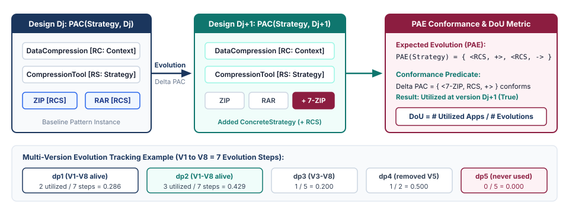
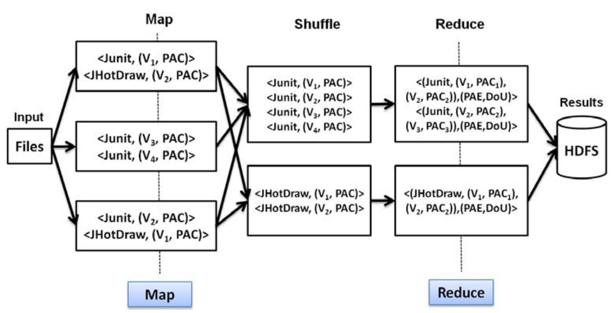
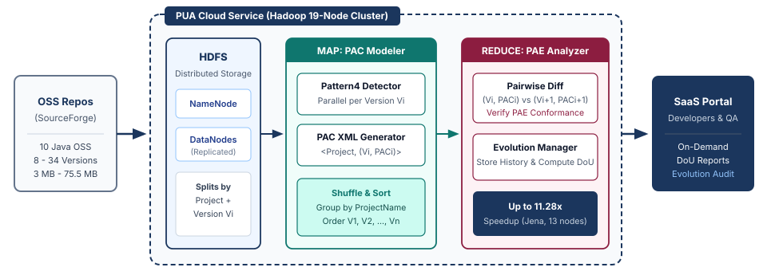
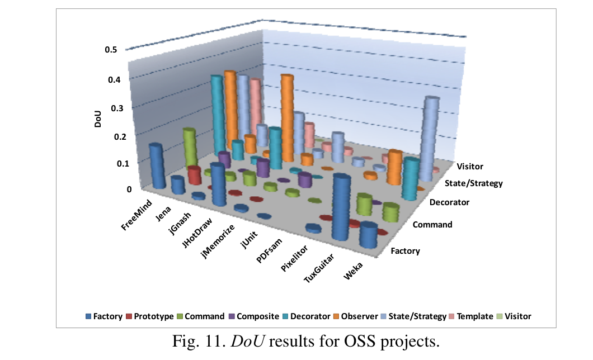
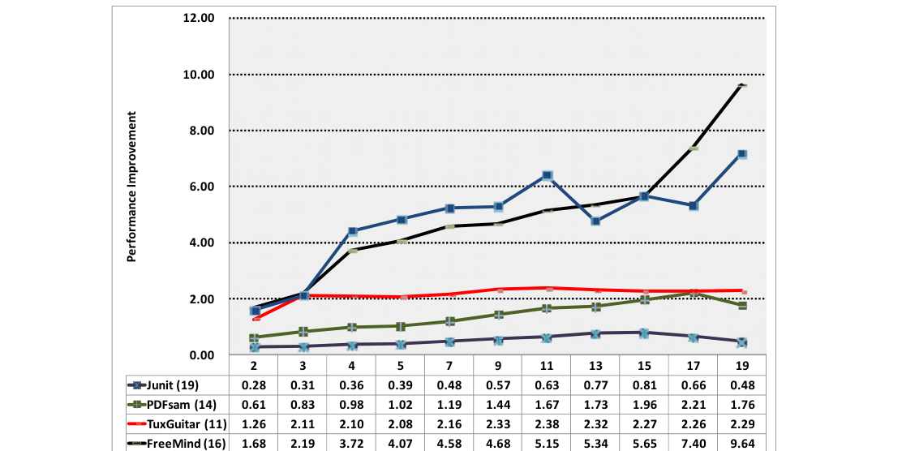
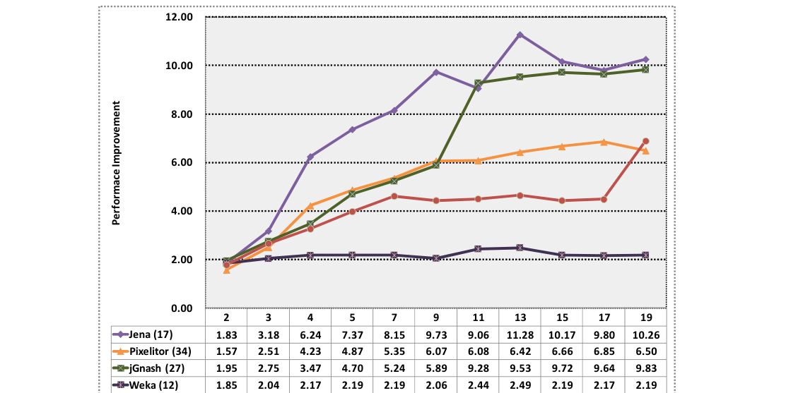

<!-- _class: lead -->

Journal of Information Science and Engineering (JISE) · 第 31 卷第 3 期，pp. 1051–1070 · 2015

# 評估軟體演化中設計模式使用度之雲端服務實作

A Cloud Service Implementation for Evaluating Design Pattern in Software Evolution

運用 <strong>Hadoop HDFS 與 MapReduce</strong> 平行化架構，將多版本開源軟體之設計模式使用度分析（<strong>PAC / PAE / DoU</strong>）擴展為按需式軟體品質評估雲端服務

<strong>丁德宏1</strong>、<strong>薛念林1,+</strong>（通訊作者）、<strong>楊朝棟2</strong>、<strong>張志宏3</strong> 
1 逢甲大學資訊工程學系 · 2 東海大學資訊工程學系 · 3 修平科技大學資訊管理系

DOI: 10.1688/JISE.2015.31.3.15 · 國科會／科技部補助計畫：NSC 101-2221-E-035-027、MOST 103-2627-M-035-003

<!--
論文基本資訊與研究定位：
- 篇名：A Cloud Service Implementation for Evaluating Design Pattern in Software Evolution（評估軟體演化中設計模式使用度之雲端服務實作）
- 發表期刊：Journal of Information Science and Engineering (JISE), Vol. 31, No. 3, pp. 1051–1070, 2015（DOI: 10.1688/JISE.2015.31.3.15）。
- 作者群：丁德宏（逢甲大學資工系博士生）、薛念林（逢甲大學資工系副教授，通訊作者）、楊朝棟（東海大學資工系教授）、張志宏（修平科大資管系副教授）。
- 核心立意：延續團隊先前於 COMPSACW 2011 提出之設計模式使用度分析工具 PUA（Pattern Utilization Analyzer），將其從單機網頁架構改造為基於 Apache Hadoop（HDFS + MapReduce）之 SaaS 軟體品質評估雲端服務，針對大型開源軟體多版本歷史達成超過 10 倍的運算加速。
-->

---

## 簡報大綱

1

<a href="#3">研究動機與目標</a> 單機多版本設計模式分析之運算瓶頸，以及軟體品質雲端服務之核心目標。

2

<a href="#5">文獻回顧與技術背景</a> 設計模式品質實證研究、Pattern4 偵測工具與 Hadoop HDFS/MapReduce 架構。

3

<a href="#6">形式化使用度模型（PAC / PAE / DoU）</a> 定義模式應用脈絡、預期演化規則與跨版本使用度指標。

4

<a href="#7">MapReduce 與 PUA 雲端服務設計</a> 透過 Map 平行偵測模式、Reduce 驗證相鄰版本演化一致性。

5

<a href="#9">十個開源專案實證評估</a> 19 節點 Hadoop 叢集實測：DoU 分布結果與最高 11.28 倍效能加速。

6

<a href="#13">討論、限制與結論</a> 磁碟 I/O 與運算負載權衡、設計模式演化洞察與品質評估雲端願景。

<!--
論文結構導覽：
- 第 1 節（緒論，pp. 1051–1053）：闡述設計模式四種角色（品質改善者、活動促進者、問題解決者、衝突協調者），以 Table 1 凸顯單機 PUA 執行耗時瓶頸，並列出三項核心貢獻。
- 第 2 節（背景與相關研究，pp. 1053–1056）：比較既有單一版本或問卷型實證研究（Vokac、Prechelt、Aversano、Tsantalis、Dong、Zhang & Budgen），並介紹 Hadoop HDFS 與 MapReduce 主從分散式架構。
- 第 3 節（使用度評估模型，pp. 1056–1059）：形式化定義 PAC、PAE、使用謂詞 δ 與 DoU，並以 Strategy 資料壓縮範例與 8 版本演化軸說明。
- 第 4 節（雲端服務設計，pp. 1059–1062）：對照傳統四步驟網頁版 PUA，提出 Map/Shuffle/Reduce 鍵值對設計與三模組雲端架構。
- 第 5 節（實驗評估，pp. 1062–1068）：於 19 節點叢集評估 10 個 Java 開源專案（5 小型、5 大型），剖析 DoU 與 2 至 19 節點加速倍率。
- 第 6 節（結論，p. 1068）：總結 SaaS 軟體品質評估雲端架構之實務價值。
-->

---

## 1. 研究動機：軟體演化中設計模式評估的運算瓶頸

### 為何必須跨版本評估設計模式？
- 設計模式扮演四種角色：<strong>品質改善者</strong>、<strong>活動促進者</strong>、<strong>問題解決者</strong>與<strong>衝突協調者</strong>（Hsueh et al., 2009）。
- 多數品質改善型模式旨在提升<strong>可維護性</strong>——使後續新增、刪除或修改元件更容易。
- 唯有比對<strong>連續版本之設計變更</strong>，才能檢驗已部署的模式是否真正發揮當初預期的演化價值。

### 單機分析之實務效能瓶頸
- 既有單機網頁版 <strong>PUA</strong> 逐版執行圖形相似度模式偵測（<code>Pattern4</code>）。
- 評估 <strong>jMemorize（12 版）</strong>即需近 <strong>3 小時</strong>；<strong>jGnash（26 版）</strong>更高達 <strong>15.4 小時</strong>！
- 過長的等待時間使開發者難以在實務上即時檢視設計投資報酬。

| 開源專案 | 版本數 | 最小檔案 (KB) | 最大檔案 (KB) | 單機 PUA 耗時 |
| :--- | :---: | :---: | :---: | :---: |
| **JUnit** | 19 | 91 | 248 | 0.7 分鐘 |
| **FreeMind** | 16 | 70 | 2,536 | 15.4 分鐘 |
| **JHotDraw** | 8 | 414 | 2,079 | 33.3 分鐘 |
| **jMemorize** | 12 | 1,791 | 4,075 | **169.3 分鐘（約 2.8 時）** |

<strong>龐大開源程式碼資源（SourceForge, 2013 Q1）：</strong>累積逾 <strong>324,000 個專案</strong>與 <strong>340 萬名開發者</strong>——唯有導入雲端分散式運算，方能按需（on-demand）萃取寶貴的軟體演化設計經驗。

<!--
理論動機與實務瓶頸（第 1 節，Table 1）：
- 團隊先前研究（Hsueh et al., SoSyM 2009）從四個視角剖析設計模式，例如 Observer 同時扮演品質改善者（降低 Subject 與 Observer 耦合）、活動促進者（輔助設計分解）與問題解決者（避免資料不一致）。
- COMPSACW 2011 提出以「連續版本變更與模式預期演化之一致性程度」來衡量設計模式使用度（Utilization）。
- Table 1 顯示單機分析隨程式碼規模呈超線性增長：JUnit 僅需 0.7 分鐘，但 jMemorize 需 169.3 分鐘；至 Table 5 的 Weka（477.37 分鐘）與 jGnash（926.66 分鐘）更需 8 至 15 小時以上，導致單機架構無法應用於實務開發回饋。
-->

---

## 1. 研究目標與三大核心貢獻

<h3>☁️ 1. SaaS 品質評估雲端服務</h3>

將單機版 <strong>PUA（Pattern Utilization Analyzer）</strong>重構為基於 <strong>Hadoop HDFS 與 MapReduce</strong> 之雲端服務，針對大型軟體達成 <strong>超過 10 倍</strong>運算加速。

<h3>📊 2. 大規模開源軟體實證</h3>

於 <strong>19 節點 Hadoop 叢集</strong>對 <strong>10 個知名 Java 開源專案</strong>（共 170 個版本快照、最大累積 75.5 MB）驗證架構之可擴展性。

<h3>🔍 3. 演化導向品質監控機制</h3>

提供程式設計師自動化、按需式分析途徑，長期追蹤已部署之 GoF 設計模式在版本演進中的實際維護貢獻。

11.28×

大型系統最高加速比（Jena，13 節點：120.0 ➔ 10.64 分鐘）

9.64×

小型系統最高加速比（FreeMind，19 節點：15.40 ➔ 1.60 分鐘）

0.350

實測最高模式使用度 DoU（JHotDraw 之 Observer 模式）

<!--
研究目標與三大貢獻（第 1 節，p. 1053）：
1. 工程貢獻：建構結合軟體即服務（SaaS）概念與 Hadoop MapReduce 之設計模式雲端評估系統，將耗時的 Pattern4 偵測分散至 Map 任務，相較舊版單機 PUA 於大型專案達成逾 10 倍加速。
2. 實證貢獻：以 10 個長期維護之知名開源專案（涵蓋 9 大 GoF 模式與 2 至 19 節點組態）全面驗證雲端品質評估架構之效能與適用邊界。
3. 方法論貢獻：建立自動化多版本演化監控流程，使設計模式品質研究由靜態單版檢視邁向縱向演化追蹤。
-->

---

## 2. 文獻回顧與技術背景

<h3>📚 設計模式品質評估與偵測工具</h3>
<ul class="small-text">
<li><strong>缺陷關聯（Vokac, 2004）：</strong>Observer 與 Singleton 因結構較龐大而有較高缺陷傾向；Factory Method 精簡低耦合，缺陷較少。</li>
<li><strong>維護實驗（Prechelt et al., 2001）：</strong>對照組紙筆維護實驗顯示 Decorator 在特定變更任務中較易修改。</li>
<li><strong>橫切關注點（Aversano et al., 2009）：</strong>設計模式引發之關注點散落程度與缺陷數呈正相關，開發者須留意副作用。</li>
<li><strong>自動偵測技術：</strong><strong>Tsantalis et al.（2006）</strong>圖形相似度計分（<code>Pattern4</code>，支援變體偵測）；<strong>Dong et al.（2007）</strong>矩陣權重法 <code>DP-Miner</code>（不支援偏差變體）。</li>
<li><strong>研究缺口：</strong>既有文獻多侷限於<strong>單一版本</strong>或問卷調查，缺乏自動化跨版本演化使用度分析。</li>
</ul>

<h3>🐘 Hadoop 分散式運算基礎架構</h3>
<ul class="small-text">
<li><strong>HDFS（主從分散式檔案系統）：</strong>單一 <code>NameNode</code> 管理命名空間與區塊映射；多台 <code>DataNodes</code> 於一般商用 Linux 主機存放多副本資料區塊，具備高吞吐 I/O 與容錯能力。</li>
<li><strong>MapReduce 運算框架：</strong>將龐大輸入資料切分為獨立區塊，由 <code>Map</code> 任務平行處理並依鍵值排序洗牌（Shuffle），再交由 <code>Reduce</code> 任務彙整輸出。</li>
<li><strong>資料局部性排程：</strong>主節點 <code>JobTracker</code> 優先將任務指派至存放資料區塊之同節點（或同機架）<code>TaskTracker</code>，大幅降低網路搬移成本。</li>
</ul>

<!--
文獻定位與基礎架構選型（第 2 節，pp. 1053–1056）：
- 既有設計模式實證研究（Vokac 2004、Prechelt et al. 2001、Ng et al. 2012、Aversano et al. 2009 與 Zhang & Budgen 2012 系統性文獻回顧）顯示設計模式對品質之影響具情境相依性：若模式部署後從未被演化需求所運用，反而徒增結構複雜度與缺陷風險。
- 在模式偵測工具方面，本研究選用 Tsantalis 等人開發之 Pattern4，因其圖形相似度演算法能識別真實專案中經過修改的 GoF 模式實例。
- 由於跨版本分析的瓶頸在於對各版本獨立執行 Pattern4（天然適合 Map 平行化），而後續比對則依專案彙整排序（天然適合 Shuffle + Reduce），因此 Apache Hadoop 成為最契合之分散式實作平台。
-->

---

## 3. 形式化使用度模型：PAC、PAE 與 DoU

<h3>1. 應用脈絡 — PAC</h3>

<code>PAC(dp, D) = { &lt;element, r&gt; }</code> 記錄設計 <code>D</code> 中各程式碼元件所扮演的模式角色 <code>r</code>（如 <code>RC</code>、<code>RS</code>、<code>RCS</code>）。

<h3>2. 預期演化 — PAE</h3>

<code>PAE(dp) = { &lt;role, op&gt; }</code> 定義預期角色變更 <code>op ∈ {+, -}</code>。Strategy 預期增刪 <code>RCS</code> 而不改動 Context。

<h3>3. 使用度指標 — DoU</h3>

若 <code>ΔPAC</code> 符合 <code>PAE(dp)</code> 則 <code>δ(dp, Dj+1)</code> 為真。 <code>DoU = 已使用次數 / 演化總次數</code>

<!--
形式化定義詳解（第 3 節，式 1–6，Figs. 4–6）：
- 式 (1) 模式應用脈絡 PAC(dp, D) = {<element, r>}。以資料壓縮之 Strategy 模式為例（式 2）：PAC(Strategy, D) = {<DataCompression, RC>, <CompressionTool, RS>, <RAR, RCS>, <ZIP, RCS>}。
- 式 (3) 模式應用演化 PAE(dp) = {<role, operator>}，運算子為新增 (+) 或刪除 (-)。Strategy 之 PAE（式 4）為 {<RCS, +>, <RCS, ->}，反映在不更動原有脈絡類別下自由擴充演算法之設計初衷。
- 式 (5) 模式使用謂詞 δ(dp, Dj+1) 成立，若且唯若相鄰版本間的脈絡差異 ΔPAC(dp, Dj, Dj+1) 符合 PAE(dp)。於版本 Dj+1 新增 7-ZIP 壓縮策略即構成一次有效使用。
- 式 (6) 使用度 DoU =（已使用次數）/（模式存活期間之演化步數，即版本數減一）。在 Fig. 6 的 8 版本範例中，dp1 至 dp5 之 DoU 分別為 2/7、3/7、1/5、1/2 與 0/5。
-->

---

## 4. 分散式 PUA 之 MapReduce 設計

### 三階段平行運算流程
1. <strong>Map 階段（<code>PAC Modeler</code>）：</strong>
   - 依 <code>(ProjectName, Version)</code> 切分開源專案檔案控點。
   - 各平行 Map 任務自 <strong>HDFS</strong> 讀取對應版本原始碼，執行 <strong><code>Pattern4</code></strong> 偵測並封裝為 <strong>PAC XML</strong>。
   - 輸出：<code>listm(Key, Value) = &lt;ProjectName, (Vi, PACi)&gt;</code>
2. <strong>Shuffle 與排序階段：</strong>
   - 依專案名稱彙整所有版本之 PAC XML，並按版本序號 <code>Vi</code> 排序。
3. <strong>Reduce 階段（<code>PAE Analyzer</code>）：</strong>
   - 串流比對相鄰版本對 <code>(Vi, PACi)</code> 與 <code>(Vi+1, PACi+1)</code>（末版 <code>Vi+1 = Null</code>）。
   - 輸出 <code>listr = &lt;(ProjectName, (Vi, PACi), (Vi+1, PACi+1)), PAE&gt;</code>，計算並儲存 <strong>DoU</strong>。

論文 Fig. 9：PUA 之 Map、Shuffle 與 Reduce 三階段分散式運算流程。

<!--
MapReduce 轉換設計（第 4.1 與 4.2 節，式 7–8，Figs. 7–9）：
- 舊版單機網頁式 PUA（Fig. 7）包含版本控制、PAC 與 PAE 三模組，需依序完成（1）下載 SourceForge 原始碼、（2）以 Pattern4 偵測模式、（3）將結果轉為單版 PAC XML（Fig. 8，含模式名稱、角色名稱與程式碼位置）、（4）比對相鄰版本計算 DoU。
- 由於步驟 2 的 Pattern4 圖形相似度分析佔據絕大部分運算時間，本論文將步驟 2 與 3 移入 Map 階段平行執行（式 7），讓叢集各節點同時剖析不同版本。
- Shuffle 階段借重 Hadoop 原生依 Key 分組與排序機制，自動將同一專案的所有版本依序對齊，再交由 Reduce 階段（式 8）執行輕量級相鄰版本 PAC 差異比對與 PAE 驗證。
-->

---

## 4. PUA 雲端服務系統架構（SaaS 工作流程）

<h3>步驟一：開源碼匯入</h3>

自 <strong>SourceForge</strong> 收集多版本 Java 開源專案原始碼，匯入 <strong>HDFS</strong> 分散式檔案系統儲存。

<h3>步驟二：雲端平行分析</h3>

<strong>PAC Modeler</strong>（Map）呼叫 <code>Pattern4</code> 抽取模式脈絡；<strong>PAE Analyzer</strong>（Reduce）檢核連續版本演化一致性。

<h3>步驟三：SaaS 報告回傳</h3>

<strong>Evolution Manager</strong> 儲存歷史紀錄，即時產出各設計模式之 <strong>DoU 評估報表</strong>回傳予開發者。

<!--
PUA 雲端服務架構（第 4.3 節，Fig. 10）：
- 改良後之 PUA 雲端服務將系統劃分為三個核心模組並無縫對應至 Hadoop 平台：
  1. PAC Modeler：於 Map 任務中呼叫模式偵測工具（Pattern4），跨多版本蒐集模式應用脈絡。
  2. PAE Analyzer：於 Reduce 任務中檢驗各開源專案連續版本間之 PAC 變化是否符合 PAE 規範。
  3. Evolution Manager：集中管理所有使用度分析歷史，並透過軟體即服務（SaaS）介面將結果回傳給終端使用者。
- 儲存（HDFS）與運算（MapReduce）解耦使系統能隨專案數量與版本深度彈性擴充節點。
-->

---

## 5. 實驗環境：19 節點叢集與 10 個開源基準專案

### 實驗硬體與軟體規格（Table 2）
- <strong>叢集規模：</strong>共 <strong>19 個運算節點</strong>（依序實測 2、3、4、5、7、9、11、13、15、17、19 節點）
- <strong>處理器：</strong>Intel Core i5 650（3.20 GHz）與 Core 2 Duo E7600（3.06 GHz）
- <strong>記憶體：</strong>每節點 4 GB DDR3（2 GB × 2）
- <strong>作業系統與平台：</strong>Ubuntu 10.4 · <strong>Apache Hadoop 0.21</strong>

<strong>規模分組門檻（Table 3）：</strong>依多版本累積原始碼總容量是否大於 <strong>10,000 KB</strong>，劃分為 <strong>小型系統（5 個）</strong>與 <strong>大型系統（5 個）</strong>。

| 分組 | 開源專案 | 版本數 | 版本區間 | 總容量 (KB) |
| :--- | :--- | :---: | :---: | :---: |
| 小型 | **JUnit** | 19 | 3.4.0–4.10.0 | 3,079 |
| 小型 | **PDFsam** | 14 | 1.0.0–2.2.1 | 4,818 |
| 小型 | **TuxGuitar** | 11 | 0.2–1.2 | 6,706 |
| 小型 | **FreeMind** | 16 | 0.0.2–0.9.0 | 8,774 |
| 小型 | **JHotDraw** | 8 | 5.2–7.6 | 8,977 |
| 大型 | **Pixelitor** | 34 | 0.1.0–1.1.2 | 26,022 |
| 大型 | **jMemorize** | 12 | 0.7.0–1.3.0 | 31,584 |
| 大型 | **Jena** | 17 | 2.0–2.6.4 | 37,388 |
| 大型 | **Weka** | 13 | 3.0.1–3.7.5 | 50,611 |
| 大型 | **jGnash** | 26 | 1.0.1–1.10.5 | **75,505** |

<!--
實驗情境與受測專案說明（第 5.1 節，Tables 2–3）：
- 實驗選取 10 個長期開發且歷經多版釋出的 Java 開源專案，橫跨圖形框架（JHotDraw）、單元測試（JUnit）、心智圖（FreeMind）、語意網工具（Jena）、個人理財（jGnash）、閃卡學習（jMemorize）、PDF 合併分割（PDFsam）、影像編輯（Pixelitor）、吉他譜編輯（TuxGuitar）與機器學習（Weka）。
- 全體語料共 170 個版本快照、總計約 253.5 MB 原始碼，單版規模介於 70 KB（FreeMind 0.0.2）至 6,246 KB（Weka 3.7.5）。
- 以 10,000 KB 為界區分小型與大型系統，能清楚對照 Hadoop 啟動／I/O 負擔與大規模平行運算效益之轉折點。
-->

---

## 5. 實證發現一：十個開源專案之模式使用度（DoU）

論文 Fig. 11：10 個 Java 開源專案於 9 大 GoF 設計模式類別之 DoU 分布。

### 關鍵設計模式演化觀察
- <strong>整體使用度低於預期：</strong>所有專案之最高 DoU 僅約 <strong>0.35</strong>，顯示大量已部署模式在後續版本中並未實際發揮擴充彈性。
- <strong>最高使用度案例：</strong><strong>JHotDraw 的 Observer 模式</strong>達全場最高 <strong>0.350</strong>。
- <strong>表現最亮眼專案：</strong><strong>FreeMind</strong> 整體 DoU 領先各專案——<strong>Decorator、Observer 與 State/Strategy</strong> 皆高於 <strong>0.30</strong>（未部署 Prototype、Composite 與 Visitor）。
- <strong>領域差異顯著：</strong>
  - <strong>TuxGuitar：</strong>Factory Method 扮演關鍵演化角色。
  - <strong>Weka 與 PDFsam：</strong>State/Strategy 為最高（或唯一）被使用之模式。
  - <strong>JUnit 與 Pixelitor：</strong>DoU 普遍偏低或不適用。

<!--
DoU 實證結果深入解讀（第 5.2 節，Fig. 11，p. 1064）：
- 本研究涵蓋九大品質改善型 GoF 模式：Factory Method、Prototype、Command、Composite、Decorator、Observer、State/Strategy（因靜態結構同構於 Pattern4 中合併偵測）、Template Method 與 Visitor。
- 部署頻率與實際使用度存在顯著落差：Command、Template Method 與 State/Strategy 最常被部署（Visitor 最少），但真正發揮演化彈性（高 DoU）的前兩名卻是 Observer 與 State/Strategy。
- 實務啟示：Observer 雖非程式設計師最偏愛部署的模式，但一旦導入往往能真正支撐後續演化；State/Strategy 則是兼具高採用率與高使用度的雙贏模式。反之，長期處於 DoU = 0 的模式代表潛在過度設計。
-->

---

## 5. 實證發現二：小型開源系統之雲端加速效能

### 執行時間（分鐘）與加速比（Table 4）
| 專案 | 單機 PUA | 2 節點 | 11 節點 | 19 節點 | 最高加速比 |
| :--- | :---: | :---: | :---: | :---: | :---: |
| **JUnit** | **0.74** | 2.65 | 1.17 | 1.54 | 0.81× (N15) |
| **PDFsam** | 1.65 | 2.69 | 0.99 | 0.94 | 2.21× (N17) |
| **TuxGuitar** | 12.34 | 9.79 | **5.18** | 5.39 | 2.38× (N11) |
| **FreeMind** | 15.40 | 9.18 | 2.99 | **1.60** | **9.64× (N19)** |
| **JHotDraw** | 33.29 | 20.96 | 5.20 | **4.64** | **7.18× (N19)** |

<strong>微型專案的 Hadoop 啟動開銷：</strong>對於極小型的 <strong>JUnit</strong>（0.74 分鐘）與 2 節點下的 <strong>PDFsam</strong>，HDFS 讀取與任務排程成本高於運算節省；但規模達 8–9 MB（FreeMind、JHotDraw）時，加速比即躍升至 <strong>7.18×–9.64×</strong>。

論文 Fig. 14：小型系統於 2–19 個 Hadoop 節點相對於單機 PUA 之加速倍率。

<!--
小型系統效能基準分析（第 5.3 節，Table 4，Figs. 12 & 14）：
- 效能改善倍率定義為 T_PUA / T_Cloud(k 節點)。以 FreeMind（16 版）為例，單機 PUA 耗時 15.40 分鐘，2 節點降至 9.18 分鐘（1.68×），19 節點更壓縮至 1.60 分鐘（9.64×）。
- JHotDraw（8 版，8,977 KB）由 33.29 分鐘降至 19 節點的 4.64 分鐘（7.18×）。11 至 17 節點間的輕微起伏源於叢集異質 CPU（Core i5 與 Core 2 Duo 混搭）及排程落點差異。
- JUnit（19 版合計僅 3,079 KB）在所有節點數下皆未能超越單機（最佳為 15 節點 0.91 分鐘，加速比 0.81×），具體印證了分散式框架在小檔案情境下的固定開銷門檻。
-->

---

## 5. 實證發現三：大型開源系統之雲端加速效能

論文 Fig. 15：大型系統（&gt;10,000 KB）於 2–19 個 Hadoop 節點之加速倍率。

### 執行時間（分鐘）與加速比（Table 5）
| 專案 | 單機 PUA | 4 節點 | 13 節點 | 19 節點 | 最高加速比 |
| :--- | :---: | :---: | :---: | :---: | :---: |
| **Pixelitor** | 47.46 | 11.23 | 7.39 | 7.31 | 6.85× (N17) |
| **jMemorize** | 169.32 | 51.77 | 36.44 | **24.57** | **6.89× (N19)** |
| **Jena** | 120.00 | 19.22 | **10.64** | 11.70 | **11.28× (N13)** |
| **Weka** | 477.37 | 219.51 | **191.80** | 218.19 | 2.49× (N13) |
| **jGnash** | **926.66** | 266.82 | 97.23 | **94.27** | **9.83× (N19)** |

<strong>實務衝擊：</strong>分析 26 個版本的 <strong>jGnash</strong> 由 <strong>15.4 小時縮短至 1.57 小時（9.83×）</strong>；<strong>Jena</strong> 更由 <strong>2 小時壓縮至 10.6 分鐘（11.28×）</strong>！

<!--
大型系統效能基準分析（第 5.3 節，Table 5，Figs. 13 & 15）：
- 五個大型開源專案（>10,000 KB）皆展現大幅度時間縮減：
  - Jena（17 版，37.4 MB）：120.00 分鐘降至 13 節點 10.64 分鐘（全場最高 11.28× 加速）。
  - jGnash（26 版，75.5 MB）：926.66 分鐘（15.4 小時）降至 19 節點 94.27 分鐘（9.83×）。
  - jMemorize（12 版，31.6 MB）：169.32 分鐘降至 19 節點 24.57 分鐘（6.89×）。
  - Pixelitor（34 版，26.0 MB）：47.46 分鐘降至 17 節點 6.93 分鐘（6.85×）。
  - Weka（13 版，50.6 MB）：477.37 分鐘降至 13 節點 191.80 分鐘（2.49×）。Weka 加速比停滯在約 2.5 倍的原因在於其最新版本單檔高達 6,246 KB，形成單一 Map 任務的「落後者瓶頸（Straggler）」，受限於版本層級平行粒度（Amdahl's Law）。
-->

---

## 6. 討論：設計模式洞察與雲端擴展權衡

<h3>🧩 設計模式使用度之軟體工程啟示</h3>
<ul class="small-text">
<li><strong>高部署 ≠ 高使用：</strong>Command、Template Method 與 State/Strategy 部署最頻繁（Visitor 最少），但實際演化使用度最高者為 <strong>Observer 與 State/Strategy</strong>。</li>
<li><strong>低調高效 — Observer：</strong>部署數量不如 Command，卻在版本演進中持續展現極高的架構彈性。</li>
<li><strong>雙料冠軍 — State/Strategy：</strong>既受開發者青睞，也最常在維護階段確實發揮替換擴充價值。</li>
<li><strong>架構治理指標：</strong>DoU 可協助團隊早期辨識「過度設計卻零使用」的僵化模式。</li>
</ul>

<h3>⚖️ 雲端運算權衡與研究限制</h3>
<ul class="small-text">
<li><strong>磁碟 I/O 與運算占比：</strong>微型專案（JUnit、PDFsam）受限於 HDFS 資料提取與排程開銷；隨專案規模放大，CPU 平行效益迅速主導並拉高加速比。</li>
<li><strong>版本粒度落後者（Weka）：</strong>以單一版本為 Map 切分單位時，超大型單版（6.25 MB）將決定整體完工下限，導致 Weka 止步於 2.49×。</li>
<li><strong>偵測工具相依性：</strong>準確度受限於 <code>Pattern4</code> 之靜態圖形相似度偵測（無法區分 State 與 Strategy）。</li>
<li><strong>千節點擴展潛力：</strong>實驗趨勢顯示增加 Hadoop 節點可持續提速，部署於千節點雲端即可實現即時分析。</li>
</ul>

<!--
綜合討論與研究限制（第 5.4 節，pp. 1067–1068）：
- 設計模式層面：靜態統計「部署了多少模式」無法代表架構品質，唯有追蹤模式預期演化規則（PAE）是否在實際版本更迭中被觸發（DoU），才能客觀評估設計模式的投資效益。
- 系統工程權衡：
  1. 小檔案效應：Hadoop 專為大量運算密集資料設計，總量低於 5 MB 的小型專案反而易被 NameNode/JobTracker 協調與磁碟 I/O 拖慢。
  2. 版本大小偏斜（Straggler 問題）：Weka 從 1.5 MB 成長至 6.25 MB，單一最大版本限制了版本級平行化的理論上限；未來可進一步拆解至套件或模組層級平行偵測。
  3. 叢集異質性：實驗室 19 節點混用 Core i5 與 Core 2 Duo，解釋了部分節點數區間的小幅波動。
-->

---

## 6. 結論與軟體品質評估雲端願景

<strong>核心貢獻總結：</strong>本研究成功實作基於 <strong>Hadoop 之軟體品質評估雲端服務（SaaS）</strong>，自動化跨版本設計模式使用度評估（<strong>PAC / PAE / DoU</strong>），於 19 節點叢集達成 <strong>最高 11.28 倍加速</strong>，使開發團隊能在實務中按需審計開源與企業軟體之設計模式演化價值。

<strong>☁️ 1. 按需式軟體品質雲</strong> 串聯全球開源程式碼庫，讓開發者隨時透過 SaaS 介面檢索跨版本設計模式實證經驗。

<strong>⚡ 2. 更細粒度平行切分</strong> 針對 Weka 等巨型單版進一步設計模組級 Map 切分策略，消除落後者效應以突破加速上限。

<strong>🔬 3. 多指標品質分析管線</strong> 在雲端架構上整合缺陷預測、程式碼異味與重構建議，建構全方位軟體演化品質監控平台。

<!--
結論與未來展望（第 6 節，p. 1068）：
- 本研究結合實證軟體工程與分散式雲端運算，將形式化設計模式演化指標（PAC、PAE、DoU）落實為可水平擴充的 Hadoop MapReduce 雲端服務。
- 關鍵驗證數據回顧：10 個 Java 開源專案（共 170 版）、19 節點 Hadoop 0.21 叢集、最高 DoU = 0.350（JHotDraw 之 Observer）、小型系統最高加速 9.64×（FreeMind，15.40 ➔ 1.60 分鐘）、大型系統最高加速 11.28×（Jena，120.00 ➔ 10.64 分鐘）、jGnash 由 15.4 小時大幅縮減至 1.57 小時（9.83×）。
- 整體架構描繪出「軟體品質評估雲（Software Quality Evaluation Cloud）」藍圖，讓大規模軟體演化分析從數小時的離線批處理邁向按需式工程服務。
-->

---

<!-- _class: closing -->

# 感謝聆聽 · 敬請指教！

評估軟體演化中設計模式使用度之雲端服務實作 
A Cloud Service Implementation for Evaluating Design Pattern in Software Evolution

<strong>丁德宏1</strong> · <strong>薛念林1,+</strong>（<code>nlhsueh@fcu.edu.tw</code>） 
<strong>楊朝棟2</strong> · <strong>張志宏3</strong>（<code>chchang@hust.edu.tw</code>） 
1 逢甲大學資訊工程學系 · 2 東海大學資訊工程學系 · 3 修平科技大學資訊管理系 
Journal of Information Science and Engineering (JISE), Vol. 31, No. 3, pp. 1051–1070, 2015 · DOI: 10.1688/JISE.2015.31.3.15

<!--
引用資訊與計畫致謝：
- 引用格式：Der-Hong Ting, Nien-Lin Hsueh, Chao-Tung Yang, and Chin-Hung Chang, "A Cloud Service Implementation for Evaluating Design Pattern in Software Evolution," Journal of Information Science and Engineering (JISE), Vol. 31, No. 3, pp. 1051–1070, 2015.
- DOI：10.1688/JISE.2015.31.3.15
- 補助計畫：國科會與科技部專題研究計畫 NSC 101-2221-E-035-027、MOST 103-2627-M-035-003。
- 關鍵詞：設計模式（design pattern）、軟體品質（software quality）、軟體演化（software evolution）、Hadoop、MapReduce。
-->

