

<!-- _class: lead -->

Journal of Information Science and Engineering · Vol. 36, pp. 53–73 (2020)

# Design Pattern Analysis with Software Evolution Data

Evaluating whether deployed <strong>GoF Design Patterns</strong> are truly utilized across software releases using <strong>Pattern Application Context (PAC)</strong>, <strong>Expected Pattern Utilization (EPU)</strong>, and <strong>Degree of Utilization (DoU)</strong>

<strong>Nien-Lin Hsueh</strong> 
Department of Information Engineering and Computer Science, Feng Chia University, Taichung 407, Taiwan 
<code>nlhsueh@fcu.edu.tw</code> · DOI: <code>10.6688/JISE.202001_36(1).0004</code>

Supported by the Ministry of Science and Technology (MOST), Taiwan, under grant MOST 106-2221-E-035-MY2.

---

## Opening Hook: Architectural Investment... Or Cobwebbed Dust Collector?

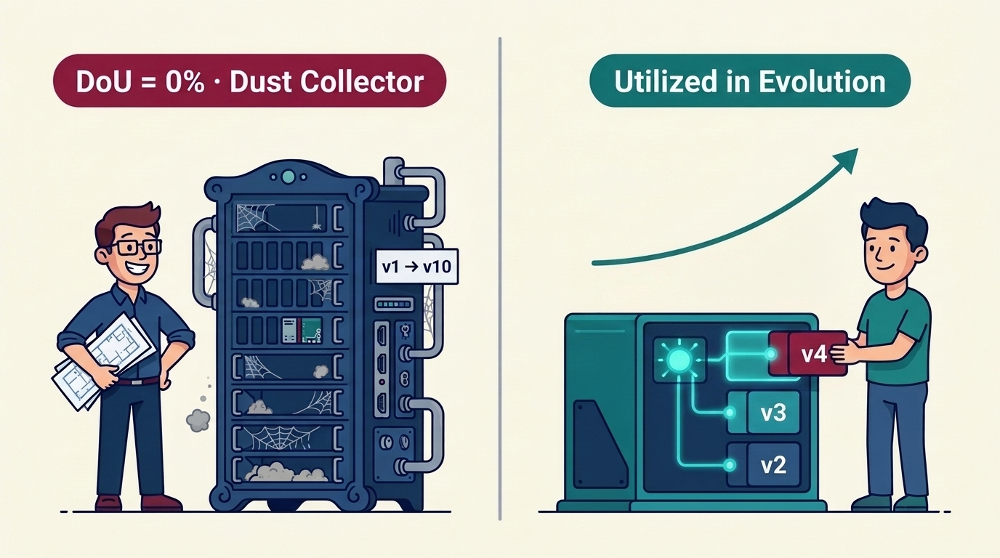

<strong>The Big Idea:</strong> Developers apply design patterns to make software flexible for future change — yet across <strong>15 open-source projects (296 evolutions)</strong>, most deployed patterns are <strong>rarely or never extended</strong> after initial deployment.

---

## Presentation Outline

1

[**Introduction & Research Questions**](#4)
Why static snapshots fail to evaluate maintainability, plus our 4 objectives and 2 formal RQs.

2

[**Background & Related Work**](#6)
Comparison of 12 pattern-evaluation studies (Table 1) and graph-similarity pattern detection.

3

[**Utilization Evaluation Methodology**](#7)
Pattern classification, FR/NFR-intent, formal PAC & EPU definitions, and the DoU metric.

4

[**PUA System & Experimental Results**](#11)
Pattern Utilization Analyzer architecture, JHotDraw case study, and 15 OSS project results.

5

[**Statistical Analysis & Threats to Validity**](#15)
One-way ANOVA for RQ1 (Pattern Type) & RQ2 (OSS Project), Scheffé post-hoc test, and threats.

6

[**Conclusion & Future Work**](#18)
Empirical synthesis of RQ1–RQ2, practical takeaways for teams, and roadmap for PUA.

---

## 1.1 Motivation: Why Static Snapshots Miss Pattern Value

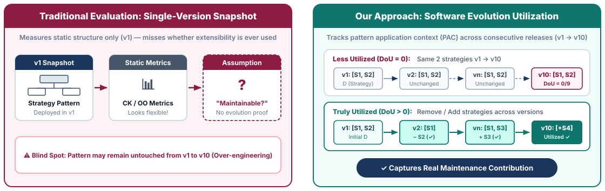

<strong>Evolutionary Principle:</strong> Most design patterns target <strong>maintainability & extensibility</strong> over time. Over-applied or unused patterns add structural complexity without payoff — so evaluation must span <strong>all consecutive versions</strong>, not a single snapshot.

---

## 1.2 Research Objectives & Two Research Questions

<strong>1. Methodology</strong> Formulate pattern utilization using evolution data.

<strong>2. Automation</strong> Build the web-based <code>PUA</code> analyzer tool.

<strong>3. Empirical Study</strong> Evaluate 11 patterns over 15 OSS (296 evolutions).

<strong>4. Statistics</strong> Test whether DoU depends on pattern type or project.

We test two core statistical research questions using One-Way ANOVA *(revealed step-by-step)*:

* 
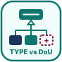

RQ1 Do certain design patterns naturally get utilized more often than others?

<strong>Is there any statistical difference between the DoU of deployed patterns and their type?</strong> (Across 9 quality-improver pattern groups covering 11 GoF patterns.)

* 

RQ2 Or does utilization depend on the project domain & engineering discipline?

<strong>Is there any statistical difference between the DoU of deployed patterns and the open source project?</strong> (Across 15 real-world Java OSS systems.)

---

## 2. Background & Related Work (Table 1)

Existing studies evaluate patterns via static metrics, controlled human experiments, surveys, or decay analysis — **none automatically quantifies evolutionary utilization**.

| Research Category | Representative Studies | Method & Code Analysis | Subjects & Key Focus |
| :--- | :--- | :--- | :--- |
| **Static Metrics & Quality** | Huston [15]; Hsueh et al. [13] | Metric analysis / Quantitative (Yes/No) | Design patterns: compatibility with OO metrics & well-definedness |
| **Controlled Experiments** | Prechelt et al. [23, 24]; Ng et al. [20, 21] | Human maintenance experiments | Maintainers: pattern benefit, documentation & anticipated changes |
| **Surveys & Mapping** | Zhang & Budgen [32, 33] | Systematic review & expert survey (No) | Papers & experts: 3 patterns rated useful; 25% gain low approval |
| **Evolution, Grime & Defects** | Aversano et al. [2]; Vokáč [30]; Izurieta [16] | Automated tools on code (Yes) | Software: change frequency, defect rate, pattern grime & decay |
| **Evolutionary Utilization** | **Hsueh [12] & This Work (2020)** | **Automated PUA tool on code (Yes)** | **15 OSS projects (296 evolutions): PAC/EPU conformance & DoU** |

<strong>Pattern Detection Foundation:</strong> We adopt <strong>Tsantalis et al. [28]</strong> (graph-similarity scoring on static class matrices) rather than DP-Miner [6], because it supports modified pattern variants and achieves <strong>100% precision & recall</strong> on JHotDraw.

---

## 3.1 Utilization Evaluation Methodology Overview

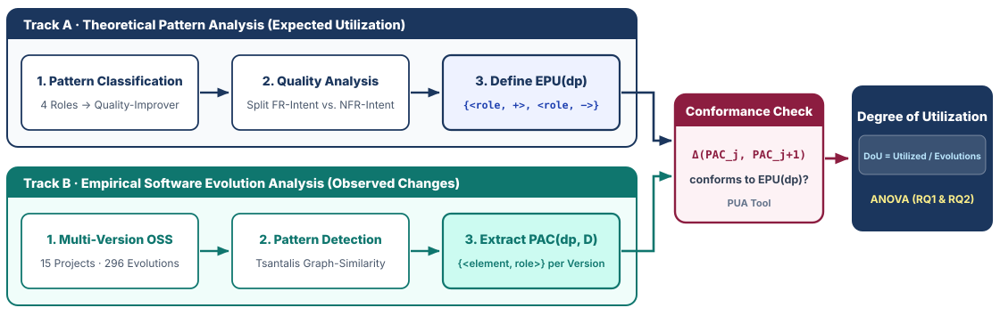

<strong>Two-Track Design:</strong> <strong>Track A (Theory)</strong> filters quality-improver patterns and defines their <em>Expected Pattern Utilization (EPU)</em> from NFR-intent; <strong>Track B (Practice)</strong> extracts <em>Pattern Application Context (PAC)</em> across versions to measure conformance.

---

## 3.2 Pattern Classification & FR/NFR-Intent Analysis

Not every GoF pattern targets maintainability. First, we classify patterns into **four roles** [14] and isolate **Quality-Improver** patterns:

### Activity-Facilitator
Facilitates recurring design tasks (decomposition, object allocation, access control).

### ★ Quality-Improver
**Our Focus:** Satisfies functional requirements while enhancing NFRs (extensibility, maintainability).

### Conflict-Resolver
Balances competing resources, divergent expectations, or side-effect requirement conflicts.

### Problem-Solver
Resolves boundary conditions and reliability issues (e.g., inconsistency via Observer).

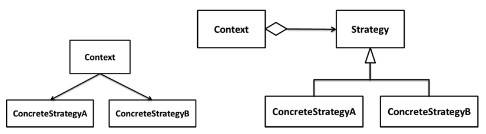

Fig. 4 · FR-structure (left) vs. NFR-structure (right) of Strategy pattern

- **FR-Intent (What it does)**: A `Context` uses an algorithm to solve a problem (simple FR-structure).
- **NFR-Intent (Quality gain)**: Introduces an abstract `Strategy` interface so new `ConcreteStrategy` algorithms can be **added or removed** without modifying `Context`.

---

## 3.3 Formal Model: PAC, EPU & Utilization Predicate

<strong>PAC(dp, D)</strong>&nbsp; = &nbsp;{ &lt;element, r&gt; }

<strong>EPU(dp)</strong>&nbsp; = &nbsp;{ &lt;role, operator&gt; }, &nbsp;operator ∈ {+, −}

<strong>utilized(dp, Dj+1)</strong> &nbsp;⇔ 
∃ Dj, Δ(PAC(dp, Dj), PAC(dp, Dj+1)) conforms to EPU(dp)

### Strategy Example (Data Compression)
- **PAC**: `{<DataCompression, R_C>, <CompressionTool, R_S>, <RAR, R_CS>, <ZIP, R_CS>}`
- **EPU(Strategy)**: `{<R_CS, +>, <R_CS, −>}` (add or remove a ConcreteStrategy).

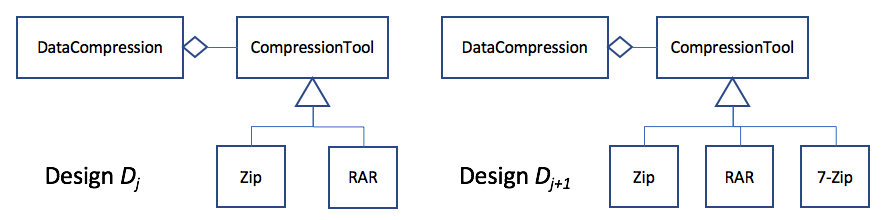

Fig. 5 · Adding <code>7-zip</code> in Dj+1 conforms to EPU(Strategy)

<strong>Core Criterion:</strong> A deployed pattern is declared <strong>utilized</strong> between consecutive versions Dj → Dj+1 if and only if its structural delta Δ(PAC) matches its expected evolution operator in EPU(dp).

---

## 3.4 Quantifying Evolution: Degree of Utilization (DoU)

<strong>DoU</strong>&nbsp; = &nbsp;

# of utilized applications
# of pattern evolution

### Fig. 6 Walkthrough (8 Versions, 5 Instances)
- **▲** = pattern deployed; **▲'** = utilized change; **X** = removed.
- `dp1` (V1–V8): 2 utilized (V3→V4, V4→V5) / 7 transitions = **2/7**.
- `dp2` (V1–V8): 3 utilized transitions / 7 = **3/7** (highest).
- `dp3` (V3–V8): 1 utilized / 5 = **1/5**.
- `dp4` (V3–V5): removed at V5 → 1 utilized / 2 = **1/2**.
- `dp5` (V3–V8): never utilized → **0/5**.

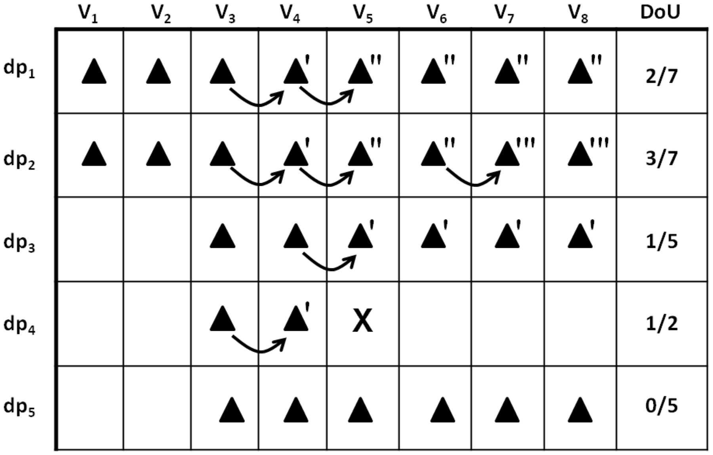

Fig. 6 · DoU calculation across 5 pattern instances (dp1–dp5) over V1–V8

---

## 4.1 PUA System Architecture & 4-Step Workflow

We built **Pattern Utilization Analyzer (PUA)**, a web-based tool with three core modules: **Version Control**, **PAC Module**, and **PAE/EPU Module**.

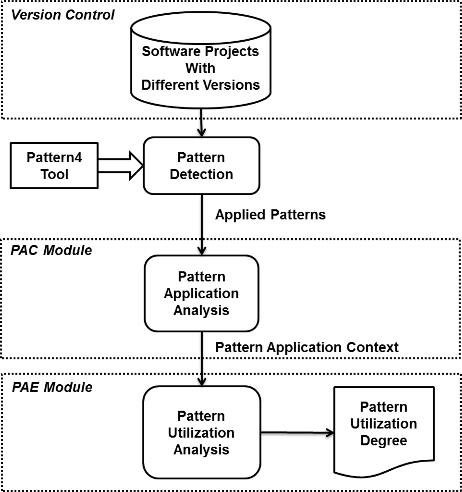

Fig. 7 · PUA System Architecture

### Step 1 · Collect Multi-Version Source Code
Harvest historical releases from SourceForge and import into PUA's **Version Control Module**.

### Step 2 · Detect 11 GoF Patterns via Pattern4
Run Tsantalis's graph-matching tool [28, 29] per version:
- **Creational**: Factory Method (`FM`), Prototype (`P`)
- **Structural**: Adapter-Command (`AC`), Composite (`C`), Decorator (`D`)
- **Behavioral**: Observer (`O`), State-Strategy (`SS`), Template Method (`TM`), Visitor (`V`)

### Step 3 & 4 · PAC/EPU Conformance → DoU
Extract `PAC` per version, check consecutive transitions against `EPU`, and output **DoU** per pattern instance and project.

---

## 4.2 Case Study Walkthrough: Observer Pattern in JHotDraw

Applying PUA to **JHotDraw** across five consecutive versions (`5.2 → 5.3 → 5.4b1 → 5.4b2 → 6.0b1`) tracks **6 Observer instances** (`dp1`–`dp6`):

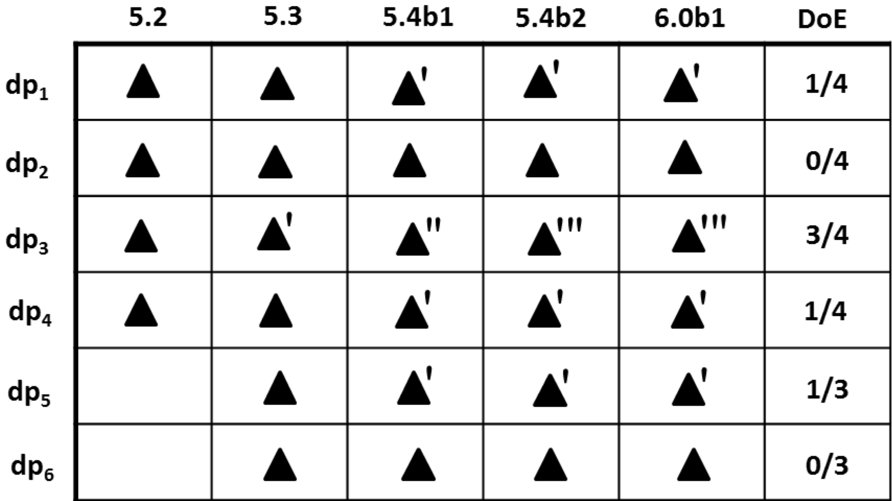

Fig. 8 · PUA analysis of 6 Observer instances in JHotDraw (5.2–6.0b1)

3/4

<code>dp3</code> (75% utilized)

1/3–1/4

<code>dp1</code>, <code>dp4</code>, <code>dp5</code>

0/4, 0/3

<code>dp2</code>, <code>dp6</code> (unused)

### Instance-Level Insights
- **`dp1`–`dp4`** deployed at v5.2 (4 evolution steps): `dp3` actively evolved in 3 of 4 transitions (`DoU = 3/4`), while `dp2` was never utilized (`0/4`).
- **`dp5`–`dp6`** introduced at v5.3 (3 evolution steps): `dp5` utilized once (`1/3`), `dp6` unused (`0/3`).
- Across all 8 JHotDraw evolutions, **Observer reaches the dataset's peak DoU of `0.350`**.

---

## 4.3 Experimental Setup: 15 OSS Projects & 296 Evolutions

We evaluated **15 Java open-source systems** from SourceForge spanning diverse domains (GUI editors, testing, ML, semantic web, finance, audio) over **2000–2012** (Table 2):

| OSS Project | # Evol. | Versions | Time Interval |
| :--- | :---: | :---: | :--- |
| **FreeMind** | 16 | 0.0.2–0.9.0 | Jun 2000 – Feb 2011 |
| **HtmlUnit** | 28 | 1.0.0–2.9.0 | May 2002 – Aug 2011 |
| **Jaxe** | 38 | 1.0–3.5 | Jun 2002 – Jun 2011 |
| **JConvert** | 9 | 1.0.0–1.1.0 | Aug 2007 – May 2011 |
| **JEdit** | 27 | 2.3–4.5.1 | Jan 2000 – Mar 2012 |
| **Jena** | 17 | 2.0–2.6.4 | Aug 2003 – Dec 2010 |
| **JGnash** | 26 | 1.0.1–1.10.5 | Jan 2003 – Mar 2006 |
| **JHotDraw** | 8 | 5.2–7.6 | Feb 2001 – Jan 2011 |

| OSS Project | # Evol. | Versions | Time Interval |
| :--- | :---: | :---: | :--- |
| **JMemorize** | 12 | 0.7.0–1.3.0 | Oct 2004 – Mar 2008 |
| **JUnit** | 19 | 3.4.0–4.10.0 | Dec 2000 – Sep 2011 |
| **LatexDraw** | 24 | 1.0.2–2.0.8 | Jan 2006 – Mar 2010 |
| **PDFsam** | 14 | 1.0.0–2.2.1 | Aug 2007 – Jul 2012 |
| **Pixelitor** | 34 | 0.1.0–1.1.2 | Nov 2009 – Nov 2010 |
| **TuxGuitar** | 11 | 0.2–1.2 | Jun 2006 – Nov 2009 |
| **Weka** | 13 | 3.0.1–3.7.5 | Feb 2002 – Aug 2012 |
| **Total** | **296** | **15 Systems** | **Up to 12 Years** |

<strong>Scope:</strong> 3 classic benchmarks (<strong>JHotDraw</strong>, <strong>JUnit</strong>, <strong>FreeMind</strong>) + 12 randomly selected Java OSS projects, evaluated across <strong>9 quality-improver pattern groups (11 GoF patterns)</strong>.

---

## 4.4 Experimental Results: DoU Matrix Across 15 OSS Projects (Table 3)

<table class="dense">
<thead>
<tr><th>Project</th><th>FM</th><th>P</th><th>AC</th><th>C</th><th>D</th><th>O</th><th>SS</th><th>TM</th><th>V</th></tr>
</thead>
<tbody>
<tr><td>FreeMind</td><td class="mid-cell">0.161</td><td></td><td class="mid-cell">0.165</td><td></td><td class="hi-cell">0.333</td><td class="hi-cell">0.333</td><td class="hi-cell">0.301</td><td class="hi-cell">0.263</td><td></td></tr>
<tr><td>HtmlUnit</td><td>0.082</td><td class="zero-cell">0</td><td>0.042</td><td></td><td class="mid-cell">0.196</td><td>0.032</td><td>0.129</td><td>0.101</td><td></td></tr>
<tr><td>Jaxe</td><td class="zero-cell">0</td><td></td><td>0.007</td><td></td><td class="zero-cell">0</td><td class="zero-cell">0</td><td>0.014</td><td class="zero-cell">0</td><td></td></tr>
<tr><td>JConvert</td><td></td><td></td><td class="zero-cell">0</td><td></td><td></td><td class="zero-cell">0</td><td class="mid-cell">0.158</td><td>0.125</td><td></td></tr>
<tr><td>JEdit</td><td></td><td></td><td>0.091</td><td></td><td></td><td></td><td class="zero-cell">0</td><td></td><td></td></tr>
<tr><td>Jena</td><td>0.056</td><td>0.060</td><td>0.014</td><td>0.056</td><td>0.076</td><td>0.071</td><td>0.093</td><td>0.047</td><td class="zero-cell">0</td></tr>
<tr><td>JGnash</td><td>0.012</td><td>0.001</td><td>0.023</td><td class="zero-cell">0</td><td>0.023</td><td>0.017</td><td>0.041</td><td>0.017</td><td></td></tr>
<tr><td>JHotDraw</td><td>0.143</td><td>0.004</td><td>0.044</td><td>0.063</td><td class="mid-cell">0.162</td><td class="hi-cell">0.350</td><td class="mid-cell">0.176</td><td>0.104</td><td class="zero-cell">0</td></tr>
<tr><td>JMemorize</td><td>0.010</td><td class="zero-cell">0</td><td>0.020</td><td class="zero-cell">0</td><td>0.010</td><td>0.040</td><td>0.030</td><td>0.030</td><td></td></tr>
<tr><td>JUnit</td><td class="zero-cell">0</td><td></td><td>0.016</td><td>0.045</td><td class="zero-cell">0</td><td class="zero-cell">0</td><td>0.120</td><td>0.026</td><td></td></tr>
<tr><td>LatexDraw</td><td class="zero-cell">0</td><td>0.005</td><td>0.058</td><td class="hi-cell">0.261</td><td></td><td class="mid-cell">0.174</td><td>0.073</td><td>0.075</td><td></td></tr>
<tr><td>PDFsam</td><td></td><td></td><td class="zero-cell">0</td><td></td><td></td><td></td><td>0.029</td><td class="zero-cell">0</td><td></td></tr>
<tr><td>Pixelitor</td><td>0.011</td><td class="zero-cell">0</td><td>0.007</td><td></td><td></td><td>0.020</td><td>0.016</td><td>0.029</td><td></td></tr>
<tr><td>TuxGuitar</td><td class="mid-cell">0.200</td><td>0.009</td><td>0.062</td><td class="zero-cell">0</td><td></td><td>0.125</td><td>0.051</td><td>0.032</td><td></td></tr>
<tr><td>Weka</td><td>0.068</td><td class="zero-cell">0</td><td>0.052</td><td></td><td>0.145</td><td class="zero-cell">0</td><td class="hi-cell">0.315</td><td>0.013</td><td></td></tr>
</tbody>
</table>

Blank = not deployed · <code>0</code> = deployed but never utilized · Teal ≥ 0.25, Blue ≥ 0.15

0.350

<strong>Highest DoU:</strong> Observer in JHotDraw

&lt; 0.20

<strong>Overall Reality:</strong> Mean DoU universally low across patterns

### Key Patterns
- **FreeMind**: Strongest overall (`D/O/SS > 0.30`).
- **Weka**: State-Strategy excels (`0.315`, ML algorithms).
- **LatexDraw**: Composite leads (`0.261`, shapes).
- **Jaxe, JEdit, PDFsam, Pixelitor**: Very low or `0` DoU.

---

## 5.1 RQ1 Analysis: DoU vs. Design Pattern Type

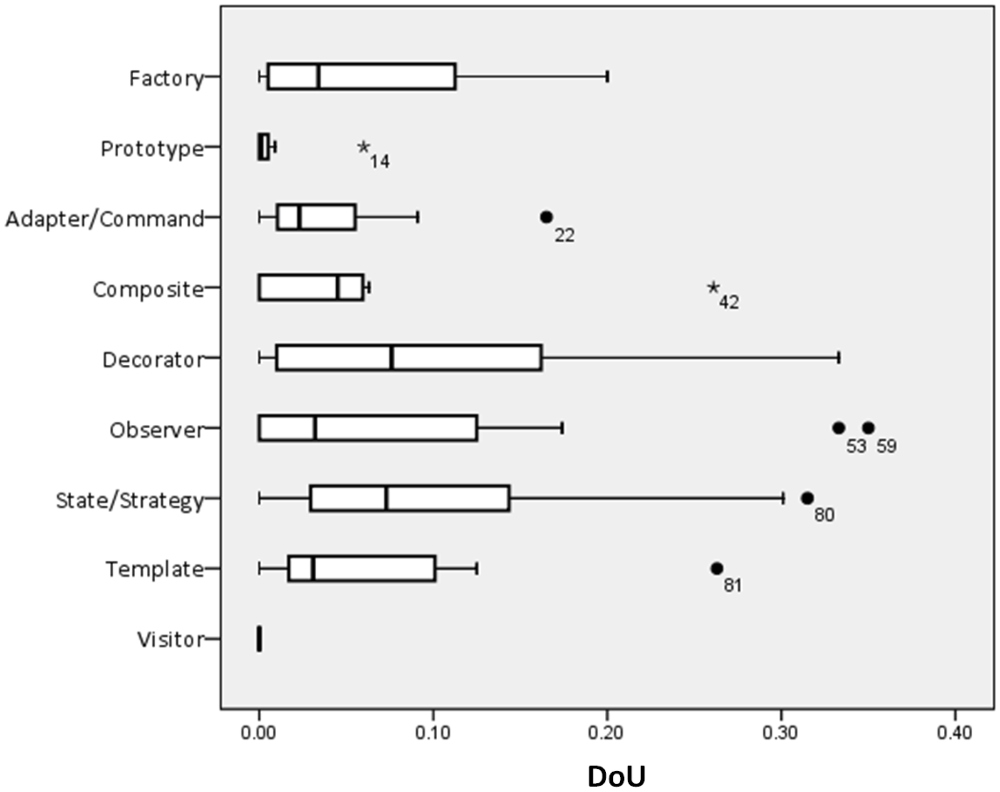

Fig. 9 · Box plots of DoU across 9 pattern groups

p = 0.146 &gt; 0.05

<strong>Fail to Reject H0:</strong> No significant DoU difference across pattern types

| Source (Table 4) | SS | df | MS (SS/df) | F | p-value |
| :--- | :---: | :---: | :---: | :---: | :---: |
| **Between Patterns** | 0.090 | 8 | 0.011 | 1.569 | **0.146** |
| **Within Patterns** | 0.626 | 87 | 0.007 | — | — |
| **Total** | 0.716 | 95 | — | — | — |

### Why No Pattern Type Dominates?
- Mean DoU is **universally &lt; 0.20** (`Visitor = 0`, `Prototype ≤ 0.060`).
- Pattern usage is heavily shaped by **human habits & program comprehension** [21].
- Developers pick **familiar patterns** or avoid structurally complex ones [30], regardless of true evolution need.

---

## 5.2 RQ2 Analysis: DoU vs. Open Source Project

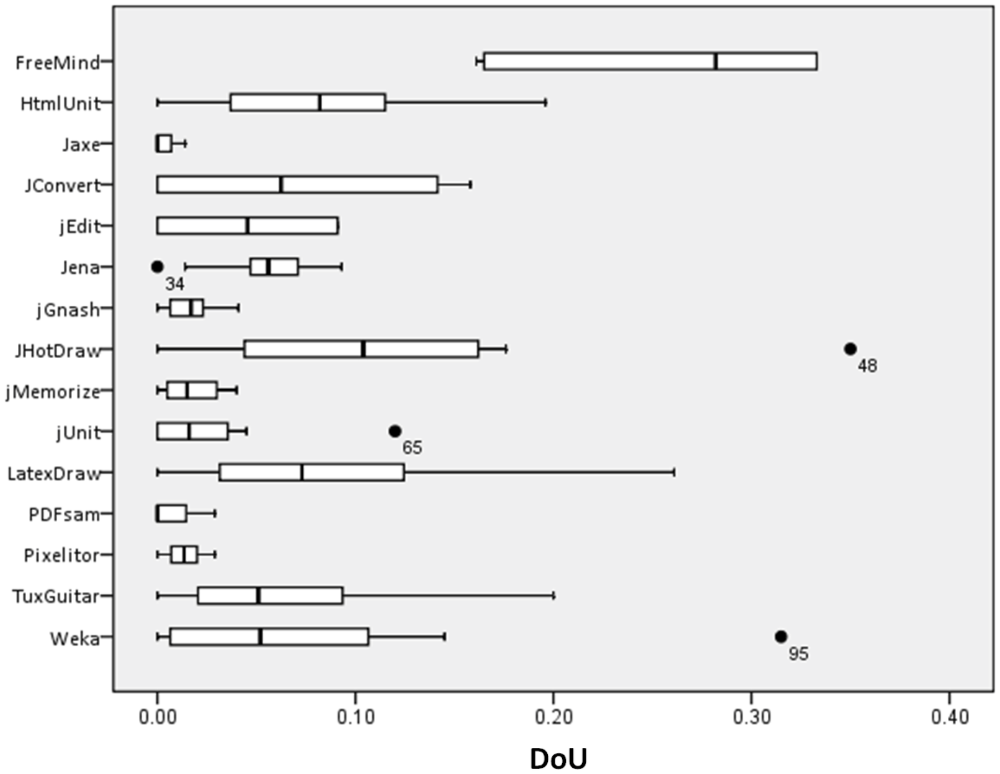

Fig. 10 · Box plots of DoU across 15 OSS projects

F = 5.704 · p &lt; 0.001

<strong>Reject H0:</strong> DoU differs significantly across OSS projects!

| Source (Table 5) | SS | df | MS (SS/df) | F | p-value |
| :--- | :---: | :---: | :---: | :---: | :---: |
| **Between Projects** | 0.356 | 14 | 0.025 | **5.704** | **&lt; 0.001** |
| **Within Projects** | 0.361 | 81 | 0.004 | — | — |
| **Total** | 0.716 | 95 | — | — | — |

### Scheffé Post-Hoc Test (Table 6)
- **FreeMind** significantly outperforms **8 OSS projects**: `Jaxe` (p=0.001), `Jena` (0.006), `jGnash` (&lt;0.001), `jMemorize` (&lt;0.001), `JUnit` (0.002), `PDFsam` (0.028), `Pixelitor` (0.001), `TuxGuitar` (0.040).
- **Domain Synergy**: In MVC GUI apps (**JHotDraw** `0.350`, **FreeMind** `0.333`), **Observer & Decorator** actively drive view-update evolution.

---

## 5.3 Threats to Validity

Following Yin's case-study validation template [25], we address four validity dimensions:

### 🎯 Construct Validity
- Results depend on the precision & recall of **Tsantalis et al.'s pattern detector** [28].
- **Mitigation:** Achieves **100% precision & 100% recall** on well-documented JHotDraw [28], and **&gt; 85% overall precision** in independent audits by Aversano et al. [1], limiting false-positive distortion.

### 🔍 Internal Validity
- External confounding factors could influence the observed DoU relationships.
- **Mitigation:** Rigorous **One-Way ANOVA** (α = 0.05) + **Scheffé post-hoc contrasts** cleanly separate the non-significant pattern-type factor (p = 0.146) from the highly significant project factor (p &lt; 0.001).

### 🌐 External Validity
- **Project Scope:** 15 OSS Java systems across diverse domains & sizes; expanding to larger industrial repositories will further strengthen generalizability.
- **Pattern Scope:** Evaluates 9 groups (11 patterns) out of 23 GoF patterns, specifically targeting **quality-improver** patterns [14].

### 🔁 Reliability Validity
- All 15 OSS codebases (SourceForge) and Tsantalis's `Pattern4` detection tool are **publicly available**.
- Step-by-step PUA workflow (Section 4.2) and raw DoU tables (Table 3) are published for full statistical replication.

---

## 6. Conclusion & Future Work

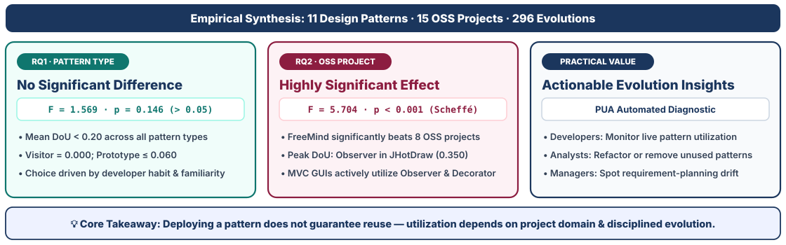

<strong>☁️ 1. Cloud-Service PUA</strong> Re-architect PUA as a scalable cloud service to accelerate multi-version graph detection & analysis.

<strong>🧩 2. Expanded Pattern Catalog</strong> Extend detection & EPU definitions beyond 11 GoF patterns to cover more architectural & design patterns.

<strong>📊 3. Larger OSS Benchmark</strong> Validate evolutionary DoU trends across larger modern repositories & industrial codebases.

---

<!-- _class: closing -->

# Thank You for Your Attention!

Design Pattern Analysis with Software Evolution Data

<strong>Nien-Lin Hsueh</strong> &nbsp;·&nbsp; <code>nlhsueh@fcu.edu.tw</code> 
Department of Information Engineering and Computer Science, Feng Chia University 
<em>Journal of Information Science and Engineering</em>, Vol. 36, No. 1, pp. 53–73 (2020) 
DOI: <code>10.6688/JISE.202001_36(1).0004</code> 
Grant: MOST 106-2221-E-035-MY2 · Questions & Discussion Welcome!

