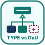
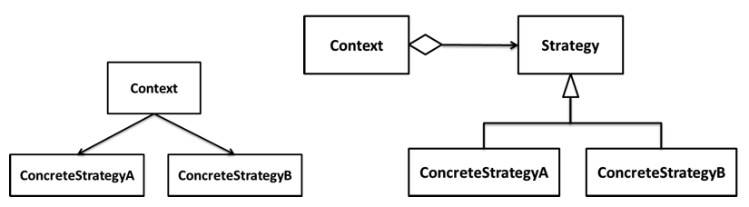
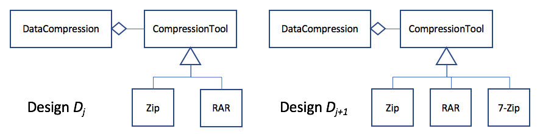
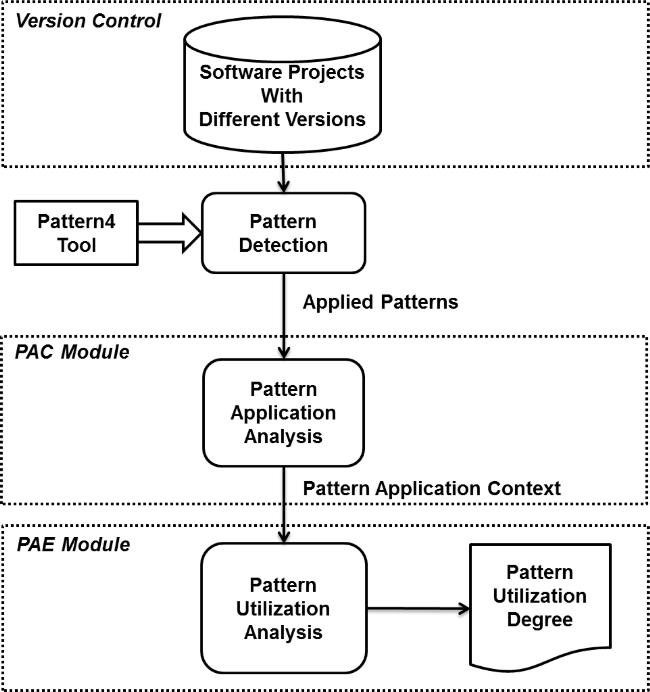
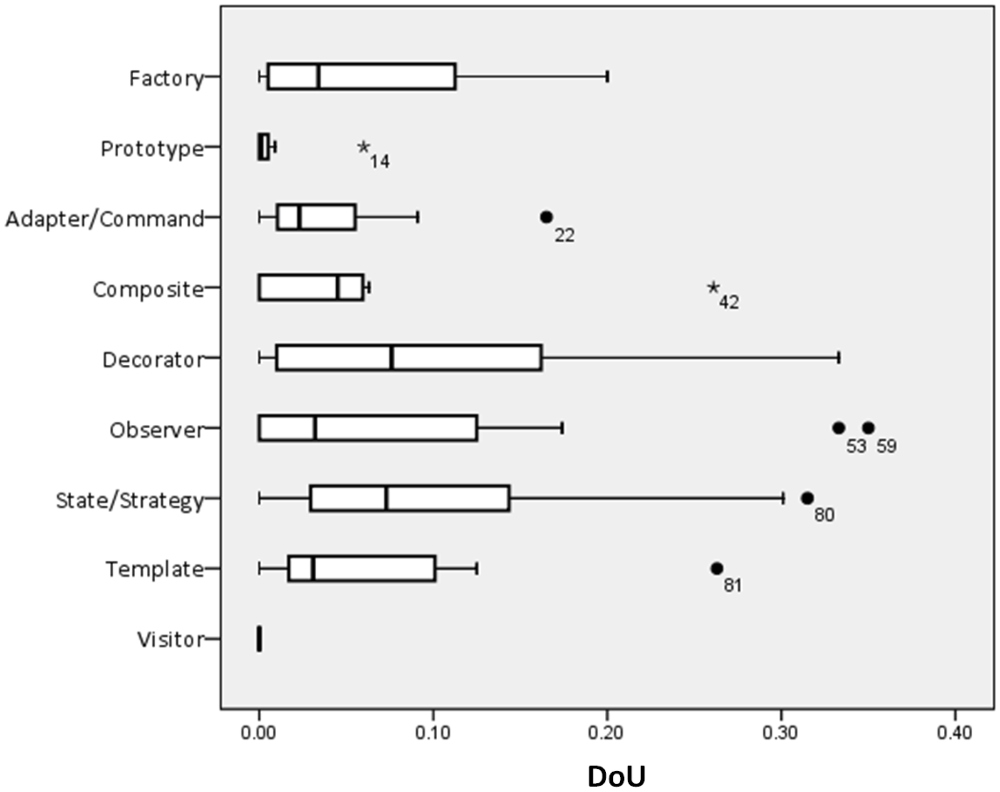
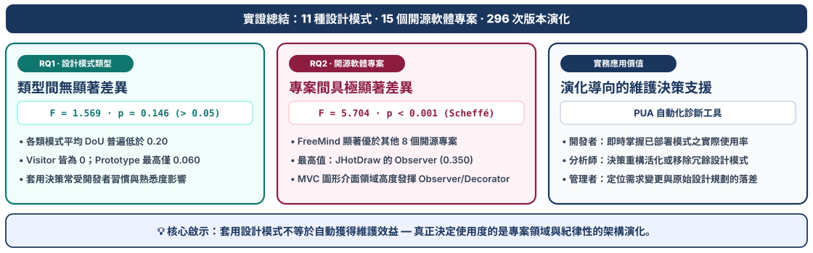

<!-- _class: lead -->

Journal of Information Science and Engineering · Vol. 36, pp. 53–73 (2020)

# 以軟體演化數據分析設計模式之使用度

<strong>Design Pattern Analysis with Software Evolution Data</strong> 
結合<strong>模式應用情境（PAC）</strong>、<strong>預期模式使用方式（EPU）</strong>與<strong>使用程度指標（DoU）</strong>，跨越連續版本實證檢驗設計模式是否真正發揮維護效益

<strong>薛念林（Nien-Lin Hsueh）</strong> 
逢甲大學資訊工程學系 · 台中市 407 台灣 
<code>nlhsueh@fcu.edu.tw</code> · DOI: <code>10.6688/JISE.202001_36(1).0004</code>

科技部專題研究計畫補助：MOST 106-2221-E-035-MY2

<!--
論文定位與研究貢獻：
- 書目資訊：薛念林（Nien-Lin Hsueh），〈Design Pattern Analysis with Software Evolution Data〉，發表於 Journal of Information Science and Engineering（JISE）第 36 卷第 1 期，第 53–73 頁，2020 年 1 月（DOI: 10.6688/JISE.202001_36(1).0004；收稿日 2018/07/19、接受日 2018/09/17；科技部計畫補助 MOST 106-2221-E-035-MY2）。
- 核心研究問題：Gang-of-Four（GoF）設計模式常被導入以提升軟體可維護性與可擴充性，但既有評估方法多僅針對單一版本的靜態結構快照進行分析，未能檢驗已部署模式在後續軟體演化歷程中是否真正發揮預期效益。
- 方法與實證範疇：本研究形式化定義模式應用情境（PAC）、預期模式使用方式（EPU）與使用程度指標（DoU），實作網頁版 Pattern Utilization Analyzer（PUA）工具，並針對 15 個 Java 開源專案、共 296 次版本演化，實證評估 9 組（涵蓋 11 種）品質改善型 GoF 設計模式。
-->

---

## 破題：精心套用的設計模式，是未雨綢繆，還是積滿灰塵？

<strong>核心洞察：</strong> 開發者常套用設計模式以換取未來擴充彈性；然而在 <strong>15 個真實開源專案（296 次演化）</strong>的實證中，多數已部署的模式在後續版本中<strong>幾乎未被擴充或重複使用</strong>！

<!--
過度設計與演化回收率之實證反差：
- 架構投資與維護成本的權衡：導入設計模式需額外增加抽象介面、類別層級與間接呼叫成本，其目的是為未來的需求變更預留彈性。然而當預期的擴充從未發生，或模式被過度套用、誤用時，這些結構複雜度反而成為額外維護負擔，甚至影響系統效能。
- 296 次演化的跨專案實證發現：追蹤 SourceForge 上 15 個真實 Java 開源系統的長期版本歷程後發現，各類已部署設計模式的平均使用度皆低於 0.20，更有大量實例呈現 DoU = 0（初始部署後全程未被擴充或重複使用）。
- 核心分析命題：此現象引導本研究以嚴謹統計檢定釐清——偏低的使用度究竟源於「設計模式本身的類型差異」（RQ1），抑或取決於「專案領域特性與團隊架構設計紀律」（RQ2）。
-->

---

## 簡報大綱

1

[**研究動機與研究問題**](#4)
為何單一版本快照無法衡量維護性？本研究之四大目標與兩個研究問題（RQ1–RQ2）。

2

[**背景與相關研究回顧**](#6)
比較 12 篇設計模式評估文獻（Table 1）與圖形相似度自動模式偵測技術。

3

[**設計模式使用度評估方法**](#7)
模式四大角色分類、FR/NFR 意圖拆解、PAC 與 EPU 形式化定義及 DoU 指標。

4

[**PUA 工具設計與實證結果**](#11)
Pattern Utilization Analyzer 系統架構、JHotDraw 案例剖析與 15 個開源專案實驗數據。

5

[**統計分析與研究威脅**](#15)
單因子變異數分析（ANOVA）檢定 RQ1 與 RQ2、Scheffé 事後檢定及四大效度威脅。

6

[**結論與未來研究方向**](#18)
RQ1–RQ2 實證總結、對開發團隊之實務價值與 PUA 雲端化展望。

<!--
論文結構與論證脈絡：
- 第一至二章（導論與背景文獻）：闡明為何評估維護性必須立基於跨版本演化數據而非單一快照，以四項準則統整 12 篇設計模式評估文獻（Table 1），並說明選用 Tsantalis 等人圖形相似度演算法而非 DP-Miner 的技術依據。
- 第三章（使用度評估方法）：介紹設計模式四大角色分類、拆解 FR 與 NFR 意圖，並以數學公式形式化定義 PAC、EPU、使用度判定謂詞與 DoU 指標（公式 1–6、Fig. 3–6）。
- 第四章（系統設計與實證結果）：說明三模組 PUA 網頁系統架構（Fig. 7）、以 JHotDraw 六個 Observer 實例演示分析流程（Fig. 8），並呈現 15 個 SourceForge 開源專案資料集（Table 2）與完整 15 × 9 DoU 矩陣（Table 3）。
- 第五至六章（統計分析、效度威脅與結論）：以單因子 ANOVA 與 Scheffé 事後檢定回答 RQ1 與 RQ2（Table 4–6、Fig. 9–10），依 Yin 之個案研究框架檢視四大效度威脅，並歸納對開發者、分析師與專案經理的實務價值及雲端化展望。
-->

---

## 1.1 研究動機：為何靜態快照無法衡量設計模式價值？

<strong>演化評估原則：</strong> 設計模式的核心價值在於提升長期的<strong>可維護性與可擴充性</strong>。若過度設計或誤用反增維護負擔，因此評估必須橫跨<strong>所有連續版本</strong>，而非只看單一時間點的靜態結構。

<!--
軟體演化視角評估設計模式之必要性：
- 靜態快照模型的盲點：傳統品質評估多採靜態物件導向指標或品質模型，僅針對軟體生命週期中的單一版本進行檢視。然而多數設計模式的核心目標在於降低未來需求變更時的維護負荷，單一時間點快照只能驗證「模式是否存在」，無法判定「模式是否在後續演化中被有效利用」。
- 兩種演化軌跡對照（論文 Fig. 1–2）：若開發者於 v1 部署 Strategy 模式 dp1 以利未來擴充演算法，但從 v1 到 v10 從未新增或移除任何具體策略類別（Fig. 1），則該模式屬於低度利用；相對地，若 v1→v2 移除舊策略、v2→vn 新增新策略（Fig. 2），則表示該模式成功讓系統透過「擴充」而非「修改既有程式碼」來吸納變更。
- 演化變更熱點（Hot Spot for Change）：預期使用方式即代表設計模式預期承接變更的熱點，唯有跨所有連續版本比對結構演變，才能客觀衡量其維護投資是否回收。
-->

---

## 1.2 研究目標與兩個核心研究問題

<strong>1. 提出評估方法</strong> 以演化數據形式化定義設計模式使用度。

<strong>2. 開發自動化工具</strong> 實作網頁版 <code>PUA</code> 自動化分析系統。

<strong>3. 大規模開源實證</strong> 跨 15 個開源專案（296 次演化）分析 11 種模式。

<strong>4. 統計假說檢定</strong> 驗證使用度是否受模式類型或專案影響。

本研究透過單因子變異數分析（One-Way ANOVA）檢定兩項關鍵問題*（逐步揭曉）*：

* 

RQ1 某些設計模式天生就比其他模式更容易被發揮嗎？

<strong>已部署設計模式的使用程度（DoU）與「模式類型」之間是否存在顯著統計差異？</strong>（涵蓋 9 組共 11 種品質改善型 GoF 設計模式。）

* 

RQ2 還是模式能否發揮價值，取決於專案領域與設計紀律？

<strong>已部署設計模式的使用程度（DoU）與「開源軟體專案」之間是否存在顯著統計差異？</strong>（橫跨 15 個真實世界 Java 開源系統。）

<!--
四大研究目標與統計假說架構：
- 四項研究目標：（1）運用軟體演化數據形式化提出設計模式使用度評估方法；（2）開發自動化分析工具 PUA 支援大規模驗證；（3）應用於 15 個公開保存版本歷程的 SourceForge 開源系統（藉助開源版本庫透明度）；（4）透過統計檢定探討模式使用度與模式類型或專案間之關聯。
- RQ1（模式類型因子）：以單因子 ANOVA（α = 0.05）檢定虛無假設 H0: μ1 = μ2 = ... = μ9（9 組品質改善型設計模式之平均 DoU 相等），檢驗是否特定設計模式天生就比其他模式更容易在演化中獲得使用。
- RQ2（開源專案因子）：以單因子 ANOVA（α = 0.05）檢定虛無假設 H0: μ1 = μ2 = ... = μ15（15 個開源專案之平均 DoU 相等），檢驗應用領域屬性（如 MVC 圖形框架相對於小型工具軟體）與開發團隊紀律是否造成顯著的使用度差異。
-->

---

## 2. 背景與相關研究回顧（Table 1）

既有研究多採靜態指標、受控實驗、問卷調查或腐化分析，**缺乏以自動化工具衡量跨版本「模式使用度」的實證方法**。

| 研究類型 | 代表文獻 | 方法與程式碼分析 | 研究標的與核心焦點 |
| :--- | :--- | :--- | :--- |
| **靜態指標與品質** | Huston [15]; Hsueh et al. [13] | 指標分析 / 量化法（是/否） | 設計模式：與 OO 指標之相容性、模式良構性驗證 |
| **受控維護實驗** | Prechelt et al. [23, 24]; Ng et al. [20, 21] | 人工受控實驗 | 開發人員：模式效益、文件化輔助與預期變更維護 |
| **文獻回顧與調查** | Zhang & Budgen [32, 33] | 系統性回顧與專家調查（否） | 論文與專家：僅 3 種模式獲高評價，四分之一評價偏低 |
| **演化、污垢與缺陷** | Aversano et al. [2]; Vokáč [30]; Izurieta [16] | 自動化工具分析程式碼（是） | 軟體系統：修改頻率、缺陷關聯、模式污垢（Grime）與腐化 |
| **演化使用度評估** | **Hsueh [12] 與本研究（2020）** | **自研 PUA 自動化工具（是）** | **15 個開源專案（296 次演化）：PAC/EPU 符合度與 DoU** |

<strong>設計模式偵測基礎：</strong> 採用 <strong>Tsantalis et al. [28]</strong> 提出之圖形相似度評分演算法（優於不支援變異體之 DP-Miner [6]），在 JHotDraw 上可達 <strong>100% 精確率與 100% 召回率</strong>。

<!--
設計模式評估文獻與偵測技術對照（Table 1）：
- Table 1 之四大分類準則：依研究動機（Motivation）、方法（Method）、是否分析程式碼（Code Analysis）與研究標的（Subjects：設計模式、軟體系統、論文或人類受試者）整理 12 篇代表文獻：
  - 靜態指標與良構性：Huston（2001）發現不同 OO 指標對設計模式可能產生相互矛盾的評估結果；Hsueh 等人（2008）提出量化方法驗證模式是否良構，但未分析演化程式碼。
  - 人工受控實驗：Prechelt 等人（2001, 2002）比較使用模式與較簡設計之維護效益及文件化助益；Ng 等人（2007, 2012）證實善用已部署模式的維護者交付的程式碼缺陷率顯著較低，並指出程式理解與人為因素的關鍵性。
  - 系統性回顧與專家調查：Zhang 與 Budgen（2012, 2013）指出僅 3 種模式獲資深專家普遍肯定，約四分之一模式評價偏低。
  - 演化、污垢與缺陷分析：Aversano 等人（2007）追蹤模式修改頻率與共變類別；Vokáč（2004）探討模式與缺陷數之關聯；Izurieta 與 Bieman（2013）研究三個開源專案中的模式污垢（grime）與腐化；Hsueh 等人（2011）曾針對單一專案 Jaxe 進行時機與效益初探。
- 偵測演算法選型依據：Tsantalis 等人（2006）將系統與模式靜態結構表徵為圖形與矩陣，透過頂點相似度評分可偵測經修改之模式變異體，並在文件完整的 JHotDraw 上達到 100% 精確率與 100% 召回率；相較之下，Dong 等人的 DP-Miner（2007）雖採加權矩陣提升靜態行為分析準度，但不支援模式變異體與動態分析。
-->

---

## 3.1 設計模式使用度評估方法總覽

<strong>雙軌評估架構：</strong> <strong>路徑 A（理論層）</strong>篩選品質改善型模式，自 NFR 意圖定義<em>預期模式使用方式（EPU）</em>；<strong>路徑 B（實證層）</strong>逐版本萃取<em>模式應用情境（PAC）</em>，比對跨版本變更是否符合預期。

<!--
雙軌設計模式使用度評估架構（Fig. 3）：
- 路徑 A — 理論規格建立（Fig. 3 左側）：由於並非所有 GoF 模式皆為了解決維護性問題，方法首先進行模式角色分類並篩選出品質改善型模式；接著將模式意圖拆解為功能性意圖（FR-intent）與非功能性意圖（NFR-intent），據此推導出形式化的預期模式使用方式（EPU）。
- 路徑 B — 實證演化挖掘（Fig. 3 右側）：自版本控制庫收集目標專案的連續發行版本原始碼，逐版本執行圖形相似度模式偵測，並萃取每個模式實例的結構角色對應——即模式應用情境（PAC）。
- 理論與實證之橋接：將相鄰版本的 PAC 結構差異與路徑 A 定義的 EPU 進行符合度比對，即可客觀判定各模式實例在每次版本演進中是否真正滿足其原始設計目的。
-->

---

## 3.2 模式角色分類與 FR/NFR 意圖拆解

並非所有設計模式皆為了解決維護性問題。我們先將設計模式分為**四大角色** [14]，並聚焦於**品質改善者（Quality-Improver）**：

### 活動促進者
協助常見設計活動（系統分解、物件配置、存取控制與元件組合）。

### ★ 品質改善者
**本研究核心：** 滿足基本功能同時提升非功能品質（可擴充性、可維護性）。

### 衝突解決者
協調資源競爭、需求分歧與設計階段頻繁出現的副作用衝突。

### 問題解決者
處理邊界條件與可靠性例外（如 Observer 解決資料不一致問題）。

Fig. 4 · Strategy 模式之功能結構 FR-structure（左）與非功能結構 NFR-structure（右）

- **功能意圖（FR-Intent）**：讓 `Context` 類別呼叫演算法以解決問題（基本結構）。
- **非功能意圖（NFR-Intent）**：額外引入 `Strategy` 介面角色，使日後可**直接新增或移除 `ConcreteStrategy`** 而不改動 `Context`，提升擴充性。

<!--
設計模式四大角色分類與 FR/NFR 意圖拆解（Fig. 4）：
- 四大角色分類框架（Hsueh et al., 2009）：
  1. 活動促進者（Activity-Facilitator）：以經驗法則協助系統設計中的重複性非演算法活動，如系統分解、物件配置、存取控制、控制流與元件組合。
  2. 品質改善者（Quality-Improver，本研究核心）：因應主觀、相對且具交互影響的非功能性需求（NFR），在滿足基本功能前提下提供更佳的可維護性、重用性與擴充性。
  3. 衝突解決者（Conflict-Resolver）：透過資源特化、引入代理者或仲裁者，協調資源競爭、需求分歧與設計階段常見的副作用衝突。
  4. 問題解決者（Problem-Solver）：處理邊界條件與系統可靠性例外，例如 Observer 模式透過註冊與通知機制解決主體與觀察者之間的狀態不一致問題。
- FR 結構與 NFR 結構對照（Fig. 4，以 Strategy 為例）：FR-intent 描述模式「做什麼」，對應較簡潔的 FR-structure（Context 直接呼叫演算法）；NFR-intent 描述如何提升品質屬性，對應擴充後的 NFR-structure（引入抽象 Strategy 介面，使日後可在不更動 Context 的情況下新增或移除 ConcreteStrategy）。正因使用度旨在驗證 NFR 意圖是否於演化中兌現，故僅鎖定品質改善者進行評估。
-->

---

## 3.3 形式化模型：PAC、EPU 與使用度判定謂詞

<strong>PAC(dp, D)</strong>&nbsp; = &nbsp;{ &lt;element, r&gt; }

<strong>EPU(dp)</strong>&nbsp; = &nbsp;{ &lt;role, operator&gt; }, &nbsp;operator ∈ {+, −}

<strong>utilized(dp, Dj+1)</strong> &nbsp;⇔ 
∃ Dj, Δ(PAC(dp, Dj), PAC(dp, Dj+1)) 符合 EPU(dp)

### Strategy 範例（資料壓縮系統）
- **PAC**：`{<DataCompression, R_C>, <CompressionTool, R_S>, <RAR, R_CS>, <ZIP, R_CS>}`
- **EPU(Strategy)**：`{<R_CS, +>, <R_CS, −>}`（新增或移除具體策略類別）。

Fig. 5 · 於版本 Dj+1 新增 <code>7-zip</code> 符合 EPU(Strategy)

<strong>核心判定準則：</strong> 若某設計模式在相鄰版本 Dj → Dj+1 間的結構差異 Δ(PAC) 恰好符合其預期操作 EPU(dp)，即判定該模式於此演化步驟中<strong>被有效使用（utilized）</strong>。

<!--
PAC、EPU 與使用度判定謂詞之數學形式化（公式 1–5、Fig. 5）：
- 模式應用情境（公式 1）：PAC(dp, D) = {<element, r>} 記錄軟體版本 D 中參與設計模式 dp 的設計元素（類別）與其扮演的角色 r。以資料壓縮系統套用 Strategy 為例（公式 2）：PAC(Strategy, D) = {<DataCompression, R_C>, <CompressionTool, R_S>, <RAR, R_CS>, <ZIP, R_CS>}，其中 R_C、R_S、R_CS 分別代表 Context、Strategy 與 ConcreteStrategy 角色。
- 預期模式使用方式（公式 3）：EPU(dp) = {<role, operator>}（其中 operator ∈ {+, −}）形式化定義該模式於演化中預期對關鍵角色執行的結構操作。Strategy 之預期使用為新增或移除具體策略類別而不改動其他元件，故 EPU(Strategy) = {<R_CS, +>, <R_CS, −>}（公式 4）。
- 使用度判定謂詞（公式 5）：utilized(dp, D_{j+1}) ⇔ ∃ D_j 使得 Δ(PAC(dp, D_j), PAC(dp, D_{j+1})) 符合 EPU(dp)，其中 D_j 與 D_{j+1} 為部署同一模式實例 dp 之相鄰版本。如 Fig. 5 所示，於 D_{j+1} 在 CompressionTool 介面下新增 7-zip 壓縮類別，其結構差異恰好對應 <R_CS, +>，因而形式化判定為有效使用。
-->

---

## 3.4 量化演化效益：模式使用程度（DoU）指標

<strong>DoU</strong>&nbsp; = &nbsp;

實際被使用次數（# of utilized applications）
模式存活演化次數（# of pattern evolution）

### Fig. 6 計算範例（8 個版本、5 個模式實例）
- **▲** = 已部署；**▲'** = 發生有效使用變更；**X** = 已移除。
- `dp1`（V1–V8）：於 V3→V4、V4→V5 使用 2 次 / 7 次演化 = **2/7**。
- `dp2`（V1–V8）：有效使用 3 次 / 7 次演化 = **3/7**（最高）。
- `dp3`（V3–V8）：有效使用 1 次 / 5 次演化 = **1/5**。
- `dp4`（V3–V5）：於 V5 移除 → 1 次 / 2 次演化 = **1/2**。
- `dp5`（V3–V8）：全程未使用 → **0/5**。

Fig. 6 · 8 個版本（V1–V8）中 5 個設計模式實例（dp1–dp5）之 DoU 計算

<!--
模式使用程度（DoU）定義與生命週期正規化（公式 6、Fig. 6）：
- 指標公式（公式 6）：DoU =（實際被使用次數）／（模式存活演化次數），數值介於 0 與 1 之間。分子計算滿足 EPU 判定謂詞之相鄰版本轉換次數；分母為該模式實例連續存活之版本數減 1，藉此公平處理「中途才導入」或「中途遭移除」的實例。
- Fig. 6 逐一演算（8 個版本 V1–V8、5 個模式實例）：
  - dp1（存活 V1–V8，7 次演化）：於 V3→V4、V4→V5 有效使用 2 次，DoU = 2/7。
  - dp2（存活 V1–V8，7 次演化）：於 V3→V4、V4→V5、V6→V7 有效使用 3 次，DoU = 3/7。
  - dp3（於 V3 導入、存活 V3–V8，5 次演化）：於 V4→V5 有效使用 1 次，DoU = 1/5。
  - dp4（於 V3 導入、於 V5 移除，僅歷經 2 次演化）：於 V3→V4 有效使用 1 次，DoU = 1/2（分母僅計入實際存活期）。
  - dp5（於 V3 導入、存活 V3–V8，5 次演化）：全程未發生符合 EPU 之擴充，DoU = 0/5。
- 論文詮釋提醒：較高的 DoU 代表該模式對系統演化貢獻較頻繁，但判定某低 DoU 模式是否確實「無用」而應移除，仍須仰賴開發者結合業務脈絡進行專業審查。
-->

---

## 4.1 PUA 工具架構與四步驟分析流程

本研究實作網頁版工具 **Pattern Utilization Analyzer（PUA）**，整合三大核心模組：**版本控制模組**、**PAC 模組**與 **PAE/EPU 模組**。

Fig. 7 · PUA（Pattern Utilization Analyzer）系統架構

### 步驟 1 · 收集多版本原始碼
自 SourceForge 收集開源專案歷代發行版本，匯入 PUA 的**版本控制模組**管理。

### 步驟 2 · 透過 Pattern4 偵測 11 種 GoF 模式
運用 Tsantalis 圖形比對工具 [28, 29] 偵測各版本模式：
- **建立型**：Factory Method（`FM`）、Prototype（`P`）
- **結構型**：Adapter-Command（`AC`）、Composite（`C`）、Decorator（`D`）
- **行為型**：Observer（`O`）、State-Strategy（`SS`）、Template Method（`TM`）、Visitor（`V`）

### 步驟 3 與 4 · PAC/EPU 比對 → 產出 DoU
逐版本建立 `PAC`、檢驗相鄰版本是否符合 `EPU`，並自動計算各實例與專案之 **DoU**。

<!--
PUA 自動化分析系統架構與模式分組細節（Fig. 7）：
- 三大模組網頁架構：Pattern Utilization Analyzer（PUA）整合三個核心模組：（1）版本控制模組，負責管理自 SourceForge 匯入之多版本原始碼與各版本偵測結果；（2）PAC 模組，解析 Pattern4 輸出並儲存各版本之模式應用情境；（3）EPU/PAE 模組，自動比對相鄰版本 PAC 差異是否符合 EPU，並計算實例與專案層級之 DoU。
- Pattern4 偵測範圍（9 組涵蓋 11 種 GoF 模式）：透過 Tsantalis（2011）之圖形相似度評分工具逐版本偵測建立型（Factory Method [FM]、Prototype [P]）、結構型（Adapter-Command [AC]、Composite [C]、Decorator [D]）與行為型（Observer [O]、State-Strategy [SS]、Template Method [TM]、Visitor [V]）。
- 合併分組原因：由於 Adapter 與 Command、State 與 Strategy 在靜態類別圖與關聯矩陣上具備同構結構，靜態圖形比對工具無法僅憑結構區分兩者，故依 Pattern4 規格合併為 AC 與 SS 兩組進行統計分析。
-->

---

## 4.2 案例剖析：JHotDraw 的 Observer 模式演化

以 **JHotDraw** 連續五個版本（`5.2 → 5.3 → 5.4b1 → 5.4b2 → 6.0b1`）為例，追蹤 **6 個 Observer 實例**（`dp1`–`dp6`）：

Fig. 8 · JHotDraw（5.2–6.0b1）6 個 Observer 實例之 PUA 分析結果

3/4

<code>dp3</code>（75% 使用率）

1/3–1/4

<code>dp1</code>、<code>dp4</code>、<code>dp5</code>

0/4, 0/3

<code>dp2</code>、<code>dp6</code>（未使用）

### 實例層級觀察
- **`dp1`–`dp4`** 於 v5.2 部署（歷經 4 次演化）：`dp3` 在 4 次演進中有 3 次被有效擴充（`DoU = 3/4`），而 `dp2` 全程未被使用（`0/4`）。
- **`dp5`–`dp6`** 於 v5.3 引入（歷經 3 次演化）：`dp5` 使用 1 次（`1/3`），`dp6` 未使用（`0/3`）。
- 在完整 8 次 JHotDraw 演化中，**Observer 達全實驗最高 DoU = `0.350`**。

<!--
JHotDraw 專案 Observer 實例層級剖析（Fig. 8）：
- 標竿案例地位：JHotDraw 源自 Erich Gamma 所設計之二維結構化繪圖框架，以高度規範地運用經典設計模式聞名，是檢驗模式偵測與演化分析方法的指標系統。
- 五個連續版本追蹤（5.2 → 5.3 → 5.4b1 → 5.4b2 → 6.0b1）：PUA 追蹤到 6 個獨立的 Observer 實例（dp1–dp6）：
  - 於 v5.2 部署（歷經 4 次相鄰演化）：dp1 於 5.3→5.4b1 被使用 1 次（DoU = 1/4）；dp2 全程未被使用（0/4）；dp3 在 4 次轉換中有 3 次被有效擴充（DoU = 3/4 = 75%）；dp4 被使用 1 次（1/4）。
  - 於 v5.3 新引入（歷經 3 次相鄰演化）：dp5 被使用 1 次（1/3）；dp6 全程未使用（0/3）。
- 跨專案對照意涵：即便在完整 8 次 JHotDraw 演化（5.2–7.6）中，Observer 以 DoU = 0.350 居全實驗 15 個專案之冠，Fig. 8 仍顯示同一系統內不同實例的使用率存在 0% 至 75% 的顯著異質性。
-->

---

## 4.3 實驗設定：15 個開源專案與 296 次軟體演化

我們選取 SourceForge 上 **15 個跨領域 Java 開源專案**（繪圖、測試、機器學習、語意網、財務、音樂編輯等），涵蓋 **2000–2012 年**（Table 2）：

| 開源專案 | 演化次數 | 版本範圍 | 開發時間區間 |
| :--- | :---: | :---: | :--- |
| **FreeMind** | 16 | 0.0.2–0.9.0 | 2000/06 – 2011/02 |
| **HtmlUnit** | 28 | 1.0.0–2.9.0 | 2002/05 – 2011/08 |
| **Jaxe** | 38 | 1.0–3.5 | 2002/06 – 2011/06 |
| **JConvert** | 9 | 1.0.0–1.1.0 | 2007/08 – 2011/05 |
| **JEdit** | 27 | 2.3–4.5.1 | 2000/01 – 2012/03 |
| **Jena** | 17 | 2.0–2.6.4 | 2003/08 – 2010/12 |
| **JGnash** | 26 | 1.0.1–1.10.5 | 2003/01 – 2006/03 |
| **JHotDraw** | 8 | 5.2–7.6 | 2001/02 – 2011/01 |

| 開源專案 | 演化次數 | 版本範圍 | 開發時間區間 |
| :--- | :---: | :---: | :--- |
| **JMemorize** | 12 | 0.7.0–1.3.0 | 2004/10 – 2008/03 |
| **JUnit** | 19 | 3.4.0–4.10.0 | 2000/12 – 2011/09 |
| **LatexDraw** | 24 | 1.0.2–2.0.8 | 2006/01 – 2010/03 |
| **PDFsam** | 14 | 1.0.0–2.2.1 | 2007/08 – 2012/07 |
| **Pixelitor** | 34 | 0.1.0–1.1.2 | 2009/11 – 2010/11 |
| **TuxGuitar** | 11 | 0.2–1.2 | 2006/06 – 2009/11 |
| **Weka** | 13 | 3.0.1–3.7.5 | 2002/02 – 2012/08 |
| **總計** | **296** | **15 個系統** | **最長達 12 年** |

<strong>樣本設計：</strong> 包含 3 個文獻經典標竿專案（<strong>JHotDraw</strong>、<strong>JUnit</strong>、<strong>FreeMind</strong>）＋ 隨機挑選之 12 個開源專案，共評估 <strong>9 組（11 種）品質改善型 GoF 模式</strong>。

<!--
15 個開源專案實驗基準與領域覆蓋（Table 2）：
- 抽樣策略設計：為兼顧與既有文獻之可比性並避免挑選偏差，資料集結合 3 個軟體工程文獻經典標竿專案（JHotDraw、JUnit、FreeMind）以及自 SourceForge 隨機挑選之 12 個 Java 開源專案（HtmlUnit、Jaxe、JConvert、JEdit、Jena、JGnash、JMemorize、LatexDraw、PDFsam、Pixelitor、TuxGuitar、Weka）。
- 跨領域系統多樣性：涵蓋二維與向量／影像繪圖（JHotDraw、LatexDraw、Pixelitor）、心智圖（FreeMind）、自動化測試與無介面瀏覽器（JUnit、HtmlUnit）、XML 與程式編輯器（Jaxe、JEdit）、語意網 RDF/OWL 工具箱（Jena）、機器學習演算法庫（Weka）、個人財務（JGnash）、閃卡學習（JMemorize）、PDF 分割合併（PDFsam）、單位換算（JConvert）及多軌吉他譜編輯（TuxGuitar）。
- 時間與演化規模：開發歷程最長橫跨 12 年（2000–2012），單一專案演化次數介於 8 次（JHotDraw 5.2–7.6）至 38 次（Jaxe 1.0–3.5），總計分析 296 次版本演進。
-->

---

## 4.4 實證結果：15 個開源專案之 DoU 矩陣（Table 3）

<table class="dense">
<thead>
<tr><th>專案名稱</th><th>FM</th><th>P</th><th>AC</th><th>C</th><th>D</th><th>O</th><th>SS</th><th>TM</th><th>V</th></tr>
</thead>
<tbody>
<tr><td>FreeMind</td><td class="mid-cell">0.161</td><td></td><td class="mid-cell">0.165</td><td></td><td class="hi-cell">0.333</td><td class="hi-cell">0.333</td><td class="hi-cell">0.301</td><td class="hi-cell">0.263</td><td></td></tr>
<tr><td>HtmlUnit</td><td>0.082</td><td class="zero-cell">0</td><td>0.042</td><td></td><td class="mid-cell">0.196</td><td>0.032</td><td>0.129</td><td>0.101</td><td></td></tr>
<tr><td>Jaxe</td><td class="zero-cell">0</td><td></td><td>0.007</td><td></td><td class="zero-cell">0</td><td class="zero-cell">0</td><td>0.014</td><td class="zero-cell">0</td><td></td></tr>
<tr><td>JConvert</td><td></td><td></td><td class="zero-cell">0</td><td></td><td></td><td class="zero-cell">0</td><td class="mid-cell">0.158</td><td>0.125</td><td></td></tr>
<tr><td>JEdit</td><td></td><td></td><td>0.091</td><td></td><td></td><td></td><td class="zero-cell">0</td><td></td><td></td></tr>
<tr><td>Jena</td><td>0.056</td><td>0.060</td><td>0.014</td><td>0.056</td><td>0.076</td><td>0.071</td><td>0.093</td><td>0.047</td><td class="zero-cell">0</td></tr>
<tr><td>JGnash</td><td>0.012</td><td>0.001</td><td>0.023</td><td class="zero-cell">0</td><td>0.023</td><td>0.017</td><td>0.041</td><td>0.017</td><td></td></tr>
<tr><td>JHotDraw</td><td>0.143</td><td>0.004</td><td>0.044</td><td>0.063</td><td class="mid-cell">0.162</td><td class="hi-cell">0.350</td><td class="mid-cell">0.176</td><td>0.104</td><td class="zero-cell">0</td></tr>
<tr><td>JMemorize</td><td>0.010</td><td class="zero-cell">0</td><td>0.020</td><td class="zero-cell">0</td><td>0.010</td><td>0.040</td><td>0.030</td><td>0.030</td><td></td></tr>
<tr><td>JUnit</td><td class="zero-cell">0</td><td></td><td>0.016</td><td>0.045</td><td class="zero-cell">0</td><td class="zero-cell">0</td><td>0.120</td><td>0.026</td><td></td></tr>
<tr><td>LatexDraw</td><td class="zero-cell">0</td><td>0.005</td><td>0.058</td><td class="hi-cell">0.261</td><td></td><td class="mid-cell">0.174</td><td>0.073</td><td>0.075</td><td></td></tr>
<tr><td>PDFsam</td><td></td><td></td><td class="zero-cell">0</td><td></td><td></td><td></td><td>0.029</td><td class="zero-cell">0</td><td></td></tr>
<tr><td>Pixelitor</td><td>0.011</td><td class="zero-cell">0</td><td>0.007</td><td></td><td></td><td>0.020</td><td>0.016</td><td>0.029</td><td></td></tr>
<tr><td>TuxGuitar</td><td class="mid-cell">0.200</td><td>0.009</td><td>0.062</td><td class="zero-cell">0</td><td></td><td>0.125</td><td>0.051</td><td>0.032</td><td></td></tr>
<tr><td>Weka</td><td>0.068</td><td class="zero-cell">0</td><td>0.052</td><td></td><td>0.145</td><td class="zero-cell">0</td><td class="hi-cell">0.315</td><td>0.013</td><td></td></tr>
</tbody>
</table>

空白 = 未部署 · <code>0</code> = 已部署但未使用 · 藍綠色 ≥ 0.25，淺藍色 ≥ 0.15

0.350

<strong>全場最高 DoU：</strong> JHotDraw 的 Observer

&lt; 0.20

<strong>整體現況：</strong> 多數模式平均使用度普遍偏低

### 亮點觀察
- **FreeMind**：整體表現最突出（`D/O/SS > 0.30`）。
- **Weka**：State-Strategy 高達 `0.315`（演算法切換）。
- **LatexDraw**：Composite 表現最佳（`0.261`）。
- **Jaxe、JEdit、PDFsam、Pixelitor**：普遍偏低或為 `0`。

<!--
跨專案 DoU 實證矩陣深度解讀（Table 3）：
- 矩陣編碼與有效觀測值：Table 3 共計 96 個已部署之「專案 × 模式」有效儲存格（對應 ANOVA 總自由度 df = 95）。空白表示該專案未部署該模式，0 表示已部署但在追蹤期間從未被有效使用。
- 普遍偏低的使用現況：所有 9 組設計模式的平均 DoU 皆低於 0.20，顯示多數已部署模式並未頻繁發揮預期擴充功能。其中 Visitor（V）僅見於 Jena 與 JHotDraw 且兩者皆為 0；Prototype（P）最高亦僅 0.060（Jena）。
- 高度領域契合之亮點案例：
  - FreeMind 整體表現最為優異，Decorator（0.333）、Observer（0.333）、State-Strategy（0.301）與 Template Method（0.263）均名列前茅。
  - JHotDraw 的 Observer 達全場最高 0.350，State-Strategy（0.176）與 Decorator（0.162）亦具水準。
  - Weka 的 State-Strategy 高達 0.315（對應機器學習演算法持續擴充）；LatexDraw 的 Composite 達 0.261（對應階層式繪圖元件）；TuxGuitar 的 Factory Method 達 0.200；HtmlUnit 的 Decorator 達 0.196。
  - 相對地，Jaxe、JEdit、PDFsam、Pixelitor、JUnit、JMemorize 與 JGnash 普遍偏低或掛零。
-->

---

## 5.1 RQ1 統計分析：DoU 與設計模式類型之關係

Fig. 9 · 9 組設計模式之 DoU 分布盒鬚圖

p = 0.146 &gt; 0.05

<strong>無法拒絕 H0：</strong> 不同設計模式類型間之 DoU 無顯著差異

| 變異來源（Table 4） | SS | df | MS (SS/df) | F 值 | p-value |
| :--- | :---: | :---: | :---: | :---: | :---: |
| **組間（Between）** | 0.090 | 8 | 0.011 | 1.569 | **0.146** |
| **組內（Within）** | 0.626 | 87 | 0.007 | — | — |
| **總計（Total）** | 0.716 | 95 | — | — | — |

### 為何模式類型無顯著差異？
- 各類模式平均 DoU 皆**低於 0.20**（`Visitor = 0`，`Prototype ≤ 0.060`）。
- 模式部署高度受到**人為習慣與程式理解程度**影響 [21]。
- 開發者傾向選用**自己熟悉的模式**，或因結構複雜度而卻步 [30]，未必契合真實演化需求。

<!--
RQ1 單因子 ANOVA 統計檢定與行為詮釋（Table 4、Fig. 9）：
- 假說設定（顯著水準 α = 0.05）：虛無假設 H0: μ1 = μ2 = ... = μ9（9 組設計模式之平均 DoU 無差異），對立假設 H1 為至少有一組平均數不同。
- 變異數分析數據（Table 4）：組間變異 SS = 0.090（df = 8, MS = 0.011），組內變異 SS = 0.626（df = 87, MS = 0.007），總變異 SS = 0.716（df = 95），統計量 F = 1.569、p = 0.146（> 0.05）。因此無法拒絕 H0，代表已部署模式的使用度並不取決於設計模式類型。
- 開發者行為面成因：Fig. 9 盒鬚圖顯示所有模式類型之平均 DoU 皆低於 0.20，無任何模式具備天生的使用度優勢。結合 Ng 等人（2012）與 Vokáč（2004）研究，論文提出兩點解釋：（1）模式部署深受人類開發習慣與程式理解門檻影響；（2）工程師傾向挑選自己熟悉的模式，並因結構複雜度而規避如 Visitor 等較複雜模式，使部署選擇與實際演化需求脫節。
-->

---

## 5.2 RQ2 統計分析：DoU 與開源軟體專案之關係

Fig. 10 · 15 個開源軟體專案之 DoU 分布盒鬚圖

F = 5.704 · p &lt; 0.001

<strong>拒絕 H0：</strong> 不同開源專案間之 DoU 存在極顯著差異！

| 變異來源（Table 5） | SS | df | MS (SS/df) | F 值 | p-value |
| :--- | :---: | :---: | :---: | :---: | :---: |
| **組間（Between）** | 0.356 | 14 | 0.025 | **5.704** | **&lt; 0.001** |
| **組內（Within）** | 0.361 | 81 | 0.004 | — | — |
| **總計（Total）** | 0.716 | 95 | — | — | — |

### Scheffé 事後多重比較（Table 6）
- **FreeMind** 顯著優於其他 **8 個專案**：`Jaxe` (p=0.001)、`Jena` (0.006)、`jGnash` (&lt;0.001)、`jMemorize` (&lt;0.001)、`JUnit` (0.002)、`PDFsam` (0.028)、`Pixelitor` (0.001)、`TuxGuitar` (0.040)。
- **領域契合度**：在 MVC 圖形介面專案（**JHotDraw** `0.350`、**FreeMind** `0.333`）中，**Observer 與 Decorator** 隨視覺化更新需求持續被活化運用。

<!--
RQ2 單因子 ANOVA 與 Scheffé 事後多重比較（Table 5–6、Fig. 10）：
- 假說設定（顯著水準 α = 0.05）：虛無假設 H0: μ1 = μ2 = ... = μ15（15 個開源專案之平均 DoU 相等），對立假設 H1 為專案間平均 DoU 存在差異。
- 變異數分析數據（Table 5）：組間變異 SS = 0.356（df = 14, MS = 0.025），組內變異 SS = 0.361（df = 81, MS = 0.004），總變異 SS = 0.716（df = 95），F = 5.704、p < 0.001，強烈拒絕 H0。專案因子獨自解釋近半數總變異量（η² = 0.356 / 0.716 ≈ 49.7%）。
- Scheffé 事後多重比較（Table 6）：採適用於不等組樣本數且較保守的 Scheffé 法檢定發現，FreeMind 顯著優於 8 個專案：Jaxe（Δ = 0.256, p = 0.001）、Jena（Δ = 0.207, p = 0.006）、jGnash（Δ = 0.243, p < 0.001）、jMemorize（Δ = 0.242, p < 0.001）、JUnit（Δ = 0.230, p = 0.002）、PDFsam（Δ = 0.250, p = 0.028）、Pixelitor（Δ = 0.246, p = 0.001）與 TuxGuitar（Δ = 0.191, p = 0.040）。
- 領域架構機制：在 JHotDraw（Observer = 0.350）與 FreeMind（Observer 與 Decorator 皆為 0.333）這類 MVC 互動式圖形介面系統中，通知監聽與視覺裝飾機制直接承接圖形變更後的視圖更新演化（Aversano et al., 2007），反映良好的領域契合與持續維護紀律。
-->

---

## 5.3 研究效度威脅（Threats to Validity）

依循 Yin [25] 之個案研究效度框架，檢視以下四個面向：

### 🎯 建構效度（Construct Validity）
- 分析結果可能受 **Tsantalis et al. 模式偵測工具** [28] 之精確率與召回率影響。
- **緩解機制：** 該工具於文件完整之 JHotDraw 達 **100% 精確率與 100% 召回率** [28]；Aversano et al. [1] 獨立檢驗整體精確率亦 **&gt; 85%**，有效抑制偽陽性干擾。

### 🔍 內部效度（Internal Validity）
- 外部混淆因子可能影響 DoU 與專案或模式類型間之因果推論。
- **緩解機制：** 透過嚴謹之**單因子 ANOVA**（α = 0.05）與 **Scheffé 事後檢定**，清楚區辨「專案因子具極顯著影響（p &lt; 0.001）」與「模式類型無顯著影響（p = 0.146）」。

### 🌐 外部效度（External Validity）
- **專案範圍：** 涵蓋 15 個跨領域、不同規模之 Java 開源系統；未來擴展至更多系統將進一步強化推論泛化力。
- **模式範圍：** 聚焦於 23 種 GoF 模式中與維護性最相關之 **9 組（11 種）品質改善型模式** [14]。

### 🔁 信度（Reliability Validity）
- 15 個開源專案原始碼（SourceForge）與 Tsantalis 偵測工具皆為**公開可取得資源**。
- 論文第 4.2 節詳述實驗流程，並公開原始 DoU 數據表（Table 3）以供完整統計重現。

<!--
依循 Yin 個案研究框架之四大效度威脅檢核（第 5.4 節）：
- 建構效度（模式偵測準確度）：DoU 計算高度仰賴 Tsantalis 等人靜態圖形相似度工具（Pattern4）之精確率與召回率。緩解依據為該工具於文件完整的 JHotDraw 達 100% 精確率與 100% 召回率（Tsantalis et al., 2006），且於 Aversano 等人（2009）跨系統獨立審核中整體精確率亦超過 85%，有效限制偽陽性對統計結果的干擾。
- 內部效度（混淆因子控制）：為釐清影響 DoU 之真正因子，研究以單因子 ANOVA（α = 0.05）搭配 Scheffé 事後檢定，嚴謹分離出不顯著之模式類型因子（p = 0.146）與極顯著之專案因子（p < 0.001）。
- 外部效度（推論泛化範圍）：雖然 15 個 SourceForge Java 系統涵蓋多元領域與規模，但外推至大型企業封閉原始碼或非 Java 生態系仍需更多實證樣本；此外，模式範圍刻意限定於 23 種 GoF 模式中具明確演化 NFR 意圖之 9 組（11 種）品質改善型模式（Hsueh et al., 2009）。
- 信度（可重現性）：全部 15 個開源專案原始碼（SourceForge）與 Pattern4 工具皆為公開資源；論文第 4.2 節詳列四步驟 PUA 執行程序，Table 3 亦完整公開原始 DoU 數據矩陣，支援獨立統計重現。
-->

---

## 6. 結論與未來研究方向

<strong>☁️ 1. PUA 工具雲端服務化</strong> 將 PUA 轉型為雲端服務，大幅提升跨版本圖形偵測與大規模演化分析之運算效能。

<strong>🧩 2. 擴充設計模式偵測類別</strong> 納入更多 GoF 與架構設計模式之偵測與 EPU 規則，拓展品質診斷涵蓋面。

<strong>📊 3. 更大規模開源與產業實證</strong> 藉由升級後之高效能平台，對更多現代開源與企業專案進行長期演化驗證。

<!--
實證總結、維護決策價值與未來技術藍圖：
- 核心實證結論：橫跨 15 個 Java 開源專案與 296 次軟體演化，已部署 GoF 設計模式的平均使用度普遍低於 0.20，許多實例在初始部署後從未再被重複利用。統計檢定證實模式使用度不因模式類型而異（p = 0.146），而是顯著取決於軟體專案領域與設計紀律（p < 0.001）。
- 論文第 6 節提出之三項工程實務價值：
  1. 開發人員：於專案演進期間即時掌握已部署設計模式的實際活用狀態。
  2. 維護分析師：依據低 DoU 診斷結果規劃重構行動，包含重構至具高使用度之模式，或移除長期未啟用之冗餘抽象。
  3. 專案經理：當需求變更始終未命中原設擴充點時，可藉此回溯功能規劃與架構預測之落差。
- 未來研究方向：將 PUA 重構為雲端服務以提升跨版本圖形比對之運算效能；擴充偵測器與 EPU 規則以支援更多 GoF 與架構設計模式；並運用升級後平台對更大規模之現代開源與企業系統進行長期實證。
-->

---

<!-- _class: closing -->

# 感謝聆聽！敬請指教

以軟體演化數據分析設計模式之使用度（Design Pattern Analysis with Software Evolution Data）

<strong>薛念林（Nien-Lin Hsueh）</strong> &nbsp;·&nbsp; <code>nlhsueh@fcu.edu.tw</code> 
逢甲大學資訊工程學系 
<em>Journal of Information Science and Engineering</em>, Vol. 36, No. 1, pp. 53–73 (2020) 
DOI: <code>10.6688/JISE.202001_36(1).0004</code> 
科技部計畫補助：MOST 106-2221-E-035-MY2 · 歡迎提問與交流！

<!--
論文典藏資訊與研究脈絡：
- 完整引用格式：N.-L. Hsueh, "Design Pattern Analysis with Software Evolution Data," Journal of Information Science and Engineering (JISE), vol. 36, no. 1, pp. 53–73, Jan. 2020, doi: 10.6688/JISE.202001_36(1).0004。
- 研究機構與補助來源：逢甲大學資訊工程學系（台灣台中市 407）；本研究獲科技部（MOST）專題研究計畫 MOST 106-2221-E-035-MY2 補助。
- 研究延續性與可重現資源：本文承接作者先前之目標導向模式分類研究（SoSyM 2009）與 Jaxe 單一專案演化初探（COMPSAC 2011），進一步擴展為 15 個公開 SourceForge 專案之大規模自動化統計基準，並結合公開 Pattern4 偵測工具提供完整重現依據。
-->

