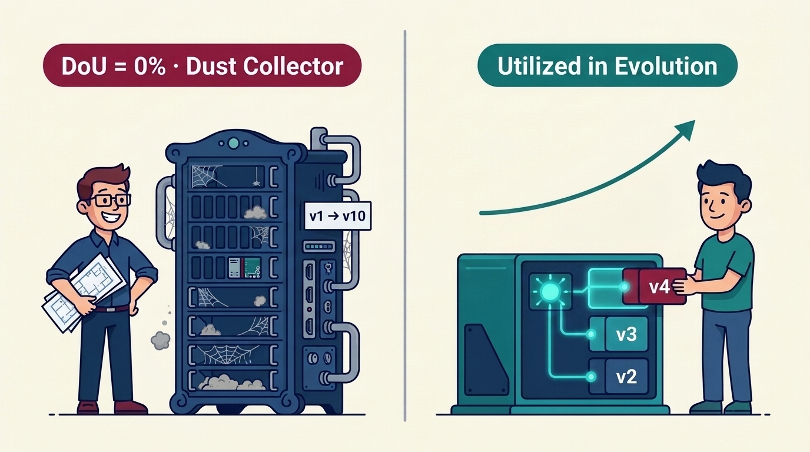
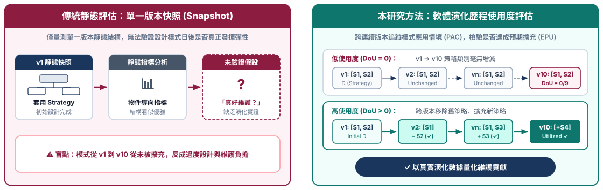
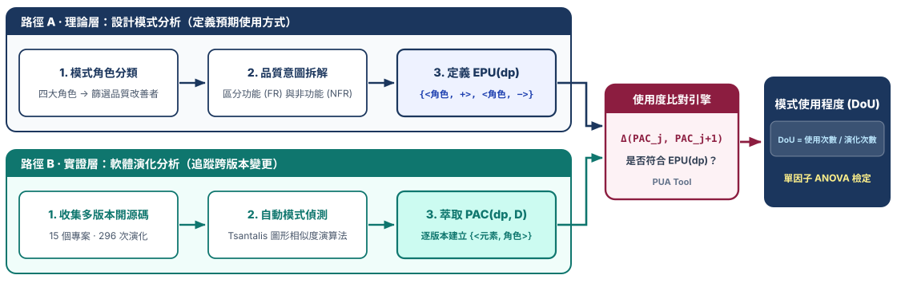
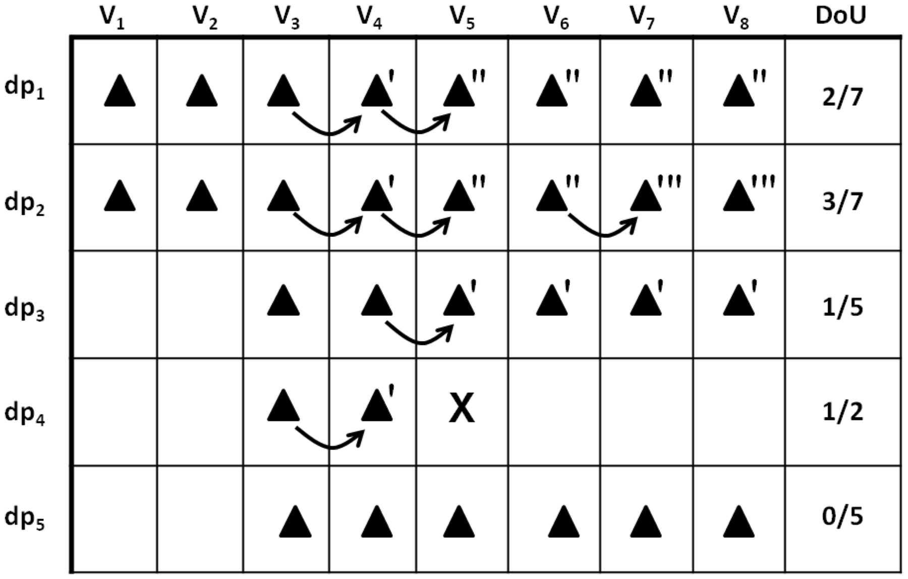
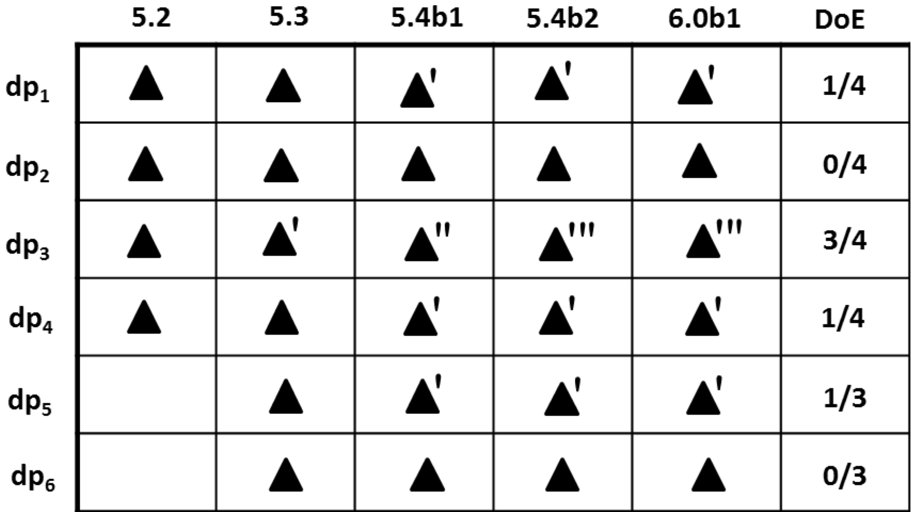
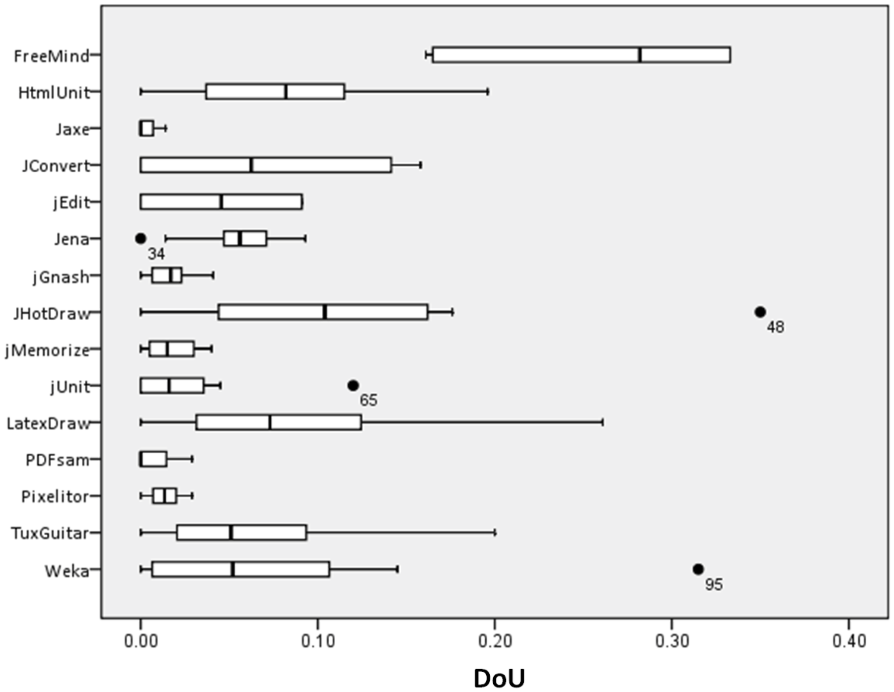

<!-- _class: lead -->

Journal of Information Science and Engineering · Vol. 36, pp. 53–73 (2020)

# 以軟體演化數據分析設計模式之使用度

<strong>Design Pattern Analysis with Software Evolution Data</strong> 
結合<strong>模式應用情境（PAC）</strong>、<strong>預期模式使用方式（EPU）</strong>與<strong>使用程度指標（DoU）</strong>，跨越連續版本實證檢驗設計模式是否真正發揮維護效益

<strong>薛念林（Nien-Lin Hsueh）</strong> 
逢甲大學資訊工程學系 · 台中市 407 台灣 
<code>nlhsueh@fcu.edu.tw</code> · DOI: <code>10.6688/JISE.202001_36(1).0004</code>

科技部專題研究計畫補助：MOST 106-2221-E-035-MY2

<!--
核心訊息：這篇發表於 JISE（2020）的研究提出 PAC、EPU 與 DoU 形式化指標，透過跨版本的軟體演化數據實證檢驗設計模式是否真正發揮維護效益。
口說要點：
- 大家好，今天分享我在 2020 年發表於 Journal of Information Science and Engineering 的論文：以軟體演化數據分析設計模式之使用度。
- 軟體工程師常為了未來擴充彈性而套用 GoF 設計模式，但我們很少回頭驗證這些模式在後續版本中到底有沒有真正派上用場。
- 本研究建立形式化的評估模型並開發自動化工具，橫跨 15 個真實開源專案進行大規模實證檢驗。
轉場：我們先從一個發人深省的工程提問破題。
-->

---

## 破題：精心套用的設計模式，是未雨綢繆，還是積滿灰塵？

<strong>核心洞察：</strong> 開發者常套用設計模式以換取未來擴充彈性；然而在 <strong>15 個真實開源專案（296 次演化）</strong>的實證中，多數已部署的模式在後續版本中<strong>幾乎未被擴充或重複使用</strong>！

<!--
核心訊息：在 15 個真實開源專案、296 次軟體演化中，多數已部署的設計模式在後續版本裡幾乎未被擴充，形同積滿灰塵的過度設計。
口說要點：
- 請看這張對比插畫：我們精心導入設計模式期待它帶來維護紅利，但實務上卻有大量模式的 DoU 等於 0，彷彿被束之高閣。
- 在我們追蹤的 15 個 Java 開源專案、共 296 次版本演進中，多數已部署的模式在初始導入後幾乎沒有再被擴充使用。
- 這引出一個關鍵問題：設計模式有沒有發揮價值，究竟取決於「模式本身的類型」，還是取決於「專案領域與團隊紀律」？
轉場：接下來透過簡報大綱，說明我們如何一步步形式化並驗證這個問題。
-->

---

## 簡報大綱

1

[**研究動機與研究問題**](#4)
為何單一版本快照無法衡量維護性？本研究之四大目標與兩個研究問題（RQ1–RQ2）。

2

[**背景與相關研究回顧**](#6)
比較 12 篇設計模式評估文獻（Table 1）與圖形相似度自動模式偵測技術。

3

[**設計模式使用度評估方法**](#7)
模式四大角色分類、FR/NFR 意圖拆解、PAC 與 EPU 形式化定義及 DoU 指標。

4

[**PUA 工具設計與實證結果**](#11)
Pattern Utilization Analyzer 系統架構、JHotDraw 案例剖析與 15 個開源專案實驗數據。

5

[**統計分析與研究威脅**](#15)
單因子變異數分析（ANOVA）檢定 RQ1 與 RQ2、Scheffé 事後檢定及四大效度威脅。

6

[**結論與未來研究方向**](#18)
RQ1–RQ2 實證總結、對開發團隊之實務價值與 PUA 雲端化展望。

<!--
核心訊息：簡報共分六大單元，依序涵蓋演化評估動機、文獻比較、PAC/EPU/DoU 形式化方法、PUA 工具與 15 個開源專案實驗，以及 ANOVA 統計檢定。
口說要點：
- 第一、二章說明為何單一版本快照無法衡量維護性，並對照 12 篇設計模式評估文獻與偵測技術。
- 第三章介紹雙軌評估方法，包含模式四大角色分類、FR/NFR 意圖拆解與 DoU 使用程度公式。
- 第四至六章展示 PUA 自動化工具、JHotDraw 案例、15 個開源專案實驗數據，以及回答 RQ1 與 RQ2 的統計結論。
轉場：先從第一章開始，討論為何評估設計模式必須放眼軟體演化歷程。
-->

---

## 1.1 研究動機：為何靜態快照無法衡量設計模式價值？

<strong>演化評估原則：</strong> 設計模式的核心價值在於提升長期的<strong>可維護性與可擴充性</strong>。若過度設計或誤用反增維護負擔，因此評估必須橫跨<strong>所有連續版本</strong>，而非只看單一時間點的靜態結構。

<!--
核心訊息：設計模式的核心目標在於長期的可維護性與擴充性，因此只看單一版本的靜態快照無法判斷其複雜度投資是否回收。
口說要點：
- 如圖所示，靜態快照只能告訴我們某個版本中存在某個設計模式，卻無法看出它在後續 V2、V3、V4 的需求變更中是否真正發揮解耦作用。
- 套用設計模式會帶來額外的介面與類別結構成本；如果日後從未被擴充，反而成為維護負擔。
- 因此，客觀的設計模式評估必須橫跨所有連續版本，觀察它在演化過程中的實際使用狀況。
轉場：基於這個演化評估原則，我們訂定四大研究目標與兩個核心研究問題。
-->

---

## 1.2 研究目標與兩個核心研究問題

<strong>1. 提出評估方法</strong> 以演化數據形式化定義設計模式使用度。

<strong>2. 開發自動化工具</strong> 實作網頁版 <code>PUA</code> 自動化分析系統。

<strong>3. 大規模開源實證</strong> 跨 15 個開源專案（296 次演化）分析 11 種模式。

<strong>4. 統計假說檢定</strong> 驗證使用度是否受模式類型或專案影響。

本研究透過單因子變異數分析（One-Way ANOVA）檢定兩項關鍵問題*（逐步揭曉）*：

* 

RQ1 某些設計模式天生就比其他模式更容易被發揮嗎？

<strong>已部署設計模式的使用程度（DoU）與「模式類型」之間是否存在顯著統計差異？</strong>（涵蓋 9 組共 11 種品質改善型 GoF 設計模式。）

* 

RQ2 還是模式能否發揮價值，取決於專案領域與設計紀律？

<strong>已部署設計模式的使用程度（DoU）與「開源軟體專案」之間是否存在顯著統計差異？</strong>（橫跨 15 個真實世界 Java 開源系統。）

<!--
核心訊息：本研究提出形式化指標、實作自動化工具 PUA，並透過單因子 ANOVA 檢定使用度是否與模式類型（RQ1）或開源專案（RQ2）顯著相關。
口說要點：
- 上方四張卡片列出四大目標：提出演化使用度方法、開發網頁版 PUA 系統、分析 15 個開源專案的 296 次演化，並進行統計檢定。
- RQ1 檢驗在 9 組共 11 種品質改善型 GoF 模式中，是否某些模式天生就比其他模式更容易被發揮。
- RQ2 則檢驗不同開源專案之間的模式使用度是否存在顯著差異，藉此判斷專案領域與設計紀律的影響。
轉場：在進入我們的方法之前，先快速回顧既有的設計模式評估文獻。
-->

---

## 2. 背景與相關研究回顧（Table 1）

既有研究多採靜態指標、受控實驗、問卷調查或腐化分析，**缺乏以自動化工具衡量跨版本「模式使用度」的實證方法**。

| 研究類型 | 代表文獻 | 方法與程式碼分析 | 研究標的與核心焦點 |
| :--- | :--- | :--- | :--- |
| **靜態指標與品質** | Huston [15]; Hsueh et al. [13] | 指標分析 / 量化法（是/否） | 設計模式：與 OO 指標之相容性、模式良構性驗證 |
| **受控維護實驗** | Prechelt et al. [23, 24]; Ng et al. [20, 21] | 人工受控實驗 | 開發人員：模式效益、文件化輔助與預期變更維護 |
| **文獻回顧與調查** | Zhang & Budgen [32, 33] | 系統性回顧與專家調查（否） | 論文與專家：僅 3 種模式獲高評價，四分之一評價偏低 |
| **演化、污垢與缺陷** | Aversano et al. [2]; Vokáč [30]; Izurieta [16] | 自動化工具分析程式碼（是） | 軟體系統：修改頻率、缺陷關聯、模式污垢（Grime）與腐化 |
| **演化使用度評估** | **Hsueh [12] 與本研究（2020）** | **自研 PUA 自動化工具（是）** | **15 個開源專案（296 次演化）：PAC/EPU 符合度與 DoU** |

<strong>設計模式偵測基礎：</strong> 採用 <strong>Tsantalis et al. [28]</strong> 提出之圖形相似度評分演算法（優於不支援變異體之 DP-Miner [6]），在 JHotDraw 上可達 <strong>100% 精確率與 100% 召回率</strong>。

<!--
核心訊息：過去研究多聚焦於靜態指標、人工受控實驗、專家調查或模式污垢，尚缺乏自動化衡量跨版本模式使用度的實證工具。
口說要點：
- Table 1 將 12 篇代表性文獻歸納為四大脈絡：靜態物件導向指標、人工維護實驗、文獻與專家調查，以及模式腐化與缺陷分析。
- 本研究補上第五個維度：透過自研 PUA 工具自動比對跨版本的 PAC 與 EPU 符合度，量化模式使用度 DoU。
- 在模式偵測核心上，我們選用 Tsantalis 等人的圖形相似度演算法，因為它能辨識修改後的模式變異體，在 JHotDraw 上達到 100% 精確率與召回率。
轉場：接著進入第三章，詳細說明本研究的雙軌設計模式使用度評估方法。
-->

---

## 3.1 設計模式使用度評估方法總覽

<strong>雙軌評估架構：</strong> <strong>路徑 A（理論層）</strong>篩選品質改善型模式，自 NFR 意圖定義<em>預期模式使用方式（EPU）</em>；<strong>路徑 B（實證層）</strong>逐版本萃取<em>模式應用情境（PAC）</em>，比對跨版本變更是否符合預期。

<!--
核心訊息：雙軌評估架構結合「理論層」的預期模式使用方式（EPU）與「實證層」的跨版本模式應用情境（PAC），精準判定模式是否被有效使用。
口說要點：
- 請看圖中的雙軌流程：路徑 A 從理論出發，先篩選品質改善型模式，再根據其非功能性意圖定義 EPU 規則。
- 路徑 B 從程式碼實證出發，收集連續發行版本、偵測模式實例並萃取每個版本的 PAC 結構。
- 最後比對相鄰版本的 PAC 差異是否符合 EPU，即可客觀判定該模式在這次版本演進中有沒有真正被使用。
轉場：我們先細看路徑 A，了解如何篩選品質改善型模式並拆解 FR 與 NFR 意圖。
-->

---

## 3.2 模式角色分類與 FR/NFR 意圖拆解

並非所有設計模式皆為了解決維護性問題。我們先將設計模式分為**四大角色** [14]，並聚焦於**品質改善者（Quality-Improver）**：

### 活動促進者
協助常見設計活動（系統分解、物件配置、存取控制與元件組合）。

### ★ 品質改善者
**本研究核心：** 滿足基本功能同時提升非功能品質（可擴充性、可維護性）。

### 衝突解決者
協調資源競爭、需求分歧與設計階段頻繁出現的副作用衝突。

### 問題解決者
處理邊界條件與可靠性例外（如 Observer 解決資料不一致問題）。

Fig. 4 · Strategy 模式之功能結構 FR-structure（左）與非功能結構 NFR-structure（右）

- **功能意圖（FR-Intent）**：讓 `Context` 類別呼叫演算法以解決問題（基本結構）。
- **非功能意圖（NFR-Intent）**：額外引入 `Strategy` 介面角色，使日後可**直接新增或移除 `ConcreteStrategy`** 而不改動 `Context`，提升擴充性。

<!--
核心訊息：我們將設計模式分為四大角色，聚焦於提升維護性的「品質改善者」，並透過拆解 FR 與 NFR 意圖來界定預期的演化操作。
口說要點：
- 並非所有 GoF 模式都是為了擴充性而設計，因此我們先區分四大角色，鎖定以提升可擴充性與可維護性為主的「品質改善者」。
- 以 Fig. 4 的 Strategy 模式為例：左側的 FR 結構只負責讓 Context 呼叫演算法，右側的 NFR 結構才引入抽象 Strategy 介面。
- 這份 NFR 意圖直接告訴我們什麼叫「有效使用」：也就是日後在不修改 Context 的情況下，新增或移除具體的 ConcreteStrategy 類別。
轉場：有了這個直覺後，下一頁我們用三個簡潔的公式將 PAC、EPU 與使用判定形式化。
-->

---

## 3.3 形式化模型：PAC、EPU 與使用度判定謂詞

<strong>PAC(dp, D)</strong>&nbsp; = &nbsp;{ &lt;element, r&gt; }

<strong>EPU(dp)</strong>&nbsp; = &nbsp;{ &lt;role, operator&gt; }, &nbsp;operator ∈ {+, −}

<strong>utilized(dp, Dj+1)</strong> &nbsp;⇔ 
∃ Dj, Δ(PAC(dp, Dj), PAC(dp, Dj+1)) 符合 EPU(dp)

### Strategy 範例（資料壓縮系統）
- **PAC**：`{<DataCompression, R_C>, <CompressionTool, R_S>, <RAR, R_CS>, <ZIP, R_CS>}`
- **EPU(Strategy)**：`{<R_CS, +>, <R_CS, −>}`（新增或移除具體策略類別）。

Fig. 5 · 於版本 Dj+1 新增 <code>7-zip</code> 符合 EPU(Strategy)

<strong>核心判定準則：</strong> 若某設計模式在相鄰版本 Dj → Dj+1 間的結構差異 Δ(PAC) 恰好符合其預期操作 EPU(dp)，即判定該模式於此演化步驟中<strong>被有效使用（utilized）</strong>。

<!--
核心訊息：只要某模式在相鄰版本間的 PAC 結構差異恰好符合其 EPU 預期操作，我們就形式化判定該模式在此演化步驟中被有效使用。
口說要點：
- PAC 記錄某個版本中參與該模式的類別與角色對應，例如資料壓縮範例裡的 DataCompression、CompressionTool 以及 RAR、ZIP。
- EPU 定義該模式預期的結構變更操作（新增 + 或移除 -），對 Strategy 來說就是新增或移除具體策略類別。
- 如右側 Fig. 5 所示，當下一個版本在 CompressionTool 下新增 7-zip 壓縮類別時，差異完全符合 EPU，因此判定為有效使用。
轉場：有了單次演化的判定準則後，接下來就能定義衡量整個生命週期的 DoU 指標。
-->

---

## 3.4 量化演化效益：模式使用程度（DoU）指標

<strong>DoU</strong>&nbsp; = &nbsp;

實際被使用次數（# of utilized applications）
模式存活演化次數（# of pattern evolution）

### Fig. 6 計算範例（8 個版本、5 個模式實例）
- **▲** = 已部署；**▲'** = 發生有效使用變更；**X** = 已移除。
- `dp1`（V1–V8）：於 V3→V4、V4→V5 使用 2 次 / 7 次演化 = **2/7**。
- `dp2`（V1–V8）：有效使用 3 次 / 7 次演化 = **3/7**（最高）。
- `dp3`（V3–V8）：有效使用 1 次 / 5 次演化 = **1/5**。
- `dp4`（V3–V5）：於 V5 移除 → 1 次 / 2 次演化 = **1/2**。
- `dp5`（V3–V8）：全程未使用 → **0/5**。

Fig. 6 · 8 個版本（V1–V8）中 5 個設計模式實例（dp1–dp5）之 DoU 計算

<!--
核心訊息：模式使用程度（DoU）將「實際被使用次數」除以「模式存活演化次數」，公平量化每個模式實例在生命週期中的貢獻度。
口說要點：
- 左上方公式非常直觀：分子是符合 EPU 的有效使用次數，分母是該模式存活期間經歷的相鄰版本轉換次數。
- 以右側 Fig. 6 的 8 個版本為例：dp1 與 dp2 都存活了 7 次演化，分別被使用 2 次與 3 次，故 DoU 為 2/7 與 3/7。
- 特別注意 dp4 在 V5 被移除，因此分母只計入它實際存活的 2 次演化（1/2）；而 dp5 歷經 5 次演化卻從未擴充，DoU 為 0/5。
轉場：定義完數學模型後，第四章展示我們如何將整套流程實作為自動化工具 PUA。
-->

---

## 4.1 PUA 工具架構與四步驟分析流程

本研究實作網頁版工具 **Pattern Utilization Analyzer（PUA）**，整合三大核心模組：**版本控制模組**、**PAC 模組**與 **PAE/EPU 模組**。

Fig. 7 · PUA（Pattern Utilization Analyzer）系統架構

### 步驟 1 · 收集多版本原始碼
自 SourceForge 收集開源專案歷代發行版本，匯入 PUA 的**版本控制模組**管理。

### 步驟 2 · 透過 Pattern4 偵測 11 種 GoF 模式
運用 Tsantalis 圖形比對工具 [28, 29] 偵測各版本模式：
- **建立型**：Factory Method（`FM`）、Prototype（`P`）
- **結構型**：Adapter-Command（`AC`）、Composite（`C`）、Decorator（`D`）
- **行為型**：Observer（`O`）、State-Strategy（`SS`）、Template Method（`TM`）、Visitor（`V`）

### 步驟 3 與 4 · PAC/EPU 比對 → 產出 DoU
逐版本建立 `PAC`、檢驗相鄰版本是否符合 `EPU`，並自動計算各實例與專案之 **DoU**。

<!--
核心訊息：我們實作網頁版 Pattern Utilization Analyzer（PUA），整合版本控制、Pattern4 偵測器與 PAC/EPU 比對模組，完成四步驟自動化分析。
口說要點：
- 左側 Fig. 7 呈現 PUA 的三大核心模組：首先從 SourceForge 匯入多版本原始碼並交由版本控制模組管理。
- 第二步呼叫 Tsantalis 的 Pattern4 工具，在每個版本中自動偵測橫跨建立型、結構型與行為型的 11 種 GoF 模式（合併為 9 組）。
- 第三與第四步自動萃取 PAC、逐版本比對 EPU，最終產出實例層級與專案層級的 DoU 統計。
轉場：我們先透過經典繪圖框架 JHotDraw 的 Observer 案例，看看 PUA 的實際輸出。
-->

---

## 4.2 案例剖析：JHotDraw 的 Observer 模式演化

以 **JHotDraw** 連續五個版本（`5.2 → 5.3 → 5.4b1 → 5.4b2 → 6.0b1`）為例，追蹤 **6 個 Observer 實例**（`dp1`–`dp6`）：

Fig. 8 · JHotDraw（5.2–6.0b1）6 個 Observer 實例之 PUA 分析結果

3/4

<code>dp3</code>（75% 使用率）

1/3–1/4

<code>dp1</code>、<code>dp4</code>、<code>dp5</code>

0/4, 0/3

<code>dp2</code>、<code>dp6</code>（未使用）

### 實例層級觀察
- **`dp1`–`dp4`** 於 v5.2 部署（歷經 4 次演化）：`dp3` 在 4 次演進中有 3 次被有效擴充（`DoU = 3/4`），而 `dp2` 全程未被使用（`0/4`）。
- **`dp5`–`dp6`** 於 v5.3 引入（歷經 3 次演化）：`dp5` 使用 1 次（`1/3`），`dp6` 未使用（`0/3`）。
- 在完整 8 次 JHotDraw 演化中，**Observer 達全實驗最高 DoU = `0.350`**。

<!--
核心訊息：即使在設計精良的 JHotDraw 專案中，同為 Observer 模式的 6 個實例其使用率仍落差極大，從完全未使用到高達 75% 不等。
口說要點：
- Fig. 8 追蹤了 JHotDraw 從 5.2 到 6.0b1 連續五個版本中的 6 個 Observer 實例。
- 在 v5.2 導入的 4 個實例中，dp3 在 4 次演進中有 3 次被有效擴充（DoU = 3/4），但 dp2 卻全程掛零（0/4）。
- 而在 v5.3 新增的 dp5 與 dp6 分別為 1/3 與 0/3；綜觀 JHotDraw 全部 8 次演化，Observer 達到本實驗最高的 0.350。
轉場：看過單一案例剖析後，接著介紹我們完整的 15 個開源專案實驗規模。
-->

---

## 4.3 實驗設定：15 個開源專案與 296 次軟體演化

我們選取 SourceForge 上 **15 個跨領域 Java 開源專案**（繪圖、測試、機器學習、語意網、財務、音樂編輯等），涵蓋 **2000–2012 年**（Table 2）：

| 開源專案 | 演化次數 | 版本範圍 | 開發時間區間 |
| :--- | :---: | :---: | :--- |
| **FreeMind** | 16 | 0.0.2–0.9.0 | 2000/06 – 2011/02 |
| **HtmlUnit** | 28 | 1.0.0–2.9.0 | 2002/05 – 2011/08 |
| **Jaxe** | 38 | 1.0–3.5 | 2002/06 – 2011/06 |
| **JConvert** | 9 | 1.0.0–1.1.0 | 2007/08 – 2011/05 |
| **JEdit** | 27 | 2.3–4.5.1 | 2000/01 – 2012/03 |
| **Jena** | 17 | 2.0–2.6.4 | 2003/08 – 2010/12 |
| **JGnash** | 26 | 1.0.1–1.10.5 | 2003/01 – 2006/03 |
| **JHotDraw** | 8 | 5.2–7.6 | 2001/02 – 2011/01 |

| 開源專案 | 演化次數 | 版本範圍 | 開發時間區間 |
| :--- | :---: | :---: | :--- |
| **JMemorize** | 12 | 0.7.0–1.3.0 | 2004/10 – 2008/03 |
| **JUnit** | 19 | 3.4.0–4.10.0 | 2000/12 – 2011/09 |
| **LatexDraw** | 24 | 1.0.2–2.0.8 | 2006/01 – 2010/03 |
| **PDFsam** | 14 | 1.0.0–2.2.1 | 2007/08 – 2012/07 |
| **Pixelitor** | 34 | 0.1.0–1.1.2 | 2009/11 – 2010/11 |
| **TuxGuitar** | 11 | 0.2–1.2 | 2006/06 – 2009/11 |
| **Weka** | 13 | 3.0.1–3.7.5 | 2002/02 – 2012/08 |
| **總計** | **296** | **15 個系統** | **最長達 12 年** |

<strong>樣本設計：</strong> 包含 3 個文獻經典標竿專案（<strong>JHotDraw</strong>、<strong>JUnit</strong>、<strong>FreeMind</strong>）＋ 隨機挑選之 12 個開源專案，共評估 <strong>9 組（11 種）品質改善型 GoF 模式</strong>。

<!--
核心訊息：實驗樣本涵蓋 SourceForge 上 15 個跨領域 Java 開源專案、共 296 次版本演化，開發歷程最長橫跨 12 年。
口說要點：
- Table 2 列出全部 15 個系統，領域涵蓋心智圖、繪圖編輯器、單元測試、機器學習、語意網、財務與樂譜編輯等。
- 為了兼顧代表性與客觀性，我們結合了 JHotDraw、JUnit、FreeMind 三個文獻經典標竿，以及隨機挑選的 12 個開源專案。
- 各專案演化次數介於 8 次到 38 次之間，總計分析 296 次跨版本轉換與 9 組品質改善型設計模式。
轉場：接下來揭曉這 15 個專案完整的 DoU 實驗結果矩陣。
-->

---

## 4.4 實證結果：15 個開源專案之 DoU 矩陣（Table 3）

<table class="dense">
<thead>
<tr><th>專案名稱</th><th>FM</th><th>P</th><th>AC</th><th>C</th><th>D</th><th>O</th><th>SS</th><th>TM</th><th>V</th></tr>
</thead>
<tbody>
<tr><td>FreeMind</td><td class="mid-cell">0.161</td><td></td><td class="mid-cell">0.165</td><td></td><td class="hi-cell">0.333</td><td class="hi-cell">0.333</td><td class="hi-cell">0.301</td><td class="hi-cell">0.263</td><td></td></tr>
<tr><td>HtmlUnit</td><td>0.082</td><td class="zero-cell">0</td><td>0.042</td><td></td><td class="mid-cell">0.196</td><td>0.032</td><td>0.129</td><td>0.101</td><td></td></tr>
<tr><td>Jaxe</td><td class="zero-cell">0</td><td></td><td>0.007</td><td></td><td class="zero-cell">0</td><td class="zero-cell">0</td><td>0.014</td><td class="zero-cell">0</td><td></td></tr>
<tr><td>JConvert</td><td></td><td></td><td class="zero-cell">0</td><td></td><td></td><td class="zero-cell">0</td><td class="mid-cell">0.158</td><td>0.125</td><td></td></tr>
<tr><td>JEdit</td><td></td><td></td><td>0.091</td><td></td><td></td><td></td><td class="zero-cell">0</td><td></td><td></td></tr>
<tr><td>Jena</td><td>0.056</td><td>0.060</td><td>0.014</td><td>0.056</td><td>0.076</td><td>0.071</td><td>0.093</td><td>0.047</td><td class="zero-cell">0</td></tr>
<tr><td>JGnash</td><td>0.012</td><td>0.001</td><td>0.023</td><td class="zero-cell">0</td><td>0.023</td><td>0.017</td><td>0.041</td><td>0.017</td><td></td></tr>
<tr><td>JHotDraw</td><td>0.143</td><td>0.004</td><td>0.044</td><td>0.063</td><td class="mid-cell">0.162</td><td class="hi-cell">0.350</td><td class="mid-cell">0.176</td><td>0.104</td><td class="zero-cell">0</td></tr>
<tr><td>JMemorize</td><td>0.010</td><td class="zero-cell">0</td><td>0.020</td><td class="zero-cell">0</td><td>0.010</td><td>0.040</td><td>0.030</td><td>0.030</td><td></td></tr>
<tr><td>JUnit</td><td class="zero-cell">0</td><td></td><td>0.016</td><td>0.045</td><td class="zero-cell">0</td><td class="zero-cell">0</td><td>0.120</td><td>0.026</td><td></td></tr>
<tr><td>LatexDraw</td><td class="zero-cell">0</td><td>0.005</td><td>0.058</td><td class="hi-cell">0.261</td><td></td><td class="mid-cell">0.174</td><td>0.073</td><td>0.075</td><td></td></tr>
<tr><td>PDFsam</td><td></td><td></td><td class="zero-cell">0</td><td></td><td></td><td></td><td>0.029</td><td class="zero-cell">0</td><td></td></tr>
<tr><td>Pixelitor</td><td>0.011</td><td class="zero-cell">0</td><td>0.007</td><td></td><td></td><td>0.020</td><td>0.016</td><td>0.029</td><td></td></tr>
<tr><td>TuxGuitar</td><td class="mid-cell">0.200</td><td>0.009</td><td>0.062</td><td class="zero-cell">0</td><td></td><td>0.125</td><td>0.051</td><td>0.032</td><td></td></tr>
<tr><td>Weka</td><td>0.068</td><td class="zero-cell">0</td><td>0.052</td><td></td><td>0.145</td><td class="zero-cell">0</td><td class="hi-cell">0.315</td><td>0.013</td><td></td></tr>
</tbody>
</table>

空白 = 未部署 · <code>0</code> = 已部署但未使用 · 藍綠色 ≥ 0.25，淺藍色 ≥ 0.15

0.350

<strong>全場最高 DoU：</strong> JHotDraw 的 Observer

&lt; 0.20

<strong>整體現況：</strong> 多數模式平均使用度普遍偏低

### 亮點觀察
- **FreeMind**：整體表現最突出（`D/O/SS > 0.30`）。
- **Weka**：State-Strategy 高達 `0.315`（演算法切換）。
- **LatexDraw**：Composite 表現最佳（`0.261`）。
- **Jaxe、JEdit、PDFsam、Pixelitor**：普遍偏低或為 `0`。

<!--
核心訊息：整體設計模式使用度普遍偏低（平均低於 0.20），但部分專案與特定模式的搭配展現出高度領域契合的亮眼表現。
口說要點：
- Table 3 呈現完整矩陣：空白代表未部署，0 代表已部署但從未使用，藍綠色標示 0.25 以上的高使用度儲存格。
- 全場最高值為 JHotDraw 的 Observer（0.350）；FreeMind 整體表現最為突出，Decorator、Observer 與 State-Strategy 全數突破 0.30。
- 我們也能看出領域特性：機器學習框架 Weka 的 State-Strategy 高達 0.315，向量繪圖軟體 LatexDraw 的 Composite 達 0.261；反觀 Jaxe、JEdit、PDFsam 與 Pixelitor 則多數趨近於 0。
轉場：有了這張完整的 DoU 矩陣，第五章我們以 ANOVA 統計檢定正式回答 RQ1 與 RQ2。
-->

---

## 5.1 RQ1 統計分析：DoU 與設計模式類型之關係

Fig. 9 · 9 組設計模式之 DoU 分布盒鬚圖

p = 0.146 &gt; 0.05

<strong>無法拒絕 H0：</strong> 不同設計模式類型間之 DoU 無顯著差異

| 變異來源（Table 4） | SS | df | MS (SS/df) | F 值 | p-value |
| :--- | :---: | :---: | :---: | :---: | :---: |
| **組間（Between）** | 0.090 | 8 | 0.011 | 1.569 | **0.146** |
| **組內（Within）** | 0.626 | 87 | 0.007 | — | — |
| **總計（Total）** | 0.716 | 95 | — | — | — |

### 為何模式類型無顯著差異？
- 各類模式平均 DoU 皆**低於 0.20**（`Visitor = 0`，`Prototype ≤ 0.060`）。
- 模式部署高度受到**人為習慣與程式理解程度**影響 [21]。
- 開發者傾向選用**自己熟悉的模式**，或因結構複雜度而卻步 [30]，未必契合真實演化需求。

<!--
核心訊息：RQ1 的單因子 ANOVA 結果未達顯著（F = 1.569, p = 0.146），顯示不同設計模式類型之間並沒有天生誰比較容易被有效使用的差異。
口說要點：
- 觀察 Fig. 9 的盒鬚圖與 Table 4 的變異數分析表，組間差異 p 值為 0.146 大於 0.05，無法拒絕虛無假設。
- 所有模式類型的平均 DoU 皆低於 0.20，其中 Visitor 甚至為 0，Prototype 最高也僅 0.060。
- 結合過去文獻解讀，開發者常依個人習慣選用熟悉的模式，或因結構複雜度而避開某些模式，導致部署決策未必貼合真實的演化需求。
轉場：既然模式類型不是關鍵，那麼「專案本身」是否才是決定因素？我們接著看 RQ2。
-->

---

## 5.2 RQ2 統計分析：DoU 與開源軟體專案之關係

Fig. 10 · 15 個開源軟體專案之 DoU 分布盒鬚圖

F = 5.704 · p &lt; 0.001

<strong>拒絕 H0：</strong> 不同開源專案間之 DoU 存在極顯著差異！

| 變異來源（Table 5） | SS | df | MS (SS/df) | F 值 | p-value |
| :--- | :---: | :---: | :---: | :---: | :---: |
| **組間（Between）** | 0.356 | 14 | 0.025 | **5.704** | **&lt; 0.001** |
| **組內（Within）** | 0.361 | 81 | 0.004 | — | — |
| **總計（Total）** | 0.716 | 95 | — | — | — |

### Scheffé 事後多重比較（Table 6）
- **FreeMind** 顯著優於其他 **8 個專案**：`Jaxe` (p=0.001)、`Jena` (0.006)、`jGnash` (&lt;0.001)、`jMemorize` (&lt;0.001)、`JUnit` (0.002)、`PDFsam` (0.028)、`Pixelitor` (0.001)、`TuxGuitar` (0.040)。
- **領域契合度**：在 MVC 圖形介面專案（**JHotDraw** `0.350`、**FreeMind** `0.333`）中，**Observer 與 Decorator** 隨視覺化更新需求持續被活化運用。

<!--
核心訊息：RQ2 的單因子 ANOVA 呈現極顯著差異（F = 5.704, p < 0.001），證實設計模式能否發揮演化價值，高度取決於專案領域與團隊設計紀律。
口說要點：
- 從 Fig. 10 與 Table 5 可以清楚看到，不同開源專案間的 DoU 差異達到 p < 0.001 的極顯著水準，明確拒絕虛無假設。
- 進一步執行 Scheffé 事後多重比較（Table 6）發現，FreeMind 顯著優於包含 Jaxe、Jena、jGnash、jMemorize、JUnit、PDFsam、Pixelitor 與 TuxGuitar 在內的 8 個專案。
- 這凸顯了領域契合度的重要性：在 JHotDraw 與 FreeMind 這類 MVC 圖形介面系統中，Observer 與 Decorator 能隨著視覺化需求持續被活化運用。
轉場：在進入結論前，我們依據 Yin 的個案研究架構檢視四個面向的效度威脅。
-->

---

## 5.3 研究效度威脅（Threats to Validity）

依循 Yin [25] 之個案研究效度框架，檢視以下四個面向：

### 🎯 建構效度（Construct Validity）
- 分析結果可能受 **Tsantalis et al. 模式偵測工具** [28] 之精確率與召回率影響。
- **緩解機制：** 該工具於文件完整之 JHotDraw 達 **100% 精確率與 100% 召回率** [28]；Aversano et al. [1] 獨立檢驗整體精確率亦 **&gt; 85%**，有效抑制偽陽性干擾。

### 🔍 內部效度（Internal Validity）
- 外部混淆因子可能影響 DoU 與專案或模式類型間之因果推論。
- **緩解機制：** 透過嚴謹之**單因子 ANOVA**（α = 0.05）與 **Scheffé 事後檢定**，清楚區辨「專案因子具極顯著影響（p &lt; 0.001）」與「模式類型無顯著影響（p = 0.146）」。

### 🌐 外部效度（External Validity）
- **專案範圍：** 涵蓋 15 個跨領域、不同規模之 Java 開源系統；未來擴展至更多系統將進一步強化推論泛化力。
- **模式範圍：** 聚焦於 23 種 GoF 模式中與維護性最相關之 **9 組（11 種）品質改善型模式** [14]。

### 🔁 信度（Reliability Validity）
- 15 個開源專案原始碼（SourceForge）與 Tsantalis 偵測工具皆為**公開可取得資源**。
- 論文第 4.2 節詳述實驗流程，並公開原始 DoU 數據表（Table 3）以供完整統計重現。

<!--
核心訊息：本研究透過高準確度偵測工具、嚴謹的 ANOVA 與 Scheffé 統計檢定、跨領域開源樣本與公開資料，系統性緩解四大效度威脅。
口說要點：
- 建構效度方面，研究結果仰賴 Tsantalis 偵測工具，其在 JHotDraw 達 100% 精確率與召回率，獨立審核整體精確率亦超過 85%，有效抑制偽陽性誤差。
- 內部效度方面，透過單因子 ANOVA 與 Scheffé 事後檢定，清楚區分不顯著的模式因子（p = 0.146）與極顯著的專案因子（p < 0.001）。
- 外部效度與信度方面，我們涵蓋 15 個跨領域專案與 11 種品質改善型模式，且所有 SourceForge 原始碼、Pattern4 工具與 Table 3 原始數據皆公開可重現。
轉場：最後進入第六章，統整兩大研究問題的實證結論與未來發展藍圖。
-->

---

## 6. 結論與未來研究方向

<strong>☁️ 1. PUA 工具雲端服務化</strong> 將 PUA 轉型為雲端服務，大幅提升跨版本圖形偵測與大規模演化分析之運算效能。

<strong>🧩 2. 擴充設計模式偵測類別</strong> 納入更多 GoF 與架構設計模式之偵測與 EPU 規則，拓展品質診斷涵蓋面。

<strong>📊 3. 更大規模開源與產業實證</strong> 藉由升級後之高效能平台，對更多現代開源與企業專案進行長期演化驗證。

<!--
核心訊息：設計模式的演化價值取決於專案領域與設計紀律而非模式類型，團隊應善用 DoU 盤點過度設計，未來研究也將推進 PUA 雲端化與更大規模實證。
口說要點：
- 上方總結圖一次呈現 RQ1 與 RQ2 的核心發現：整體平均 DoU 低於 0.20，模式類型無顯著差異（p = 0.146），但開源專案間差異極顯著（p < 0.001）。
- 在實務上，開發團隊可運用 DoU 找出長期未使用的「積灰塵模式」進行重構，並聚焦於最契合系統演化需求的模式。
- 未來將朝三大方向推進：把 PUA 轉型為雲端服務以加速大規模分析、擴充更多設計與架構模式的 EPU 規則，並擴大至現代開源與企業系統驗證。
轉場：以上就是本次演講的完整內容，進入結尾頁並歡迎各位提問。
-->

---

<!-- _class: closing -->

# 感謝聆聽！敬請指教

以軟體演化數據分析設計模式之使用度（Design Pattern Analysis with Software Evolution Data）

<strong>薛念林（Nien-Lin Hsueh）</strong> &nbsp;·&nbsp; <code>nlhsueh@fcu.edu.tw</code> 
逢甲大學資訊工程學系 
<em>Journal of Information Science and Engineering</em>, Vol. 36, No. 1, pp. 53–73 (2020) 
DOI: <code>10.6688/JISE.202001_36(1).0004</code> 
科技部計畫補助：MOST 106-2221-E-035-MY2 · 歡迎提問與交流！

<!--
核心訊息：感謝聽眾聆聽，附上論文發表資訊與聯絡信箱，開放現場提問與技術交流。
口說要點：
- 非常感謝各位的聆聽與指教！
- 本研究全文發表於 Journal of Information Science and Engineering（2020），歡迎透過畫面上的 DOI 查閱全文或來信至 nlhsueh@fcu.edu.tw 交流。
- 接下來開放提問，歡迎針對 PAC/EPU 形式化定義、PUA 自動化工具或 15 個開源專案的實證發現提出討論。
轉場：開放現場 Q&A。
-->

