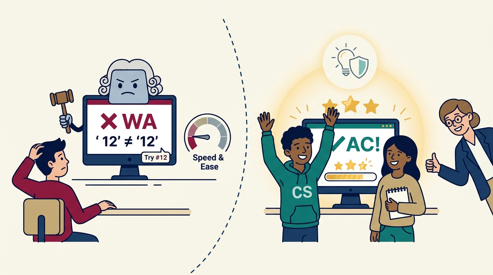
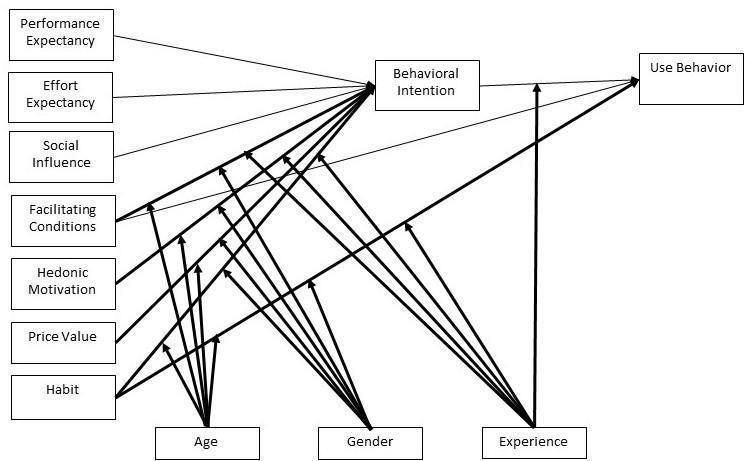
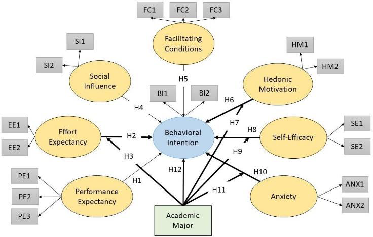
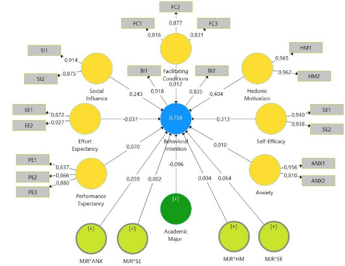
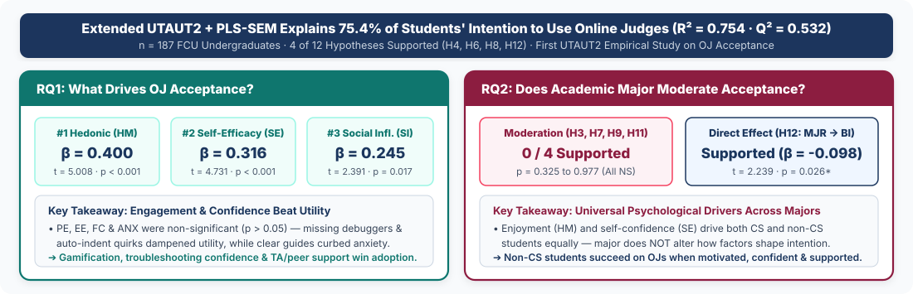

<!-- _class: lead -->

IEEE Access · Vol. 9 · pp. 152606–152615 · November 2021

# Understanding Students’ Acceptance of Online Judge System in Programming Courses

<strong>A Structural Equation Modeling Approach:</strong> Applying Extended <strong>UTAUT2</strong> &amp; <strong>PLS-SEM</strong> to Uncover What Truly Drives Student Adoption of Automated Programming Assessment

<strong>Daramsenge Bilegjargal*</strong> and <strong>Nien-Lin Hsueh</strong> 
Department of Information Engineering and Computer Science, Feng Chia University, Taichung, Taiwan 
<code>p0731809@o365.fcu.edu.tw</code> · <code>nlhsueh@fcu.edu.tw</code> · DOI: <code>10.1109/ACCESS.2021.3126896</code>

Supported by the Ministry of Science and Technology (MOST), Taiwan, under Grant MOST 109-2221-E-035-056.

<!--
Paper Context & Contribution:
- Bibliographic record: Daramsenge Bilegjargal and Nien-Lin Hsueh, "Understanding Students' Acceptance of Online Judge System in Programming Courses: A Structural Equation Modeling Approach," IEEE Access, Vol. 9, pp. 152606–152615, November 2021 (DOI: 10.1109/ACCESS.2021.3126896; supported by MOST 109-2221-E-035-056).
- Core problem addressed: Automated Programming Assessment Systems (APAS) and Online Judge (OJ) platforms are widely adopted to scale coding evaluation, yet prior engineering-focused literature rarely investigates the psychological and behavioral determinants of student acceptance in online or blended programming courses.
- Methodological scope: The study adapts the Unified Theory of Acceptance and Use of Technology 2 (UTAUT2) with educational psychology constructs (Self-Efficacy, Anxiety) and Academic Major moderation, empirically validating the structural model via Partial Least Squares Structural Equation Modeling (PLS-SEM) on survey data from 187 undergraduates at Feng Chia University (FCU).
-->

---

## Opening Hook: "Try #12: Wrong Answer!" ... So Why Do Students Keep Using OJs?

<strong>The Surprise Finding:</strong> An extra space (<code>" 12"</code> vs. <code>"12"</code>) triggers instant failure, yet <strong>efficiency &amp; ease of use did NOT predict adoption</strong>! Instead, <strong>fun (Hedonic Motivation)</strong>, <strong>confidence (Self-Efficacy)</strong>, and <strong>peer/teacher support (Social Influence)</strong> win students over — across both CS and non-CS majors.

<!--
Empirical Paradox & Analytical Framing:
- Operational strictness of OJ judging: An OJ compiles uploaded source code into an executable, runs it against hidden test suites, and performs exact character-level output comparison against standard solutions. A single extraneous whitespace character (e.g., outputting " 12" instead of "12") triggers a Wrong Answer verdict, and prior OJ studies cited in the paper report an average of ~12 submissions before a program passes.
- Counterintuitive empirical finding: Under conventional technology acceptance assumptions, utilitarian constructs such as Performance Expectancy (PE) and Effort Expectancy (EE) are expected to dominate adoption in technical tools. However, the PLS-SEM results show that neither PE (p = 0.373) nor EE (p = 0.648) significantly predicts Behavioral Intention (BI).
- Primary behavioral drivers: Intrinsic enjoyment (Hedonic Motivation, β = 0.400), independent debugging confidence (Self-Efficacy, β = 0.316), and peer/instructor support (Social Influence, β = 0.245) collectively drive acceptance across both Computer Science (IECS) and non-CS majors.
-->

---

## Presentation Outline

1

[**Motivation &amp; Research Questions**](#4)
Why Online Judge acceptance in distance programming remains under-studied and our two RQs.

2

[**Related Work &amp; Research Gap**](#6)
Online Judge systems, UTAUT2 in education, and PLS-SEM for small-sample causal modeling.

3

[**Research Model &amp; 12 Hypotheses**](#7)
Extending UTAUT2 with Self-Efficacy, Anxiety, and Academic Major (H1–H12).

4

[**Course Context, Survey &amp; Sample**](#10)
6-week blended FCU Data Science course, 22-item survey (n = 187), and PLS-SEM pipeline.

5

[**PLS-SEM Measurement &amp; Structural Results**](#12)
Reliability/validity checks, R2 = 0.754, direct drivers (RQ1), and major moderation (RQ2).

6

[**Discussion, Implications &amp; Conclusion**](#15)
Why 8 hypotheses were rejected, actionable design playbook, limitations, and future work.

<!--
Paper Architecture & Analytical Progression:
- Sections I–II (Motivation & Literature Review): Establishes the research gap between system-centric OJ engineering and learner-centric behavioral modeling, synthesizing prior work on OJ platforms (Edgar, Jutge.org, UNED), UTAUT/UTAUT2 educational applications, and PLS-SEM estimation theory.
- Section III (Research Model & Hypotheses): Justifies the context-specific pruning of UTAUT2 (removing Price Value, Habit, and Use Behavior) and extension with Self-Efficacy, Anxiety, and Academic Major across 12 formal hypotheses (H1–H12).
- Section IV (Methodology): Details the 6-week blended FCU Data Science course setting, the 22-item 5-point Likert instrument (n = 187), and the two-stage SmartPLS 3.0 evaluation protocol.
- Sections V–VIII (Results, Discussion, Limitations & Conclusion): Reports outer measurement validity (Tables 2–4), inner structural path significance (R² = 0.754, Q² = 0.532; Tables 5–7), post-hoc diagnostic explanations for the 8 unsupported hypotheses, practical design implications, and external validity boundaries.
-->

---

## 1.1 Motivation: Automated Grading Alone Doesn’t Guarantee Adoption

<strong>Why This Matters:</strong> While automated programming assessment systems (APAS) like Codeforces, UVa, SPOJ, and Edgar slash grading workload, <strong>no prior empirical study</strong> examined what drives students to actually accept an Online Judge in an online course.

<!--
Theoretical Motivation & Research Gap:
- Limitations of manual assessment: Grading programming assignments manually is labor-intensive and slow, motivating Automated Programming Assessment Systems (APAS) such as Edgar (Mekterovic et al., 2020), which supports multi-language grading (SQL, Java, C, C#), multi-correct MCQs, exam logging, and analytics, alongside competitive OJ platforms like Codeforces, URI Online Judge, UVa, and SPOJ.
- Pedagogical tension in remote learning: While OJs automate compilation, execution, and test-case verification, deploying them in online or blended courses shifts learning responsibility onto students, who may lack intrinsic motivation or disciplined self-study habits (Lu et al., 2017).
- Literature gap: Existing OJ research focuses primarily on system architecture, distributed judging scalability (e.g., MetaOJ), or grade correlation, leaving a critical empirical void regarding the latent psychological and contextual factors that govern student acceptance of OJ technology.
-->

---

## 1.2 Two Core Research Questions

To bridge this gap, we investigate student acceptance of an OJ system in a blended programming course using **UTAUT2 + PLS-SEM** *(revealed step-by-step)*:

* 

RQ1 What truly motivates students to embrace an Online Judge?

<strong>What are the significant factors</strong> (among performance, effort, social influence, facilitating conditions, hedonic motivation, self-efficacy, anxiety, and major) that affect students’ <strong>acceptance of and behavioral intention to use</strong> an OJ system in an online programming course?

* 

RQ2 Does being a CS vs. non-CS major change how those factors work?

<strong>Does academic major (MJR) moderate</strong> the causal relationships between candidate psychological/usability factors (EE, HM, SE, ANX) and students’ <strong>behavioral intention</strong> to use an OJ system?

<!--
Formalization of Research Questions:
- RQ1 (Direct Acceptance Determinants): Investigates which latent predictors from an extended UTAUT2 framework—Performance Expectancy (PE), Effort Expectancy (EE), Social Influence (SI), Facilitating Conditions (FC), Hedonic Motivation (HM), Self-Efficacy (SE), Anxiety (ANX), and Academic Major (MJR)—exert statistically significant direct effects on students' Behavioral Intention (BI) to use an OJ system.
- RQ2 (Demographic Moderation by Major): Examines whether Academic Major (MJR: IECS vs. EE vs. Other departments) moderates the structural slopes linking EE, HM, SE, and ANX to BI. Because CS majors typically possess prior IDE exposure and stronger programming identity, testing moderation determines whether OJ acceptance mechanisms operate uniformly or diverge across disciplinary backgrounds.
- Practical significance: Separating direct baseline differences (RQ1) from slope differences (RQ2) clarifies whether universities need separate OJ systems per major or universal pedagogical scaffolding.
-->

---

## 2. Related Work: Online Judges, UTAUT2 &amp; PLS-SEM

Existing OJ studies focus on system engineering or learning outcomes rather than **technology acceptance**, while UTAUT2 studies target general e-learning platforms.

| Research Stream | Representative Studies | Key Findings / Focus | Gap Addressed by Our Study |
| :--- | :--- | :--- | :--- |
| **Online Judge (OJ) Systems** | Mekterovic *et al.* (*Edgar*, 2020); Petit *et al.* (*Jutge.org*, 2018); Aleman (2011); Galan *et al.* (2019) | Multi-language auto-grading, tournament fun, stronger retention &amp; grade correlation after training | Lack empirical behavioral-acceptance models explaining *why* learners adopt OJs |
| **UTAUT / UTAUT2 in EdTech** | Venkatesh *et al.* (2003, 2012); Huang (2020); Jakkaew &amp; Hemrungrote (2017); Salloum *et al.* (2019) | Integrates 8 theories (TRA, TPB, TAM…); PE, HM, SE &amp; playfulness drive VR, Google Classroom &amp; LMS use | Never applied with demographic moderation to **online programming OJ systems** |
| **PLS-SEM Modeling** | Hair *et al.* (2011, 2017); Lin *et al.* (2019); Wong (2013) | Nonparametric bootstrap; robust to small samples &amp; non-normal data; 2-step outer/inner evaluation | Ideal for single-semester course empirical survey (`n = 187`) &amp; prediction |

<strong>Theoretical Contribution:</strong> First study to pair an <strong>extended UTAUT2 model</strong> (adding Self-Efficacy, Anxiety &amp; Academic Major) with <strong>PLS-SEM</strong> in an automated online programming assessment context.

<!--
Synthesis of Three Literature Streams:
- Online Judge (OJ) Systems in Education: Petit et al. (2018) documented 10 years of Jutge.org across programming, algorithms, AI, and circuit design at UPC, noting that students viewed tournament features as fun and motivating. Aleman (2011) showed automated assessment outperformed traditional face-to-face instruction in retaining versioning, testing, debugging, and deployment skills. Galan et al. (2019) analyzed 8 years of UNED data, confirming high acceptance after proper training and strong correlation between assignment completion and course grades. However, Pereira et al. (2020) noted that behavioral analysis remains scarce due to limited data granularity.
- UTAUT / UTAUT2 in EdTech: Venkatesh et al. (2003) unified eight classic models (including TRA, TPB, and TAM) into UTAUT, later adding HM, Price Value, and Habit in UTAUT2 (2012). Subsequent studies validated UTAUT2 in VR (Huang, 2020, n = 56), Google Classroom (Jakkaew & Hemrungrote, 2017), ICT services (Thong et al., 2011, n = 4,777, explaining 50%–66% of BI variance), and UAE e-learning (Salloum et al., 2019, n = 435), yet none tested UTAUT2 with major moderation in online programming OJs.
- PLS-SEM Rationale: Hair et al. (2011, 2017) and Lin et al. (2019) establish PLS-SEM as a variance-based, nonparametric bootstrap method maximizing explained variance (R²) without multivariate normality assumptions, making it well-suited for exploratory single-semester empirical samples (n = 187).
-->

---

## 3.1 Theoretical Foundation: Adapting UTAUT2 to Online Judges

Fig. 1: Original UTAUT2 Conceptual Framework (Venkatesh et al., 2012 [13])

### 🎯 Context-Driven Model Adaptation
- **Retained Core UTAUT2 Constructs (5)**:
  - Performance Expectancy (`PE`), Effort Expectancy (`EE`), Social Influence (`SI`), Facilitating Conditions (`FC`), Hedonic Motivation (`HM`)
- **Excluded Non-Applicable Constructs (3)**:
  - *Price Value*: OJ is **free** for university students.
  - *Habit*: Course-bound tool, not everyday consumer use.
  - *Use Behavior*: Mandatory course context; `BI` predicts future open-OJ use (e.g., LeetCode).
- **Added Educational &amp; Coding Constructs (3)**:
  - **Self-Efficacy (`SE`)**, **Anxiety (`ANX`)**, and **Academic Major (`MJR`)** (IECS vs. EE vs. Other).

<!--
Context-Driven Adaptation of UTAUT2:
- Retained constructs (5): PE, EE, SI, FC, and HM are retained from Venkatesh et al. (2012) because they map directly to automated grading utility, workspace usability, institutional/peer encouragement, technical support, and gamified enjoyment.
- Excluded constructs (3) and theoretical justification:
  1. Price Value: Omitted because the university-hosted OJ is provided free of charge for educational use, eliminating monetary cost-benefit trade-offs.
  2. Habit: Omitted because the OJ is a bounded 6-week course instrument rather than an everyday consumer technology.
  3. Use Behavior: Omitted as an endogenous target because OJ participation was mandatory within the course; instead, Behavioral Intention (BI) serves as the theoretically validated proxy for voluntary post-course adoption (e.g., practicing on open OJ platforms such as LeetCode).
- Added constructs (3): Self-Efficacy (SE) and Anxiety (ANX), adapted from Venkatesh et al. (2003), capture independent debugging confidence and error-avoidance stress in remote coding; Academic Major (MJR) replaces standard consumer demographics to test disciplinary background effects across IECS, EE, and other departments.
-->

---

## 3.2 Proposed Research Model &amp; 12 Hypotheses (H1–H12)

Fig. 2: Proposed Extended UTAUT2 Research Model (darker lines = moderated paths)

### 📋 Group 1: Direct Effects on BI (8 Paths)
- **H1**: `PE ➔ BI` (+) · **H2**: `EE ➔ BI` (+)
- **H4**: `SI ➔ BI` (+) · **H5**: `FC ➔ BI` (+)
- **H6**: `HM ➔ BI` (+) · **H8**: `SE ➔ BI` (+)
- **H10**: `ANX ➔ BI` (−) · **H12**: `MJR ➔ BI` (+)

### 🎓 Group 2: Major Moderation (4 Paths)
- **H3**: `MJR × EE ➔ BI` (prior IDE familiarity)
- **H7**: `MJR × HM ➔ BI` (CS coding interest)
- **H9**: `MJR × SE ➔ BI` (prior OJ confidence)
- **H11**: `MJR × ANX ➔ BI` (stress sensitivity)

<!--
Structural Specification of H1–H12:
- Group 1 — Direct Effects on Behavioral Intention (8 hypotheses):
  - Positive utilitarian and social paths: H1 (PE → BI), H2 (EE → BI), H4 (SI → BI), and H5 (FC → BI), grounded in prior e-learning and remote experimentation studies (Almaiah & Alyoussef, 2019; Cheng, 2017; Jakkaew & Hemrungrote, 2017).
  - Psychological and affective paths: H6 (HM → BI, positive), H8 (SE → BI, positive), and H10 (ANX → BI, negative), reflecting gamified enjoyment, independent problem-solving confidence, and fear of errors or grade visibility.
  - Direct disciplinary path: H12 (MJR → BI), positing that students pursuing computing careers have stronger baseline intention to continue using open OJ platforms like LeetCode.
- Group 2 — Moderating Effects of Academic Major (4 hypotheses):
  - H3 (MJR × EE → BI), H7 (MJR × HM → BI), H9 (MJR × SE → BI), and H11 (MJR × ANX → BI). The darker arrows in Fig. 2 represent interaction terms testing whether prior programming coursework among IECS and EE students alters the sensitivity of BI to usability, enjoyment, self-efficacy, or anxiety.
-->

---

## 3.3 Why These Constructs Matter in an OJ Classroom

### 🛠️ Core UTAUT Drivers (PE, EE, SI, FC)
- **Performance Expectancy (`PE`)**: Instant compile/run feedback helps students iteratively fix code quality until all test cases pass.
- **Effort Expectancy (`EE`)**: Simple web workspace, yet OpenEdu SSO login &amp; strict test-case judging add learning overhead.
- **Social Influence (`SI`)**: IECS built its own OJ and actively encouraged **senior students, TAs &amp; peers** to help each other.
- **Facilitating Conditions (`FC`)**: Exact string diff (e.g., `" 12"` ≠ `"12"`) frustrates novices unless clear guides &amp; support exist.

### 🧠 Psychological &amp; Major Factors (HM, SE, ANX, MJR)
- **Hedonic Motivation (`HM`)**: **5 of 6 units** featured gamified coding quests — students unlock the next level only after passing the current one.
- **Self-Efficacy (`SE`)**: Confidence to debug independently when stuck in distance learning without an instructor nearby.
- **Anxiety (`ANX`)**: Students average **~12 submissions** per problem, fear losing code on misclicks, and see **public rankings**.
- **Academic Major (`MJR`)**: IECS students view coding as a core career skill vs. EE (moderate) &amp; Other departments.

<!--
Operational Mapping of Latent Constructs to Classroom Mechanics:
- PE & EE mechanics: In the FCU workflow, students compress (zip) and upload code to the LMS or write directly in the web workspace integrated via OpenEdu Single Sign-On (SSO). The OJ compiles, executes, and returns verdicts (correct, compiler error, runtime error, wrong answer) plus elapsed time. While instant verification supports iterative code refinement (PE), SSO friction and strict verdict interpretation add cognitive overhead compared to local IDEs (EE).
- SI & FC mechanics: The IECS department built its own custom OJ and actively mobilized senior students and TAs to support learners via course channels (SI). Because exact string diffing rejects outputs differing by a single leading space (" 12" vs. "12"), explicit onboarding instructions and debugging resources are critical operational prerequisites (FC).
- HM, SE, ANX & MJR mechanics: Five of the six programming units incorporated gamified progression where students had to pass the current stage to unlock the next (HM). Remote self-study without an instructor physically present heightened reliance on independent troubleshooting confidence (SE). Conversely, averaging ~12 submissions per problem, fearing accidental code loss on misclicks, and viewing always-visible public rankings created potential stress triggers (ANX), whose impact was hypothesized to vary across IECS (career-core), EE (at least one prior coding course), and non-CS majors (MJR).
-->

---

## 4.1 Blended Course Context &amp; PLS-SEM Research Pipeline

<strong>Why SmartPLS 3.0 (PLS-SEM)?</strong> Unlike covariance-based SEM, PLS-SEM is a nonparametric bootstrap approach requiring <strong>no multivariate normality assumption</strong> and offering high statistical power for exploratory prediction with <code>n = 187</code>.

<!--
Course Protocol, Measurement Instrument & Analytical Method:
- Instructional setting: "Foundations and Application of Data Science" (Spring 2021, College of Information and Electrical Engineering, FCU, open university-wide). The 3-credit flipped course comprised three modules (programming, machine learning, applications) and followed a weekly 2-hour online self-learning + 1-hour in-class Q&A format. Students watched lecture videos, completed self-tests, and solved OJ assignments before class; TAs supported online questions via the LMS forum, and instructors addressed unresolved questions in class without repeating video lectures.
- Timeline & survey design: Students used the OJ during Weeks 1–6; the study spanned Weeks 1–7, with the voluntary survey administered immediately after completing the OJ units. The instrument contained 22 measurement items across the latent constructs (adapted from Henrico et al., 2021; Tamilmani et al., 2021; Venkatesh et al., 2003; Huang, 2020) rated on a 5-point Likert scale (1 = strongly disagree to 5 = strongly agree), plus demographic items.
- Two-stage SmartPLS 3.0 pipeline: Stage 1 evaluates the reflective outer measurement model (internal consistency, convergent validity, discriminant validity); Stage 2 evaluates the inner structural model via nonparametric bootstrapping (two-tailed t-tests and p-values) and blindfolding (Q²), chosen because PLS-SEM requires no multivariate normality assumption and achieves high statistical power at n = 187.
-->

---

## 4.2 Participant Demographics (`n = 187`, Table 1)

187 / ~300

Voluntary undergrad respondents (~62% response rate, Spring 2021)

83.4% IECS

156 IECS, 23 EE (12.3%), and 8 Other Departments (4.3%)

80.2% Prior OJ

150 had prior OJ experience vs. 37 first-time users (19.8%)

| Demographic Item | Category | Freq. | % |
| :--- | :--- | :---: | :---: |
| **Academic Major** | Dept. of IECS | 156 | 83.4% |
| | Dept. of EE | 23 | 12.3% |
| | Other departments | 8 | 4.3% |
| **Gender** | Male / Female | 150 / 37 | 80.2% / 19.8% |
| **Year of Study** | 1st / 2nd / 3rd / 4th | 36 / 53 / 72 / 26 | 19.2 / 28.3 / 38.5 / 14.0% |
| **OJ Experience** | Yes / No | 150 / 37 | 80.2% / 19.8% |

### 📊 Year &amp; Major Distribution

<strong>IECS Major</strong>

83.4%

<strong>EE Major</strong>

12.3%

<strong>Other Depts.</strong>

4.3%

<strong>3rd Year (Peak)</strong>

38.5%

<strong>Prior OJ Exp.</strong>

80.2%

<!--
Sample Composition & Distributional Characteristics (Table 1):
- Response rate & sampling frame: Out of approximately 300 enrolled undergraduates, 187 completed the voluntary questionnaire (~62% response rate), providing a well-powered sample for PLS-SEM path estimation.
- Disciplinary skew: IECS majors constituted 83.4% (n = 156), Electrical Engineering (EE) majors 12.3% (n = 23), and students from other departments 4.3% (n = 8). This heavy concentration in computing-adjacent majors is an important contextual factor when interpreting both the direct MJR effect (H12) and the null moderation tests (H3, H7, H9, H11).
- Gender, academic level & prior exposure: Respondents were predominantly male (80.2%, n = 150; female 19.8%, n = 37) and concentrated in the middle undergraduate years (3rd year 38.5%, n = 72; 2nd year 28.3%, n = 53; 1st year 19.2%, n = 36; 4th year 14.0%, n = 26). Exactly 80.2% (n = 150) had prior OJ experience, while 19.8% (n = 37) were first-time OJ users.
-->

---

## 5.1 Measurement Model Assessment (Outer Model · Tables 2–4)

Fig. 3: PLS-Algorithm Outer Loadings &amp; Path Coefficients (SmartPLS 3.0)

### ✅ Reliability &amp; Validity Verification
| Construct | CL (≥0.7) | α (≥0.7) | CR (≥0.7) | AVE (>0.5) |
| :--- | :---: | :---: | :---: | :---: |
| **HM** (2 items) | 0.962–0.965 | 0.924 | 0.963 | **0.929** |
| **SE** (2 items) | 0.938–0.940 | 0.867 | 0.938 | **0.882** |
| **EE** (2 items) | 0.872–0.927 | 0.769 | 0.895 | **0.810** |
| **SI** (2 items) | 0.875–0.914 | 0.752 | 0.889 | **0.800** |
| **ANX** (2 items) | 0.810–0.956 | 0.753 | 0.879 | **0.786** |
| **BI** (2 items) | 0.835–0.918 | 0.708 | 0.870 | **0.770** |
| **PE** (3 items) | 0.837–0.880 | 0.827 | 0.896 | **0.741** |
| **FC** (3 items) | 0.816–0.877 | 0.794 | 0.879 | **0.709** |

- **Fornell-Larcker (Tables 3–4)**: All diagonal √AVE values (`0.842–0.964`) exceed every off-diagonal correlation ➔ **strong discriminant validity**.

<!--
Psychometric Validation of the Reflective Outer Model (Tables 2–4, Fig. 3):
- Reflective indicator criteria: Because items within each construct are conceptually interchangeable and correlated, reflective measurement validation was conducted via the PLS algorithm using four benchmarks (Wong, 2013): Cross/Outer Loadings (CL) ≥ 0.70, Cronbach's alpha (α) ≥ 0.70, Composite Reliability (CR) ≥ 0.70, and Average Variance Extracted (AVE) > 0.50.
- Reliability & convergent validity results: Across all eight multi-item constructs (2–3 retained items each), outer loadings exceeded 0.726 (ranging from 0.810 to 0.965 for displayed items), Cronbach's α ranged from 0.708 (BI) to 0.924 (HM), CR ranged from 0.870 (BI) to 0.963 (HM), and AVE ranged from 0.709 (FC) to 0.929 (HM). These values confirm strong indicator reliability, internal consistency, and convergent validity.
- Discriminant validity (Fornell-Larcker, Tables 3–4): For every construct, the square root of AVE on the matrix diagonal (0.842 to 0.964) strictly exceeded all off-diagonal inter-construct correlation coefficients, establishing that each latent variable captures a empirically distinct phenomenon.
-->

---

## 5.2 Structural Model: Direct Effects &amp; RQ1 Results (Tables 5–6)

R2 = 0.754

<strong>Substantial</strong> explained variance in Behavioral Intention (> 0.67)

Q2 = 0.532

Blindfolding cross-validated redundancy (> 0 = <strong>predictive relevance</strong>)

4 / 8 Supported

<strong>HM, SE, SI &amp; MJR</strong> significantly predict BI (bootstrapping two-tailed)

| Hyp. | Path | Orig. (O) | SD | t (>1.96) | p (<0.05) | Result |
| :---: | :--- | :---: | :---: | :---: | :---: | :---: |
| **H6** | **HM ➔ BI** | **0.400** | 0.080 | **5.008** | **0.000\*\*** | **✓ S** |
| **H8** | **SE ➔ BI** | **0.316** | 0.067 | **4.731** | **0.000\*\*** | **✓ S** |
| **H4** | **SI ➔ BI** | **0.245** | 0.102 | **2.391** | **0.017\*** | **✓ S** |
| **H12** | **MJR ➔ BI** | **-0.098** | 0.044 | **2.239** | **0.026\*** | **✓ S** |
| H1 | PE ➔ BI | 0.066 | 0.074 | 0.891 | 0.373 | ✗ NS |
| H2 | EE ➔ BI | -0.035 | 0.076 | 0.457 | 0.648 | ✗ NS |
| H10 | ANX ➔ BI | 0.011 | 0.038 | 0.282 | 0.778 | ✗ NS |
| H5 | FC ➔ BI | 0.010 | 0.104 | 0.098 | 0.922 | ✗ NS |

### 🏆 Ranking of Significant Drivers (RQ1)

<strong>HM (Fun)</strong>

β = 0.400

<strong>SE (Confidence)</strong>

β = 0.316

<strong>SI (Social)</strong>

β = 0.245

<strong>MJR (Direct)</strong>

|β| = 0.098

<strong>RQ1 Answer:</strong> <strong>Hedonic Motivation</strong> is the #1 predictor, followed by <strong>Self-Efficacy</strong> and <strong>Social Influence</strong> — outweighing utility (<code>PE</code>, <code>EE</code>, <code>FC</code>).

<!--
Inner Structural Model Evaluation & Direct Path Estimates (Tables 5–6):
- Global explanatory & predictive power (Table 5): The structural model explains 75.4% of the variance in Behavioral Intention (R² = 0.754), exceeding the 0.67 benchmark for "substantial" explanatory power (Hair et al., 2011; Wong, 2013). Blindfolding yields a cross-validated redundancy value of Q² = 0.532 (> 0), confirming strong out-of-sample predictive relevance.
- Statistically significant direct predictors (two-tailed bootstrapping, α = 0.05):
  - H6 (HM → BI): O = 0.400, SD = 0.080, t = 5.008, p = 0.000 (p ≤ 0.01) — strongest overall determinant.
  - H8 (SE → BI): O = 0.316, SD = 0.067, t = 4.731, p = 0.000 (p ≤ 0.01) — second strongest determinant.
  - H4 (SI → BI): O = 0.245, SD = 0.102, t = 2.391, p = 0.017 (p ≤ 0.05) — third strongest determinant.
  - H12 (MJR → BI): O = -0.098, SD = 0.044, t = 2.239, p = 0.026 (p ≤ 0.05) — smaller but significant direct baseline effect (negative coefficient reflects numeric coding order of major categories, with computing majors exhibiting higher baseline intention).
- Unsupported utilitarian & affective paths: PE (O = 0.066, t = 0.891, p = 0.373), EE (O = -0.035, t = 0.457, p = 0.648), ANX (O = 0.011, t = 0.282, p = 0.778), and FC (O = 0.010, t = 0.098, p = 0.922) failed to reach significance, demonstrating that intrinsic enjoyment, self-confidence, and social support dominate over perceived efficiency or ease of use.
-->

---

## 5.3 Moderating Effects of Academic Major — RQ2 Results (Table 7)

All four hypothesized moderating effects of **Academic Major (`MJR`)** were statistically **non-significant** (`t < 1.96`, `p > 0.05`):

| Hyp. | Moderated Relationship | Orig. Sample (O) | Sample Mean (M) | SD | t-Stat (>1.96) | p-Value (<0.05) | Result |
| :---: | :--- | :---: | :---: | :---: | :---: | :---: | :---: |
| **H3** | `MJR × EE ➔ BI` | 0.064 | 0.060 | 0.065 | 0.985 | 0.325 | **✗ NS** |
| **H7** | `MJR × HM ➔ BI` | 0.006 | -0.013 | 0.083 | 0.067 | 0.947 | **✗ NS** |
| **H9** | `MJR × SE ➔ BI` | -0.002 | 0.016 | 0.076 | 0.029 | 0.977 | **✗ NS** |
| **H11** | `MJR × ANX ➔ BI` | 0.060 | 0.053 | 0.065 | 0.921 | 0.358 | **✗ NS** |

### ⚖️ No Moderation (`H3, H7, H9, H11` Rejected)
- Whether a student is **IECS, EE, or non-CS**, enjoyment (`HM`) and problem-solving confidence (`SE`) boost OJ acceptance at virtually identical strength.
- Neither CS nor non-CS students found the editor especially convenient (`H3`), and neither group felt anxious (`H11`).

### 🎯 Yet Significant Direct Effect (`H12`, p = 0.026*)
- Academic major **directly affects baseline intention** (`t = 2.239`), likely reflecting career relevance of coding practice (e.g., future LeetCode use).
- **Encouraging takeaway**: Non-CS students can succeed equally well when motivated, self-confident, and supported!

<!--
Moderation Analysis & Interpretation of Major Effects (Table 7):
- Non-significant interaction terms: All four hypothesized moderation paths involving Academic Major (MJR) failed to reach the critical threshold (t > 1.96, p < 0.05):
  - H3 (MJR × EE → BI): O = 0.064, M = 0.060, SD = 0.065, t = 0.985, p = 0.325.
  - H7 (MJR × HM → BI): O = 0.006, M = -0.013, SD = 0.083, t = 0.067, p = 0.947.
  - H9 (MJR × SE → BI): O = -0.002, M = 0.016, SD = 0.076, t = 0.029, p = 0.977.
  - H11 (MJR × ANX → BI): O = 0.060, M = 0.053, SD = 0.065, t = 0.921, p = 0.358.
- Substantive meaning of null moderation + significant main effect (H12): While academic major shifts the intercept of behavioral intention (H12, p = 0.026)—reflecting greater career-driven need for coding platforms among CS students—the slopes of HM and SE do not differ by major. Fun and troubleshooting confidence elevate OJ acceptance equally for IECS, EE, and non-CS learners.
- Methodological caveat: Because non-IECS students represented only 16.6% of the sample (23 EE + 8 Other), small subgroup sizes may also limit statistical power to detect subtle interaction effects.
-->

---

## 6.1 Diagnostic Deep Dive: Why Were 8 Hypotheses Rejected?

Turning non-significant paths into **actionable UX and pedagogical diagnostics**:

| Rejected Path | Statistical Result | Root-Cause Diagnosis from Course &amp; Student Interviews | Design Implication |
| :--- | :---: | :--- | :--- |
| **H1: `PE ➔ BI`** | `p = 0.373` (NS) | Unlike professional IDEs, the OJ lacked **debugging information**, limiting perceived workspace productivity | Integrate step-by-step **debugger / diagnostic hints** into OJ |
| **H2: `EE ➔ BI`** | `p = 0.648` (NS) | Web editor UX friction — e.g., **auto-indent on Enter** forced manual deletion or caused Python compile errors | Fix editor formatting &amp; offer modern IDE-grade editing UX |
| **H5: `FC ➔ BI`** | `p = 0.922` (NS) | Clear course guidelines &amp; upfront reminders already pre-empted operational hurdles (ceiling effect) | Maintain concise onboarding checklists &amp; FAQ docs |
| **H10: `ANX ➔ BI`** | `p = 0.778` (NS) | **Troubleshooting guideline videos** eliminated technical fear across all majors — inconvenient ≠ anxious | Keep short troubleshooting videos to prevent drop-off |
| **H3, H7, H9, H11** | `p = 0.325–0.977` | CS students compared OJ unfavorably to IDEs; non-CS still faced steep learning; fun &amp; SE mattered universally | Design **universal gamification &amp; scaffolding** for all majors |

<!--
Qualitative Post-Hoc Diagnosis of the Eight Unsupported Hypotheses:
- Why H1 (PE) and H2 (EE) were rejected: Follow-up student interviews revealed concrete workspace deficiencies. Unlike professional local IDEs, the OJ lacked structured debugging information (suppressing perceived productivity, H1). Furthermore, the web editor automatically inserted indentation upon pressing Enter; students had to manually delete excess indentation or trigger Python compilation/indentation errors (degrading usability, H2).
- Why H3 (MJR × EE) was rejected: Both groups experienced usability friction for opposing reasons—CS majors judged the OJ inconvenient relative to professional IDEs they already mastered, whereas non-CS students still faced a steep operational learning curve.
- Why H5 (FC), H10 (ANX), and H11 (MJR × ANX) were rejected: Surprisingly, FC was non-significant (p = 0.922); student interviews indicated a ceiling effect because instructors had proactively reminded students of common pitfalls and embedded clear operational guidelines in the online course. Likewise, pre-recorded troubleshooting guideline videos neutralized technical anxiety across all majors (H10, p = 0.778; H11, p = 0.358). Synthesizing H1, H2, H5, and H10, the authors conclude that students viewed the OJ as neither highly efficient nor convenient, yet experienced no operational difficulty or anxiety using it.
- Why H7 (MJR × HM) and H9 (MJR × SE) were rejected: Combined with significant H6 and H8, these null interactions demonstrate that enjoyment and independent problem-solving confidence are universal acceptance levers regardless of disciplinary background.
-->

---

## 6.2 Practical Implications: A Playbook for Developers &amp; Instructors

### 💻 For OJ Developers &amp; University Policymakers
1. **Double Down on Gamification (`HM`, β = 0.400)**:
   - Expand staged quests, progress bars, badges, and unlockable units to sustain self-directed engagement.
2. **Add Real Debugging Support (`PE`)**:
   - Provide structured runtime/compiler diagnostics instead of opaque `Wrong Answer` verdicts.
3. **Eliminate Editor Friction (`EE`)**:
   - Fix language-specific quirks (like Python auto-indent traps) and smooth SSO workflows.
4. **Design Anxiety-Safe Feedback (`ANX`)**:
   - Auto-save code drafts and reconsider always-visible public rankings that heighten grade stress.

### 👩‍🏫 For Programming Instructors &amp; Course Designers
1. **Cultivate Self-Efficacy (`SE`, β = 0.316)**:
   - Provide short **troubleshooting videos** and scaffolded starter problems so students gain confidence solving bugs independently.
2. **Build Active Social Support (`SI`, β = 0.245)**:
   - Pair online OJ practice with responsive **TA forums, messaging channels, email, and senior-student mentoring**.
3. **Empower Cross-Major Cohorts (`MJR`)**:
   - Do not assume non-CS students cannot thrive on OJs: clear guidelines + fun tasks + supportive instructors bridge the major gap.

<!--
Translating Empirical Estimates into System & Pedagogical Design:
- Recommendations for OJ developers and university policymakers:
  1. Prioritize gamification (HM, β = 0.400): Expand staged quests, progression locks, and interactive rewards to sustain voluntary engagement in remote courses.
  2. Embed diagnostic debugging (PE): Provide meaningful compiler/runtime diagnostic feedback rather than bare Wrong Answer verdicts so the workspace approaches IDE utility.
  3. Eliminate editor friction (EE): Fix language-specific traps (such as Python auto-indent conflicts) and streamline OpenEdu SSO authentication.
  4. Mitigate latent anxiety triggers (ANX): Although ANX was non-significant in this scaffolded course, the paper stresses that unmitigated anxiety can impair decision-making, self-confidence, and completion in distance programming—warranting draft auto-save and careful design of always-visible public rankings.
- Recommendations for instructors and course designers:
  1. Cultivate self-efficacy (SE, β = 0.316): Deploy concise troubleshooting videos and graduated exercises to build independent debugging habits.
  2. Leverage social support (SI, β = 0.245): Maintain active instructor/TA presence via discussion forums, email, messaging systems, and senior-student peer mentoring, reinforcing both SE and course achievement.
  3. Support cross-major equity (MJR): Because major does not moderate HM or SE, structured guidance and engaging tasks enable non-CS students to complete OJ programming courses successfully.
-->

---

## 7. Limitations &amp; Threats to Validity

### 🏫 Single-Course Sample Scope
- Respondents (`n = 187`) came from **one undergraduate course** at a single university (FCU, Taiwan).
- **83.4%** were IECS majors and **80.2%** had prior OJ experience, which may constrain generalizability to novice-heavy or humanities cohorts.

### 📅 Age &amp; Demographic Homogeneity
- Because undergraduate participants were close in age, the core UTAUT2 moderator of **age** could not be evaluated.
- Future studies should recruit broader age groups (e.g., **MOOCs** and lifelong learners) to test age moderation.

### 📈 Intention vs. Longitudinal Use
- The study measured **Behavioral Intention (`BI`)** after 6 weeks rather than long-term post-course **Use Behavior** (e.g., voluntary LeetCode practice).
- Combining survey data with **OJ submission logs** would triangulate intention with actual coding behavior.

<!--
Methodological Boundaries & Validity Considerations:
- External validity (single-course, CS-heavy sample): All 187 participants were undergraduates enrolled in one Data Science course at a single Taiwanese university (FCU), with 83.4% in IECS and 80.2% possessing prior OJ experience. Generalizing path weights to pure-novice cohorts, non-engineering disciplines, or multi-institutional populations requires further replication.
- Omitted UTAUT2 demographic moderator (Age): Because traditional undergraduate students share a narrow age band, the study could not test Age—a foundational moderating variable in the original UTAUT2 framework. Recruiting age-diverse learners from Massive Open Online Courses (MOOCs) is explicitly recommended to evaluate age moderation.
- Construct & temporal scope (BI vs. Use Behavior): Because OJ exercises were mandatory during the 6-week window, actual voluntary Use Behavior was excluded and only cross-sectional Behavioral Intention (BI) was measured. Combining survey instruments with longitudinal OJ submission logs (e.g., voluntary post-course practice on LeetCode) is needed to verify intention-to-behavior translation.
-->

---

## 8. Conclusion &amp; Future Work

<strong>🌐 1. Broader MOOC Cohorts</strong> Extend sampling beyond one campus course to diverse universities and massive open online courses (MOOCs).

<strong>👥 2. Age &amp; Longitudinal Tracking</strong> Test UTAUT2 age moderation and link behavioral intention to actual long-term coding practice logs.

<strong>🎮 3. Gamified + Debugger OJ</strong> Co-design next-gen OJs combining richer gamification with built-in debugging hints and frictionless editors.

<!--
Synthesis of Contributions & Research Agenda:
- Theoretical synthesis: As the first empirical study combining an extended UTAUT2 model, Academic Major moderation, and PLS-SEM in automated online programming assessment, the model accounts for 75.4% of variance in Behavioral Intention (Q² = 0.532).
- Core answers to RQ1 & RQ2: Student acceptance is governed primarily by Hedonic Motivation (β = 0.400), Self-Efficacy (β = 0.316), and Social Influence (β = 0.245), with a modest direct baseline effect of Academic Major (|β| = 0.098, p = 0.026) and no moderating effects across majors (H3, H7, H9, H11 all NS).
- Future research agenda: (1) Extend sampling to multi-university settings and MOOCs to increase demographic and disciplinary diversity; (2) evaluate UTAUT2 age moderation and link BI surveys to longitudinal behavioral submission logs; and (3) co-design next-generation OJ environments that unite deeper gamification with IDE-grade debugging diagnostics and frictionless code editing.
-->

---

<!-- _class: closing -->

# Thank You for Your Attention!

Understanding Students’ Acceptance of Online Judge System in Programming Courses: A Structural Equation Modeling Approach

<strong>Daramsenge Bilegjargal*</strong> &nbsp;·&nbsp; <code>p0731809@o365.fcu.edu.tw</code> 
<strong>Nien-Lin Hsueh</strong> &nbsp;·&nbsp; <code>nlhsueh@fcu.edu.tw</code> 
Department of Information Engineering and Computer Science, Feng Chia University, Taiwan 
Published in <strong>IEEE Access</strong>, Vol. 9, pp. 152606–152615 (2021) · DOI: <code>10.1109/ACCESS.2021.3126896</code> 
Grant: MOST 109-2221-E-035-056 · Questions &amp; Discussion Welcome!

<!--
Archival Citation & Research Provenance:
- Full citation: D. Bilegjargal and N.-L. Hsueh, "Understanding Students' Acceptance of Online Judge System in Programming Courses: A Structural Equation Modeling Approach," IEEE Access, vol. 9, pp. 152606–152615, Nov. 2021, doi: 10.1109/ACCESS.2021.3126896.
- Institutional affiliation & funding: Department of Information Engineering and Computer Science, Feng Chia University, Taichung 40724, Taiwan; funded by the Ministry of Science and Technology (MOST), Taiwan, under Grant MOST 109-2221-E-035-056.
- Instrument availability: The complete 22-item measurement questionnaire (Table 8, Appendix) and full SmartPLS 3.0 diagnostic tables (Tables 1–7) are published in the open-access IEEE Access article under Creative Commons Attribution 4.0 for replication and cross-institutional comparative studies.
-->

