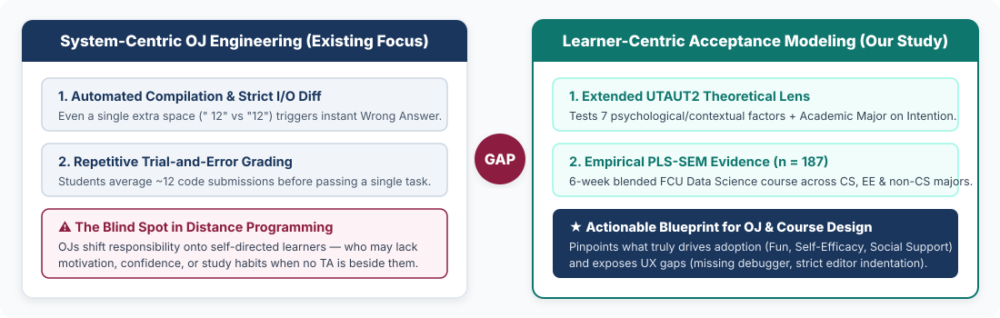
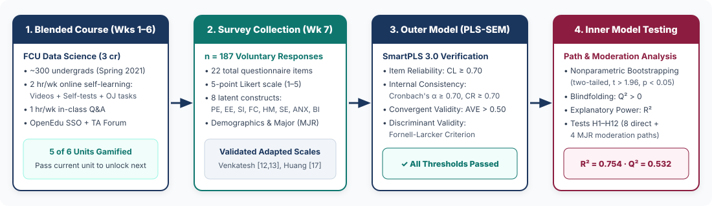

<!-- _class: lead -->

IEEE Access · Vol. 9 · pp. 152606–152615 · November 2021

# Understanding Students’ Acceptance of Online Judge System in Programming Courses

<strong>A Structural Equation Modeling Approach:</strong> Applying Extended <strong>UTAUT2</strong> &amp; <strong>PLS-SEM</strong> to Uncover What Truly Drives Student Adoption of Automated Programming Assessment

<strong>Daramsenge Bilegjargal*</strong> and <strong>Nien-Lin Hsueh</strong> 
Department of Information Engineering and Computer Science, Feng Chia University, Taichung, Taiwan 
<code>p0731809@o365.fcu.edu.tw</code> · <code>nlhsueh@fcu.edu.tw</code> · DOI: <code>10.1109/ACCESS.2021.3126896</code>

Supported by the Ministry of Science and Technology (MOST), Taiwan, under Grant MOST 109-2221-E-035-056.

---

## Opening Hook: "Try #12: Wrong Answer!" ... So Why Do Students Keep Using OJs?

<strong>The Surprise Finding:</strong> An extra space (<code>" 12"</code> vs. <code>"12"</code>) triggers instant failure, yet <strong>efficiency &amp; ease of use did NOT predict adoption</strong>! Instead, <strong>fun (Hedonic Motivation)</strong>, <strong>confidence (Self-Efficacy)</strong>, and <strong>peer/teacher support (Social Influence)</strong> win students over — across both CS and non-CS majors.

---

## Presentation Outline

1

[**Motivation &amp; Research Questions**](#4)
Why Online Judge acceptance in distance programming remains under-studied and our two RQs.

2

[**Related Work &amp; Research Gap**](#6)
Online Judge systems, UTAUT2 in education, and PLS-SEM for small-sample causal modeling.

3

[**Research Model &amp; 12 Hypotheses**](#7)
Extending UTAUT2 with Self-Efficacy, Anxiety, and Academic Major (H1–H12).

4

[**Course Context, Survey &amp; Sample**](#10)
6-week blended FCU Data Science course, 22-item survey (n = 187), and PLS-SEM pipeline.

5

[**PLS-SEM Measurement &amp; Structural Results**](#12)
Reliability/validity checks, R2 = 0.754, direct drivers (RQ1), and major moderation (RQ2).

6

[**Discussion, Implications &amp; Conclusion**](#15)
Why 8 hypotheses were rejected, actionable design playbook, limitations, and future work.

---

## 1.1 Motivation: Automated Grading Alone Doesn’t Guarantee Adoption

<strong>Why This Matters:</strong> While automated programming assessment systems (APAS) like Codeforces, UVa, SPOJ, and Edgar slash grading workload, <strong>no prior empirical study</strong> examined what drives students to actually accept an Online Judge in an online course.

---

## 1.2 Two Core Research Questions

To bridge this gap, we investigate student acceptance of an OJ system in a blended programming course using **UTAUT2 + PLS-SEM** *(revealed step-by-step)*:

* 

RQ1 What truly motivates students to embrace an Online Judge?

<strong>What are the significant factors</strong> (among performance, effort, social influence, facilitating conditions, hedonic motivation, self-efficacy, anxiety, and major) that affect students’ <strong>acceptance of and behavioral intention to use</strong> an OJ system in an online programming course?

* 

RQ2 Does being a CS vs. non-CS major change how those factors work?

<strong>Does academic major (MJR) moderate</strong> the causal relationships between candidate psychological/usability factors (EE, HM, SE, ANX) and students’ <strong>behavioral intention</strong> to use an OJ system?

---

## 2. Related Work: Online Judges, UTAUT2 &amp; PLS-SEM

Existing OJ studies focus on system engineering or learning outcomes rather than **technology acceptance**, while UTAUT2 studies target general e-learning platforms.

| Research Stream | Representative Studies | Key Findings / Focus | Gap Addressed by Our Study |
| :--- | :--- | :--- | :--- |
| **Online Judge (OJ) Systems** | Mekterovic *et al.* (*Edgar*, 2020); Petit *et al.* (*Jutge.org*, 2018); Aleman (2011); Galan *et al.* (2019) | Multi-language auto-grading, tournament fun, stronger retention &amp; grade correlation after training | Lack empirical behavioral-acceptance models explaining *why* learners adopt OJs |
| **UTAUT / UTAUT2 in EdTech** | Venkatesh *et al.* (2003, 2012); Huang (2020); Jakkaew &amp; Hemrungrote (2017); Salloum *et al.* (2019) | Integrates 8 theories (TRA, TPB, TAM…); PE, HM, SE &amp; playfulness drive VR, Google Classroom &amp; LMS use | Never applied with demographic moderation to **online programming OJ systems** |
| **PLS-SEM Modeling** | Hair *et al.* (2011, 2017); Lin *et al.* (2019); Wong (2013) | Nonparametric bootstrap; robust to small samples &amp; non-normal data; 2-step outer/inner evaluation | Ideal for single-semester course empirical survey (`n = 187`) &amp; prediction |

<strong>Theoretical Contribution:</strong> First study to pair an <strong>extended UTAUT2 model</strong> (adding Self-Efficacy, Anxiety &amp; Academic Major) with <strong>PLS-SEM</strong> in an automated online programming assessment context.

---

## 3.1 Theoretical Foundation: Adapting UTAUT2 to Online Judges

Fig. 1: Original UTAUT2 Conceptual Framework (Venkatesh et al., 2012 [13])

### 🎯 Context-Driven Model Adaptation
- **Retained Core UTAUT2 Constructs (5)**:
  - Performance Expectancy (`PE`), Effort Expectancy (`EE`), Social Influence (`SI`), Facilitating Conditions (`FC`), Hedonic Motivation (`HM`)
- **Excluded Non-Applicable Constructs (3)**:
  - *Price Value*: OJ is **free** for university students.
  - *Habit*: Course-bound tool, not everyday consumer use.
  - *Use Behavior*: Mandatory course context; `BI` predicts future open-OJ use (e.g., LeetCode).
- **Added Educational &amp; Coding Constructs (3)**:
  - **Self-Efficacy (`SE`)**, **Anxiety (`ANX`)**, and **Academic Major (`MJR`)** (IECS vs. EE vs. Other).

---

## 3.2 Proposed Research Model &amp; 12 Hypotheses (H1–H12)

Fig. 2: Proposed Extended UTAUT2 Research Model (darker lines = moderated paths)

### 📋 Group 1: Direct Effects on BI (8 Paths)
- **H1**: `PE ➔ BI` (+) · **H2**: `EE ➔ BI` (+)
- **H4**: `SI ➔ BI` (+) · **H5**: `FC ➔ BI` (+)
- **H6**: `HM ➔ BI` (+) · **H8**: `SE ➔ BI` (+)
- **H10**: `ANX ➔ BI` (−) · **H12**: `MJR ➔ BI` (+)

### 🎓 Group 2: Major Moderation (4 Paths)
- **H3**: `MJR × EE ➔ BI` (prior IDE familiarity)
- **H7**: `MJR × HM ➔ BI` (CS coding interest)
- **H9**: `MJR × SE ➔ BI` (prior OJ confidence)
- **H11**: `MJR × ANX ➔ BI` (stress sensitivity)

---

## 3.3 Why These Constructs Matter in an OJ Classroom

### 🛠️ Core UTAUT Drivers (PE, EE, SI, FC)
- **Performance Expectancy (`PE`)**: Instant compile/run feedback helps students iteratively fix code quality until all test cases pass.
- **Effort Expectancy (`EE`)**: Simple web workspace, yet OpenEdu SSO login &amp; strict test-case judging add learning overhead.
- **Social Influence (`SI`)**: IECS built its own OJ and actively encouraged **senior students, TAs &amp; peers** to help each other.
- **Facilitating Conditions (`FC`)**: Exact string diff (e.g., `" 12"` ≠ `"12"`) frustrates novices unless clear guides &amp; support exist.

### 🧠 Psychological &amp; Major Factors (HM, SE, ANX, MJR)
- **Hedonic Motivation (`HM`)**: **5 of 6 units** featured gamified coding quests — students unlock the next level only after passing the current one.
- **Self-Efficacy (`SE`)**: Confidence to debug independently when stuck in distance learning without an instructor nearby.
- **Anxiety (`ANX`)**: Students average **~12 submissions** per problem, fear losing code on misclicks, and see **public rankings**.
- **Academic Major (`MJR`)**: IECS students view coding as a core career skill vs. EE (moderate) &amp; Other departments.

---

## 4.1 Blended Course Context &amp; PLS-SEM Research Pipeline

<strong>Why SmartPLS 3.0 (PLS-SEM)?</strong> Unlike covariance-based SEM, PLS-SEM is a nonparametric bootstrap approach requiring <strong>no multivariate normality assumption</strong> and offering high statistical power for exploratory prediction with <code>n = 187</code>.

---

## 4.2 Participant Demographics (`n = 187`, Table 1)

187 / ~300

Voluntary undergrad respondents (~62% response rate, Spring 2021)

83.4% IECS

156 IECS, 23 EE (12.3%), and 8 Other Departments (4.3%)

80.2% Prior OJ

150 had prior OJ experience vs. 37 first-time users (19.8%)

| Demographic Item | Category | Freq. | % |
| :--- | :--- | :---: | :---: |
| **Academic Major** | Dept. of IECS | 156 | 83.4% |
| | Dept. of EE | 23 | 12.3% |
| | Other departments | 8 | 4.3% |
| **Gender** | Male / Female | 150 / 37 | 80.2% / 19.8% |
| **Year of Study** | 1st / 2nd / 3rd / 4th | 36 / 53 / 72 / 26 | 19.2 / 28.3 / 38.5 / 14.0% |
| **OJ Experience** | Yes / No | 150 / 37 | 80.2% / 19.8% |

### 📊 Year &amp; Major Distribution

<strong>IECS Major</strong>

83.4%

<strong>EE Major</strong>

12.3%

<strong>Other Depts.</strong>

4.3%

<strong>3rd Year (Peak)</strong>

38.5%

<strong>Prior OJ Exp.</strong>

80.2%

---

## 5.1 Measurement Model Assessment (Outer Model · Tables 2–4)

Fig. 3: PLS-Algorithm Outer Loadings &amp; Path Coefficients (SmartPLS 3.0)

### ✅ Reliability &amp; Validity Verification
| Construct | CL (≥0.7) | α (≥0.7) | CR (≥0.7) | AVE (>0.5) |
| :--- | :---: | :---: | :---: | :---: |
| **HM** (2 items) | 0.962–0.965 | 0.924 | 0.963 | **0.929** |
| **SE** (2 items) | 0.938–0.940 | 0.867 | 0.938 | **0.882** |
| **EE** (2 items) | 0.872–0.927 | 0.769 | 0.895 | **0.810** |
| **SI** (2 items) | 0.875–0.914 | 0.752 | 0.889 | **0.800** |
| **ANX** (2 items) | 0.810–0.956 | 0.753 | 0.879 | **0.786** |
| **BI** (2 items) | 0.835–0.918 | 0.708 | 0.870 | **0.770** |
| **PE** (3 items) | 0.837–0.880 | 0.827 | 0.896 | **0.741** |
| **FC** (3 items) | 0.816–0.877 | 0.794 | 0.879 | **0.709** |

- **Fornell-Larcker (Tables 3–4)**: All diagonal √AVE values (`0.842–0.964`) exceed every off-diagonal correlation ➔ **strong discriminant validity**.

---

## 5.2 Structural Model: Direct Effects &amp; RQ1 Results (Tables 5–6)

R2 = 0.754

<strong>Substantial</strong> explained variance in Behavioral Intention (> 0.67)

Q2 = 0.532

Blindfolding cross-validated redundancy (> 0 = <strong>predictive relevance</strong>)

4 / 8 Supported

<strong>HM, SE, SI &amp; MJR</strong> significantly predict BI (bootstrapping two-tailed)

| Hyp. | Path | Orig. (O) | SD | t (>1.96) | p (<0.05) | Result |
| :---: | :--- | :---: | :---: | :---: | :---: | :---: |
| **H6** | **HM ➔ BI** | **0.400** | 0.080 | **5.008** | **0.000\*\*** | **✓ S** |
| **H8** | **SE ➔ BI** | **0.316** | 0.067 | **4.731** | **0.000\*\*** | **✓ S** |
| **H4** | **SI ➔ BI** | **0.245** | 0.102 | **2.391** | **0.017\*** | **✓ S** |
| **H12** | **MJR ➔ BI** | **-0.098** | 0.044 | **2.239** | **0.026\*** | **✓ S** |
| H1 | PE ➔ BI | 0.066 | 0.074 | 0.891 | 0.373 | ✗ NS |
| H2 | EE ➔ BI | -0.035 | 0.076 | 0.457 | 0.648 | ✗ NS |
| H10 | ANX ➔ BI | 0.011 | 0.038 | 0.282 | 0.778 | ✗ NS |
| H5 | FC ➔ BI | 0.010 | 0.104 | 0.098 | 0.922 | ✗ NS |

### 🏆 Ranking of Significant Drivers (RQ1)

<strong>HM (Fun)</strong>

β = 0.400

<strong>SE (Confidence)</strong>

β = 0.316

<strong>SI (Social)</strong>

β = 0.245

<strong>MJR (Direct)</strong>

|β| = 0.098

<strong>RQ1 Answer:</strong> <strong>Hedonic Motivation</strong> is the #1 predictor, followed by <strong>Self-Efficacy</strong> and <strong>Social Influence</strong> — outweighing utility (<code>PE</code>, <code>EE</code>, <code>FC</code>).

---

## 5.3 Moderating Effects of Academic Major — RQ2 Results (Table 7)

All four hypothesized moderating effects of **Academic Major (`MJR`)** were statistically **non-significant** (`t < 1.96`, `p > 0.05`):

| Hyp. | Moderated Relationship | Orig. Sample (O) | Sample Mean (M) | SD | t-Stat (>1.96) | p-Value (<0.05) | Result |
| :---: | :--- | :---: | :---: | :---: | :---: | :---: | :---: |
| **H3** | `MJR × EE ➔ BI` | 0.064 | 0.060 | 0.065 | 0.985 | 0.325 | **✗ NS** |
| **H7** | `MJR × HM ➔ BI` | 0.006 | -0.013 | 0.083 | 0.067 | 0.947 | **✗ NS** |
| **H9** | `MJR × SE ➔ BI` | -0.002 | 0.016 | 0.076 | 0.029 | 0.977 | **✗ NS** |
| **H11** | `MJR × ANX ➔ BI` | 0.060 | 0.053 | 0.065 | 0.921 | 0.358 | **✗ NS** |

### ⚖️ No Moderation (`H3, H7, H9, H11` Rejected)
- Whether a student is **IECS, EE, or non-CS**, enjoyment (`HM`) and problem-solving confidence (`SE`) boost OJ acceptance at virtually identical strength.
- Neither CS nor non-CS students found the editor especially convenient (`H3`), and neither group felt anxious (`H11`).

### 🎯 Yet Significant Direct Effect (`H12`, p = 0.026*)
- Academic major **directly affects baseline intention** (`t = 2.239`), likely reflecting career relevance of coding practice (e.g., future LeetCode use).
- **Encouraging takeaway**: Non-CS students can succeed equally well when motivated, self-confident, and supported!

---

## 6.1 Diagnostic Deep Dive: Why Were 8 Hypotheses Rejected?

Turning non-significant paths into **actionable UX and pedagogical diagnostics**:

| Rejected Path | Statistical Result | Root-Cause Diagnosis from Course &amp; Student Interviews | Design Implication |
| :--- | :---: | :--- | :--- |
| **H1: `PE ➔ BI`** | `p = 0.373` (NS) | Unlike professional IDEs, the OJ lacked **debugging information**, limiting perceived workspace productivity | Integrate step-by-step **debugger / diagnostic hints** into OJ |
| **H2: `EE ➔ BI`** | `p = 0.648` (NS) | Web editor UX friction — e.g., **auto-indent on Enter** forced manual deletion or caused Python compile errors | Fix editor formatting &amp; offer modern IDE-grade editing UX |
| **H5: `FC ➔ BI`** | `p = 0.922` (NS) | Clear course guidelines &amp; upfront reminders already pre-empted operational hurdles (ceiling effect) | Maintain concise onboarding checklists &amp; FAQ docs |
| **H10: `ANX ➔ BI`** | `p = 0.778` (NS) | **Troubleshooting guideline videos** eliminated technical fear across all majors — inconvenient ≠ anxious | Keep short troubleshooting videos to prevent drop-off |
| **H3, H7, H9, H11** | `p = 0.325–0.977` | CS students compared OJ unfavorably to IDEs; non-CS still faced steep learning; fun &amp; SE mattered universally | Design **universal gamification &amp; scaffolding** for all majors |

---

## 6.2 Practical Implications: A Playbook for Developers &amp; Instructors

### 💻 For OJ Developers &amp; University Policymakers
1. **Double Down on Gamification (`HM`, β = 0.400)**:
   - Expand staged quests, progress bars, badges, and unlockable units to sustain self-directed engagement.
2. **Add Real Debugging Support (`PE`)**:
   - Provide structured runtime/compiler diagnostics instead of opaque `Wrong Answer` verdicts.
3. **Eliminate Editor Friction (`EE`)**:
   - Fix language-specific quirks (like Python auto-indent traps) and smooth SSO workflows.
4. **Design Anxiety-Safe Feedback (`ANX`)**:
   - Auto-save code drafts and reconsider always-visible public rankings that heighten grade stress.

### 👩‍🏫 For Programming Instructors &amp; Course Designers
1. **Cultivate Self-Efficacy (`SE`, β = 0.316)**:
   - Provide short **troubleshooting videos** and scaffolded starter problems so students gain confidence solving bugs independently.
2. **Build Active Social Support (`SI`, β = 0.245)**:
   - Pair online OJ practice with responsive **TA forums, messaging channels, email, and senior-student mentoring**.
3. **Empower Cross-Major Cohorts (`MJR`)**:
   - Do not assume non-CS students cannot thrive on OJs: clear guidelines + fun tasks + supportive instructors bridge the major gap.

---

## 7. Limitations &amp; Threats to Validity

### 🏫 Single-Course Sample Scope
- Respondents (`n = 187`) came from **one undergraduate course** at a single university (FCU, Taiwan).
- **83.4%** were IECS majors and **80.2%** had prior OJ experience, which may constrain generalizability to novice-heavy or humanities cohorts.

### 📅 Age &amp; Demographic Homogeneity
- Because undergraduate participants were close in age, the core UTAUT2 moderator of **age** could not be evaluated.
- Future studies should recruit broader age groups (e.g., **MOOCs** and lifelong learners) to test age moderation.

### 📈 Intention vs. Longitudinal Use
- The study measured **Behavioral Intention (`BI`)** after 6 weeks rather than long-term post-course **Use Behavior** (e.g., voluntary LeetCode practice).
- Combining survey data with **OJ submission logs** would triangulate intention with actual coding behavior.

---

## 8. Conclusion &amp; Future Work

<strong>🌐 1. Broader MOOC Cohorts</strong> Extend sampling beyond one campus course to diverse universities and massive open online courses (MOOCs).

<strong>👥 2. Age &amp; Longitudinal Tracking</strong> Test UTAUT2 age moderation and link behavioral intention to actual long-term coding practice logs.

<strong>🎮 3. Gamified + Debugger OJ</strong> Co-design next-gen OJs combining richer gamification with built-in debugging hints and frictionless editors.

---

<!-- _class: closing -->

# Thank You for Your Attention!

Understanding Students’ Acceptance of Online Judge System in Programming Courses: A Structural Equation Modeling Approach

<strong>Daramsenge Bilegjargal*</strong> &nbsp;·&nbsp; <code>p0731809@o365.fcu.edu.tw</code> 
<strong>Nien-Lin Hsueh</strong> &nbsp;·&nbsp; <code>nlhsueh@fcu.edu.tw</code> 
Department of Information Engineering and Computer Science, Feng Chia University, Taiwan 
Published in <strong>IEEE Access</strong>, Vol. 9, pp. 152606–152615 (2021) · DOI: <code>10.1109/ACCESS.2021.3126896</code> 
Grant: MOST 109-2221-E-035-056 · Questions &amp; Discussion Welcome!

