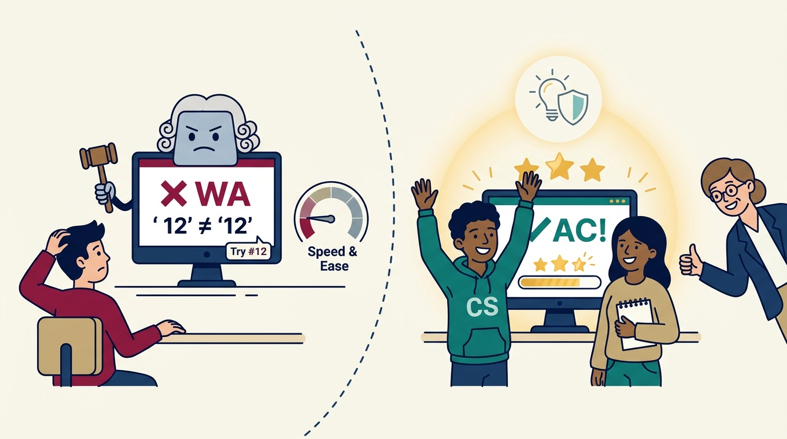
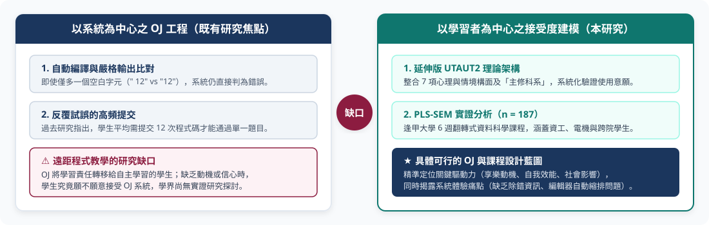
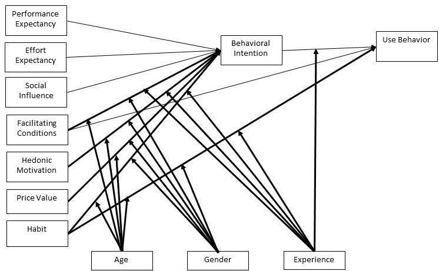
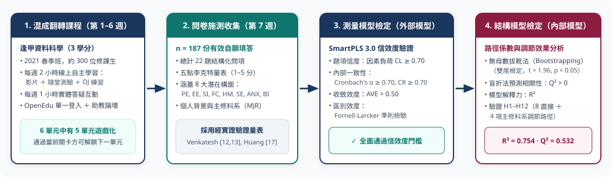
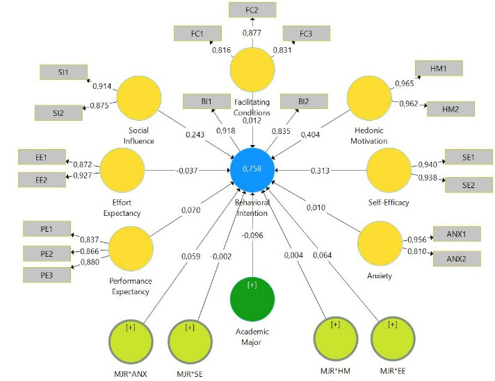
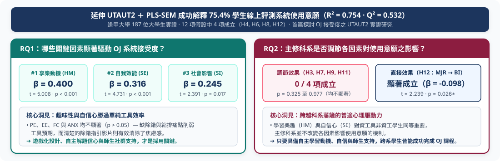

<!-- _class: lead -->

IEEE Access · 第 9 卷 · pp. 152606–152615 · 2021 年 11 月

# 探討學生於程式設計課程中對線上評測系統（Online Judge）之接受度

<strong>結構方程模型分析法（PLS-SEM）：</strong>以延伸版 <strong>UTAUT2</strong> 理論模型，實證揭露驅動大學生採用自動化程式評測系統的真正關鍵因素

<strong>Daramsenge Bilegjargal*</strong> ＆ <strong>薛念林（Nien-Lin Hsueh）</strong> 
逢甲大學 資訊工程學系（Department of Information Engineering and Computer Science, FCU） 
<code>p0731809@o365.fcu.edu.tw</code> · <code>nlhsueh@fcu.edu.tw</code> · DOI: <code>10.1109/ACCESS.2021.3126896</code>

本研究獲科技部（MOST）研究計畫補助：MOST 109-2221-E-035-056。

<!--
論文定位與研究貢獻：
- 書目資訊：Daramsenge Bilegjargal 與薛念林（Nien-Lin Hsueh），〈Understanding Students' Acceptance of Online Judge System in Programming Courses: A Structural Equation Modeling Approach〉，發表於 IEEE Access 第 9 卷，第 152606–152615 頁，2021 年 11 月（DOI: 10.1109/ACCESS.2021.3126896；科技部計畫補助 MOST 109-2221-E-035-056）。
- 核心研究問題：自動化程式評測系統（APAS）與線上評測系統（Online Judge, OJ）雖已廣泛導入程式設計課程，但既有文獻多著重系統工程與評測架構，極少從學習者心理與科技接受度角度，實證檢驗線上或混成課程中影響學生採用 OJ 的關鍵因素。
- 研究方法範疇：本研究以延伸版整合科技接受模式（UTAUT2）為理論基礎，納入教育心理構面（自我效能、焦慮感）與主修科系調節變項，並以逢甲大學 187 位大學生問卷資料進行偏最小平方法結構方程模型（PLS-SEM）實證分析。
-->

---

## 破題：「第 12 次提交還是 WA！」……那學生為何仍願意用 Online Judge？

<strong>出乎意料的發現：</strong>多一個空白（<code>" 12"</code> vs. <code>"12"</code>）就會直接被判錯誤，但<strong>效率與易用性竟然不是關鍵</strong>！真正讓學生買單的是<strong>學習樂趣（享樂動機）</strong>、<strong>解題自信（自我效能）</strong>與<strong>師生同儕支持（社會影響）</strong>——且對資工與非資工學生一體適用。

<!--
實證反差與理論意涵：
- OJ 評測的嚴格運作機制：OJ 會將學生上傳的程式碼編譯為可執行檔，針對隱藏測資執行並與標準輸出進行逐字元精確比對；即便僅多出一個前導空白字元（如輸出 " 12" 而非 "12"），系統亦直接判為 Wrong Answer。論文引用之既有研究指出，學生平均需提交約 12 個版本才能通過單一題目。
- 違反直覺的實證結果：依傳統工具型資訊系統接受度推論，績效預期（PE）與努力預期（EE）應是決定採用的核心因素；然而本研究 PLS-SEM 檢定顯示，PE（p = 0.373）與 EE（p = 0.648）對行為意願（BI）皆未達統計顯著。
- 真正關鍵的驅動因子：學習樂趣（享樂動機 HM，β = 0.400）、獨立排錯自信（自我效能 SE，β = 0.316）與師長同儕支持（社會影響 SI，β = 0.245）才是決定學生接受 OJ 的核心力量，且在資工系與非資工系學生間展現一致的作用模式。
-->

---

## 簡報大綱

1

[**研究動機與核心問題**](#4)
為何遠距程式課程中的 Online Judge 接受度亟待研究，以及兩大研究問題（RQ1–RQ2）。

2

[**文獻回顧與研究缺口**](#6)
線上評測系統（OJ）、UTAUT2 科技接受度模型與 PLS-SEM 小樣本因果建模。

3

[**研究模型與 12 項假設**](#7)
延伸 UTAUT2（納入自我效能、焦慮感與主修科系）及 H1–H12 假設推演。

4

[**課程情境、問卷與樣本**](#10)
逢甲大學 6 週翻轉式資料科學課程、22 題問卷（n = 187）與兩階段 PLS-SEM 流程。

5

[**PLS-SEM 測量與結構模型結果**](#12)
信效度驗證、R2 = 0.754、直接驅動因素（RQ1）與主修科系調節檢定（RQ2）。

6

[**深度討論、實務建議與結論**](#15)
為何 8 項假設未成立、系統與教學設計指南、研究限制與未來方向。

<!--
論文結構與論證脈絡：
- 第一至二章（研究動機與文獻回顧）：釐清系統工程導向與學習者行為導向之間的研究缺口，統整既有 OJ 系統實證（Edgar、Jutge.org、UNED）、UTAUT/UTAUT2 教育科技應用，以及 PLS-SEM 統計估計優勢。
- 第三章（研究模型與假設發展）：說明因應大學免費必修課程情境而調適 UTAUT2 的理論依據（排除價格價值、習慣與實際使用行為），並納入自我效能、焦慮感與主修科系，建構 H1–H12 共 12 項假設。
- 第四章（研究方法）：詳述逢甲大學 6 週翻轉式資料科學課程設計、22 題五點李克特量表問卷（n = 187）與 SmartPLS 3.0 兩階段檢定流程。
- 第五至八章（實證結果、深度討論、限制與結論）：呈現外部測量模型信效度（表 2–4）、內部結構模型解釋力（R² = 0.754、Q² = 0.532；表 5–7），並結合課後訪談剖析 8 項未成立假設之根因、實務設計建議與研究限制。
-->

---

## 1.1 研究動機：自動化批改不等於學生願意採用

<strong>研究重要性：</strong>雖然 Codeforces、UVa、SPOJ 與 Edgar 等自動化程式評測系統（APAS）大幅減輕教師批改負擔，但學界至今<strong>尚無實證研究</strong>探討學生在線上程式課程中對 OJ 系統的接受度成因。

<!--
理論動機與文獻缺口：
- 人工批改之瓶頸與 APAS 發展：程式作業的人工評分繁瑣耗時，促使自動化程式評測系統（APAS）蓬勃發展，例如 Mekterovic 等人（2020）開發的 Edgar 系統可支援 SQL、Java、C、C# 等多語言評測、多選題、考試監控與數據視覺化；競賽型 OJ 如 Codeforces、URI Online Judge、UVa 與 SPOJ 亦廣受歡迎。
- 遠距教學的學習責任轉移：將 OJ 導入線上程式課程時，學習進度掌控權高度轉移至學生端；若學生缺乏持續動機或自主學習習慣，自動化批改本身並無法保證學習成效（Lu et al., 2017）。
- 研究缺口界定：既有 OJ 文獻幾乎集中於系統架構優化、分散式評測效能（如 MetaOJ）或作業完成度與成績之關聯，尚未有實證研究建構行為接受度模型來解釋學生於線上程式課程中採用 OJ 之心理機制。
-->

---

## 1.2 兩大核心研究問題（Research Questions）

本研究以 **UTAUT2 ＋ PLS-SEM** 針對混成式程式設計課程中的 OJ 接受度提出兩大研究問題 *(逐步揭曉)*：

* 

RQ1 究竟是哪些關鍵因素，真正驅動學生接受 Online Judge？

在線上程式設計課程中，<strong>哪些構面</strong>（績效預期、努力預期、社會影響、促成條件、享樂動機、自我效能、焦慮感與主修科系）對學生的 <strong>OJ 系統接受度與使用意願（Behavioral Intention）</strong>具有顯著影響？

* 

RQ2 資工與非資工主修背景，會改變這些因素的影響力嗎？

<strong>主修科系（Academic Major, MJR）是否扮演調節變項</strong>，進而改變各候選因素（EE、HM、SE、ANX）與學生使用 OJ 系統之<strong>行為意願</strong>之間的因果關係？

<!--
核心研究問題之形式化界定：
- RQ1（直接驅動構面）：檢驗延伸版 UTAUT2 模型中的八項候選構面——績效預期（PE）、努力預期（EE）、社會影響（SI）、促成條件（FC）、享樂動機（HM）、自我效能（SE）、焦慮感（ANX）與主修科系（MJR）——何者對學生使用 OJ 系統之行為意願（BI）具統計顯著之直接影響。
- RQ2（主修科系調節效應）：檢驗主修科系（MJR：資工系、電機系與其他科系）是否調節 EE、HM、SE 與 ANX 對 BI 之因果斜率。由於資工系學生通常具備較豐富的 IDE 與程式修課經驗，檢驗調節效果可釐清不同科系學生的接受度形成機制是否具結構性差異。
- 教學實務意涵：區分「基準意願差異（直接效果）」與「路徑強度差異（調節效果）」，有助於大學決策者判斷應為不同科系客製化不同系統，抑或建構跨科系通用的教學鷹架。
-->

---

## 2. 文獻回顧：Online Judge、UTAUT2 與 PLS-SEM

既有 OJ 文獻偏重系統工程與學習成效，而 UTAUT2 教育應用多聚焦於一般數位學習平台，尚未切入自動化程式評測情境。

| 研究脈絡 | 代表性文獻 | 核心發現與焦點 | 本研究填補之缺口 |
| :--- | :--- | :--- | :--- |
| **線上評測系統（OJ）** | Mekterovic *et al.* (*Edgar*, 2020)；Petit *et al.* (*Jutge.org*, 2018)；Aleman (2011)；Galan *et al.* (2019) | 跨語言自動評測、競賽趣味性、提升留存率與作業完成度之成績正相關 | 缺乏行為接受度實證模型，未能解釋學生*為何*願意持續使用 OJ |
| **教育科技之 UTAUT2** | Venkatesh *et al.* (2003, 2012)；Huang (2020)；Jakkaew &amp; Hemrungrote (2017)；Salloum *et al.* (2019) | 整合 8 大理論（TRA、TPB、TAM 等）；PE、HM、SE 與趣味性顯著影響 VR、Google Classroom 與 LMS 採用 | 首次將 UTAUT2 與主修調節機制應用於**線上程式評測系統** |
| **PLS-SEM 統計建模** | Hair *et al.* (2011, 2017)；Lin *et al.* (2019)；Wong (2013) | 無母數拔靴法；不須常態分佈假設、適用小樣本；採外部＋內部兩階段檢定 | 最適合單學期課程實證調查（`n = 187`）與探索性預測建模 |

<strong>理論貢獻：</strong>首篇結合<strong>延伸 UTAUT2 模型</strong>（納入自我效能、焦慮感與主修科系）與 <strong>PLS-SEM</strong> 探討自動化程式評測接受度之實證研究。

<!--
三大文獻脈絡之系統性對照：
- 線上評測系統（OJ）教育實證：Petit 等人（2018）回顧加泰隆尼亞理工大學（UPC）使用 Jutge.org 十年的經驗，涵蓋基礎程式、資料結構、演算法、AI 與電路設計，學生普遍肯定其助益並認為競賽活動富有趣味與激勵效果；Aleman（2011）透過對照實驗證實自動評測在版控、測試、除錯與部署技能留存上顯著優於傳統面授；Galan 等人（2019）分析 UNED 八年數據，顯示經適當訓練後學生接受度高且作業完成度與學期成績高度正相關。然而 Pereira 等人（2020）指出，受限於資料粒度與可得性，深入分析學生行為的研究仍屬少數。
- UTAUT / UTAUT2 教育科技應用：Venkatesh 等人（2003）整合八大經典理論（含 TRA、TPB、TAM）提出 UTAUT，並於 2012 年擴充 HM、價格價值與習慣為 UTAUT2。後續研究陸續驗證於 VR（Huang, 2020, n = 56）、Google Classroom（Jakkaew & Hemrungrote, 2017）、ICT 服務（Thong et al., 2011, n = 4,777，解釋 50%–66% 變異量）與阿聯酋數位學習（Salloum et al., 2019, n = 435），但尚未結合主修調節應用於線上程式 OJ。
- PLS-SEM 方法論優勢：依據 Hair 等人（2011, 2017）與 Lin 等人（2019），PLS-SEM 屬變異數基礎之無母數拔靴法，以最大化內生潛在變項解釋變異量為目標，不須多變量常態分佈假設且容忍小樣本，極適合單學期課程之探索性預測研究（n = 187）。
-->

---

## 3.1 理論基礎：將 UTAUT2 調適至線上程式評測情境

圖 1：原始 UTAUT2 概念架構（Venkatesh et al., 2012 [13]）

### 🎯 依課程情境進行構面調適
- **保留核心 UTAUT2 構面（5 項）**：
  - 績效預期（`PE`）、努力預期（`EE`）、社會影響（`SI`）、促成條件（`FC`）、享樂動機（`HM`）
- **排除不適用構面（3 項）**：
  - *價格價值（Price Value）*：校內教學用 OJ **完全免費**。
  - *習慣（Habit）*：屬課程階段性工具，非日常消費軟體。
  - *實際使用行為（Use Behavior）*：屬必修課程情境，故以 `BI` 預測未來自主使用意願（如 LeetCode）。
- **新增程式學習關鍵變項（3 項）**：
  - **自我效能（`SE`）**、**焦慮感（`ANX`）**與**主修科系（`MJR`）**（資工／電機／其他科系）。

<!--
UTAUT2 構面依課程情境之理論調適：
- 保留核心構面（5 項）：保留原 UTAUT2 之 PE、EE、SI、FC 與 HM，分別對應自動評測效能、介面易用性、同儕師長影響、技術支援資源與遊戲化樂趣。
- 排除不適用構面（3 項）與理由：
  1. 價格價值（Price Value）：校內教學用 OJ 完全免費提供學生使用，不存在消費性產品之金錢成本權衡。
  2. 習慣（Habit）：OJ 為期 6 週之課程階段性評量工具，非學生每日例行使用之消費軟體。
  3. 實際使用行為（Use Behavior）：因課堂作業屬必修強制使用情境，無法真實反映自主選擇行為；故以行為意願（BI）作為預測學生課後主動使用開放式 OJ 平台（如 LeetCode）之理論代理指標。
- 新增程式學習構面（3 項）：參考 Venkatesh 等人（2003）納入自我效能（SE）與焦慮感（ANX），以衡量遠距獨立除錯自信與畏懼出錯心理；另引入主修科系（MJR）區分資工系、電機系與其他科系，檢驗不同程式背景對接受度之影響。
-->

---

## 3.2 本研究模型與 12 項假設（H1–H12）

圖 2：延伸版 UTAUT2 研究模型（粗黑線代表主修科系之調節路徑）

### 📋 第一組：對行為意願之直接影響（8 條）
- **H1**：`PE ➔ BI` (+) · **H2**：`EE ➔ BI` (+)
- **H4**：`SI ➔ BI` (+) · **H5**：`FC ➔ BI` (+)
- **H6**：`HM ➔ BI` (+) · **H8**：`SE ➔ BI` (+)
- **H10**：`ANX ➔ BI` (−) · **H12**：`MJR ➔ BI` (+)

### 🎓 第二組：主修科系之調節效果（4 條）
- **H3**：`MJR × EE ➔ BI`（既定開發環境熟悉度）
- **H7**：`MJR × HM ➔ BI`（資工背景對寫程式的興趣）
- **H9**：`MJR × SE ➔ BI`（過往解題累積之自信心）
- **H11**：`MJR × ANX ➔ BI`（面對試誤之焦慮敏感度）

<!--
研究模型與 12 項假設之結構設計：
- 第一組：對行為意願之直接影響路徑（8 項）：
  - 工具與社會路徑：H1（PE → BI）、H2（EE → BI）、H4（SI → BI）與 H5（FC → BI）皆預期為正向影響，立基於既有數位學習與遠距實驗研究（Almaiah & Alyoussef, 2019; Cheng, 2017; Jakkaew & Hemrungrote, 2017）。
  - 心理與情感路徑：H6（HM → BI，正向）、H8（SE → BI，正向）與 H10（ANX → BI，負向），分別對應遊戲化樂趣、獨立排錯自信，以及面對反覆退件與成績壓力的焦慮反應。
  - 主修科系直接路徑：H12（MJR → BI），預期以程式設計為職涯核心之科系學生，課後持續使用開放式 OJ（如 LeetCode）之基準意願較高。
- 第二組：主修科系之調節效果（4 項）：
  - H3（MJR × EE → BI）、H7（MJR × HM → BI）、H9（MJR × SE → BI）與 H11（MJR × ANX → BI）。圖 2 中粗黑線代表交互作用項，檢驗資工與電機學生因過往修習程式課程所累積之經驗，是否改變易用性、樂趣、自我效能或焦慮對使用意願的影響強度。
-->

---

## 3.3 構面推論與 OJ 課堂真實痛點

### 🛠️ 核心 UTAUT 構面（PE, EE, SI, FC）
- **績效預期（`PE`）**：即時編譯與測試回饋有助於學生反覆修正程式碼品質，直到通過所有測資。
- **努力預期（`EE`）**：介面結構單純，但整合 OpenEdu 單一登入與嚴格測資判讀仍增加學習門檻。
- **社會影響（`SI`）**：逢甲資工自建 OJ 並鼓勵**學長姐、助教與同儕**於系統上互助解題。
- **促成條件（`FC`）**：嚴格字元比對（如 `" 12"` ≠ `"12"`）極易引發挫敗感，凸顯指引與資源之重要性。

### 🧠 心理與背景構面（HM, SE, ANX, MJR）
- **享樂動機（`HM`）**：**6 個單元中有 5 個融入遊戲化關卡**，學生須通過當前單元才能解鎖下一關，維持學習動力。
- **自我效能（`SE`）**：遠距自主練習時，無老師在旁也能獨立排錯與完成任務的自信心。
- **焦慮感（`ANX`）**：平均需提交 **12 次**才通過、擔心誤按遺失程式碼，加上**公開排行榜**可能加劇成績壓力。
- **主修科系（`MJR`）**：資工系將寫程式視為核心職能，電機系具中度經驗，外系則多屬初學者。

<!--
潛在構面與真實 OJ 課堂運作機制之對應：
- PE 與 EE 對應情境：學生須將程式碼壓縮上傳至學習管理系統，或透過 OpenEdu 單一登入（SSO）進入網頁編輯區作答，系統自動編譯執行並回傳四類狀態（正確、編譯錯誤、執行期錯誤、答案錯誤）及作答時間。即時驗證雖能促成反覆修正程式碼品質（PE），但 OpenEdu SSO 整合流程與嚴格測資判讀相較於本機 IDE 仍增加操作負荷（EE）。
- SI 與 FC 對應情境：逢甲大學資工系自建 OJ 系統，並積極鼓勵學長姐與助教在系統內互助解題（SI）。由於系統採嚴格字元比對（輸出 " 12" 與標準答案 "12" 即判失敗），初學者極易因細微格式差異受挫，因此明確的指引文件與資源支援成為關鍵促成條件（FC）。
- HM、SE、ANX 與 MJR 對應情境：課程 6 個單元中有 5 個融入遊戲化程式關卡，學生須通過當前單元才能解鎖下一階段（HM）；遠距自學期間缺乏教師在旁即時介入，考驗學生獨立排錯之自信心（SE）；平均約 12 次提交方能通過、擔心誤按導致程式碼遺失，以及系統常駐顯示公開排行榜，均可能誘發焦慮感（ANX）。各主修族群中，資工系具多門先修程式課與職涯需求，電機系至少修過一門程式課具中度興趣，外系則多為初學者（MJR）。
-->

---

## 4.1 混成課程情境與兩階段 PLS-SEM 研究流程

<strong>為何選用 SmartPLS 3.0（PLS-SEM）？</strong>相較於共變異數結構方程模型，PLS-SEM 採無母數拔靴法，<strong>不要求多變量常態分佈</strong>，在 <code>n = 187</code> 之單學期課程樣本下仍具高度統計檢定力與預測效度。

<!--
課程實施細節、量表設計與統計流程：
- 翻轉混成課程設計：研究場域為逢甲大學資訊電機學院開設、開放全校選修之 3 學分課程「資料科學基礎與應用」（2021 年春季班），內容分為程式設計、機器學習與應用三階段。每週採「2 小時線上自學 ＋ 1 小時實體課堂」模式：學生課前須觀看教學影片、完成自我測驗與 OJ 程式練習，線上問題可於 LMS 討論區向助教提問；實體課堂由教師解答疑難，但不重複講授影片內容。
- 施測時程與問卷工具：學生於前 6 週使用 OJ 系統，整體實驗橫跨前 7 週，並於完成 OJ 練習後開放自願填答問卷。問卷共 22 題（附錄表 8），採五點李克特量表（1 = 非常不同意至 5 = 非常同意），UTAUT2 題項改編自 Henrico 等人（2021）與 Tamilmani 等人（2021），SE 與 ANX 改編自 Venkatesh 等人（2003），HM 改編自 Huang（2020），另含人口統計變項。
- SmartPLS 3.0 兩階段分析：第一階段檢驗反映型外部測量模型之題項信度、內部一致性、收斂效度與區別效度；第二階段以無母數拔靴法（雙尾檢定）與盲折法檢驗內部結構路徑顯著性與預測相關性，此法不須多變量常態分佈假設，在 n = 187 樣本下具高度檢定力。
-->

---

## 4.2 受測樣本人口統計特徵（`n = 187`，表 1）

187 / 約 300

2021 春季班自願填答大學生（回收率約 62%）

83.4% 資工系

資工系 156 人、電機系 23 人（12.3%）、其他科系 8 人（4.3%）

80.2% 曾用 OJ

150 人具過往 OJ 使用經驗，37 人為初次接觸（19.8%）

| 背景變項 | 類別 | 人數 | 百分比 |
| :--- | :--- | :---: | :---: |
| **主修科系** | 資訊工程學系（IECS） | 156 | 83.4% |
| | 電機工程學系（EE） | 23 | 12.3% |
| | 其他科系 | 8 | 4.3% |
| **性別** | 男 / 女 | 150 / 37 | 80.2% / 19.8% |
| **年級** | 大一 / 大二 / 大三 / 大四 | 36 / 53 / 72 / 26 | 19.2 / 28.3 / 38.5 / 14.0% |
| **OJ 使用經驗** | 有 / 無 | 150 / 37 | 80.2% / 19.8% |

### 📊 樣本結構視覺化分佈

<strong>資工系（IECS）</strong>

83.4%

<strong>電機系（EE）</strong>

12.3%

<strong>其他科系</strong>

4.3%

<strong>大三學生（最多）</strong>

38.5%

<strong>具 OJ 經驗</strong>

80.2%

<!--
受測樣本結構與分佈特徵（表 1）：
- 回收率與抽樣母體：修課大學生約 300 人，共回收 187 份自願有效問卷（回收率約 62%），符合 PLS-SEM 路徑估計之樣本規模需求。
- 科系分佈偏態：資訊工程學系（IECS）佔 83.4%（156 人）、電機工程學系（EE）佔 12.3%（23 人），其餘外系學生僅佔 4.3%（8 人）。此一以資電科系為主體的樣本結構，在解讀主修科系直接效果（H12）與四項未顯著調節檢定（H3、H7、H9、H11）時須納入考量。
- 性別、年級與先備經驗：受測者以男性居多（80.2%，150 人；女性 19.8%，37 人）；年級以大三最多（38.5%，72 人），其次為大二（28.3%，53 人）、大一（19.2%，36 人）與大四（14.0%，26 人）。高達 80.2%（150 人）具過往 OJ 使用經驗，僅 19.8%（37 人）為初次接觸者。
-->

---

## 5.1 測量模型檢定（外部模型 · 表 2–4）

圖 3：SmartPLS 3.0 因素負荷量與路徑係數估計結果

### ✅ 信度與效度全面達標
| 構面 | CL (≥0.7) | α (≥0.7) | CR (≥0.7) | AVE (>0.5) |
| :--- | :---: | :---: | :---: | :---: |
| **HM 享樂動機** (2) | 0.962–0.965 | 0.924 | 0.963 | **0.929** |
| **SE 自我效能** (2) | 0.938–0.940 | 0.867 | 0.938 | **0.882** |
| **EE 努力預期** (2) | 0.872–0.927 | 0.769 | 0.895 | **0.810** |
| **SI 社會影響** (2) | 0.875–0.914 | 0.752 | 0.889 | **0.800** |
| **ANX 焦慮感** (2) | 0.810–0.956 | 0.753 | 0.879 | **0.786** |
| **BI 行為意願** (2) | 0.835–0.918 | 0.708 | 0.870 | **0.770** |
| **PE 績效預期** (3) | 0.837–0.880 | 0.827 | 0.896 | **0.741** |
| **FC 促成條件** (3) | 0.816–0.877 | 0.794 | 0.879 | **0.709** |

- **Fornell-Larcker 區別效度（表 3–4）**：各構面對角線 √AVE 值（`0.842–0.964`）皆大於與其他構面之相關係數 ➔ **具優良區別與收斂效度**。

<!--
外部測量模型心理計量驗證（表 2–4、圖 3）：
- 反映型指標檢核標準：因各構面題項具高度相關性與可互換性，本研究依 Wong（2013）準則以 PLS 演算法檢驗四項核心指標：交叉／因素負荷量（CL）≥ 0.70、Cronbach's α ≥ 0.70、組合信度（CR）≥ 0.70，以及平均變異萃取量（AVE）> 0.50。
- 信度與收斂效度結果：全部八個多題項潛在構面（各保留 2 至 3 題）之因素負荷量皆高於 0.726（表列保留題項介於 0.810 至 0.965），Cronbach's α 介於 0.708（BI）至 0.924（HM），CR 介於 0.870（BI）至 0.963（HM），AVE 介於 0.709（FC）至 0.929（HM），顯示測量工具具備優良之內部一致性與收斂效度。
- 區別效度（Fornell-Larcker 準則，表 3–4）：各構面於相關矩陣對角線上之平方根 AVE 值（0.842 至 0.964）均嚴格大於其與其他構面之相關係數，證實各潛在構面在實證上具備清楚的區辨性。
-->

---

## 5.2 結構模型：直接路徑與 RQ1 實證結果（表 5–6）

R2 = 0.754

行為意願解釋變異量達<strong>高度顯著水準</strong>（> 0.67）

Q2 = 0.532

盲折法交叉驗證冗餘值 > 0 ➔ <strong>具良好預測相關性</strong>

4 / 8 項成立

<strong>HM、SE、SI 與 MJR</strong> 顯著預測使用意願（雙尾拔靴檢定）

| 假設 | 路徑關係 | 原始樣本 (O) | SD | t (>1.96) | p (<0.05) | 結論 |
| :---: | :--- | :---: | :---: | :---: | :---: | :---: |
| **H6** | **HM ➔ BI** | **0.400** | 0.080 | **5.008** | **0.000\*\*** | **✓ 成立** |
| **H8** | **SE ➔ BI** | **0.316** | 0.067 | **4.731** | **0.000\*\*** | **✓ 成立** |
| **H4** | **SI ➔ BI** | **0.245** | 0.102 | **2.391** | **0.017\*** | **✓ 成立** |
| **H12** | **MJR ➔ BI** | **-0.098** | 0.044 | **2.239** | **0.026\*** | **✓ 成立** |
| H1 | PE ➔ BI | 0.066 | 0.074 | 0.891 | 0.373 | ✗ 不成立 |
| H2 | EE ➔ BI | -0.035 | 0.076 | 0.457 | 0.648 | ✗ 不成立 |
| H10 | ANX ➔ BI | 0.011 | 0.038 | 0.282 | 0.778 | ✗ 不成立 |
| H5 | FC ➔ BI | 0.010 | 0.104 | 0.098 | 0.922 | ✗ 不成立 |

### 🏆 顯著驅動因素影響力排序（RQ1）

<strong>HM 享樂動機</strong>

β = 0.400

<strong>SE 自我效能</strong>

β = 0.316

<strong>SI 社會影響</strong>

β = 0.245

<strong>MJR 主修直接</strong>

|β| = 0.098

<strong>RQ1 解答：</strong><strong>享樂動機</strong>是最強預測因子，其次為<strong>自我效能</strong>與<strong>社會影響</strong>——遠勝於傳統工具效率與易用性構面（<code>PE</code>, <code>EE</code>, <code>FC</code>）。

<!--
內部結構模型評估與 RQ1 直接路徑估計（表 5–6）：
- 整體解釋力與預測相關性（表 5）：結構模型對行為意願（BI）之解釋變異量達 R² = 0.754，遠高於 Hair 等人（2011）與 Wong（2013）所定義之「高度顯著（substantial）」門檻（0.67）；盲折法交叉驗證冗餘值 Q² = 0.532（> 0），證實模型具備強健的樣本外預測相關性。
- 統計顯著之直接預測因子（雙尾拔靴檢定，α = 0.05）：
  - H6（HM → BI）：O = 0.400, SD = 0.080, t = 5.008, p = 0.000（p ≤ 0.01），為全模型最強驅動因子。
  - H8（SE → BI）：O = 0.316, SD = 0.067, t = 4.731, p = 0.000（p ≤ 0.01），影響力居次。
  - H4（SI → BI）：O = 0.245, SD = 0.102, t = 2.391, p = 0.017（p ≤ 0.05），位居第三。
  - H12（MJR → BI）：O = -0.098, SD = 0.044, t = 2.239, p = 0.026（p ≤ 0.05），具顯著但幅度較小的基準效果（負號源自科系類別之數值編碼順序，代表資工系之基準使用意願高於非資工科系）。
- 未達顯著之路徑：PE（O = 0.066, t = 0.891, p = 0.373）、EE（O = -0.035, t = 0.457, p = 0.648）、ANX（O = 0.011, t = 0.282, p = 0.778）與 FC（O = 0.010, t = 0.098, p = 0.922）均未成立，凸顯內在樂趣、自信與社會支持的重要性遠高於傳統工具效率與易用性。
-->

---

## 5.3 主修科系調節效果檢定 — RQ2 結果（表 7）

四項關於<strong>主修科系（<code>MJR</code>）</strong>之調節假設全數未達顯著水準（`t < 1.96`, `p > 0.05`）：

| 假設 | 調節路徑 | 原始樣本 (O) | 樣本平均 (M) | SD | t 值 (>1.96) | p 值 (<0.05) | 結論 |
| :---: | :--- | :---: | :---: | :---: | :---: | :---: | :---: |
| **H3** | `MJR × EE ➔ BI` | 0.064 | 0.060 | 0.065 | 0.985 | 0.325 | **✗ 不成立** |
| **H7** | `MJR × HM ➔ BI` | 0.006 | -0.013 | 0.083 | 0.067 | 0.947 | **✗ 不成立** |
| **H9** | `MJR × SE ➔ BI` | -0.002 | 0.016 | 0.076 | 0.029 | 0.977 | **✗ 不成立** |
| **H11** | `MJR × ANX ➔ BI` | 0.060 | 0.053 | 0.065 | 0.921 | 0.358 | **✗ 不成立** |

### ⚖️ 無調節效果（`H3, H7, H9, H11` 拒絕）
- 無論是**資工、電機或其他科系**，學習樂趣（`HM`）與解題自信（`SE`）皆以同等強度驅動使用意願。
- 資工與非資工學生同樣未覺得系統特別便利（`H3`），也同樣未因使用 OJ 而感到焦慮（`H11`）。

### 🎯 但具顯著直接效果（`H12`, p = 0.026*）
- 主修科系仍**直接影響基準使用意願**（`t = 2.239`），反映職涯對程式練習（如未來使用 LeetCode）的需求差異。
- **正向啟示**：只要具備動機、自信與支持，非資工學生同樣能在 OJ 課程中脫穎而出！

<!--
主修科系調節效果檢定與統計詮釋（表 7）：
- 四項交互作用項全數未達顯著（門檻 t > 1.96, p < 0.05）：
  - H3（MJR × EE → BI）：O = 0.064, M = 0.060, SD = 0.065, t = 0.985, p = 0.325。
  - H7（MJR × HM → BI）：O = 0.006, M = -0.013, SD = 0.083, t = 0.067, p = 0.947。
  - H9（MJR × SE → BI）：O = -0.002, M = 0.016, SD = 0.076, t = 0.029, p = 0.977。
  - H11（MJR × ANX → BI）：O = 0.060, M = 0.053, SD = 0.065, t = 0.921, p = 0.358。
- 「無調節效果」併存「顯著直接效果（H12）」之實質意涵：主修科系雖會改變學生的基準使用意願截距（反映資工學生因應職涯需求而較傾向未來使用 LeetCode 等平台），但並未改變 HM 與 SE 對 BI 之影響斜率——亦即學習樂趣與排錯自信對資工、電機與外系學生發揮同等強度的正向推力。
- 統計檢定力提醒：由於非資工系學生合計僅佔樣本 16.6%（電機 23 人、外系 8 人），次群體樣本數偏少亦可能降低偵測微弱交互作用效果的統計檢定力。
-->

---

## 6.1 深度診斷：為何有 8 項假設未成立？

將「不顯著」的統計結果，轉化為具體的 **OJ 系統體驗與課程設計診斷**：

| 未成立假設 | 檢定結果 | 訪談與課程脈絡之根因診斷 | 具體設計啟示 |
| :--- | :---: | :--- | :--- |
| **H1：`PE ➔ BI`** | `p = 0.373` (NS) | 與專業 IDE 相比，OJ 缺乏**除錯資訊（debug info）**，削弱學生對開發效率的期待 | 於 OJ 內建階段性**除錯提示與錯誤診斷**功能 |
| **H2：`EE ➔ BI`** | `p = 0.648` (NS) | 網頁編輯器體驗不佳：例如按 Enter **自動縮排**卻須手動刪除，否則 Python 直接編譯錯誤 | 改善程式碼編輯器縮排與現代化 IDE 體驗 |
| **H5：`FC ➔ BI`** | `p = 0.922` (NS) | 線上課程事前已提供清楚操作指引與提醒，基本門檻已被消弭（天花板效應） | 持續維護簡明的新手操作指南與 FAQ |
| **H10：`ANX ➔ BI`** | `p = 0.778` (NS) | 教師事前錄製之**排錯指引影片**有效降低各系學生焦慮——「不好用」不等於「會害怕」 | 保留短影音排錯教學，穩定自主學習信心 |
| **H3, H7, H9, H11** | `p = 0.325–0.977` | 資工生嫌 OJ 不如專業 IDE、外系生覺得操作仍有難度；但樂趣與自信對全體學生皆關鍵 | 打造**跨科系通用之遊戲化與鷹架支持**設計 |

<!--
八項未成立假設之質性訪談根因診斷：
- H1（PE）與 H2（EE）未成立之根因：課後學生訪談揭露了具體的系統體驗缺陷。相較於專業本機 IDE，校內 OJ 缺乏除錯資訊（debug information），導致學生不認為其為高效開發環境（H1 不顯著）；此外，網頁編輯器在按下 Enter 換行時會自動縮排，學生必須手動刪除多餘縮排，否則 Python 即判為編譯／縮排錯誤，嚴重影響操作便利性（H2 不顯著）。
- H3（MJR × EE）未成立之根因：資工與非資工族群對操作便利性皆評價偏低但原因各異——資工生習慣專業開發工具而嫌 OJ 不夠便利，外系生則仍須投入較高心力理解系統操作流程。
- H5（FC）、H10（ANX）與 H11（MJR × ANX）未成立之根因：訪談顯示授課團隊事前已針對常見問題進行完整提醒，並於線上課程提供清晰的操作指引，產生天花板效應，使學生不覺得額外資源支援是差異來源（H5，p = 0.922）。同理，事前錄製的排錯指引影片有效消弭了各科系學生的技術恐懼（H10，p = 0.778；H11，p = 0.358）。綜合 H1、H2、H5 與 H10，論文歸納出關鍵診斷：學生認為該 OJ 既不夠高效也不夠便利，但操作上並未感到困難或焦慮。
- H7（MJR × HM）與 H9（MJR × SE）未成立之根因：搭配顯著成立的 H6 與 H8，證實趣味性與獨立排錯自信對所有科系學生皆具普遍性的正向驅動力。
-->

---

## 6.2 實務建議：給 OJ 開發者與授課教師的行動指南

### 💻 給 OJ 系統開發者與大學決策者
1. **深化遊戲化機制（`HM`, β = 0.400）**：
   - 強化闖關式單元、進度條、徽章與任務回饋，維持遠距學習的持續動機。
2. **補齊除錯支援功能（`PE`）**：
   - 提供結構化的編譯／執行期除錯資訊，取代冰冷單一的 `Wrong Answer` 結果。
3. **消除編輯器操作摩擦（`EE`）**：
   - 修正如 Python 自動縮排誤判等編輯器缺陷，優化單一登入與提交流程。
4. **降低評測焦慮設計（`ANX`）**：
   - 加入草稿自動儲存，並審慎設計常駐公開排行榜以避免過度成績焦慮。

### 👩‍🏫 給程式設計教師與課程設計者
1. **刻意培養自我效能（`SE`, β = 0.316）**：
   - 錄製簡短**排錯教學影片**並設計由淺入深的題組，幫助學生建立獨立解決問題的自信。
2. **強化正向社會支持（`SI`, β = 0.245）**：
   - 善用**課程討論區、助教即時回覆、電子郵件、通訊軟體與學長姐互助**，維繫學習歸屬感。
3. **友善跨科系學習者（`MJR`）**：
   - 勿預設非資工學生無法適應 OJ：清楚指引 ＋ 遊戲化題目 ＋ 師生支持即可跨越科系門檻。

<!--
從實證估計轉化為系統開發與教學設計準則：
- 給 OJ 系統開發者與大學決策者之建議：
  1. 深化遊戲化設計（HM，β = 0.400）：擴大闖關任務、進度回饋與激勵機制，維持學生在遠距課程中的持續投入。
  2. 強化除錯輔助功能（PE）：提供結構化的編譯與執行期錯誤診斷資訊，取代單一冰冷的 Wrong Answer 判定，縮短與專業 IDE 的體驗落差。
  3. 排除編輯器與登入摩擦（EE）：修正 Python 自動縮排誤判等語言特定缺陷，並優化 OpenEdu 單一登入流程。
  4. 降低潛在焦慮風險（ANX）：儘管本課程因事前影片介入而未出現顯著焦慮效應，論文仍提醒高焦慮會削弱程式決策能力、自信與遠距完課率，建議導入草稿自動儲存並審慎設計常駐公開排行榜。
- 給程式教師與課程設計者之建議：
  1. 系統性培養自我效能（SE，β = 0.316）：錄製簡短排錯教學影片並設計循序漸進的題組，幫助學生建立獨立解決問題的學習習慣。
  2. 建立多管道社會支持（SI，β = 0.245）：善用課程討論區、電子郵件、通訊軟體與學長姐同儕互助，透過積極的師生互動強化自我效能與學業表現。
  3. 落實跨科系共融教學（MJR）：無須預設非資工學生無法適應 OJ；只要兼具清楚指引、遊戲化任務與師生支持，任何科系學生皆能順利完成線上程式課程。
-->

---

## 7. 研究限制與效度威脅

### 🏫 單一課程樣本範圍
- 受試者（`n = 187`）皆來自台灣逢甲大學之**單一大學部課程**。
- **83.4%** 為資工系學生且 **80.2%** 曾用過 OJ，推論至全初學者或人文社科族群時仍須審慎驗證。

### 📅 年齡與背景同質性
- 由於大學部受試者年齡高度集中，無法檢驗 UTAUT2 基本調節變項之一——<strong>年齡（Age）</strong>的效果。
- 未來可擴大納入跨年齡層樣本（如 **MOOCs 磨課師**學習者）檢驗年齡調節效應。

### 📈 使用意願 vs. 長期實際使用
- 本研究於 6 週練習後測量**行為意願（`BI`）**，尚未追蹤課後長期自主使用行為（如持續刷 LeetCode）。
- 未來結合**問卷資料與 OJ 系統提交日誌**，將能更完整驗證意願與實際行為之連結。

<!--
研究邊界與效度限制：
- 外部效度（單一課程與資工為主樣本）：187 位受試者全數來自台灣逢甲大學單一資料科學課程，且 83.4% 為資工系學生、80.2% 具過往 OJ 經驗；將路徑係數外推至純初學者班級、人文社科族群或跨校情境時仍需進一步驗證。
- 遺漏 UTAUT2 基礎調節變項（年齡）：由於大學部學生年齡高度集中，本研究無法檢驗原 UTAUT2 架構中核心調節變項之一——年齡（Age）的作用。論文建議後續研究可於大型開放式線上課程（MOOCs）招募跨年齡層樣本以補足此缺口。
- 構面與時間維度限制（行為意願 vs. 實際使用行為）：因課程期間 OJ 練習屬必修評量，研究排除實際使用行為（Use Behavior），僅於第 6 週練習後測量橫斷面行為意願（BI）。未來若能將問卷資料與長期 OJ 系統提交日誌（如課後自主刷題紀錄）進行三角驗證，將更能確認意願與實際行為之轉化關係。
-->

---

## 8. 結論與未來研究方向

<strong>🌐 1. 擴大跨校與 MOOCs 樣本</strong> 將調查對象延伸至跨校課程與大型開放式線上課程（MOOCs），提升外部效度。

<strong>👥 2. 年齡調節與長期追蹤</strong> 納入多元年齡層檢驗年齡調節效果，並串接 OJ 提交紀錄追蹤長期實際使用行為。

<strong>🎮 3. 遊戲化 ＋ 除錯型新一代 OJ</strong> 結合更豐富的遊戲化元素、內建除錯輔助與流暢編輯器，全面提升學生接受度。

<!--
核心結論統整與後續研究藍圖：
- 理論貢獻總結：本研究為首篇結合延伸版 UTAUT2、主修科系調節與 PLS-SEM 探討自動化線上程式評測接受度之實證論文，模型對行為意願之解釋變異量達 75.4%（Q² = 0.532）。
- RQ1 與 RQ2 核心解答：驅動學生接受 OJ 的三大關鍵因子依序為享樂動機（β = 0.400）、自我效能（β = 0.316）與社會影響（β = 0.245）；主修科系僅具較小之直接基準效果（|β| = 0.098, p = 0.026），對四條心理與易用路徑均無顯著調節效果（H3、H7、H9、H11 皆不成立）。
- 未來研究方向：（1）擴大抽樣至跨校課程與 MOOCs 平台以提升族群異質性與外部效度；（2）納入跨年齡層樣本檢驗 UTAUT2 年齡調節效應，並串接長期 OJ 提交日誌追蹤實際使用行為；（3）研發整合進階遊戲化機制、內建除錯診斷與流暢編輯體驗的新一代教學用 OJ 系統。
-->

---

<!-- _class: closing -->

# 感謝聆聽 · 敬請指教！

探討學生於程式設計課程中對線上評測系統（Online Judge）之接受度：結構方程模型分析法

<strong>Daramsenge Bilegjargal*</strong> &nbsp;·&nbsp; <code>p0731809@o365.fcu.edu.tw</code> 
<strong>薛念林（Nien-Lin Hsueh）</strong> &nbsp;·&nbsp; <code>nlhsueh@fcu.edu.tw</code> 
逢甲大學 資訊工程學系（Department of Information Engineering and Computer Science, FCU） 
發表於 <strong>IEEE Access</strong>, Vol. 9, pp. 152606–152615 (2021) · DOI: <code>10.1109/ACCESS.2021.3126896</code> 
科技部計畫補助：MOST 109-2221-E-035-056 · 歡迎交流與提問！

<!--
論文典藏資訊與引用參考：
- 完整引用格式：D. Bilegjargal and N.-L. Hsueh, "Understanding Students' Acceptance of Online Judge System in Programming Courses: A Structural Equation Modeling Approach," IEEE Access, vol. 9, pp. 152606–152615, Nov. 2021, doi: 10.1109/ACCESS.2021.3126896。
- 研究機構與補助來源：逢甲大學資訊工程學系（台灣台中市 40724）；本研究獲科技部（MOST）專題研究計畫 MOST 109-2221-E-035-056 補助。
- 研究工具與公開資料：完整 22 題測量問卷題項（附錄表 8）及 SmartPLS 3.0 完整統計報表（表 1–7）均公開收錄於 IEEE Access 開放取用期刊全文（CC BY 4.0 授權），可供後續跨校複製研究與教育科技比較分析使用。
-->

