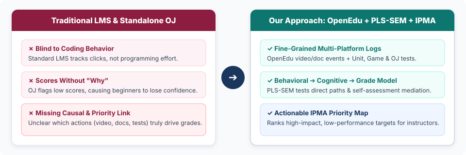
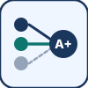
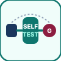
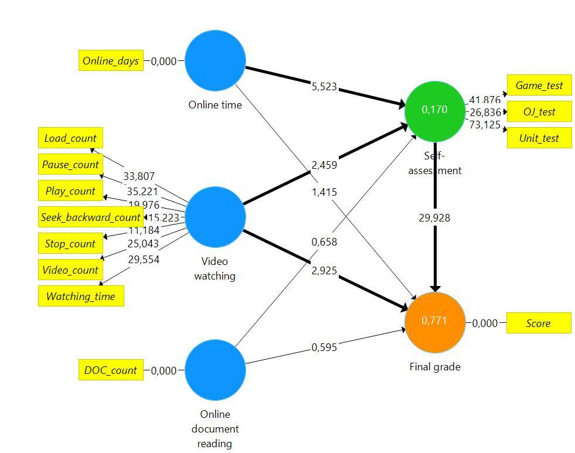
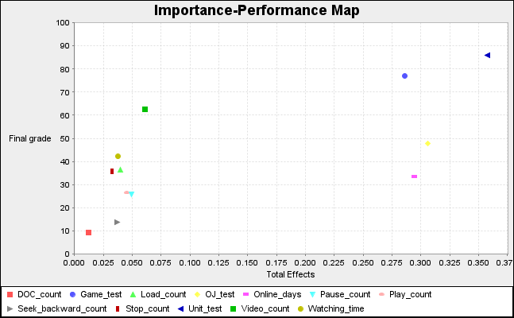
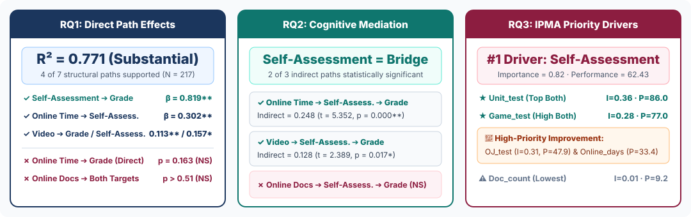

<!-- _class: lead -->

Journal of Information Technology Education: Research · Vol. 21, 2022, pp. 403–423

# Exploring the Influence of Students' Modes of Behavioral Engagement in an Online Programming Course

Using the <strong>Partial Least Squares Structural Equation Modeling (PLS-SEM)</strong> &amp; <strong>Importance-Performance Map Analysis (IPMA)</strong> Approach

<strong>Nien-Lin Hsueh</strong>, <strong>Bilegjargal Daramsenge*</strong>, and <strong>Lien-Chi Lai</strong> 
Department of Information Engineering and Computer Science, Feng Chia University, Taichung, Taiwan 
<code>nlhsueh@fcu.edu.tw</code> · <code>P0731809@o365.fcu.edu.tw</code> · <code>P1000433@mail.fcu.edu.tw</code>

Supported by the Ministry of Science and Technology (MOST), Taiwan, under grant MOST 110-2221-E-035-031-MY2 · DOI: 10.28945/5010

---

## Opening Hook: "Logged In Every Day!" ... Why Didn't Grades Move?

<strong>The Big Idea:</strong> Simply logging in every day (<code>Online_days</code>) or clicking online textbooks (<code>Doc_count</code>) does <strong>not</strong> directly raise coding grades. Only when behavioral activity channels through <strong>cognitive self-assessment</strong> (<code>Unit_test</code>, <code>Game_test</code>, <code>OJ_test</code>) and <strong>active video watching</strong> do grades soar (<strong>R2 = 77.1%</strong>).

---

## Presentation Outline

1

[**Introduction & Research Questions**](#4)
Limitations of traditional LMS/OJ tools and our three guiding questions (RQ1–RQ3).

2

[**Literature Review**](#6)
Prior findings on video viewing, learning materials, self-assessment, and behavioral analytics.

3

[**Course Design & Research Model**](#7)
FCU Python blended MOOC (N = 217), OpenEdu log pipeline, 13 indicators, and H1–H7.

4

[**PLS-SEM & IPMA Empirical Results**](#12)
Measurement reliability, direct paths (RQ1), mediation (RQ2), and IPMA maps (RQ3).

5

[**Implications & Study Limitations**](#17)
Actionable recommendations for platform developers, policymakers, and instructors.

6

[**Conclusion & Future Work**](#18)
Visual synthesis of RQ1–RQ3 findings and roadmap for MOOCs and affective analytics.

---

## 1.1 Motivation: Beyond Click Counts and Blind OJ Scores

217 Students

Active undergraduates in FCU's MOE Award-winning Python blended course (Spring 2021)

5 Constructs · 13 Logs

Behavioral (Time, Video, Docs) + Cognitive Mediator (Self-Assessment) ➔ Final Grade

R2 = 0.771

Substantial in-sample predictive power explaining 77.1% of final project grade variance

---

## 1.2 Research Questions

* 

RQ1 · Direct Effects — Which Online Study Habits Actually Raise Coding Grades?

What is the <strong>direct effect</strong> of students' behavioral engagement types (Online Time, Video Watching, Online Document Reading) and cognitive self-assessment on their final grades in an online programming course? <em>(Tested via H1, H3, H5, H7)</em>

* 

RQ2 · Cognitive Mediation — Does Self-Assessment Bridge Activity to Mastery?

What is the <strong>mediating role of cognitive engagement</strong> (Self-Assessment: Unit Quiz, 4-HP Game, Online Judge) on the relationship between behavioral engagement types and final grades? <em>(Tested via H2, H4, H6 + Bootstrapped Indirect Effects)</em>

* 

RQ3 · Priority Drivers — Where Should Instructors &amp; Platforms Invest First?

Which specific constructs and log indicators <strong>most strongly affect students' performance</strong>, and which high-importance activities currently suffer from low performance? <em>(Investigated via Importance-Performance Map Analysis, IPMA)</em>

---

## 2. Literature Review: Engagement in Online Programming

### 🎬 Video Watching Behavior
- **In-Video Quizzes**: Cummins et al. (2015) achieved consistently high engagement (**71%–86%**) with interactive video questions.
- **Grade Correlation**: Picardo et al. (2021) found lecture recording views significantly correlate with CS1 grades—even lifting repeat students' scores.
- **Viewing Strategies**: Li (2019) & Yoon et al. (2021) linked active pausing/seeking to higher achievement.

### 📖 Materials & Self-Assessment
- **Interactive Docs**: Isomöttönen & Tirronen (2016) showed e-books work best when paired with quizzes, feedback, and embedded coding boxes.
- **Fair Self-Evaluation**: Ngai et al. (2010) proved beginners assess themselves objectively given instant feedback.
- **Automated Explanations**: Lepp et al. (2017) found self-assessment tools cut instructor support load in MOOCs.

### 📊 Behavioral Log Analytics
- **IDE Logging**: Watson et al. (2013) predicted **42.49%** of coursework variance directly from BlueJ IDE logs (N = 45).
- **Flipped PLS-SEM**: Wang (2017, 2019) showed problem-solving & self-reflection drive Moodle achievement (N = 488).
- **Research Gap**: Few studies link **MOOC behavioral logs** + **cognitive self-assessment** + **IPMA** in programming.

<strong>Theoretical Anchor:</strong> We adapt <strong>G. Sun &amp; Bin's (2018)</strong> MOOC behavioral engagement evaluation framework and integrate it with <strong>PLS-SEM</strong> (Hair et al., 2019) to model causal paths without strict normality assumptions.

---

## 3.1 Blended Python Course Design & Participants

### 🏫 Course Format & Pedagogical Design
- **Course**: Basic Python Programming (computation, logic, collections, functions, basic `pandas` analysis) at **Feng Chia University**, Spring 2021.
- **Blended Schedule**: **2 hrs/week** flexible online study + **1 hr/week** in-class discussion.
- **Interactive Suite**: Quiz-in-video, Trinket online workshops, Google Slide flashcards, Google Docs textbook, StarTrec lite **Game-test**, and **Online Judge (OJ)**.
- **Recognition**: Winner of Taiwan Ministry of Education's **Outstanding MOOC Award**.

### 👥 Sample & Authentic Final Assessment
- **Participants**: **315** initially enrolled ➔ **217 active students** retained after removing inactive accounts with zero behavioral logs.
- **Major Distribution**:
  - **177 (82%)** Information Engineering & Computer Science (IECS)
  - **40 (18%)** Non-CS majors (Materials, Applied Math, Business, Aerospace, Civil, Statistics, EE, etc.)
- **Final Grade (`Score`)**: Open-data Python term project (e.g., decade traffic trends or Taiwan birth rates since 1900) measuring real problem-solving skill.

<strong>Why Open-Data Projects?</strong> Grounding Python tasks in familiar Taiwan government open datasets keeps beginners focused on coding logic rather than abstract domain rules.

---

## 3.2 Multi-Platform Log Processing & PLS-SEM Pipeline

<strong>Why PLS-SEM (SmartPLS 3.3.6)?</strong> Ideal for exploratory causal models with multiple latent constructs, non-normal log distributions, and moderate sample sizes (N = 217), while enabling <strong>bootstrapped mediation</strong> (5,000 subsamples) and <strong>IPMA</strong>.

---

## 3.3 Research Model & Seven Hypotheses (H1–H7)

### 🧭 Hypothesized Causal Paths
- **Online Time** (`Online_days`):
  - **H1**: Online time ➔ Final grade *(direct)*
  - **H2**: Online time ➔ Self-assessment
- **Video Watching** (7 OpenEdu actions):
  - **H3**: Video watching ➔ Final grade *(direct)*
  - **H4**: Video watching ➔ Self-assessment
- **Online Document Reading** (`Doc_count`):
  - **H5**: Online doc use ➔ Final grade *(direct)*
  - **H6**: Online doc use ➔ Self-assessment
- **Cognitive Mediator** (`Self-assessment`):
  - **H7**: Self-assessment ➔ Final grade

Figure 1: Research model with 5 constructs, 13 indicators &amp; H1–H7.

---

## 3.4 Behavioral & Cognitive Constructs Defined

| Engagement Type | Construct | Log Indicators (13 Retained from 28) | Operational Meaning |
| :--- | :--- | :--- | :--- |
| **Behavioral** | **Online Time** | `Online_days` (1 item) | Number of active days with OpenEdu activity logs |
| **Behavioral** | **Video Watching** | `Load_count`, `Play_count`, `Pause_count`, `Stop_count`, `Seek_backward_count`, `Video_count`, `Watching_time` (7 items) | Classroom entry, study frequency, thinking pauses, stopping, active content review, unique videos watched & total viewing duration |
| **Behavioral** | **Online Doc Reading** | `Doc_count` (1 item) | Click frequency on chapter-decomposed Google Docs code & explanation guides |
| **Cognitive (Mediator)** | **Self-Assessment** | `Unit_test`, `Game_test`, `OJ_test` (3 items) | Concept MCQs, gamified 4-HP StarTrec lite challenges, and auto-graded executable Python coding tasks |
| **Target (DV)** | **Final Grade** | `Score` (1 item) | Final term project grade on Taiwan open-data analysis with Python |

<strong>Indicator Screening:</strong> 15 of 28 initial log variables had cross-loadings below Hair et al. (2019) thresholds and were pruned; single-item constructs (<code>Online_days</code>, <code>Doc_count</code>, <code>Score</code>) are natively supported in PLS-SEM (CL = 1.000).

---

## 3.5 Interactive Cognitive Plug-ins: Game Test & OJ System

Figure 3: (a) StarTrec lite 4-HP Game Test &amp; (b) Automated Python OJ.

### 🎮 Three Tiers of Cognitive Challenge
1. **`Unit_test` (Concept Check)**: Multiple-choice unit quizzes verifying foundational Python syntax & logic.
2. **`Game_test` (StarTrec lite)**: Gamified adventure requiring **4 HP** to advance—wrong answers force a restart, nudging students to consult docs & peers.
3. **`OJ_test` (Online Judge)**: Highest difficulty—students write & submit executable Python code graded instantly against predefined test cases.

<strong>Acting as a 24/7 TA:</strong> Instant automated feedback transforms passive watching into active cognitive problem-solving.

---

## 4.1 Measurement Model: Reliability & Discriminant Validity

### Table 1: Reliability & Convergent Validity
| Construct | Indicator | CL | α | CR | AVE |
| :--- | :--- | :---: | :---: | :---: | :---: |
| **Self-Assessment** | `Unit_test` | **0.926** | **0.824** | **0.896** | **0.743** |
| | `Game_test` | **0.866** | | | |
| | `OJ_test` | **0.787** | | | |
| **Video Watching** | `Load_count` | **0.873** | **0.900** | **0.922** | **0.629** |
| | `Watching_time` | **0.857** | | | |
| | `Pause_count` | **0.836** | | | |
| | `Play_count` | **0.792** | | | |
| | `Video_count` | **0.738** | | | |
| | `Seek_backward` | **0.670** | | | |
| | `Stop_count` | **0.655** | | | |
| *Single-Item (×3)* | `Score`/`Doc`/`Days` | 1.000 | — | — | — |

### Table 2: Fornell-Larcker Criterion
| Construct | FG | Doc | Time | SA | Vid |
| :--- | :---: | :---: | :---: | :---: | :---: |
| **Final Grade** | **1.00** | | | | |
| **Online Doc** | 0.16 | **1.00** | | | |
| **Online Time** | 0.41 | 0.29 | **1.00** | | |
| **Self-Assess.** | 0.87 | 0.17 | 0.39 | **0.86** | |
| **Video Watch** | 0.38 | 0.26 | 0.46 | 0.31 | **0.79** |

<strong>All Thresholds Passed:</strong> Cronbach's α (&gt; 0.82), CR (&gt; 0.89), AVE (&gt; 0.62), and diagonal √AVE exceeds all off-diagonal correlations (Hair et al., 2019).

---

## 4.2 RQ1 Structural Model & Direct Effects (H1–H7)

### Table 3: Bootstrapped Direct Paths (5,000 subsamples)
| H | Path | Coeff (O) | t-Stat | p-Value | Result |
| :-: | :--- | :---: | :---: | :---: | :---: |
| H1 | Online time ➔ Grade | 0.047 | 1.394 | 0.163 | NS |
| **H2** | **Online time ➔ Self-Assess.** | **0.302** | **5.430** | **0.000\*\*** | **Supported** |
| **H3** | **Video ➔ Final grade** | **0.113** | **2.937** | **0.003\*\*** | **Supported** |
| **H4** | **Video ➔ Self-Assess.** | **0.157** | **2.429** | **0.015\*** | **Supported** |
| H5 | Online doc ➔ Grade | -0.018 | 0.582 | 0.561 | NS |
| H6 | Online doc ➔ Self-Assess. | 0.037 | 0.658 | 0.511 | NS |
| **H7** | **Self-Assess. ➔ Grade** | **0.819** | **29.505** | **0.000\*\*** | **Supported** |

<strong>Substantial Explanatory Power:</strong> Final Grade <strong>R2 = 0.771</strong> (Adjusted R2 = 0.767). Among behavioral modes, <strong>Video Watching</strong> is the <em>only</em> one with a significant direct effect on grades!

Figure 6: PLS path model (bold = significant; R2 = 0.771).

---

## 4.3 RQ2 Mediation Analysis: Self-Assessment as the Bridge

### Table 5: Specific Indirect Effects via Self-Assessment (Bootstrapping, 5,000 subsamples)

| Indirect Path (Behavioral ➔ Cognitive ➔ Outcome) | Indirect Effect (O) | Sample Mean (M) | SD | t-Stat | p-Value | Mediation Type |
| :--- | :---: | :---: | :---: | :---: | :---: | :---: |
| **Online time ➔ Self-assessment ➔ Final grade** | **0.248** | 0.248 | 0.046 | **5.352** | **0.000\*\*** | **Full Mediation** |
| **Video watching ➔ Self-assessment ➔ Final grade** | **0.128** | 0.134 | 0.054 | **2.389** | **0.017\*** | **Partial Mediation** |
| Online document reading ➔ Self-assessment ➔ Final grade | 0.031 | 0.029 | 0.047 | 0.656 | 0.512 | Not Significant |

Full Mediation

<strong>Online Time</strong> fails directly (p = 0.163), but strongly lifts grades <em>when spent on self-assessments</em> (β = 0.248, p = 0.000**).

Dual Channel

<strong>Video Watching</strong> boosts grades <em>both</em> directly (0.113**) and indirectly through self-assessment (0.128*).

Docs Unused

<strong>Online Docs</strong> show no direct or mediated effect (p = 0.512)—students prefer coding &amp; videos over reading static text.

---

## 4.4 RQ3 IPMA at the Construct Level

### Table 6: Standardized Construct Effects on Final Grade
| Engagement Type | Construct | Importance (Total Effect) | Performance (0–100) |
| :--- | :--- | :---: | :---: |
| **Cognitive** | **Self-Assessment** | **0.82** | **62.43** |
| Behavioral | **Online Time** | **0.29** | 33.43 |
| Behavioral | **Video Watching** | **0.24** | 48.70 |
| Behavioral | Online Doc Reading | 0.01 | 9.19 |

<strong>Strategic Reading of IPMA:</strong>
<ul>
<li><strong>#1 Driver</strong>: Self-Assessment dominates both Importance (<strong>0.82</strong>) and Performance (<strong>62.43</strong>).</li>
<li><strong>High Leverage</strong>: Boosting Online Time (P = 33.43) &amp; Video engagement (P = 48.70) yields strong gains.</li>
<li><strong>Red Flag</strong>: Online Docs sit at the bottom-left (I = 0.01, P = 9.19).</li>
</ul>

Figure 4: Construct-level IPMA (x = Total Effect, y = Performance).

---

## 4.5 RQ3 IPMA at the Indicator Level: Actionable Targets

### Table 7: Key Indicator Importance & Performance
| Indicator | Type | Importance | Performance | Priority Zone |
| :--- | :--- | :---: | :---: | :--- |
| **`Unit_test`** | Cognitive | **0.36** | **85.97** | ★ Maintain Strength |
| **`OJ_test`** | Cognitive | **0.31** | **47.88** | 🎯 **Top Improvement** |
| **`Online_days`** | Behavioral | **0.29** | **33.43** | 🎯 **Top Improvement** |
| **`Game_test`** | Cognitive | **0.28** | **77.00** | ★ Maintain Strength |
| `Video_count` | Behavioral | 0.06 | 62.52 | Solid Habit |
| `Watching_time` | Behavioral | 0.04 | 42.16 | Moderate |
| `Pause`/`Play` | Behavioral | 0.05 / 0.05 | 25.8 / 26.5 | Low Activity |
| `Doc_count` | Behavioral | 0.01 | 9.19 | Lowest Usage |

Figure 5: Indicator-level IPMA—<code>OJ_test</code> &amp; <code>Online_days</code> offer highest ROI.

---

## 5.1 Practical Implications & Study Limitations

### 🏗️ For Platform Developers & Policymakers
- **Prioritize Cognitive Self-Assessment**: Invest in interactive OJ systems, gamified tests (`Game_test`), and unit quizzes (`Unit_test`) tightly aligned with cognitive skills.
- **Turn Time into Practice**: Since `OJ_test` has high importance (0.31) but moderate performance (47.88), scaffolded hints & progressive coding exercises can unlock major grade gains.

### 👩‍🏫 For Instructors & Students
- **Craft Concise, Engaging Videos**: Video watching directly and indirectly lifts grades—short, focused session videos support review, language learners, and absent students (Carlisle, 2010; Ronchetti, 2010).
- **Redesign Static Online Docs**: Students bypass plain text (`P = 9.19`); embed interactive code runners and mini-quizzes inside readings.

<strong>⚠️ Limitation 1 · Single Cohort</strong> 217 undergraduates from one university course; broader MOOC generalizability needed.

<strong>⚠️ Limitation 2 · Single-Item Logs</strong> 15 of 28 indicators pruned for low CL; Online Time &amp; Docs retained as single-item constructs.

<strong>⚠️ Limitation 3 · Affective Gap</strong> Focused on behavioral &amp; cognitive dimensions; emotional/social engagement not yet captured.

---

## 5.2 Conclusion & Future Work

<strong>🌍 1. Wider MOOC Cohorts</strong> Replicate across diverse open MOOC populations beyond a single university classroom.

<strong>🐛 2. Fine-Grained Coding Logs</strong> Integrate debugging, testing, and multi-item behavioral logs to enrich construct validity.

<strong>💬 3. Emotional &amp; Social Dimensions</strong> Incorporate affective reactions and peer-interaction analytics alongside behavioral logs.

---

<!-- _class: closing -->

# Thank You for Your Attention!

Exploring the Influence of Students' Modes of Behavioral Engagement in an Online Programming Course Using the PLS-SEM Approach

<strong>Nien-Lin Hsueh</strong> &nbsp;·&nbsp; <code>nlhsueh@fcu.edu.tw</code> 
<strong>Bilegjargal Daramsenge*</strong> &nbsp;·&nbsp; <code>P0731809@o365.fcu.edu.tw</code> 
<strong>Lien-Chi Lai</strong> &nbsp;·&nbsp; <code>P1000433@mail.fcu.edu.tw</code> 
Department of Information Engineering and Computer Science, Feng Chia University 
JITE:Research, Vol. 21 (2022), pp. 403–423 · DOI: 10.28945/5010 · MOST 110-2221-E-035-031-MY2

