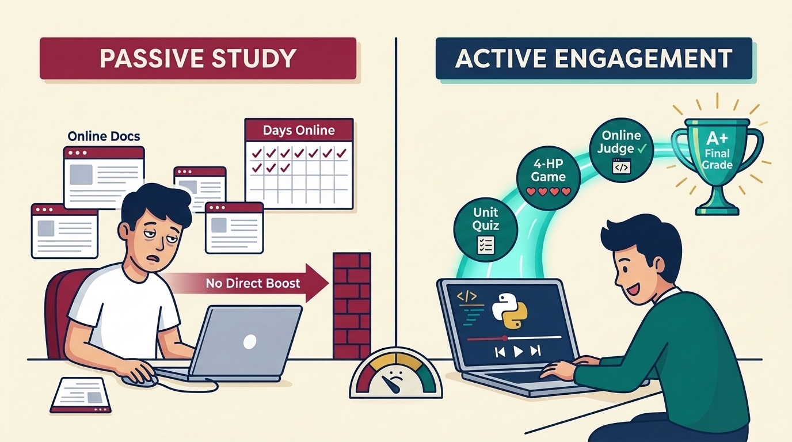
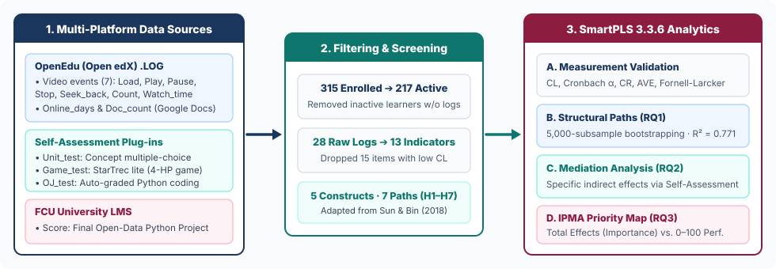
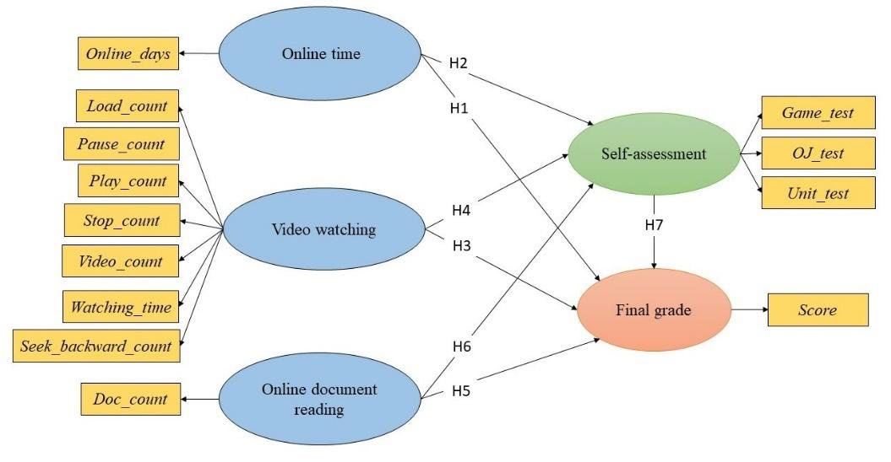
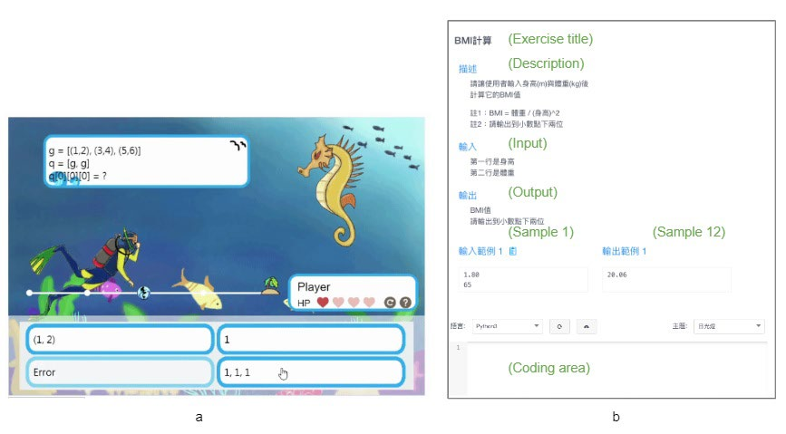
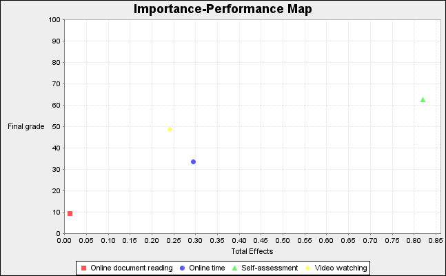

<!-- _class: lead -->

Journal of Information Technology Education: Research · Vol. 21, 2022, pp. 403–423

# Exploring the Influence of Students' Modes of Behavioral Engagement in an Online Programming Course

Using the <strong>Partial Least Squares Structural Equation Modeling (PLS-SEM)</strong> &amp; <strong>Importance-Performance Map Analysis (IPMA)</strong> Approach

<strong>Nien-Lin Hsueh</strong>, <strong>Bilegjargal Daramsenge*</strong>, and <strong>Lien-Chi Lai</strong> 
Department of Information Engineering and Computer Science, Feng Chia University, Taichung, Taiwan 
<code>nlhsueh@fcu.edu.tw</code> · <code>P0731809@o365.fcu.edu.tw</code> · <code>P1000433@mail.fcu.edu.tw</code>

Supported by the Ministry of Science and Technology (MOST), Taiwan, under grant MOST 110-2221-E-035-031-MY2 · DOI: 10.28945/5010

<!--
Paper Context & Contribution:
- Bibliographic Record: Hsueh, N.-L., Daramsenge, B., & Lai, L.-C. (2022). "Exploring the Influence of Students' Modes of Behavioral Engagement in an Online Programming Course Using the Partial Least Squares Structural Equation Modeling Approach." Journal of Information Technology Education: Research (JITE:Research), 21, 403–423. https://doi.org/10.28945/5010. Received May 17, 2022; revised July 17, 2022; accepted August 4, 2022; supported by MOST grant 110-2221-E-035-031-MY2.
- Dual Research Aim: (1) Quantify how distinct behavioral engagement modes derived from LMS/MOOC activity logs affect final programming achievement both directly and indirectly; (2) identify which constructs and granular log indicators exert the highest strategic impact on performance via Importance-Performance Map Analysis (IPMA).
- Empirical Setting: Multi-platform log dataset from N = 217 active undergraduates in a Spring 2021 blended Python programming course at Feng Chia University, Taiwan, integrating OpenEdu (Open edX) telemetry with custom cognitive self-assessment plug-ins (StarTrec lite Game-test and an automated Online Judge).
-->

---

## Opening Hook: "Logged In Every Day!" ... Why Didn't Grades Move?

<strong>The Big Idea:</strong> Simply logging in every day (<code>Online_days</code>) or clicking online textbooks (<code>Doc_count</code>) does <strong>not</strong> directly raise coding grades. Only when behavioral activity channels through <strong>cognitive self-assessment</strong> (<code>Unit_test</code>, <code>Game_test</code>, <code>OJ_test</code>) and <strong>active video watching</strong> do grades soar (<strong>R2 = 77.1%</strong>).

<!--
Core Empirical Insight of the Study:
- The Passive-Activity Fallacy: In distance programming education, raw attendance or resource-access metrics such as daily platform logins (Online_days) and online textbook clicks (Doc_count) do not directly translate into higher coding grades (H1: beta = 0.047, p = 0.163; H5: beta = -0.018, p = 0.561).
- The Cognitive Channeling Mechanism: Behavioral activity produces measurable academic gains only when channeled into active cognitive self-assessment (Unit_test, Game_test, OJ_test), which exerts the dominant direct effect on final project scores (H7: beta = 0.819, t = 29.505, p < 0.001) and mediates Online Time fully (indirect beta = 0.248, p < 0.001).
- Unique Role of Video Watching: Among all behavioral modes, Video Watching is the sole construct with a statistically significant direct effect on final grades (H3: beta = 0.113, p = 0.003) in addition to a significant mediated effect through self-assessment (indirect beta = 0.128, p = 0.017). Together, the structural model explains 77.1% of final project grade variance (R^2 = 0.771, Adjusted R^2 = 0.767).
-->

---

## Presentation Outline

1

[**Introduction & Research Questions**](#4)
Limitations of traditional LMS/OJ tools and our three guiding questions (RQ1–RQ3).

2

[**Literature Review**](#6)
Prior findings on video viewing, learning materials, self-assessment, and behavioral analytics.

3

[**Course Design & Research Model**](#7)
FCU Python blended MOOC (N = 217), OpenEdu log pipeline, 13 indicators, and H1–H7.

4

[**PLS-SEM & IPMA Empirical Results**](#12)
Measurement reliability, direct paths (RQ1), mediation (RQ2), and IPMA maps (RQ3).

5

[**Implications & Study Limitations**](#17)
Actionable recommendations for platform developers, policymakers, and instructors.

6

[**Conclusion & Future Work**](#18)
Visual synthesis of RQ1–RQ3 findings and roadmap for MOOCs and affective analytics.

<!--
Structure of the Paper:
- Introduction: Contrasts the analytical blind spots of conventional LMS click logs and standalone Online Judge (OJ) scoreboards, formulating three guiding research questions (RQ1 to RQ3) grounded in G. Sun & Bin's (2018) MOOC behavioral engagement framework.
- Literature Review: Synthesizes prior empirical findings on video-watching analytics, interactive learning materials, automated self-assessment, and behavioral engagement modeling in online and blended programming courses.
- Course Design & Research Model: Describes Feng Chia University's MOE Award-winning blended Python course (N = 217), the cross-platform OpenEdu + OJ + Game-test log extraction pipeline, operational definitions of 5 constructs across 13 retained indicators (screened from 28 raw logs), and seven hypotheses (H1 to H7).
- Results: Reports measurement model validation (CL, alpha, CR, AVE, Fornell-Larcker), bootstrapped structural path tests (5,000 subsamples), specific indirect mediation effects, and two-level IPMA (constructs and indicators).
- Discussion, Limitations & Conclusion: Derives targeted recommendations for platform developers, policymakers, and instructors, and critically examines sample scope, single-item constructs, and unmeasured affective/social dimensions.
-->

---

## 1.1 Motivation: Beyond Click Counts and Blind OJ Scores

217 Students

Active undergraduates in FCU's MOE Award-winning Python blended course (Spring 2021)

5 Constructs · 13 Logs

Behavioral (Time, Video, Docs) + Cognitive Mediator (Self-Assessment) ➔ Final Grade

R2 = 0.771

Substantial in-sample predictive power explaining 77.1% of final project grade variance

<!--
Methodological Gap & Motivation (Introduction):
- Limitations of Traditional LMSs: While digital LMSs facilitate asynchronous materials, quizzes, and flexible pacing (Li & Tsai, 2017; Battestilli et al., 2020), conventional LMSs cannot capture or analyze domain-specific coding behaviors required in computer science education.
- Limitations of Standalone Online Judges (OJ): Although OJ systems automate grading and archive problem/solution histories (Kurnia et al., 2001), most OJs only reveal whether a student received a low score without explaining why, which can erode novice confidence (Wu et al., 2021).
- Integrated Causal + Strategic Solution: By uniting granular OpenEdu behavioral logs with three-tier cognitive self-assessment scores across 217 active learners and modeling them via PLS-SEM (SmartPLS 3.3.6) plus IPMA, the study bridges descriptive clickstream tracking with causal mediation and actionable instructional prioritization, achieving substantial in-sample predictive power (R^2 = 0.771).
-->

---

## 1.2 Research Questions

* 

RQ1 · Direct Effects — Which Online Study Habits Actually Raise Coding Grades?

What is the <strong>direct effect</strong> of students' behavioral engagement types (Online Time, Video Watching, Online Document Reading) and cognitive self-assessment on their final grades in an online programming course? <em>(Tested via H1, H3, H5, H7)</em>

* 

RQ2 · Cognitive Mediation — Does Self-Assessment Bridge Activity to Mastery?

What is the <strong>mediating role of cognitive engagement</strong> (Self-Assessment: Unit Quiz, 4-HP Game, Online Judge) on the relationship between behavioral engagement types and final grades? <em>(Tested via H2, H4, H6 + Bootstrapped Indirect Effects)</em>

* 

RQ3 · Priority Drivers — Where Should Instructors &amp; Platforms Invest First?

Which specific constructs and log indicators <strong>most strongly affect students' performance</strong>, and which high-importance activities currently suffer from low performance? <em>(Investigated via Importance-Performance Map Analysis, IPMA)</em>

<!--
Formal Research Questions & Hypothesis Mapping (Introduction & Identifying Constructs):
- RQ1 (Direct Effects): "What is the direct effect of students' engagement types on their final grades in an online programming course?" Tested via four direct structural paths: H1 (Online time -> Final grade), H3 (Video watching -> Final grade), H5 (Online document reading -> Final grade), and H7 (Self-assessment -> Final grade).
- RQ2 (Cognitive Mediation): "What is the mediating role of cognitive engagement on the relationship between behavioral engagement types and final grades in an online programming course?" Tested via behavioral-to-cognitive paths H2 (Online time -> Self-assessment), H4 (Video watching -> Self-assessment), and H6 (Online doc reading -> Self-assessment), combined with bootstrapped specific indirect effects (5,000 subsamples).
- RQ3 (Priority Drivers): "Which factors most strongly affect students' performance in an online programming course?" Investigated via Importance-Performance Map Analysis (IPMA) at both the latent construct level and the granular indicator level, contrasting standardized total effects (importance) against rescaled 0 to 100 mean scores (performance).
-->

---

## 2. Literature Review: Engagement in Online Programming

### 🎬 Video Watching Behavior
- **In-Video Quizzes**: Cummins et al. (2015) achieved consistently high engagement (**71%–86%**) with interactive video questions.
- **Grade Correlation**: Picardo et al. (2021) found lecture recording views significantly correlate with CS1 grades—even lifting repeat students' scores.
- **Viewing Strategies**: Li (2019) & Yoon et al. (2021) linked active pausing/seeking to higher achievement.

### 📖 Materials & Self-Assessment
- **Interactive Docs**: Isomöttönen & Tirronen (2016) showed e-books work best when paired with quizzes, feedback, and embedded coding boxes.
- **Fair Self-Evaluation**: Ngai et al. (2010) proved beginners assess themselves objectively given instant feedback.
- **Automated Explanations**: Lepp et al. (2017) found self-assessment tools cut instructor support load in MOOCs.

### 📊 Behavioral Log Analytics
- **IDE Logging**: Watson et al. (2013) predicted **42.49%** of coursework variance directly from BlueJ IDE logs (N = 45).
- **Flipped PLS-SEM**: Wang (2017, 2019) showed problem-solving & self-reflection drive Moodle achievement (N = 488).
- **Research Gap**: Few studies link **MOOC behavioral logs** + **cognitive self-assessment** + **IPMA** in programming.

<strong>Theoretical Anchor:</strong> We adapt <strong>G. Sun &amp; Bin's (2018)</strong> MOOC behavioral engagement evaluation framework and integrate it with <strong>PLS-SEM</strong> (Hair et al., 2019) to model causal paths without strict normality assumptions.

<!--
Synthesis of Prior Literature & Theoretical Anchor (Literature Review):
- Video-Watching Analytics: Cummins et al. (2015) demonstrated that interactive in-video quiz questions sustain 71% to 86% student engagement. Picardo et al. (2021) identified a significant positive correlation between lecture recording views and CS1 final grades, noting that repeat students achieved higher grades when viewing more recordings on their second attempt. Li (2019) linked higher prior knowledge to strategic video viewing, while Yoon et al. (2021) applied PCA to video logs to identify active learner clusters.
- Interactive Materials & Self-Assessment: Othman et al. (2013) observed students' preference for small-group and multi-source online study; Isomöttönen & Tirronen (2016) showed e-books support independent study best when augmented with quizzes, feedback tools, and embedded coding boxes. Ngai et al. (2010) confirmed that novices self-assess fairly and objectively under structured feedback, and Lepp et al. (2017) found automated self-assessment explanations reduce instructor support queries in MOOCs.
- Behavioral Log Modeling: Grounded in behavioral engagement definitions emphasizing active participation, attention, effort, and persistence (Deng et al., 2019; Bergdahl et al., 2020; T. K. Chiu, 2022), prior studies predicted 42.49% of coursework variance from BlueJ IDE logs (Watson et al., 2013, N = 45), modeled Moodle flipped-classroom problem solving via PLS-SEM (Wang, 2017, 2019, N = 488), and used feature selection on 3-year blended Java logs (Xie et al., 2021).
- Theoretical Framework: The study adapts G. Sun & Bin's (2018) 8-log MOOC behavioral engagement evaluation framework (previously referenced by Y. Sun & Chai, 2020) and integrates it with distribution-free PLS-SEM (Hair et al., 2011, 2019).
-->

---

## 3.1 Blended Python Course Design & Participants

### 🏫 Course Format & Pedagogical Design
- **Course**: Basic Python Programming (computation, logic, collections, functions, basic `pandas` analysis) at **Feng Chia University**, Spring 2021.
- **Blended Schedule**: **2 hrs/week** flexible online study + **1 hr/week** in-class discussion.
- **Interactive Suite**: Quiz-in-video, Trinket online workshops, Google Slide flashcards, Google Docs textbook, StarTrec lite **Game-test**, and **Online Judge (OJ)**.
- **Recognition**: Winner of Taiwan Ministry of Education's **Outstanding MOOC Award**.

### 👥 Sample & Authentic Final Assessment
- **Participants**: **315** initially enrolled ➔ **217 active students** retained after removing inactive accounts with zero behavioral logs.
- **Major Distribution**:
  - **177 (82%)** Information Engineering & Computer Science (IECS)
  - **40 (18%)** Non-CS majors (Materials, Applied Math, Business, Aerospace, Civil, Statistics, EE, etc.)
- **Final Grade (`Score`)**: Open-data Python term project (e.g., decade traffic trends or Taiwan birth rates since 1900) measuring real problem-solving skill.

<strong>Why Open-Data Projects?</strong> Grounding Python tasks in familiar Taiwan government open datasets keeps beginners focused on coding logic rather than abstract domain rules.

<!--
Course Design, Cohort Composition & Authentic Assessment (Course Description & Final Grade):
- Blended Instructional Design: Offered by the College of Information and Electrical Engineering at Feng Chia University in Spring 2021, Basic Python Programming covered computation, logic, collection objects, functions, and introductory pandas data analysis. Each week combined 2 hours of anytime/anywhere online study with 1 hour of in-class discussion. Interactive components included quiz-in-video activities, Trinket online coding workshops, Google Slide flashcards, a chapter-decomposed Google Docs textbook, StarTrec lite Game-test, and an Online Judge. The course won Taiwan's Ministry of Education Outstanding MOOC Award.
- Sample Filtering & Demographics: Of 315 initially registered undergraduates, 98 inactive accounts lacking system behavioral logs were removed, yielding N = 217 active participants: 177 (82%) Information Engineering and Computer Science majors and 40 (18%) non-CS majors spanning Materials Science, Applied Mathematics, Automatic Control, Chemical Engineering, Business Administration, Aerospace, Civil Engineering, Statistics, and Electrical Engineering.
- Authentic Dependent Variable (Score): Rather than a rote multiple-choice final exam, final grades evaluated a real-world Python data-science term project using Taiwan government open datasets (e.g., 10-year traffic trends or Taiwan birth rates since 1900), supported by an open-data access tutorial. Familiar real-life domains minimized extraneous domain friction so scores directly reflected Python problem-solving competence (consistent with Kanaparan et al., 2019; Shaw, 2012; Lau & Yuen, 2009).
-->

---

## 3.2 Multi-Platform Log Processing & PLS-SEM Pipeline

<strong>Why PLS-SEM (SmartPLS 3.3.6)?</strong> Ideal for exploratory causal models with multiple latent constructs, non-normal log distributions, and moderate sample sizes (N = 217), while enabling <strong>bootstrapped mediation</strong> (5,000 subsamples) and <strong>IPMA</strong>.

<!--
Cross-Platform Data Pipeline & Statistical Rationale (Log Data Processing, Fig. 2):
- Multi-Platform Telemetry Architecture: Course administration ran on Feng Chia University's institutional LMS, while granular learning interaction logs were captured via OpenEdu (an Open edX extension widely used in Taiwan; Ruiz et al., 2014; Y.-C. Chiu et al., 2018). Custom cognitive plug-ins (StarTrec lite Game-test and the automated OJ system) logged per-student correct/incorrect submission histories.
- Event Aggregation Categories: Three raw event streams were extracted and aggregated per student: (1) answering questions (unit quizzes, game challenges, OJ submissions), (2) page-navigation jumps (accessing Google Slide flashcards and chapter-decomposed Google Docs textbooks), and (3) video-watching telemetry (unique videos watched, action counts, and cumulative viewing time).
- Why PLS-SEM (SmartPLS 3.3.6): Following Hair et al. (2011, 2012, 2019), PLS-SEM is a distribution-free soft-modeling technique uniquely suited to exploratory causal models with multiple latent constructs, strongly skewed clickstream log data, and moderate sample sizes (N = 217). It simultaneously validates reflective measurement models, executes 5,000-subsample two-tailed bootstrapping for direct and mediated paths, and computes IPMA matrices.
-->

---

## 3.3 Research Model & Seven Hypotheses (H1–H7)

### 🧭 Hypothesized Causal Paths
- **Online Time** (`Online_days`):
  - **H1**: Online time ➔ Final grade *(direct)*
  - **H2**: Online time ➔ Self-assessment
- **Video Watching** (7 OpenEdu actions):
  - **H3**: Video watching ➔ Final grade *(direct)*
  - **H4**: Video watching ➔ Self-assessment
- **Online Document Reading** (`Doc_count`):
  - **H5**: Online doc use ➔ Final grade *(direct)*
  - **H6**: Online doc use ➔ Self-assessment
- **Cognitive Mediator** (`Self-assessment`):
  - **H7**: Self-assessment ➔ Final grade

Figure 1: Research model with 5 constructs, 13 indicators &amp; H1–H7.

<!--
Structural Specification & Theoretical Basis of H1 to H7 (Identifying Constructs & Hypotheses, Fig. 1):
- Two-Component SEM Architecture (Hair et al., 2011): The measurement (outer) model links 13 observed log indicators to 5 latent constructs, while the structural (inner) model tests 7 directional hypotheses linking three behavioral engagement constructs (Online Time, Video Watching, Online Document Reading) to Final Grade directly and via Cognitive Engagement (Self-Assessment).
- Online Time (H1, H2): Grounded in Kuh (2003) and Trowler (2010), who define engagement through commitment of time and energy to educational activities, H1 tests whether active login days directly raise Final Grade and H2 tests whether active days drive Self-Assessment participation.
- Video Watching (H3, H4): Grounded in McGowan & Hanna (2015), Li (2019), and Yoon et al. (2021), H3 and H4 posit that rich video interaction behaviors directly improve coding grades and stimulate self-assessment completion.
- Online Document Reading (H5, H6): Grounded in Leppänen et al. (2017), who found in-situ material usage moderately predicts introductory programming success, H5 and H6 test whether clicking chapter-decomposed Google Docs guides predicts Final Grade and Self-Assessment.
- Self-Assessment (H7): Grounded in Deng et al. (2019), Kanaparan et al. (2019), Lee (2021), Hu et al. (2021), and Ortiz-Rojas et al. (2019), H7 tests the direct impact of cognitive self-assessment mastery on Final Grade.
-->

---

## 3.4 Behavioral & Cognitive Constructs Defined

| Engagement Type | Construct | Log Indicators (13 Retained from 28) | Operational Meaning |
| :--- | :--- | :--- | :--- |
| **Behavioral** | **Online Time** | `Online_days` (1 item) | Number of active days with OpenEdu activity logs |
| **Behavioral** | **Video Watching** | `Load_count`, `Play_count`, `Pause_count`, `Stop_count`, `Seek_backward_count`, `Video_count`, `Watching_time` (7 items) | Classroom entry, study frequency, thinking pauses, stopping, active content review, unique videos watched & total viewing duration |
| **Behavioral** | **Online Doc Reading** | `Doc_count` (1 item) | Click frequency on chapter-decomposed Google Docs code & explanation guides |
| **Cognitive (Mediator)** | **Self-Assessment** | `Unit_test`, `Game_test`, `OJ_test` (3 items) | Concept MCQs, gamified 4-HP StarTrec lite challenges, and auto-graded executable Python coding tasks |
| **Target (DV)** | **Final Grade** | `Score` (1 item) | Final term project grade on Taiwan open-data analysis with Python |

<strong>Indicator Screening:</strong> 15 of 28 initial log variables had cross-loadings below Hair et al. (2019) thresholds and were pruned; single-item constructs (<code>Online_days</code>, <code>Doc_count</code>, <code>Score</code>) are natively supported in PLS-SEM (CL = 1.000).

<!--
Operational Definitions & Indicator Screening Protocol (Hypotheses & Limitations):
- Indicator Pruning (28 -> 13): The authors initially extracted 28 log indicators from OpenEdu and plug-in databases, then pruned 15 indicators whose cross-loadings (CL) fell below Hair et al.'s (2019) psychometric standards, retaining 13 reliable indicators across 5 constructs.
- Online Time (1 item): Online_days counts the number of distinct days a student generated activity logs on OpenEdu.
- Video Watching (7 OpenEdu events): Load_count (video_load, digital classroom entry frequency), Play_count (video_play, study frequency), Pause_count (video_pause, cognitive thinking time to digest content), Stop_count (video_stop, frequency of halting playback), Seek_backward_count (seek_backward, active review of specific segments), Video_count (distinct course videos watched), and Watching_time (cumulative video viewing duration).
- Online Document Reading (1 item): Doc_count logs clicks on "read document" links for instructor-authored Google Docs code examples and explanations decomposed by chapter/section. Even students who downloaded files for offline reading had to click the tracked link first.
- Self-Assessment (3 items) & Final Grade (1 item): Self-Assessment aggregates Unit_test, Game_test, and OJ_test scores; Final Grade uses the term project Score. Single-item constructs are natively supported in PLS-SEM with fixed outer loading = 1.000 (Ringle et al., 2012).
-->

---

## 3.5 Interactive Cognitive Plug-ins: Game Test & OJ System

Figure 3: (a) StarTrec lite 4-HP Game Test &amp; (b) Automated Python OJ.

### 🎮 Three Tiers of Cognitive Challenge
1. **`Unit_test` (Concept Check)**: Multiple-choice unit quizzes verifying foundational Python syntax & logic.
2. **`Game_test` (StarTrec lite)**: Gamified adventure requiring **4 HP** to advance—wrong answers force a restart, nudging students to consult docs & peers.
3. **`OJ_test` (Online Judge)**: Highest difficulty—students write & submit executable Python code graded instantly against predefined test cases.

<strong>Acting as a 24/7 TA:</strong> Instant automated feedback transforms passive watching into active cognitive problem-solving.

<!--
Pedagogical Design of Three-Tier Cognitive Self-Assessment (Self-Assessment Section, Fig. 3):
- Conceptual Grounding: Cognitive engagement denotes students' willingness to invest mental effort to comprehend complex ideas and master difficult skills (Deng et al., 2019). Because traditional programming lectures offer limited individualized coding feedback, the integrated OJ and gamified assessment suite functions as an always-available virtual teaching assistant.
- Tier 1 — Unit_test: Multiple-choice unit quizzes evaluating foundational comprehension of Python syntax, data structures, and control flow immediately after each module.
- Tier 2 — Game_test (StarTrec lite, Fig. 3a): A gamified progression challenge requiring students to earn 4 HP (health points) via correct answers to advance to the next level; failing forces a game restart. Designed specifically to assess motivation and information-seeking ability: hints are embedded in the online document or searchable online, and peer discussion is explicitly encouraged.
- Tier 3 — OJ_test (Online Judge, Fig. 3b): The most cognitively demanding assessment for novices, requiring students to design and write executable Python programs verified automatically against predefined hidden test cases. The indicator records each student's earned OJ assessment score.
-->

---

## 4.1 Measurement Model: Reliability & Discriminant Validity

### Table 1: Reliability & Convergent Validity
| Construct | Indicator | CL | α | CR | AVE |
| :--- | :--- | :---: | :---: | :---: | :---: |
| **Self-Assessment** | `Unit_test` | **0.926** | **0.824** | **0.896** | **0.743** |
| | `Game_test` | **0.866** | | | |
| | `OJ_test` | **0.787** | | | |
| **Video Watching** | `Load_count` | **0.873** | **0.900** | **0.922** | **0.629** |
| | `Watching_time` | **0.857** | | | |
| | `Pause_count` | **0.836** | | | |
| | `Play_count` | **0.792** | | | |
| | `Video_count` | **0.738** | | | |
| | `Seek_backward` | **0.670** | | | |
| | `Stop_count` | **0.655** | | | |
| *Single-Item (×3)* | `Score`/`Doc`/`Days` | 1.000 | — | — | — |

### Table 2: Fornell-Larcker Criterion
| Construct | FG | Doc | Time | SA | Vid |
| :--- | :---: | :---: | :---: | :---: | :---: |
| **Final Grade** | **1.00** | | | | |
| **Online Doc** | 0.16 | **1.00** | | | |
| **Online Time** | 0.41 | 0.29 | **1.00** | | |
| **Self-Assess.** | 0.87 | 0.17 | 0.39 | **0.86** | |
| **Video Watch** | 0.38 | 0.26 | 0.46 | 0.31 | **0.79** |

<strong>All Thresholds Passed:</strong> Cronbach's α (&gt; 0.82), CR (&gt; 0.89), AVE (&gt; 0.62), and diagonal √AVE exceeds all off-diagonal correlations (Hair et al., 2019).

<!--
Psychometric Validation of the Reflective Measurement Model (Results: Measurement Model, Tables 1 & 2):
- Evaluation Benchmarks (Hair et al., 2019): Reliability and convergent validity require indicator cross-loadings (CL) >= 0.60 (acceptable in exploratory research) or 0.70 to 0.90 (satisfactory to good), Cronbach's alpha >= 0.70, Composite Reliability (CR) >= 0.70, and Average Variance Extracted (AVE) >= 0.50.
- Table 1 Results: Self-Assessment achieves strong internal consistency and convergent validity (alpha = 0.824, CR = 0.896, AVE = 0.743), led by Unit_test (CL = 0.926), Game_test (CL = 0.866), and OJ_test (CL = 0.787). Video Watching likewise passes all thresholds (alpha = 0.900, CR = 0.922, AVE = 0.629), with CLs ranging from 0.655 (Stop_count) and 0.670 (Seek_backward_count) up to 0.857 (Watching_time) and 0.873 (Load_count). The three single-item constructs (Score, Doc_count, Online_days) have fixed CL = 1.000.
- Table 2 Discriminant Validity (Fornell-Larcker Criterion, Hair et al., 2011, 2013): The square root of each construct's AVE on the diagonal (Final Grade = 1.000, Online Doc = 1.000, Online Time = 1.000, Self-Assessment = 0.862, Video Watching = 0.793) is strictly larger than its correlations with other latent constructs (e.g., Video Watching correlates at 0.458 with Online Time and 0.305 with Self-Assessment). Note that Self-Assessment's correlation with Final Grade (0.869) is very close to its sqrt(AVE) of 0.862, reflecting the tight empirical coupling between formative programming assessments and summative project scores.
-->

---

## 4.2 RQ1 Structural Model & Direct Effects (H1–H7)

### Table 3: Bootstrapped Direct Paths (5,000 subsamples)
| H | Path | Coeff (O) | t-Stat | p-Value | Result |
| :-: | :--- | :---: | :---: | :---: | :---: |
| H1 | Online time ➔ Grade | 0.047 | 1.394 | 0.163 | NS |
| **H2** | **Online time ➔ Self-Assess.** | **0.302** | **5.430** | **0.000\*\*** | **Supported** |
| **H3** | **Video ➔ Final grade** | **0.113** | **2.937** | **0.003\*\*** | **Supported** |
| **H4** | **Video ➔ Self-Assess.** | **0.157** | **2.429** | **0.015\*** | **Supported** |
| H5 | Online doc ➔ Grade | -0.018 | 0.582 | 0.561 | NS |
| H6 | Online doc ➔ Self-Assess. | 0.037 | 0.658 | 0.511 | NS |
| **H7** | **Self-Assess. ➔ Grade** | **0.819** | **29.505** | **0.000\*\*** | **Supported** |

<strong>Substantial Explanatory Power:</strong> Final Grade <strong>R2 = 0.771</strong> (Adjusted R2 = 0.767). Among behavioral modes, <strong>Video Watching</strong> is the <em>only</em> one with a significant direct effect on grades!

Figure 6: PLS path model (bold = significant; R2 = 0.771).

<!--
Bootstrapped Structural Path Analysis & Explanatory Power (Results: Structural Model, Tables 3 & 4, Fig. 6):
- Estimation Protocol: Path coefficients and statistical significance were estimated via two-tailed bootstrapping with 5,000 subsamples in SmartPLS 3.3.6 (** p <= 0.01, * p <= 0.05).
- Supported Direct Paths (4 of 7):
  1. H7 (Self-assessment -> Final grade): Dominant direct predictor (O = 0.819, M = 0.819, SD = 0.028, t = 29.505, p = 0.000**).
  2. H2 (Online time -> Self-assessment): Strong behavioral antecedent of cognitive practice (O = 0.302, M = 0.303, SD = 0.056, t = 5.430, p = 0.000**).
  3. H3 (Video watching -> Final grade): Sole behavioral mode with a significant direct effect on grades (O = 0.113, M = 0.113, SD = 0.039, t = 2.937, p = 0.003**).
  4. H4 (Video watching -> Self-assessment): Significant positive lift on self-assessment performance (O = 0.157, M = 0.164, SD = 0.064, t = 2.429, p = 0.015*).
- Non-Significant Paths (3 of 7): Online Time -> Final Grade (H1: O = 0.047, t = 1.394, p = 0.163), Online Doc -> Final Grade (H5: O = -0.018, t = 0.582, p = 0.561), and Online Doc -> Self-Assessment (H6: O = 0.037, t = 0.658, p = 0.511).
- Explanatory Power (Table 4): Following Hair et al.'s (2011) thresholds (0.75 substantial, 0.50 moderate, 0.25 weak), Final Grade R^2 = 0.771 (Adjusted R^2 = 0.767) confirms substantial in-sample predictive power.
-->

---

## 4.3 RQ2 Mediation Analysis: Self-Assessment as the Bridge

### Table 5: Specific Indirect Effects via Self-Assessment (Bootstrapping, 5,000 subsamples)

| Indirect Path (Behavioral ➔ Cognitive ➔ Outcome) | Indirect Effect (O) | Sample Mean (M) | SD | t-Stat | p-Value | Mediation Type |
| :--- | :---: | :---: | :---: | :---: | :---: | :---: |
| **Online time ➔ Self-assessment ➔ Final grade** | **0.248** | 0.248 | 0.046 | **5.352** | **0.000\*\*** | **Full Mediation** |
| **Video watching ➔ Self-assessment ➔ Final grade** | **0.128** | 0.134 | 0.054 | **2.389** | **0.017\*** | **Partial Mediation** |
| Online document reading ➔ Self-assessment ➔ Final grade | 0.031 | 0.029 | 0.047 | 0.656 | 0.512 | Not Significant |

Full Mediation

<strong>Online Time</strong> fails directly (p = 0.163), but strongly lifts grades <em>when spent on self-assessments</em> (β = 0.248, p = 0.000**).

Dual Channel

<strong>Video Watching</strong> boosts grades <em>both</em> directly (0.113**) and indirectly through self-assessment (0.128*).

Docs Unused

<strong>Online Docs</strong> show no direct or mediated effect (p = 0.512)—students prefer coding &amp; videos over reading static text.

<!--
Bootstrapped Mediation Analysis via Self-Assessment (Results: Mediation Analysis, Table 5):
- Analytical Rationale (Hair et al., 2013): Reporting formal bootstrapped specific indirect effects (5,000 subsamples) alongside direct paths distinguishes full mediation, partial mediation, and null effects, revealing how behavioral habits translate into academic mastery.
- Full Mediation of Online Time: Online Time -> Self-Assessment -> Final Grade is highly significant (O = 0.248, M = 0.248, SD = 0.046, t = 5.352, p = 0.000**), while its direct path H1 is non-significant (p = 0.163). Substantively, merely logging into OpenEdu across many days yields no direct grade advantage unless those active days are spent completing cognitive self-assessments (Unit_test, Game_test, OJ_test).
- Partial Mediation (Dual Channel) of Video Watching: Video Watching -> Self-Assessment -> Final Grade is statistically significant (O = 0.128, M = 0.134, SD = 0.054, t = 2.389, p = 0.017*) alongside its significant direct path H3 (O = 0.113, p = 0.003**). Thus, active video viewing elevates grades both directly (conceptual comprehension) and indirectly (enabling stronger assessment execution), yielding a total effect of approximately 0.241.
- Null Effect of Online Document Reading: Online Doc -> Self-Assessment -> Final Grade is non-significant (O = 0.031, M = 0.029, SD = 0.047, t = 0.656, p = 0.512), corroborating H5 and H6 that novices rarely leverage static text documents to drive either practice or final project quality.
-->

---

## 4.4 RQ3 IPMA at the Construct Level

### Table 6: Standardized Construct Effects on Final Grade
| Engagement Type | Construct | Importance (Total Effect) | Performance (0–100) |
| :--- | :--- | :---: | :---: |
| **Cognitive** | **Self-Assessment** | **0.82** | **62.43** |
| Behavioral | **Online Time** | **0.29** | 33.43 |
| Behavioral | **Video Watching** | **0.24** | 48.70 |
| Behavioral | Online Doc Reading | 0.01 | 9.19 |

<strong>Strategic Reading of IPMA:</strong>
<ul>
<li><strong>#1 Driver</strong>: Self-Assessment dominates both Importance (<strong>0.82</strong>) and Performance (<strong>62.43</strong>).</li>
<li><strong>High Leverage</strong>: Boosting Online Time (P = 33.43) &amp; Video engagement (P = 48.70) yields strong gains.</li>
<li><strong>Red Flag</strong>: Online Docs sit at the bottom-left (I = 0.01, P = 9.19).</li>
</ul>

Figure 4: Construct-level IPMA (x = Total Effect, y = Performance).

<!--
Construct-Level Importance-Performance Map Analysis (Results: IPMA, Table 6, Fig. 4):
- IPMA Mechanics (Ringle & Sarstedt, 2016; Ahmad & Afthanorhan, 2014; Hair et al., 2012): Setting Final Grade as the target endogenous construct, IPMA plots each antecedent's standardized total effect (direct + indirect effect = Importance on the x-axis; values > 0.10 are significant at alpha <= 0.10) against its rescaled average latent variable score on a 0 to 100 Performance scale (y-axis).
- Quantitative Ranking (Table 6):
  1. Self-Assessment (Cognitive): Highest Importance (0.82) and highest Performance (62.43), confirming cognitive engagement as the primary performance engine of the course.
  2. Online Time (Behavioral): Second-highest Importance (0.29, driven by full mediation) paired with low Performance (33.43), signaling substantial untapped room to encourage more regular study cadence.
  3. Video Watching (Behavioral): Third-highest Importance (0.24, combining direct and indirect channels) with moderate-low Performance (48.70), representing a strong secondary leverage point.
  4. Online Document Reading (Behavioral): Lowest Importance (0.01, non-significant) and lowest Performance (9.19), sitting isolated in the bottom-left quadrant as an underutilized pedagogical resource.
-->

---

## 4.5 RQ3 IPMA at the Indicator Level: Actionable Targets

### Table 7: Key Indicator Importance & Performance
| Indicator | Type | Importance | Performance | Priority Zone |
| :--- | :--- | :---: | :---: | :--- |
| **`Unit_test`** | Cognitive | **0.36** | **85.97** | ★ Maintain Strength |
| **`OJ_test`** | Cognitive | **0.31** | **47.88** | 🎯 **Top Improvement** |
| **`Online_days`** | Behavioral | **0.29** | **33.43** | 🎯 **Top Improvement** |
| **`Game_test`** | Cognitive | **0.28** | **77.00** | ★ Maintain Strength |
| `Video_count` | Behavioral | 0.06 | 62.52 | Solid Habit |
| `Watching_time` | Behavioral | 0.04 | 42.16 | Moderate |
| `Pause`/`Play` | Behavioral | 0.05 / 0.05 | 25.8 / 26.5 | Low Activity |
| `Doc_count` | Behavioral | 0.01 | 9.19 | Lowest Usage |

Figure 5: Indicator-level IPMA—<code>OJ_test</code> &amp; <code>Online_days</code> offer highest ROI.

<!--
Indicator-Level IPMA & Granular Instructional Priorities (Results: IPMA, Table 7, Fig. 5):
- Value of Indicator Disaggregation: Expanding IPMA from latent constructs down to individual log variables pinpoints exact platform features where a 1-point performance gain yields the largest predicted lift in Final Grade (Ringle & Sarstedt, 2016).
- Established Strengths (High Importance, High Performance): Unit_test leads both dimensions (I = 0.36, P = 85.97), followed by Game_test (I = 0.28, P = 77.00). Students readily engage with concept MCQs and gamified 4-HP challenges, making them reliable anchors to maintain.
- Top-ROI Improvement Targets (High Importance, Low/Moderate Performance): OJ_test carries the second-highest overall Importance (0.31) but only moderate Performance (47.88), reflecting beginner difficulty in writing executable code from scratch. Online_days ranks third in Importance (0.29) with low Performance (33.43). Targeted interventions (e.g., scaffolded OJ hints, spaced weekly reminders) here deliver the highest marginal grade returns.
- Granular Video & Document Indicators: Among video actions, Video_count achieves high Performance (62.52) with modest individual Importance (0.06), followed by Watching_time (I = 0.04, P = 42.16), Load_count (0.04, 36.32), Stop_count (0.03, 35.88), Play_count (0.05, 26.47), Pause_count (0.05, 25.78), and Seek_backward_count (0.04, 13.73). Doc_count sits lowest overall (I = 0.01, P = 9.19).
-->

---

## 5.1 Practical Implications & Study Limitations

### 🏗️ For Platform Developers & Policymakers
- **Prioritize Cognitive Self-Assessment**: Invest in interactive OJ systems, gamified tests (`Game_test`), and unit quizzes (`Unit_test`) tightly aligned with cognitive skills.
- **Turn Time into Practice**: Since `OJ_test` has high importance (0.31) but moderate performance (47.88), scaffolded hints & progressive coding exercises can unlock major grade gains.

### 👩‍🏫 For Instructors & Students
- **Craft Concise, Engaging Videos**: Video watching directly and indirectly lifts grades—short, focused session videos support review, language learners, and absent students (Carlisle, 2010; Ronchetti, 2010).
- **Redesign Static Online Docs**: Students bypass plain text (`P = 9.19`); embed interactive code runners and mini-quizzes inside readings.

<strong>⚠️ Limitation 1 · Single Cohort</strong> 217 undergraduates from one university course; broader MOOC generalizability needed.

<strong>⚠️ Limitation 2 · Single-Item Logs</strong> 15 of 28 indicators pruned for low CL; Online Time &amp; Docs retained as single-item constructs.

<strong>⚠️ Limitation 3 · Affective Gap</strong> Focused on behavioral &amp; cognitive dimensions; emotional/social engagement not yet captured.

<!--
Stakeholder Implications & Methodological Limitations (Discussion & Limitations):
- For Platform Developers & University Policymakers: Because Online Time -> Self-Assessment (p < 0.001) and Self-Assessment -> Final Grade (p < 0.001) form the backbone of achievement, institutions should invest heavily in cognitive self-assessment infrastructures (OJ, Game_test, Unit_test) aligned with students' cognitive skill levels (corroborating Wang, 2019; Ngai et al., 2010). Specifically, adding progressive scaffolding to OJ_test directly addresses the largest high-importance performance gap (I = 0.31, P = 47.88).
- For Instructors & Students: Consistent with Carlisle (2010) and Ronchetti (2010), pre-recorded short instructional videos directly and indirectly boost grades by (a) bridging gaps for working students, (b) allowing recovery of missed lectures, (c) supporting learners facing spoken-language barriers, and (d) enabling targeted review of critical sections. Conversely, the negligible usage of static Google Docs (P = 9.19) shows novices favor hands-on coding over passive text, urging instructors to embed interactive code sandboxes and micro-quizzes inside reading materials.
- Three Explicit Study Limitations: (1) Single-institution sample of 217 undergraduates limits generalizability to open MOOC populations; (2) pruning 15 of 28 raw indicators for low cross-loadings left Online Time and Online Doc Reading as single-item constructs (loading = 1.00), warranting richer multi-item logging in larger samples; (3) drawing on Fredricks et al.'s (2016) tripartite engagement model (behavioral, cognitive, emotional/affective), emotional engagement (T. K. Chiu, 2021) was omitted because affective reactions to peers and instructors cannot be reliably captured from distance LMS logs alone.
-->

---

## 5.2 Conclusion & Future Work

<strong>🌍 1. Wider MOOC Cohorts</strong> Replicate across diverse open MOOC populations beyond a single university classroom.

<strong>🐛 2. Fine-Grained Coding Logs</strong> Integrate debugging, testing, and multi-item behavioral logs to enrich construct validity.

<strong>💬 3. Emotional &amp; Social Dimensions</strong> Incorporate affective reactions and peer-interaction analytics alongside behavioral logs.

<!--
Empirical Synthesis & Future Research Agenda (Conclusion & Future Work):
- Synthesis of Findings: Across 217 undergraduates modeled with distribution-free PLS-SEM, Video Watching emerged as the most influential behavioral construct (both directly, p = 0.003**, and via self-assessment, p = 0.015*), while Self-Assessment dominated overall explanatory power (beta = 0.819, p = 0.000**) and mediated Online Time completely (indirect beta = 0.248, p = 0.000**). Online Document Reading showed no significant direct or mediated effect (p > 0.51), a pattern fully corroborated by construct- and indicator-level IPMA.
- Broader Societal Impact: Because 18% of active participants were non-CS majors (from engineering, science, and business), the findings inform inclusive distance programming pedagogy that enables learners across disciplines to acquire computational problem-solving skills.
- Three Concrete Future Research Directions: (1) Replicate across wider, more heterogeneous open MOOC populations beyond a single university; (2) incorporate finer-grained programming telemetry—such as IDE debugging steps, compilation errors, and unit-testing logs—to build multi-item behavioral constructs; and (3) integrate emotional/affective engagement surveys and social/peer-interaction analytics to complete Fredricks et al.'s (2016) multidimensional engagement framework.
-->

---

<!-- _class: closing -->

# Thank You for Your Attention!

Exploring the Influence of Students' Modes of Behavioral Engagement in an Online Programming Course Using the PLS-SEM Approach

<strong>Nien-Lin Hsueh</strong> &nbsp;·&nbsp; <code>nlhsueh@fcu.edu.tw</code> 
<strong>Bilegjargal Daramsenge*</strong> &nbsp;·&nbsp; <code>P0731809@o365.fcu.edu.tw</code> 
<strong>Lien-Chi Lai</strong> &nbsp;·&nbsp; <code>P1000433@mail.fcu.edu.tw</code> 
Department of Information Engineering and Computer Science, Feng Chia University 
JITE:Research, Vol. 21 (2022), pp. 403–423 · DOI: 10.28945/5010 · MOST 110-2221-E-035-031-MY2

<!--
Reference & Archival Summary:
- Citation: Hsueh, N.-L., Daramsenge, B., & Lai, L.-C. (2022). Exploring the influence of students' modes of behavioral engagement in an online programming course using the partial least squares structural equation modeling approach. Journal of Information Technology Education: Research, 21, 403–423. https://doi.org/10.28945/5010
- Authors & Affiliation: Dr. Nien-Lin Hsueh (Professor), Bilegjargal Daramsenge (Corresponding Author, Ph.D. candidate), and Lien-Chi Lai (Ph.D. candidate), Department of Information Engineering and Computer Science, Feng Chia University, Taichung, Taiwan.
- Funding & License: Supported by the Ministry of Science and Technology (MOST), Taiwan, under grant MOST 110-2221-E-035-031-MY2. Distributed under Creative Commons Attribution-NonCommercial 4.0 International (CC BY-NC 4.0).
- Analytical Summary: 5 latent constructs, 13 screened OpenEdu/OJ/Game-test indicators, N = 217 active learners, SmartPLS 3.3.6 (5,000-subsample bootstrapping + two-level IPMA), Final Grade R^2 = 0.771.
-->

