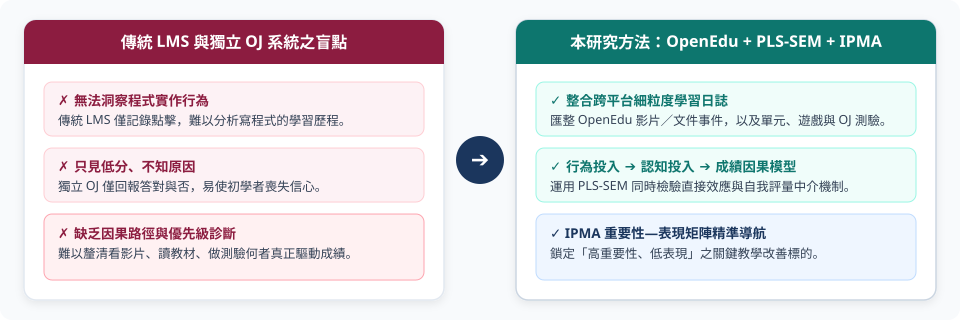
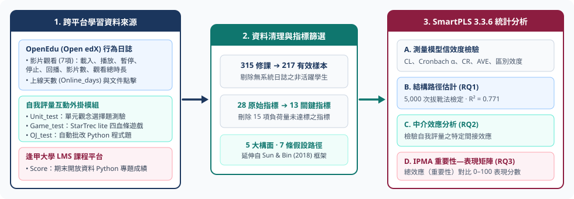
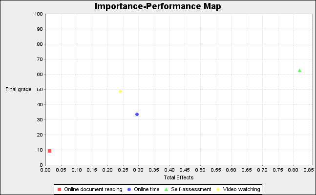
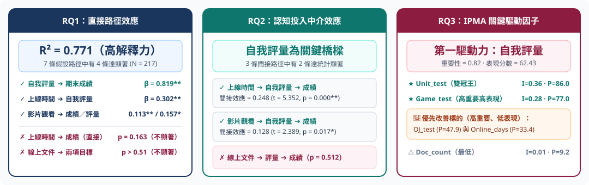

<!-- _class: lead -->

Journal of Information Technology Education: Research · 第 21 卷，2022，pp. 403–423

# 探討線上程式設計課程中學生行為投入模式對學習成效之影響

基於 <strong>偏最小平方結構方程模型（PLS-SEM）</strong> 與 <strong>重要性—表現矩陣分析（IPMA）</strong> 之實證研究

<strong>薛念林（Nien-Lin Hsueh）</strong>、<strong>Bilegjargal Daramsenge*</strong> 與 <strong>Lien-Chi Lai</strong> 
逢甲大學 資訊工程學系（Department of Information Engineering and Computer Science, FCU） 
<code>nlhsueh@fcu.edu.tw</code> · <code>P0731809@o365.fcu.edu.tw</code> · <code>P1000433@mail.fcu.edu.tw</code>

科技部研究計畫補助：MOST 110-2221-E-035-031-MY2 · DOI: 10.28945/5010

<!--
論文脈絡與研究貢獻：
- 書目資訊：Hsueh, N.-L., Daramsenge, B., & Lai, L.-C. (2022). "Exploring the Influence of Students' Modes of Behavioral Engagement in an Online Programming Course Using the Partial Least Squares Structural Equation Modeling Approach." Journal of Information Technology Education: Research (JITE:Research), 21, 403–423（DOI: 10.28945/5010）。稿件於 2022 年 5 月 17 日收件、7 月 17 日修訂、8 月 4 日接受，獲科技部計畫 MOST 110-2221-E-035-031-MY2 補助。
- 雙重研究目標：（1）實證剖析線上程式設計課程中，各類行為投入（Behavioral Engagement）如何直接及透過認知投入（Cognitive Engagement）間接影響期末成績；（2）進一步運用重要性—表現矩陣分析（IPMA），識別對學生成績具最高策略槓桿的潛在構面與細部日誌指標。
- 實證場域：以台灣逢甲大學 2021 年春季學期混成式 Python 程式設計課程之 217 位活躍大學生為樣本，整合 OpenEdu（Open edX）磨課師平台日誌與自建互動評量外掛（StarTrec lite 遊戲測驗與自動批改 Online Judge）。
-->

---

## 破題：「天天登入又點講義！」為何程式成績卻沒起色？

<strong>核心發現：</strong>單純每天登入系統（<code>Online_days</code>）或點擊線上講義（<code>Doc_count</code>）並<strong>不會直接</strong>提升期末成績；唯有透過<strong>認知自我評量</strong>（<code>Unit_test</code>、<code>Game_test</code>、<code>OJ_test</code>）與<strong>積極觀看教學影片</strong>，行為投入才能真正轉化為高分（<strong>R2 = 77.1%</strong>）。

<!--
核心實證發現與機制解析：
- 被動行為迷思：在遠距程式設計課程中，單純累積上線天數（Online_days）或頻繁點擊線上講義（Doc_count），均無法對期末程式專題成績產生顯著的直接正向效應（H1：beta = 0.047, p = 0.163；H5：beta = -0.018, p = 0.561）。
- 認知轉化關鍵路徑：行為投入必須導入主動的認知自我評量（Unit_test、Game_test、OJ_test），方能轉化為高分。自我評量對期末成績具壓倒性的直接驅動力（H7：beta = 0.819, t = 29.505, p < 0.001），並對「上線時間」發揮完全中介效果（間接效應 beta = 0.248, p < 0.001）。
- 影片觀看的雙重通道優勢：在三類行為投入中，唯獨「影片觀看」同時具備顯著的直接效應（H3：beta = 0.113, p = 0.003）與透過自我評量的間接效應（beta = 0.128, p = 0.017）。整體結構模型成功解釋高達 77.1% 的期末專題成績變異量（R^2 = 0.771，調整後 R^2 = 0.767）。
-->

---

## 簡報大綱

1

[**研究動機與研究問題**](#4)
傳統 LMS 與獨立 OJ 的盲點，以及本研究三大核心問題（RQ1–RQ3）。

2

[**文獻回顧**](#6)
影片觀看行為、線上教材、自我評量與數位學習行為分析之相關研究。

3

[**課程設計與研究模型**](#7)
逢甲大學 Python 混成磨課師（N = 217）、跨平台日誌處理、13 項指標與 H1–H7。

4

[**PLS-SEM 與 IPMA 實證結果**](#12)
測量模型信效度、直接路徑（RQ1）、中介效應（RQ2）與 IPMA 優先順序（RQ3）。

5

[**實務啟示與研究限制**](#17)
給平台開發者、決策者與授課教師的具體建議，以及研究限制反思。

6

[**結論與未來研究方向**](#18)
RQ1–RQ3 核心結論視覺總覽，以及延伸至 MOOC 與情感投入的未來藍圖。

<!--
論文整體架構總覽：
- Introduction（緒論）：剖析傳統 LMS 點擊日誌與獨立 Online Judge（OJ）判分系統的分析盲點，延伸 G. Sun & Bin (2018) 之 MOOC 行為投入框架，提出三大核心研究問題（RQ1 至 RQ3）。
- Literature Review（文獻回顧）：系統性綜整影片觀看行為、互動電子教材、自動化自我評量，以及數位學習行為日誌預測模型之相關實證文獻。
- Course Design & Research Model（課程設計與研究模型）：詳述逢甲大學獲教育部績優磨課師獎之 Python 混成課程（N = 217）、跨平台日誌抽取與清理管線、自 28 項原始日誌篩選保留 13 項指標的 5 大構面定義，以及七條假設路徑（H1 至 H7）。
- Results（實證分析結果）：依序報告測量模型信效度檢定（CL、alpha、CR、AVE、Fornell-Larcker）、5,000 次拔靴法結構路徑檢定、特定間接中介效應，以及構面與指標雙層級 IPMA 結果。
- Discussion, Limitations & Conclusion（討論、限制與結論）：分別針對平台開發者、決策者與授課教師提出實務建議，並反思單一大學樣本、單一指標構面與未納入情感投入之研究限制。
-->

---

## 1.1 研究動機：突破傳統點擊紀錄與單純 OJ 判分盲點

217 位大學生

逢甲大學 2021 春季獲教育部績優磨課師獎之 Python 混成課程有效樣本

5 構面 · 13 指標

行為投入（時間、影片、文件）➔ 認知中介（自我評量）➔ 期末成績

R2 = 0.771

模型具備高度解釋力，可解釋期末 Python 開放資料專題 77.1% 之變異

<!--
研究背景與方法論動機（Introduction）：
- 傳統 LMS 的領域限制：雖然數位學習管理系統（LMS）有助於課後複習、非同步討論與自主配速（Li & Tsai, 2017; Battestilli et al., 2020），但對資訊工程與程式設計學生而言，傳統 LMS 無法記錄與分析真實的程式撰寫與除錯行為。
- 獨立 Online Judge（OJ）的診斷盲點：OJ 系統雖能自動批改程式作業並累積題庫與解題歷程（Kurnia et al., 2001），但多數 OJ 僅能回報學生得分高低，無法解釋低分背後的學習行為成因，容易導致初學者喪失寫程式的信心（Wu et al., 2021）。
- 整合因果模型與策略分析：本研究結合 OpenEdu 細粒度行為日誌與三層次認知自我評量成績，以 217 位活躍學生資料導入 SmartPLS 3.3.6（PLS-SEM 與 IPMA），將靜態點擊統計升級為具高解釋力（R^2 = 0.771）的因果中介與教學優先排序模型。
-->

---

## 1.2 三大研究問題（Research Questions）

* 

RQ1 · 直接效應 — 哪些線上學習習慣能真正直接拉高程式成績？

在線上程式設計課程中，學生的各類行為投入（上線時間、影片觀看、線上文件閱讀）與自我評量對期末成績有何<strong>直接影響</strong>？<em>（對應假設 H1、H3、H5、H7）</em>

* 

RQ2 · 認知中介 — 自我評量是否扮演「行為轉化為高分」的關鍵橋樑？

<strong>認知投入（自我評量：單元測驗、四血條遊戲、OJ 程式實作）</strong>在行為投入與期末成績之間扮演何種<strong>中介角色</strong>？<em>（對應假設 H2、H4、H6 與間接效應檢定）</em>

* 

RQ3 · 優先排序 — 教師與平台最該優先投入資源改善哪一環？

哪些構面與細部日誌指標對學生表現影響最深？又有哪些「高重要性、低表現」的活動最具改善槓桿？<em>（透過重要性—表現矩陣分析 IPMA 探討）</em>

<!--
三大研究問題與假設對應關係（Introduction ＆ Identifying Constructs）：
- RQ1（直接效應）：探討線上程式設計課程中，各類行為投入與認知投入對期末成績之直接影響；由四條直接路徑假設檢驗，分別為 H1（上線時間 -> 期末成績）、H3（影片觀看 -> 期末成績）、H5（線上文件閱讀 -> 期末成績）與 H7（自我評量 -> 期末成績）。
- RQ2（認知中介角色）：探討認知投入（自我評量）在行為投入與期末成績之間的中介機制；由行為指向認知的三條路徑 H2（上線時間 -> 自我評量）、H4（影片觀看 -> 自我評量）、H6（線上文件 -> 自我評量），搭配 5,000 次拔靴法特定間接效應（Specific Indirect Effects）檢定。
- RQ3（關鍵驅動與優先順序）：探討哪些潛在構面與細部日誌指標對學生表現影響最深，以及何處最具教學改善槓桿；透過重要性—表現矩陣分析（IPMA），將標準化總效應（重要性）對照 0 至 100 分標準化均分（表現）進行雙層級定位。
-->

---

## 2. 文獻回顧：線上程式設計之學習投入分析

### 🎬 影片觀看行為
- **影片內嵌測驗**：Cummins et al. (2015) 證實影片內提問能維持高達 **71%–86%** 的學生參與度。
- **重看提升成績**：Picardo et al. (2021) 發現觀看錄影次數與程式課期末成績顯著正相關，重修生多看影片成績明顯進步。
- **觀看策略**：Li (2019) 與 Yoon et al. (2021) 指出主動暫停與回播有助理解程式邏輯。

### 📖 教材閱讀與自我評量
- **互動式教材**：Isomöttönen & Tirronen (2016) 強調電子教材需搭配測驗、即時回饋與內嵌程式框才有效。
- **客觀自評**：Ngai et al. (2010) 證實初學者在適當引導與回饋下能準確自我評量並提升滿意度。
- **降低教師負擔**：Lepp et al. (2017) 指出自動回饋與解析可顯著減少 MOOC 學生重複提問。

### 📊 數位學習行為分析
- **IDE 日誌預測**：Watson et al. (2013) 分析 BlueJ IDE 日誌（N = 45），成功解釋 **42.49%** 課程成績變異。
- **翻轉教室 PLS-SEM**：Wang (2017, 2019) 以 488 名台灣大學生為例，發現問題解決與自我反思對成績影響顯著。
- **研究缺口**：鮮少研究同時結合 **MOOC 行為日誌**、**認知自我評量中介**與 **IPMA**。

<strong>理論基礎：</strong>本研究延伸 <strong>G. Sun &amp; Bin (2018)</strong> 之 MOOC 行為投入評估框架，並結合無須常態分佈假設之 <strong>PLS-SEM</strong>（Hair et al., 2019）進行因果路徑與中介分析。

<!--
文獻脈絡與理論基礎（Literature Review）：
- 影片觀看行為研究：Cummins et al. (2015) 建置互動影片平台，證實影片內嵌測驗能維持 71% 至 86% 的高參與度；Picardo et al. (2021) 發現大學一年級程式課錄影觀看次數與期末成績顯著正相關，且重修生增加觀看次數可顯著拉高成績；Li (2019) 與 Yoon et al. (2021) 則透過先備知識對比與主成分分析（PCA），證實主動暫停與回播策略與高成就密切相關。
- 教材與自我評量研究：Othman et al. (2013) 指出學生偏好小組協作與多元網路教材；Isomöttönen & Tirronen (2016) 強調電子教材必須結合隨堂測驗、即時回饋與內嵌程式編輯框才能有效支援自主學習；Ngai et al. (2010) 證實初學者在適當引導與回饋下能客觀自評；Lepp et al. (2017) 發現自動回饋與題解能有效降低 MOOC 教師回答重複問題的負擔。
- 數位學習行為分析：立基於將行為投入界定為積極參與、專注、努力與持續性之文獻（Deng et al., 2019; Bergdahl et al., 2020; T. K. Chiu, 2022），過去研究包含 Watson et al. (2013) 以 BlueJ IDE 日誌解釋 42.49% 課程成績變異（N = 45）、Wang (2017, 2019) 以 488 名台灣大學生 Moodle 翻轉教室資料建立 PLS-SEM 模型，以及 Xie et al. (2021) 分析三年期混成式 Java 課程日誌進行特徵選擇。
- 理論框架延伸：本研究援引 G. Sun & Bin (2018) 涵蓋八類指標之 MOOC 行為投入評估框架（亦為 Y. Sun & Chai, 2020 所採用），並整合無須常態分佈假設之 PLS-SEM（Hair et al., 2011, 2019）。
-->

---

## 3.1 混成式 Python 課程設計與研究對象

### 🏫 課程架構與互動教學設計
- **課程名稱**：逢甲大學資電學院 2021 春季 **Python 程式設計**（運算、邏輯、集合、函式與基礎 `pandas` 資料分析）。
- **混成模式**：每週 **2 小時** 彈性線上自學 ＋ **1 小時** 實體課堂討論。
- **多元互動設計**：影片中隨堂測驗、Trinket 線上工作坊、Google Slide 閃卡、Google Docs 線上講義、**StarTrec lite 遊戲測驗**與 **Online Judge（OJ）**。
- **教學肯定**：榮獲台灣教育部 **績優磨課師課程獎（Outstanding MOOC Award）**。

### 👥 樣本結構與實務導向評量
- **樣本篩選**：原修課 **315 人** ➔ 剔除無系統行為日誌之非活躍學生後，保留 **217 位有效樣本**。
- **系所組成**：
  - **177 位（82%）** 資訊工程學系學生
  - **40 位（18%）** 跨院系學生（材料、應數、自控、化工、企管、航太、土木、統計、電機等）
- **期末成績（`Score`）**：政府開放資料 Python 專題（如十年交通數據或 1900 年起台灣出生率分析），真實評量問題解決能力。

<strong>為何採用開放資料專題？</strong>貼近學生日常生活的真實資料能降低領域理解門檻，讓初學者專注於 Python 程式實作與分析能力。

<!--
混成式 Python 課程設計、樣本組成與真實評量（Course Description ＆ Final Grade）：
- 混成教學模式與獲獎肯定：逢甲大學資訊電機學院 2021 年春季開設之「Python 程式設計」涵蓋運算、邏輯、集合、函式與基礎 pandas 資料分析，採每週 2 小時不限時地線上自學搭配 1 小時實體課堂討論。互動教材涵蓋影片內嵌隨堂測驗、Trinket 線上工作坊、Google Slide 閃卡、章節化 Google Docs 講義、StarTrec lite 遊戲測驗與 Online Judge，榮獲台灣教育部「績優磨課師課程獎」。
- 樣本篩選與跨院系組成：原修課人數為 315 人，剔除 98 位無系統行為日誌之非活躍帳號後，保留 N = 217 位有效樣本。其中 177 位（82%）為資訊工程學系學生，其餘 40 位（18%）涵蓋材料、應數、自控、化工、企管、航太、土木、統計與電機等九個跨院系學生。
- 期末開放資料專題（Score）：有別於紙筆選擇題考試，期末成績採真實世界 Python 資料分析專題（如分析近十年交通數據或 1900 年以來台灣出生率變化），並提供政府開放資料擷取教學。貼近生活的資料主題可降低領域背景門檻，使專題分數真實反映學生的 Python 問題解決能力（呼應 Kanaparan et al., 2019; Shaw, 2012; Lau & Yuen, 2009）。
-->

---

## 3.2 跨平台學習日誌處理與 PLS-SEM 分析流程

<strong>為何選擇 PLS-SEM（SmartPLS 3.3.6）？</strong>特別適合多構面探索性因果模型、非常態分佈之行為日誌資料與中小樣本（N = 217），並支援 <strong>5,000 次拔靴法中介檢定</strong> 與 <strong>IPMA</strong> 分析。

<!--
跨平台日誌處理管線與 PLS-SEM 方法論依據（Log Data Processing, Fig. 2）：
- 多平台資料整合架構：課程基本管理採用逢甲大學校內 LMS；細粒度學習互動事件則記錄於台灣廣泛使用的 Open edX 延伸磨課師平台 OpenEdu（Ruiz et al., 2014; Y.-C. Chiu et al., 2018）；並額外串接自建之 OJ 系統與 StarTrec lite 遊戲測驗，完整記錄每位學生的答題對錯次數與評量分數。
- 三大活動事件彙整：依學生帳號清理並彙整三類核心事件：（1）作答事件（單元測驗、遊戲關卡、OJ 提交）、（2）頁面跳轉事件（進入閃卡與線上講義頁面的次數）、（3）影片觀看事件（觀看部數、各項播放器操作頻率與累積觀看時長）。
- 選擇 SmartPLS 3.3.6（PLS-SEM）之統計理由：依據 Hair et al. (2011, 2012, 2019)，PLS-SEM 屬於無分佈假設（Distribution-Free）的軟建模方法，特別適用於含多潛在構面的探索性因果模型、高度偏態的學習點擊日誌與中小樣本（N = 217），並可一站式執行 5,000 次雙尾拔靴法檢定與 IPMA 分析。
-->

---

## 3.3 研究模型與七大假設（H1–H7）

### 🧭 假設路徑設計
- **上線時間（Online Time）**：
  - **H1**：上線時間 ➔ 期末成績 *（直接效應）*
  - **H2**：上線時間 ➔ 自我評量
- **影片觀看（Video Watching，7 項行為）**：
  - **H3**：影片觀看 ➔ 期末成績 *（直接效應）*
  - **H4**：影片觀看 ➔ 自我評量
- **線上文件閱讀（Online Doc Reading）**：
  - **H5**：線上文件 ➔ 期末成績 *（直接效應）*
  - **H6**：線上文件 ➔ 自我評量
- **認知中介變項（Self-Assessment）**：
  - **H7**：自我評量 ➔ 期末成績

圖 1：包含 5 大構面、13 項指標與 7 條假設路徑之研究模型。

<!--
結構方程模型設定與七大假設之理論依據（Identifying Constructs ＆ Hypotheses, Fig. 1）：
- 雙層次模型結構（Hair et al., 2011）：測量模型（外部模型）定義 13 項觀測指標與 5 大潛在構面之單向反映關係；結構模型（內部模型）則透過 7 條假設路徑檢驗三類行為投入對期末成績之直接效應與透過認知中介（自我評量）之間接效應。
- 上線時間（H1、H2）：依據 Kuh (2003) 與 Trowler (2010) 將學習投入定義為時間與精力之投入，假設活躍登入天數越多，期末成績越高（H1）且自我評量表現越佳（H2）。
- 影片觀看（H3、H4）：依據 McGowan & Hanna (2015)、Li (2019) 與 Yoon et al. (2021) 對影片觀看行為與程式學習成效之實證，假設積極的影片互動能直接提升期末成績（H3）並促進自我評量表現（H4）。
- 線上文件閱讀（H5、H6）：依據 Leppänen et al. (2017) 發現非侵入式教材使用紀錄對程式課成績具中度預測力，假設線上文件點擊頻率顯著關聯期末成績（H5）與自我評量（H6）。
- 自我評量（H7）：依據 Deng et al. (2019)、Kanaparan et al. (2019)、Lee (2021)、Hu et al. (2021) 與 Ortiz-Rojas et al. (2019)，假設認知自我評量對期末成績具顯著正向影響。
-->

---

## 3.4 行為投入與認知投入構面指標定義

| 投入類型 | 潛在構面 | 日誌觀測指標（自 28 項篩選保留 13 項） | 操作型定義 |
| :--- | :--- | :--- | :--- |
| **行為投入** | **上線時間** | `Online_days`（1 項） | 學生於 OpenEdu 平台有活動紀錄之累積天數 |
| **行為投入** | **影片觀看** | `Load_count`、`Play_count`、`Pause_count`、`Stop_count`、`Seek_backward_count`、`Video_count`、`Watching_time`（7 項） | 載入教室頻率、播放次數、思考暫停、停止觀看、主動回播查找、觀看影片部數與累積觀看總時長 |
| **行為投入** | **線上文件閱讀** | `Doc_count`（1 項） | 點擊依章節拆解之 Google Docs 程式碼與說明教材次數 |
| **認知投入（中介）** | **自我評量** | `Unit_test`、`Game_test`、`OJ_test`（3 項） | 單元選擇題測驗、StarTrec lite 四血條遊戲關卡、OJ 自動批改 Python 程式題 |
| **結果變項（DV）** | **期末成績** | `Score`（1 項） | 期末台灣開放資料 Python 分析專題成績 |

<strong>指標篩選原則：</strong>原始 28 項日誌指標中，15 項因跨負荷量未達 Hair et al. (2019) 標準而剔除；PLS-SEM 原生支援單一指標構面（<code>Online_days</code>、<code>Doc_count</code>、<code>Score</code> 之負荷量為 1.000）。

<!--
五大構面操作型定義與指標篩選機制（Hypotheses ＆ Limitations）：
- 指標篩選（28 項 -> 13 項）：研究初期共自平台抽取 28 項原始日誌指標，經檢核跨負荷量（CL）後剔除 15 項未達 Hair et al. (2019) 標準之指標，保留 13 項具信效度之觀測變項。
- 上線時間（1 項）：Online_days 統計學生在 OpenEdu 平台上留有活動紀錄的總天數。
- 影片觀看（7 項 OpenEdu 事件）：Load_count（video_load，進入數位教室載入頻率）、Play_count（video_play，學習播放頻率）、Pause_count（video_pause，暫停思考消化內容之次數）、Stop_count（video_stop，停止觀看頻率）、Seek_backward_count（seek_backward，主動回播查找特定片段頻率）、Video_count（觀看之不重複影片部數）與 Watching_time（累積觀看總時長）。
- 線上文件閱讀（1 項）：Doc_count 記錄點擊授課教師以 Google Docs 撰寫並依章節拆解之程式碼與說明教材次數；即便學生下載供離線閱讀，仍須先點擊系統連結觸發紀錄。
- 自我評量（3 項）與期末成績（1 項）：自我評量整合 Unit_test、Game_test 與 OJ_test 三項分數；期末成績採專題分數 Score。PLS-SEM 原生支援單一指標構面，其外部負荷量固定為 1.000（Ringle et al., 2012）。
-->

---

## 3.5 認知自我評量外掛模組：遊戲測驗與 OJ 系統

圖 3：(a) StarTrec lite 四血條遊戲測驗 與 (b) Python OJ 系統。

### 🎮 三層次漸進式認知挑戰
1. **`Unit_test`（單元觀念測驗）**：選擇題形式，快速檢核每個單元的 Python 基礎語法與概念理解。
2. **`Game_test`（StarTrec lite 遊戲）**：具挑戰性之遊戲化評量，需集滿 **4 顆愛心（HP）** 才能晉級，答錯須重來，鼓勵查閱教材與同儕討論。
3. **`OJ_test`（Online Judge 實作）**：對初學者難度最高，須撰寫可執行 Python 程式碼並由預設測資自動批改。

<strong>24 小時隨身助教：</strong>即時回饋機制將被動聽講轉化為主動除錯與深度認知投入。

<!--
三層次認知自我評量外掛之教學設計（Self-Assessment Section, Fig. 3）：
- 認知投入定義與角色定位：認知投入（Cognitive Engagement）指學生願意付出必要心智努力以理解複雜概念並精熟困難技能的程度（Deng et al., 2019）。針對傳統程式課缺乏即時個別回饋的痛點，本課程透過嵌入 OpenEdu 的評量外掛扮演 24 小時隨身助教。
- 第一層 Unit_test（單元觀念測驗）：採選擇題形式，於各單元後快速檢核學生對 Python 基礎語法、資料型別與控制結構的概念掌握度。
- 第二層 Game_test（StarTrec lite 遊戲測驗，Fig. 3a）：採遊戲化闖關機制，學生須答對題目累積滿 4 顆愛心（4 HP）方可晉級下一關，失敗則須重新開始。此設計旨在衡量學生主動搜尋補充資訊的動機與能力——答題提示隱藏於線上講義或網際網路中，並明確鼓勵同儕討論。
- 第三層 OJ_test（Online Judge 實作，Fig. 3b）：對初學者最具認知挑戰性，要求學生從零設計並撰寫可執行的 Python 程式碼，由系統依預設測資自動判分；該指標直接記錄學生於 OJ 評量之得分。
-->

---

## 4.1 測量模型檢驗：信度、收斂效度與區別效度

### 表 1：測量模型信度與收斂效度
| 構面 | 觀測指標 | CL | α | CR | AVE |
| :--- | :--- | :---: | :---: | :---: | :---: |
| **自我評量** | `Unit_test` | **0.926** | **0.824** | **0.896** | **0.743** |
| | `Game_test` | **0.866** | | | |
| | `OJ_test` | **0.787** | | | |
| **影片觀看** | `Load_count` | **0.873** | **0.900** | **0.922** | **0.629** |
| | `Watching_time` | **0.857** | | | |
| | `Pause_count` | **0.836** | | | |
| | `Play_count` | **0.792** | | | |
| | `Video_count` | **0.738** | | | |
| | `Seek_backward` | **0.670** | | | |
| | `Stop_count` | **0.655** | | | |
| *單一指標 (×3)* | `Score`/`Doc`/`Days` | 1.000 | — | — | — |

### 表 2：Fornell-Larcker 區別效度
| 構面 | 成績 | 文件 | 時間 | 評量 | 影片 |
| :--- | :---: | :---: | :---: | :---: | :---: |
| **期末成績** | **1.00** | | | | |
| **線上文件** | 0.16 | **1.00** | | | |
| **上線時間** | 0.41 | 0.29 | **1.00** | | |
| **自我評量** | 0.87 | 0.17 | 0.39 | **0.86** | |
| **影片觀看** | 0.38 | 0.26 | 0.46 | 0.31 | **0.79** |

<strong>全數指標達優良標準：</strong>Cronbach's α（&gt; 0.82）、組合信度 CR（&gt; 0.89）與 AVE（&gt; 0.62）皆高於門檻，且對角線 √AVE 均大於構面間相關係數（Hair et al., 2019）。

<!--
反映型測量模型之信效度檢定（Results: Measurement Model, Tables 1 ＆ 2）：
- 檢定門檻（Hair et al., 2019）：探索性研究中負荷量（CL）介於 0.60 至 0.70 為可接受，0.70 至 0.90 為滿意至優良；內部一致性信度 Cronbach's alpha 與組合信度（CR）須大於 0.70，平均變異抽取量（AVE）須大於 0.50。
- 表 1 信度與收斂效度結果：「自我評量」構面表現優異（alpha = 0.824, CR = 0.896, AVE = 0.743），三項指標負荷量均高於 0.78（Unit_test = 0.926、Game_test = 0.866、OJ_test = 0.787）。「影片觀看」構面同樣全數達標（alpha = 0.900, CR = 0.922, AVE = 0.629），七項指標 CL 介於 0.655（Stop_count）與 0.670（Seek_backward_count）至 0.857（Watching_time）與 0.873（Load_count）之間。三項單一指標構面（Score、Doc_count、Online_days）之 CL 為 1.000。
- 表 2 Fornell-Larcker 區別效度（Hair et al., 2011, 2013）：各構面對角線之 √AVE（期末成績 1.000、線上文件 1.000、上線時間 1.000、自我評量 0.862、影片觀看 0.793）整體高於非對角線之構面相關係數（如影片觀看與上線時間相關 0.458、與自我評量相關 0.305）。值得留意的是，自我評量與期末成績之相關係數（0.869）極為貼近自我評量之 √AVE（0.862），反映形成性程式評量與總結性專題成績之間的高度實證連結。
-->

---

## 4.2 RQ1 結構模型與直接路徑效應（H1–H7）

### 表 3：拔靴法直接路徑檢定（5,000 次抽樣）
| 假設 | 路徑關係 | 係數 (O) | t 值 | p 值 | 結果 |
| :-: | :--- | :---: | :---: | :---: | :---: |
| H1 | 上線時間 ➔ 期末成績 | 0.047 | 1.394 | 0.163 | 不顯著 |
| **H2** | **上線時間 ➔ 自我評量** | **0.302** | **5.430** | **0.000\*\*** | **支持** |
| **H3** | **影片觀看 ➔ 期末成績** | **0.113** | **2.937** | **0.003\*\*** | **支持** |
| **H4** | **影片觀看 ➔ 自我評量** | **0.157** | **2.429** | **0.015\*** | **支持** |
| H5 | 線上文件 ➔ 期末成績 | -0.018 | 0.582 | 0.561 | 不顯著 |
| H6 | 線上文件 ➔ 自我評量 | 0.037 | 0.658 | 0.511 | 不顯著 |
| **H7** | **自我評量 ➔ 期末成績** | **0.819** | **29.505** | **0.000\*\*** | **支持** |

<strong>高度解釋力：</strong>期末成績 <strong>R2 = 0.771</strong>（調整後 R2 = 0.767）。在三種行為投入中，<strong>影片觀看</strong>是<em>唯一</em>對期末成績具顯著直接正向影響的因素！

圖 6：PLS 路徑結果（粗線代表達顯著；R2 = 0.771）。

<!--
結構模型路徑檢定與解釋力評估（Results: Structural Model, Tables 3 ＆ 4, Fig. 6）：
- 拔靴法估計設定：採用 SmartPLS 3.3.6 進行 5,000 次拔靴法抽樣與雙尾檢定評估路徑係數顯著性（** p <= 0.01，* p <= 0.05）。
- 獲支持之四條顯著直接路徑：
  1. H7（自我評量 -> 期末成績）：全模型最強直接驅動力（O = 0.819, M = 0.819, SD = 0.028, t = 29.505, p = 0.000**）。
  2. H2（上線時間 -> 自我評量）：驅動認知評量參與之關鍵行為前因（O = 0.302, M = 0.303, SD = 0.056, t = 5.430, p = 0.000**）。
  3. H3（影片觀看 -> 期末成績）：三類行為投入中唯一對期末成績具顯著直接正向影響者（O = 0.113, M = 0.113, SD = 0.039, t = 2.937, p = 0.003**）。
  4. H4（影片觀看 -> 自我評量）：顯著正向提升自我評量得分（O = 0.157, M = 0.164, SD = 0.064, t = 2.429, p = 0.015*）。
- 未獲支持之三條路徑：上線時間 -> 期末成績（H1：O = 0.047, t = 1.394, p = 0.163）、線上文件 -> 期末成績（H5：O = -0.018, t = 0.582, p = 0.561）與線上文件 -> 自我評量（H6：O = 0.037, t = 0.658, p = 0.511）。
- 模型解釋力（表 4）：依據 Hair et al. (2011) 標準（0.75 高、0.50 中、0.25 低），期末成績 R^2 = 0.771（調整後 R^2 = 0.767）達高度樣本內預測力（Substantial）。
-->

---

## 4.3 RQ2 中介效應分析：自我評量為關鍵橋樑

### 表 5：透過自我評量之特定間接效應（5,000 次拔靴法檢定）

| 間接路徑（行為投入 ➔ 認知投入 ➔ 學習成效） | 間接效應 (O) | 樣本均值 (M) | 標準差 | t 值 | p 值 | 中介類型 |
| :--- | :---: | :---: | :---: | :---: | :---: | :---: |
| **上線時間 ➔ 自我評量 ➔ 期末成績** | **0.248** | 0.248 | 0.046 | **5.352** | **0.000\*\*** | **完全中介** |
| **影片觀看 ➔ 自我評量 ➔ 期末成績** | **0.128** | 0.134 | 0.054 | **2.389** | **0.017\*** | **部分中介** |
| 線上文件閱讀 ➔ 自我評量 ➔ 期末成績 | 0.031 | 0.029 | 0.047 | 0.656 | 0.512 | 不顯著 |

完全中介

<strong>上線時間</strong>無法直接拉高成績（p = 0.163），但當學生把時間投入自我評量時，成績顯著躍升（β = 0.248, p = 0.000**）。

雙重管道

<strong>影片觀看</strong>同時透過直接效應（0.113**）與自我評量間接效應（0.128*）帶動學習成效。

講義被忽略

<strong>線上文件</strong>無論直接或間接皆不顯著（p = 0.512）—學生更偏好寫程式與看影片而非閱讀靜態文字。

<!--
自我評量之中介效應檢定（Results: Mediation Analysis, Table 5）：
- 分析意義（Hair et al., 2013）：透過 5,000 次拔靴法正式檢定特定間接效應（Specific Indirect Effects），可精確區分完全中介、部分中介與無效路徑，揭示線上行為投入轉化為學習成效的深層因果機制。
- 上線時間之「完全中介（Full Mediation）」：「上線時間 -> 自我評量 -> 期末成績」之間接效應高度顯著（O = 0.248, M = 0.248, SD = 0.046, t = 5.352, p = 0.000**），而其直接路徑 H1 不顯著（p = 0.163）。這證明在線上程式課中，單純增加登入天數並不會直接提高成績，唯有將上線時間實際投入 Unit_test、Game_test 與 OJ_test 等認知評量活動，才能顯著拉高期末專題表現。
- 影片觀看之「部分中介（Partial Mediation）」：「影片觀看 -> 自我評量 -> 期末成績」達顯著間接效應（O = 0.128, M = 0.134, SD = 0.054, t = 2.389, p = 0.017*），同時保有顯著直接效應 H3（O = 0.113, p = 0.003**）。雙重管道疊加後對期末成績產生約 0.241 的總效應。
- 線上文件閱讀之無效路徑：「線上文件 -> 自我評量 -> 期末成績」間接效應不顯著（O = 0.031, M = 0.029, SD = 0.047, t = 0.656, p = 0.512），再次印證初學者傾向動手寫程式與看影片，而非閱讀靜態線上講義。
-->

---

## 4.4 RQ3 構面層級之重要性—表現矩陣（IPMA）

### 表 6：各構面對期末成績之標準化總效應與表現
| 投入類型 | 潛在構面 | 重要性（總效應） | 表現分數 (0–100) |
| :--- | :--- | :---: | :---: |
| **認知投入** | **自我評量** | **0.82** | **62.43** |
| 行為投入 | **上線時間** | **0.29** | 33.43 |
| 行為投入 | **影片觀看** | **0.24** | 48.70 |
| 行為投入 | 線上文件閱讀 | 0.01 | 9.19 |

<strong>IPMA 策略判讀：</strong>
<ul>
<li><strong>核心主力</strong>：自我評量在重要性（<strong>0.82</strong>）與表現（<strong>62.43</strong>）均居首位。</li>
<li><strong>高槓桿改善區</strong>：上線時間（33.43）與影片觀看（48.70）具顯著重要性但表現偏低，提升空間大。</li>
<li><strong>警訊指標</strong>：線上文件位於左下角（I = 0.01, P = 9.19）。</li>
</ul>

圖 4：構面層級 IPMA（橫軸 = 總效應重要性，縱軸 = 表現分數）。

<!--
構面層級之重要性—表現矩陣分析（Results: IPMA, Table 6, Fig. 4）：
- IPMA 分析原理（Ringle & Sarstedt, 2016; Ahmad & Afthanorhan, 2014; Hair et al., 2012）：以「期末成績」為目標內生構面，將各前因構面之標準化總效應（直接效應＋間接效應＝重要性，繪於橫軸；數值 > 0.10 即達 alpha <= 0.10 顯著水準）對照標準化 0 至 100 分的潛在變項平均表現分數（繪於縱軸），藉此識別最具投資報酬率的教學改善區。
- 表 6 構面排序判讀：
  1. 自我評量（認知投入）：重要性（0.82）與表現分數（62.43）雙雙高居首位，確認其為線上程式課程的核心成效引擎。
  2. 上線時間（行為投入）：重要性居次（0.29，主要源自透過自我評量之完全中介效應），但目前表現偏低（33.43），代表引導學生建立規律上線學習節奏具高度提升潛力。
  3. 影片觀看（行為投入）：重要性排名第三（0.24，結合直接與間接效應），表現居中偏低（48.70），為次要高槓桿改善區。
  4. 線上文件閱讀（行為投入）：重要性（0.01，未達顯著）與表現（9.19）皆敬陪末座，孤立於左下角，顯示靜態文字教材使用率嚴重偏低。
-->

---

## 4.5 RQ3 指標層級 IPMA：精準鎖定改善標的

### 表 7：關鍵細部指標之重要性與表現排序
| 觀測指標 | 類型 | 重要性 | 表現分數 | 策略建議區 |
| :--- | :--- | :---: | :---: | :--- |
| **`Unit_test`** | 認知 | **0.36** | **85.97** | ★ 維持核心優勢 |
| **`OJ_test`** | 認知 | **0.31** | **47.88** | 🎯 **首要改善目標** |
| **`Online_days`** | 行為 | **0.29** | **33.43** | 🎯 **首要改善目標** |
| **`Game_test`** | 認知 | **0.28** | **77.00** | ★ 維持核心優勢 |
| `Video_count` | 行為 | 0.06 | 62.52 | 穩定學習習慣 |
| `Watching_time` | 行為 | 0.04 | 42.16 | 中等表現 |
| `Pause`/`Play` | 行為 | 0.05 / 0.05 | 25.8 / 26.5 | 互動偏低 |
| `Doc_count` | 行為 | 0.01 | 9.19 | 使用率最低 |

圖 5：指標層級 IPMA—提升 <code>OJ_test</code> 與 <code>Online_days</code> 投資報酬率最高。

<!--
指標層級 IPMA 與精準教學改善標的（Results: IPMA, Table 7, Fig. 5）：
- 細部指標拆解價值：將 IPMA 由構面延伸至單一系統日誌指標，可協助教師與平台開發者精準鎖定「每提升 1 分表現即能帶來最大成績增量」的具體功能模組（Ringle & Sarstedt, 2016）。
- 應維持之核心優勢（高重要性、高表現）：Unit_test 在重要性（0.36）與表現（85.97）皆居全體指標之冠，Game_test 亦展現高重要性（0.28）與高表現（77.00），顯示基礎單元測驗與四血條遊戲關卡已成功驅動學生投入。
- 首要改善目標（高重要性、中低表現）：OJ_test 重要性高居第二（0.31），但表現僅達中等（47.88），反映初學者獨立撰寫可執行程式碼的實作門檻偏高；Online_days 重要性居第三（0.29），表現卻僅 33.43。針對 OJ 提供階段式提示鷹架並強化規律學習提醒，可獲最高教學投資報酬率。
- 影片與文件細部指標分佈：影片指標中 Video_count 表現較高（62.52，單項重要性 0.06），其餘依序為 Watching_time（I = 0.04, P = 42.16）、Load_count（0.04, 36.32）、Stop_count（0.03, 35.88）、Play_count（0.05, 26.47）、Pause_count（0.05, 25.78）與 Seek_backward_count（0.04, 13.73）；Doc_count 則雙雙墊底（I = 0.01, P = 9.19）。
-->

---

## 5.1 實務教學啟示與研究限制

### 🏗️ 給平台開發者與大學決策者
- **強化認知自我評量系統**：優先建置貼合學生認知層級的 OJ 自動批改、遊戲化測驗（`Game_test`）與單元測驗（`Unit_test`）。
- **降低 OJ 實作門檻**：`OJ_test` 重要性高（0.31）但表現僅 47.88，提供階段式提示與鷹架題組將大幅釋放學習潛力。

### 👩‍🏫 給授課教師與學習者
- **精製短篇教學影片**：影片觀看兼具直接與間接正向效益，能協助缺課補課、克服語言隔閡與重點複習（Carlisle, 2010; Ronchetti, 2010）。
- **活化線上教材設計**：學生極少閱讀純文字文件（P = 9.19），建議在教材中嵌入互動程式框與隨堂小測驗以提升閱讀誘因。

<strong>⚠️ 限制 1 · 單一大學樣本</strong> 樣本僅限單一大學 217 名大學生，未來需跨校與 MOOC 驗證推論性。

<strong>⚠️ 限制 2 · 單一指標構面</strong> 28 項原始指標剔除 15 項低負荷指標；時間與文件採單一指標構面。

<strong>⚠️ 限制 3 · 未含情感投入</strong> 遠距環境不易精準量測情感與社群互動，本研究聚焦行為與認知維度。

<!--
實務建議與三大研究限制深度剖析（Discussion ＆ Limitations）：
- 給平台開發者與大學決策者：鑑於「上線時間 -> 自我評量」（p < 0.001）與「自我評量 -> 期末成績」（p < 0.001）構成核心因果骨幹，大學應優先投資貼合學生認知層級的自動化自我評量系統（OJ、Game_test、Unit_test），呼應 Wang (2019) 與 Ngai et al. (2010) 之結論；特別是針對高重要性、中表現的 OJ_test（I = 0.31, P = 47.88）導入鷹架題組與即時提示。
- 給授課教師與學習者：呼應 Carlisle (2010) 與 Ronchetti (2010)，精製短篇單元教學影片能透過四大管道助益學習：（a）協助在職或兼職學生彌補缺課落差、（b）讓一般生補回因故缺席的課程、（c）協助克服口語授課語言隔閡、（d）方便反覆複習重點並核對筆記。反之，線上文件表現僅 9.19 分，顯示學生明顯偏好動手寫程式勝過閱讀純文字，教師應將互動程式執行框與隨堂小測驗嵌入電子教材以活化閱讀誘因。
- 三項研究限制：（1）單一大學單一課程 217 名大學生樣本，外部推論至大規模開放 MOOC 族群仍待驗證；（2）原始 28 項指標因負荷量不足剔除 15 項，使上線時間與線上文件僅保留單一指標（負荷量 1.00），未來大樣本下宜擴充多題項日誌；（3）依據 Fredricks et al. (2016) 之行為、認知、情感三維度模型，本研究因遠距環境難以精確量測學生對同儕與教師之情感反應（T. K. Chiu, 2021），尚未納入情感與社群投入構面。
-->

---

## 5.2 結論與未來研究方向

<strong>🌍 1. 擴大至開放 MOOC 族群</strong> 納入跨校、跨背景之大規模線上課程學習者，檢驗模型穩健度。

<strong>🐛 2. 納入細粒度除錯與測試行為</strong> 整合程式除錯、單元測試等多元日誌指標，深化行為構面效度。

<strong>💬 3. 整合情感與社群投入維度</strong> 結合情感回饋與同儕討論互動分析，建構更完整的線上學習投入模型。

<!--
核心結論統整與未來研究藍圖（Conclusion ＆ Future Work）：
- 實證結論總覽：針對 217 位大學生採用無分佈假設之 PLS-SEM 建模分析證實，在各類行為投入中「影片觀看」對學習成效的綜合影響最為關鍵（直接效應 p = 0.003**、間接效應 p = 0.017*）；「自我評量」則為整體模型最強驅動力（beta = 0.819, p = 0.000**）並完全中介「上線時間」（間接效應 beta = 0.248, p = 0.000**）；而「線上文件閱讀」在直接與中介路徑均未達顯著（p > 0.51），上述結果均獲構面與指標層級 IPMA 一致印證。
- 跨領域教育價值：本研究樣本包含 18% 非資訊科系學生（跨足工程、理學與商管院系），研究成果有助於推動跨領域遠距程式教育，協助非本科學習者透過結構化評量與短影片建立運算思維。
- 未來三大研究方向：（1）擴大受試族群至跨校、跨背景之開放式 MOOC 學習者以驗證模型穩健度；（2）納入更細粒度的程式開發日誌（如 IDE 除錯軌跡、編譯錯誤與單元測試行為），強化多題項構面效度；（3）結合情感投入量表與同儕討論社群互動分析，補齊 Fredricks et al. (2016) 之多維度學習投入全貌。
-->

---

<!-- _class: closing -->

# 感謝聆聽！歡迎提問與交流

探討線上程式設計課程中學生行為投入模式對學習成效之影響：基於 PLS-SEM 與 IPMA 之實證研究

<strong>薛念林（Nien-Lin Hsueh）</strong> &nbsp;·&nbsp; <code>nlhsueh@fcu.edu.tw</code> 
<strong>Bilegjargal Daramsenge*</strong> &nbsp;·&nbsp; <code>P0731809@o365.fcu.edu.tw</code> 
<strong>Lien-Chi Lai</strong> &nbsp;·&nbsp; <code>P1000433@mail.fcu.edu.tw</code> 
逢甲大學 資訊工程學系（Department of Information Engineering and Computer Science, FCU） 
JITE:Research, Vol. 21 (2022), pp. 403–423 · DOI: 10.28945/5010 · MOST 110-2221-E-035-031-MY2

<!--
文獻引用與研究資料摘要：
- 論文引用格式：Hsueh, N.-L., Daramsenge, B., & Lai, L.-C. (2022). Exploring the influence of students' modes of behavioral engagement in an online programming course using the partial least squares structural equation modeling approach. Journal of Information Technology Education: Research, 21, 403–423. https://doi.org/10.28945/5010
- 研究團隊與單位：逢甲大學資訊工程學系薛念林教授（Nien-Lin Hsueh）、Bilegjargal Daramsenge（通訊作者，博士候選人）與 Lien-Chi Lai（博士候選人）。
- 經費補助與授權：台灣科技部研究計畫補助（MOST 110-2221-E-035-031-MY2）；本文採創用 CC 姓名標示—非商業性 4.0 國際授權條款（CC BY-NC 4.0）。
- 模型規格摘要：5 大潛在構面、13 項篩選後之跨平台日誌指標、N = 217 有效樣本、SmartPLS 3.3.6（5,000 次拔靴法檢定與雙層級 IPMA）、期末專題成績解釋力 R^2 = 0.771。
-->

