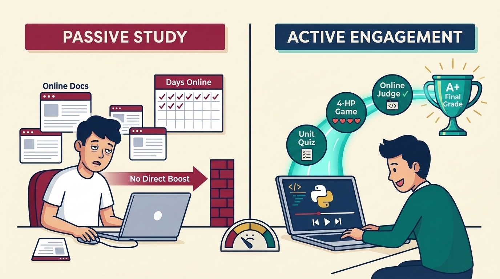
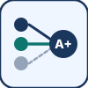
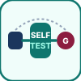
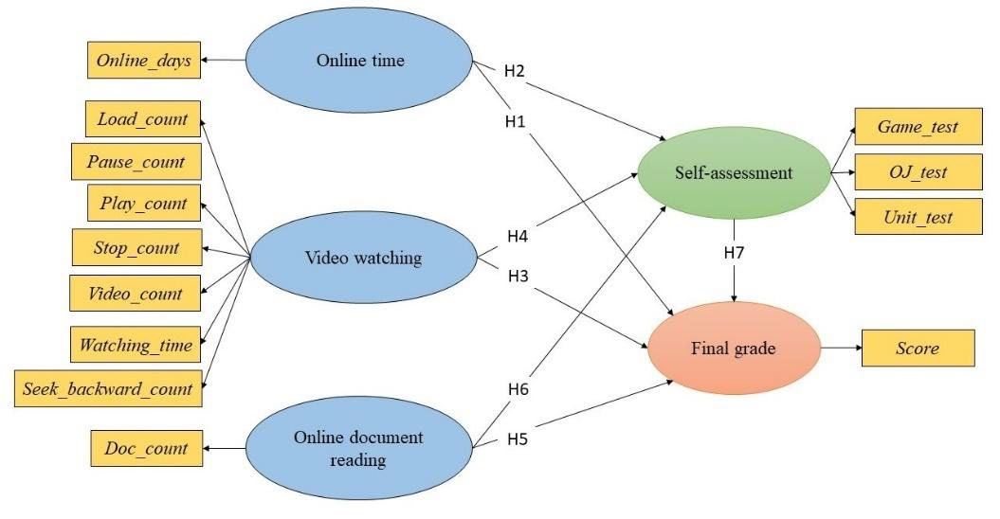
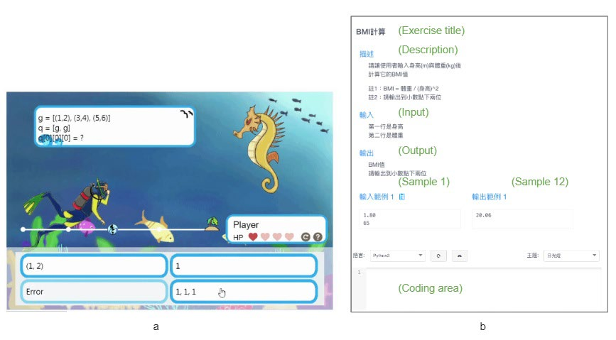
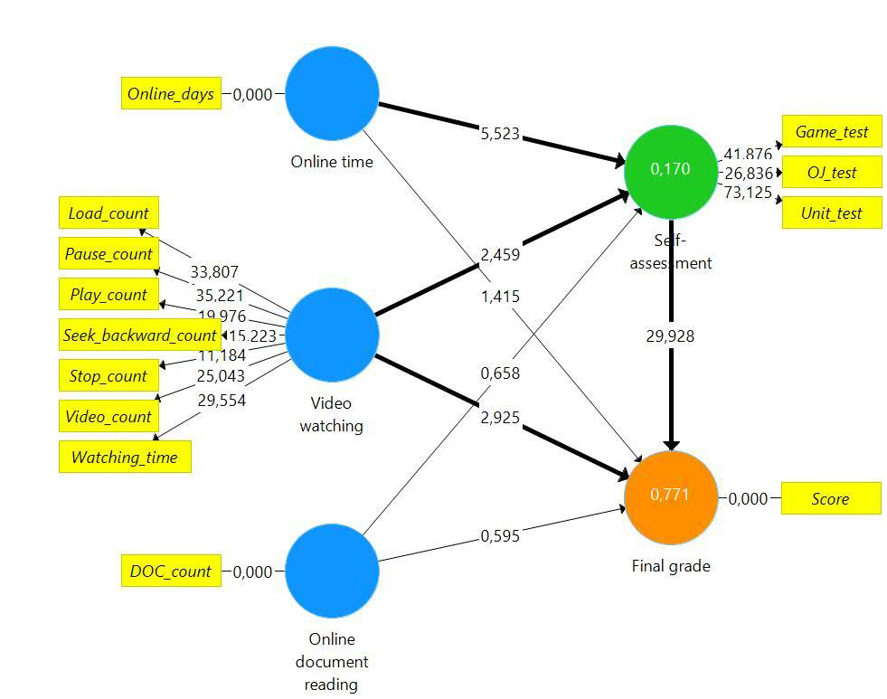
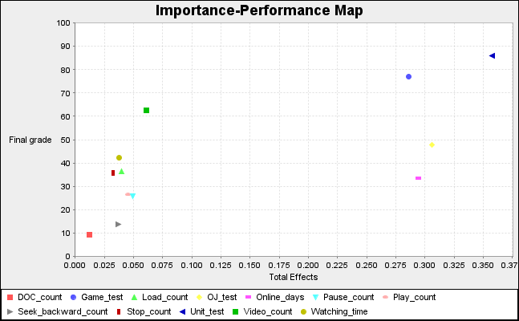

<!-- _class: lead -->

Journal of Information Technology Education: Research · 第 21 卷，2022，pp. 403–423

# 探討線上程式設計課程中學生行為投入模式對學習成效之影響

基於 <strong>偏最小平方結構方程模型（PLS-SEM）</strong> 與 <strong>重要性—表現矩陣分析（IPMA）</strong> 之實證研究

<strong>薛念林（Nien-Lin Hsueh）</strong>、<strong>Bilegjargal Daramsenge*</strong> 與 <strong>Lien-Chi Lai</strong> 
逢甲大學 資訊工程學系（Department of Information Engineering and Computer Science, FCU） 
<code>nlhsueh@fcu.edu.tw</code> · <code>P0731809@o365.fcu.edu.tw</code> · <code>P1000433@mail.fcu.edu.tw</code>

科技部研究計畫補助：MOST 110-2221-E-035-031-MY2 · DOI: 10.28945/5010

<!--
核心訊息：本研究發表於 JITE:Research 2022，運用 PLS-SEM 與 IPMA 實證剖析線上 Python 課程中，學生行為投入如何轉化為期末成績。
口說要點：
- 大家好，今天分享我們逢甲大學資工系團隊針對線上程式設計課程所做的學習分析實證研究。
- 我們結合偏最小平方結構方程模型（PLS-SEM）與重要性—表現矩陣分析（IPMA），從真實系統日誌找出最能提升程式成績的關鍵投入模式。
轉場：我們先從一個線上教學現場非常常見的困惑開始破題。
-->

---

## 破題：「天天登入又點講義！」為何程式成績卻沒起色？

<strong>核心發現：</strong>單純每天登入系統（<code>Online_days</code>）或點擊線上講義（<code>Doc_count</code>）並<strong>不會直接</strong>提升期末成績；唯有透過<strong>認知自我評量</strong>（<code>Unit_test</code>、<code>Game_test</code>、<code>OJ_test</code>）與<strong>積極觀看教學影片</strong>，行為投入才能真正轉化為高分（<strong>R2 = 77.1%</strong>）。

<!--
核心訊息：單純每天登入或點擊線上講義並不會直接拉高成績，唯有透過認知自我評量與積極看影片，努力才能轉化為高分。
口說要點：
- 許多學生會疑惑：「我天天登入系統、也點開講義了，為什麼程式成績還是沒起色？」
- 本研究發現，被動點擊無法直接轉化為成績；唯有將行為投入導入單元測驗、遊戲測驗、OJ 實作等認知自我評量，並搭配積極觀看教學影片，模型才能解釋高達 77.1% 的期末成績變異。
轉場：接下來快速介紹今天簡報的六個章節架構。
-->

---

## 簡報大綱

1

[**研究動機與研究問題**](#4)
傳統 LMS 與獨立 OJ 的盲點，以及本研究三大核心問題（RQ1–RQ3）。

2

[**文獻回顧**](#6)
影片觀看行為、線上教材、自我評量與數位學習行為分析之相關研究。

3

[**課程設計與研究模型**](#7)
逢甲大學 Python 混成磨課師（N = 217）、跨平台日誌處理、13 項指標與 H1–H7。

4

[**PLS-SEM 與 IPMA 實證結果**](#12)
測量模型信效度、直接路徑（RQ1）、中介效應（RQ2）與 IPMA 優先順序（RQ3）。

5

[**實務啟示與研究限制**](#17)
給平台開發者、決策者與授課教師的具體建議，以及研究限制反思。

6

[**結論與未來研究方向**](#18)
RQ1–RQ3 核心結論視覺總覽，以及延伸至 MOOC 與情感投入的未來藍圖。

<!--
核心訊息：本次簡報分為六大部分，從研究動機與文獻回顧，一路推進到課程設計、PLS-SEM 與 IPMA 實證結果及教學啟示。
口說要點：
- 前兩節會說明傳統 LMS 與獨立 OJ 的分析盲點、三大研究問題與相關文獻基礎。
- 第三節介紹逢甲大學獲獎 Python 混成磨課師與研究模型，第四至六節則呈現路徑檢定、中介效應、IPMA 優先排序與未來展望。
轉場：我們先進入第一節，看看為什麼需要結合因果模型與 IPMA 來解讀學習日誌。
-->

---

## 1.1 研究動機：突破傳統點擊紀錄與單純 OJ 判分盲點

217 位大學生

逢甲大學 2021 春季獲教育部績優磨課師獎之 Python 混成課程有效樣本

5 構面 · 13 指標

行為投入（時間、影片、文件）➔ 認知中介（自我評量）➔ 期末成績

R2 = 0.771

模型具備高度解釋力，可解釋期末 Python 開放資料專題 77.1% 之變異

<!--
核心訊息：整合跨平台學習日誌、PLS-SEM 與 IPMA，我們以 217 位大學生資料成功解釋 77.1% 的期末專題成績變異。
口說要點：
- 傳統學習平台只統計點擊次數卻看不出因果關係，而單純的 Online Judge 只看最後得分，忽略了背後的學習歷程。
- 本研究從逢甲大學榮獲教育部績優磨課師獎的 Python 課程中，彙整 5 大構面、13 項日誌指標，建立兼具解釋力與策略價值的評估模型。
轉場：接下來明確聚焦本研究欲回答的三個核心研究問題。
-->

---

## 1.2 三大研究問題（Research Questions）

* 

RQ1 · 直接效應 — 哪些線上學習習慣能真正直接拉高程式成績？

在線上程式設計課程中，學生的各類行為投入（上線時間、影片觀看、線上文件閱讀）與自我評量對期末成績有何<strong>直接影響</strong>？<em>（對應假設 H1、H3、H5、H7）</em>

* 

RQ2 · 認知中介 — 自我評量是否扮演「行為轉化為高分」的關鍵橋樑？

<strong>認知投入（自我評量：單元測驗、四血條遊戲、OJ 程式實作）</strong>在行為投入與期末成績之間扮演何種<strong>中介角色</strong>？<em>（對應假設 H2、H4、H6 與間接效應檢定）</em>

* 

RQ3 · 優先排序 — 教師與平台最該優先投入資源改善哪一環？

哪些構面與細部日誌指標對學生表現影響最深？又有哪些「高重要性、低表現」的活動最具改善槓桿？<em>（透過重要性—表現矩陣分析 IPMA 探討）</em>

<!--
核心訊息：三大研究問題依序檢驗行為投入的直接效應（RQ1）、認知自我評量的中介橋樑（RQ2），以及 IPMA 改善優先順序（RQ3）。
口說要點：
- RQ1 探討上線時間、影片觀看、線上文件與自我評量中，哪些習慣能直接拉高期末程式成績。
- RQ2 檢驗認知自我評量（單元測驗、四血條遊戲、OJ 實作）是否在行為投入與期末成績之間扮演關鍵中介角色。
- RQ3 運用 IPMA 矩陣，找出高重要性但目前表現偏低、最具投資報酬率的改善目標。
轉場：在介紹課程設計前，先簡要回顧線上程式設計學習投入的相關文獻。
-->

---

## 2. 文獻回顧：線上程式設計之學習投入分析

### 🎬 影片觀看行為
- **影片內嵌測驗**：Cummins et al. (2015) 證實影片內提問能維持高達 **71%–86%** 的學生參與度。
- **重看提升成績**：Picardo et al. (2021) 發現觀看錄影次數與程式課期末成績顯著正相關，重修生多看影片成績明顯進步。
- **觀看策略**：Li (2019) 與 Yoon et al. (2021) 指出主動暫停與回播有助理解程式邏輯。

### 📖 教材閱讀與自我評量
- **互動式教材**：Isomöttönen & Tirronen (2016) 強調電子教材需搭配測驗、即時回饋與內嵌程式框才有效。
- **客觀自評**：Ngai et al. (2010) 證實初學者在適當引導與回饋下能準確自我評量並提升滿意度。
- **降低教師負擔**：Lepp et al. (2017) 指出自動回饋與解析可顯著減少 MOOC 學生重複提問。

### 📊 數位學習行為分析
- **IDE 日誌預測**：Watson et al. (2013) 分析 BlueJ IDE 日誌（N = 45），成功解釋 **42.49%** 課程成績變異。
- **翻轉教室 PLS-SEM**：Wang (2017, 2019) 以 488 名台灣大學生為例，發現問題解決與自我反思對成績影響顯著。
- **研究缺口**：鮮少研究同時結合 **MOOC 行為日誌**、**認知自我評量中介**與 **IPMA**。

<strong>理論基礎：</strong>本研究延伸 <strong>G. Sun &amp; Bin (2018)</strong> 之 MOOC 行為投入評估框架，並結合無須常態分佈假設之 <strong>PLS-SEM</strong>（Hair et al., 2019）進行因果路徑與中介分析。

<!--
核心訊息：既有文獻分別證實影片互動、互動教材與 IDE 日誌的重要性，但鮮少同時整合 MOOC 日誌、認知中介與 IPMA。
口說要點：
- 影片研究指出，影片內嵌測驗可維持 71% 至 86% 高參與度，主動暫停與回播也有助於理解程式邏輯。
- 教材與自評研究顯示，純文字電子書必須搭配即時回饋與練習框才有效，且自動解析能減輕 MOOC 教師負擔。
- 本研究延伸 G. Sun & Bin 的 MOOC 行為投入框架，並採用不須常態假設的 PLS-SEM 進行整合建模。
轉場：接著進入第三節，詳細介紹我們的混成式 Python 課程與研究樣本。
-->

---

## 3.1 混成式 Python 課程設計與研究對象

### 🏫 課程架構與互動教學設計
- **課程名稱**：逢甲大學資電學院 2021 春季 **Python 程式設計**（運算、邏輯、集合、函式與基礎 `pandas` 資料分析）。
- **混成模式**：每週 **2 小時** 彈性線上自學 ＋ **1 小時** 實體課堂討論。
- **多元互動設計**：影片中隨堂測驗、Trinket 線上工作坊、Google Slide 閃卡、Google Docs 線上講義、**StarTrec lite 遊戲測驗**與 **Online Judge（OJ）**。
- **教學肯定**：榮獲台灣教育部 **績優磨課師課程獎（Outstanding MOOC Award）**。

### 👥 樣本結構與實務導向評量
- **樣本篩選**：原修課 **315 人** ➔ 剔除無系統行為日誌之非活躍學生後，保留 **217 位有效樣本**。
- **系所組成**：
  - **177 位（82%）** 資訊工程學系學生
  - **40 位（18%）** 跨院系學生（材料、應數、自控、化工、企管、航太、土木、統計、電機等）
- **期末成績（`Score`）**：政府開放資料 Python 專題（如十年交通數據或 1900 年起台灣出生率分析），真實評量問題解決能力。

<strong>為何採用開放資料專題？</strong>貼近學生日常生活的真實資料能降低領域理解門檻，讓初學者專注於 Python 程式實作與分析能力。

<!--
核心訊息：本研究以逢甲大學 217 位修習混成式 Python 課程的大學生為樣本，並以政府開放資料專題作為真實評量指標。
口說要點：
- 課程採每週 2 小時彈性線上自學加上 1 小時實體討論，並整合影片測驗、Trinket 工作坊、StarTrec lite 遊戲測驗與 OJ 系統。
- 原修課 315 人中剔除無紀錄者後保留 217 位有效樣本，涵蓋 82% 資工系與 18% 跨院系學生。
- 期末成績採用台灣政府開放資料專題，讓初學者在熟悉的情境中展現真實的 Python 問題解決能力。
轉場：來看看我們如何整合多平台日誌並匯入 SmartPLS 進行分析。
-->

---

## 3.2 跨平台學習日誌處理與 PLS-SEM 分析流程

<strong>為何選擇 PLS-SEM（SmartPLS 3.3.6）？</strong>特別適合多構面探索性因果模型、非常態分佈之行為日誌資料與中小樣本（N = 217），並支援 <strong>5,000 次拔靴法中介檢定</strong> 與 <strong>IPMA</strong> 分析。

<!--
核心訊息：本研究串聯 OpenEdu 與外掛評量模組的跨平台日誌，並透過 SmartPLS 3.3.6 進行 5,000 次拔靴法檢定與 IPMA 分析。
口說要點：
- 如流程圖所示，我們將影片操作、文件點擊與三類測驗成績依學生彙整清理，並依跨負荷量篩選保留具代表性的指標。
- 由於數位學習點擊日誌多呈偏態非常態分佈，且樣本數為 217 人，採用 PLS-SEM 是最穩健的統計選擇。
轉場：接下來看看本研究所建構的因果研究模型與七條假設路徑。
-->

---

## 3.3 研究模型與七大假設（H1–H7）

### 🧭 假設路徑設計
- **上線時間（Online Time）**：
  - **H1**：上線時間 ➔ 期末成績 *（直接效應）*
  - **H2**：上線時間 ➔ 自我評量
- **影片觀看（Video Watching，7 項行為）**：
  - **H3**：影片觀看 ➔ 期末成績 *（直接效應）*
  - **H4**：影片觀看 ➔ 自我評量
- **線上文件閱讀（Online Doc Reading）**：
  - **H5**：線上文件 ➔ 期末成績 *（直接效應）*
  - **H6**：線上文件 ➔ 自我評量
- **認知中介變項（Self-Assessment）**：
  - **H7**：自我評量 ➔ 期末成績

圖 1：包含 5 大構面、13 項指標與 7 條假設路徑之研究模型。

<!--
核心訊息：研究模型包含七條假設路徑，同時檢驗三類行為投入對期末成績的直接影響與透過自我評量的間接影響。
口說要點：
- 請看右側圖 1：上線時間、影片觀看與線上文件各自連接至期末成績（H1、H3、H5），也各自指向認知中介構面「自我評量」（H2、H4、H6）。
- 最後以 H7 檢驗自我評量對期末開放資料專題成績的直接影響力。
轉場：這五大構面具體對應哪些系統日誌指標？我們看下一頁的定義總表。
-->

---

## 3.4 行為投入與認知投入構面指標定義

| 投入類型 | 潛在構面 | 日誌觀測指標（自 28 項篩選保留 13 項） | 操作型定義 |
| :--- | :--- | :--- | :--- |
| **行為投入** | **上線時間** | `Online_days`（1 項） | 學生於 OpenEdu 平台有活動紀錄之累積天數 |
| **行為投入** | **影片觀看** | `Load_count`、`Play_count`、`Pause_count`、`Stop_count`、`Seek_backward_count`、`Video_count`、`Watching_time`（7 項） | 載入教室頻率、播放次數、思考暫停、停止觀看、主動回播查找、觀看影片部數與累積觀看總時長 |
| **行為投入** | **線上文件閱讀** | `Doc_count`（1 項） | 點擊依章節拆解之 Google Docs 程式碼與說明教材次數 |
| **認知投入（中介）** | **自我評量** | `Unit_test`、`Game_test`、`OJ_test`（3 項） | 單元選擇題測驗、StarTrec lite 四血條遊戲關卡、OJ 自動批改 Python 程式題 |
| **結果變項（DV）** | **期末成績** | `Score`（1 項） | 期末台灣開放資料 Python 分析專題成績 |

<strong>指標篩選原則：</strong>原始 28 項日誌指標中，15 項因跨負荷量未達 Hair et al. (2019) 標準而剔除；PLS-SEM 原生支援單一指標構面（<code>Online_days</code>、<code>Doc_count</code>、<code>Score</code> 之負荷量為 1.000）。

<!--
核心訊息：從 28 項原始日誌篩選保留 13 項有效指標，涵蓋七項細粒度影片行為與三層次認知自我評量。
口說要點：
- 影片觀看由載入次數、總觀看時長、暫停、播放、影片部數、主動回播與停止等 7 項 OpenEdu 行為組成。
- 上線天數、文件點擊數與期末成績為單一指標構面，PLS-SEM 原生支援且負荷量為 1.000。
- 自我評量則整合單元選擇題、遊戲測驗與 OJ 程式實作三項評量成績。
轉場：我們特別來看看提升認知投入的兩大互動外掛：遊戲測驗與 OJ 系統。
-->

---

## 3.5 認知自我評量外掛模組：遊戲測驗與 OJ 系統

圖 3：(a) StarTrec lite 四血條遊戲測驗 與 (b) Python OJ 系統。

### 🎮 三層次漸進式認知挑戰
1. **`Unit_test`（單元觀念測驗）**：選擇題形式，快速檢核每個單元的 Python 基礎語法與概念理解。
2. **`Game_test`（StarTrec lite 遊戲）**：具挑戰性之遊戲化評量，需集滿 **4 顆愛心（HP）** 才能晉級，答錯須重來，鼓勵查閱教材與同儕討論。
3. **`OJ_test`（Online Judge 實作）**：對初學者難度最高，須撰寫可執行 Python 程式碼並由預設測資自動批改。

<strong>24 小時隨身助教：</strong>即時回饋機制將被動聽講轉化為主動除錯與深度認知投入。

<!--
核心訊息：三層次自我評量外掛宛如 24 小時隨身助教，透過即時回饋將被動看片轉化為主動除錯與深度思考。
口說要點：
- 圖 3 展示了我們開發的兩個外掛：左側是 StarTrec lite 四血條遊戲測驗，右側是自動批改的 Python Online Judge。
- 難度由淺入深：先以 Unit_test 檢核基礎語法，再透過答錯須重來的 Game_test 促發查閱與討論，最後在 OJ_test 撰寫可執行程式碼。
轉場：接下來進入第四節，先檢驗測量模型的信度與效度是否達標。
-->

---

## 4.1 測量模型檢驗：信度、收斂效度與區別效度

### 表 1：測量模型信度與收斂效度
| 構面 | 觀測指標 | CL | α | CR | AVE |
| :--- | :--- | :---: | :---: | :---: | :---: |
| **自我評量** | `Unit_test` | **0.926** | **0.824** | **0.896** | **0.743** |
| | `Game_test` | **0.866** | | | |
| | `OJ_test` | **0.787** | | | |
| **影片觀看** | `Load_count` | **0.873** | **0.900** | **0.922** | **0.629** |
| | `Watching_time` | **0.857** | | | |
| | `Pause_count` | **0.836** | | | |
| | `Play_count` | **0.792** | | | |
| | `Video_count` | **0.738** | | | |
| | `Seek_backward` | **0.670** | | | |
| | `Stop_count` | **0.655** | | | |
| *單一指標 (×3)* | `Score`/`Doc`/`Days` | 1.000 | — | — | — |

### 表 2：Fornell-Larcker 區別效度
| 構面 | 成績 | 文件 | 時間 | 評量 | 影片 |
| :--- | :---: | :---: | :---: | :---: | :---: |
| **期末成績** | **1.00** | | | | |
| **線上文件** | 0.16 | **1.00** | | | |
| **上線時間** | 0.41 | 0.29 | **1.00** | | |
| **自我評量** | 0.87 | 0.17 | 0.39 | **0.86** | |
| **影片觀看** | 0.38 | 0.26 | 0.46 | 0.31 | **0.79** |

<strong>全數指標達優良標準：</strong>Cronbach's α（&gt; 0.82）、組合信度 CR（&gt; 0.89）與 AVE（&gt; 0.62）皆高於門檻，且對角線 √AVE 均大於構面間相關係數（Hair et al., 2019）。

<!--
核心訊息：測量模型在內部一致性信度、收斂效度與區別效度上全數通過 Hair et al. 的嚴格標準。
口說要點：
- 表 1 顯示自我評量與影片觀看兩個多題項構面表現優良：Cronbach's α 均高於 0.82，組合信度 CR 高於 0.89，AVE 也都超過 0.62。
- 表 2 的 Fornell-Larcker 檢定中，對角線上的 √AVE 全數大於非對角線的構面相關係數，確認各構面具備良好區別效度。
轉場：確認測量品質無虞後，我們揭曉 RQ1 的結構模型與直接路徑結果。
-->

---

## 4.2 RQ1 結構模型與直接路徑效應（H1–H7）

### 表 3：拔靴法直接路徑檢定（5,000 次抽樣）
| 假設 | 路徑關係 | 係數 (O) | t 值 | p 值 | 結果 |
| :-: | :--- | :---: | :---: | :---: | :---: |
| H1 | 上線時間 ➔ 期末成績 | 0.047 | 1.394 | 0.163 | 不顯著 |
| **H2** | **上線時間 ➔ 自我評量** | **0.302** | **5.430** | **0.000\*\*** | **支持** |
| **H3** | **影片觀看 ➔ 期末成績** | **0.113** | **2.937** | **0.003\*\*** | **支持** |
| **H4** | **影片觀看 ➔ 自我評量** | **0.157** | **2.429** | **0.015\*** | **支持** |
| H5 | 線上文件 ➔ 期末成績 | -0.018 | 0.582 | 0.561 | 不顯著 |
| H6 | 線上文件 ➔ 自我評量 | 0.037 | 0.658 | 0.511 | 不顯著 |
| **H7** | **自我評量 ➔ 期末成績** | **0.819** | **29.505** | **0.000\*\*** | **支持** |

<strong>高度解釋力：</strong>期末成績 <strong>R2 = 0.771</strong>（調整後 R2 = 0.767）。在三種行為投入中，<strong>影片觀看</strong>是<em>唯一</em>對期末成績具顯著直接正向影響的因素！

圖 6：PLS 路徑結果（粗線代表達顯著；R2 = 0.771）。

<!--
核心訊息：自我評量是期末成績最強的直接驅動力（0.819），而影片觀看是三種行為投入中唯一具顯著直接正向影響的因素（0.113）。
口說要點：
- 表 3 與圖 6 顯示七條假設中有四條獲得支持，整體模型解釋了 77.1% 的期末成績變異。
- 關鍵發現是：單純上線時間（H1, p = 0.163）與線上文件閱讀（H5, p = 0.561）都無法直接拉高成績。
- 相反地，自我評量的直接係數高達 0.819（t = 29.505），影片觀看也能同時直接提升成績（0.113）與自我評量表現（0.157）。
轉場：既然上線時間沒有直接效應，它究竟是如何發揮作用的？我們看 RQ2 的中介分析。
-->

---

## 4.3 RQ2 中介效應分析：自我評量為關鍵橋樑

### 表 5：透過自我評量之特定間接效應（5,000 次拔靴法檢定）

| 間接路徑（行為投入 ➔ 認知投入 ➔ 學習成效） | 間接效應 (O) | 樣本均值 (M) | 標準差 | t 值 | p 值 | 中介類型 |
| :--- | :---: | :---: | :---: | :---: | :---: | :---: |
| **上線時間 ➔ 自我評量 ➔ 期末成績** | **0.248** | 0.248 | 0.046 | **5.352** | **0.000\*\*** | **完全中介** |
| **影片觀看 ➔ 自我評量 ➔ 期末成績** | **0.128** | 0.134 | 0.054 | **2.389** | **0.017\*** | **部分中介** |
| 線上文件閱讀 ➔ 自我評量 ➔ 期末成績 | 0.031 | 0.029 | 0.047 | 0.656 | 0.512 | 不顯著 |

完全中介

<strong>上線時間</strong>無法直接拉高成績（p = 0.163），但當學生把時間投入自我評量時，成績顯著躍升（β = 0.248, p = 0.000**）。

雙重管道

<strong>影片觀看</strong>同時透過直接效應（0.113**）與自我評量間接效應（0.128*）帶動學習成效。

講義被忽略

<strong>線上文件</strong>無論直接或間接皆不顯著（p = 0.512）—學生更偏好寫程式與看影片而非閱讀靜態文字。

<!--
核心訊息：自我評量對上線時間扮演「完全中介」、對影片觀看扮演「部分中介」，而線上文件在雙管道皆不顯著。
口說要點：
- 表 5 的 5,000 次拔靴法檢定顯示，上線時間透過自我評量對期末成績產生顯著間接效應（0.248, p < 0.001），屬於完全中介——重點不在掛網幾天，而在上線後是否做評量。
- 影片觀看具備雙重管道優勢，既有直接效應（0.113），也透過自我評量產生間接效應（0.128）。
- 線上文件無論直接或間接皆不顯著（p = 0.512），反映初學者偏好寫程式與看影片而非閱讀靜態長文。
轉場：了解因果與中介機制後，我們進一步透過 RQ3 的 IPMA 找出教學改善的優先順序。
-->

---

## 4.4 RQ3 構面層級之重要性—表現矩陣（IPMA）

### 表 6：各構面對期末成績之標準化總效應與表現
| 投入類型 | 潛在構面 | 重要性（總效應） | 表現分數 (0–100) |
| :--- | :--- | :---: | :---: |
| **認知投入** | **自我評量** | **0.82** | **62.43** |
| 行為投入 | **上線時間** | **0.29** | 33.43 |
| 行為投入 | **影片觀看** | **0.24** | 48.70 |
| 行為投入 | 線上文件閱讀 | 0.01 | 9.19 |

<strong>IPMA 策略判讀：</strong>
<ul>
<li><strong>核心主力</strong>：自我評量在重要性（<strong>0.82</strong>）與表現（<strong>62.43</strong>）均居首位。</li>
<li><strong>高槓桿改善區</strong>：上線時間（33.43）與影片觀看（48.70）具顯著重要性但表現偏低，提升空間大。</li>
<li><strong>警訊指標</strong>：線上文件位於左下角（I = 0.01, P = 9.19）。</li>
</ul>

圖 4：構面層級 IPMA（橫軸 = 總效應重要性，縱軸 = 表現分數）。

<!--
核心訊息：構面層級 IPMA 顯示自我評量居於絕對主力，而上線時間與影片觀看則是高槓桿改善區。
口說要點：
- 圖 4 與表 6 中，橫軸代表對期末成績的總效應重要性，縱軸代表 0 到 100 分的目前表現。
- 自我評量在重要性（0.82）與表現（62.43）皆穩居第一；上線時間（0.29, 33.43）與影片觀看（0.24, 48.70）重要性顯著但表現尚有空間。
- 線上文件落在左下角（重要性 0.01、表現 9.19），是明顯的警訊指標。
轉場：接下來把鏡頭拉近到細部日誌指標層級，精準鎖定投資報酬率最高的改善標的。
-->

---

## 4.5 RQ3 指標層級 IPMA：精準鎖定改善標的

### 表 7：關鍵細部指標之重要性與表現排序
| 觀測指標 | 類型 | 重要性 | 表現分數 | 策略建議區 |
| :--- | :--- | :---: | :---: | :--- |
| **`Unit_test`** | 認知 | **0.36** | **85.97** | ★ 維持核心優勢 |
| **`OJ_test`** | 認知 | **0.31** | **47.88** | 🎯 **首要改善目標** |
| **`Online_days`** | 行為 | **0.29** | **33.43** | 🎯 **首要改善目標** |
| **`Game_test`** | 認知 | **0.28** | **77.00** | ★ 維持核心優勢 |
| `Video_count` | 行為 | 0.06 | 62.52 | 穩定學習習慣 |
| `Watching_time` | 行為 | 0.04 | 42.16 | 中等表現 |
| `Pause`/`Play` | 行為 | 0.05 / 0.05 | 25.8 / 26.5 | 互動偏低 |
| `Doc_count` | 行為 | 0.01 | 9.19 | 使用率最低 |

圖 5：指標層級 IPMA—提升 <code>OJ_test</code> 與 <code>Online_days</code> 投資報酬率最高。

<!--
核心訊息：指標層級 IPMA 精準鎖定 OJ_test 與 Online_days 為兩大首要改善目標。
口說要點：
- 對照表 7 與圖 5，Unit_test（重要性 0.36、表現 85.97）與 Game_test（0.28、77.00）表現亮眼，屬於應維持的核心優勢。
- 反觀 OJ_test 重要性高達 0.31 但表現僅 47.88，Online_days 重要性 0.29 而表現僅 33.43。
- 因此，降低 OJ 實作門檻並引導學生養成規律上線習慣，能帶來最大的成績提升效益。
轉場：我們將這些實證數據轉化為給平台開發者、教師的具體建議，並反思研究限制。
-->

---

## 5.1 實務教學啟示與研究限制

### 🏗️ 給平台開發者與大學決策者
- **強化認知自我評量系統**：優先建置貼合學生認知層級的 OJ 自動批改、遊戲化測驗（`Game_test`）與單元測驗（`Unit_test`）。
- **降低 OJ 實作門檻**：`OJ_test` 重要性高（0.31）但表現僅 47.88，提供階段式提示與鷹架題組將大幅釋放學習潛力。

### 👩‍🏫 給授課教師與學習者
- **精製短篇教學影片**：影片觀看兼具直接與間接正向效益，能協助缺課補課、克服語言隔閡與重點複習（Carlisle, 2010; Ronchetti, 2010）。
- **活化線上教材設計**：學生極少閱讀純文字文件（P = 9.19），建議在教材中嵌入互動程式框與隨堂小測驗以提升閱讀誘因。

<strong>⚠️ 限制 1 · 單一大學樣本</strong> 樣本僅限單一大學 217 名大學生，未來需跨校與 MOOC 驗證推論性。

<strong>⚠️ 限制 2 · 單一指標構面</strong> 28 項原始指標剔除 15 項低負荷指標；時間與文件採單一指標構面。

<strong>⚠️ 限制 3 · 未含情感投入</strong> 遠距環境不易精準量測情感與社群互動，本研究聚焦行為與認知維度。

<!--
核心訊息：平台應強化 OJ 鷹架引導與規律練習機制，教師應精製短影片並活化靜態教材，同時正視樣本與情感維度等三項限制。
口說要點：
- 對平台與決策者而言，針對高重要性、中低表現的 OJ_test 提供階段式提示與鷹架題組，最具實務槓桿。
- 對教師而言，短篇教學影片兼具補課與複習價值；而使用率極低的純文字講義（表現 9.19）應改版嵌入互動程式框與小測驗。
- 本研究亦有三大限制：單一大學 217 人樣本、部分構面採單一指標，以及尚未納入情感與社群互動日誌。
轉場：最後我們以視覺總覽統整 RQ1 至 RQ3 的核心結論與未來研究藍圖。
-->

---

## 5.2 結論與未來研究方向

<strong>🌍 1. 擴大至開放 MOOC 族群</strong> 納入跨校、跨背景之大規模線上課程學習者，檢驗模型穩健度。

<strong>🐛 2. 納入細粒度除錯與測試行為</strong> 整合程式除錯、單元測試等多元日誌指標，深化行為構面效度。

<strong>💬 3. 整合情感與社群投入維度</strong> 結合情感回饋與同儕討論互動分析，建構更完整的線上學習投入模型。

<!--
核心訊息：線上行為投入必須導入認知自我評量與主動看片才能轉化為高分，未來將擴大至開放 MOOC 並整合除錯與情感分析。
口說要點：
- 上方圖表完整收斂三大發現：影片觀看是唯一直接正向行為因子（RQ1）、自我評量是核心中介橋樑（RQ2），而 OJ_test 與 Online_days 是最高優先改善標的（RQ3）。
- 未來研究將從三方向推進：擴大至跨校開放 MOOC 族群、納入細粒度程式除錯與測試日誌，並整合情感回饋與同儕互動維度。
轉場：以上是本研究的完整報告，接下來進入結尾頁與現場問答。
-->

---

<!-- _class: closing -->

# 感謝聆聽！歡迎提問與交流

探討線上程式設計課程中學生行為投入模式對學習成效之影響：基於 PLS-SEM 與 IPMA 之實證研究

<strong>薛念林（Nien-Lin Hsueh）</strong> &nbsp;·&nbsp; <code>nlhsueh@fcu.edu.tw</code> 
<strong>Bilegjargal Daramsenge*</strong> &nbsp;·&nbsp; <code>P0731809@o365.fcu.edu.tw</code> 
<strong>Lien-Chi Lai</strong> &nbsp;·&nbsp; <code>P1000433@mail.fcu.edu.tw</code> 
逢甲大學 資訊工程學系（Department of Information Engineering and Computer Science, FCU） 
JITE:Research, Vol. 21 (2022), pp. 403–423 · DOI: 10.28945/5010 · MOST 110-2221-E-035-031-MY2

<!--
核心訊息：感謝各位聆聽，歡迎就 PLS-SEM 模型、IPMA 策略判讀或混成式 Python 課程設計進行交流。
口說要點：
- 非常感謝各位的聆聽與指教，畫面上提供研究團隊聯絡信箱與 JITE:Research 2022 論文資訊供進一步參考。
- 歡迎大家針對跨平台日誌處理、自我評量中介機制，或是遊戲測驗與 OJ 外掛的教學實務提出問題。
轉場：開放現場 Q&A 提問與討論。
-->

