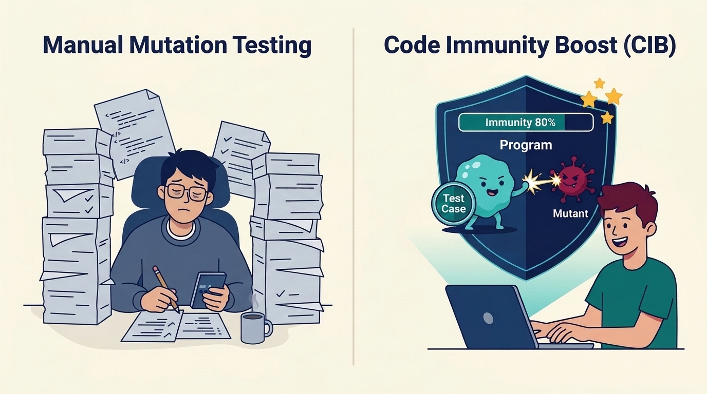
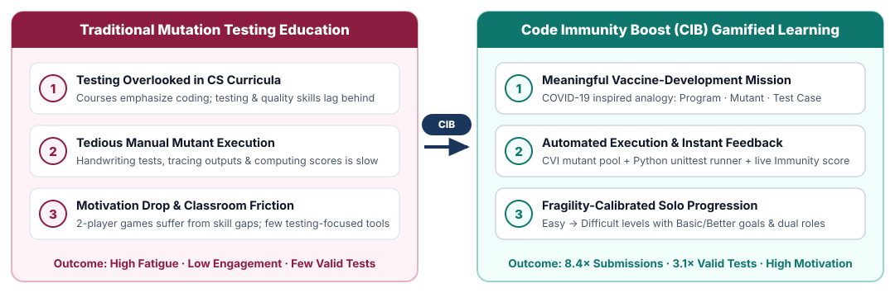
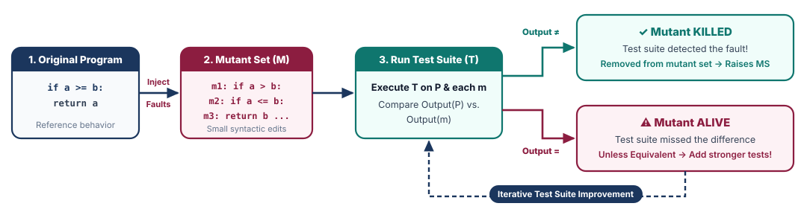
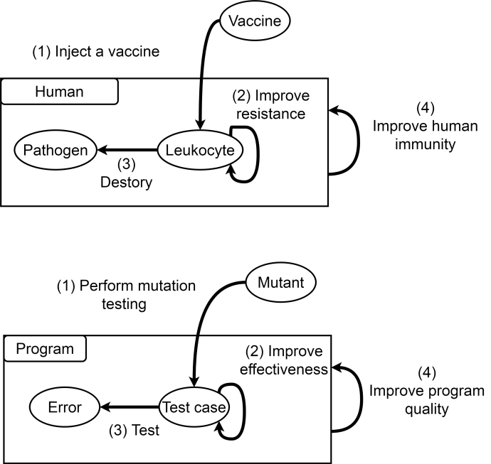
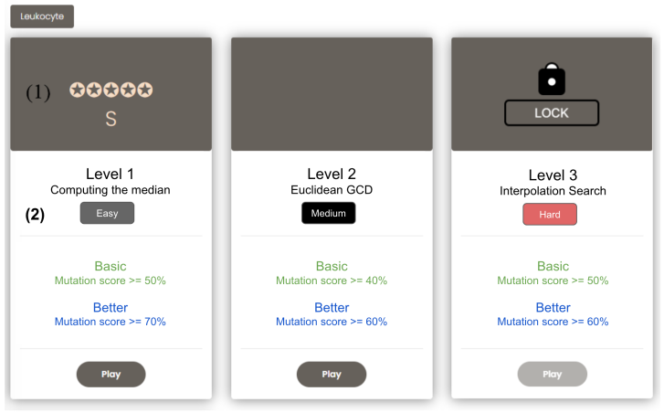
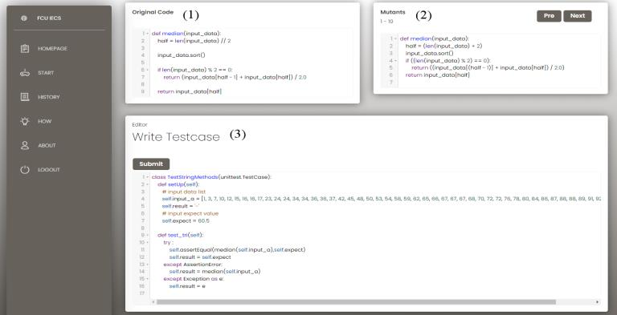
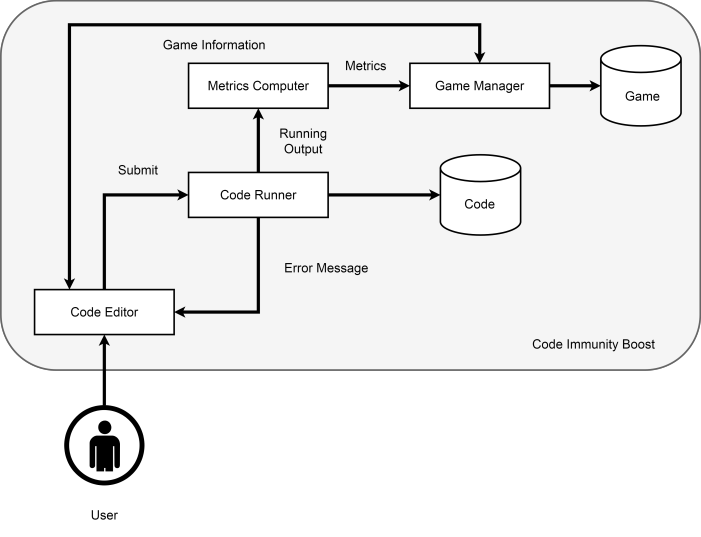
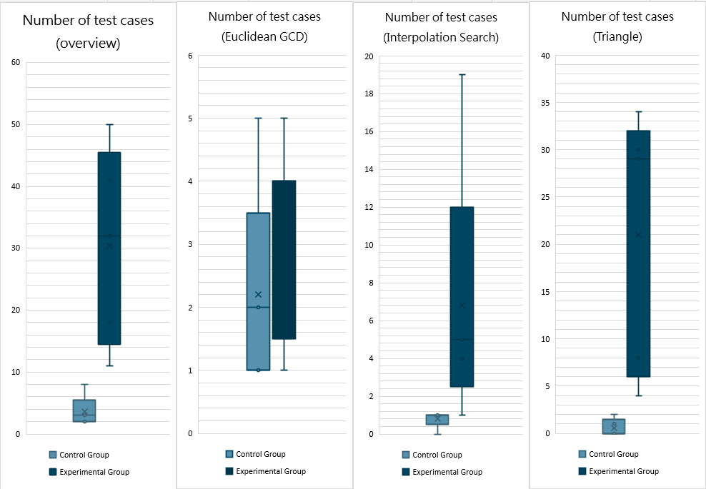
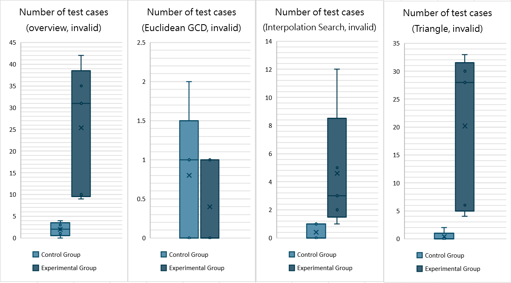
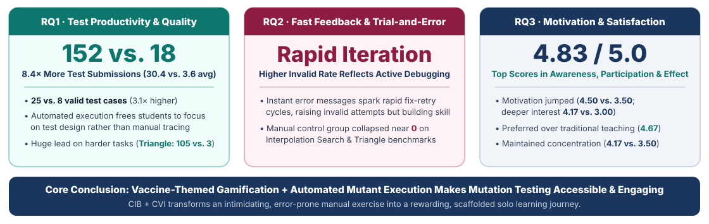

<!-- _class: lead -->

IJIET 2023 · Vol. 13, No. 7 · Gamified Software Testing Education

# Design and Implementation of Gamified Learning System for Mutation Testing

<strong>Code Immunity Boost (CIB)</strong> &amp; <strong>Code Vaccine Incubator (CVI)</strong>: Turning Mutation Testing Education into an Interactive Vaccine-Development Mission

<strong>Nien-Lin Hsueh*</strong>, <strong>Zeng Hung Xuan</strong>, and <strong>Bilegjargal Daramsenge</strong> 
Department of Information Engineering and Computer Science, Feng Chia University, Taiwan 
<code>nlhsueh@fcu.edu.tw</code> · DOI: <code>10.18178/ijiet.2023.13.7.1916</code>

Published in International Journal of Information and Education Technology (pp. 1150–1155, July 2023) · Grant: MOST 110-2221-E-035-031-MY2

<!--
Key Takeaway: We present Code Immunity Boost (CIB) and Code Vaccine Incubator (CVI), a gamified learning platform that transforms mutation testing education into an interactive vaccine-development mission.
Talking Points:
- Welcome everyone. This work, published in IJIET 2023 by our team at Feng Chia University, tackles a persistent pain point in software testing courses: teaching mutation testing effectively.
- Instead of asking students to trace mutants by hand, we turn the workflow into an engaging immune-defense game backed by an automated mutant generator.
Transition: Let's start with a quick visual contrast of why traditional mutation testing classrooms struggle.
-->

---

## Opening Hook: Drowning in Mutant Sheets... or Boosting Code Immunity?

<strong>The Big Idea:</strong> Handwriting and tracing dozens of mutants by hand quickly drains students' motivation. <strong>Code Immunity Boost (CIB)</strong> reframes mutation testing as a <strong>vaccine-development mission</strong>—where <strong>Leukocytes</strong> (test cases) hunt <strong>Vaccines</strong> (mutants) to strengthen the <strong>Human Body</strong> (program).

<!--
Key Takeaway: Manual mutation testing quickly exhausts student motivation, whereas CIB reframes the same rigor as a vaccine-development game.
Talking Points:
- On the left, you see the classic classroom reality: students drowning in paper mutant sheets, manually tracing outputs and losing enthusiasm as soon as programs get non-trivial.
- On the right is Code Immunity Boost: the program becomes a Human Body, mutants become Vaccines, and student-written test cases become Leukocytes hunting those mutants.
Transition: Here is the roadmap for how we designed, built, and evaluated this system.
-->

---

## Presentation Outline

1

[**Introduction & Research Questions**](#4)
Why software testing education needs gamification and our three pilot RQs (RQ1–RQ3).

2

[**Mutation Testing & Related Work**](#6)
Mutant killing workflow, Mutation Score metric, and limitations of Code Defenders.

3

[**CIB Game Design & Architecture**](#8)
Immune-system metaphor, 3 Octalysis drives, fragility-calibrated levels, and 6 core modules.

4

[**Pilot Experiment: Performance & Validity**](#13)
Control (handwriting) vs. Experimental (CIB) submission volume and valid/invalid dynamics.

5

[**Student Satisfaction Survey & Insights**](#16)
5-point Likert evaluation across Motivation (Q1), Attention (Q2), and Learning Outcome (Q3).

6

[**Conclusion & Future Work**](#18)
Visual synthesis of RQ1–RQ3 findings and roadmap for Online Judge integration.

<!--
Key Takeaway: Our talk covers six parts, from motivation and mutation testing basics to CIB's architecture, pilot results, and future roadmap.
Talking Points:
- First, we explain why software testing education lags in gamification and introduce our three research questions.
- Next, we walk through CIB's biological metaphor, Octalysis game mechanics, and six-module architecture, followed by our pilot experiment comparing CIB against handwriting.
Transition: Let's dive into Section 1 to see why gamification is especially needed in software testing.
-->

---

## 1.1 Motivation: Why Software Testing Education Needs Gamification

<strong>Why This Matters:</strong> A systematic mapping of 156 SE gamification studies [15] shows gamification boosts participation, knowledge, and SE practices—yet <strong>software testing remains severely underrepresented</strong> compared to design and process courses.

<!--
Key Takeaway: Software engineering gamification is proven to boost engagement, yet software testing remains severely underrepresented.
Talking Points:
- A systematic mapping of 156 SE gamification studies shows strong gains in student participation and knowledge across design and process courses.
- However, software testing—and mutation testing in particular—still relies heavily on tedious manual exercises where high cognitive overhead kills motivation.
- As the diagram illustrates, CIB replaces that manual bottleneck with instant automated execution and game feedback.
Transition: With that motivation in mind, let's look at the three research questions guiding our pilot study.
-->

---

## 1.2 Research Objectives & Three Research Questions

We evaluate **Code Immunity Boost (CIB)** in a pilot study asking *"How do students learn by using the CIB tool?"* *(revealed step-by-step)*:

* 

RQ1 Does gamified automation help students write more &amp; better test cases?

<strong>How does CIB affect test case submission volume and valid test case construction</strong> compared with traditional manual handwriting?

* 

RQ2 Why do automated players submit more invalid attempts—and is that good?

<strong>How does CIB's instant automated feedback shape invalid submission rates</strong> and iterative trial-and-error learning across difficulty levels?

* 

RQ3 Do students stay motivated, focused, and confident in applying mutation testing?

<strong>How does CIB impact Motivation (Q1), Attention (Q2), and Learning Performance (Q3)</strong> on a 5-point Likert questionnaire?

<!--
Key Takeaway: Our pilot study investigates how CIB affects test productivity (RQ1), trial-and-error feedback dynamics (RQ2), and student motivation and learning outcomes (RQ3).
Talking Points:
- RQ1 measures whether automated gamification helps novices write more total and valid test cases than paper-based handwriting.
- RQ2 unpacks an intriguing pattern: why automated learners submit more invalid attempts, and how instant feedback turns those errors into productive iteration.
- RQ3 evaluates students' Motivation, Attention, and self-reported Learning Performance via a 5-point Likert survey.
Transition: Before introducing the game, let's briefly review how mutation testing and the Mutation Score work.
-->

---

## 2.1 Background: How Mutation Testing Works

<i>ms</i> &nbsp;=&nbsp; <i>killed</i><i>all</i> − <i>equiv</i> &nbsp; ∈ [0.0, 1.0]

<strong>Mutation Score (ms):</strong> Ratio of killed mutants to non-equivalent mutants [17]. <strong>Equivalent mutants</strong> preserve original program behavior and cannot be killed. Higher <code>ms</code> ➔ stronger error-detecting test suite.

<!--
Key Takeaway: Mutation testing evaluates test suite strength by injecting small faults (mutants) and measuring the Mutation Score (ms).
Talking Points:
- As shown in the cycle diagram, we take an original program, generate slightly modified mutants, and run the student's test suite against both.
- If a test produces a different output on a mutant, that mutant is "killed"; otherwise it survives.
- The Mutation Score equals killed mutants divided by all non-equivalent mutants, ranging from 0.0 to 1.0, where higher scores mean stronger fault-detection power.
Transition: Now let's compare CIB against existing gamified tools, especially Code Defenders.
-->

---

## 2.2 Related Work: Code Defenders & Research Gap

While **Code Defenders** [16, 18, 19] pioneered gamified mutation testing via 2-player *Attacker vs. Defender* competition, classroom adoption faces practical barriers:

| Learning Approach | Play Mode | Difficulty Control | Feedback Mechanism | Key Limitation / Advantage |
| :--- | :--- | :--- | :--- | :--- |
| **Manual Handwriting** | Solo paper-based | Unstructured | Manual tracing & calculation | Extreme workload; students lose motivation on complex programs |
| **Code Defenders [16, 18, 19]** | 2-player (Attacker vs. Defender) + AI mode | No explicit quantitative difficulty index | Competitive round scoring | Large **skill gap** between paired students frustrates weaker side; AI mode cannot fully replace 2-player balance |
| **Our Approach: CIB + CVI** | **Structured Solo Progression** | **Fragility-calibrated 4-tier levels** | **Instant automated Python runner & Immunity bar** | **Self-paced, vaccine-themed mission with dual roles & automated CVI mutant pool** |

<strong>Research Gap Addressed:</strong> CIB eliminates peer skill-mismatch by pairing an automated mutant pool (<strong>CVI</strong>) with an explicit, quantitative difficulty index (<strong>mutant fragility</strong>) for smooth solo progression.

<!--
Key Takeaway: CIB overcomes Code Defenders' peer skill-mismatch problem by offering structured solo progression with fragility-calibrated difficulty levels.
Talking Points:
- Code Defenders pioneered two-player Attacker-versus-Defender mutation testing, but in real classrooms a wide skill gap between paired students often frustrates the weaker partner.
- Its AI mode also lacks an explicit quantitative difficulty index to guide novices smoothly from easy to hard tasks.
- Our approach pairs CIB with CVI, an automated mutant pool calibrated by mutant fragility, enabling self-paced solo mastery.
Transition: Let's see how we translated these mechanics into an intuitive immune-system metaphor.
-->

---

## 3.1 Game Metaphor: Vaccine, Leukocyte & Human Body

Fig. 1: Biological immune-system analogy for mutation testing

### 🧬 Immune Defense = Software Quality
- **Human Body ⇄ Program**: The system whose resilience we aim to protect and strengthen.
- **Vaccine ⇄ Mutant**: A controlled, weakened fault injected to train defenses.
- **Leukocyte ⇄ Test Case**: Immune defender that detects and kills invading mutants.
- **Pathogen ⇄ Real Error**: Bugs prevented once test cases are upgraded.

<strong>Immunity</strong> &nbsp;=&nbsp; Mutation Score (<i>ms</i>)

<strong>Vaccine Efficacy</strong> &nbsp;=&nbsp; 1 − <i>fragility</i>

<!--
Key Takeaway: CIB maps core mutation testing concepts directly onto an immune-system analogy so novices grasp metrics intuitively.
Talking Points:
- In Figure 1, the Human Body represents the program under test, Vaccines represent injected mutants, and Leukocytes represent test cases that detect and neutralize them.
- Real software bugs act as Pathogens that the strengthened immune system prevents.
- Crucially, the two formulas map directly to game scores: Immunity equals Mutation Score (ms), and Vaccine Efficacy equals 1 minus fragility.
Transition: Beyond the metaphor, let's examine the Octalysis gamification drives and benchmark suite behind CIB.
-->

---

## 3.2 Gamification Core: Three Octalysis Drives & Benchmark Suite

CIB embeds **three core drives from the Octalysis gamification framework** to sustain intrinsic and extrinsic motivation:

### 🌍 1. Epic Meaning
- Set in a world facing raging pathogens (inspired by COVID-19).
- Students develop vaccines (mutants) and train leukocytes (test cases) to protect programs—giving exercises a **sense of mission**.

### 🏆 2. Accomplishment
- **Immunity** (`ms`) and **Vaccine Efficacy** (`1 − fragility`) serve as clear status points.
- Visual **progress bars** exploit incomplete graphics to motivate filling targets and earning higher ranks.

### 🎭 3. Empowerment
- Students play **two complementary roles** (*Leukocyte* & *Vaccine*).
- Open-ended test & mutant authoring lets learners apply creativity and iterate on strategy.

<strong style="color: var(--navy);">🧪 Benchmark Suite &amp; Code Vaccine Incubator (CVI):</strong> We built <strong>CVI</strong> to generate large mutant pools across 7 classic mutation-testing benchmarks [20]:

Triangle
Computing the Median
Euclidean GCD
Fibonacci Search
Binary Search
Interpolation Search
Leap Year

<!--
Key Takeaway: CIB embeds three Octalysis core drives—Epic Meaning, Accomplishment, and Empowerment—across seven classic mutation-testing benchmarks.
Talking Points:
- Inspired by the COVID-19 era, Epic Meaning frames testing as a vaccine-development mission rather than a dry homework sheet.
- Accomplishment uses Immunity progress bars and rankings to motivate students to push past minimum thresholds, while Empowerment lets them play both Leukocyte and Vaccine roles.
- To power these levels, our Code Vaccine Incubator (CVI) generates mutant pools across seven classic benchmarks, from Triangle and GCD to Binary and Interpolation Search.
Transition: Let's look at how these benchmarks are organized into progressive difficulty tiers.
-->

---

## 3.3 Progressive Level Design & Difficulty Calibration

Fig. 2: CIB progressive level screen with ranking, difficulty &amp; thresholds

### 🎯 Fragility-Based 4-Tier Difficulty
- Unlike arbitrary solo modes, CIB calibrates level difficulty using **mutant fragility** across 4 tiers:
  - `Easy` ➔ `Medium` ➔ `Hard` ➔ `Difficult`
- **Unlock Progression**:
  1. **Rank & Lock Status**: Cleared levels display star rankings (e.g., `S` rank); uncleared levels show a lock icon.
  2. **Level Metadata**: Shows level number, benchmark program, and difficulty badge.
  3. **Dual Thresholds**:
     - **Basic Condition**: Minimum mutation score to pass & unlock the next level (e.g., `≥ 50%`).
     - **Better Condition**: Stretch goal (e.g., `≥ 70%–80%`) for bonus points and mastery.

<!--
Key Takeaway: CIB calibrates four progressive difficulty tiers using mutant fragility and motivates mastery through dual pass thresholds.
Talking Points:
- Figure 2 shows the level selection screen, where cleared stages earn star ranks such as S while locked stages await progression.
- Instead of arbitrary ordering, levels scale from Easy to Difficult based on quantitative mutant fragility.
- Each level defines a Basic Condition (such as 50% mutation score) to unlock the next stage, plus a Better Condition (70% to 80%) for stretch-goal bonus points.
Transition: Let's walk through a concrete round of playing the Leukocyte role inside CIB.
-->

---

## 3.4 Gameplay Walkthrough: Playing the Leukocyte Role

Fig. 3: CIB Leukocyte UI — (1) Original Code, (2) Mutants, (3) Test Editor

<strong>Tech Stack:</strong> Built on <strong>Python</strong> &amp; the standard <code>unittest</code> framework—students inspect the original code and mutants side-by-side and submit live unit tests.

### 🛡️ Example Scenario (10 Mutants: m1–m10)
- **Pass (Basic)**: Kill ≥ 5 mutants (`Immunity ≥ 0.5`).
- **High Points (Better)**: Kill ≥ 8 mutants (`Immunity ≥ 0.8`).

| Round | Test Case | Killed Mutants | Immunity | Result |
| :---: | :---: | :--- | :---: | :---: |
| 1 | `t1` | m1, m2 | `0.2` | Not Pass |
| 2 | `t2` | m1, m3–m6 | `0.5` | **Pass** |
| 3 | `t3` | m1–m8 | **`0.8`** | **Pass (High Pts)** |

- **Iterative Learning**: Immediate mutant-kill feedback guides students from `0.2` ➔ `0.5` ➔ `0.8` without manual output tracing.

<!--
Key Takeaway: Instant mutant-kill feedback lets students iteratively strengthen their Python unittest suite without manual output tracing.
Talking Points:
- In Figure 3, the Leukocyte interface displays the original code, the mutants, and a Python unittest editor side by side.
- Take a 10-mutant level requiring 0.5 Immunity to pass and 0.8 for high points: Round 1 kills only 2 mutants (0.2, Not Pass), Round 2 reaches 0.5 (Pass), and Round 3 kills 8 mutants for 0.8 (High Points).
- Students immediately see which mutants survived and refine their assertions in seconds.
Transition: Under the hood, six modular components make this rapid feedback loop possible.
-->

---

## 3.5 CIB System Architecture & Six Core Modules

Fig. 4: System architecture of Code Immunity Boost (CIB)

### ⚙️ Six Interconnected Modules
1. **Code Editor**: Front-end editor for authoring Python `unittest` test cases or custom mutants.
2. **Code Runner**: Compiles & executes submitted code, routing outputs to `Metrics Computer` and syntax/runtime **Error Messages** back to the user.
3. **Metrics Computer**: Executes mutation testing to compute **Mutation Score** (test cases) and **Fragility** (mutants).
4. **Game Manager**: Feeds level info to the UI, computes game scores, and checks Basic/Better pass conditions.
5. **Code Database**: Stores and manages user-defined test cases and mutants.
6. **Game Database**: Persists levels, CVI mutant pools, and player progress.

<!--
Key Takeaway: CIB's architecture connects six dedicated modules to automate code execution, metric computation, and game progression.
Talking Points:
- As shown in Figure 4, students submit Python unittest code or mutants via the Code Editor, which sends them to the Code Runner for compilation and execution.
- Syntax or runtime errors return immediately to the learner, while valid runs pass to the Metrics Computer to compute Mutation Score and Fragility.
- Finally, the Game Manager evaluates pass thresholds and updates the UI, backed by separate Code and Game Databases.
Transition: With the system built, let's examine how we designed our pilot experiment to evaluate it.
-->

---

## 4.1 Pilot Experiment Setup

Before a full-scale classroom deployment, we conducted a **pilot experiment** to evaluate feasibility, test-writing performance, and student perception.

### 👥 Participants
- **10 university students** (3 female, 7 male).
- Department of Information Engineering, **Feng Chia University**.
- **Zero prior exposure** to mutation testing before the study.

### ⚖️ Controlled Grouping
- **Experimental Group (CIB)**: Designed Python `unittest` cases inside CIB with automated mutant execution & instant feedback.
- **Control Group (Handwriting)**: Learned mutation testing manually by handwriting tests, simulating mutant outputs, and computing `ms`.

### 📊 Tasks & Survey
- **Evaluated Benchmarks**: `Euclidean GCD`, `Interpolation Search`, and `Triangle` (increasing difficulty).
- **Survey Instrument**: 11-item **5-point Likert questionnaire** adapted from Barrio [21] covering Motivation, Attention, and Learning Outcome.

<strong>Analysis Method:</strong> Because this pilot study focuses on validating tool usability and learning dynamics with `N = 10` novices, we report <strong>descriptive statistics</strong>, submission boxplots, valid/invalid breakdowns, and Likert comparisons.

<!--
Key Takeaway: Our pilot study compared CIB against manual handwriting with 10 mutation-testing novices across three progressively harder benchmarks.
Talking Points:
- Ten IECS undergraduates at Feng Chia University with zero prior mutation testing exposure were split into an Experimental group using CIB and a Control group using paper handwriting.
- Both groups worked through Euclidean GCD, Interpolation Search, and Triangle, followed by an 11-item 5-point Likert questionnaire adapted from Barrio.
- Given the pilot sample size of N = 10, we focus on descriptive statistics, submission distributions, and qualitative classroom observations.
Transition: Let's look at the first striking result for RQ1: test case submission volume.
-->

---

## 4.2 RQ1 Results: Dramatic Surge in Test Case Submissions

Fig. 5: Total test case submissions across benchmarks (Control vs. CIB)

### 📈 Table II: Submitted Test Cases by Group

| Group | All | GCD | Search | Triangle |
| :--- | :---: | :---: | :---: | :---: |
| Control (Handwriting) | 18 | 11 | 4 | 3 |
| **Experimental (CIB)** | **152** | **13** | **34** | **105** |

8.4×

Total submissions (<strong>152 vs. 18</strong>; avg 30.4 vs. 3.6 per task)

3.1×

<strong>Valid</strong> test cases constructed (<strong>25 vs. 8</strong> overall)

- **Why the gap widens**: Manual simulation breaks down as program logic grows complex (`Triangle`: **105 vs. 3**).

<!--
Key Takeaway: CIB students submitted 8.4 times more total test cases and constructed 3.1 times more valid test cases than the handwriting group.
Talking Points:
- Table II and Figure 5 show 152 total submissions in CIB versus only 18 in the Control group, alongside 25 valid test cases versus 8 overall.
- Notice how the gap explodes with problem complexity: on GCD it is 13 versus 11, on Interpolation Search 34 versus 4, and on Triangle 105 versus just 3.
- Manual output tracing simply collapses once branching logic grows complex.
Transition: Next, let's examine RQ2 to understand why CIB also produced more invalid submissions.
-->

---

## 4.3 RQ2 Results: Valid vs. Invalid Submissions & Trial-and-Error

Fig. 6: Invalid test case submissions across benchmarks

### 🔄 The Productive Trial-and-Error Paradox
- **More Valid Tests**: Experimental group produced **25 valid** test cases vs. only **8** for Control.
- **Higher Invalid Rate**: CIB's proportion of invalid (uncompilable/failing) submissions was also higher.
- **Root Cause — Instant Feedback Loop**:
  - When `Code Runner` returns an immediate error message, CIB students rapidly tweak and resubmit—even when intermediate fixes remain invalid.
  - Rather than a flaw, this rapid cycle represents **healthy trial-and-error learning** in test design.
- **Difficulty Cliff in Control Group**: On harder tasks (`Interpolation Search` & `Triangle`), Control group valid & invalid submissions both **collapsed near 0**.

<!--
Key Takeaway: CIB's higher invalid submission rate reflects healthy, rapid trial-and-error debugging driven by instant error feedback.
Talking Points:
- Figure 6 shows that CIB learners submitted more uncompilable or failing attempts alongside their 25 valid tests.
- Rather than a drawback, this happens because Code Runner immediately surfaces syntax and assertion errors, prompting students to tweak and resubmit rapidly until tests succeed.
- By contrast, on Search and Triangle, the Control group hit a difficulty cliff where both valid and invalid submissions dropped near zero.
Transition: Now let's turn to RQ3 and see how students rated Motivation and Attention on the survey.
-->

---

## 4.4 RQ3 Results: Motivation (Q1) & Attention (Q2) Survey

Students rated 11 items on a **5-point Likert scale** (`*` = CIB-only questions comparing gamification against traditional teaching):

### 🔥 Table IV: Motivation (Q1)

| Item | Description (Short) | Ctrl | **Exp** |
| :--- | :--- | :---: | :---: |
| `Q1-1` | Like this way of learning | 3.50 | **4.50** |
| `Q1-2` | Makes me more aware of MT | 3.50 | **4.83** |
| `Q1-3` | Want to go deeper into MT | 3.00 | **4.17** |
| `Q1-4*` | Level design increases motivation | — | **4.33** |
| `Q1-5*` | Prefer over traditional teaching | — | **4.67** |

### 🎯 Table V: Attention (Q2)

| Item | Description (Short) | Ctrl | **Exp** |
| :--- | :--- | :---: | :---: |
| `Q2-1` | Few distractions / concentrate well | 3.50 | **4.17** |
| `Q2-2` | High-intensity cognitive thinking | **4.50** | **4.50** |
| `Q2-3` | Actively participating in process | 4.50 | **4.83** |

<strong>Nuance on Q2-2:</strong> Manual handwriting forced heavy cognitive tracing (4.50), but the tedious computation severely hurt concentration (<code>Q2-1: 3.50</code>) and killed deeper interest (<code>Q1-3: 3.00</code>).

<!--
Key Takeaway: CIB substantially boosted student Motivation and classroom concentration while maintaining high cognitive engagement.
Talking Points:
- In Table IV, CIB outscored handwriting on every shared Motivation item, including awareness of mutation testing (4.83 vs. 3.50) and desire to explore further (4.17 vs. 3.00), with 4.67 preferring CIB over traditional teaching.
- In Table V, both groups reported equally high cognitive thinking on Q2-2 (4.50), but tedious manual calculations hurt the Control group's concentration (Q2-1: 3.50 vs. 4.17).
Transition: Let's look at self-reported Learning Performance and the qualitative contrast between both groups.
-->

---

## 4.5 RQ3 Results: Learning Performance (Q3) & Qualitative Findings

### 🎓 Table VI: Learning Performance (Q3)

| Item | Question | Ctrl | **Exp** |
| :--- | :--- | :---: | :---: |
| `Q3-1` | Understand mutation testing approach | **4.75** | 4.67 |
| `Q3-2` | Can apply mutation testing technique | 4.00 | **4.33** |
| `Q3-3*` | Better learning effect than traditional | — | **4.83** |

<strong>Q1 Avg (Shared)</strong>

4.50 vs 3.33

<strong>Q2 Avg (All 3)</strong>

4.50 vs 4.17

<strong>Q3 Avg (Shared)</strong>

4.50 vs 4.38

### 💬 Qualitative Classroom Takeaways
- **Shared Conceptual Grasp**: Both groups understood mutation testing basics (`Q3-1`: 4.75 vs. 4.67), showing manual tracing still builds conceptual memory.
- **Divergent Student Reactions**:
  - **Control Group**: Felt overwhelmed by handwriting workload and **asked to reduce the number of mutants** to ease manual execution.
  - **Experimental Group**: Never felt the mutant pool was too large—instead expressed strong enthusiasm for CIB (`Q3-3* = 4.83`) and **wanted to tackle even harder levels**.
- **Applied Skill Edge**: CIB students reported higher confidence in *applying* mutation testing (`Q3-2`: **4.33** vs. 4.00).

<!--
Key Takeaway: Both groups grasped basic concepts, but CIB gave students stronger applied confidence and enthusiasm for harder challenges.
Talking Points:
- In Table VI, both groups scored high on conceptual understanding (Q3-1: 4.75 vs. 4.67), showing manual tracing still builds conceptual memory.
- However, CIB students felt more confident applying mutation testing (Q3-2: 4.33 vs. 4.00) and strongly rated CIB's learning effect above traditional teaching (Q3-3*: 4.83).
- Qualitatively, Control students asked to reduce the number of mutants due to fatigue, whereas CIB students never complained about volume and actively wanted harder levels.
Transition: Let's wrap up with a visual summary of our findings and future research directions.
-->

---

## 5. Conclusion & Future Work

<strong>🌐 1. Online Judge Integration</strong> Embed CIB &amp; CVI into popular Online Judge platforms so students practice testing alongside coding assignments.

<strong>📊 2. Larger Controlled Studies</strong> Scale beyond the 10-student pilot to full university cohorts with inferential statistics &amp; longitudinal retention tests.

<strong>🧩 3. Expanded Roles &amp; Languages</strong> Evaluate the Vaccine-authoring role deeply and extend CVI beyond Python <code>unittest</code> to Java/C++ curricula.

<!--
Key Takeaway: CIB successfully makes mutation testing engaging and scalable for novices, paving the way for Online Judge integration and larger cohorts.
Talking Points:
- The visual summary captures our three takeaways: 8.4x higher submission activity (RQ1), productive instant-feedback trial-and-error (RQ2), and strong gains in motivation, focus, and applied confidence (RQ3).
- Looking ahead, we plan to embed CIB and CVI into Online Judge platforms, run larger controlled classroom studies with inferential statistics, and expand beyond Python to Java and C++ while evaluating the Vaccine-authoring role.
Transition: Thank you for listening—let's move to the closing slide for questions and discussion.
-->

---

<!-- _class: closing -->

# Thank You for Your Attention!

Design and Implementation of Gamified Learning System for Mutation Testing (Code Immunity Boost)

<strong>Nien-Lin Hsueh*</strong> · <code>nlhsueh@fcu.edu.tw</code> 
<strong>Zeng Hung Xuan</strong> &nbsp;·&nbsp; <strong>Bilegjargal Daramsenge</strong> 
Department of Information Engineering and Computer Science, Feng Chia University, Taiwan 
IJIET Vol. 13, No. 7, pp. 1150–1155, July 2023 · DOI: <code>10.18178/ijiet.2023.13.7.1916</code> 
Grant: MOST 110-2221-E-035-031-MY2 · Questions &amp; Discussion Welcome!

<!--
Key Takeaway: Thank the audience and invite questions on CIB's design, fragility calibration, or classroom deployment.
Talking Points:
- Thank you very much for your attention. Feel free to reach out via email or check our IJIET 2023 paper for full details.
- I would be happy to answer any questions about Code Immunity Boost, our mutant generator CVI, or our plans for Online Judge integration.
Transition: Open the floor for Q&A.
-->

