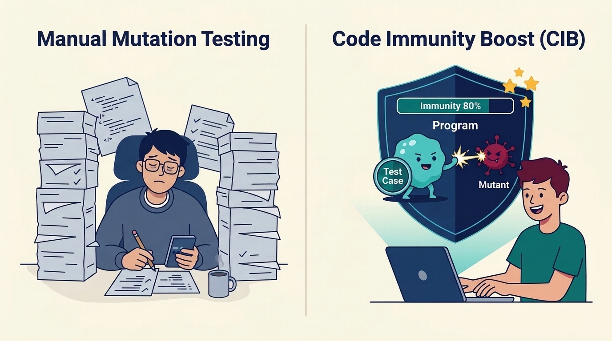
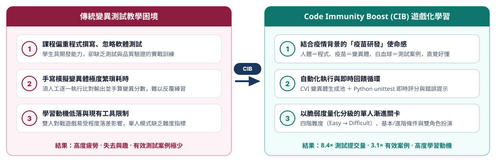
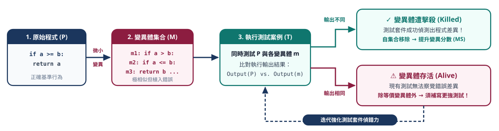
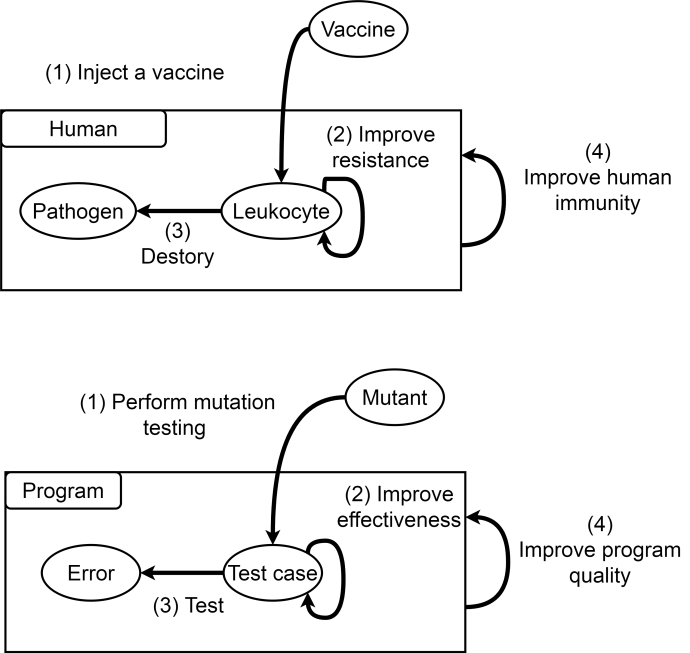
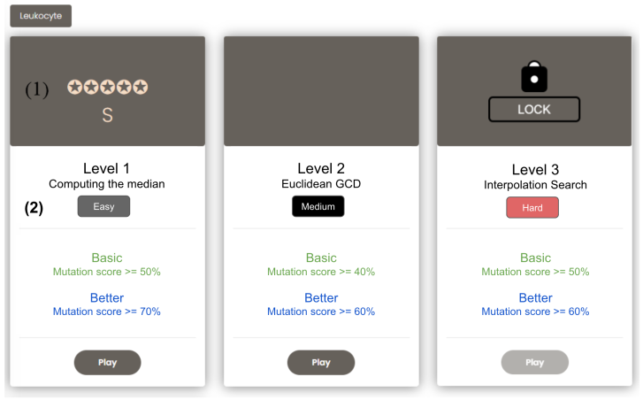
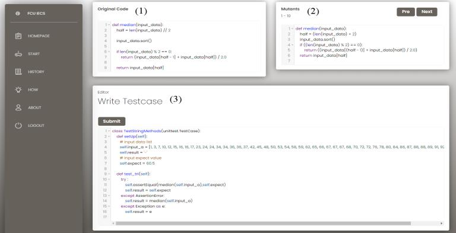
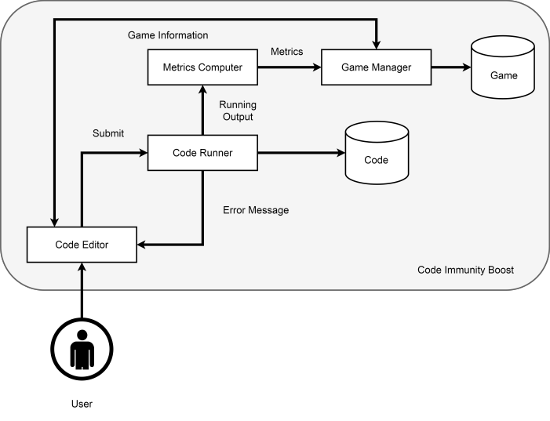
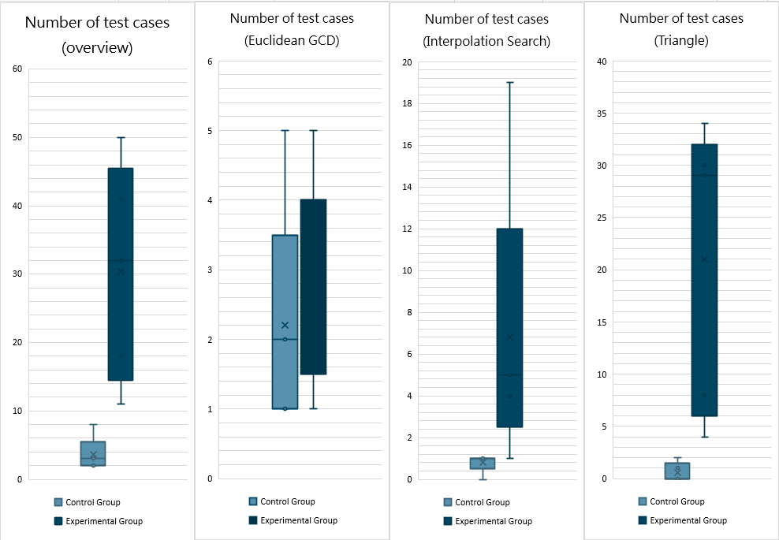
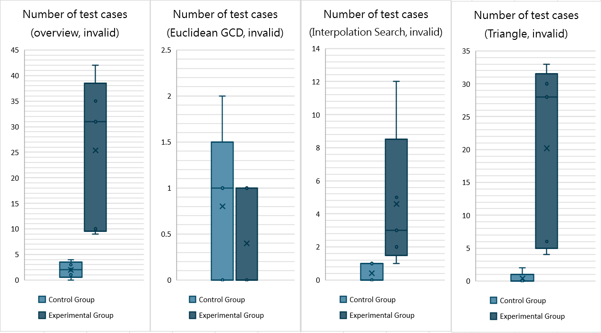
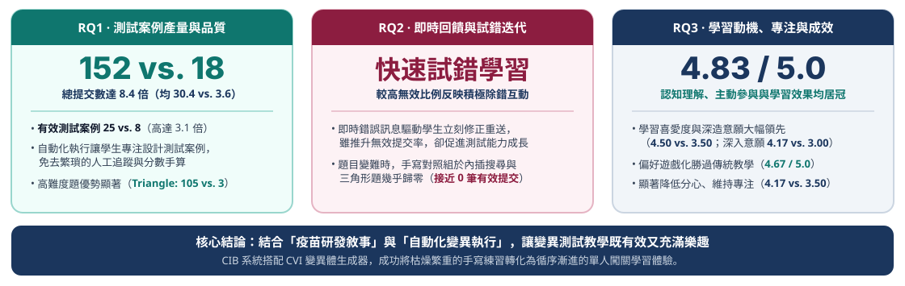

<!-- _class: lead -->

IJIET 2023 · Vol. 13, No. 7 · 軟體測試遊戲化教育

# 變異測試遊戲化學習系統之設計與實作

<strong>Code Immunity Boost (CIB)</strong> ＆ <strong>Code Vaccine Incubator (CVI)</strong>：以「疫苗研發與免疫防禦」為主題的互動式變異測試教學平台

<strong>薛念林（Nien-Lin Hsueh）*</strong>、<strong>Zeng Hung Xuan</strong>、<strong>Bilegjargal Daramsenge</strong> 
逢甲大學資訊工程學系（Department of Information Engineering and Computer Science, Feng Chia University） 
<code>nlhsueh@fcu.edu.tw</code> · DOI: <code>10.18178/ijiet.2023.13.7.1916</code>

發表於 International Journal of Information and Education Technology (pp. 1150–1155, July 2023) · 科技部計畫：MOST 110-2221-E-035-031-MY2

<!--
論文脈絡與核心貢獻：
- 書目資訊：Hsueh, N.-L., Xuan, Z. H., & Daramsenge, B. (2023). "Design and Implementation of Gamified Learning System for Mutation Testing." International Journal of Information and Education Technology (IJIET), 13(7), 1150–1155（DOI: 10.18178/ijiet.2023.13.7.1916）。稿件於 2022 年 12 月 20 日收件、2023 年 1 月 28 日修訂、2 月 12 日接受，獲科技部計畫 MOST 110-2221-E-035-031-MY2 補助。
- 核心研究問題：變異測試（Mutation Testing）雖是評估單元測試套件偵錯力的經典技術，但資訊相關科系課程長期偏重程式撰寫而輕忽軟體測試與品質保證，導致學生缺乏系統化的測試案例設計能力。
- 兩大系統產出：本研究建置（1）Code Immunity Boost（CIB），以疫苗研發與人體免疫防禦為敘事主軸的變異測試遊戲化學習平台；（2）Code Vaccine Incubator（CVI），針對經典基準程式自動生成大量變異體的孵化工具，作為整個實驗與教學關卡的基石。
- 作者分工：薛念林（Nien-Lin Hsueh）主導研究設計、Zeng Hung Xuan 負責系統實作、Bilegjargal Daramsenge 負責論文撰寫。
-->

---

## 破題：深陷手寫變異體地獄……還是強化「程式免疫力」？

<strong>核心概念：</strong>傳統手寫與人工追蹤大量變異體極易耗盡學生的學習熱情。<strong>Code Immunity Boost (CIB)</strong> 將變異測試轉化為<strong>疫苗研發任務</strong>——讓學生化身<strong>白血球</strong>（測試案例）擊殺<strong>疫苗</strong>（變異體），全面提升<strong>人體</strong>（程式）品質！

<!--
免疫系統隱喻之教學設計動機：
- 手寫變異測試的認知瓶頸：在缺乏自動化工具的情況下，學生必須逐一檢視變異體程式碼、以人工模擬或手繪追蹤每個測試輸入的執行路徑與輸出結果，再手動統計變異分數。當程式分支邏輯稍微複雜時，繁瑣的機械式運算便會迅速壓過概念學習，導致學習動機枯竭。
- 免疫隱喻的結構對應：CIB 將變異測試的抽象機制精準對應至生物防禦系統——目標程式（Program）對應「人體」、刻意植入微小缺陷的變異體（Mutant）對應刺激防禦訓練的「疫苗」、學生撰寫的測試案例（Test Case）對應負責偵測並消滅異物的「白血球」，而真實軟體缺陷則對應「病原體」。
- 教學價值：藉助大眾熟知的疫苗與免疫機制，大幅降低初學者理解故障植入（Fault Injection）與測試覆蓋評估的認知門檻，同時完整保留變異測試的數學嚴謹性。
-->

---

## 簡報大綱

1

[**研究動機與核心問題**](#4)
軟體測試教學為何需要遊戲化，以及本先導研究欲探討之三大問題（RQ1–RQ3）。

2

[**變異測試基礎與文獻比較**](#6)
變異體擊殺流程、變異分數公式，以及與 Code Defenders 之對比缺口。

3

[**CIB 遊戲設計與系統架構**](#8)
免疫系統隱喻、Octalysis 三大核心驅力、脆弱度分級關卡與六大系統模組。

4

[**先導實驗：測試產量與有效性**](#13)
手寫對照組 vs. CIB 實驗組之測試提交量與有效／無效案例動態分析。

5

[**學習滿意度問卷與質性洞察**](#16)
五點李克特量表評估：學習動機 (Q1)、專注力 (Q2) 與學習成效 (Q3)。

6

[**結論與未來展望**](#18)
RQ1–RQ3 核心發現視覺化統整，以及整合至 Online Judge 之推廣藍圖。

<!--
論文整體章節架構（Section I 至 Section V）：
- Section I（Introduction）：剖析程式設計教育與軟體測試教育的失衡現象，綜整 Mauricio et al. (2018) 涵蓋 156 篇軟體工程遊戲化文獻的系統性回顧，並定位 CIB／CVI 相對於 Code Defenders 的研究切入點。
- Section II（Background and Related Work）：嚴謹定義變異測試迭代擊殺流程、等價變異體（Equivalent Mutants）與變異分數（ms）公式（DeMillo et al., 1978），並深入評析 Code Defenders（Rojas & Fraser, 2016, 2017; Fraser et al., 2019）在課堂導入時的限制。
- Section III（Game Design and Tool Implementation）：詳述免疫系統類比關係（Fig. 1）、Octalysis 八角框架三大核心驅力、七支經典基準程式（Jia & Harman, 2009）、以脆弱度校準的四階關卡設計（Fig. 2）、Python unittest 實作流程（Fig. 3, Table I）以及六大模組系統架構（Fig. 4）。
- Section IV（Pilot Experiments）：報告 10 位逢甲資工系初學者的對照先導實驗（Tables II 至 VI；Figs. 5 與 6），結合提交行為敘述性統計與改編自 Barrio et al. (2015) 的 11 題五點李克特問卷進行多面向評估。
- Section V（Conclusion）：總結自動化工具與手寫教學之間的成效權衡，並提出與 Online Judge 平台整合之未來方向。
-->

---

## 1.1 研究動機：為何軟體測試教育亟需遊戲化？

<strong>研究背景：</strong>涵蓋 156 篇軟體工程遊戲化研究的系統性回顧 [15] 指出，遊戲化能顯著提升課程參與度與專業知識；然而相較於系統設計與開發流程，<strong>軟體測試領域的遊戲化教學工具仍極度匱乏</strong>。

<!--
文獻基礎與研究動機（Section I）：
- 課程訓練失衡：軟體工程教育涵蓋版本控制、需求分析、系統設計、架構與測試等環節，但多數教學資源集中在程式開發本身，軟體測試與品質驗證長期被邊緣化（文獻 [1–4]），使許多擅長寫程式的學生仍無法有效驗證與提升程式品質。
- 軟體工程遊戲化實證（Mauricio et al., 2018 [15]）：該篇涵蓋 156 篇研究的系統性映射回顧歸納出遊戲化對軟體工程教育的四大效益：（1）提升課堂參與度、（2）強化專業知識吸收、（3）鼓勵採用軟體工程實務規範、（4）增進團隊合作能力；常見機制包含排行榜、積分、里程碑、關卡、進度條、競賽與獎勵。
- 測試領域之研究缺口：在這 156 篇文獻中，遊戲化應用高度集中於軟體設計、開發流程與需求分析，軟體測試相關工具與實證研究比例明顯偏低。
- 疫情背景的敘事啟發：研究團隊結合 Code Defenders [16] 的先行經驗與 COVID-19 疫情期間大眾對「疫苗強化免疫力」的深刻共鳴，構思出兼具使命感與自動化的變異測試學習系統 CIB。
-->

---

## 1.2 研究目標與三大研究問題

本先導實驗探討核心問題*「學生如何透過 CIB 工具學習變異測試？」*，聚焦三大面向*（逐步展開）*：

* 

RQ1 遊戲化自動化環境能否幫助學生寫出更多、更有效的測試案例？

<strong>相較於傳統手寫變異測試，CIB 如何影響學生的測試案例總提交數與有效測試案例產出</strong>？

* 

RQ2 為何實驗組的無效提交比例反而較高——這對學習有何意義？

<strong>CIB 的即時自動化回饋如何影響無效提交率</strong>，以及在不同題目難度下的反覆試錯除錯行為？

* 

RQ3 學生是否更投入、更專注，且更有信心將變異測試應用於實務？

<strong>CIB 對學生的學習動機 (Q1)、專注度 (Q2) 與自評學習成效 (Q3)</strong> 有何具體影響？

<!--
先導實驗之研究問題設計（Section IV.A）：
- 總體探索核心：本先導實驗圍繞核心問題「學生如何透過 CIB 工具學習變異測試？（How do students learn by using the CIB tool?）」，旨在正式大規模課堂部署前，先驗證系統可行性、教學流程順暢度與學習行為差異。
- RQ1（測試案例產量與品質）：比較 CIB 實驗組與手寫對照組在三支難度遞增基準程式（Euclidean GCD、Interpolation Search、Triangle）上的測試案例總提交數與有效（可編譯且可執行）測試案例數，評估自動化環境是否能顯著提升測試設計產出。
- RQ2（即時回饋與無效提交動態）：剖析兩組在無效提交（編譯或執行失敗）比例上的差異，驗證 CIB 的即時錯誤回饋是否會驅動良性的快速試錯迭代（Trial-and-Error），以及題目難度上升時對照組的行為變化。
- RQ3（主觀動機、專注力與學習成效）：透過改編自 Barrio et al. (2015) [21] 的 11 題五點李克特問卷，從學習動機（Q1-1 至 Q1-5*）、專注投入（Q2-1 至 Q2-3）與學習成效（Q3-1 至 Q3-3*）三個構面進行評估，其中標註星號者專門衡量遊戲化系統相較於傳統教學之優勢。
-->

---

## 2.1 背景知識：變異測試（Mutation Testing）運作機制

<i>ms</i> &nbsp;=&nbsp; <i>killed</i><i>all</i> − <i>equiv</i> &nbsp; ∈ [0.0, 1.0]

<strong>變異分數 (Mutation Score, ms)：</strong>遭擊殺變異體佔所有非等價變異體之比例 [17]。<strong>等價變異體 (equiv)</strong> 不改變原程式行為，無法被任何測試擊殺；<code>ms</code> 越高代表測試套件偵錯力越強。

<!--
變異測試之形式化運作機制（Section II）：
- 理論淵源：由 DeMillo、Lipton 與 Sayward (1978) [17] 提出，旨在透過於原始程式中植入微小語法變動（如運算子替換、條件邊界修改）產生大量極為相似但含錯的「變異體（Mutants）」，藉此檢驗單元測試套件的錯誤偵測能力。
- 執行與擊殺判定：將同一組測試案例同時執行於原始程式與各變異體並比對輸出。若兩者輸出相同，表示測試案例未能察覺缺陷，該變異體視為「存活（Alive）」，需持續補充更強的測試案例；若輸出不同，表示測試案例成功揭露差異，該變異體即遭「擊殺（Killed）」並移出待測集合。
- 等價變異體（Equivalent Mutants, equiv）：部分語法變動在所有可能輸入下皆與原程式語意完全一致，不可能被任何測試案例擊殺，因此計算品質指標時須將其自總數中扣除。
- 變異分數公式：ms = killed / (all - equiv)，數值介於 0.0 至 1.0 之間。ms 反映測試套件擊殺所有非等價變異體的比例，數值越高代表測試套件對邊界條件與邏輯錯誤的偵測力越強。
-->

---

## 2.2 文獻回顧：Code Defenders 與研究缺口

**Code Defenders** [16, 18, 19] 首創雙人對戰式變異測試遊戲（攻擊者寫變異體、防禦者寫測試案例），但在課堂實際導入時面臨以下挑戰：

| 教學模式 | 進行方式 | 難度控制 | 回饋機制 | 主要限制／優勢 |
| :--- | :--- | :--- | :--- | :--- |
| **傳統手寫教學** | 單人紙筆模擬 | 缺乏分級 | 人工追蹤比對與手算 | 工作量極為繁重，題目一難便迅速喪失學習動機 |
| **Code Defenders [16, 18, 19]** | 雙人對戰（攻／守）＋單人電腦模式 | 單人模式**缺乏明確難度指標** | 對戰回合積分 | 雙方**能力落差過大**時易使一方挫敗；電腦模式難以取代雙人平衡 |
| **本研究：CIB ＋ CVI** | **單人結構化闖關** | **以脆弱度量化四階難度** | **Python 即時自動評分與免疫力進度條** | **無需配對、結合疫苗研發敘事、雙角色扮演與 CVI 自動變異體池** |

<strong>填補研究缺口：</strong>CIB 透過自建變異體生成器（<strong>CVI</strong>）與明確的量化難度指標（<strong>變異體脆弱度</strong>），徹底消除雙人程度落差，打造循序漸進的單人變異測試學習體驗。

<!--
與 Code Defenders 之文獻比較與研究缺口（Section II.A）：
- 代表性先行系統：Rojas 與 Fraser 等人 [16, 18, 19] 開發的 Code Defenders 首度將變異測試結合遊戲化，採雙人攻守對戰模式——攻擊者（Attacker）撰寫難以被偵測的變異體，防禦者（Defender）撰寫測試案例以擊殺變異體，透過競賽提升學習興趣。
- 雙人對戰之課堂限制：Code Defenders 原始設計至少需要兩名玩家配對對戰；在實際大學課堂中，學生程式與測試能力參差不齊，當攻守雙方程度落差過大時，較弱的一方極易因持續受挫而失去學習動力。
- 單人電腦模式之不足：後續研究雖新增單人對抗電腦（AI）模式，但論文明確指出其單人模式缺乏明確且量化的難度分級指標（Difficulty Index），無法完全取代雙人對戰的平衡體驗與漸進式引導效果。
- 本研究填補之缺口：CIB 結合自主開發的 CVI（Code Vaccine Incubator）變異體池與量化的「變異體脆弱度（Fragility）」四階分級，建構無須同儕配對的結構化單人闖關體驗，同時保留雙角色（白血球／疫苗）扮演以兼顧廣度與深度。
-->

---

## 3.1 遊戲隱喻：疫苗、白血球與人體防禦

Fig. 1：以「疫苗提升人體免疫力」類比變異測試核心關係

### 🧬 免疫防禦 ＝ 軟體品質強化
- **人體（Human）⇄ 程式（Program）**：我們欲保護並強化品質的目標軟體。
- **疫苗（Vaccine）⇄ 變異體（Mutant）**：刻意植入微小變異以刺激防禦機制。
- **白血球（Leukocyte）⇄ 測試案例（Test Case）**：負責偵測並消滅變異體的守護者。
- **病原體（Pathogen）⇄ 程式錯誤（Error）**：經由強化後的測試套件預先防範。

<strong>免疫力（Immunity）</strong> &nbsp;=&nbsp; 變異分數 (<i>ms</i>)

<strong>疫苗保護力（Vaccine Efficacy）</strong> &nbsp;=&nbsp; 1 − <i>fragility</i>

<!--
生物免疫類比與指標數學轉譯（Section III.A ＆ III.E）：
- 雙角色概念模型（Fig. 1）：CIB 讓學生從兩種互補視角理解「程式—測試案例—變異體」三角關係。扮演「疫苗（Vaccine）」角色時，學生撰寫變異體去刺激並考驗現有測試案例的盲點；扮演「白血球（Leukocyte）」角色時，學生撰寫測試案例去偵測並消滅變異體，進而強化「人體（程式）」對抗真實「病原體（軟體錯誤）」的防禦力。
- 免疫力（Immunity）之數學定義：Immunity = 變異分數（ms）。在遊戲敘事中代表白血球抵禦變異體入侵的能力，擊殺越多變異體則免疫力越高，直接讓學生內化測試套件偵錯強度的量化意義。
- 疫苗保護力（Vaccine Efficacy）之數學定義：Vaccine Efficacy = 1 - fragility。變異體脆弱度（fragility）衡量該變異體被參考測試集擊殺的難易程度；脆弱度越低代表變異體越隱蔽難殺，因此 1 - fragility 越高，象徵該疫苗具備更高的保護力與訓練價值，能迫使測試案例升級。
- 教學耦合效果：不論扮演何種角色，學生都必須深入思考程式語意與測試斷言之間的對應邊界。
-->

---

## 3.2 遊戲化核心：Octalysis 三大驅力與基準程式庫

CIB 融入 **Octalysis 遊戲化八角框架中的三大核心驅力**，兼顧內在使命感與外在成就回饋：

### 🌍 1. 史詩意義（Meaning）
- 受 COVID-19 疫情啟發，設定病原體肆虐之故事背景。
- 學生研發疫苗（變異體）並訓練白血球（測試案例）保護程式，賦予練習**真實使命感**。

### 🏆 2. 發展與成就（Accomplishment）
- 以**免疫力**（`ms`）與**疫苗保護力**（`1 − fragility`）作為直覺分數指標。
- 透過**進度條**與星等評級激發「填滿空白」的通關動力，同時內化兩大測試指標。

### 🎭 3. 創意與賦權（Empowerment）
- 學生可自由扮演**白血球**與**疫苗**兩種角色。
- 測試案例與變異體的寫法多元開放，鼓勵學生結合軟體知識反覆精進策略。

<strong style="color: var(--navy);">🧪 基準程式與 Code Vaccine Incubator (CVI)：</strong>本研究開發 <strong>CVI</strong> 變異體生成工具，針對 7 支變異測試經典基準程式 [20] 建置大量變異體題庫：

Triangle
Computing the Median
Euclidean GCD
Fibonacci Search
Binary Search
Interpolation Search
Leap Year

<!--
Octalysis 遊戲化八角框架與 CVI 基準程式庫（Section III.B ＆ III.C）：
- 核心驅力一：史詩意義與使命感（Epic Meaning）：以全球病原體肆虐為故事背景（呼應 COVID-19 疫情經驗），讓學生相信自己正在執行研發疫苗、訓練白血球以守護系統安全的重大任務，使單調的測試練習具備高層次意義感。
- 核心驅力二：發展與成就（Accomplishment）：將「免疫力（ms）」與「疫苗保護力（1 - fragility）」化為明確的狀態積分，搭配星等評級與未填滿的視覺進度條，善用人們渴望填補空白圖形的心理驅力，持續引導學生往高分邁進，同時潛移默化地學會兩大測試指標。
- 核心驅力三：創意與賦權（Empowerment）：提供白血球與疫苗兩種可自由切換的角色，且測試案例與變異體的寫法具高度開放性，讓學生運用既有軟體工程知識與遊玩經驗，反覆構思與優化個人策略。
- 七大經典基準程式與 CVI [20]：依循變異測試領域經典文獻（Jia & Harman, 2009），本研究選定 Triangle、Computing the Median、Euclidean GCD、Fibonacci Search、Binary Search、Interpolation Search 與 Leap Year 七支基準程式，並開發 CVI 工具自動產出大量變異體作為 CIB 關卡題庫。
-->

---

## 3.3 漸進式關卡設計與難度分級

Fig. 2：CIB 漸進式關卡介面——顯示評級、題目難度與通關門檻

### 🎯 以脆弱度（Fragility）劃分四階難度
- 以變異體之**脆弱度**作為客觀難度依據，由淺入深劃分四個等級：
  - `Easy` ➔ `Medium` ➔ `Hard` ➔ `Difficult`
- **闖關解鎖機制**：
  1. **評級與鎖定狀態**：通關後顯示對應星等（如 `S` 級），未解鎖關卡顯示鎖頭圖示。
  2. **關卡資訊**：清楚呈現關卡編號、基準程式名稱與難度標籤。
  3. **雙重通關條件**：
     - **基本條件（Basic）**：達標即可過關並解鎖下一關（如 `ms ≥ 50%`）。
     - **進階條件（Better）**：鼓勵追求高分與深度測試（如 `ms ≥ 70%–80%`）。

<!--
以脆弱度校準之漸進式關卡設計（Section III.D）：
- 客觀量化分級機制：不同於主觀排列的練習題組，CIB 以變異體之「脆弱度（Fragility）」作為客觀難度標準，由淺入深將關卡劃分為 Easy、Medium、Hard 與 Difficult 四個等級。難度越高的關卡包含越多低脆弱度（難以擊殺）的細微變異體，要求學生具備更嚴謹的邊界值與分支條件分析能力。
- 關卡介面三大要素（Fig. 2）：（1）通關評級與解鎖狀態——已通關者顯示對應星等評級（如 S 級），未通關者則顯示鎖頭符號，學生須完成前一關方可解鎖下一關；（2）關卡資訊——清楚標示關卡編號、對應基準程式與難度標籤；（3）雙重通關門檻。
- 雙重門檻鷹架設計：每一關皆設定「基本條件（Basic Condition）」（例如變異分數 ms >= 50%）作為最低過關與解鎖門檻，另設「進階條件（Better Condition）」（例如 ms >= 70% 至 80%）提供額外高分獎勵，鼓勵學生超越及格線、主動挑戰高覆蓋率測試設計。
-->

---

## 3.4 實際遊玩示範：扮演「白血球」角色

Fig. 3：白血球介面——(1) 原始程式、(2) 變異體檢視、(3) 測試編輯區

<strong>技術實作：</strong>基於 <strong>Python</strong> 與標準 <code>unittest</code> 框架，學生可並排比對原始碼與變異體，即時撰寫並提交單元測試。

### 🛡️ 闖關情境範例（共 10 個變異體 m1–m10）
- **基本通關**：擊殺 ≥ 5 個變異體（`Immunity ≥ 0.5`）。
- **高分獎勵**：擊殺 ≥ 8 個變異體（`Immunity ≥ 0.8`）。

| 回合 | 測試案例 | 擊殺之變異體 | 免疫力 | 判定結果 |
| :---: | :---: | :--- | :---: | :---: |
| 1 | `t1` | m1, m2 | `0.2` | 未通關 |
| 2 | `t2` | m1, m3–m6 | `0.5` | **通關** |
| 3 | `t3` | m1–m8 | **`0.8`** | **高分通關** |

- **即時回饋循環**：學生免去手動追蹤輸出，依系統回饋迅速將免疫力從 `0.2` 推進至 `0.8`。

<!--
Python unittest 實作流程與回合範例解析（Section III.E, Fig. 3, Table I）：
- 技術架構與介面配置：CIB 基於 Python 與標準 unittest 測試框架實作。在白血球遊玩介面（Fig. 3）中，畫面同步呈現三個區塊：（1）原始待測程式碼、（2）本關提供的變異體清單、（3）供學生撰寫並提交 unittest 測試案例的程式編輯區。
- 十變異體關卡範例（Table I）：假設某關卡包含 10 個變異體（m1 至 m10），設定基本通關門檻為至少擊殺 5 個變異體（Immunity >= 0.5），高分獎勵門檻為至少擊殺 8 個變異體（Immunity >= 0.8）。
- 三回合迭代軌跡：第一回合提交測試案例 t1，僅擊殺 m1、m2（免疫力 0.2，未通關）；學生檢視即時存活變異體清單後，於第二回合提交 t2 擊殺 m1 與 m3 至 m6（免疫力 0.5，達成基本通關）；第三回合持續強化斷言提交 t3，成功擊殺 m1 至 m8（免疫力 0.8，高分通關）。
- 學習認知轉移：免除繁重的人工追蹤輸出後，學生可將寶貴的認知資源完全聚焦於比對原程式與存活變異體的邏輯差異。
-->

---

## 3.5 CIB 系統架構與六大核心模組

Fig. 4：Code Immunity Boost (CIB) 六大模組系統架構

### ⚙️ 六大核心模組職責
1. **Code Editor**：前端程式碼編輯器，供學生撰寫 Python `unittest` 測試案例或變異體。
2. **Code Runner**：負責編譯與執行提交程式，將執行結果送往 `Metrics Computer`，若有語法或執行錯誤則即時回傳 **Error Message**。
3. **Metrics Computer**：執行變異測試並計算測試案例之**變異分數**與變異體之**脆弱度**。
4. **Game Manager**：提供關卡資訊給前端顯示、計算遊戲得分並判定是否通關。
5. **Code Database**：儲存與管理使用者撰寫之測試案例與變異體。
6. **Game Database**：儲存關卡設定、CVI 變異體題庫與玩家進度。

<!--
CIB 六大核心模組系統架構（Section III.F, Fig. 4）：
- Code Editor（程式碼編輯器）：前端互動編輯介面，供學生撰寫 Python unittest 測試案例（白血球角色）或自訂變異體（疫苗角色），並即時呈現關卡條件與評分回饋。
- Code Runner（程式執行器）：負責編譯與執行學生提交的測試案例或變異體。若發生語法錯誤、匯入異常或執行期錯誤，系統立即將 Error Message 回傳至前端供學生除錯；若執行成功，則將結果送往 Metrics Computer。
- Metrics Computer（指標計算模組）：核心變異測試運算引擎，負責將測試案例執行於變異體集合（或以基準測試集驗證學生撰寫的變異體），精確計算測試案例的變異分數（Mutation Score）與變異體的脆弱度（Fragility）。
- Game Manager（遊戲管理模組）：中控協調層，負責提供關卡資訊給 Code Editor 顯示、將測試指標轉譯為遊戲分數（免疫力／疫苗保護力），並檢核是否達成基本或進階通關條件。
- 雙資料庫職責分離：Code Database 專門儲存與管理使用者撰寫的程式碼作品（測試案例與變異體）；Game Database 則儲存關卡配置、CVI 預先產出之變異體題庫與玩家通關進度紀錄。
-->

---

## 4.1 先導實驗設計（Pilot Experiment）

於正式大規模導入前，我們先進行**先導實驗**以驗證系統可行性、測試案例產出品質與學生學習體驗。

### 👥 受試對象
- **10 位大學生**（女性 3 位、男性 7 位）。
- 皆來自**逢甲大學資訊工程學系**。
- 實驗前均**未曾學過變異測試**，起點一致。

### ⚖️ 實驗分組
- **實驗組（CIB 工具）**：透過 CIB 遊戲化平台撰寫 Python 測試案例擊殺變異體，享自動化執行與即時回饋。
- **對照組（手寫方式）**：以傳統手寫方式設計測試案例、人工模擬變異體輸出並手算變異分數。

### 📊 評測題目與問卷
- **實作基準題**：`Euclidean GCD`、`Interpolation Search` 與 `Triangle`（難度遞增）。
- **滿意度問卷**：改編自 Barrio [21] 之 11 題**五點李克特量表**，涵蓋動機、專注力與學習成效。

<strong>分析方法：</strong>考量本先導實驗樣本數為 `N = 10`，重點在於驗證工具流程與學習行為差異，故採用<strong>敘述性統計</strong>、提交次數箱型圖、有效／無效案例拆解及問卷均分比較進行分析。

<!--
先導實驗設計與變項控制（Section IV.A ＆ IV.B）：
- 實驗目的：在正式導入大型班級前，透過先導實驗（Pilot Experiment）評估 CIB 系統的操作可行性、建置成本、流程順暢度，以及對初學者測試產出與學習動機的初步影響。
- 受試者背景控制：共招募 10 位逢甲大學資訊工程學系大學生（女性 3 位、男性 7 位）。所有受試者在實驗前皆完全未曾學習過變異測試，有效排除先備知識不均的干擾。
- 實驗組與對照組操作差異：實驗組於 CIB 平台上設計 Python 測試案例以擊殺變異體，享有自動編譯執行與即時回饋；對照組則採傳統手寫方式，必須全程人工撰寫測試案例、逐一手動模擬每個變異體的執行輸出，並自行手算變異分數。
- 評測題目與問卷量表：兩組均依難度遞增順序實作 Euclidean GCD、Interpolation Search 與 Triangle 三支基準程式，並填寫改編自 Barrio et al. (2015) [21] 的 11 題五點李克特問卷。考量先導樣本數為 N = 10，論文採敘述性統計、箱型圖分佈與質性觀察進行嚴謹剖析，而非勉強套用低檢定力的推論統計。
-->

---

## 4.2 RQ1 結果：測試案例提交量與有效案例大幅領先

Fig. 5：各題目測試案例提交次數比較（對照組 vs. CIB 實驗組）

### 📈 Table II：兩組測試案例總提交次數

| 分組 | 總計 (All) | GCD | Search | Triangle |
| :--- | :---: | :---: | :---: | :---: |
| 對照組（手寫） | 18 | 11 | 4 | 3 |
| **實驗組（CIB）** | **152** | **13** | **34** | **105** |

8.4×

總提交數（<strong>152 vs. 18</strong>；均 30.4 vs. 3.6 筆）

3.1×

<strong>有效</strong>測試案例數（<strong>25 vs. 8</strong> 筆）

- **差距隨難度擴大**：手寫模擬在複雜題目極度吃力，在 `Triangle` 題差距高達 **105 vs. 3**！

<!--
測試案例產量與程式複雜度交互效應（Section IV.B, Table II, Fig. 5）：
- 整體提交量差距：如 Table II 與 Fig. 5 所示，手寫對照組總計僅提交 18 筆測試案例（平均每項作業 3.6 筆，即 18 / 5）；CIB 實驗組總提交數高達 152 筆（平均每項作業 30.4 筆，即 152 / 5），整體產量為對照組的 8.4 倍。
- 有效測試案例產出：進一步剔除無法編譯或執行失敗的無效嘗試後，實驗組仍產出 25 筆有效測試案例，遠勝對照組的 8 筆（達 3.1 倍）。
- 隨題目複雜度急遽擴大的鴻溝：依三支基準程式拆解 Table II 數據可見，在迴圈結構相對單純的 Euclidean GCD 上，兩組提交量尚稱接近（13 vs. 11）；進入涉及陣列索引與算術邊界的 Interpolation Search 後，差距擴大為 34 vs. 4；到了多分支條件判斷的 Triangle，實驗組躍升至 105 筆，而手寫對照組崩跌至僅 3 筆。
- 機制歸因：手寫組必須為每一筆候選測試重複執行「手動模擬變異體、記錄輸出、手算變異分數」全流程，複雜度一提高即不堪負荷；CIB 將執行與計分全面自動化，徹底釋放學生的測試設計產能。
-->

---

## 4.3 RQ2 結果：有效 vs. 無效提交與「即時回饋試錯效應」

Fig. 6：各題目無效測試案例（無法編譯或執行失敗）比較

### 🔄 建設性的「快速試錯」現象
- **有效案例大幅勝出**：實驗組產出 **25 筆有效**測試案例，遠勝對照組的 **8 筆**。
- **無效比例亦較高**：實驗組中無法編譯／執行失敗的無效提交比例高於對照組。
- **原因剖析——即時錯誤回饋驅動迭代**：
  - `Code Runner` 立即回報錯誤訊息，促使學生迅速修改重送（即使當次修正仍未完全正確）。
  - 我們認為這正是**鍛鍊測試設計能力的重要試錯學習過程（Trial-and-Error）**。
- **對照組難度崩潰**：在較難的 `Interpolation Search` 與 `Triangle` 題目中，手寫組的有效與無效提交數皆**趨近於 0**。

<!--
無效提交比例與「即時回饋試錯效應」剖析（Section IV.B, Fig. 6）：
- 無效測試案例定義：凡因語法錯誤無法編譯，或執行階段發生例外而無法正確完成測試的提交紀錄，皆歸類為無效測試案例（Invalid Test Cases）。
- 表面矛盾現象：Fig. 6 顯示，實驗組在產出更多有效測試案例（25 vs. 8）的同時，其無效測試案例佔總提交數的比例亦高於對照組。
- 即時回饋驅動之建設性試錯：論文作者推論，此現象直接源於 CIB 的 Code Runner 即時錯誤回饋機制。當系統立刻回報錯誤訊息時，學生會迅速依據提示修改程式碼並再次提交驗證——即便當下的修訂版本仍存在未解錯誤。這種高頻率的「提交—報錯—修正」循環並非系統缺陷，而是初學者培養單元測試設計與除錯能力的健康試錯學習歷程（Trial-and-Error Learning）。
- 對照組在高難度題目的全面停擺：在 Interpolation Search 與 Triangle 兩道較難題目中，對照組無論有效或無效提交數皆趨近於 0，顯示缺乏即時回饋時，高難度只會讓學生直接放棄嘗試，連試錯的機會都消失。
-->

---

## 4.4 RQ3 結果：學習動機 (Q1) 與專注力 (Q2) 問卷分析

採用 **5 分制李克特量表**施測 11 題（標註 `*` 者為實驗組專屬題目，用以評估遊戲化相較傳統教學之優勢）：

### 🔥 Table IV：學習動機（Q1）

| 題號 | 題項摘要 | 對照 | **實驗** |
| :--- | :--- | :---: | :---: |
| `Q1-1` | 喜歡這種變異測試學習方式 | 3.50 | **4.50** |
| `Q1-2` | 更能理解變異測試概念 | 3.50 | **4.83** |
| `Q1-3` | 想更深入學習變異測試 | 3.00 | **4.17** |
| `Q1-4*` | 關卡具挑戰性且提升動機 | — | **4.33** |
| `Q1-5*` | 偏好此方式勝過傳統教學 | — | **4.67** |

### 🎯 Table V：專注與投入度（Q2）

| 題號 | 題項摘要 | 對照 | **實驗** |
| :--- | :--- | :---: | :---: |
| `Q2-1` | 較少分心、能專注學習 | 3.50 | **4.17** |
| `Q2-2` | 過程屬高強度認知思考 | **4.50** | **4.50** |
| `Q2-3` | 感覺自己主動參與學習 | 4.50 | **4.83** |

<strong>Q2-2 細緻觀察：</strong>手寫法雖迫使學生高度動腦追蹤（4.50），但繁瑣計算導致專注力下滑（<code>Q2-1: 3.50</code>），並大幅澆熄深入學習意願（<code>Q1-3: 3.00</code>）。

<!--
學習動機（Q1）與專注投入（Q2）問卷深度解讀（Section IV.C, Tables III 至 V）：
- 問卷結構說明：改編自 Barrio et al. (2015) [21] 之五點李克特量表。共同題項用於比較兩組差異；標註星號題項（Q1-4*、Q1-5*、Q3-3*）僅針對實驗組施測，用以評估遊戲化機制相較於傳統教學之主觀優勢。
- 學習動機全面領先（Table IV）：實驗組在三道共同題均明顯高於對照組，包含喜歡此學習方式（Q1-1：4.50 vs. 3.50）、更了解變異測試概念（Q1-2：4.83 vs. 3.50），以及想更深入學習變異測試（Q1-3：4.17 vs. 3.00）。對照組在 Q1-3 僅得 3.00 分，反映繁重手寫流程大幅削弱了學生的延伸學習動機。實驗組亦高度肯定關卡挑戰性（Q1-4* = 4.33）並偏好 CIB 勝過傳統教學（Q1-5* = 4.67）。
- 專注度（Table V 原文數據細緻對照）：在原文 Table V 中，實驗組在「較少分心、能專注學習」（Q2-1：4.50 vs. 3.50）與「主動參與學習」（Q2-3：4.83 vs. 4.50）皆高於對照組；而論文特別點出 Q2-2「高強度認知思考」屬特殊案例，原文 Table V 中對照組（4.50）略高於實驗組（4.17）。
- 教學心理學意涵：手寫追蹤迫使學生進行高強度的人工推演（高 Q2-2），確實能對變異流程留下深刻印象；但過度的機械式計算負荷同時導致專注力顯著下滑（Q2-1 僅 3.50）並澆熄後續探索意願（Q1-3 僅 3.00）。
-->

---

## 4.5 RQ3 結果：學習成效 (Q3) 與質性回饋洞察

### 🎓 Table VI：學習成效自評（Q3）

| 題號 | 問卷題目 | 對照 | **實驗** |
| :--- | :--- | :---: | :---: |
| `Q3-1` | 我能理解變異測試的方法 | **4.75** | 4.67 |
| `Q3-2` | 我能應用變異測試的技術 | 4.00 | **4.33** |
| `Q3-3*` | 學習效果優於傳統教學法 | — | **4.83** |

<strong>Q1 均分（共同題）</strong>

4.50 vs 3.33

<strong>Q2 均分（全 3 題）</strong>

4.50 vs 4.17

<strong>Q3 均分（共同題）</strong>

4.50 vs 4.38

### 💬 課堂質性觀察與回饋對比
- **基本概念皆獲建立**：兩組在「理解變異測試概念」（`Q3-1`：4.75 vs. 4.67）皆達高分，顯示手寫追蹤雖辛苦，仍能讓學生對原理留下深刻印象。
- **截然不同的心態走向**：
  - **對照組**：強烈感受手寫壓力，紛紛**希望減少變異體數量**以減輕人工負擔。
  - **實驗組**：完全不覺得變異體太多，高度肯定 CIB 成效（`Q3-3* = 4.83`），甚至**主動期待挑戰更難的關卡**。
- **實作應用更具信心**：實驗組在「實際應用變異測試技術」（`Q3-2`：**4.33** vs. 4.00）表現更佳。

<!--
學習成效自評（Q3）與課堂質性觀察對比（Section IV.C, Table VI）：
- 概念理解 vs. 實務應用之分化：在 Q3-1「我能理解變異測試的方法」上，對照組（4.75）與實驗組（4.67）皆達極高分，證實傳統手寫追蹤雖耗時吃力，仍能讓學生建立對變異測試原理的清晰概念記憶。但在 Q3-2「我能應用變異測試的技術」上，實驗組以 4.33 領先對照組的 4.00，展現自動化實作所帶來的技術遷移信心。
- 教學成效高度肯定：實驗組在專屬題 Q3-3*「此教學法學習效果優於傳統教學法」給出 4.83 的極高評價，為全問卷最高分項目之一。
- 面對變異體數量的截然不同心態：質性回饋揭露兩組心理負荷的本質差異。對照組學生普遍對龐大的手寫運算感到沉重壓力，紛紛建議「減少變異體數量」以減輕負擔；反觀實驗組學生完全不認為變異體過多，不僅對 CIB 展現濃厚興趣，甚至主動期待挑戰更高難度的關卡。
- 綜合均分意涵：三構面共同題平均分數顯示，CIB 在維持概念理解深度的前提下，大幅扭轉了學習動機（4.50 vs. 3.33）並強化實作應用能力。
-->

---

## 5. 結論與未來研究方向

<strong>🌐 1. 整合至 Online Judge 系統</strong> 將 CIB 與 CVI 結合熱門線上解題平台，讓學生在寫程式的同時自然養成軟體測試與品質驗證習慣。

<strong>📊 2. 擴大正式課堂對照實驗</strong> 由 10 人先導實驗擴大至完整修課班級，導入推論統計檢定並追蹤長期學習保留成效。

<strong>🧩 3. 深化雙角色與多語言支援</strong> 進一步評估「疫苗（撰寫變異體）」角色學習效益，並將 CVI 擴展至 Java／C++ 等主流教學語言。

<!--
研究總結、先導限制與未來發展藍圖（Section V）：
- 核心研究結論：CIB 實證了結合「疫苗與免疫防禦」敘事、Octalysis 遊戲化機制與 CVI 自動化變異體池的教學價值。雖然不藉助工具的手寫練習仍能使學生對變異測試留下印象，但過程過度艱澀且缺乏樂趣，終究會導致學習動機流失；CIB 則成功在嚴謹訓練與高投入度之間取得平衡。
- 先導研究之方法論限制：本實驗屬 N = 10 的單一系所先導驗證，統計分析以敘述性指標為主，尚未涵蓋大樣本推論統計檢定與長期學習保留（Retention）追蹤；此外，本先導實測主要聚焦於「白血球（撰寫測試案例）」角色，針對「疫苗（撰寫變異體）」角色的深度學習效益仍待後續實證。
- 未來三大推展方向：（1）將 CIB 與 CVI 整合至廣泛使用的 Online Judge（OJ）平台，使學生在日常程式解題訓練中自然導入測試品質評估；（2）擴大至完整大學修課班級進行嚴謹對照實驗與推論統計分析；（3）深化雙角色教學評估，並將 CVI 支援範圍由 Python unittest 延伸至 Java、C++ 等主流教學語言。
-->

---

<!-- _class: closing -->

# 感謝聆聽與指教！

變異測試遊戲化學習系統之設計與實作（Code Immunity Boost, CIB）

<strong>薛念林（Nien-Lin Hsueh）*</strong> · <code>nlhsueh@fcu.edu.tw</code> 
<strong>Zeng Hung Xuan</strong> &nbsp;·&nbsp; <strong>Bilegjargal Daramsenge</strong> 
逢甲大學資訊工程學系（Feng Chia University, Taiwan） 
IJIET Vol. 13, No. 7, pp. 1150–1155, July 2023 · DOI: <code>10.18178/ijiet.2023.13.7.1916</code> 
科技部補助計畫：MOST 110-2221-E-035-031-MY2 · 歡迎提問與交流！

<!--
文獻引用與系統產出總結：
- 論文引用格式：Hsueh, N.-L., Xuan, Z. H., & Daramsenge, B. (2023). Design and Implementation of Gamified Learning System for Mutation Testing. International Journal of Information and Education Technology (IJIET), 13(7), 1150–1155. https://doi.org/10.18178/ijiet.2023.13.7.1916
- 研究單位與補助：逢甲大學資訊工程學系（Department of Information Engineering and Computer Science, Feng Chia University, Taiwan）；獲台灣科技部計畫 MOST 110-2221-E-035-031-MY2 補助。
- 授權與利益衝突聲明：本文採創用 CC 姓名標示 4.0（CC BY 4.0）開放取用授權，作者聲明無任何利益衝突。
- 核心技術產出：Code Immunity Boost（CIB，六大模組 Python unittest 遊戲化變異測試系統）與 Code Vaccine Incubator（CVI，涵蓋七大經典基準程式且以脆弱度校準之變異體孵化工具）。
-->

