

<!-- _class: lead -->

Electronics 2023, 12(22), 4596 · Software Engineering Education

# Design of an Online Programming Platform and a Study on Learners’ Testing Ability

<strong>Pytutor</strong>: Integrating Software-Testing Concepts, Defining Test Cases (DTCs), Code Coverage &amp; Mutation Testing into Automated Programming Education

<strong>Nien-Lin Hsueh*</strong>, <strong>Lien-Chi Lai</strong>, and <strong>Wei-Hsiang Tseng</strong> 
Department of Information Engineering and Computer Science, Feng Chia University, Taichung 407, Taiwan 
<code>nlhsueh@fcu.edu.tw</code> · DOI: <code>10.3390/electronics12224596</code>

Published: 10 November 2023 (MDPI Electronics) · Funded by the National Science and Technology Council (NSTC), Taiwan R.O.C., under grant MOST112-2813-C-035-075-E.

<!--
Bibliographic & Research Overview:
This article (Hsueh, Lai, & Tseng, Electronics 2023, 12(22), 4596; published 10 November 2023; funded by NSTC grant MOST112-2813-C-035-075-E) presents the design of Pytutor, a testing-aware Online Judge (OJ) platform, and an empirical investigation of novice learners' programming ability, software-testing ability, and online learning behaviors.

Clarification & Scope:
- Note on Naming (Section 1): Although Pytutor shares a similar name with the well-known code-visualization website Python Tutor (pythontutor.com), the two systems are completely distinct; Pytutor is a full Online Judge system designed around learner-authored Defining Test Cases (DTCs).
- Core Contribution: Combines software engineering metrics (cyclomatic complexity, branch coverage, mutation testing) with cross-platform behavioral telemetry (Pytutor exercise logs + OpenEdu video logs) across a 7-week Python course enrolling both Computer Science (CS) and Non-CS undergraduates.
-->

---

## Opening Hook: "Looks Fine, Send It!" ... Or Did You Test Your Code?

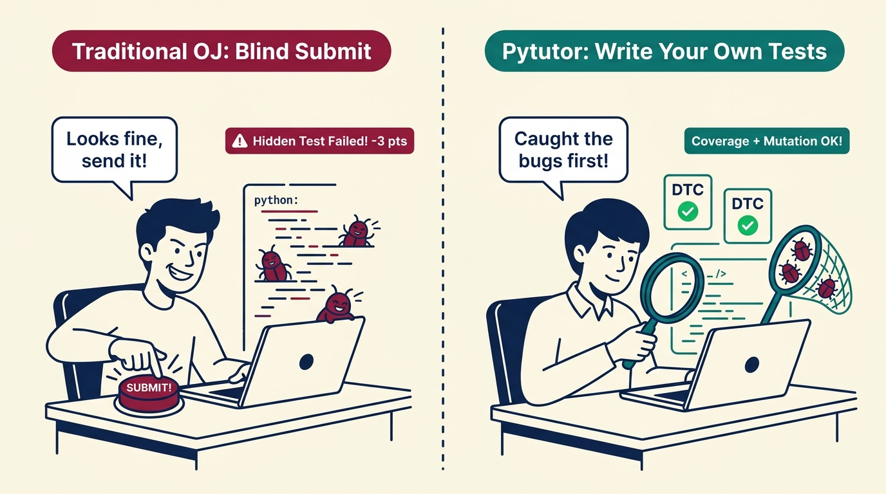

<strong>The Big Idea:</strong> Traditional Online Judges grade code with hidden tests alone — and <strong>23% of submissions are sent blindly without a single test</strong>. <strong>Pytutor</strong> embeds <strong>Defining Test Cases (DTCs)</strong>, branch coverage, and mutation testing to cultivate and measure learners' software-testing ability.

<!--
Empirical Motivation & Central Finding (Table 1):
This opening contrast highlights a pervasive behavioral flaw documented in Section 4.5.1 (Table 1) of the paper:
- Blind Submission Rate (23%): Even under a punitive Cautionary Principle that deducts 3 points per formal submission, learners formally submitted 23% of exercise attempts without executing a single Open Test Case (OTC) or Defining Test Case (DTC) beforehand.
- Under-Utilization of Self-Testing: Learners executed at least one OTC before submission in 59% of exercises, and authored/ran at least one custom DTC in only 44% of exercises, resulting in an average of 1.43 formal submissions per problem.
- Design Intervention: Conventional OJs evaluate code exclusively via hidden test suites, inadvertently training novices to use the grader as a trial-and-error oracle. Pytutor embeds DTC authoring, branch coverage, and mutation testing directly into the practice loop to cultivate and measure software-testing ability.
-->

---

## Presentation Outline

1

[**Introduction & Research Questions**](#4)
Why traditional Online Judges overlook software testing and our three RQs (RQ1–RQ3).

2

[**Related Work & Research Gap**](#6)
Survey of educational OJ platforms and automated testing assessment systems.

3

[**Pytutor Platform & SE Indicators**](#7)
Django + Docker sandbox, OTC / DTC / HTC workflow, Resilience (<i>r</i>), PAI, and TEI.

4

[**Experiment & RQ1–RQ3 Results**](#11)
7-week Python course (61 active learners, 50 exercises), group comparisons & correlations.

5

[**Comparison, Limitations & Pedagogy**](#17)
Alignment with Yang et al. (2020), study threats, and course design recommendations.

6

[**Conclusion & Future Work**](#19)
Visual synthesis of RQ1–RQ3 findings and roadmap for AI-assisted programming education.

<!--
Paper Structure & Section Mapping:
The 25-page article is organized into six sections:
1. Introduction (Section 1): Contrasts competition-oriented vs. educational OJs (Wasik [5]), reviews evidence linking testing to code reliability [7–11], introduces Pytutor, and defines RQ1–RQ3.
2. Related Work (Section 2): Surveys three threads: importance of software-testing ability [10, 12–15], automated programming assessment platforms [16–24], and test-case quality / testing education systems [13, 25–29].
3. Methods (Section 3): Details Pytutor's Django MVT architecture (Fig. 1), UI (Figs. 2–3), Docker sandbox security [30–33], learner workflow (Fig. 4), and mathematical definitions of Resilience r, PAI, TQI, TQI+, and TEI (Equations 1–6, Figs. 5–7).
4. Experiment (Section 4): Describes the 7-week asynchronous OpenEdu + Pytutor course (64 videos, 50 exercises, Fig. 8), participant demographics (69 enrolled, 61 active), data sources, and descriptive statistics (Tables 1–2, Fig. 9).
5. Discussion (Section 5): Answers RQ1 (four ability quadrants, Fig. 10), RQ2 (CS vs. Non-CS, formative, and summative Mann-Whitney U tests, Figs. 11–16), RQ3 (Spearman correlations, Figs. 17–18), comparison with Yang et al. [11], and study limitations.
6. Conclusions & Future Work (Section 6): Summarizes pedagogical takeaways and outlines AI virtual tutoring, enhanced web IDE telemetry, and controlled experiments.
-->

---

## 1.1 Motivation: Why Traditional Online Judges Miss Software Testing

<strong>Why Testing Ability Matters:</strong> Software testing helps learners clarify specifications and write more reliable code (Lemos et al., 2018; Fidge &amp; Hogan, 2013). Yet existing educational OJ systems evaluate <em>code correctness only</em>, ignoring learners' ability to design effective test cases.

<!--
Theoretical Grounding & Pedagogical Rationale:
- Role of Online Judges: Educational OJs accelerate feedback, reduce grading overhead, improve learning outcomes, and lower dropout rates (Pereira et al. [4]). Wasik [5] distinguishes competition-oriented OJs (leaderboards, limited languages) from educational OJs (broader language support, gamification), while Fu et al. [6] demonstrated real-time learning analytics dashboards (VisOJ) for tracking student error distributions.
- Why Testing Ability Must Be Cultivated: Empirical studies consistently show that testing strengthens specification comprehension and code reliability: Lemos et al. [7] demonstrated positive impacts of testing education on code reliability; Buffardi & Edwards [8] found strong correlations between early testing quality/quantity and assignment grades; Spacco et al. [9] linked testing habits to improved coding practices; and Fidge & Hogan [10] framed testing ability as "understanding problems" vs. programming ability as "solving problems," noting that novices' testing skills lag substantially behind coding skills.
- Core Gap: Standard educational OJs only verify submitted code against hidden tests, offering neither practice opportunities nor quantitative evaluation for learner-authored test cases.
-->

---

## 1.2 Research Objectives & Three Research Questions

Using **Pytutor** alongside an asynchronous **OpenEdu** Python course, we investigate learners' software engineering abilities and online behaviors *(revealed step-by-step)*:

* 

RQ1 How do novices actually code, test, and watch course videos?

<strong>What is the performance of learners</strong> in terms of software engineering ability indicators (<i>r</i>, PAI, TEI) and online learning behaviors?

* 

RQ2 Do CS majors automatically test better than Non-CS majors?

<strong>How do learners from different groups perform</strong> in programming ability and testing ability across academic major, formative, and summative assessments?

* 
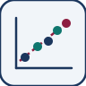

RQ3 Does writing better tests or watching more videos raise grades?

<strong>Is there a relationship between ability indicators and learning behavior</strong> (video completion, playback speed) and final learning outcomes?

<!--
Operationalization of the Three Research Questions:
Conducted inside a real 7-week asynchronous Python course combining OpenEdu (video lectures) and Pytutor (coding exercises), the study investigates three progressive questions:
- RQ1 (Baseline SE Abilities & Online Behaviors): Quantifies learners' distribution across Resilience (r), Programming Ability Index (PAI), Testing Efficiency Index (TEI), four percentile-based ability quadrants (HPHT, HPLT, LPHT, LPLT), submission/testing frequencies, and OpenEdu video engagement (completion rate, playback speed).
- RQ2 (Group Comparisons Across Major & Assessment Types): Uses non-parametric Mann-Whitney U tests to evaluate whether CS majors (n = 26) differ from Non-CS majors (n = 35) in r, PAI, and TEI, and how these indicators separate median-split high vs. low performers in formative practice (50 exercises) versus summative assessment (40-minute timed exam).
- RQ3 (Correlational Structure): Applies Spearman's rank correlation across ability indicators, video-watching behaviors, and both formative and summative outcomes to uncover how study habits and testing practices relate to programming achievement.
-->

---

## 2. Related Work & Research Gap

While automated assessment tools accelerate grading and feedback, few combine **learner-authored test cases**, **mutation/coverage evaluation**, and **multi-platform behavior analytics**.

| Study / Platform | Primary Focus | Custom Tests (DTC) | Coverage & Mutation | Behavior & Video Logs | Target Learners |
| :--- | :--- | :---: | :---: | :---: | :--- |
| YOJ [16] / Sakai [17] | Automated assignment grading & resubmission | × | × | × | CS1 Beginners |
| Codeflex [20] / 2TSW [23] | Competitive / gamified programming practice | × | × | × | Undergraduates |
| Codespec [21] / Blockly [22] | Parsons / visual algorithm scaffolding | × | × | × | Novices |
| UnitJudge [29] / Selenium [27] | Unit-test feedback / online test scripting | Partial | × | × | Intermediate |
| Yang et al. (2020) [11] | Empirical PAI vs. TEI on 3 tasks (unit tests) | ✓ | ✓ | × | Experienced CS |
| **Pytutor (Ours, 2023)** | **Testing-aware OJ + 50 exercises + OpenEdu logs** | **✓** | **✓** | **✓** | **CS & Non-CS** |

<strong>Key Research Gap:</strong> Prior testing-ability studies focused on experienced CS undergraduates over 3 timed tasks. How <strong>novices across CS and Non-CS majors</strong> develop testing sensitivity across a full self-paced online course remains largely unexplored.

<!--
Positioning Pytutor Against Prior Educational Platforms & Studies:
- Automated Grading & Scaffolding Platforms: Early systems such as YOJ (Sun et al. [16]) and Sakai (Suleman [17]) automated grading and enabled iterative resubmission, leveraging formative feedback (Carless et al. [18], Malmi et al. [19]). Subsequent platforms added timed competition (Codeflex [20]), multi-modality scaffolding including Parsons and Faded Parsons problems (Codespec [21]), visual algorithm animation (Progressive Blockly [22]), and gamification (2TSW [23], Swacha [24], Code Defenders [15]). None evaluate learner-authored test suites via coverage and mutation analysis.
- Testing-Oriented Assessment Systems: Ala-Mutka [13], Vujosevic-Janicic et al. [25], and Montoya-Dato et al. [26] emphasized that weak test suites misjudge buggy code as correct. Jiang & Deng [27] built an online Selenium script practice tool, Kasahara et al. [28] gamified code quality, and UnitJudge (Garcia-Magarino et al. [29]) used unit tests to localize errors in longer assignments, but did not measure coverage/mutation efficiency of student-designed test inputs.
- Closest Benchmark (Yang et al., 2020 [11]): Evaluated programming vs. testing ability using coverage and mutation scores, but examined experienced CS undergraduates with prior testing instruction across only 3 timed unit-test assignments and without video/behavioral analytics. Pytutor extends this paradigm to 50 self-paced exercises across CS and Non-CS novices integrated with OpenEdu telemetry.
-->

---

## 3.1 Pytutor Architecture, Sandbox & Three Test-Case Types

### 🧪 Three Categories of Test Cases
- **Open Test Cases (OTCs)**: Teacher-provided public samples (2 per exercise) for basic sanity checks.
- **Defining Test Cases (DTCs)**: **Learner-authored** custom tests executed in Testing Mode to hunt edge cases.
- **Hidden Test Cases (HTCs)**: Teacher-predesigned grading suite (5 per exercise) executed upon formal submission.

### ⚖️ Two Pedagogical Submission Principles
- **Completion Principle**: Learners may submit multiple times until passing all HTCs.
- **Cautionary Principle**: Each formal submission deducts **3 points**, discouraging blind trial-and-error and encouraging thorough DTC testing first.
- **Docker Security**: Ephemeral containers isolate infinite loops & malicious code, auto-deleting within seconds.

<!--
System Architecture, Security & Pedagogical Rules (Section 3.1, Figure 1):
- Django MVT Architecture: Built on Django's Model-View-Template framework for modular extensibility. The Template layer provides a browser-based Python editor and question interface; the View-Control layer invokes the automated assessment engine upon execution/submission; and the Software-Testing module computes branch coverage, mutation scores, and SE indicators (r, PAI, TEI). Design follows Ihantola et al.'s [30] guidelines for usability and safety.
- Three-Tier Test Case Taxonomy:
  1. Open Test Cases (OTCs): 2 instructor-provided public examples per exercise allowing basic verification.
  2. Defining Test Cases (DTCs): Custom inputs authored by learners in Testing Mode; learners must determine expected correctness themselves to probe edge cases.
  3. Hidden Test Cases (HTCs): 5 predesigned private test cases executed only during Formal Submission to compute scores.
- Pedagogical Rules & Docker Isolation: The Completion Principle permits unlimited resubmissions until passing all HTCs, while the Cautionary Principle deducts 3 points per formal submission to deter blind guessing. Addressing server security risks [31, 32], every code run spawns a fresh ephemeral Docker container [33] that terminates and self-deletes within seconds, containing infinite loops or malicious scripts.
-->

---

## 3.2 Testing Mode Interface & Learner Workflow

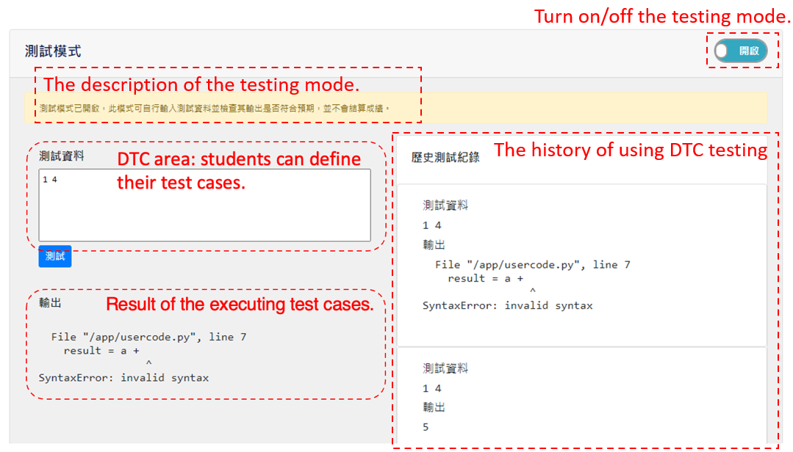

Fig. 3: Pytutor Testing Mode — DTC input area, raw compile errors &amp; 3-run history

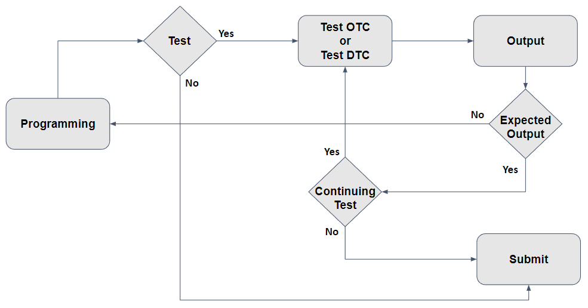

Fig. 4: Learner workflow — iterative OTC/DTC verification before formal HTC submit

<strong>Error Transparency &amp; Safety Net:</strong> Compilation errors appear in raw Python form to train debugging, while formal submission requires ticking a <strong>"Confirm Submission"</strong> checkbox to prevent accidental −3 pt penalties.

<!--
Interface Structure & Behavioral Logging (Sections 3.1.2 & 3.2, Figures 2–4):
- Three-Pane Answering Page: Comprises (1) the Question-Information area (title, problem description, and public OTCs, Fig. 2), (2) the Answering area (code editor with Testing Mode vs. Formal Submission Mode), and (3) the Result-Display area (Fig. 3).
- Testing Mode Pedagogical Features (Figure 3): Displays raw, unmodified Python compiler/runtime error messages so novices learn authentic debugging directly from stack traces rather than sanitized hints. The lower panel allows entering custom DTC inputs and retains a rolling history of the last 3 test runs for side-by-side comparison.
- Formal Submission Safety Net & Workflow (Figure 4): Learners iterate between coding, OTC checks, and DTC verification (or may bypass testing and submit directly). Formal Submission requires explicitly checking a "Confirm Submission" box to prevent accidental -3 point deductions. Every testing event (code snapshot, test input, output) and formal submission (code, passed HTC count, elapsed time) is logged to the database.
-->

---

## 3.3 Quantifying Programming Ability: Resilience (<i>r</i>) & PAI

Pure assignment scores hide how many setbacks a learner faced. We normalize scores by **complexity-adjusted resilience (<i>r</i>)** (`k = 0.1<code>):

<i>r</i> &nbsp;=&nbsp; <i>e</i><i>k</i> × (<i>tr</i> − <i>chp</i>)

<i>s</i> &nbsp;=&nbsp; <i>base</i> + (100 − <i>base</i>) × <i>p</i>

<i>PAI</i> &nbsp;=&nbsp; <i>s</i><i>r</i>

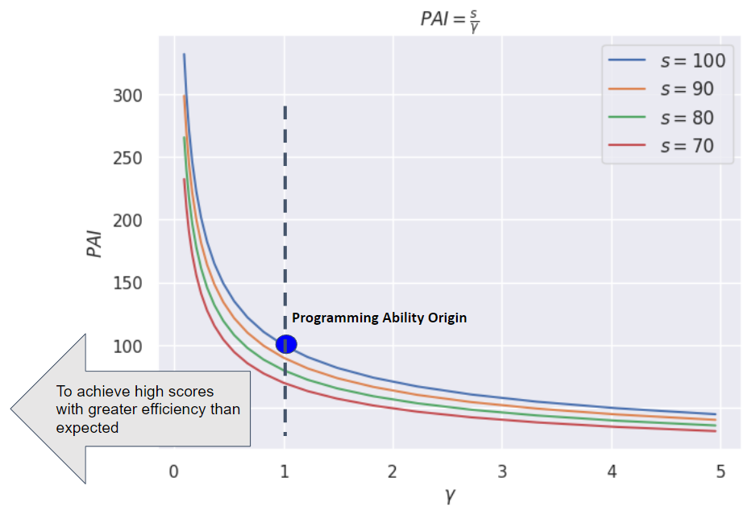

Fig. 6: Impact of resilience <i>r</i> on Programming Ability Index (PAI)

### 📈 Interpreting <i>r</i> and PAI
- **</code>tr`**: Total setback attempts (syntax errors + failed HTC submissions).
- **<code>chp</code>**: Challenge level of program `p` (decision count / cyclomatic complexity).
- **Resilience Origin (<code>tr = chp</code>, `r = 1`)**: `r > 1` reflects high persistence through setbacks; `r < 1` reflects solving faster than expected.
- **Dual Meaning**: Higher `PAI = s / r` means achieving high HTC pass scores (`s`) with **fewer setbacks**.
- **Course Mean**: Avg `PAI = 121.80` (> 100), showing learners solved most exercises efficiently.

<!--
Mathematical Formulation of Resilience (r) & PAI (Sections 3.3.1–3.3.2, Equations 1–3):
Pure exercise scores fail to distinguish a student who solves a problem cleanly from one who succeeds only after many failed attempts. Extending Xu et al.'s [34] attempt-based proficiency model and Pereira et al.'s [36] resilience construct with McCabe cyclomatic complexity [35], the authors define three linked equations:
- Equation (1) Resilience: r = exp(k * (tr - ch_p)), with tuning constant k = 0.1 (chosen via Fig. 5 to provide smooth, non-extreme weighting). Here tr is total setback attempts (syntax errors in testing/submissions plus formal submissions failing to pass all HTCs), and ch_p is the program's challenge level (decision count / cyclomatic complexity). At tr = ch_p (the "resilience origin"), r = 1. Values r > 1 indicate high persistence through setbacks; r < 1 indicates solving with fewer setbacks than expected.
- Equation (3) Base-Adjusted Score: s = base + (100 - base) * p, where base is the minimum score awarded for passing at least one HTC and p is the fraction of HTCs passed.
- Equation (2) Programming Ability Index: PAI = s / r. At r = 1 ("programming ability origin"), PAI = s. When r < 1 (high efficiency), PAI exceeds s (course mean PAI = 121.80 > 100); when r > 1 (many setbacks), PAI drops below s (Fig. 6). Thus r acts as a dual indicator: persistence on one hand, and inverse coding fluency on the other. Note: unlike Yang et al. [11], code maintainability was omitted because introductory exercises are small.
-->

---

## 3.4 Quantifying Testing Ability: TQI & TEI

Testing quality combines **branch coverage (<code>bt</code>)** and **mutation score (<code>mst</code>)** of a learner's combined OTC + DTC suite relative to OTC alone:

<i>TQIt</i> &nbsp;=&nbsp; √(<i>bt</i> × <i>mst</i>)

<i>TQI</i>+ &nbsp;=&nbsp; <i>TQIOD</i><i>TQIO</i>

<i>TEI</i> = 1 (<i>te</i>=<i>teo</i>) &nbsp;|&nbsp; <i>TQI</i>+(1 + <i>e</i>−<i>k</i>(<i>te</i>−<i>cht</i>))

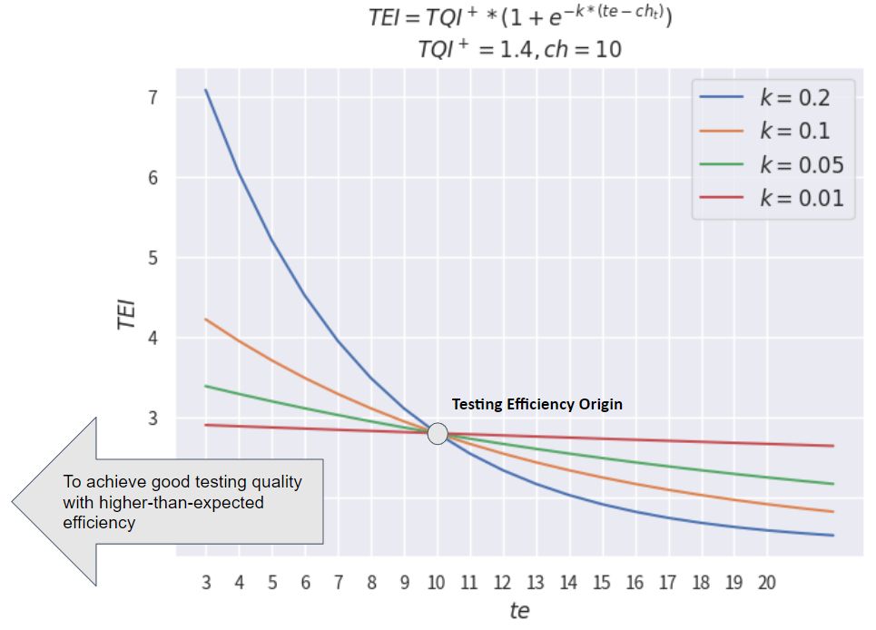

Fig. 7: Impact of <i>k</i> (= 0.1) and test count on Testing Efficiency Index (TEI)

### 🎯 Interpreting TQI+ and TEI
- **<code>TQIOD / TQIO</code>**: Measures how much a learner's **DTCs** improve branch coverage and mutant killing over baseline **OTCs**.
- **Baseline Guarantee**: Learners using only OTCs (<code>te = teo</code>) receive `TEI = 1`. Adding <code>1 + e−k(te−cht)</code> ensures writing DTCs never drops below `1`.
- **Efficiency Bonus**: Achieving high <code>TQI+</code> with **fewer test cases** than expected (<code>te < cht</code>) yields a higher `TEI`.
- **Course Mean**: Avg `TEI = 1.89`, revealing weak testing habits across most exercises.

<!--
Mathematical Formulation of TQI, TQI+ & TEI (Section 3.3.3, Equations 4–6):
Following software-testing literature linking coverage and mutation killing to fault detection [11, 37], testing ability is quantified exclusively from how much a learner's custom DTCs strengthen the baseline OTC suite:
- Equation (4) Test Quality Index: TQI_t = sqrt(b_t * ms_t), the geometric mean of branch coverage b_t (fraction of code branches executed) and mutation score ms_t (fraction of generated mutants killed), scaled 0–100.
- Equation (5) Quality Gain Ratio: TQI+ = TQI_OD / TQI_O, comparing the combined OTC + DTC test suite (TQI_OD) against OTC alone (TQI_O).
- Equation (6) Testing Efficiency Index: If a learner runs only OTCs (te = te_o), TEI = 1 by default (assuming basic testing competence). If the learner authors DTCs (te > te_o), TEI = TQI+ * (1 + exp(-k * (te - ch_t))), where te = total test cases (OTC + DTC), ch_t = expected test count scaling with complexity, and k = 0.1 (Fig. 7).
- Design Safeguard: Adding "1 +" to the exponential term guarantees that learners willing to write DTCs are never penalized below the baseline TEI = 1 even if their DTCs are numerous or weak. Achieving high TQI+ with concise test sets (te < ch_t, left of the "testing ability origin") yields the highest TEI. Course mean TEI was only 1.89 because many exercises remained at TEI = 1.
-->

---

## 4.1 Course Design, Participants & Exercise TQI Distribution

### 📚 7-Week Online Python Course
- **Format**: Asynchronous **OpenEdu** (7 units, **64 videos**) + **Pytutor** (**50 exercises**) + 5 face-to-face Q&amp;A meetings + MS Teams support.
- **Exercise Complexity**: Avg cyclomatic complexity = **4.06**; each has **2 OTCs** + **5 HTCs** (avg OTC branch coverage = **0.92**, mutation score = **0.75**).
- **Participants**: **69 enrolled** (27 CS, 42 Non-CS; 54 with prior coding, 15 with Python); **61 active learners** analyzed (26 CS, 35 Non-CS).
- **Assessments**: **Formative** (avg of 50 Pytutor exercises) &amp; **Summative** (40-min, 4-question final coding exam).

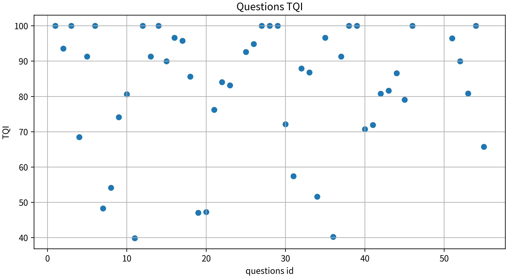

Fig. 8: Baseline OTC TQI distribution across all 50 exercises (some low-TQI exercises urgently require learner DTCs)

<!--
Experimental Context, Curriculum & Data Sources (Sections 4.1–4.4, Figure 8):
- Course Structure: A 7-week asynchronous online Python course combining OpenEdu (7 units, 64 prerecorded videos: Units 1–5 cover programming fundamentals, basic structures/operations, logic, and OOP; Units 6–7 cover practical data processing and object design) with Pytutor (50 exercises distributed across Units 1–5 as 1, 9, 13, 18, and 9 problems respectively). Five face-to-face Q&A meetings (following Montoya-Dato et al. [26] on instructor-guided reflection) and a Microsoft Teams channel provided synchronous/asynchronous support.
- Problem Bank Metrics (Figure 8): Mean cyclomatic complexity = 4.06; each problem includes 2 OTCs and 5 HTCs. Baseline OTCs average 0.92 branch coverage and 0.75 mutation score, though Fig. 8 shows several exercises with very low baseline TQI where learner DTCs are essential to catch faults.
- Cohort & Filtering: 69 undergraduates enrolled (27 CS, 42 Non-CS; 54 had prior coding experience in some language, 15 had prior Python). Motivations included interest in programming (44), acquiring a second skill (30), online convenience (21), and enrolling with classmates (13). After excluding 8 learners inactive in later weeks, N = 61 active learners (26 CS, 35 Non-CS) entered statistical analysis.
- Triangulated Measures: Pre-course survey, OpenEdu video event logs (load_video, play_video, seek_video, pause_video, stop_video), Pytutor execution logs, formative score (50-exercise average), and summative score (40-min, 4-question coding exam held 2 weeks after Week 7 release).
-->

---

## 4.2 RQ1 Results: Learner Engagement & Four Ability Types

23% Blind

Exercises submitted with <strong>zero</strong> OTC or DTC testing

44% DTC

Used ≥ 1 DTC before submit (59% used ≥ 1 OTC)

56% @ 2.08×

Avg OpenEdu video completion &amp; playback speed

1.43 Submits

Avg formal submits/Q · 14.45 min · <i>tr</i> = 3.23

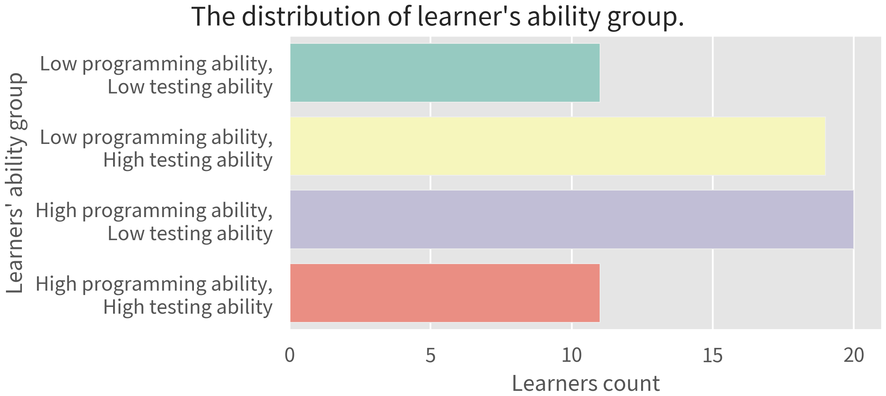

Fig. 10: 61 learners grouped by percentile rank (1–50 Low, 51–99 High)

### 📊 Descriptive Summary (Table 2 · N = 61)
| Metric | Mean | Std | Median | Max |
| :--- | :---: | :---: | :---: | :---: |
| Resilience (<i>r</i>) | 1.97 | 2.82 | 0.99 | 17.53 |
| **Avg TEI** | **1.89** | 0.49 | 1.92 | 2.99 |
| **Avg PAI** | **121.80** | 23.64 | 127.55 | 157.19 |
| Formative Score | 72.66 | 26.17 | 84.08 | 99.64 |
| Summative Exam | 68.04 | 23.69 | 77.93 | 100.00 |

**Key Insight**: Low patience (2.08× speed, 56% completion, 23% blind submits) — yet **39 of 61 learners** are split between **HPLT (20)** and **LPHT (19)**!

<!--
Empirical Analysis of RQ1: Engagement & Ability Quadrants (Sections 4.5 & 5.1, Tables 1–2, Figs. 9–10):
- Engagement Telemetry (Table 1): Despite the -3 point cautionary penalty, learners averaged 1.43 formal submissions per exercise (spending 14.45 min/problem on average), with tr = 3.23 setbacks and te = 3.41 total test cases (executing OTCs 3.96 times and DTCs 2.94 times per question, including reruns). Crucially, 59% ran >= 1 OTC, only 44% ran >= 1 DTC, and 23% submitted blindly with zero testing. On OpenEdu, mean video completion was 56% (median 60%, max 83%) at an average playback speed of 2.08x (median 2.16x, max 2.92x), signaling low learner patience.
- Proportional Exam Prediction: Given 14.45 min per practice problem, a 40-min, 4-question final exam proportionally predicts ~69% completion; the observed summative mean of 68.04 (median 77.93) closely matches this estimate.
- Descriptive Distributions (Table 2, Fig. 9): r (mean 1.97, SD 2.82, median 0.99, max 17.53 — strongly right-skewed due to highly persistent outliers); TEI (mean 1.89, SD 0.49, median 1.92, range 1.00–2.99); PAI (mean 121.80, SD 23.64, median 127.55, range 49.18–157.19); Formative (mean 72.66, median 84.08); Summative (mean 68.04, median 77.93).
- Four Percentile Quadrants (Figure 10): Splitting PAI and TEI at percentile rank 50 (1–50 Low, 51–99 High) yields HPHT = 11, HPLT = 20, LPHT = 19, LPLT = 11. Nearly two-thirds (39/61) exhibit mismatched coding vs. testing profiles.
-->

---

## 4.3 RQ2a Results: CS Majors vs. Non-CS Majors

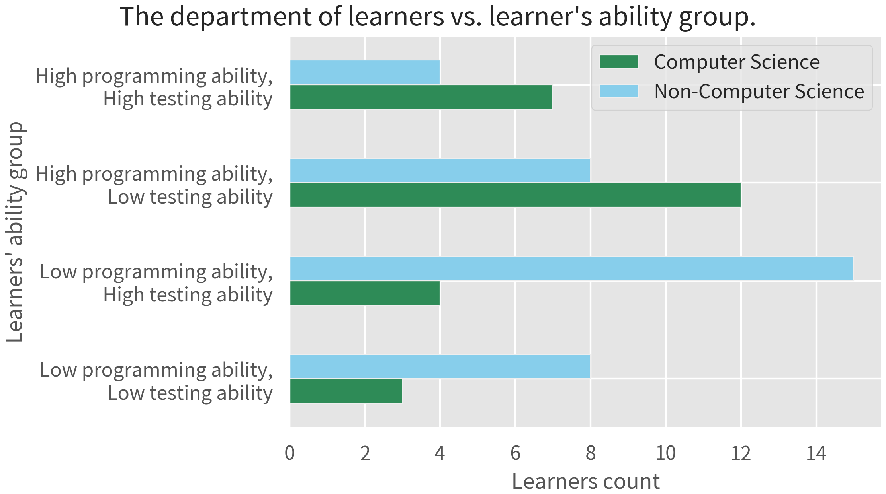

Fig. 11: Departmental background vs. 4 ability categories (26 CS vs. 35 Non-CS)

### 🔬 Mann–Whitney U Test: CS vs. Non-CS (Fig. 12)
| Indicator | CS (n = 26) vs. Non-CS (n = 35) | <i>p</i>-value | Sig.? |
| :--- | :--- | :---: | :---: |
| **Resilience (<i>r</i>)** | Non-CS face more errors &amp; persist longer | **0.001** | **Yes*** |
| **PAI (Coding)** | CS: **19/26 (73%) HP** vs. Non-CS: 12/35 | **0.0003** | **Yes*** |
| **TEI (Testing)** | CS: **11/26 (42%) HT** vs. Non-CS: 19/35 (54%) | **0.277** | **No** |

<strong>Surprising Finding:</strong> CS majors significantly outperform Non-CS majors in <strong>programming ability (PAI)</strong>, yet show <strong>NO significant advantage in testing ability (TEI)</strong>! Overconfidence leads CS students to test less, while Non-CS learners write more DTCs to avoid errors.

<!--
RQ2a Statistical Breakdown: Departmental Background (Section 5.2, Figures 11–12):
Because indicator distributions violated normality (skewed r and PAI), two-sided Mann-Whitney U tests were used to compare CS (n = 26) and Non-CS (n = 35) learners:
- Programming Ability (PAI, Fig. 12b): Highly significant advantage for CS majors (p = 0.0003 < 0.05). In Figure 11, 19 of 26 CS students (73%) fall into High PAI (HP), compared with only 12 of 35 Non-CS students (34%), and CS distributions are tighter/more concentrated.
- Resilience (r, Fig. 12a): Significantly higher among Non-CS majors (p = 0.001 < 0.05). Facing less prior coding fluency, Non-CS students encountered more syntax/logic setbacks yet persisted through repeated iterations.
- Testing Efficiency (TEI, Fig. 12c): No statistically significant difference (p = 0.277 > 0.05). Counterintuitively, a higher proportion of Non-CS learners achieved High TEI (19/35 = 54%) than CS majors (11/26 = 42%).
- Behavioral Interpretation: The authors infer that prior coding experience gives CS majors confidence to attain high scores without authoring many DTCs, whereas Non-CS learners proactively write custom DTCs to avoid compilation and grading errors. Consequently, CS enrollment alone does not confer software-testing proficiency.
-->

---

## 4.4 RQ2b Results: Formative Assessment (Learning Phase)

Dividing the 61 learners by the formative-assessment median (**84.08**) yields **31 high-score** and **30 low-score** learners:

Fig. 13: Formative score groups — 21 of 31 high scorers have High TEI!

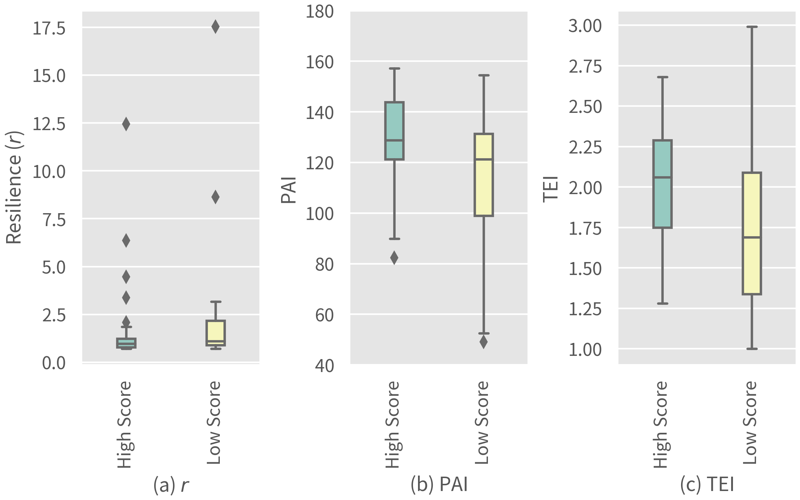

Fig. 14: Mann–Whitney U — <i>r</i>: <i>p</i> = 0.153 (n.s.) · <b>PAI: <i>p</i> = 0.035*</b> · <b>TEI: <i>p</i> = 0.036*</b>

<strong>RQ2b Finding:</strong> During the 50-exercise practice phase, <strong>BOTH programming ability (PAI, <i>p</i> = 0.035) and testing ability (TEI, <i>p</i> = 0.036)</strong> significantly separate high scorers from low scorers. Even learners with lower PAI achieve top formative scores when armed with high TEI (<strong>12 LPHT high scorers</strong>)!

<!--
RQ2b Statistical Breakdown: Formative Learning Phase (Section 5.2, Figures 13–14):
Splitting the 61 active learners at the formative-assessment median (84.08 across 50 Pytutor exercises) produced 31 high-scoring and 30 low-scoring learners:
- Ability Quadrant Distribution (Figure 13): Among the 31 formative high scorers, 21 (68%) belong to the High Testing Ability (HT) quadrants — specifically 9 HPHT and 12 LPHT learners. Notably, 12 learners with below-median programming fluency (Low PAI) still reached the top half of formative scores by leveraging disciplined DTC testing.
- Mann-Whitney U Results (Figure 14):
  - Resilience r (Fig. 14a): p = 0.153 (not significant) — persistence alone does not guarantee high formative scores without effective coding or testing strategies.
  - PAI (Fig. 14b): p = 0.035 (significant) — higher coding efficiency separates top formative performers.
  - TEI (Fig. 14c): p = 0.036 (significant) — higher testing efficiency independently and significantly distinguishes high scorers from low scorers during self-paced practice.
- Pedagogical Insight: In untimed formative learning, strong testing ability acts as a compensatory scaffold that enables novices to catch edge-case defects before incurring formal submission penalties.
-->

---

## 4.5 RQ2c Results: Summative Assessment (Timed Final Exam)

Dividing learners by the summative-exam median (**77.93**; 4 questions in **40 minutes**) yields **31 high achievers** and **30 low achievers**:

Fig. 15: Summative score groups — 18 HP vs. 13 LP in the high-score group

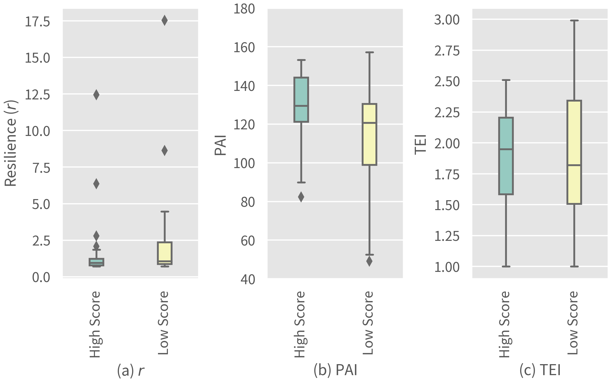

Fig. 16: Mann–Whitney U — <i>r</i>: <i>p</i> = 0.105 (n.s.) · <b>PAI: <i>p</i> = 0.016*</b> · TEI: <i>p</i> = 0.93 (n.s.)

<strong>RQ2c Finding:</strong> Under strict <strong>40-minute exam pressure</strong>, <strong>PAI is the sole significant differentiator (<i>p</i> = 0.016)</strong>, whereas TEI shows no difference (<i>p</i> = 0.93). Limited exam time leaves little room to design thorough DTCs, favoring rapid, low-error coding proficiency.

<!--
RQ2c Statistical Breakdown: Timed Summative Exam (Section 5.2, Figures 15–16):
Splitting the 61 learners at the summative final-exam median (77.93 on a 40-minute, 4-question programming exam held two weeks after Week 7) yields 31 high achievers and 30 low achievers:
- Ability Quadrant Shift (Figure 15): In the high-score group, High PAI learners dominate (18 HP vs. 13 LP), reversing the low-score group (13 HP vs. 17 LP).
- Mann-Whitney U Results (Figure 16):
  - Resilience r (Fig. 16a): p = 0.105 (not significant).
  - PAI (Fig. 16b): p = 0.016 (statistically significant) — programming proficiency is the sole significant differentiator of exam performance.
  - TEI (Fig. 16c): p = 0.93 (completely non-significant).
- Contextual Explanation: Under severe time constraints (~10 minutes per coding problem), learners lack the temporal margin to design comprehensive DTC suites and iterate through coverage/mutation checks. Furthermore, the timed exam emphasizes conceptual mastery and rapid, low-error implementation, giving high-PAI coders a decisive competitive advantage.
-->

---

## 4.6 RQ3 Results: Correlations Among Abilities, Videos & Outcomes

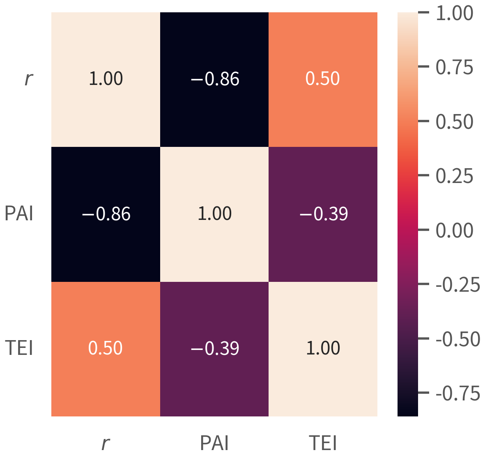

Fig. 17: Spearman correlations among <i>r</i>, PAI &amp; TEI

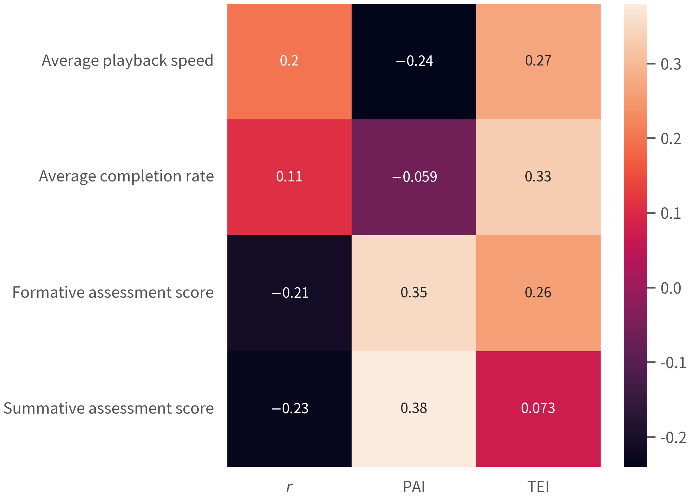

Fig. 18: Spearman correlations with video behaviors &amp; scores

<strong>Key Correlation Patterns:</strong>
(1) <b><i>r</i> ↔ TEI (+0.50)</b>: Frequent errors trigger iterative DTC debugging; <b>PAI ↔ TEI (−0.39)</b> confirms coding &amp; testing are distinct skills.
(2) <b>Video Completion ↔ TEI (+0.33)</b>: Engaged video watchers test more thoroughly; <b>Playback Speed ↔ PAI (−0.24)</b>: Rushing videos hurts coding accuracy.
(3) <b>Outcomes</b>: PAI correlates with both Formative (<b>+0.35</b>) &amp; Summative (<b>+0.38</b>); TEI boosts Formative (<b>+0.26</b>) but not timed exams (<b>+0.073</b>).

<!--
RQ3 Correlational Network: Abilities, Video Telemetry & Grades (Section 5.3, Figures 17–18):
Spearman's rank correlation heatmaps uncover three structural relationships across the 61 learners:
1. Inter-Indicator Structure (Figure 17):
   - PAI vs. r = -0.863 (strong negative): Mathematically expected since PAI = s / r, reflecting that fluent coders encounter fewer setbacks.
   - r vs. TEI = +0.50 (moderate positive): Learners who hit more syntax/logic errors actively engage in multiple rounds of DTC testing to debug their code.
   - PAI vs. TEI = -0.385 (moderate negative): Confirms that programming fluency and testing diligence are distinct constructs; strong coders often pass introductory exercises without thorough DTC authoring.
2. OpenEdu Video Behaviors vs. Abilities (Figure 18):
   - Video Completion vs. TEI = +0.331 (moderate positive): Diligent learners who watch more lecture content also test more thoroughly; completion has near-zero correlation with r (+0.111) and PAI.
   - Playback Speed vs. PAI = -0.24 (negative), vs. r = +0.203 (positive), vs. TEI = +0.237 (low positive): Rushing videos at high speed impairs conceptual comprehension, raising coding errors (lower PAI, higher r) and forcing compensatory testing (higher TEI).
3. Outcomes: PAI correlates moderately with both Formative (+0.35) and Summative (+0.38) scores; TEI correlates positively with Formative (+0.26) but not Summative (+0.073); r shows weak negative correlations with both assessments.
-->

---

## 5.1 Comparison with Prior Studies & Study Limitations

### 🔍 Comparison with Yang et al. (2020) [11]
- **Confirmed Core Finding**: Both studies show that **strong programming skills do NOT guarantee strong testing ability** — nearly half of strong coders test poorly, while weaker coders can excel at testing.
- **Scale &amp; Context**: Yang et al. evaluated experienced CS students with prior testing training on **3 timed tasks**.
- **Our Extension**: Pytutor spans **50 self-paced exercises** across **CS &amp; Non-CS novices** without prior testing instruction, capturing natural test-case sensitivity and OpenEdu video telemetry.

### ⚠️ Three Study Limitations
1. **High Baseline OTC Quality**: Several exercises had baseline <code>TQIO > 80</code>, leaving narrow headroom for learner DTCs to raise <code>TQI+</code> and `TEI`.
2. **Untaught Testing Concepts**: Software-testing techniques (e.g., boundary value, equivalence partitioning) were not explicitly taught in the curriculum, so TEI measured *natural sensitivity*.
3. **Off-Platform Editing Blind Spot**: Pytutor currently cannot log whether learners write and test code in a **local IDE** before pasting into the web platform.

<!--
Cross-Study Synthesis & Methodological Limitations (Sections 5.4 & 5.5):
- Positioning Against Automated Assessment Platforms: Unlike YOJ [16], Sakai [17], and Codeflex [20], Pytutor lets instructors vary difficulty while requiring learners to design DTCs; like Codespec's [21] multi-skill focus, Pytutor allows instructors to seed starter/buggy code to target debugging skills directly.
- Detailed Comparison with Yang et al. (2020) [11]: Both studies converge on a crucial empirical truth — strong programming skill does not guarantee strong testing ability (nearly half of high-PAI coders exhibit low TEI, while low-PAI learners can excel in TEI). Key extensions: Yang et al. studied experienced CS undergraduates with prior testing training on 3 timed unit-test tasks (Pearson r); Pytutor scales to 50 self-paced exercises across CS and Non-CS novices without prior testing training, adds OpenEdu video telemetry, and applies non-parametric Spearman/Mann-Whitney statistics.
- Three Explicit Study Limitations (Section 5.5):
  1. Ceiling Effect on Baseline OTCs: Several exercises had baseline TQI_O > 80, leaving narrow headroom for learner DTCs to raise TQI+ and compressing TEI variance.
  2. Untaught Testing Methodology: Because formal testing techniques (boundary value analysis, equivalence partitioning) were not taught, TEI captured novices' "natural sensitivity" to test cases rather than trained testing skill.
  3. Off-Platform IDE Blind Spot: Pytutor cannot observe whether students author and test code locally in an external IDE (e.g., VS Code, PyCharm) before pasting a polished solution into the web editor.
-->

---

## 5.2 Pedagogical Implications for Programming Education

Our empirical evidence yields three concrete recommendations for CS1 &amp; online programming instructors:

### 1. Teach Testing to ALL Majors
- CS majors are **not** naturally better testers (`p = 0.277`).
- Integrate black-box &amp; boundary-case testing directly into introductory courses for **both CS and Non-CS** students.
- Testing helps lower-PAI novices achieve top formative performance.

### 2. Micro-Segment Video Lessons
- Learners watch only **56%** of videos at **2.08× speed**, and high playback speed negatively correlates with PAI (`−0.24`).
- Break long lectures into **bite-sized knowledge-point clips** to sustain attention and reduce rushed coding errors.

### 3. Design "Test-Hungry" Problems
- Intentionally keep public OTC coverage modest (<code>TQIO < 70</code>) so students **must** craft DTCs to uncover edge cases.
- Pair the **Cautionary Principle (−3 pts)** with instant DTC coverage feedback to make testing a habit.

<!--
Evidence-Based Recommendations for Programming Curricula (Sections 5.1, 5.2, 5.5 & 6):
Translating the empirical findings from 61 learners across 50 exercises into actionable instructional design yields three concrete interventions:
1. Embed Software-Testing Instruction for ALL Majors: In the Taiwanese university context studied, CS majors showed no natural TEI advantage over Non-CS peers (p = 0.277), yet strong testing enabled 12 LPHT novices to reach the top half of formative scores. Introductory programming courses (both CS1 and non-major Python) should explicitly teach black-box test design, boundary cases, and equivalence partitioning alongside syntax.
2. Micro-Segment Video Lectures into Knowledge-Point Clips: Because learners averaged only 56% video completion at 2.08x playback speed — and accelerated viewing correlated negatively with PAI (-0.24) and positively with setbacks r (+0.203) — long recordings should be partitioned into concise, single-concept micro-videos to sustain attention and prevent superficial comprehension.
3. Engineer "Test-Hungry" Exercises: To eliminate the TQI_O > 80 ceiling effect (Section 5.5), instructors should deliberately calibrate public OTC coverage to remain modest (e.g., TQI_O < 70), pairing the -3 point Cautionary Principle with immediate DTC coverage/mutation feedback so students must write meaningful DTCs to uncover hidden edge cases.
-->

---

## 6. Conclusion & Future Work

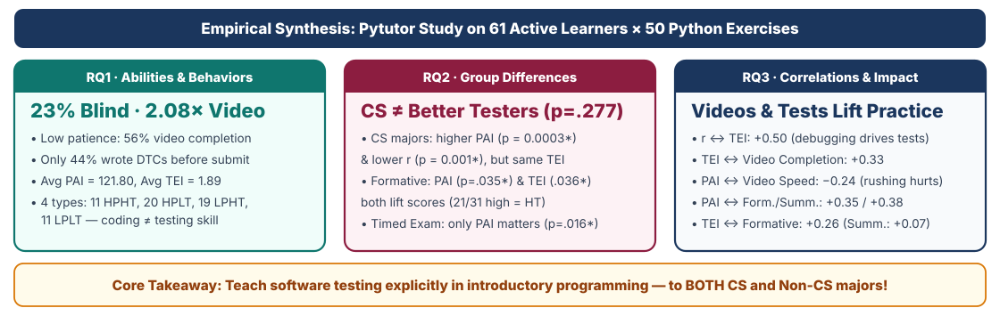

<strong>🤖 1. AI Virtual Assistant</strong> Use generative AI to guide learners Socratic-style toward edge cases — without giving away direct answers.

<strong>💻 2. Richer Online IDE &amp; Telemetry</strong> Enhance the web editor so students stay on-platform, enabling fine-grained keystroke &amp; debugging analytics.

<strong>🧪 3. Controlled Experiments</strong> Run experimental vs. control group studies to quantify the causal learning gains of testing-integrated OJs.

<!--
Summary of Contributions & Future Research Agenda (Section 6):
Pytutor demonstrates how an educational Online Judge can move beyond binary HTC pass/fail grading by integrating learner-defined test cases (DTCs), cyclomatic-complexity-adjusted resilience (r) and PAI, and coverage/mutation-based TEI. Across 61 active learners and 50 exercises, the study establishes that (1) novices exhibit impatient online habits (56% video completion at 2.08x speed, 23% blind submits), (2) CS majors surpass Non-CS majors in PAI (p = 0.0003) but not TEI (p = 0.277), and (3) both PAI and TEI drive formative success while PAI alone governs 40-minute timed exams.

Three Future Directions in the Era of AI-Assisted Programming (citing Welsh [38]):
1. Socratic AI Virtual Teaching Assistant: Leverage generative AI to guide learners toward discovering edge cases and debugging strategies through questioning — explicitly avoiding the pitfall of handing out direct code solutions.
2. Enhanced Web IDE & Fine-Grained Telemetry: Upgrade Pytutor's in-browser editor so learners prefer coding on-platform rather than in local IDEs, enabling keystroke-level, edit-compile-test behavioral analytics.
3. Experimental vs. Control Group Validation: Conduct randomized or quasi-experimental controlled trials in future offerings to establish the causal learning gains of testing-integrated OJs over conventional OJs.
-->

---

<!-- _class: closing -->

# Thank You for Your Attention!

Design of an Online Programming Platform and a Study on Learners’ Testing Ability (Pytutor)

<strong>Nien-Lin Hsueh*</strong> &nbsp;·&nbsp; <code>nlhsueh@fcu.edu.tw</code> 
<strong>Lien-Chi Lai</strong> &amp; <strong>Wei-Hsiang Tseng</strong> 
Department of Information Engineering and Computer Science, Feng Chia University, Taichung, Taiwan 
Journal Article: <code>Electronics 2023, 12(22), 4596</code> · <code>https://doi.org/10.3390/electronics12224596</code> 
Grant: MOST112-2813-C-035-075-E · Questions &amp; Discussion Welcome!

<!--
Reference & Reproducibility Information:
- Full Citation: Hsueh, N.-L.; Lai, L.-C.; Tseng, W.-H. Design of an Online Programming Platform and a Study on Learners' Testing Ability. Electronics 2023, 12(22), 4596. DOI: https://doi.org/10.3390/electronics12224596 (Open Access, CC BY 4.0).
- Core Formulas & Figures in Published Article: System architecture & workflow (Figs. 1–4), Resilience r, PAI, TQI, TQI+, and TEI equations (Eqs. 1–6; Figs. 5–7), 50-exercise TQI distribution (Fig. 8), engagement & descriptive statistics (Tables 1–2; Figs. 9–10), Mann-Whitney U group comparisons (Figs. 11–16), and Spearman correlation heatmaps (Figs. 17–18).
- Funding & Data Availability: Supported by the National Science and Technology Council (NSTC), Taiwan R.O.C., grant MOST112-2813-C-035-075-E. Learner-level logs are available upon request from the corresponding author (nlhsueh@fcu.edu.tw) subject to student privacy protections.
-->

