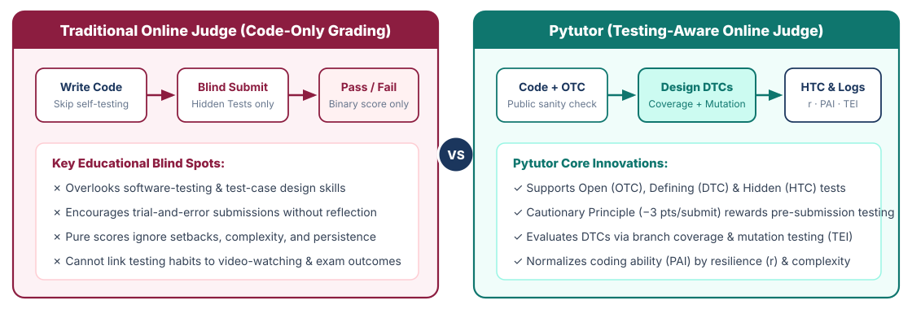
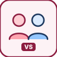
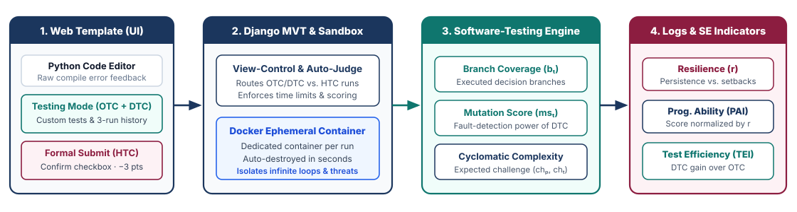
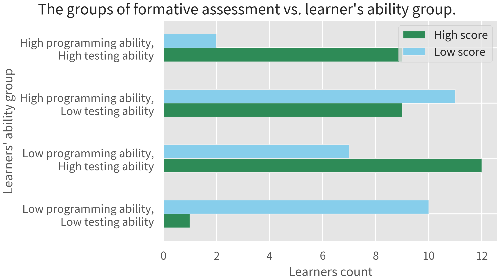
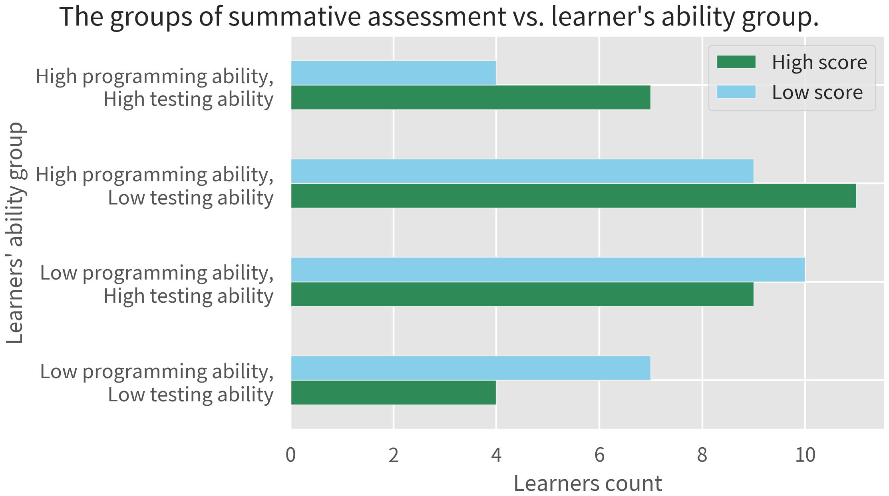

<!-- _class: lead -->

Electronics 2023, 12(22), 4596 · Software Engineering Education

# Design of an Online Programming Platform and a Study on Learners’ Testing Ability

<strong>Pytutor</strong>: Integrating Software-Testing Concepts, Defining Test Cases (DTCs), Code Coverage &amp; Mutation Testing into Automated Programming Education

<strong>Nien-Lin Hsueh*</strong>, <strong>Lien-Chi Lai</strong>, and <strong>Wei-Hsiang Tseng</strong> 
Department of Information Engineering and Computer Science, Feng Chia University, Taichung 407, Taiwan 
<code>nlhsueh@fcu.edu.tw</code> · DOI: <code>10.3390/electronics12224596</code>

Published: 10 November 2023 (MDPI Electronics) · Funded by the National Science and Technology Council (NSTC), Taiwan R.O.C., under grant MOST112-2813-C-035-075-E.

<!--
Key Takeaway: We introduce Pytutor, a testing-aware online programming platform, and present an empirical study of novices' programming and testing abilities.
Talking Points:
- Hello everyone. Today I am presenting our Electronics 2023 study from Feng Chia University on designing an online programming platform and investigating learners' software-testing ability.
- We built Pytutor to integrate learner-defined test cases, branch coverage, and mutation testing directly into an automated online judge.
- Across a 7-week Python course, we examined how CS and Non-CS learners code, test, watch course videos, and perform on formative and summative assessments.
Transition: Let's begin with an everyday classroom habit that motivated this entire project.
-->

---

## Opening Hook: "Looks Fine, Send It!" ... Or Did You Test Your Code?

<strong>The Big Idea:</strong> Traditional Online Judges grade code with hidden tests alone — and <strong>23% of submissions are sent blindly without a single test</strong>. <strong>Pytutor</strong> embeds <strong>Defining Test Cases (DTCs)</strong>, branch coverage, and mutation testing to cultivate and measure learners' software-testing ability.

<!--
Key Takeaway: Traditional online judges foster blind submissions — 23% of exercise attempts are submitted without any testing — whereas Pytutor trains learners to test first.
Talking Points:
- Most students using a standard online judge write code, eyeball it, and hit Submit immediately, treating hidden grading tests as a trial-and-error crutch.
- Even with a penalty in place, our logs revealed that 23% of submissions were sent blindly without running a single open or custom test case.
- Pytutor flips this mindset by making Defining Test Cases (DTCs), branch coverage, and mutation testing first-class parts of the learning loop.
Transition: Here is an outline of the six sections we will cover today.
-->

---

## Presentation Outline

1

[**Introduction & Research Questions**](#4)
Why traditional Online Judges overlook software testing and our three RQs (RQ1–RQ3).

2

[**Related Work & Research Gap**](#6)
Survey of educational OJ platforms and automated testing assessment systems.

3

[**Pytutor Platform & SE Indicators**](#7)
Django + Docker sandbox, OTC / DTC / HTC workflow, Resilience (<i>r</i>), PAI, and TEI.

4

[**Experiment & RQ1–RQ3 Results**](#11)
7-week Python course (61 active learners, 50 exercises), group comparisons & correlations.

5

[**Comparison, Limitations & Pedagogy**](#17)
Alignment with Yang et al. (2020), study threats, and course design recommendations.

6

[**Conclusion & Future Work**](#19)
Visual synthesis of RQ1–RQ3 findings and roadmap for AI-assisted programming education.

<!--
Key Takeaway: The presentation moves from motivation and related work to Pytutor's design and SE indicators, empirical RQ1-RQ3 results, and pedagogical takeaways.
Talking Points:
- Sections 1 and 2 establish why traditional online judges neglect software testing and where prior empirical studies leave a gap.
- Section 3 introduces Pytutor's Docker sandbox, three test-case tiers, and our quantitative indicators: Resilience r, PAI, and TEI.
- Sections 4 through 6 report results from 61 active learners across 50 Python exercises, followed by pedagogical recommendations and future work.
Transition: Let's start with Section 1 and look closely at the limitations of traditional online judges.
-->

---

## 1.1 Motivation: Why Traditional Online Judges Miss Software Testing

<strong>Why Testing Ability Matters:</strong> Software testing helps learners clarify specifications and write more reliable code (Lemos et al., 2018; Fidge &amp; Hogan, 2013). Yet existing educational OJ systems evaluate <em>code correctness only</em>, ignoring learners' ability to design effective test cases.

<!--
Key Takeaway: Traditional educational OJs check code correctness only, missing the pedagogical value of designing test cases to clarify specifications.
Talking Points:
- As shown in the comparison diagram, conventional OJs give students a problem statement, accept a code upload, and return a pass-or-fail verdict from hidden tests.
- Research shows that designing test cases helps novices understand edge cases and write more reliable code, yet standard OJs never measure or reward testing effort.
- Pytutor bridges this gap by introducing a dedicated Testing Mode and quantifying both programming efficiency and test-suite quality.
Transition: Guided by this motivation, we formulated three research questions.
-->

---

## 1.2 Research Objectives & Three Research Questions

Using **Pytutor** alongside an asynchronous **OpenEdu** Python course, we investigate learners' software engineering abilities and online behaviors *(revealed step-by-step)*:

* 

RQ1 How do novices actually code, test, and watch course videos?

<strong>What is the performance of learners</strong> in terms of software engineering ability indicators (<i>r</i>, PAI, TEI) and online learning behaviors?

* 

RQ2 Do CS majors automatically test better than Non-CS majors?

<strong>How do learners from different groups perform</strong> in programming ability and testing ability across academic major, formative, and summative assessments?

* 

RQ3 Does writing better tests or watching more videos raise grades?

<strong>Is there a relationship between ability indicators and learning behavior</strong> (video completion, playback speed) and final learning outcomes?

<!--
Key Takeaway: We investigate learners' baseline SE abilities and video behaviors (RQ1), differences across majors and score groups (RQ2), and correlations with outcomes (RQ3).
Talking Points:
- RQ1 establishes the baseline: how do novices perform on resilience r, PAI, TEI, and OpenEdu video engagement?
- RQ2 tests a common assumption: do CS majors automatically test better than Non-CS majors, and how do abilities separate high and low scorers in formative versus summative assessments?
- RQ3 explores how coding ability, testing ability, and video-watching habits correlate with final learning outcomes.
Transition: Next, let's position Pytutor relative to existing programming platforms and testing studies.
-->

---

## 2. Related Work & Research Gap

While automated assessment tools accelerate grading and feedback, few combine **learner-authored test cases**, **mutation/coverage evaluation**, and **multi-platform behavior analytics**.

| Study / Platform | Primary Focus | Custom Tests (DTC) | Coverage & Mutation | Behavior & Video Logs | Target Learners |
| :--- | :--- | :---: | :---: | :---: | :--- |
| YOJ [16] / Sakai [17] | Automated assignment grading & resubmission | × | × | × | CS1 Beginners |
| Codeflex [20] / 2TSW [23] | Competitive / gamified programming practice | × | × | × | Undergraduates |
| Codespec [21] / Blockly [22] | Parsons / visual algorithm scaffolding | × | × | × | Novices |
| UnitJudge [29] / Selenium [27] | Unit-test feedback / online test scripting | Partial | × | × | Intermediate |
| Yang et al. (2020) [11] | Empirical PAI vs. TEI on 3 tasks (unit tests) | ✓ | ✓ | × | Experienced CS |
| **Pytutor (Ours, 2023)** | **Testing-aware OJ + 50 exercises + OpenEdu logs** | **✓** | **✓** | **✓** | **CS & Non-CS** |

<strong>Key Research Gap:</strong> Prior testing-ability studies focused on experienced CS undergraduates over 3 timed tasks. How <strong>novices across CS and Non-CS majors</strong> develop testing sensitivity across a full self-paced online course remains largely unexplored.

<!--
Key Takeaway: Pytutor is the first educational platform to combine learner-authored DTCs, coverage and mutation metrics, and multi-platform video analytics for both CS and Non-CS novices.
Talking Points:
- As summarized in the table, mainstream educational OJs like YOJ, Sakai, Codeflex, and Blockly focus on grading or scaffolding without evaluating learner-authored test suites.
- Yang et al. (2020) pioneered empirical PAI and TEI evaluation, but their study examined experienced CS students over just three timed tasks without video telemetry.
- Pytutor extends this line of work to 50 self-paced exercises across both CS and Non-CS novices, integrated with OpenEdu learning logs.
Transition: Let's move to Section 3 to see how Pytutor is architected under the hood.
-->

---

## 3.1 Pytutor Architecture, Sandbox & Three Test-Case Types

### 🧪 Three Categories of Test Cases
- **Open Test Cases (OTCs)**: Teacher-provided public samples (2 per exercise) for basic sanity checks.
- **Defining Test Cases (DTCs)**: **Learner-authored** custom tests executed in Testing Mode to hunt edge cases.
- **Hidden Test Cases (HTCs)**: Teacher-predesigned grading suite (5 per exercise) executed upon formal submission.

### ⚖️ Two Pedagogical Submission Principles
- **Completion Principle**: Learners may submit multiple times until passing all HTCs.
- **Cautionary Principle**: Each formal submission deducts **3 points**, discouraging blind trial-and-error and encouraging thorough DTC testing first.
- **Docker Security**: Ephemeral containers isolate infinite loops & malicious code, auto-deleting within seconds.

<!--
Key Takeaway: Pytutor pairs a Django MVT architecture and ephemeral Docker sandboxes with three test-case tiers and a cautionary -3 point submission rule.
Talking Points:
- The pipeline diagram shows how learner code executes inside isolated Docker containers that auto-delete within seconds to guard against infinite loops or unsafe code.
- We structure testing into three tiers: 2 public Open Test Cases (OTCs), unlimited learner-authored Defining Test Cases (DTCs), and 5 Hidden Test Cases (HTCs) for grading.
- Pedagogically, we balance the Completion Principle (unlimited resubmissions) with the Cautionary Principle (-3 points per formal submit) to discourage blind trial-and-error.
Transition: Let's see how this workflow looks from the learner's perspective in Testing Mode.
-->

---

## 3.2 Testing Mode Interface & Learner Workflow

Fig. 3: Pytutor Testing Mode — DTC input area, raw compile errors &amp; 3-run history

Fig. 4: Learner workflow — iterative OTC/DTC verification before formal HTC submit

<strong>Error Transparency &amp; Safety Net:</strong> Compilation errors appear in raw Python form to train debugging, while formal submission requires ticking a <strong>"Confirm Submission"</strong> checkbox to prevent accidental −3 pt penalties.

<!--
Key Takeaway: Pytutor's Testing Mode displays raw Python error traces, tracks recent test history, and requires explicit confirmation before formal submission.
Talking Points:
- Figure 3 shows the Testing Mode interface, where students input custom DTCs, inspect raw Python compilation or runtime errors to practice real debugging, and compare their last three test runs.
- Figure 4 maps the full workflow: learners iterate freely between OTCs and DTCs until confident, then tick a Confirm Submission checkbox to avoid accidental -3 point deductions.
- Every testing event and submission attempt is logged seamlessly for downstream SE ability analytics.
Transition: Now let's look at how we turn those logs into quantitative indicators, starting with Resilience and PAI.
-->

---

## 3.3 Quantifying Programming Ability: Resilience (<i>r</i>) & PAI

Pure assignment scores hide how many setbacks a learner faced. We normalize scores by **complexity-adjusted resilience (<i>r</i>)** (`k = 0.1<code>):

<i>r</i> &nbsp;=&nbsp; <i>e</i><i>k</i> × (<i>tr</i> − <i>chp</i>)

<i>s</i> &nbsp;=&nbsp; <i>base</i> + (100 − <i>base</i>) × <i>p</i>

<i>PAI</i> &nbsp;=&nbsp; <i>s</i><i>r</i>

Fig. 6: Impact of resilience <i>r</i> on Programming Ability Index (PAI)

### 📈 Interpreting <i>r</i> and PAI
- **</code>tr`**: Total setback attempts (syntax errors + failed HTC submissions).
- **<code>chp</code>**: Challenge level of program `p` (decision count / cyclomatic complexity).
- **Resilience Origin (<code>tr = chp</code>, `r = 1`)**: `r > 1` reflects high persistence through setbacks; `r < 1` reflects solving faster than expected.
- **Dual Meaning**: Higher `PAI = s / r` means achieving high HTC pass scores (`s`) with **fewer setbacks**.
- **Course Mean**: Avg `PAI = 121.80` (> 100), showing learners solved most exercises efficiently.

<!--
Key Takeaway: Programming Ability Index (PAI) normalizes a learner's exercise score by complexity-adjusted resilience r, rewarding high scores achieved with fewer setbacks.
Talking Points:
- Raw scores alone cannot tell a student who solved a problem cleanly from one who stumbled through ten failed attempts.
- We define resilience r = exp(k * (tr - ch_p)), where tr counts setbacks (syntax errors and failed HTC submits) and ch_p is the problem's cyclomatic complexity.
- As Figure 6 illustrates, dividing score s by r produces PAI: fewer setbacks yield r < 1 and a higher PAI. Across our course, mean PAI reached 121.80, indicating generally efficient problem solving.
Transition: Next, let's see how we quantify testing ability using TQI and TEI.
-->

---

## 3.4 Quantifying Testing Ability: TQI & TEI

Testing quality combines **branch coverage (<code>bt</code>)** and **mutation score (<code>mst</code>)** of a learner's combined OTC + DTC suite relative to OTC alone:

<i>TQIt</i> &nbsp;=&nbsp; √(<i>bt</i> × <i>mst</i>)

<i>TQI</i>+ &nbsp;=&nbsp; <i>TQIOD</i><i>TQIO</i>

<i>TEI</i> = 1 (<i>te</i>=<i>teo</i>) &nbsp;|&nbsp; <i>TQI</i>+(1 + <i>e</i>−<i>k</i>(<i>te</i>−<i>cht</i>))

Fig. 7: Impact of <i>k</i> (= 0.1) and test count on Testing Efficiency Index (TEI)

### 🎯 Interpreting TQI+ and TEI
- **<code>TQIOD / TQIO</code>**: Measures how much a learner's **DTCs** improve branch coverage and mutant killing over baseline **OTCs**.
- **Baseline Guarantee**: Learners using only OTCs (<code>te = teo</code>) receive `TEI = 1`. Adding <code>1 + e−k(te−cht)</code> ensures writing DTCs never drops below `1`.
- **Efficiency Bonus**: Achieving high <code>TQI+</code> with **fewer test cases** than expected (<code>te < cht</code>) yields a higher `TEI`.
- **Course Mean**: Avg `TEI = 1.89`, revealing weak testing habits across most exercises.

<!--
Key Takeaway: Testing Efficiency Index (TEI) measures how much a learner's custom DTCs boost branch coverage and mutation killing over baseline OTCs, weighted by test-count efficiency.
Talking Points:
- First, Test Quality Index (TQI) takes the geometric mean of branch coverage and mutation score, and TQI+ computes the improvement ratio when adding learner DTCs to baseline OTCs.
- To ensure writing DTCs is never penalized below doing nothing, learners who use only OTCs get TEI = 1, while DTC authors receive TQI+ * (1 + exp(-k * (te - ch_t))).
- As shown in Figure 7, achieving strong coverage and mutant killing with concise, targeted test cases yields the highest TEI. However, the course mean was only 1.89.
Transition: With the metrics defined, let's move to Section 4 and review our 7-week course experiment.
-->

---

## 4.1 Course Design, Participants & Exercise TQI Distribution

### 📚 7-Week Online Python Course
- **Format**: Asynchronous **OpenEdu** (7 units, **64 videos**) + **Pytutor** (**50 exercises**) + 5 face-to-face Q&amp;A meetings + MS Teams support.
- **Exercise Complexity**: Avg cyclomatic complexity = **4.06**; each has **2 OTCs** + **5 HTCs** (avg OTC branch coverage = **0.92**, mutation score = **0.75**).
- **Participants**: **69 enrolled** (27 CS, 42 Non-CS; 54 with prior coding, 15 with Python); **61 active learners** analyzed (26 CS, 35 Non-CS).
- **Assessments**: **Formative** (avg of 50 Pytutor exercises) &amp; **Summative** (40-min, 4-question final coding exam).

Fig. 8: Baseline OTC TQI distribution across all 50 exercises (some low-TQI exercises urgently require learner DTCs)

<!--
Key Takeaway: Our 7-week asynchronous Python course analyzed 61 active CS and Non-CS learners across 64 OpenEdu videos and 50 Pytutor exercises.
Talking Points:
- The course combined 64 OpenEdu videos across 7 units with 50 Pytutor exercises averaging a cyclomatic complexity of 4.06, supported by five Q&A sessions and MS Teams.
- Out of 69 enrolled students, 61 active learners (26 CS and 35 Non-CS) completed enough work for full analysis, evaluated via both formative practice scores and a 40-minute summative coding exam.
- Figure 8 plots baseline OTC TQI across all 50 exercises: while average OTC coverage is high (0.92), several low-TQI exercises urgently require learner-authored DTCs to catch edge cases.
Transition: Let's examine our first empirical findings for RQ1 on the next slide.
-->

---

## 4.2 RQ1 Results: Learner Engagement & Four Ability Types

23% Blind

Exercises submitted with <strong>zero</strong> OTC or DTC testing

44% DTC

Used ≥ 1 DTC before submit (59% used ≥ 1 OTC)

56% @ 2.08×

Avg OpenEdu video completion &amp; playback speed

1.43 Submits

Avg formal submits/Q · 14.45 min · <i>tr</i> = 3.23

Fig. 10: 61 learners grouped by percentile rank (1–50 Low, 51–99 High)

### 📊 Descriptive Summary (Table 2 · N = 61)
| Metric | Mean | Std | Median | Max |
| :--- | :---: | :---: | :---: | :---: |
| Resilience (<i>r</i>) | 1.97 | 2.82 | 0.99 | 17.53 |
| **Avg TEI** | **1.89** | 0.49 | 1.92 | 2.99 |
| **Avg PAI** | **121.80** | 23.64 | 127.55 | 157.19 |
| Formative Score | 72.66 | 26.17 | 84.08 | 99.64 |
| Summative Exam | 68.04 | 23.69 | 77.93 | 100.00 |

**Key Insight**: Low patience (2.08× speed, 56% completion, 23% blind submits) — yet **39 of 61 learners** are split between **HPLT (20)** and **LPHT (19)**!

<!--
Key Takeaway: Learners display impatient online habits (2.08x video speed, 56% completion, 23% blind submits), and coding and testing abilities diverge sharply across individuals.
Talking Points:
- The top KPI cards highlight impatient study behavior: students watched only 56% of videos at an average 2.08x playback speed, used DTCs in just 44% of exercises, and submitted blindly 23% of the time.
- In Figure 10, splitting the 61 learners at the 50th percentile into four quadrants reveals a striking split: 39 of 61 learners fall into the mismatched groups — 20 HPLT (high coding, low testing) and 19 LPHT (low coding, high testing).
- Table 2 confirms solid overall coding (mean PAI 121.80) alongside modest testing efficiency (mean TEI 1.89).
Transition: Now let's test RQ2a: do CS majors outperform Non-CS majors in both coding and testing?
-->

---

## 4.3 RQ2a Results: CS Majors vs. Non-CS Majors

Fig. 11: Departmental background vs. 4 ability categories (26 CS vs. 35 Non-CS)

### 🔬 Mann–Whitney U Test: CS vs. Non-CS (Fig. 12)
| Indicator | CS (n = 26) vs. Non-CS (n = 35) | <i>p</i>-value | Sig.? |
| :--- | :--- | :---: | :---: |
| **Resilience (<i>r</i>)** | Non-CS face more errors &amp; persist longer | **0.001** | **Yes*** |
| **PAI (Coding)** | CS: **19/26 (73%) HP** vs. Non-CS: 12/35 | **0.0003** | **Yes*** |
| **TEI (Testing)** | CS: **11/26 (42%) HT** vs. Non-CS: 19/35 (54%) | **0.277** | **No** |

<strong>Surprising Finding:</strong> CS majors significantly outperform Non-CS majors in <strong>programming ability (PAI)</strong>, yet show <strong>NO significant advantage in testing ability (TEI)</strong>! Overconfidence leads CS students to test less, while Non-CS learners write more DTCs to avoid errors.

<!--
Key Takeaway: CS majors significantly outperform Non-CS majors in programming ability (p = 0.0003), but show NO significant advantage in testing ability (p = 0.277).
Talking Points:
- Look at Figure 11 and the Mann-Whitney U table: 73% of CS majors (19 of 26) fall into the High PAI group, confirming a clear coding advantage over Non-CS peers.
- Yet on TEI, the difference vanishes completely (p = 0.277): in fact, 54% of Non-CS learners achieved High TEI compared to only 42% of CS majors.
- Non-CS students also showed higher resilience r (p = 0.001): encountering more errors prompted them to write more DTCs, whereas CS students' confidence often led them to skip testing.
Transition: Next, let's check how PAI and TEI relate to performance in the 50-exercise formative phase (RQ2b).
-->

---

## 4.4 RQ2b Results: Formative Assessment (Learning Phase)

Dividing the 61 learners by the formative-assessment median (**84.08**) yields **31 high-score** and **30 low-score** learners:

Fig. 13: Formative score groups — 21 of 31 high scorers have High TEI!

Fig. 14: Mann–Whitney U — <i>r</i>: <i>p</i> = 0.153 (n.s.) · <b>PAI: <i>p</i> = 0.035*</b> · <b>TEI: <i>p</i> = 0.036*</b>

<strong>RQ2b Finding:</strong> During the 50-exercise practice phase, <strong>BOTH programming ability (PAI, <i>p</i> = 0.035) and testing ability (TEI, <i>p</i> = 0.036)</strong> significantly separate high scorers from low scorers. Even learners with lower PAI achieve top formative scores when armed with high TEI (<strong>12 LPHT high scorers</strong>)!

<!--
Key Takeaway: In formative practice, BOTH programming ability (p = 0.035) and testing ability (p = 0.036) significantly distinguish high scorers from low scorers.
Talking Points:
- Splitting the cohort by the formative median of 84.08 gives 31 high scorers and 30 low scorers.
- Figure 13 shows that 21 of the 31 high scorers have High TEI — remarkably, 12 of them are LPHT learners who overcame weaker coding fluency through disciplined testing.
- The boxplots in Figure 14 confirm statistically significant differences for both PAI (p = 0.035) and TEI (p = 0.036), while resilience r is not significant.
Transition: Does testing ability keep that same advantage during a strict timed final exam? Let's check RQ2c.
-->

---

## 4.5 RQ2c Results: Summative Assessment (Timed Final Exam)

Dividing learners by the summative-exam median (**77.93**; 4 questions in **40 minutes**) yields **31 high achievers** and **30 low achievers**:

Fig. 15: Summative score groups — 18 HP vs. 13 LP in the high-score group

Fig. 16: Mann–Whitney U — <i>r</i>: <i>p</i> = 0.105 (n.s.) · <b>PAI: <i>p</i> = 0.016*</b> · TEI: <i>p</i> = 0.93 (n.s.)

<strong>RQ2c Finding:</strong> Under strict <strong>40-minute exam pressure</strong>, <strong>PAI is the sole significant differentiator (<i>p</i> = 0.016)</strong>, whereas TEI shows no difference (<i>p</i> = 0.93). Limited exam time leaves little room to design thorough DTCs, favoring rapid, low-error coding proficiency.

<!--
Key Takeaway: Under strict 40-minute final-exam pressure, programming ability (PAI, p = 0.016) is the sole significant differentiator, while TEI shows no effect (p = 0.93).
Talking Points:
- Splitting learners at the summative exam median of 77.93 shifts the pattern noticeably: 18 of 31 high achievers are High PAI coders (Figure 15).
- In Figure 16, PAI remains statistically significant (p = 0.016), whereas TEI drops completely to p = 0.93.
- The reason is practical: answering four coding questions in 40 minutes leaves little time to craft thorough DTCs, so rapid, low-error coding proficiency dominates timed exams.
Transition: Let's tie all abilities, video behaviors, and scores together through Spearman correlation analysis in RQ3.
-->

---

## 4.6 RQ3 Results: Correlations Among Abilities, Videos & Outcomes

Fig. 17: Spearman correlations among <i>r</i>, PAI &amp; TEI

Fig. 18: Spearman correlations with video behaviors &amp; scores

<strong>Key Correlation Patterns:</strong>
(1) <b><i>r</i> ↔ TEI (+0.50)</b>: Frequent errors trigger iterative DTC debugging; <b>PAI ↔ TEI (−0.39)</b> confirms coding &amp; testing are distinct skills.
(2) <b>Video Completion ↔ TEI (+0.33)</b>: Engaged video watchers test more thoroughly; <b>Playback Speed ↔ PAI (−0.24)</b>: Rushing videos hurts coding accuracy.
(3) <b>Outcomes</b>: PAI correlates with both Formative (<b>+0.35</b>) &amp; Summative (<b>+0.38</b>); TEI boosts Formative (<b>+0.26</b>) but not timed exams (<b>+0.073</b>).

<!--
Key Takeaway: Coding and testing are negatively correlated (PAI vs. TEI = -0.39), while thorough video watching boosts testing (+0.33) and rushing playback hurts coding (-0.24).
Talking Points:
- In Figure 17, resilience r correlates positively with TEI (+0.50) because encountering errors drives learners to debug with DTCs, while PAI and TEI correlate negatively (-0.39), reinforcing that coding and testing are distinct skills.
- Figure 18 links OpenEdu video habits to performance: higher video completion correlates positively with TEI (+0.33), whereas cranking up playback speed correlates negatively with PAI (-0.24).
- Finally, PAI predicts both formative (+0.35) and summative (+0.38) scores, whereas TEI specifically lifts formative performance (+0.26) rather than timed exams (+0.073).
Transition: Let's move to Section 5 to compare our findings with prior literature and discuss key limitations.
-->

---

## 5.1 Comparison with Prior Studies & Study Limitations

### 🔍 Comparison with Yang et al. (2020) [11]
- **Confirmed Core Finding**: Both studies show that **strong programming skills do NOT guarantee strong testing ability** — nearly half of strong coders test poorly, while weaker coders can excel at testing.
- **Scale &amp; Context**: Yang et al. evaluated experienced CS students with prior testing training on **3 timed tasks**.
- **Our Extension**: Pytutor spans **50 self-paced exercises** across **CS &amp; Non-CS novices** without prior testing instruction, capturing natural test-case sensitivity and OpenEdu video telemetry.

### ⚠️ Three Study Limitations
1. **High Baseline OTC Quality**: Several exercises had baseline <code>TQIO > 80</code>, leaving narrow headroom for learner DTCs to raise <code>TQI+</code> and `TEI`.
2. **Untaught Testing Concepts**: Software-testing techniques (e.g., boundary value, equivalence partitioning) were not explicitly taught in the curriculum, so TEI measured *natural sensitivity*.
3. **Off-Platform Editing Blind Spot**: Pytutor currently cannot log whether learners write and test code in a **local IDE** before pasting into the web platform.

<!--
Key Takeaway: Our findings corroborate Yang et al. (2020) across a much larger 50-exercise novice cohort, while highlighting three concrete study limitations.
Talking Points:
- Like Yang et al. (2020), we confirm that strong coders are not automatically strong testers; our contribution extends this insight from 3 timed CS tasks to 50 self-paced exercises across CS and Non-CS novices with video analytics.
- On the right, we note three limitations: several exercises had baseline OTC TQI above 80, leaving limited room for DTC gains; testing theory was not explicitly taught; and Pytutor cannot observe off-platform local IDE editing.
Transition: Based on these insights and limitations, what should instructors change in their courses?
-->

---

## 5.2 Pedagogical Implications for Programming Education

Our empirical evidence yields three concrete recommendations for CS1 &amp; online programming instructors:

### 1. Teach Testing to ALL Majors
- CS majors are **not** naturally better testers (`p = 0.277`).
- Integrate black-box &amp; boundary-case testing directly into introductory courses for **both CS and Non-CS** students.
- Testing helps lower-PAI novices achieve top formative performance.

### 2. Micro-Segment Video Lessons
- Learners watch only **56%** of videos at **2.08× speed**, and high playback speed negatively correlates with PAI (`−0.24`).
- Break long lectures into **bite-sized knowledge-point clips** to sustain attention and reduce rushed coding errors.

### 3. Design "Test-Hungry" Problems
- Intentionally keep public OTC coverage modest (<code>TQIO < 70</code>) so students **must** craft DTCs to uncover edge cases.
- Pair the **Cautionary Principle (−3 pts)** with instant DTC coverage feedback to make testing a habit.

<!--
Key Takeaway: Instructors should explicitly teach testing to all majors, micro-segment lecture videos, and design "test-hungry" exercises with modest public OTC coverage.
Talking Points:
- First, teach black-box and boundary-value testing to both CS and Non-CS students, since CS majors show no natural testing advantage and strong testing helps weaker coders excel.
- Second, break long recordings into short, single-concept micro-videos to counter the 56% completion rate and 2.08x speed-watching that hurts coding accuracy.
- Third, intentionally keep public OTC TQI below 70 and pair the -3 point cautionary rule with instant coverage feedback so students must write DTCs to uncover edge cases.
Transition: Let's conclude with a visual synthesis of RQ1 through RQ3 and our roadmap for future work.
-->

---

## 6. Conclusion & Future Work

<strong>🤖 1. AI Virtual Assistant</strong> Use generative AI to guide learners Socratic-style toward edge cases — without giving away direct answers.

<strong>💻 2. Richer Online IDE &amp; Telemetry</strong> Enhance the web editor so students stay on-platform, enabling fine-grained keystroke &amp; debugging analytics.

<strong>🧪 3. Controlled Experiments</strong> Run experimental vs. control group studies to quantify the causal learning gains of testing-integrated OJs.

<!--
Key Takeaway: Pytutor reveals that coding and testing are distinct skills shaped by study habits, pointing toward AI Socratic tutoring, richer online IDEs, and controlled experiments.
Talking Points:
- The visual synthesis brings all three RQs together: novices rush videos and blind-submit 23% of exercises; CS majors lead in PAI but not TEI; and testing lifts formative scores while coding speed governs timed exams.
- Moving forward, we plan to integrate a Socratic generative AI assistant to guide edge-case thinking without leaking answers, upgrade the web IDE to capture on-platform editing telemetry, and run controlled experimental studies.
Transition: Thank you for your attention; let's move to the closing slide for questions.
-->

---

<!-- _class: closing -->

# Thank You for Your Attention!

Design of an Online Programming Platform and a Study on Learners’ Testing Ability (Pytutor)

<strong>Nien-Lin Hsueh*</strong> &nbsp;·&nbsp; <code>nlhsueh@fcu.edu.tw</code> 
<strong>Lien-Chi Lai</strong> &amp; <strong>Wei-Hsiang Tseng</strong> 
Department of Information Engineering and Computer Science, Feng Chia University, Taichung, Taiwan 
Journal Article: <code>Electronics 2023, 12(22), 4596</code> · <code>https://doi.org/10.3390/electronics12224596</code> 
Grant: MOST112-2813-C-035-075-E · Questions &amp; Discussion Welcome!

<!--
Key Takeaway: Thank the audience and invite questions on Pytutor, SE ability metrics, and testing-integrated programming education.
Talking Points:
- Thank you very much for joining this presentation. You can access the full Electronics 2023 article via the DOI listed on screen.
- I welcome any questions or suggestions about Pytutor's architecture, PAI and TEI metrics, or classroom deployment.
Transition: Open the floor for Q&A.
-->

