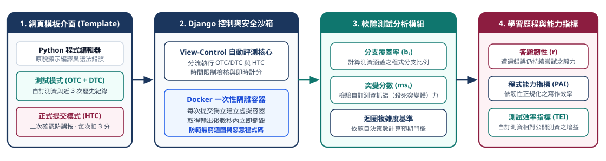
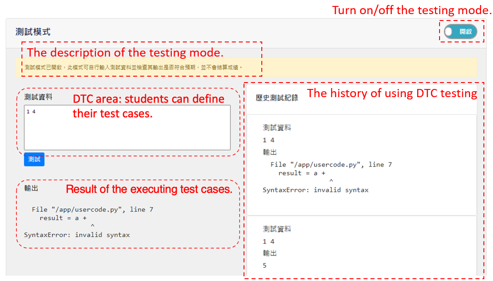
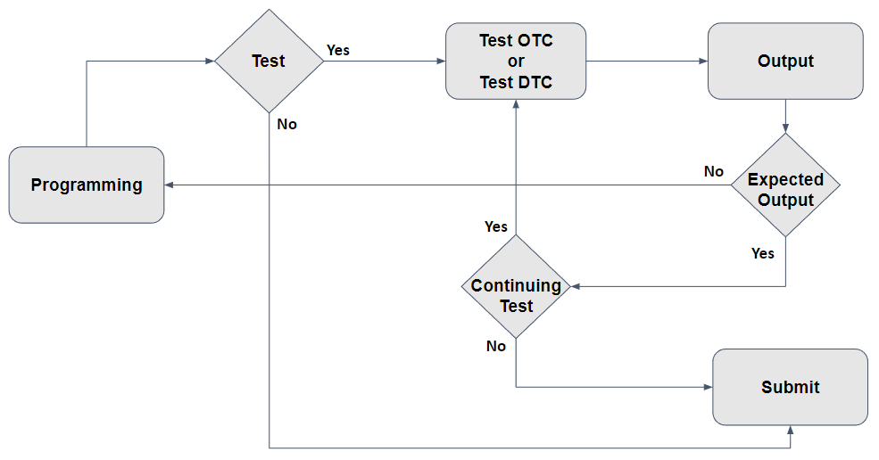
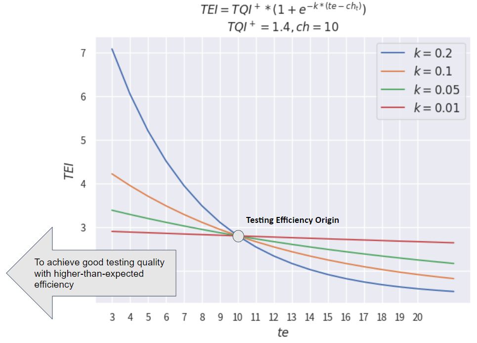
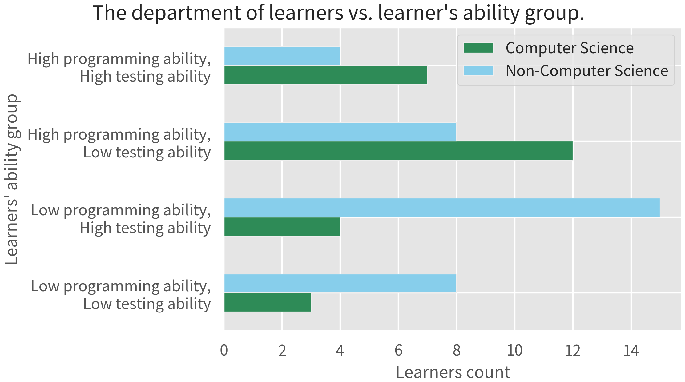
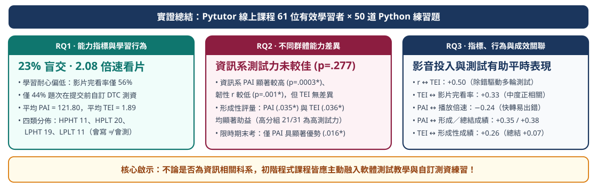

<!-- _class: lead -->

Electronics 2023, 12(22), 4596 · 軟體工程教育與線上評測研究

# 線上程式設計平台之設計與學習者測試能力研究

<strong>Pytutor</strong>：將軟體測試概念、自訂測試案例（DTC）、分支覆蓋率與突變測試融入線上程式自動化教學評量

<strong>薛念林（Nien-Lin Hsueh）*</strong>、<strong>Lien-Chi Lai</strong>、<strong>Wei-Hsiang Tseng</strong> 
逢甲大學資訊工程學系（Department of Information Engineering and Computer Science, FCU） 
<code>nlhsueh@fcu.edu.tw</code> · DOI: <code>10.3390/electronics12224596</code>

刊登於 MDPI Electronics（2023 年 11 月 10 日）· 國科會（NSTC）專題研究計畫補助：MOST112-2813-C-035-075-E

<!--
論文書目與研究定位：
本篇論文（Hsueh, Lai, & Tseng, Electronics 2023, 12(22), 4596；2023 年 11 月 10 日刊登；國科會計畫 MOST112-2813-C-035-075-E 補助）介紹一套融入軟體測試概念的線上程式設計評測平台 Pytutor，並實證剖析初學者的程式設計能力、軟體測試能力與線上學習行為。

系統釐清與核心貢獻：
- 命名區別說明（第 1 節）：Pytutor 雖與知名的程式碼視覺化教學網站 Python Tutor（pythontutor.com）名稱相近，但兩者完全不同；本研究之 Pytutor 是一套支援「學生自訂測試案例（DTC）」的完整線上評測系統（Online Judge）。
- 核心貢獻：將軟體工程指標（迴圈複雜度、分支覆蓋率、突變測試）與跨平台學習歷程（Pytutor 練習紀錄 ＋ OpenEdu 影音紀錄）整合於為期 7 週的 Python 線上課程中，比較資訊與非資訊科系初學者的真實表現。
-->

---

## 破題思考：「看起來沒問題，直接交！」⋯⋯你真的測過自己的程式嗎？

<strong>核心洞見：</strong>傳統線上評測（OJ）只用隱藏測資打分數，導致高達 <strong>23% 的題次在未經任何測試下便盲目提交</strong>。<strong>Pytutor</strong> 導入<strong>自訂測試案例（DTC）</strong>、分支覆蓋率與突變測試，全面培養並量化學習者的軟體測試能力。

<!--
實證動機與關鍵數據（表 1）：
本頁對照濃縮自論文第 4.5.1 節（表 1）所揭露的初學者線上作答行為現象：
- 23% 盲目提交率：即便課程已導入「每次正式提交扣 3 分」的謹慎原則（Cautionary Principle），學生仍有高達 23% 的題次在完全未執行任何公開測資（OTC）或自訂測資（DTC）的情況下便直接正式提交。
- 自測意願偏低：提交前至少執行 1 組 OTC 的題次比例為 59%，至少自訂並執行 1 組 DTC 的比例更僅有 44%，導致每題平均正式提交次數達 1.43 次。
- 平台設計介入：傳統 OJ 僅以隱藏測資給予通過與否的結果，容易養成學生以評測器試錯的習慣；Pytutor 將 DTC 設計、分支覆蓋率與突變測試直接納入練習迴圈，藉以培養並量化學生的軟體測試能力。
-->

---

## 簡報大綱

1

[**研究動機與三個研究問題（RQ1–RQ3）**](#4)
為何傳統 OJ 系統忽略軟體測試，以及本研究欲探討的三大面向。

2

[**文獻回顧與研究缺口**](#6)
比較現有程式教學 OJ 系統與軟體測試自動化評量研究。

3

[**Pytutor 平台設計與能力指標**](#7)
Django + Docker 沙箱、OTC/DTC/HTC 流程，以及答題韌性 (<i>r</i>)、PAI 與 TEI。

4

[**課程實驗設計與 RQ1–RQ3 實證結果**](#11)
7 週線上 Python 課程（61 位有效學生、50 題練習）、分組檢定與相關性分析。

5

[**與前人比較、研究限制與教學啟示**](#17)
與 Yang et al. (2020) 對照、三項研究限制與具體課程改善建議。

6

[**結論與未來研究方向**](#19)
RQ1–RQ3 實證結論視覺化總結，以及 AI 助教與實驗對照組展望。

<!--
論文結構與六大章節對應：
全文共 25 頁，依序分為六個主要章節：
1. 緒論（第 1 節）：區分競賽型與教學型 OJ（Wasik [5]），回顧軟體測試提升程式品質之實證文獻 [7–11]，介紹 Pytutor 特色並提出 RQ1–RQ3。
2. 相關研究（第 2 節）：從軟體測試能力之重要性 [10, 12–15]、自動化程式教學評測平台 [16–24] 與軟體測試教學評量 [13, 25–29] 三條脈絡定位研究缺口。
3. 研究方法（第 3 節）：詳述 Pytutor 的 Django MVT 架構（圖 1）、介面設計（圖 2–3）、Docker 安全隔離 [30–33]、作答流程（圖 4）以及答題韌性 r、PAI、TQI、TQI+、TEI 數學定義（公式 1–6、圖 5–7）。
4. 實驗設計與結果（第 4 節）：說明 7 週非同步 OpenEdu ＋ Pytutor 課程（64 支影片、50 道練習題、圖 8）、參與者背景（69 人選修、61 人有效）、三類資料來源與描述統計（表 1–2、圖 9）。
5. 討論（第 5 節）：依序回應 RQ1（四類能力象限、圖 10）、RQ2（科系、形成性與總結性 Mann-Whitney U 檢定、圖 11–16）、RQ3（Spearman 相關分析、圖 17–18），對照 Yang et al. [11] 並剖析研究限制。
6. 結論與未來研究（第 6 節）：歸納教學啟示，並展望生成式 AI 助教、強化線上 IDE 與實驗對照組研究。
-->

---

## 1.1 研究動機：為何傳統線上評測（OJ）忽略軟體測試？

<strong>軟體測試在程式教育中的價值：</strong>撰寫測試案例有助於理解問題規格、提升程式碼品質與可靠性（Lemos et al., 2018；Fidge &amp; Hogan, 2013）。然而傳統教學用 OJ 往往<em>只檢核學生程式碼</em>，卻忽略培養「設計有效測資」的關鍵能力。

<!--
理論背景與軟體測試教育價值：
- 線上評測系統（OJ）之教學功能：教育型 OJ 可提供即時回饋、減輕教師批改負擔、提升學習成效並降低輟學率（Pereira et al. [4]）。Wasik [5] 將 OJ 區分為競賽導向（排行榜、語言較少）與教育導向（支援多元語言與遊戲化）；Fu et al. [6]（VisOJ）則以即時視覺化儀表板協助教師掌握學生錯誤分佈。
- 培養測試能力之實證依據：既有研究一致證實軟體測試有助於釐清規格與提升程式碼可靠度——Lemos et al. [7] 驗證測試教育能提升程式可靠性；Buffardi & Edwards [8] 發現早期測試的質與量與作業成績高度正相關；Spacco et al. [9] 證明測試實務可改善寫程式習慣；Fidge & Hogan [10] 更指出「測試能力是理解問題的能力，寫作能力是解決問題的能力」，但初學者的測試能力普遍明顯落後於程式能力。
- 核心缺口：傳統教學用 OJ 僅以隱藏測資檢驗程式碼正確性，既未提供學生練習撰寫測資的介面，亦未量化評估學生測資的品質。
-->

---

## 1.2 研究目標與三個研究問題（RQ1–RQ3）

我們將 **Pytutor** 與非同步 **OpenEdu** 線上 Python 課程結合，深入剖析學習者的軟體工程能力與學習行為*（逐項揭示）*：

* 

RQ1 初學者在線上寫程式、做測試與看教學影片的真實樣貌為何？

<strong>學習者在軟體工程能力指標（<i>r</i>、PAI、TEI）與線上學習行為</strong>上的整體表現為何？

* 

RQ2 資訊相關科系學生的測試能力，真的比非資訊科系更好嗎？

<strong>不同群體學習者在程式能力與測試能力上有何差異</strong>（依科系背景、形成性評量與總結性評量分組）？

* 

RQ3 多寫測試案例或認真看完影片，真的能幫助提升學習成績嗎？

<strong>各項能力指標與學習行為</strong>（影片完看率、播放倍速）及最終學習成效之間是否存在關聯？

<!--
三大研究問題（RQ1–RQ3）之操作化架構：
本研究於一門結合 OpenEdu（影音教學）與 Pytutor（程式實作）的 7 週非同步線上 Python 課程中，透過三個層層遞進的問題探討軟體工程能力與學習行為：
- RQ1（能力指標與學習行為基線）：量化分析 61 位有效學習者的答題韌性（r）、程式能力指標（PAI）、測試效率指標（TEI）、百分等級切分之四類能力象限（HPHT、HPLT、LPHT、LPLT），以及作答測試比例與 OpenEdu 影片觀看行為（完看率、播放倍速）。
- RQ2（跨群體差異比較）：採用無母數 Mann-Whitney U 檢定，分別比較資訊科系（n = 26）與非資訊科系（n = 35）在 r、PAI 與 TEI 之差異，並檢驗此三項指標在形成性評量（50 題平時練習）與總結性評量（40 分鐘期末上機考）高低分組間之區辨力。
- RQ3（能力、影音行為與成效關聯）：運用 Spearman 等級相關分析，串聯 r、PAI、TEI、影片完看率、播放倍速與形成／總結性成績，釐清線上學習習慣與測試實作如何連動影響最終學習成效。
-->

---

## 2. 文獻回顧與研究缺口

現有自動化評測平台多著重於快速批改或遊戲化互動，極少同時整合**學生自訂測資（DTC）**、**覆蓋率／突變測試評估**與**跨平台學習行為紀錄**。

| 研究 / 系統平台 | 核心特色與評量重點 | 自訂測資 (DTC) | 覆蓋率與突變測試 | 影音／行為紀錄 | 適用對象 |
| :--- | :--- | :---: | :---: | :---: | :--- |
| YOJ [16] / Sakai [17] | 基礎程式作業自動批改與多次提交 | × | × | × | 初學者 |
| Codeflex [20] / 2TSW [23] | 競賽導向與遊戲化程式練習系統 | × | × | × | 大學生 |
| Codespec [21] / Blockly [22] | Parsons 拼圖題與演算法視覺化鷹架 | × | × | × | 初學者 |
| UnitJudge [29] / Selenium [27] | 單元測試錯誤回饋／線上測試腳本練習 | 部分 | × | × | 中階學習者 |
| Yang et al. (2020) [11] | 以 3 項單元測試作業實證程式與測試力 | ✓ | ✓ | × | 具背景資工生 |
| **Pytutor（本研究, 2023）** | **測試導向 OJ ＋ 50 題練習 ＋ OpenEdu 紀錄** | **✓** | **✓** | **✓** | **資訊＆非資訊** |

<strong>關鍵研究缺口：</strong>前人多針對具備測試背景的資工學生進行短期（3 題）限時實驗；針對<strong>跨越資訊與非資訊科系初學者</strong>、在完整線上課程中的自然測試敏感度與學習行為關聯，仍有待實證填補。

<!--
相關平台對照與研究缺口定位：
- 程式教學評測與鷹架平台：YOJ（Sun et al. [16]）與 Sakai（Suleman [17]）著重自動化批改與多次提交之形成性回饋（Carless et al. [18]、Malmi et al. [19]）；後續平台進一步導入限時競賽題庫（Codeflex [20]）、多元解題鷹架如 Parsons 拼圖題與程式碼修復（Codespec [21]）、演算法視覺化動態演示（Progressive Blockly [22]）及遊戲化設計（2TSW [23]、Swacha [24]、Code Defenders [15]），但皆未對學生自訂測資進行覆蓋率與突變測試分析。
- 軟體測試教學評量系統：Ala-Mutka [13]、Vujosevic-Janicic et al. [25] 與 Montoya-Dato et al. [26] 均強調測資設計不良會使錯誤程式被誤判為正確；Jiang & Deng [27] 建置線上 Selenium 測試腳本練習系統，Kasahara et al. [28] 結合遊戲化與程式碼品質評量，UnitJudge（Garcia-Magarino et al. [29]）以單元測試協助定位長程式碼錯誤，但仍未評估學生自訂測資的覆蓋與抓錯效率。
- 最接近之前人研究（Yang et al., 2020 [11]）：同樣採用覆蓋率與突變分數評估程式與測試能力，但受試者為具程式與測試訓練背景之資工本科生，且僅於限時內完成 3 項單元測試作業、未納入影音歷程。本研究將規模擴展至 50 道自學練習題、橫跨資訊與非資訊初學者，並結合 OpenEdu 影音紀錄。
-->

---

## 3.1 Pytutor 系統架構、Docker 沙箱與三類測資設計

### 🧪 三種測試案例（Test Cases）
- **公開測資（OTC）**：教師提供之公開範例（每題 2 組），供基本功能驗證。
- **自訂測資（DTC）**：**由學生自行設計**之測試資料，在測試模式中主動發掘邊界錯誤。
- **隱藏測資（HTC）**：教師預先設計之評分測資（每題 5 組），於正式提交時計分。

### ⚖️ 兩大作答設計原則與安全機制
- **完成原則（Completion）**：允許學生多次嘗試，直到通過所有隱藏測資。
- **謹慎原則（Cautionary）**：每次正式提交固定**扣 3 分**，遏止盲目試錯並鼓勵先用 DTC 驗證。
- **Docker 隔離沙箱**：每次執行獨立建立容器、數秒內自動銷毀，防範無窮迴圈與惡意程式。

<!--
系統架構、安全隔離與雙作答原則（第 3.1 節、圖 1）：
- Django MVT 模組化架構：採 Model-View-Template 架構以利擴充；Template 層提供網頁端 Python 編輯器與題目介面，View-Control 層於學生測試或提交時呼叫自動化評測引擎，軟體測試模組則負責計算分支覆蓋率、突變分數與各項能力指標（r、PAI、TEI），整體設計參考 Ihantola et al. [30] 提出之易用性與安全性準則。
- 三層測試案例分類：
  1. 公開測資（OTC）：每題由教師提供 2 組公開範例，供學生執行基本功能驗證。
  2. 自訂測資（DTC）：由學生於測試模式自行設計輸入資料，並須自行判讀輸出是否符合題意，以主動發掘邊界錯誤。
  3. 隱藏測資（HTC）：每題由教師預先設計 5 組評分測資，於正式提交時執行並即時回傳得分。
- 教學原則與 Docker 沙箱：結合「完成原則（允許反覆修正直至通過所有 HTC）」與「謹慎原則（每次正式提交固定扣 3 分，遏止盲目試錯並促發先測再交）」。針對遠端執行安全風險 [31, 32]，系統採用 Docker 容器 [33] 於每次執行時建立獨立虛擬沙箱，取回輸出後數秒內即自動銷毀，徹底隔離無窮迴圈與惡意程式碼。
-->

---

## 3.2 測試模式介面與作答工作流程

圖 3：Pytutor 測試模式介面 — 自訂測資輸入區、原貌錯誤訊息與近 3 次測試紀錄

圖 4：學習者作答流程 — 經由 OTC／DTC 反覆驗證確認無誤後再正式提交

<strong>錯誤原貌呈現與防呆機制：</strong>系統直接顯示 Python 原始編譯／語法錯誤訊息培養除錯力；正式提交前須勾選<strong>「確認提交」</strong>防呆核取方塊，避免誤按而遭扣 3 分。

<!--
介面配置、除錯透明化與操作歷程紀錄（第 3.1.2 與 3.2 節、圖 2–4）：
- 作答頁面三大區塊：包含（1）題目資訊區（顯示題名、題目敘述與公開 OTC，圖 2）、（2）作答編輯區（提供「測試模式」與「正式提交模式」切換），以及（3）結果顯示區（圖 3）。
- 測試模式教學巧思（圖 3）：編譯與語法錯誤訊息一律以 Python 原始格式直接呈現，不加以包裝隱藏，促使初學者學會閱讀真實錯誤追蹤訊息並自行除錯；下方區域可供輸入自訂 DTC 並保留最近 3 次測試執行紀錄，方便對照修改前後的輸出差異。
- 正式提交防呆機制與完整流程（圖 4）：學生寫完程式後可於測試模式反覆透過 OTC 與 DTC 驗證修正（亦可選擇不測試直接進入正式提交）；為防止誤按導致遭扣 3 分，正式提交前必須明確勾選「確認提交（Confirm Submission）」核取方塊。系統資料庫完整記錄每次測試的程式碼、測資與執行結果，以及正式提交之通過 HTC 數與作答耗時。
-->

---

## 3.3 程式能力量化指標：答題韌性（<i>r</i>）與 PAI

單純的作業分數無法區分「一次寫對」與「反覆試錯」的差距。本研究結合題目複雜度與挫折次數定義**答題韌性（<i>r</i>）**（取 `k = 0.1<code>）：

<i>r</i> &nbsp;=&nbsp; <i>e</i><i>k</i> × (<i>tr</i> − <i>chp</i>)

<i>s</i> &nbsp;=&nbsp; <i>base</i> + (100 − <i>base</i>) × <i>p</i>

<i>PAI</i> &nbsp;=&nbsp; <i>s</i><i>r</i>

圖 6：答題韌性 <i>r</i> 與程式能力指標（PAI）之函數曲線

### 📈 指標定義與解讀
- **</code>tr`**：挫折嘗試次數（包含語法錯誤與未通過全部 HTC 之提交）。
- **<code>chp</code>**：題目挑戰度（依程式 `p` 之決策數／迴圈複雜度計算）。
- **韌性原點（<code>tr = chp</code>，`r = 1`）**：`r > 1` 表示遭遇顯著挫折仍堅持嘗試；`r < 1` 表示解題效率優於預期。
- **雙重意涵**：同分下遭遇越少挫折者 `PAI = s / r` 越高，代表程式寫作越穩健。
- **課程平均**：全體平均 `PAI = 121.80`（大於滿分 100），顯示多數題目能高效率完成。

<!--
答題韌性（r）與程式能力指標（PAI）之數學推導（第 3.3.1–3.3.2 節、公式 1–3）：
單純的作業分數無法區分「一次寫對」與「反覆試錯」的能力落差。本研究延伸 Xu et al. [34] 的提交次數模型與 Pereira et al. [36] 的韌性構念，並導入 McCabe 迴圈複雜度 [35] 校正題目難度，建立三組連貫公式：
- 公式（1）答題韌性：r = exp(k * (tr - ch_p))，其中權重係數取 k = 0.1（經圖 5 敏感度分析選定，使差距加權平緩不致過度放大）。tr 為挫折嘗試次數（涵蓋測試與正式提交中的語法錯誤，以及未通過全部 HTC 之正式提交）；ch_p 為程式 p 的挑戰度（依決策數／迴圈複雜度計算）。當 tr = ch_p 時稱為「韌性原點」（r = 1）；r > 1 代表面臨高於預期之挫折仍堅持嘗試，r < 1 則代表以少於預期之挫折完成題目。
- 公式（3）基礎分校正成績：s = base + (100 - base) * p，其中 base 為至少通過一組 HTC 之基礎分，p 為通過 HTC 之比例。
- 公式（2）程式能力指標：PAI = s / r。當 r = 1（「程式能力原點」）時 PAI = s；當 r < 1 時 PAI 高於原始得分（本課程平均 PAI = 121.80 > 100），反之則低於原始得分（圖 6）。因此 r 具雙重意涵：既是堅持度指標，也是寫作流暢度的反向指標。註：因初階練習題規模較小，本研究未納入 Yang et al. [11] 之程式碼維護性指標。
-->

---

## 3.4 測試能力量化指標：TQI 與 TEI

結合**分支覆蓋率（<code>bt</code>）**與**突變分數（<code>mst</code>）**，衡量學習者自訂測資（DTC）相對於公開測資（OTC）所帶來的品質提升與效率：

<i>TQIt</i> &nbsp;=&nbsp; √(<i>bt</i> × <i>mst</i>)

<i>TQI</i>+ &nbsp;=&nbsp; <i>TQIOD</i><i>TQIO</i>

<i>TEI</i> = 1 (<i>te</i>=<i>teo</i>) &nbsp;|&nbsp; <i>TQI</i>+(1 + <i>e</i>−<i>k</i>(<i>te</i>−<i>cht</i>))

圖 7：權重係數 <i>k</i> (= 0.1) 與測資數量對測試效率指標（TEI）之影響

### 🎯 TQI+ 與 TEI 設計巧思
- **<code>TQIOD / TQIO</code>**：量化加入學生自訂測資（DTC）後，分支覆蓋與突變抓錯能力的增益倍率。
- **基礎保障機制**：僅使用公開測資（<code>te = teo</code>）預設 `TEI = 1`；公式採 <code>1 + e−k(te−cht)</code> 確保願意自訂測資者不會反而低於基準值 1。
- **精準效率加權**：能以**較少測資**（<code>te < cht</code>）達成同等 <code>TQI+</code> 者，獲得更高 `TEI`。
- **課程平均**：全體平均 `TEI = 1.89`，反映多數題次測試意願或效率仍偏低。

<!--
測試品質（TQI / TQI+）與測試效率指標（TEI）之設計（第 3.3.3 節、公式 4–6）：
依據軟體工程實證研究（覆蓋率與突變分數越高，抓錯效能越強 [11, 37]），本研究以學生自訂 DTC 相對於教師公開 OTC 的品質增益與精簡度量化測試能力：
- 公式（4）測試品質指標：TQI_t = sqrt(b_t * ms_t)，取分支覆蓋率 b_t（執行覆蓋之程式碼分支比例）與突變分數 ms_t（殺死突變體比例）之幾何平均，數值介於 0 至 100。
- 公式（5）品質增益倍率：TQI+ = TQI_OD / TQI_O，分子 TQI_OD 為合併公開 OTC 與學生自訂 DTC 後重新計算之 TQI，分母 TQI_O 僅計算公開 OTC 之基準 TQI。
- 公式（6）測試效率指標：若學生僅使用公開測資（te = te_o），預設具備基本測試能力，給定 TEI = 1；若學生主動撰寫 DTC（te > te_o），則 TEI = TQI+ * (1 + exp(-k * (te - ch_t)))，其中 te 為總測資數（OTC + DTC）、ch_t 為隨題目複雜度遞增之預期測資數、k = 0.1（圖 7）。
- 防懲罰保障設計：指數項額外加上「1 +」，確保願意自訂 DTC 的學生即使測資品質不佳或數量過多，其 TEI 亦不致低於僅用 OTC 之基準值 1；若能以少於預期之精簡測資（te < ch_t，位於「測試能力原點」左側）達成高 TQI+，則可獲得最高 TEI。全班平均 TEI 僅 1.89，反映多數題次停留在 TEI = 1。
-->

---

## 4.1 課程實驗設計、參與者與 50 題 TQI 分佈

### 📚 7 週非同步線上 Python 課程
- **課程架構**：**OpenEdu** 7 大單元（**64 支教學影片**）＋ **Pytutor**（**50 道練習題**）＋ 5 次實體討論會 ＋ MS Teams 即時問答。
- **題庫規格**：平均迴圈複雜度 **4.06**；每題含 **2 組 OTC** 與 **5 組 HTC**（公開測資平均分支覆蓋率 **0.92**、突變分數 **0.75**）。
- **參與對象**：共 **69 人選修**（資訊系 27 人、非資訊系 42 人；54 人曾學過程式、15 人學過 Python）；排除後期無活動者後，有效分析 **61 人**（資訊 26 人、非資訊 35 人）。
- **雙軌評量**：**形成性評量**（50 題平均）與**總結性評量**（40 分鐘 4 題期末上機考）。

圖 8：50 道題目原始 OTC 之 TQI 分佈（部分低 TQI 題目亟需學生自訂 DTC 補強）

<!--
課程實驗規格、參與者組成與三類資料來源（第 4.1–4.4 節、圖 8）：
- 非同步課程與實體支持：為期 7 週的線上 Python 課程整合 OpenEdu（7 大單元共 64 支影片：單元 1–5 涵蓋程式設計基礎、基本結構與運算、邏輯運算與物件導向；單元 6–7 為資料處理與物件設計實務應用）與 Pytutor（50 道練習題，依單元 1 至 5 分別配置 1、9、13、18、9 題）。另安排 5 次實體討論會（呼應 Montoya-Dato et al. [26] 強調教師即時答疑對深度反思的助益）與 Microsoft Teams 線上提問管道。
- 題庫基準分佈（圖 8）：50 題平均迴圈複雜度為 4.06，每題配 2 組 OTC 與 5 組 HTC，原始 OTC 平均分支覆蓋率達 0.92、突變分數達 0.75，但圖 8 顯示仍有部分題目之基礎 TQI 甚低，亟需學生自訂 DTC 補強。
- 參與者與樣本篩選：共 69 位大學生選修（資訊系 27 人、非資訊系 42 人；54 人曾學過程式語言、15 人學過 Python）。選課動機包含對寫程式有興趣（44 人）、習得第二專長（30 人）、線上學習便利（21 人）及與同學結伴選修（13 人）。排除課程後期無活動紀錄之 8 人後，有效分析樣本為 61 人（資訊系 26 人、非資訊系 35 人）。
- 三軌資料蒐集：課前背景問卷、OpenEdu 影音事件日誌（load_video、play_video、seek_video、pause_video、stop_video）、Pytutor 測試與提交日誌，以及形成性成績（50 題平均）與總結性成績（第 7 週開放後兩週舉行之 40 分鐘 4 題上機考）。
-->

---

## 4.2 RQ1 實證結果：學習參與度與四類能力分群

23% 盲交

未經任何 OTC 或 DTC 測試即直接正式提交

44% 用 DTC

提交前至少自訂 1 組 DTC（59% 使用 OTC）

56% · 2.08×

OpenEdu 平均影片完看率與平均播放倍速

1.43 次提交

每題平均正式提交 · 耗時 14.45 分 · <i>tr</i> = 3.23

圖 10：依百分等級（1–50 低、51–99 高）劃分四類能力群體

### 📊 能力指標描述性統計（Table 2 · N = 61）
| 指標項目 | 平均數 | 標準差 | 中位數 | 最大值 |
| :--- | :---: | :---: | :---: | :---: |
| 答題韌性 (<i>r</i>) | 1.97 | 2.82 | 0.99 | 17.53 |
| **平均 TEI** | **1.89** | 0.49 | 1.92 | 2.99 |
| **平均 PAI** | **121.80** | 23.64 | 127.55 | 157.19 |
| 形成性成績 | 72.66 | 26.17 | 84.08 | 99.64 |
| 總結性成績 | 68.04 | 23.69 | 77.93 | 100.00 |

**關鍵觀察**：學生普遍缺乏耐心（2.08 倍速快轉、完看率 56%、23% 盲交），且 **61 人中有 39 人落於 HPLT (20) 與 LPHT (19)**——會寫程式不等於會做測試！

<!--
RQ1 深度解析：學習參與度與四類能力象限（第 4.5 與 5.1 節、表 1–2、圖 9–10）：
- 跨平台學習行為統計（表 1）：即便設有每次提交扣 3 分之謹慎原則，每題平均正式提交仍達 1.43 次，平均作答耗時 14.45 分鐘、挫折次數 tr = 3.23、總測資數 te = 3.41（平均執行 OTC 3.96 次、DTC 2.94 次，含重複測試）。提交前至少測 1 次 OTC 者佔 59%、至少用 1 次 DTC 者僅 44%，高達 23% 題次未經任何測試即盲目提交。OpenEdu 端影片平均完看率僅 56%（中位數 60%、最高 83%），平均播放倍速高達 2.08 倍（中位數 2.16 倍、最高 2.92 倍），顯示多數初學者缺乏耐心。
- 期末考時間比例推估：依平時每題平均耗時 14.45 分鐘推算，40 分鐘完成 4 題之預期完成率約 69%，與實際期末考平均分 68.04（中位數 77.93）高度吻合。
- 指標描述統計（表 2、圖 9）：答題韌性 r（平均 1.97、標準差 2.82、中位數 0.99、最大 17.53，呈顯著右偏，少數學生展現極高堅持度）；TEI（平均 1.89、標準差 0.49、中位數 1.92、範圍 1.00–2.99）；PAI（平均 121.80、標準差 23.64、中位數 127.55、範圍 49.18–157.19）；形成性平均 72.66（中位數 84.08）；總結性平均 68.04（中位數 77.93）。
- 四類能力群體（圖 10）：依 PAI 與 TEI 之百分等級（1–50 為低、51–99 為高）劃分，結果為 HPHT 11 人、HPLT 20 人、LPHT 19 人、LPLT 11 人——高達 39/61 人落於寫作與測試能力不對稱的組別。
-->

---

## 4.3 RQ2a 實證結果：資訊科系 vs. 非資訊科系

圖 11：資訊系（26 人）與非資訊系（35 人）之能力分類比較

### 🔬 Mann–Whitney U 檢定：資訊 vs. 非資訊（圖 12）
| 評估指標 | 資訊系 (n = 26) vs. 非資訊系 (n = 35) | <i>p</i> 值 | 顯著？ |
| :--- | :--- | :---: | :---: |
| **答題韌性 (<i>r</i>)** | 非資訊系面臨較多錯誤且更堅持嘗試 | **0.001** | **顯著*** |
| **程式能力 (PAI)** | 資訊系 **19/26 (73%) 高程式力** vs. 非資訊 12/35 | **0.0003** | **顯著*** |
| **測試能力 (TEI)** | 資訊系僅 **11/26 (42%) 高測試力** vs. 非資訊 19/35 (54%) | **0.277** | **不顯著** |

<strong>驚人發現：</strong>資訊科系學生的<strong>程式能力（PAI）顯著領先</strong>，但在<strong>測試能力（TEI）上卻無任何顯著優勢</strong>！推論資訊系學生因對自身程式碼過度自信而減少測試；非資訊系學生反而更積極撰寫 DTC 以避免報錯。

<!--
RQ2a 統計解析：資訊科系與非資訊科系之能力對照（第 5.2 節、圖 11–12）：
由於能力指標分佈不符合常態假設，本研究採用無母數 Mann-Whitney U 檢定比較資訊系（n = 26）與非資訊系（n = 35）學習者：
- 程式能力指標（PAI，圖 12b）：資訊系顯著優於非資訊系（p = 0.0003 < 0.05）。圖 11 顯示資訊系有 19/26 人（73%）屬於高程式能力群（HP），非資訊系僅 12/35 人（34%），且資訊系之能力分佈更為集中。
- 答題韌性（r，圖 12a）：非資訊系顯著高於資訊系（p = 0.001 < 0.05），反映非資訊系初學者雖遭遇較多語法與邏輯錯誤，卻願意持續反覆嘗試修正。
- 測試效率指標（TEI，圖 12c）：兩組間無統計顯著差異（p = 0.277 > 0.05）；非資訊系進入高測試能力群（HT）之比例（19/35 = 54%）甚至略高於資訊系（11/26 = 42%）。
- 行為推論：作者指出資訊系學生因既有程式背景而對程式碼較有自信，往往不需撰寫大量 DTC 即能拿高分，遂忽略測試練習；非資訊系學生反而更積極以自訂測資防錯。此結果打破「資工系天然更會測試」之迷思。
-->

---

## 4.4 RQ2b 實證結果：形成性評量（平時練習階段）

依形成性評量中位數（**84.08 分**）將 61 位學生分為**高分組（31 人）**與**低分組（30 人）**：

圖 13：形成性評量高分組 31 人中，高達 21 人具備高測試能力（HT）

圖 14：Mann–Whitney U — <i>r</i>: <i>p</i> = 0.153 · <b>PAI: <i>p</i> = 0.035*</b> · <b>TEI: <i>p</i> = 0.036*</b>

<strong>RQ2b 發現：</strong>在 50 題形成性練習階段，<strong>程式能力（PAI, <i>p</i> = 0.035）與測試能力（TEI, <i>p</i> = 0.036）皆與高分顯著相關</strong>。即使程式能力較弱，只要具備高測試能力，仍能拿下優異平時成績（<strong>LPHT 組有 12 人進入高分組</strong>）！

<!--
RQ2b 統計解析：形成性評量（50 題平時練習階段）（第 5.2 節、圖 13–14）：
依形成性評量中位數（84.08 分）將 61 位學生區分為高分組（31 人）與低分組（30 人）：
- 能力象限分佈（圖 13）：形成性高分組 31 人中，高達 21 人（68%）具備高測試能力（HT），包含 9 位 HPHT 與 12 位 LPHT 學生。特別值得注意的是，有 12 位程式流暢度較弱（低 PAI）的學生，憑藉積極且有效的 DTC 測試策略成功進入高分組。
- Mann-Whitney U 檢定結果（圖 14）：
  - 答題韌性 r（圖 14a）：p = 0.153（不顯著），顯示單純重複試錯若缺乏有效測試或寫作策略，並不足以確保高分。
  - 程式能力 PAI（圖 14b）：p = 0.035（達顯著），高寫作效率顯著助益平時成績。
  - 測試能力 TEI（圖 14c）：p = 0.036（達顯著），高測試能力同樣顯著區分形成性高低分組。
- 教學意涵：在時間充裕的自主練習階段，良好的測試能力具備顯著的補償效應，可協助初學者在正式提交扣分前先揪出邊界錯誤。
-->

---

## 4.5 RQ2c 實證結果：總結性評量（限時期末上機考）

依期末考中位數（**77.93 分**；限時 **40 分鐘**完成 4 題）分為**高分組（31 人）**與**低分組（30 人）**：

圖 15：期末考高分組 31 人中，高程式能力（HP）佔 18 人

圖 16：Mann–Whitney U — <i>r</i>: <i>p</i> = 0.105 · <b>PAI: <i>p</i> = 0.016*</b> · TEI: <i>p</i> = 0.93 (n.s.)

<strong>RQ2c 發現：</strong>在嚴格的 <strong>40 分鐘期末考時間壓力</strong>下，僅<strong>程式能力（PAI, <i>p</i> = 0.016）</strong>呈現顯著差異，TEI 則無差異（<i>p</i> = 0.93）。因作答時間緊迫，學生較難設計高品質 DTC，使寫作熟練度成為勝負關鍵。

<!--
RQ2c 統計解析：總結性評量（40 分鐘限時期末上機考）（第 5.2 節、圖 15–16）：
依期末上機考中位數（77.93 分，於第 7 週課程開放兩週後施測，限時 40 分鐘完成 4 題）將 61 位學生分為高分組（31 人）與低分組（30 人）：
- 能力象限消長（圖 15）：期末考高分組改由高程式能力者（HP）佔多數（18 位 HP vs. 13 位 LP），與低分組呈現鏡像反轉（13 位 HP vs. 17 位 LP）。
- Mann-Whitney U 檢定結果（圖 16）：
  - 答題韌性 r（圖 16a）：p = 0.105（不顯著）。
  - 程式能力 PAI（圖 16b）：p = 0.016（達統計顯著），成為唯一顯著區分期末考高低分之指標。
  - 測試能力 TEI（圖 16c）：p = 0.93（完全不顯著）。
- 情境解讀：在平均每題僅 10 分鐘的嚴苛限時壓力下，學生難以撥出時間設計高覆蓋、高突變殺傷力的 DTC 進行多輪驗證，且總結性考試偏重概念精熟與快速低錯誤之即時實作能力，使高 PAI 學習者具備明顯競爭優勢。
-->

---

## 4.6 RQ3 實證結果：能力指標、影音行為與成績關聯

圖 17：<i>r</i>、PAI 與 TEI 三項能力指標之 Spearman 相關熱圖

圖 18：能力指標與影片觀看行為、形成／總結成績之相關熱圖

<strong>核心相關脈絡：</strong>
(1) <b><i>r</i> ↔ TEI (+0.50)</b>：出錯頻率越高越會透過多輪測試除錯；<b>PAI ↔ TEI (−0.39)</b> 證實寫作與測試屬不同能力。
(2) <b>影片完看率 ↔ TEI (+0.33)</b>：完整看片者更願意仔細測試；<b>播放倍速 ↔ PAI (−0.24)</b>：過度快轉看片容易導致寫程式出錯。
(3) <b>學習成效</b>：PAI 與形成性（<b>+0.35</b>）及總結性（<b>+0.38</b>）皆呈中度正相關；TEI 顯著助益形成性成績（<b>+0.26</b>），限時考試則無關（<b>+0.073</b>）。

<!--
RQ3 相關網絡解析：能力指標、影音行為與學習成效（第 5.3 節、圖 17–18）：
透過 Spearman 等級相關係數熱圖，可歸納三大關鍵脈絡：
1. 能力指標間之結構關聯（圖 17）：
   - PAI 與 r（-0.863，高度負相關）：符合 PAI = s / r 之數學定義，寫作越熟練者遭遇挫折越少。
   - r 與 TEI（+0.50，中度正相關）：程式出錯頻率越高，越會驅動學生透過多輪 DTC 測試進行除錯。
   - PAI 與 TEI（-0.385，中度負相關）：證實程式寫作與軟體測試屬不同維度能力，許多寫作流暢者無須深度測試即可通過基礎練習題。
2. OpenEdu 影音行為與能力指標（圖 18）：
   - 影片完看率與 TEI（+0.331，中度正相關）：完整觀看課程影片的學習者傾向進行更周全的測試驗證；完看率與 r（+0.111）及 PAI 幾乎無關。
   - 播放倍速與 PAI（-0.24，負相關）、與 r（+0.203，低度正相關）、與 TEI（+0.237，低度正相關）：過度快轉看片以急於進入寫題階段，易導致觀念吸收不完整，使寫程式更易出錯（PAI 下降、r 上升）並被迫以多次測試補救（TEI 上升）。
3. 與學習成效之關聯：PAI 與形成性（+0.35）及總結性成績（+0.38）均呈中度正相關；TEI 顯著助益形成性成績（+0.26），但與限時期末考幾乎無關（+0.073）；r 與兩項成績皆呈低度負相關。
-->

---

## 5.1 與前人研究之比較與研究限制

### 🔍 與 Yang et al. (2020) [11] 之對照
- **一致的核心結論**：兩研究皆證實**程式能力強不代表測試能力強**——近半數程式好手測試能力偏低，而程式較弱者亦可能展現優異測試力。
- **前人情境**：Yang et al. 以具備測試訓練的資工系大學生為對象，於限時內完成 **3 項作業**並以單元測試評分。
- **本研究突破**：在 Pytutor 上擴展至 **50 題隨時可練之題庫**，涵蓋**資訊與非資訊初學者**，並串聯 OpenEdu 影音歷程進行全方位剖析。

### ⚠️ 三項研究限制
1. **公開測資基準偏高**：部分題目之原始 <code>TQIO</code> 已超過 80，使學生自訂 DTC 之提升空間受限，壓縮 `TEI` 變化幅度。
2. **未正式教授測試方法**：課程僅教導基礎 Python，尚未融入邊界值或等價類等測試理論，故 TEI 反映的是「自然測試敏感度」。
3. **本機端開發行為盲區**：系統目前無法記錄學生是否在<strong>本機編輯器（IDE）</strong>寫完並測試完畢後，才貼上平台提交。

<!--
與前人研究深度對照及三項研究限制（第 5.4 與 5.5 節）：
- 與既有教學平台對照：相較 YOJ [16]、Sakai [17] 與 Codeflex [20]，Pytutor 允許教師設計多元難度題目並引導學生撰寫 DTC；如同 Codespec [21] 強調多面向技能訓練，Pytutor 亦支援教師預設含錯範本程式碼，專門鍛鍊學生的除錯與測試能力。
- 與 Yang et al. (2020) [11] 之異同：兩項研究一致證實「程式能力強不等於測試能力強」（近半數高程式能力者測試力偏低，而低程式能力者亦可能展現優異測試力）。本研究之重要拓展在於：Yang et al. 以具測試背景之資工系學生於限時內完成 3 項單元測試作業（採 Pearson 相關）；Pytutor 則擴展至 50 道隨時可練之題庫、涵蓋未曾修習測試理論之資訊與非資訊初學者，並結合 OpenEdu 影音歷程與無母數檢定。
- 三項研究限制（第 5.5 節）：
  1. 公開測資基準偏高（天花板效應）：部分題目原始 TQI_O 已超過 80，壓縮學生自訂 DTC 提升 TQI+ 與 TEI 的空間。
  2. 課程未正式教授測試理論：本課程僅教導基礎 Python，未融入邊界值分析或等價類分割等方法，故 TEI 衡量的是初學者的「自然測試敏感度」。
  3. 本機編輯器行為盲區：系統目前無法觀測學生是否先於本機 IDE（如 VS Code、PyCharm）撰寫並測試完畢後，再將完成碼貼上 Pytutor 提交。
-->

---

## 5.2 對程式設計教學之三項具體建議

根據 61 位學生於 50 道練習題的實證證據，本研究對程式設計教師與課程設計者提出以下建議：

### 1. 不分科系全面融入測試教學
- 在臺灣現行教育脈絡下，資訊系學生的測試能力**並未優於非資訊系**（`p = 0.277`）。
- 應在初階程式課同步教授黑箱與邊界測試觀念，協助程式較弱的學習者透過測試補齊實力。

### 2. 將教學影片拆分為微知識單元
- 學習者平均僅看 **56%** 影片且開 **2.08 倍速**，而快轉與程式能力呈負相關（`−0.24`）。
- 建議將長影片依**單一知識點切分為精短微單元**，維持專注度並減少觀念遺漏。

### 3. 設計「需要自訂測資」的練習題
- 適度控制公開測資覆蓋率（如 <code>TQIO < 70</code>），引導學生主動思考遺漏情境並撰寫 DTC。
- 結合<strong>謹慎原則（扣 3 分）</strong>與即時測試覆蓋回饋，讓「先測再交」內化為開發習慣。

<!--
實證導向之三大程式設計教學建議（第 5.1、5.2、5.5 與 6 節）：
依據 61 位學生在 50 道練習題與 64 支教學影片上的實證證據，本研究提出三項可直接落地於大學初階程式課程的教學策略：
1. 不分科系全面融入軟體測試教學：在台灣大學教育脈絡下，資訊系學生的測試能力並未優於非資訊系（p = 0.277），而良好的測試習慣卻能幫助 12 位低 PAI 初學者拿下優異形成性成績。因此無論資訊系或非資訊系初階程式課，皆應同步教授黑箱測試、邊界條件與等價類概念。
2. 將長篇教學影片拆分為單一知識點微單元：針對學生平均僅觀看 56% 影片、平均開 2.08 倍速快轉，且高倍速與程式能力呈負相關（-0.24）、與挫折次數呈正相關（+0.203）之現象，建議依個別知識點將教材切分為精短微單元，維持專注度並減少觀念遺漏。
3. 刻意設計「需要自訂測資」的練習題：針對第 5.5 節所述之 TQI_O > 80 天花板效應，教師出題時應刻意將公開測資覆蓋率控制在適度水準（如 TQI_O < 70），並搭配「每次正式提交扣 3 分」之謹慎原則與即時覆蓋回饋，驅動學生主動思考遺漏邊界並撰寫 DTC。
-->

---

## 6. 結論與未來研究方向

<strong>🤖 1. AI 虛擬教學助理</strong> 導入生成式 AI 扮演蘇格拉底式引導助教，啟發學生思考邊界測資，而非直接給予標準答案。

<strong>💻 2. 強化線上編輯器與細部歷程</strong> 提升網頁端寫程式體驗以留住學生於平台內開發，蒐集更細緻的編輯與除錯行為資料。

<strong>🧪 3. 實驗組 vs. 對照組實證</strong> 於未來課程進行分組對照實驗，嚴謹驗證「融入測試概念之 OJ 系統」對學習成效的因果貢獻。

<!--
研究總結與 AI 時代之三大未來方向（第 6 節）：
本研究透過 Pytutor 打破傳統 OJ 僅依隱藏測資通過與否評分的框架，將學生自訂測資（DTC）、迴圈複雜度校正之答題韌性（r）與 PAI，以及結合分支覆蓋率與突變測試之 TEI 完整導入線上程式教學。針對 61 位有效學生與 50 題練習的實證證實：（1）初學者普遍缺乏耐心（56% 完看率、2.08 倍速、23% 盲交）；（2）資訊系僅在 PAI 顯著領先（p = 0.0003），TEI 無差異（p = 0.277）；（3）形成性階段同時受 PAI 與 TEI 驅動，限時期末考則由 PAI 單獨主導。

因應生成式 AI 徹底改變程式寫作行為（引用 Welsh [38]），論文規劃三大未來研究方向：
1. 蘇格拉底式 AI 虛擬教學助理：運用生成式 AI 扮演引導式助教，啟發學生自行思考邊界測資與除錯方向，並克服「避免直接洩漏標準答案」之教學挑戰。
2. 強化網頁端編輯器與細部歷程遙測：提升 Pytutor 線上編碼體驗以留住學生於平台內開發，進而蒐集按鍵與除錯層級的精細程式撰寫行為資料。
3. 實驗組與對照組因果驗證：於未來課程規劃分組對照實驗，嚴謹量化「融入軟體測試概念之 OJ 系統」相較於傳統 OJ 對學習成效之因果貢獻。
-->

---

<!-- _class: closing -->

# 感謝您的聆聽與指教！

線上程式設計平台之設計與學習者測試能力研究（Pytutor）

<strong>薛念林（Nien-Lin Hsueh）*</strong> &nbsp;·&nbsp; <code>nlhsueh@fcu.edu.tw</code> 
<strong>Lien-Chi Lai</strong> ＆ <strong>Wei-Hsiang Tseng</strong> 
逢甲大學資訊工程學系（Department of Information Engineering and Computer Science, FCU） 
期刊論文：<code>Electronics 2023, 12(22), 4596</code> · <code>https://doi.org/10.3390/electronics12224596</code> 
研究計畫補助：MOST112-2813-C-035-075-E · 歡迎提問與交流！

<!--
論文引用與重現性資源：
- 完整書目：Hsueh, N.-L.; Lai, L.-C.; Tseng, W.-H. Design of an Online Programming Platform and a Study on Learners' Testing Ability. Electronics 2023, 12(22), 4596. DOI: https://doi.org/10.3390/electronics12224596（開放取用，CC BY 4.0 授權）。
- 論文核心圖表與公式索引：系統架構與流程（圖 1–4）、答題韌性 r、PAI、TQI、TQI+ 與 TEI 公式推導（公式 1–6、圖 5–7）、50 題基礎 TQI 分佈（圖 8）、參與度與描述統計（表 1–2、圖 9–10）、Mann-Whitney U 分組盒鬚圖（圖 11–16）及 Spearman 相關熱圖（圖 17–18）。
- 計畫補助與資料取用：本研究獲台灣國家科學及技術委員會（NSTC）專題研究計畫 MOST112-2813-C-035-075-E 補助；因原始學習日誌包含學生個人資訊，相關資料集可逕洽通訊作者（nlhsueh@fcu.edu.tw）申請取用。
-->

