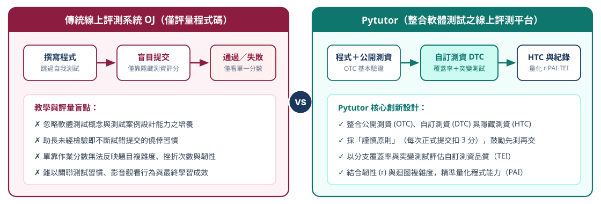
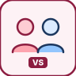
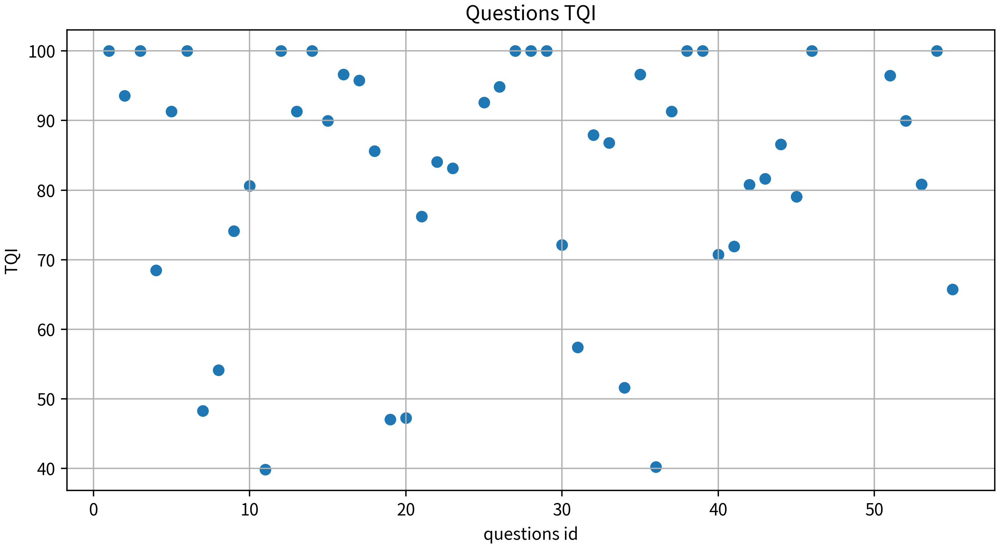
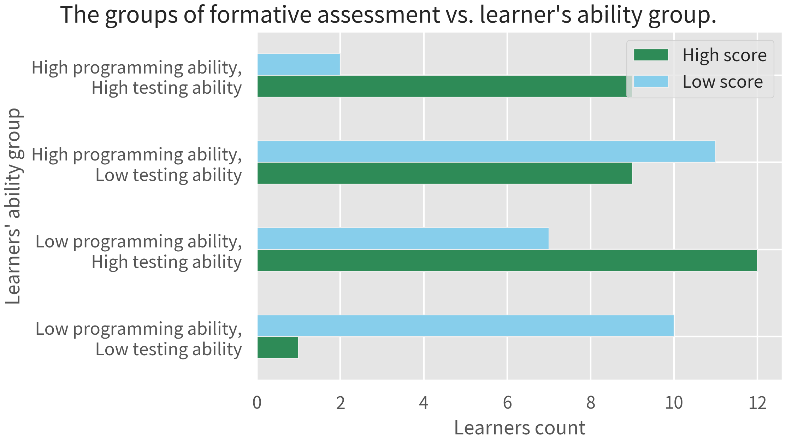
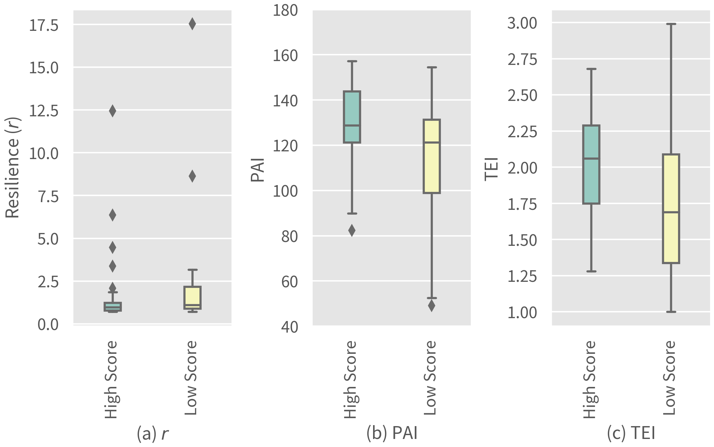
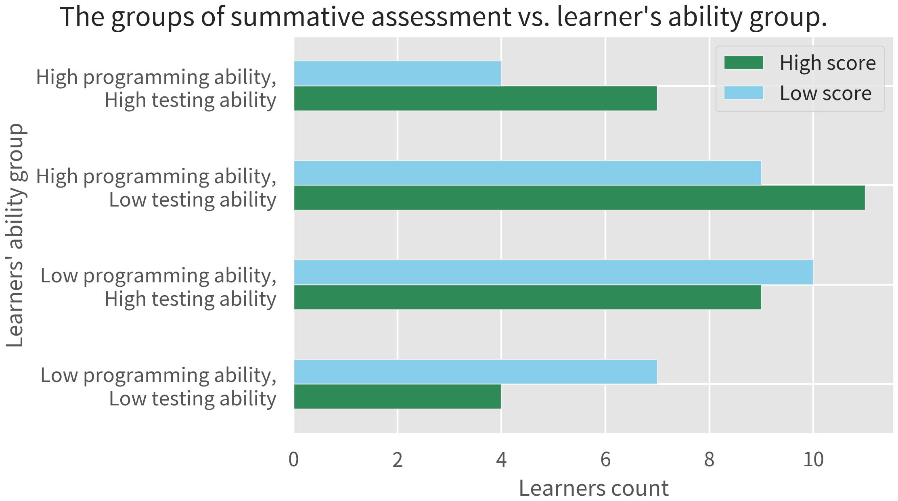
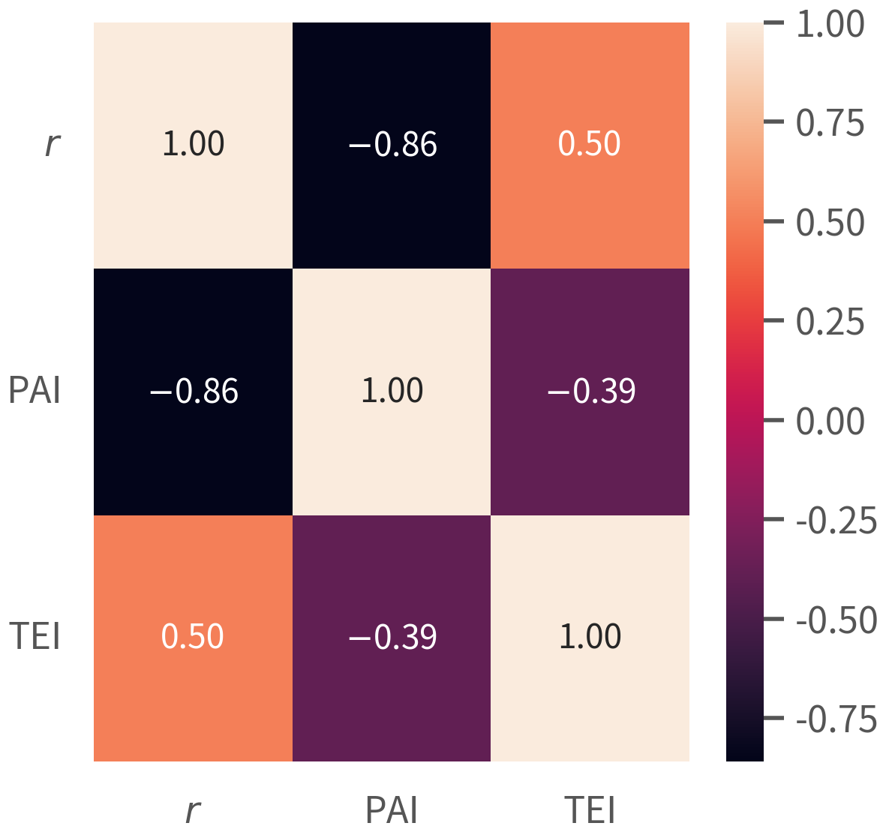
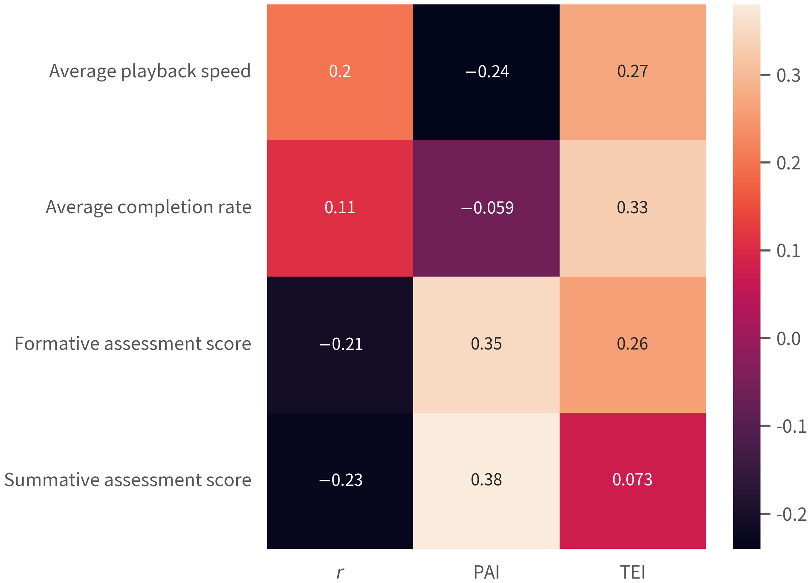

<!-- _class: lead -->

Electronics 2023, 12(22), 4596 · 軟體工程教育與線上評測研究

# 線上程式設計平台之設計與學習者測試能力研究

<strong>Pytutor</strong>：將軟體測試概念、自訂測試案例（DTC）、分支覆蓋率與突變測試融入線上程式自動化教學評量

<strong>薛念林（Nien-Lin Hsueh）*</strong>、<strong>Lien-Chi Lai</strong>、<strong>Wei-Hsiang Tseng</strong> 
逢甲大學資訊工程學系（Department of Information Engineering and Computer Science, FCU） 
<code>nlhsueh@fcu.edu.tw</code> · DOI: <code>10.3390/electronics12224596</code>

刊登於 MDPI Electronics（2023 年 11 月 10 日）· 國科會（NSTC）專題研究計畫補助：MOST112-2813-C-035-075-E

<!--
核心訊息：本研究設計融入軟體測試概念的線上評測平台 Pytutor，並實證剖析資訊與非資訊科系初學者的程式與測試能力。
口說要點：
- 大家好，今天分享我們刊登於 Electronics 2023 的研究：線上程式設計平台 Pytutor 之設計與學習者測試能力實證分析。
- 我們將學生自訂測試案例（DTC）、分支覆蓋率與突變測試直接整合進自動化線上評測系統。
- 透過一門為期 7 週的線上 Python 課程，我們系統性檢視初學者的寫作能力、測試能力、影片觀看習慣與學習成效之間的關聯。
轉場：我們先從一個程式課堂上最常見的現象來破題。
-->

---

## 破題思考：「看起來沒問題，直接交！」⋯⋯你真的測過自己的程式嗎？

<strong>核心洞見：</strong>傳統線上評測（OJ）只用隱藏測資打分數，導致高達 <strong>23% 的題次在未經任何測試下便盲目提交</strong>。<strong>Pytutor</strong> 導入<strong>自訂測試案例（DTC）</strong>、分支覆蓋率與突變測試，全面培養並量化學習者的軟體測試能力。

<!--
核心訊息：傳統線上評測容易養成學生「盲目提交」的習慣（高達 23% 未經測試直接交卷），Pytutor 則透過自訂測資培養先測再交的工程素養。
口說要點：
- 在傳統 OJ 平台上，學生常常寫完程式看一眼覺得沒問題就直接按提交，把隱藏測資當成試錯工具。
- 即使我們設有提交扣分機制，實證紀錄仍顯示高達 23% 的題次在完全沒有執行任何測資下便盲目提交。
- Pytutor 透過導入自訂測試案例（DTC）、分支覆蓋率與突變測試，讓「寫測資抓蟲」成為學習過程的核心環節。
轉場：接著透過簡報大綱，快速說明今天分享的六個重點章節。
-->

---

## 簡報大綱

1

[**研究動機與三個研究問題（RQ1–RQ3）**](#4)
為何傳統 OJ 系統忽略軟體測試，以及本研究欲探討的三大面向。

2

[**文獻回顧與研究缺口**](#6)
比較現有程式教學 OJ 系統與軟體測試自動化評量研究。

3

[**Pytutor 平台設計與能力指標**](#7)
Django + Docker 沙箱、OTC/DTC/HTC 流程，以及答題韌性 (<i>r</i>)、PAI 與 TEI。

4

[**課程實驗設計與 RQ1–RQ3 實證結果**](#11)
7 週線上 Python 課程（61 位有效學生、50 題練習）、分組檢定與相關性分析。

5

[**與前人比較、研究限制與教學啟示**](#17)
與 Yang et al. (2020) 對照、三項研究限制與具體課程改善建議。

6

[**結論與未來研究方向**](#19)
RQ1–RQ3 實證結論視覺化總結，以及 AI 助教與實驗對照組展望。

<!--
核心訊息：簡報依序涵蓋研究動機、文獻缺口、Pytutor 平台與能力指標、7 週課程實證結果，以及教學啟示與未來展望。
口說要點：
- 第一與第二部分剖析傳統 OJ 忽略軟體測試的痛點，並對照前人研究定位缺口。
- 第三部分介紹 Pytutor 的 Docker 沙箱架構、三類測資流程，以及答題韌性 r、PAI 與 TEI 三大指標。
- 第四到第六部分呈現 61 位有效學生在 50 道練習題上的 RQ1 至 RQ3 統計結果、課程建議與未來方向。
轉場：首先進入第一章，說明為什麼傳統線上評測系統會忽略軟體測試。
-->

---

## 1.1 研究動機：為何傳統線上評測（OJ）忽略軟體測試？

<strong>軟體測試在程式教育中的價值：</strong>撰寫測試案例有助於理解問題規格、提升程式碼品質與可靠性（Lemos et al., 2018；Fidge &amp; Hogan, 2013）。然而傳統教學用 OJ 往往<em>只檢核學生程式碼</em>，卻忽略培養「設計有效測資」的關鍵能力。

<!--
核心訊息：傳統教學用 OJ 只評量程式碼正確性，忽略了透過撰寫測試案例釐清規格與提升品質的教育價值。
口說要點：
- 如圖所示，傳統 OJ 僅接收學生程式碼並以隱藏測資回傳通過與否，學生幾乎沒有練習設計測資的機會。
- 既有研究指出，設計測試案例能幫助初學者理解題目邊界條件並寫出更可靠的程式。
- 因此我們打造測試導向的 Pytutor，在自動化批改的同時，也能培養並量化學習者的測試能力。
轉場：針對這項缺口，本研究擬定了三個具體的研究問題。
-->

---

## 1.2 研究目標與三個研究問題（RQ1–RQ3）

我們將 **Pytutor** 與非同步 **OpenEdu** 線上 Python 課程結合，深入剖析學習者的軟體工程能力與學習行為*（逐項揭示）*：

* 

RQ1 初學者在線上寫程式、做測試與看教學影片的真實樣貌為何？

<strong>學習者在軟體工程能力指標（<i>r</i>、PAI、TEI）與線上學習行為</strong>上的整體表現為何？

* 

RQ2 資訊相關科系學生的測試能力，真的比非資訊科系更好嗎？

<strong>不同群體學習者在程式能力與測試能力上有何差異</strong>（依科系背景、形成性評量與總結性評量分組）？

* 

RQ3 多寫測試案例或認真看完影片，真的能幫助提升學習成績嗎？

<strong>各項能力指標與學習行為</strong>（影片完看率、播放倍速）及最終學習成效之間是否存在關聯？

<!--
核心訊息：我們透過 RQ1 描繪能力與行為基線，RQ2 檢驗跨科系與高低分組差異，RQ3 剖析能力、影音行為與成績的相關脈絡。
口說要點：
- RQ1 關注整體樣貌：初學者在答題韌性 r、程式能力 PAI、測試能力 TEI 與 OpenEdu 影片行為上的真實表現為何。
- RQ2 檢驗常見迷思：資訊科系學生的測試能力真的比非資訊系更好嗎？平時練習與期末考的高低分組又有何差異？
- RQ3 則探討能力指標、影片完看率與播放倍速如何與最終學習成效產生關聯。
轉場：在深入系統設計前，我們先回顧相關平台與文獻，釐清本研究的定位。
-->

---

## 2. 文獻回顧與研究缺口

現有自動化評測平台多著重於快速批改或遊戲化互動，極少同時整合**學生自訂測資（DTC）**、**覆蓋率／突變測試評估**與**跨平台學習行為紀錄**。

| 研究 / 系統平台 | 核心特色與評量重點 | 自訂測資 (DTC) | 覆蓋率與突變測試 | 影音／行為紀錄 | 適用對象 |
| :--- | :--- | :---: | :---: | :---: | :--- |
| YOJ [16] / Sakai [17] | 基礎程式作業自動批改與多次提交 | × | × | × | 初學者 |
| Codeflex [20] / 2TSW [23] | 競賽導向與遊戲化程式練習系統 | × | × | × | 大學生 |
| Codespec [21] / Blockly [22] | Parsons 拼圖題與演算法視覺化鷹架 | × | × | × | 初學者 |
| UnitJudge [29] / Selenium [27] | 單元測試錯誤回饋／線上測試腳本練習 | 部分 | × | × | 中階學習者 |
| Yang et al. (2020) [11] | 以 3 項單元測試作業實證程式與測試力 | ✓ | ✓ | × | 具背景資工生 |
| **Pytutor（本研究, 2023）** | **測試導向 OJ ＋ 50 題練習 ＋ OpenEdu 紀錄** | **✓** | **✓** | **✓** | **資訊＆非資訊** |

<strong>關鍵研究缺口：</strong>前人多針對具備測試背景的資工學生進行短期（3 題）限時實驗；針對<strong>跨越資訊與非資訊科系初學者</strong>、在完整線上課程中的自然測試敏感度與學習行為關聯，仍有待實證填補。

<!--
核心訊息：Pytutor 是少數同時整合學生自訂測資、覆蓋率與突變測試，並串聯影音學習歷程以研究跨科系初學者的平台。
口說要點：
- 從表格可見，YOJ、Sakai、Codeflex 與 Blockly 等教學平台著重自動批改或遊戲化鷹架，皆未評量學生自訂測資品質。
- Yang et al. (2020) 雖曾以單元測試實證 PAI 與 TEI，但對象是有測試背景的資工生，且僅涵蓋 3 項限時作業。
- 本研究將規模擴展至 50 道自學練習題，橫跨資訊與非資訊初學者，並結合 OpenEdu 影音紀錄進行多維度分析。
轉場：接下來進入第三章，說明 Pytutor 的系統架構與評測機制。
-->

---

## 3.1 Pytutor 系統架構、Docker 沙箱與三類測資設計

### 🧪 三種測試案例（Test Cases）
- **公開測資（OTC）**：教師提供之公開範例（每題 2 組），供基本功能驗證。
- **自訂測資（DTC）**：**由學生自行設計**之測試資料，在測試模式中主動發掘邊界錯誤。
- **隱藏測資（HTC）**：教師預先設計之評分測資（每題 5 組），於正式提交時計分。

### ⚖️ 兩大作答設計原則與安全機制
- **完成原則（Completion）**：允許學生多次嘗試，直到通過所有隱藏測資。
- **謹慎原則（Cautionary）**：每次正式提交固定**扣 3 分**，遏止盲目試錯並鼓勵先用 DTC 驗證。
- **Docker 隔離沙箱**：每次執行獨立建立容器、數秒內自動銷毀，防範無窮迴圈與惡意程式。

<!--
核心訊息：Pytutor 以 Django MVT 與獨立 Docker 沙箱為基礎，結合三類測資與「完成／謹慎」雙原則引導學生先測再交。
口說要點：
- 上方流程圖展示系統架構：每次執行皆建立獨立 Docker 容器並於數秒內銷毀，安全隔離無窮迴圈與惡意程式。
- 測資分為三層：教師提供的 2 組公開測資（OTC）、學生自行設計的自訂測資（DTC），以及正式計分用的 5 組隱藏測資（HTC）。
- 教學機制兼顧「完成原則」與「謹慎原則」：允許學生反覆修正至全過，但每次正式提交扣 3 分，促使學生先用 DTC 徹底驗證。
轉場：接下來看看學習者在測試模式中的實際操作介面與流程。
-->

---

## 3.2 測試模式介面與作答工作流程

圖 3：Pytutor 測試模式介面 — 自訂測資輸入區、原貌錯誤訊息與近 3 次測試紀錄

圖 4：學習者作答流程 — 經由 OTC／DTC 反覆驗證確認無誤後再正式提交

<strong>錯誤原貌呈現與防呆機制：</strong>系統直接顯示 Python 原始編譯／語法錯誤訊息培養除錯力；正式提交前須勾選<strong>「確認提交」</strong>防呆核取方塊，避免誤按而遭扣 3 分。

<!--
核心訊息：測試模式提供自訂測資輸入區、原貌 Python 錯誤訊息與防呆確認勾選，協助學生在正式提交前反覆除錯。
口說要點：
- 左側圖 3 為 Pytutor 測試模式介面，學生可自由輸入 DTC、檢視近 3 次測試紀錄，並透過原始 Python 錯誤訊息訓練除錯力。
- 右側圖 4 呈現完整作答流程：先用 OTC 與 DTC 反覆驗證，確認無誤後還須勾選「確認提交」核取方塊，避免誤按遭扣 3 分。
- 所有測試與提交歷程皆自動寫入資料庫，供後續計算軟體工程能力指標。
轉場：接著我們說明如何將這些操作歷程量化為具體指標，先看答題韌性與 PAI。
-->

---

## 3.3 程式能力量化指標：答題韌性（<i>r</i>）與 PAI

單純的作業分數無法區分「一次寫對」與「反覆試錯」的差距。本研究結合題目複雜度與挫折次數定義**答題韌性（<i>r</i>）**（取 `k = 0.1<code>）：

<i>r</i> &nbsp;=&nbsp; <i>e</i><i>k</i> × (<i>tr</i> − <i>chp</i>)

<i>s</i> &nbsp;=&nbsp; <i>base</i> + (100 − <i>base</i>) × <i>p</i>

<i>PAI</i> &nbsp;=&nbsp; <i>s</i><i>r</i>

圖 6：答題韌性 <i>r</i> 與程式能力指標（PAI）之函數曲線

### 📈 指標定義與解讀
- **</code>tr`**：挫折嘗試次數（包含語法錯誤與未通過全部 HTC 之提交）。
- **<code>chp</code>**：題目挑戰度（依程式 `p` 之決策數／迴圈複雜度計算）。
- **韌性原點（<code>tr = chp</code>，`r = 1`）**：`r > 1` 表示遭遇顯著挫折仍堅持嘗試；`r < 1` 表示解題效率優於預期。
- **雙重意涵**：同分下遭遇越少挫折者 `PAI = s / r` 越高，代表程式寫作越穩健。
- **課程平均**：全體平均 `PAI = 121.80`（大於滿分 100），顯示多數題目能高效率完成。

<!--
核心訊息：程式能力指標（PAI）透過結合題目複雜度的答題韌性 r 校正作業分數，獎勵以較少挫折穩健解題的學習者。
口說要點：
- 單看分數無法分辨一次寫對與反覆試錯的差別，因此我們以挫折次數 tr 與題目迴圈複雜度 ch_p 定義答題韌性 r。
- 當挫折少於題目挑戰度時 r 小於 1，表示解題效率優於預期；r 大於 1 則反映面臨較多挫折仍持續嘗試。
- 如圖 6 所示，將得分 s 除以 r 即得 PAI。本課程全體平均 PAI 達 121.80，顯示多數題目能高效率完成。
轉場：看完了程式能力指標，下一頁介紹如何以 TQI 與 TEI 量化測試能力。
-->

---

## 3.4 測試能力量化指標：TQI 與 TEI

結合**分支覆蓋率（<code>bt</code>）**與**突變分數（<code>mst</code>）**，衡量學習者自訂測資（DTC）相對於公開測資（OTC）所帶來的品質提升與效率：

<i>TQIt</i> &nbsp;=&nbsp; √(<i>bt</i> × <i>mst</i>)

<i>TQI</i>+ &nbsp;=&nbsp; <i>TQIOD</i><i>TQIO</i>

<i>TEI</i> = 1 (<i>te</i>=<i>teo</i>) &nbsp;|&nbsp; <i>TQI</i>+(1 + <i>e</i>−<i>k</i>(<i>te</i>−<i>cht</i>))

圖 7：權重係數 <i>k</i> (= 0.1) 與測資數量對測試效率指標（TEI）之影響

### 🎯 TQI+ 與 TEI 設計巧思
- **<code>TQIOD / TQIO</code>**：量化加入學生自訂測資（DTC）後，分支覆蓋與突變抓錯能力的增益倍率。
- **基礎保障機制**：僅使用公開測資（<code>te = teo</code>）預設 `TEI = 1`；公式採 <code>1 + e−k(te−cht)</code> 確保願意自訂測資者不會反而低於基準值 1。
- **精準效率加權**：能以**較少測資**（<code>te < cht</code>）達成同等 <code>TQI+</code> 者，獲得更高 `TEI`。
- **課程平均**：全體平均 `TEI = 1.89`，反映多數題次測試意願或效率仍偏低。

<!--
核心訊息：測試效率指標（TEI）結合分支覆蓋率與突變分數，衡量學生自訂 DTC 相較於公開 OTC 所帶來的品質增益與精簡效率。
口說要點：
- 我們先以分支覆蓋率與突變分數的幾何平均定義測試品質 TQI，並以 TQI+ 衡量加入學生 DTC 後的品質提升倍率。
- 僅用公開測資者預設 TEI 為 1；而公式設計確保願意撰寫 DTC 的學生不會低於基準值，且能以較少測資達到高覆蓋者得分更高（如圖 7）。
- 不過全班平均 TEI 僅為 1.89，反映出初學者在多數題目上的測試意願與效率仍有很大進步空間。
轉場：指標定義清楚後，我們進入第四章，介紹為期 7 週的課程實驗與實證數據。
-->

---

## 4.1 課程實驗設計、參與者與 50 題 TQI 分佈

### 📚 7 週非同步線上 Python 課程
- **課程架構**：**OpenEdu** 7 大單元（**64 支教學影片**）＋ **Pytutor**（**50 道練習題**）＋ 5 次實體討論會 ＋ MS Teams 即時問答。
- **題庫規格**：平均迴圈複雜度 **4.06**；每題含 **2 組 OTC** 與 **5 組 HTC**（公開測資平均分支覆蓋率 **0.92**、突變分數 **0.75**）。
- **參與對象**：共 **69 人選修**（資訊系 27 人、非資訊系 42 人；54 人曾學過程式、15 人學過 Python）；排除後期無活動者後，有效分析 **61 人**（資訊 26 人、非資訊 35 人）。
- **雙軌評量**：**形成性評量**（50 題平均）與**總結性評量**（40 分鐘 4 題期末上機考）。

圖 8：50 道題目原始 OTC 之 TQI 分佈（部分低 TQI 題目亟需學生自訂 DTC 補強）

<!--
核心訊息：本實驗涵蓋 7 週非同步線上 Python 課程、64 支 OpenEdu 影片與 50 道 Pytutor 題目，有效分析 61 位跨科系學生。
口說要點：
- 課程結合 OpenEdu 7 大單元與 50 道平均複雜度 4.06 的練習題，並輔以實體討論與 MS Teams 即時問答。
- 69 位選修生中，有效分析 61 人（資訊系 26 人、非資訊系 35 人），同時追蹤 50 題平時形成性成績與 40 分鐘期末上機考成績。
- 右側圖 8 呈現 50 題公開測資的原始 TQI 分佈，雖然平均覆蓋率不低，但仍有不少低 TQI 題目亟需學生自訂 DTC 補強。
轉場：接下來逐一揭曉 RQ1 到 RQ3 的實證結果，先看 RQ1 的整體參與與分群。
-->

---

## 4.2 RQ1 實證結果：學習參與度與四類能力分群

23% 盲交

未經任何 OTC 或 DTC 測試即直接正式提交

44% 用 DTC

提交前至少自訂 1 組 DTC（59% 使用 OTC）

56% · 2.08×

OpenEdu 平均影片完看率與平均播放倍速

1.43 次提交

每題平均正式提交 · 耗時 14.45 分 · <i>tr</i> = 3.23

圖 10：依百分等級（1–50 低、51–99 高）劃分四類能力群體

### 📊 能力指標描述性統計（Table 2 · N = 61）
| 指標項目 | 平均數 | 標準差 | 中位數 | 最大值 |
| :--- | :---: | :---: | :---: | :---: |
| 答題韌性 (<i>r</i>) | 1.97 | 2.82 | 0.99 | 17.53 |
| **平均 TEI** | **1.89** | 0.49 | 1.92 | 2.99 |
| **平均 PAI** | **121.80** | 23.64 | 127.55 | 157.19 |
| 形成性成績 | 72.66 | 26.17 | 84.08 | 99.64 |
| 總結性成績 | 68.04 | 23.69 | 77.93 | 100.00 |

**關鍵觀察**：學生普遍缺乏耐心（2.08 倍速快轉、完看率 56%、23% 盲交），且 **61 人中有 39 人落於 HPLT (20) 與 LPHT (19)**——會寫程式不等於會做測試！

<!--
核心訊息：線上初學者普遍缺乏耐心（2.08 倍速看片、完看率 56%、23% 盲交），且寫作與測試能力呈現明顯分化。
口說要點：
- 上方四張卡片揭示了真實學習行為：影片平均只看 56% 且開到 2.08 倍速，僅 44% 題次使用 DTC，更有 23% 直接盲交。
- 看左下圖 10，依百分等級切分四類能力群體後，61 人中有高達 39 人落在能力不對稱組別，包含 20 位高寫作低測試（HPLT）與 19 位低寫作高測試（LPHT）。
- 右側統計表再次印證：會寫程式並不代表自然就會做測試。
轉場：這引出一個關鍵問題（RQ2a）：資訊科系學生的測試能力真的比較好嗎？
-->

---

## 4.3 RQ2a 實證結果：資訊科系 vs. 非資訊科系

圖 11：資訊系（26 人）與非資訊系（35 人）之能力分類比較

### 🔬 Mann–Whitney U 檢定：資訊 vs. 非資訊（圖 12）
| 評估指標 | 資訊系 (n = 26) vs. 非資訊系 (n = 35) | <i>p</i> 值 | 顯著？ |
| :--- | :--- | :---: | :---: |
| **答題韌性 (<i>r</i>)** | 非資訊系面臨較多錯誤且更堅持嘗試 | **0.001** | **顯著*** |
| **程式能力 (PAI)** | 資訊系 **19/26 (73%) 高程式力** vs. 非資訊 12/35 | **0.0003** | **顯著*** |
| **測試能力 (TEI)** | 資訊系僅 **11/26 (42%) 高測試力** vs. 非資訊 19/35 (54%) | **0.277** | **不顯著** |

<strong>驚人發現：</strong>資訊科系學生的<strong>程式能力（PAI）顯著領先</strong>，但在<strong>測試能力（TEI）上卻無任何顯著優勢</strong>！推論資訊系學生因對自身程式碼過度自信而減少測試；非資訊系學生反而更積極撰寫 DTC 以避免報錯。

<!--
核心訊息：資訊科系學生的程式能力（PAI）顯著領先（p = 0.0003），但在測試能力（TEI）上卻完全沒有顯著優勢（p = 0.277）。
口說要點：
- 從圖 11 與 Mann–Whitney U 檢定表可見，資訊系有高達 73%（19/26）屬於高程式能力群，顯著優於非資訊系。
- 然而在測試能力 TEI 上兩組完全無顯著差異（p = 0.277），甚至非資訊系的高測試力比例（54%）還略高於資訊系（42%）。
- 同時非資訊系的答題韌性 r 顯著較高（p = 0.001），推論資訊系學生因過度自信而省略測試，非資訊系反而更勤於用 DTC 抓錯。
轉場：接著我們看 RQ2b，在平時 50 題形成性練習中，哪項能力決定了高分表現？
-->

---

## 4.4 RQ2b 實證結果：形成性評量（平時練習階段）

依形成性評量中位數（**84.08 分**）將 61 位學生分為**高分組（31 人）**與**低分組（30 人）**：

圖 13：形成性評量高分組 31 人中，高達 21 人具備高測試能力（HT）

圖 14：Mann–Whitney U — <i>r</i>: <i>p</i> = 0.153 · <b>PAI: <i>p</i> = 0.035*</b> · <b>TEI: <i>p</i> = 0.036*</b>

<strong>RQ2b 發現：</strong>在 50 題形成性練習階段，<strong>程式能力（PAI, <i>p</i> = 0.035）與測試能力（TEI, <i>p</i> = 0.036）皆與高分顯著相關</strong>。即使程式能力較弱，只要具備高測試能力，仍能拿下優異平時成績（<strong>LPHT 組有 12 人進入高分組</strong>）！

<!--
核心訊息：在形成性練習階段，程式能力（p = 0.035）與測試能力（p = 0.036）皆顯著區分高低分組，高測試力能有效彌補寫作弱勢。
口說要點：
- 依形成性成績中位數 84.08 分切分後，圖 13 顯示高分組 31 人中有高達 21 人具備高測試能力。
- 特別令人鼓舞的是，有 12 位屬於低程式力高測試力（LPHT）的學生，憑藉扎實的測試習慣成功挺進高分組。
- 圖 14 盒鬚圖證實 PAI（p = 0.035）與 TEI（p = 0.036）皆達統計顯著，答題韌性 r 則無顯著差異。
轉場：那麼到了時間緊迫的期末上機考（RQ2c），測試能力是否依然發揮同樣效果？
-->

---

## 4.5 RQ2c 實證結果：總結性評量（限時期末上機考）

依期末考中位數（**77.93 分**；限時 **40 分鐘**完成 4 題）分為**高分組（31 人）**與**低分組（30 人）**：

圖 15：期末考高分組 31 人中，高程式能力（HP）佔 18 人

圖 16：Mann–Whitney U — <i>r</i>: <i>p</i> = 0.105 · <b>PAI: <i>p</i> = 0.016*</b> · TEI: <i>p</i> = 0.93 (n.s.)

<strong>RQ2c 發現：</strong>在嚴格的 <strong>40 分鐘期末考時間壓力</strong>下，僅<strong>程式能力（PAI, <i>p</i> = 0.016）</strong>呈現顯著差異，TEI 則無差異（<i>p</i> = 0.93）。因作答時間緊迫，學生較難設計高品質 DTC，使寫作熟練度成為勝負關鍵。

<!--
核心訊息：在 40 分鐘限時期末考壓力下，僅程式能力（PAI, p = 0.016）顯著影響成績，測試能力 TEI 則無顯著差異（p = 0.93）。
口說要點：
- 依期末考中位數 77.93 分切分，圖 15 顯示高分組 31 人中以高程式能力（HP）佔多數（18 人）。
- 圖 16 檢定結果清楚對照出轉變：PAI 維持顯著（p = 0.016），但 TEI 的 p 值高達 0.93，完全不具區辨力。
- 原因很直觀：要在 40 分鐘內寫完 4 題，學生幾乎沒有餘裕設計周全的 DTC，使得快速且低錯誤的寫作熟練度成為勝負關鍵。
轉場：接下來透過 RQ3 的 Spearman 相關熱圖，一次看清能力、影音習慣與成績之間的連動關係。
-->

---

## 4.6 RQ3 實證結果：能力指標、影音行為與成績關聯

圖 17：<i>r</i>、PAI 與 TEI 三項能力指標之 Spearman 相關熱圖

圖 18：能力指標與影片觀看行為、形成／總結成績之相關熱圖

<strong>核心相關脈絡：</strong>
(1) <b><i>r</i> ↔ TEI (+0.50)</b>：出錯頻率越高越會透過多輪測試除錯；<b>PAI ↔ TEI (−0.39)</b> 證實寫作與測試屬不同能力。
(2) <b>影片完看率 ↔ TEI (+0.33)</b>：完整看片者更願意仔細測試；<b>播放倍速 ↔ PAI (−0.24)</b>：過度快轉看片容易導致寫程式出錯。
(3) <b>學習成效</b>：PAI 與形成性（<b>+0.35</b>）及總結性（<b>+0.38</b>）皆呈中度正相關；TEI 顯著助益形成性成績（<b>+0.26</b>），限時考試則無關（<b>+0.073</b>）。

<!--
核心訊息：程式與測試能力呈負相關（-0.39），完整看片有助提升測試能力（+0.33），而過度快轉看片則會傷害寫作準確度（-0.24）。
口說要點：
- 左側圖 17 顯示答題韌性 r 與 TEI 呈正相關（+0.50），因為遭遇錯誤會驅動學生反覆寫測資除錯；而 PAI 與 TEI 呈負相關（-0.39），再次證實兩者是截然不同的能力。
- 右側圖 18 揭示影音行為的影響：影片完看率越高，TEI 越高（+0.33）；但播放倍速開太快，PAI 反而顯著下降（-0.24）。
- 在成效面上，PAI 同時助益平時與期末成績（+0.35、+0.38），TEI 則顯著提升平時成績（+0.26），但對限時考試幫助有限（+0.073）。
轉場：掌握全部實證數據後，第五章我們將結果與前人研究對照，並討論研究限制與教學建議。
-->

---

## 5.1 與前人研究之比較與研究限制

### 🔍 與 Yang et al. (2020) [11] 之對照
- **一致的核心結論**：兩研究皆證實**程式能力強不代表測試能力強**——近半數程式好手測試能力偏低，而程式較弱者亦可能展現優異測試力。
- **前人情境**：Yang et al. 以具備測試訓練的資工系大學生為對象，於限時內完成 **3 項作業**並以單元測試評分。
- **本研究突破**：在 Pytutor 上擴展至 **50 題隨時可練之題庫**，涵蓋**資訊與非資訊初學者**，並串聯 OpenEdu 影音歷程進行全方位剖析。

### ⚠️ 三項研究限制
1. **公開測資基準偏高**：部分題目之原始 <code>TQIO</code> 已超過 80，使學生自訂 DTC 之提升空間受限，壓縮 `TEI` 變化幅度。
2. **未正式教授測試方法**：課程僅教導基礎 Python，尚未融入邊界值或等價類等測試理論，故 TEI 反映的是「自然測試敏感度」。
3. **本機端開發行為盲區**：系統目前無法記錄學生是否在<strong>本機編輯器（IDE）</strong>寫完並測試完畢後，才貼上平台提交。

<!--
核心訊息：本研究在更大規模與跨科系初學者情境中印證了 Yang et al. (2020) 的核心發現，同時指出三項待改進的研究限制。
口說要點：
- 左側與 Yang et al. (2020) 對照：兩項研究一致證明「程式好不等於會測試」，本研究更將驗證範圍從 3 題資工生擴展至 50 題跨科系初學者與影音歷程。
- 右側整理三項限制：部分題目原始公開測資 TQI 超過 80 壓縮了增益空間；課程尚未正式教授測試方法，所測為自然敏感度；此外目前無法追蹤學生在外部本機 IDE 寫完再貼上的行為。
轉場：基於這些發現與限制，我們對第一線程式教學提出三項具體建議。
-->

---

## 5.2 對程式設計教學之三項具體建議

根據 61 位學生於 50 道練習題的實證證據，本研究對程式設計教師與課程設計者提出以下建議：

### 1. 不分科系全面融入測試教學
- 在臺灣現行教育脈絡下，資訊系學生的測試能力**並未優於非資訊系**（`p = 0.277`）。
- 應在初階程式課同步教授黑箱與邊界測試觀念，協助程式較弱的學習者透過測試補齊實力。

### 2. 將教學影片拆分為微知識單元
- 學習者平均僅看 **56%** 影片且開 **2.08 倍速**，而快轉與程式能力呈負相關（`−0.24`）。
- 建議將長影片依**單一知識點切分為精短微單元**，維持專注度並減少觀念遺漏。

### 3. 設計「需要自訂測資」的練習題
- 適度控制公開測資覆蓋率（如 <code>TQIO < 70</code>），引導學生主動思考遺漏情境並撰寫 DTC。
- 結合<strong>謹慎原則（扣 3 分）</strong>與即時測試覆蓋回饋，讓「先測再交」內化為開發習慣。

<!--
核心訊息：建議教師不分科系融入測試教學、將長影片拆分為微知識單元，並刻意設計需要自訂測資的「測試飢渴型」題目。
口說要點：
- 第一，不分資訊與非資訊科系，在初階程式課就同步融入黑箱與邊界測試觀念，幫助寫作較弱的學生以測試補齊實力。
- 第二，因應學生平均只看 56% 影片且開 2.08 倍速快轉的現象，建議將影片依單一知識點切分為精短微單元，減少觀念遺漏。
- 第三，刻意將公開測資覆蓋率控制在 TQI 低於 70，結合扣 3 分的謹慎原則與即時覆蓋回饋，讓學生養成先測再交的習慣。
轉場：最後透過第六章的視覺化總覽，統整三大研究問題結論並展望未來方向。
-->

---

## 6. 結論與未來研究方向

<strong>🤖 1. AI 虛擬教學助理</strong> 導入生成式 AI 扮演蘇格拉底式引導助教，啟發學生思考邊界測資，而非直接給予標準答案。

<strong>💻 2. 強化線上編輯器與細部歷程</strong> 提升網頁端寫程式體驗以留住學生於平台內開發，蒐集更細緻的編輯與除錯行為資料。

<strong>🧪 3. 實驗組 vs. 對照組實證</strong> 於未來課程進行分組對照實驗，嚴謹驗證「融入測試概念之 OJ 系統」對學習成效的因果貢獻。

<!--
核心訊息：Pytutor 實證揭示寫作與測試屬不同能力且深受學習習慣影響，未來將結合蘇格拉底式 AI 助教、強化線上 IDE 與分組對照實驗。
口說要點：
- 上方視覺圖總結了 RQ1 至 RQ3：初學者看片急躁且盲交率達 23%；資訊系僅程式力領先而測試力無優勢；測試力能拉抬平時成績，寫作熟練度則主導限時考試。
- 未來我們將朝三個方向推進：導入生成式 AI 蘇格拉底式引導助教啟發邊界思考、升級線上編輯器以留住開發歷程，以及進行嚴謹的實驗組與對照組因果驗證。
轉場：以上就是本次研究的完整分享，接下來進入結尾頁並歡迎提問交流。
-->

---

<!-- _class: closing -->

# 感謝您的聆聽與指教！

線上程式設計平台之設計與學習者測試能力研究（Pytutor）

<strong>薛念林（Nien-Lin Hsueh）*</strong> &nbsp;·&nbsp; <code>nlhsueh@fcu.edu.tw</code> 
<strong>Lien-Chi Lai</strong> ＆ <strong>Wei-Hsiang Tseng</strong> 
逢甲大學資訊工程學系（Department of Information Engineering and Computer Science, FCU） 
期刊論文：<code>Electronics 2023, 12(22), 4596</code> · <code>https://doi.org/10.3390/electronics12224596</code> 
研究計畫補助：MOST112-2813-C-035-075-E · 歡迎提問與交流！

<!--
核心訊息：感謝聆聽，提供論文 DOI、聯絡資訊與計畫編號，開放現場提問與指教。
口說要點：
- 非常感謝各位的聆聽與指教。本研究完整內容與公式推導皆收錄於 Electronics 2023，歡迎透過畫面上的 DOI 查閱。
- 若對 Pytutor 平台實作、PAI 與 TEI 指標設計或課程導入經驗有任何問題，歡迎隨時提出交流。
轉場：開放現場 Q&A 提問。
-->

