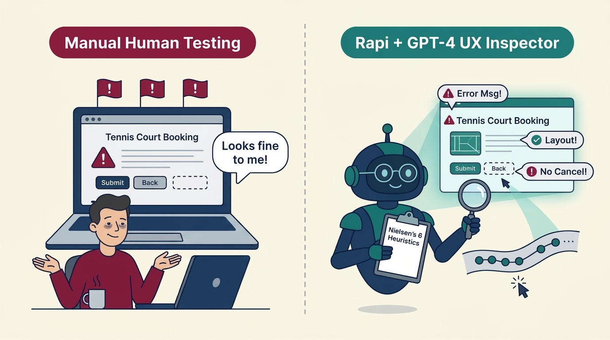
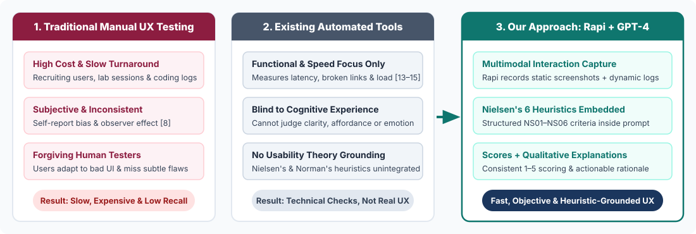
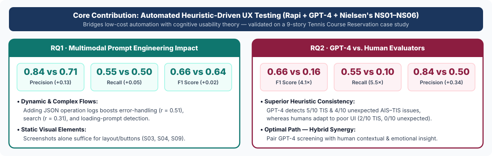

<!-- _class: lead -->

Electronics 2024 · Vol. 13, Issue 23 · Article 4633 (MDPI)

# Applying Large Language Model to User Experience Testing

Integrating <strong>Rapi Web Interaction Recording</strong>, <strong>Multimodal Prompt Engineering</strong>, and <strong>Nielsen's Usability Heuristics</strong> with GPT-4 for Automated UX Evaluation

<strong>Nien-Lin Hsueh*</strong>, <strong>Hsuen-Jen Lin</strong>, and <strong>Lien-Chi Lai</strong> 
Department of Information Engineering and Computer Science, Feng Chia University, Taichung 407, Taiwan 
<code>nlhsueh@fcu.edu.tw</code> · <code>kobayasa209924@gmail.com</code> · <code>p1000433@mail.fcu.edu.tw</code>

Published: 24 November 2024 · DOI: <code>https://doi.org/10.3390/electronics13234633</code> · Grant: NSTC112-2221-E-035-030-MY2

---

## Opening Hook: "Looks Fine to Me!" ... Or Did We Miss 90% of UX Bugs?

<strong>The Big Idea:</strong> Human evaluators naturally adapt to suboptimal interfaces — yielding a surprisingly conservative <strong>Recall of 0.10 (F1 = 0.16)</strong>. Pairing <strong>Rapi interaction logs + screenshots</strong> with <strong>GPT-4</strong> guided by <strong>Nielsen's heuristics</strong> achieves <strong>0.84 Precision</strong> and <strong>0.66 F1</strong>.

---

## Presentation Outline

1

[**Introduction & Research Questions**](#4)
Why manual UX testing and existing automated tools fall short, and our two RQs (RQ1–RQ2).

2

[**Literature Review & Research Gap**](#6)
UX evaluation methods, metric taxonomies, and the missing usability-theory link in automation.

3

[**Proposed LLM-Based UX Testing Tool**](#7)
Rapi + GPT-4 architecture, six Nielsen heuristics (NS01–NS06), and multimodal prompt design.

4

[**Case Study: Tennis Course Reservation**](#10)
System workflow, UI contrast examples, nine evaluation stories (S01–S09), and TIS/AIS grouping.

5

[**Experimental Evaluation (RQ1 & RQ2)**](#12)
Prompt configuration impact, GPT-4 vs. 16 human evaluators, and non-parametric statistics.

6

[**Discussion, Limitations & Conclusion**](#16)
Human–AI synergy, study limitations, RQ conclusions synthesis, and future research roadmap.

---

## 1.1 Motivation: Why Traditional & Automated UX Testing Fall Short

<strong>Bridging the Gap:</strong> Multimodal LLMs like <strong>GPT-4</strong> combine visual perception with semantic reasoning — enabling automated tools to inspect not only <em>technical performance</em>, but also <em>cognitive experience, interaction nuances, and Nielsen's usability heuristics</em>.

---

## 1.2 Research Objectives & Two Research Questions

We build a **GPT-4 + Rapi** automated UX detection tool grounded in **Nielsen's usability heuristics** and empirically investigate two core questions *(revealed step-by-step)*:

* 

RQ1 Do interaction logs + screenshots beat screenshots alone?

<strong>How does providing different information within prompts</strong> (visual screenshots + Rapi JSON operation scripts vs. screenshots only) <strong>influence the accuracy of UX detection by GPT-4?</strong>

* 

RQ2 Can an LLM inspector outperform human evaluators on usability heuristics?

<strong>What is the performance of GPT-4 in user experience detection compared to human evaluators</strong> when using optimized heuristic-guided prompts?

<strong>Goal:</strong> Lower early-stage UX testing cost while maintaining rigorous, consistent, and theory-grounded usability feedback.

---

## 2. Literature Review: Methods, Metrics & the Automation Gap

UX is inherently **subjective, holistic, dynamic, and context-dependent** [1, 7]. Existing evaluation methods and automated tools each face clear trade-offs:

| Category | Representative Approaches & Studies | Key Strengths | Critical Limitations |
| :--- | :--- | :--- | :--- |
| **Manual Methods** [8] | Self-report (surveys/interviews), Observational, Physiological | Captures real human perception & emotion | Costly, time-consuming, self-report bias & observer effect |
| **UX Metrics** [9] | Performance, Issue-based, Self-reported, Behavioral/Physiological | Holistic view when combined in mixed methods [10, 11] | High labor required to collect, code & align across lifecycle |
| **Web Usability Tools** [13] | 10 popular automated tools across 9 websites (19-dim framework) | Fast technical checks (HTML, links, load time) | Neglects usability issues; inconsistent; no usability theory |
| **ML / Load UI Tools** [14, 15] | AST embeddings + Random Forest (3.7% MAE); Load + UI tests | Accurate performance-impact & load estimation | Focuses on speed/functionality; blind to cognition & heuristics |
| **Our Approach** | **Rapi Web Recorder + GPT-4 + Nielsen's Heuristics (NS01–NS06)** | **Low-cost, consistent, multimodal & theory-grounded** | **Requires prompt tuning & human oversight for high-stakes UX** |

<strong>Key Research Gap:</strong> Established UX theories — such as <strong>Jakob Nielsen's 10 Heuristics [2]</strong> and <strong>Donald Norman's Design Principles [16]</strong> — have rarely been integrated into automated UX testing frameworks.

---

## 3.1 Automated UX Testing Architecture (Rapi + GPT-4)

Fig. 1: Website UX evaluation framework combining Rapi, Nielsen's heuristics, and GPT-4

### ⚙️ Four-Stage Evaluation Pipeline
1. **Interaction Recording (`Rapi v4.0.0`)**: Captures clicks, keyboard inputs, timestamps, status & page snapshots into an **Operation Script File** (JSON).
2. **Dual-Stream Bifurcation**:
   - **Text Script**: Extracts structured user actions & timing logs.
   - **Screenshot-Link Conversion**: Converts visual captures into accessible links for multimodal input.
3. **Heuristic-Guided GPT-4 Analysis**: Integrates visual + operational streams with **Nielsen's 6 heuristics (NS01–NS06)**.
4. **Dual Outputs**: Produces both **quantitative 1–5 scores** per indicator and **qualitative score explanations**.

---

## 3.2 Six Adopted Nielsen Usability Heuristics (NS01–NS06)

We selected **six perception-critical heuristics** from Nielsen [2] and embedded their definitions and concrete interface rules directly into the GPT-4 prompt (Appendix A):

| Code | Nielsen Usability Heuristic | Core UX Focus | Concrete Rule / Example in Prompt |
| :---: | :--- | :--- | :--- |
| **NS01** | **Visibility of system status** | Timely feedback so users always know system state | If execution exceeds `3000 ms`, display a clear loading status prompt |
| **NS02** | **User control and freedom** | Clearly marked "emergency exit" to undo/leave unwanted states | Provide explicit `Cancel` and `Return / Back` buttons |
| **NS03** | **Recognize, diagnose & recover from errors** | Plain-language error messages explaining cause & fix | On login/password failure, show clear error message specifying the issue |
| **NS04** | **Consistency and standards** | Uniform layout, visual hierarchy & platform conventions | `Back` button placed to the **left** of `Confirm` and **less prominent** |
| **NS05** | **Recognition rather than recall** | Minimize user memory load by making options visible | Provide accessible `Course Search` and `History Records` functions |
| **NS06** | **Match between system & real world** | Familiar language and natural, logical presentation | Display course schedules in a familiar **weekly table** (not flat list) |

---

## 3.3 Multimodal Prompt Engineering Pipeline (Dual-Data Strategy)

<strong>Why Dual-Modal Data Matters:</strong> Screenshots show <em>what users see</em> (static layout, error boxes, loading spinners), whereas Rapi JSON scripts show <em>how users interact</em> (attempts, delays <code>>3000 ms</code>, navigation failures).

---

## 4.1 Case Study: Tennis Course Reservation System

Fig. 2: Tennis course reservation user flow (Homepage ➔ Course Overview ➔ Login Check ➔ Confirm / Record / Cancel)

Fig. 3: Example Story S09 — (a) Expected UI with "Cancel Reservation" vs. (b) Unexpected UI without cancellation

### 🎾 Controlled A/B Story Design
- **Four Core Features**: Course listing, course search, course reservation, and reservation cancellation.
- **Expected vs. Unexpected Pairs**: Each of 9 stories (`S01`–`S09`) creates a controlled contrast:
  - **Expected**: Strictly follows Nielsen's heuristic.
  - **Unexpected**: Deliberately violates one target heuristic while holding other features constant.

---

## 4.2 Nine Evaluation Stories (S01–S09) & TIS / AIS Grouping

| Story | Evaluated Aspect | Target Heuristic (TIS) | Expected Scenario (Good UX) | Unexpected Scenario (Flawed UX) |
| :---: | :--- | :--- | :--- | :--- |
| **S01** | Login failure error | `NS01`, `NS03` | Failure message displayed on login fail | No failure message displayed |
| **S02** | Course schedule format | `NS06` | Weekly order in a **table** format | Displayed in a flat **list** format |
| **S03** | Back button color | `NS04` | Back button **less prominent** than Reserve | Back button **more prominent** than Reserve |
| **S04** | Back button position | `NS04` | Back button to the **left** of Reserve | Back button to the **right** of Reserve |
| **S05** | Back button presence | `NS02` | Back button provided | No back button provided |
| **S06** | Course search function | `NS05` | Course search function provided | No course search function provided |
| **S07** | Loading system prompt | `NS01` | System prompt shown while loading | No system prompt shown while loading |
| **S08** | Course history record | `NS05` | Course history record provided | No course history record provided |
| **S09** | Cancel booking option | `NS02` | History record **+ cancellation** provided | History record only (**no cancellation**) |

<strong>TIS vs. AIS Grouping:</strong> <strong>TIS (Target Indicator Score)</strong> measures the exact heuristic modified by the story (e.g., <code>NS05</code> in <code>S06</code>), while <strong>AIS (Auxiliary Indicator Score)</strong> covers the other 5 heuristics to test indirect spillover effects.

---

## 5.1 Experimental Setup & Non-Parametric Statistical Design

Fig. 4: Parallel human questionnaire & LLM-based UX evaluation workflow

### 🧪 Human vs. Automated Study Protocol
- **Human Evaluators**: **16 participants** (3 months web/SE training), 1-hour sessions, randomly assigned stories (both Expected & Unexpected).
  - Collected **54 questionnaires** across **27 story instances** (`n = 27`), rated on an **11-item 5-point Likert scale** (Appendix C).
- **Automated Tool (`GPT-4`)**: Recorded sessions via **Rapi**, evaluated at `temperature = 0.7`, **30 runs per scenario** across 2 prompt configurations.
- **Non-Parametric Tests** *(ordinal Likert data)*:
  - **Mann–Whitney U** (`p < 0.05`, effect size `r`): Expected vs. Unexpected TIS sensitivity.
  - **Wilcoxon Signed Rank**: Paired **AIS–TIS consistency**.

---

## 5.2 RQ1 Results: Visual + Operational Data vs. Visual-Only Prompts

0.84 vs. 0.71

<strong>Precision (+0.13)</strong> — fewer false positives with operation scripts

0.55 vs. 0.50

<strong>Recall (+0.05)</strong> — catches more dynamic UX inconsistencies

0.66 vs. 0.64

<strong>F1 Score (+0.02)</strong> · Overall Accuracy similar (0.63 vs. 0.65)

### 📊 Comparative Metrics (Table 4)
| Prompt Configuration | Acc. | Prec. | Rec. | F1 |
| :--- | :---: | :---: | :---: | :---: |
| **Visual + Operational Data** | 0.63 | **0.84** | **0.55** | **0.66** |
| **Visual Input Only** | **0.65** | 0.71 | 0.50 | 0.64 |

<strong>Takeaway (RQ1):</strong> Richer multimodal prompts noticeably lift <strong>Precision (+13 pts)</strong> and <strong>Recall (+5 pts)</strong>, proving prompt design must match the UX dimension being audited.

### 🔎 Scenario-Specific Insights (Tables 2 & 3)
- **Dynamic & Complex Features** *(Ops Script Wins)*:
  - `S01–NS03` (Error msg): **Large effect `r = 0.51`** (`p < 0.001`) vs. `r = 0.46` (Visual only).
  - `S06–NS05` (Search): **Medium effect `r = 0.31`** (`p < 0.001`).
  - `S05`, `S07` (Loading), `S08` (History): Significant (`p ≤ 0.003`) **only when operation logs are included**.
- **Static Visual Elements** *(Visual Only Suffices)*:
  - Button color/position (`S03`, `S04`) show comparable results without logs.
  - `S09–NS02` (Cancel button) was significant (`p = 0.013`, `r = 0.14`) only in Visual-Only mode — simpler prompts can reduce distraction for static checks.

---

## 5.3 RQ2 Results: GPT-4 (Optimized Prompt) vs. Human Evaluators

0.66 vs. 0.16

<strong>F1 Score (4.1× higher)</strong> — GPT-4 vs. Human Evaluators

0.55 vs. 0.10

<strong>Recall (5.5× higher)</strong> — Humans miss 90% of injected UX flaws

0.84 vs. 0.50

<strong>Precision (+0.34)</strong> · Accuracy: <strong>0.63 vs. 0.33</strong>

### 📈 Metric-by-Metric Comparison (Tables 4 & 6)

<strong>Accuracy</strong>

0.63 vs 0.33

<strong>Precision</strong>

0.84 vs 0.50

<strong>Recall</strong>

0.55 vs 0.10

<strong>F1 Score</strong>

0.66 vs 0.16

### 🧠 Why Human Evaluators Scored Low Recall
- **User Adaptability Bias**: Participants tended to **adapt their behavior to suboptimal designs** and treat flawed interfaces as "normal" (conservative ratings).
- **Limited Significant Hits (Table 5)**: Humans only detected **2 of 10** target pairs significantly:
  - `S01–NS01` (Login status, `p = 0.015`, `r = 0.47` M)
  - `S04–NS04` (Back button position, `p = 0.035`, `r = 0.39` M)
- **Zero Unexpected AIS–TIS Detection**: Humans found **0/10** significant AIS–TIS unexpected consistencies, whereas GPT-4 flagged **4/10**.

---

## 5.4 Scenario-Level Sensitivity & AIS–TIS Consistency (Tables 2, 3 & 5)

| Story – Indicator | Tested UX Element | GPT-4 (Visual + Ops) TIS `p` / `r` | GPT-4 (Visual Only) TIS `p` / `r` | Human Evaluators TIS `p` / `r` | GPT-4 (+Ops) Unexpected AIS–TIS |
| :--- | :--- | :---: | :---: | :---: | :---: |
| **S01 – NS01** | Login error status | 0.317 / 0.16 (S) | 0.951 / 0.00 (N) | **0.015\*** / **0.47 (M)** | 0.196 |
| **S01 – NS03** | Error diagnosis | **0.000\*** / **0.51 (L)** | **0.000\*** / **0.46 (M)** | 0.059 / 0.35 (M) | 0.207 |
| **S02 – NS06** | Weekly table vs. list | 0.218 / 0.07 (N) | 0.398 / 0.05 (N) | 0.937 / 0.02 (N) | 0.499 |
| **S03 – NS04** | Back button color | 0.083 / 0.03 (N) | 0.157 / 0.07 (N) | 0.542 / 0.12 (S) | **0.010\*** |
| **S04 – NS04** | Back button position | 1.000 / 0.06 (N) | 0.418 / 0.04 (N) | **0.035\*** / **0.39 (M)** | 0.440 |
| **S05 – NS02** | Back button presence | **0.003\*** / 0.07 (N) | 0.107 / 0.09 (N) | 0.783 / 0.06 (N) | **0.026\*** |
| **S06 – NS05** | Course search | **0.000\*** / **0.31 (M)** | **0.000\*** / **0.33 (M)** | 0.052 / 0.37 (M) | 0.562 |
| **S07 – NS01** | Loading prompt | **0.000\*** / 0.08 (N) | 0.074 / 0.06 (N) | 0.845 / 0.04 (N) | **0.000\*** |
| **S08 – NS05** | History record | **0.001\*** / 0.00 (N) | 0.153 / 0.08 (N) | 0.183 / 0.26 (S) | **0.000\*** |
| **S09 – NS02** | Cancel booking | 0.512 / 0.03 (N) | **0.013\*** / **0.14 (S)** | 0.054 / 0.37 (M) | 0.623 |

<strong>Complementary Strengths:</strong> GPT-4 systematically catches <strong>error handling (<code>S01</code>), feature completeness (<code>S05</code>, <code>S06</code>, <code>S08</code>), and loading feedback (<code>S07</code>)</strong>, while human intuition remains sharp on <strong>spatial layout conventions (<code>S04</code>)</strong>.

---

## 6.1 Discussion & Study Limitations

### 🤝 Toward Synergistic AI + Human UX Testing
- **Beyond Functional Automation**: Unlike traditional automated tools limited to speed/load metrics, GPT-4 interprets interface semantics, error guidance, and cognitive load via Nielsen's heuristics.
- **Cost-Effective Early Screening**: Run Rapi + GPT-4 rapidly in early iterations to catch missing controls, broken feedback, and consistency issues before recruiting lab participants.
- **Irreplaceable Human Judgment**: Human evaluators retain intuitive sensitivity to spatial ergonomics (`S04`), emotional resonance, and domain-specific cultural context — pointing to a **hybrid AI + Human workflow**.

### ⚠️ Threats to Validity & Limitations
- **Sample Size**: 16 participants (54 questionnaires across 27 story instances) may not represent full user diversity across ages and domains.
- **Environmental Factors**: Testing venue and network latency could introduce uncontrolled noise into user interaction logs.
- **UX Subjectivity**: Individual backgrounds and prior expectations naturally create variance in perceived usability.
- **Ground-Truth Design Bias**: Although grounded in Nielsen's heuristics, crafting Expected/Unexpected scenarios may embed researcher assumptions — warranting broader multi-site validation.

---

## 6.2 Conclusion & Future Work

<strong>🤝 1. AI–Human Synergy</strong> Study where human expertise is vital — e.g., emotional resonance in healthcare UI & cultural appropriateness.

<strong>🔒 2. Multimodal & Ethics</strong> Integrate voice/video data with strict privacy boundaries & validation protocols for finance/medical apps.

<strong>📱 3. Mobile & Platform Rules</strong> Extend to mobile platforms with platform-specific heuristics & clear AI–human alignment metrics.

---

<!-- _class: closing -->

# Thank You for Your Attention!

Applying Large Language Model to User Experience Testing

<strong>Nien-Lin Hsueh*</strong> &nbsp;·&nbsp; <code>nlhsueh@fcu.edu.tw</code> 
<strong>Hsuen-Jen Lin</strong> &nbsp;·&nbsp; <code>kobayasa209924@gmail.com</code> &nbsp;|&nbsp; <strong>Lien-Chi Lai</strong> &nbsp;·&nbsp; <code>p1000433@mail.fcu.edu.tw</code> 
Department of Information Engineering and Computer Science, Feng Chia University 
Published in <strong>Electronics 2024, 13, 4633</strong> · <code>https://doi.org/10.3390/electronics13234633</code> 
Grant: NSTC112-2221-E-035-030-MY2 · Questions & Discussion Welcome!

