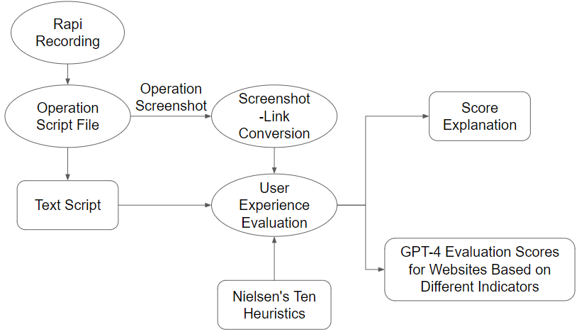
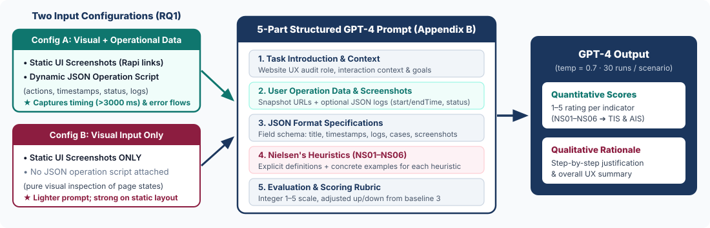
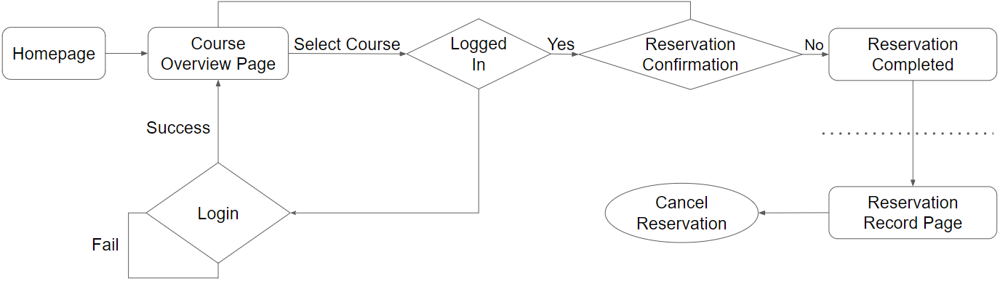
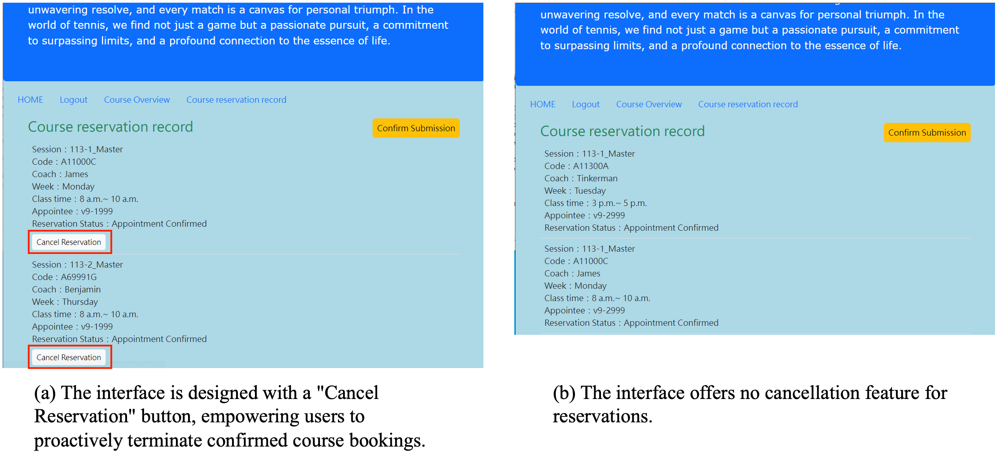
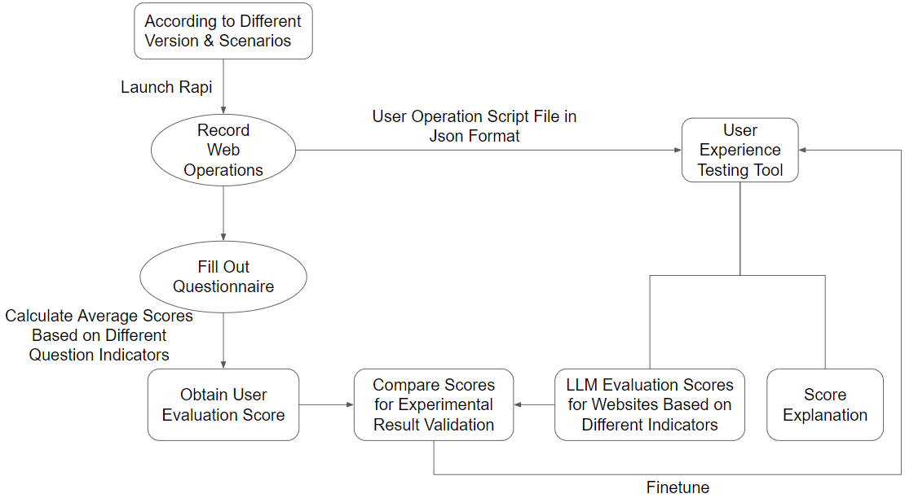

<!-- _class: lead -->

Electronics 2024 · Vol. 13, Issue 23 · Article 4633 (MDPI)

# Applying Large Language Model to User Experience Testing

Integrating <strong>Rapi Web Interaction Recording</strong>, <strong>Multimodal Prompt Engineering</strong>, and <strong>Nielsen's Usability Heuristics</strong> with GPT-4 for Automated UX Evaluation

<strong>Nien-Lin Hsueh*</strong>, <strong>Hsuen-Jen Lin</strong>, and <strong>Lien-Chi Lai</strong> 
Department of Information Engineering and Computer Science, Feng Chia University, Taichung 407, Taiwan 
<code>nlhsueh@fcu.edu.tw</code> · <code>kobayasa209924@gmail.com</code> · <code>p1000433@mail.fcu.edu.tw</code>

Published: 24 November 2024 · DOI: <code>https://doi.org/10.3390/electronics13234633</code> · Grant: NSTC112-2221-E-035-030-MY2

<!--
Bibliographic & Research Overview:
This article (Hsueh, Lin, & Lai, Electronics 2024, 13(23), 4633; published 24 November 2024; funded by NSTC grant NSTC112-2221-E-035-030-MY2) investigates how multimodal Large Language Models (specifically GPT-4) can operationalize established Human-Computer Interaction (HCI) theory for automated User Experience (UX) evaluation.

Core Problem & Contribution:
- Traditional manual UX evaluation (lab testing, heuristic inspections, user interviews) is hampered by subjectivity, lack of standardization, high recruitment/coding costs, and observer effects.
- Existing automated web testing tools largely audit technical metrics (HTML validity, broken links, response latency) while neglecting cognitive ergonomics and usability heuristics.
- The authors bridge this divide by coupling Rapi (v4.0.0) automated web interaction recording (JSON operation logs + sequential page screenshots) with GPT-4 guided by six of Jakob Nielsen's usability heuristics (NS01–NS06), validated on a controlled tennis course reservation web application against 16 human evaluators.
-->

---

## Opening Hook: "Looks Fine to Me!" ... Or Did We Miss 90% of UX Bugs?

<strong>The Big Idea:</strong> Human evaluators naturally adapt to suboptimal interfaces — yielding a surprisingly conservative <strong>Recall of 0.10 (F1 = 0.16)</strong>. Pairing <strong>Rapi interaction logs + screenshots</strong> with <strong>GPT-4</strong> guided by <strong>Nielsen's heuristics</strong> achieves <strong>0.84 Precision</strong> and <strong>0.66 F1</strong>.

<!--
Empirical Motivation & Core Finding:
This opening contrast synthesizes the central empirical takeaway from Section 4.4 (Table 6) and Section 4.3 (Table 4) of the paper.
- Human Evaluator Conservatism (Recall = 0.10, Precision = 0.50, Accuracy = 0.33, F1 = 0.16): Across 54 questionnaires covering 27 controlled story instances, human evaluators exhibited strong user adaptability bias. Rather than flagging missing controls or silent failures as usability defects, participants subconsciously adjusted their behavior to accommodate suboptimal designs and rated flawed interfaces conservatively as acceptable.
- Multimodal LLM Sensitivity (Precision = 0.84, Recall = 0.55, Accuracy = 0.63, F1 = 0.66): When GPT-4 receives both Rapi JSON interaction logs and page screenshots structured around Nielsen's heuristics, it systematically penalizes injected violations without habituating to poor design, achieving 5.5x higher recall and 4.1x higher F1 than human evaluators.
-->

---

## Presentation Outline

1

[**Introduction & Research Questions**](#4)
Why manual UX testing and existing automated tools fall short, and our two RQs (RQ1–RQ2).

2

[**Literature Review & Research Gap**](#6)
UX evaluation methods, metric taxonomies, and the missing usability-theory link in automation.

3

[**Proposed LLM-Based UX Testing Tool**](#7)
Rapi + GPT-4 architecture, six Nielsen heuristics (NS01–NS06), and multimodal prompt design.

4

[**Case Study: Tennis Course Reservation**](#10)
System workflow, UI contrast examples, nine evaluation stories (S01–S09), and TIS/AIS grouping.

5

[**Experimental Evaluation (RQ1 & RQ2)**](#12)
Prompt configuration impact, GPT-4 vs. 16 human evaluators, and non-parametric statistics.

6

[**Discussion, Limitations & Conclusion**](#16)
Human–AI synergy, study limitations, RQ conclusions synthesis, and future research roadmap.

<!--
Paper Architecture & Section Mapping:
The manuscript is organized into six sections plus three methodological appendices that support full reproducibility:
1. Introduction (Section 1): Frames UX testing within the software development lifecycle (from unit testing to user acceptance testing), cites Nielsen & Molich [2] and Alomari et al. [3] on the dual necessity of usability and learnability, reviews multimodal VLM advances (Flamingo [4], Emu [5]), and formulates RQ1 and RQ2.
2. Literature Review (Section 2): Surveys UX definition challenges (Law et al. [1], Vermeeren et al. [6], Kashfi et al. [7]), evaluation methods/metrics (Inan et al. [8], Albert & Tullis [9]), mixed-method studies [10, 11], and automated UX evaluation gaps [12–15].
3. Research Methodology (Section 3): Details the Rapi + GPT-4 pipeline (Fig. 1), heuristics NS01–NS06 (Appendix A), five-part prompt template (Appendix B), and the tennis course reservation case study (Figs. 2–3, Table 1).
4. Experimental Results & Analysis (Section 4): Reports the parallel human vs. GPT-4 protocol (Fig. 4, Appendix C), TIS/AIS grouping, and Mann-Whitney U / Wilcoxon Signed Rank results (Tables 2–6).
5. Discussion & Limitations (Section 5) and Conclusions (Section 6): Synthesize RQ1–RQ2 answers, human-AI complementarity, validity threats, and three future research directions.
-->

---

## 1.1 Motivation: Why Traditional & Automated UX Testing Fall Short

<strong>Bridging the Gap:</strong> Multimodal LLMs like <strong>GPT-4</strong> combine visual perception with semantic reasoning — enabling automated tools to inspect not only <em>technical performance</em>, but also <em>cognitive experience, interaction nuances, and Nielsen's usability heuristics</em>.

<!--
Theoretical Background & Technological Catalyst:
- Dual Usability Imperative: The paper anchors its motivation in two foundational HCI observations: Nielsen & Molich [2] noted that if a system fails to satisfy usability needs, ease of use alone is irrelevant; conversely, Alomari et al. [3] argued that if a system is too difficult to operate, meeting functional requirements is moot because users cannot complete their tasks.
- Why Existing Automation Is Insufficient: Automated web scanners excel at functional regression and performance benchmarking (load time, DOM validity), yet remain blind to users' cognitive experiences, interaction friction, and emotional needs.
- Multimodal Foundation Models as Enablers: The authors cite Flamingo (Alayrac et al. [4], capable of few-shot visual-language reasoning across up to 32 images/videos) and Emu (Sun et al. [5], unified autoregressive multimodal pretraining for zero-shot/few-shot VQA and description) as evidence that multimodal LLMs like GPT-4 can jointly interpret interface visuals and sequential textual logs, bringing semantic and heuristic reasoning into automated UX auditing.
-->

---

## 1.2 Research Objectives & Two Research Questions

We build a **GPT-4 + Rapi** automated UX detection tool grounded in **Nielsen's usability heuristics** and empirically investigate two core questions *(revealed step-by-step)*:

* 

RQ1 Do interaction logs + screenshots beat screenshots alone?

<strong>How does providing different information within prompts</strong> (visual screenshots + Rapi JSON operation scripts vs. screenshots only) <strong>influence the accuracy of UX detection by GPT-4?</strong>

* 

RQ2 Can an LLM inspector outperform human evaluators on usability heuristics?

<strong>What is the performance of GPT-4 in user experience detection compared to human evaluators</strong> when using optimized heuristic-guided prompts?

<strong>Goal:</strong> Lower early-stage UX testing cost while maintaining rigorous, consistent, and theory-grounded usability feedback.

<!--
Research Design & Operationalization of RQ1 and RQ2:
The study establishes three engineering and empirical objectives: (1) build an automated UX detection tool integrating GPT-4's vision capabilities with Nielsen's heuristics; (2) examine how prompt content and structure alter detection accuracy; and (3) benchmark optimized LLM prompts against human evaluators.
- RQ1 (Prompt Modality Ablation): Isolates the marginal value of dynamic behavioral telemetry by contrasting two prompt configurations on the exact same Rapi sessions: Visual Input Only (screenshots + heuristics) vs. Visual Input with Operational Data (screenshots + Rapi JSON operation scripts + heuristics).
- RQ2 (Human-AI Benchmark): Compares the optimized multimodal GPT-4 configuration against 16 trained human evaluators who rated the identical scenarios using an 11-item, 5-point Likert questionnaire mapped to NS01–NS06.
- Practical Objective: Reduce early-stage UX testing cost and subjectivity while preserving theory-grounded quantitative ratings and actionable qualitative diagnostics.
-->

---

## 2. Literature Review: Methods, Metrics & the Automation Gap

UX is inherently **subjective, holistic, dynamic, and context-dependent** [1, 7]. Existing evaluation methods and automated tools each face clear trade-offs:

| Category | Representative Approaches & Studies | Key Strengths | Critical Limitations |
| :--- | :--- | :--- | :--- |
| **Manual Methods** [8] | Self-report (surveys/interviews), Observational, Physiological | Captures real human perception & emotion | Costly, time-consuming, self-report bias & observer effect |
| **UX Metrics** [9] | Performance, Issue-based, Self-reported, Behavioral/Physiological | Holistic view when combined in mixed methods [10, 11] | High labor required to collect, code & align across lifecycle |
| **Web Usability Tools** [13] | 10 popular automated tools across 9 websites (19-dim framework) | Fast technical checks (HTML, links, load time) | Neglects usability issues; inconsistent; no usability theory |
| **ML / Load UI Tools** [14, 15] | AST embeddings + Random Forest (3.7% MAE); Load + UI tests | Accurate performance-impact & load estimation | Focuses on speed/functionality; blind to cognition & heuristics |
| **Our Approach** | **Rapi Web Recorder + GPT-4 + Nielsen's Heuristics (NS01–NS06)** | **Low-cost, consistent, multimodal & theory-grounded** | **Requires prompt tuning & human oversight for high-stakes UX** |

<strong>Key Research Gap:</strong> Established UX theories — such as <strong>Jakob Nielsen's 10 Heuristics [2]</strong> and <strong>Donald Norman's Design Principles [16]</strong> — have rarely been integrated into automated UX testing frameworks.

<!--
Detailed Synthesis of Prior Work & Research Gap:
- Complexity of UX Constructs: Kashfi et al. [7] identify five inherent UX properties (subjectivity, holism, dynamism, context dependency, and worth) that resist standardization. Law et al. [1] further note a persistent divide: academia emphasizes hedonic and emotional qualities, whereas industry prioritizes functionality and pragmatic usability. Vermeeren et al. [6] stress the shortage of early-stage, lifecycle-integrated evaluation methods.
- Evaluation Methods (Inan et al. [8]): Self-report measures (surveys/interviews) are low-cost but prone to self-report bias; observational measures offer higher objectivity but suffer from observer effects and labor cost; physiological measures (EEG, heart rate, GSR) maximize objectivity at the highest instrumentation cost.
- Metrics & Mixed Methods: Albert & Tullis [9] classify UX metrics into performance, issue-based, self-reported, and behavioral/physiological categories. Prior mixed-method studies combined heuristics + questionnaires on Brazil's Immunization Information System (Guimaraes et al. [10]) and UEQ + usability testing on Halodoc mobile health (Mochammad et al. [11]).
- Automation Gap: Nguyen et al. [12] noted the organizational disconnect between UX designers and SE/DevOps engineers. Namoun et al. [13] audited 10 popular web usability tools across 9 websites (3 categories) on a 19-dimension framework, finding technical bias, inconsistent outputs, and no grounding in usability theory. Biringa & Kul [14] used AST embeddings + Random Forest (3.7% MAE) to predict performance impact of updates, while Whiting [15] coupled load testing with automated UI tests. None of these integrate Jakob Nielsen's 10 heuristics [2] or Donald Norman's design principles [16].
-->

---

## 3.1 Automated UX Testing Architecture (Rapi + GPT-4)

Fig. 1: Website UX evaluation framework combining Rapi, Nielsen's heuristics, and GPT-4

### ⚙️ Four-Stage Evaluation Pipeline
1. **Interaction Recording (`Rapi v4.0.0`)**: Captures clicks, keyboard inputs, timestamps, status & page snapshots into an **Operation Script File** (JSON).
2. **Dual-Stream Bifurcation**:
   - **Text Script**: Extracts structured user actions & timing logs.
   - **Screenshot-Link Conversion**: Converts visual captures into accessible links for multimodal input.
3. **Heuristic-Guided GPT-4 Analysis**: Integrates visual + operational streams with **Nielsen's 6 heuristics (NS01–NS06)**.
4. **Dual Outputs**: Produces both **quantitative 1–5 scores** per indicator and **qualitative score explanations**.

<!--
Pipeline Mechanics & Architectural Rationale (Figure 1):
The framework automates UX auditing across four tightly coupled stages to eliminate manual log coding and reduce evaluator bias:
1. Interaction Recording (Rapi v4.0.0): As a user (or tester) executes a web task, Rapi records granular browser events (clicks, keyboard inputs, execution status, precise startTime/endTime timestamps, and step-level page snapshots) into a structured JSON Operation Script File (e.g., keyed by browser environment such as Chrome 122.0.0.6).
2. Dual-Stream Bifurcation: The raw Operation Script File is parsed into two complementary representations: a textual operation script (preserving chronological action logs, durations, and status flags) and a screenshot-link conversion stream that exposes each captured page state as an image reference for GPT-4's vision encoder.
3. Heuristic-Guided Multimodal Evaluation: GPT-4 receives both streams alongside formal definitions and concrete examples of Nielsen's six heuristics (NS01–NS06) and a standardized scoring rubric.
4. Dual Outputs: For every session, the model produces both quantitative integer scores (1–5 scale per heuristic, anchored at a baseline of 3 and adjusted up or down for notable strengths or violations) and qualitative justifications explaining the specific visual or behavioral evidence behind each rating.
-->

---

## 3.2 Six Adopted Nielsen Usability Heuristics (NS01–NS06)

We selected **six perception-critical heuristics** from Nielsen [2] and embedded their definitions and concrete interface rules directly into the GPT-4 prompt (Appendix A):

| Code | Nielsen Usability Heuristic | Core UX Focus | Concrete Rule / Example in Prompt |
| :---: | :--- | :--- | :--- |
| **NS01** | **Visibility of system status** | Timely feedback so users always know system state | If execution exceeds `3000 ms`, display a clear loading status prompt |
| **NS02** | **User control and freedom** | Clearly marked "emergency exit" to undo/leave unwanted states | Provide explicit `Cancel` and `Return / Back` buttons |
| **NS03** | **Recognize, diagnose & recover from errors** | Plain-language error messages explaining cause & fix | On login/password failure, show clear error message specifying the issue |
| **NS04** | **Consistency and standards** | Uniform layout, visual hierarchy & platform conventions | `Back` button placed to the **left** of `Confirm` and **less prominent** |
| **NS05** | **Recognition rather than recall** | Minimize user memory load by making options visible | Provide accessible `Course Search` and `History Records` functions |
| **NS06** | **Match between system & real world** | Familiar language and natural, logical presentation | Display course schedules in a familiar **weekly table** (not flat list) |

<!--
Selection Rationale & Appendix A Operational Definitions:
Rather than applying all 10 of Nielsen's heuristics, the authors selected six heuristics most directly tied to immediate user perception, interaction feedback, operational freedom, and cognitive load in web workflows. Each heuristic was codified in Appendix A with explicit interface criteria embedded into the GPT-4 prompt:
- NS01 (Visibility of system status): Users must never doubt system state or action success. Concrete threshold in prompt: whenever execution time exceeds 3000 ms, the system must display an explicit status/loading indicator.
- NS02 (User control and freedom): Users frequently trigger unintended actions and need clearly marked "emergency exits" (undo/redo, Cancel, Return/Back buttons) without traversing extended recovery paths.
- NS03 (Recognize, diagnose, and recover from errors): Error messages must use plain language (no cryptic codes), identify the exact cause, and suggest a fix (e.g., explicitly stating which password policy was violated during authentication/registration).
- NS04 (Consistency and standards): Uniform conventions reduce learning curves and enable skill transfer. Concrete rule in prompt: the Return/Back button should be placed to the left of the Confirm/Reserve button, and Confirm should be visually more conspicuous.
- NS05 (Recognition rather than recall): Minimize memory load by keeping options and prior records visible or easily retrievable (e.g., course search and reservation history functions).
- NS06 (Match between system and real world): Align language and data presentation with familiar real-world conventions (e.g., weekly timetable table instead of an unstructured flat list; trash-bin metaphor for deletion).
-->

---

## 3.3 Multimodal Prompt Engineering Pipeline (Dual-Data Strategy)

<strong>Why Dual-Modal Data Matters:</strong> Screenshots show <em>what users see</em> (static layout, error boxes, loading spinners), whereas Rapi JSON scripts show <em>how users interact</em> (attempts, delays <code>>3000 ms</code>, navigation failures).

<!--
Five-Part Prompt Structure (Appendix B) & Dual-Modality Justification:
Appendix B documents the exact structured prompt passed to GPT-4, composed of five sequential blocks:
1. Introduction & Context: Explains the web interaction JSON dataset containing user actions, timestamps, outcomes, snapshots, and execution context.
2. JSON Format Explanation: Defines key schema fields (`title`, `startTime`, `endTime`, `logs` with message patterns, `cases`, and `screenshots`) so the LLM parses behavioral logs accurately without hallucinating field semantics.
3. User Operation Data: Embeds the recorded Rapi JSON snippet (included in the Visual + Operational Data condition; omitted in the Visual-Only ablation).
4. Nielsen's Usability Principles: Injects the full NS01–NS06 definitions and concrete domain examples from Appendix A.
5. Request for Evaluation: Instructs GPT-4 to evaluate website performance using snapshots and timing records, rate each heuristic on an integer 1–5 scale (starting from a baseline of 3 points and adjusting up or down based on significant evidence), justify each score, and provide an overall summary.

Why Dual-Modal Input Matters: Static screenshots capture visual layout, button hierarchy, and rendered error dialogs, but cannot reveal temporal latency (>3000 ms), repeated failed login attempts, or navigation dead-ends. Combining both modalities allows GPT-4 to cross-verify visual cues against dynamic interaction traces.
-->

---

## 4.1 Case Study: Tennis Course Reservation System

Fig. 2: Tennis course reservation user flow (Homepage ➔ Course Overview ➔ Login Check ➔ Confirm / Record / Cancel)

Fig. 3: Example Story S09 — (a) Expected UI with "Cancel Reservation" vs. (b) Unexpected UI without cancellation

### 🎾 Controlled A/B Story Design
- **Four Core Features**: Course listing, course search, course reservation, and reservation cancellation.
- **Expected vs. Unexpected Pairs**: Each of 9 stories (`S01`–`S09`) creates a controlled contrast:
  - **Expected**: Strictly follows Nielsen's heuristic.
  - **Unexpected**: Deliberately violates one target heuristic while holding other features constant.

<!--
Controlled A/B Testbed Design (Figures 2 & 3):
To evaluate automated UX detection objectively without confounding domain variables, the authors built a custom tennis course reservation web application covering four realistic functional requirements: course listing, course search, course reservation, and reservation cancellation.
- User Flow (Figure 2): Homepage -> Course Overview -> Select Course -> Login Status Check. Unauthenticated users are routed to Login (failed login loops back to Login; successful login proceeds to Reservation Confirmation). On Confirmation, users either confirm (recording reservation details) or cancel (redirecting to the Reservation Record page).
- Controlled Scenario Bifurcation: Each of the 9 stories (S01–S09) exists in two strictly paired versions: an Expected Scenario adhering to Nielsen's heuristics and an Unexpected Scenario that deliberately injects a single targeted heuristic violation while holding all unrelated pages and features constant.
- Concrete Contrast (Figure 3, Story S09): Both versions display the user's reservation history, but the Expected UI (Fig. 3a) provides an explicit "Cancel Reservation" button whereas the Unexpected UI (Fig. 3b) removes cancellation entirely, isolating NS02 (User Control and Freedom).
-->

---

## 4.2 Nine Evaluation Stories (S01–S09) & TIS / AIS Grouping

| Story | Evaluated Aspect | Target Heuristic (TIS) | Expected Scenario (Good UX) | Unexpected Scenario (Flawed UX) |
| :---: | :--- | :--- | :--- | :--- |
| **S01** | Login failure error | `NS01`, `NS03` | Failure message displayed on login fail | No failure message displayed |
| **S02** | Course schedule format | `NS06` | Weekly order in a **table** format | Displayed in a flat **list** format |
| **S03** | Back button color | `NS04` | Back button **less prominent** than Reserve | Back button **more prominent** than Reserve |
| **S04** | Back button position | `NS04` | Back button to the **left** of Reserve | Back button to the **right** of Reserve |
| **S05** | Back button presence | `NS02` | Back button provided | No back button provided |
| **S06** | Course search function | `NS05` | Course search function provided | No course search function provided |
| **S07** | Loading system prompt | `NS01` | System prompt shown while loading | No system prompt shown while loading |
| **S08** | Course history record | `NS05` | Course history record provided | No course history record provided |
| **S09** | Cancel booking option | `NS02` | History record **+ cancellation** provided | History record only (**no cancellation**) |

<strong>TIS vs. AIS Grouping:</strong> <strong>TIS (Target Indicator Score)</strong> measures the exact heuristic modified by the story (e.g., <code>NS05</code> in <code>S06</code>), while <strong>AIS (Auxiliary Indicator Score)</strong> covers the other 5 heuristics to test indirect spillover effects.

<!--
Experimental Matrix (Table 1) & TIS/AIS Analytical Separation:
Table 1 maps all nine stories (S01–S09) to 10 Target Indicator pairs (S01 targets both NS01 and NS03, while S02–S09 each target one primary heuristic):
- S01 (NS01, NS03): Login failure displays explicit error message vs. silent failure with no message.
- S02 (NS06): Courses rendered in a weekly timetable table vs. a flat list lacking temporal structure.
- S03 (NS04): Back button visually less prominent than Reserve vs. Back button more prominent.
- S04 (NS04): Back button positioned to the left of Reserve vs. positioned to the right.
- S05 (NS02): Back button present vs. omitted.
- S06 (NS05): Course search function available vs. omitted.
- S07 (NS01): Loading system prompt shown during delay vs. no loading prompt.
- S08 (NS05): Course history record available vs. omitted.
- S09 (NS02): History record + booking cancellation available vs. history record only.

TIS vs. AIS Analytical Rationale (Section 4.2):
- TIS (Target Indicator Score) isolates scores on the exact heuristic manipulated in a story (e.g., NS05 in S06) to test direct detection sensitivity between Expected and Unexpected versions.
- AIS (Auxiliary Indicator Score) aggregates the remaining five non-targeted heuristics (e.g., NS01–NS04 and NS06 in S06) to check whether a localized defect triggers unintended spillover effects or consistent divergence between target and auxiliary ratings.
-->

---

## 5.1 Experimental Setup & Non-Parametric Statistical Design

Fig. 4: Parallel human questionnaire & LLM-based UX evaluation workflow

### 🧪 Human vs. Automated Study Protocol
- **Human Evaluators**: **16 participants** (3 months web/SE training), 1-hour sessions, randomly assigned stories (both Expected & Unexpected).
  - Collected **54 questionnaires** across **27 story instances** (`n = 27`), rated on an **11-item 5-point Likert scale** (Appendix C).
- **Automated Tool (`GPT-4`)**: Recorded sessions via **Rapi**, evaluated at `temperature = 0.7`, **30 runs per scenario** across 2 prompt configurations.
- **Non-Parametric Tests** *(ordinal Likert data)*:
  - **Mann–Whitney U** (`p < 0.05`, effect size `r`): Expected vs. Unexpected TIS sensitivity.
  - **Wilcoxon Signed Rank**: Paired **AIS–TIS consistency**.

<!--
Parallel Evaluation Protocol & Non-Parametric Statistical Justification (Figure 4):
- Human Participant Protocol: 16 participants with 3 months of web development and software engineering training completed 1-hour testing sessions. Each participant was randomly assigned stories containing both Expected and Unexpected versions (completing additional stories if time permitted), yielding 54 completed questionnaires across 27 distinct story instances (n = 27).
- Questionnaire Instrument (Appendix C): An 11-item, 5-point Likert questionnaire covering NS01–NS06 (items 1–2: system state & reasonable response time; items 3–4: return & cancel/redo freedom; items 5–6: clear error messages & major operation reminders; items 7–9: color scheme, consistent layout, general web standards; item 10: low memory load; item 11: real-world display habits). The questionnaire was identical across stories so participants were not cued to which defect was injected.
- LLM Evaluation Protocol: Participants' actual Rapi recordings and screenshots served as direct inputs to GPT-4. API temperature was set to 0.7 to capture response variability, and each Expected/Unexpected scenario was evaluated 30 times under both prompt configurations (Visual + Ops vs. Visual Only).
- Statistical Tests: Because Likert scores are ordinal and human sample size is modest (n = 27), non-parametric tests were applied: two-sample Mann-Whitney U test (alpha = 0.05) with rank-biserial/Z-based effect size r (N < 0.1, S = 0.1–0.3, M = 0.3–0.5, L > 0.5) for Expected vs. Unexpected TIS comparisons, and paired Wilcoxon Signed Rank test for AIS-TIS consistency.
-->

---

## 5.2 RQ1 Results: Visual + Operational Data vs. Visual-Only Prompts

0.84 vs. 0.71

<strong>Precision (+0.13)</strong> — fewer false positives with operation scripts

0.55 vs. 0.50

<strong>Recall (+0.05)</strong> — catches more dynamic UX inconsistencies

0.66 vs. 0.64

<strong>F1 Score (+0.02)</strong> · Overall Accuracy similar (0.63 vs. 0.65)

### 📊 Comparative Metrics (Table 4)
| Prompt Configuration | Acc. | Prec. | Rec. | F1 |
| :--- | :---: | :---: | :---: | :---: |
| **Visual + Operational Data** | 0.63 | **0.84** | **0.55** | **0.66** |
| **Visual Input Only** | **0.65** | 0.71 | 0.50 | 0.64 |

<strong>Takeaway (RQ1):</strong> Richer multimodal prompts noticeably lift <strong>Precision (+13 pts)</strong> and <strong>Recall (+5 pts)</strong>, proving prompt design must match the UX dimension being audited.

### 🔎 Scenario-Specific Insights (Tables 2 & 3)
- **Dynamic & Complex Features** *(Ops Script Wins)*:
  - `S01–NS03` (Error msg): **Large effect `r = 0.51`** (`p < 0.001`) vs. `r = 0.46` (Visual only).
  - `S06–NS05` (Search): **Medium effect `r = 0.31`** (`p < 0.001`).
  - `S05`, `S07` (Loading), `S08` (History): Significant (`p ≤ 0.003`) **only when operation logs are included**.
- **Static Visual Elements** *(Visual Only Suffices)*:
  - Button color/position (`S03`, `S04`) show comparable results without logs.
  - `S09–NS02` (Cancel button) was significant (`p = 0.013`, `r = 0.14`) only in Visual-Only mode — simpler prompts can reduce distraction for static checks.

<!--
Deep Dive into RQ1: Modality Trade-offs & Scenario Sensitivity (Tables 2, 3 & 4):
Comparing Visual + Operational Data against Visual Input Only reveals a nuanced trade-off rather than a uniform gain:
- Aggregate Classification Metrics (Table 4): Visual + Ops substantially improves Precision (0.84 vs. 0.71, +0.13), Recall (0.55 vs. 0.50, +0.05), and F1 (0.66 vs. 0.64, +0.02), indicating far fewer false positives and stronger defect capture. Overall Accuracy is slightly lower (0.63 vs. 0.65), driven by static-UI edge cases where extra JSON text can dilute visual focus.
- Where Operation Scripts Are Essential (Tables 2 vs. 3): Dynamic and stateful defects depend heavily on Rapi logs. S01-NS03 (login error handling) strengthens from medium effect r = 0.46 (Visual Only) to large effect r = 0.51 (Visual + Ops, U = 6968.0, Z = 8.35, p < 0.001). Three scenarios reach statistical significance ONLY with operation logs: S05-NS02 (back button presence, p = 0.003), S07-NS01 (loading prompt, p < 0.001), and S08-NS05 (history record, p = 0.001).
- Where Visual-Only Prompts Suffice or Excel: Purely static layout checks (S03 button color, S04 button position) perform comparably without logs. Notably, S09-NS02 (missing cancellation button) reached significance only in Visual-Only mode (p = 0.013, r = 0.14 vs. p = 0.512 with logs), demonstrating that leaner prompts can reduce distraction for visually self-contained checks.
-->

---

## 5.3 RQ2 Results: GPT-4 (Optimized Prompt) vs. Human Evaluators

0.66 vs. 0.16

<strong>F1 Score (4.1× higher)</strong> — GPT-4 vs. Human Evaluators

0.55 vs. 0.10

<strong>Recall (5.5× higher)</strong> — Humans miss 90% of injected UX flaws

0.84 vs. 0.50

<strong>Precision (+0.34)</strong> · Accuracy: <strong>0.63 vs. 0.33</strong>

### 📈 Metric-by-Metric Comparison (Tables 4 & 6)

<strong>Accuracy</strong>

0.63 vs 0.33

<strong>Precision</strong>

0.84 vs 0.50

<strong>Recall</strong>

0.55 vs 0.10

<strong>F1 Score</strong>

0.66 vs 0.16

### 🧠 Why Human Evaluators Scored Low Recall
- **User Adaptability Bias**: Participants tended to **adapt their behavior to suboptimal designs** and treat flawed interfaces as "normal" (conservative ratings).
- **Limited Significant Hits (Table 5)**: Humans only detected **2 of 10** target pairs significantly:
  - `S01–NS01` (Login status, `p = 0.015`, `r = 0.47` M)
  - `S04–NS04` (Back button position, `p = 0.035`, `r = 0.39` M)
- **Zero Unexpected AIS–TIS Detection**: Humans found **0/10** significant AIS–TIS unexpected consistencies, whereas GPT-4 flagged **4/10**.

<!--
Deep Dive into RQ2: GPT-4 vs. Human Evaluators (Tables 4, 5 & 6):
When evaluated against the exact same controlled Expected/Unexpected ground truth, optimized multimodal GPT-4 outperforms the 16 human evaluators across every classification metric:
- Metric Disparity: Accuracy 0.63 vs. 0.33, Precision 0.84 vs. 0.50, Recall 0.55 vs. 0.10 (5.5x higher), and F1 0.66 vs. 0.16 (4.1x higher).
- Cognitive Mechanism Behind Low Human Recall (0.10): The authors attribute humans' severe false-negative rate to user adaptability bias. During live tasks, participants adapt their workflow around missing features or silent delays, normalizing suboptimal UX rather than penalizing it on Likert scales. In addition, 3 months of SE training may be insufficient to sensitize evaluators to subtle heuristic violations without targeted UX inspection checklists.
- Significant Target Detections (Table 5): Humans achieved statistical significance on only 2 of 10 story-indicator pairs: S01-NS01 (login failure status, U = 67.5, Z = 2.43, p = 0.015, r = 0.47 M) and S04-NS04 (back button position, U = 62.5, Z = 2.04, p = 0.035, r = 0.39 M). Three others were borderline non-significant (S01-NS03 p = 0.059; S06-NS05 p = 0.052; S09-NS02 p = 0.054).
- Unexpected AIS-TIS Consistency: Humans detected 0 of 10 significant unexpected AIS-TIS divergences, whereas GPT-4 (+Ops) flagged 4 of 10 (S03, S05, S07, S08), demonstrating much higher sensitivity to non-standard interface deviations.
-->

---

## 5.4 Scenario-Level Sensitivity & AIS–TIS Consistency (Tables 2, 3 & 5)

| Story – Indicator | Tested UX Element | GPT-4 (Visual + Ops) TIS `p` / `r` | GPT-4 (Visual Only) TIS `p` / `r` | Human Evaluators TIS `p` / `r` | GPT-4 (+Ops) Unexpected AIS–TIS |
| :--- | :--- | :---: | :---: | :---: | :---: |
| **S01 – NS01** | Login error status | 0.317 / 0.16 (S) | 0.951 / 0.00 (N) | **0.015\*** / **0.47 (M)** | 0.196 |
| **S01 – NS03** | Error diagnosis | **0.000\*** / **0.51 (L)** | **0.000\*** / **0.46 (M)** | 0.059 / 0.35 (M) | 0.207 |
| **S02 – NS06** | Weekly table vs. list | 0.218 / 0.07 (N) | 0.398 / 0.05 (N) | 0.937 / 0.02 (N) | 0.499 |
| **S03 – NS04** | Back button color | 0.083 / 0.03 (N) | 0.157 / 0.07 (N) | 0.542 / 0.12 (S) | **0.010\*** |
| **S04 – NS04** | Back button position | 1.000 / 0.06 (N) | 0.418 / 0.04 (N) | **0.035\*** / **0.39 (M)** | 0.440 |
| **S05 – NS02** | Back button presence | **0.003\*** / 0.07 (N) | 0.107 / 0.09 (N) | 0.783 / 0.06 (N) | **0.026\*** |
| **S06 – NS05** | Course search | **0.000\*** / **0.31 (M)** | **0.000\*** / **0.33 (M)** | 0.052 / 0.37 (M) | 0.562 |
| **S07 – NS01** | Loading prompt | **0.000\*** / 0.08 (N) | 0.074 / 0.06 (N) | 0.845 / 0.04 (N) | **0.000\*** |
| **S08 – NS05** | History record | **0.001\*** / 0.00 (N) | 0.153 / 0.08 (N) | 0.183 / 0.26 (S) | **0.000\*** |
| **S09 – NS02** | Cancel booking | 0.512 / 0.03 (N) | **0.013\*** / **0.14 (S)** | 0.054 / 0.37 (M) | 0.623 |

<strong>Complementary Strengths:</strong> GPT-4 systematically catches <strong>error handling (<code>S01</code>), feature completeness (<code>S05</code>, <code>S06</code>, <code>S08</code>), and loading feedback (<code>S07</code>)</strong>, while human intuition remains sharp on <strong>spatial layout conventions (<code>S04</code>)</strong>.

<!--
Granular Cross-Comparison of Tables 2, 3 & 5:
Examining all 10 story-indicator pairs side by side uncovers distinct error profiles and human-AI complementarity:
- GPT-4 (+Ops) Strengths: Excels at systematic, rule-verifiable functional and feedback checks: S01-NS03 (p < 0.001, r = 0.51 L), S06-NS05 (p < 0.001, r = 0.31 M), S05-NS02 (p = 0.003), S07-NS01 (p < 0.001), and S08-NS05 (p = 0.001). Notice that S05, S07, and S08 exhibit statistically significant p-values despite small/negligible r values due to rank-order consistency across 30 repeated LLM runs (and strong Unexpected AIS-TIS significance in S03 p = 0.010, S05 p = 0.026, S07 p < 0.001, S08 p < 0.001).
- Human Spatial & Status Intuition: Humans decisively outperformed GPT-4 on S04-NS04 (back button placed right of Reserve: human p = 0.035, r = 0.39 M vs. GPT-4 p = 1.000 / 0.418), showing that subtle spatial conventions remain easier for human visual perception than for GPT-4. Humans also registered login failure under NS01 (p = 0.015, r = 0.47 M), whereas GPT-4 categorized the same defect primarily under NS03 (error diagnosis).
- Shared Blind Spot (S02-NS06): Neither GPT-4 (p = 0.218 / 0.398) nor humans (p = 0.937) significantly penalized flat list vs. weekly table display, suggesting that layout format preferences are less strictly perceived as usability violations than missing controls or broken error feedback.
-->

---

## 6.1 Discussion & Study Limitations

### 🤝 Toward Synergistic AI + Human UX Testing
- **Beyond Functional Automation**: Unlike traditional automated tools limited to speed/load metrics, GPT-4 interprets interface semantics, error guidance, and cognitive load via Nielsen's heuristics.
- **Cost-Effective Early Screening**: Run Rapi + GPT-4 rapidly in early iterations to catch missing controls, broken feedback, and consistency issues before recruiting lab participants.
- **Irreplaceable Human Judgment**: Human evaluators retain intuitive sensitivity to spatial ergonomics (`S04`), emotional resonance, and domain-specific cultural context — pointing to a **hybrid AI + Human workflow**.

### ⚠️ Threats to Validity & Limitations
- **Sample Size**: 16 participants (54 questionnaires across 27 story instances) may not represent full user diversity across ages and domains.
- **Environmental Factors**: Testing venue and network latency could introduce uncontrolled noise into user interaction logs.
- **UX Subjectivity**: Individual backgrounds and prior expectations naturally create variance in perceived usability.
- **Ground-Truth Design Bias**: Although grounded in Nielsen's heuristics, crafting Expected/Unexpected scenarios may embed researcher assumptions — warranting broader multi-site validation.

<!--
Theoretical Implications & Validity Threats (Sections 5.2 & 5.3):
- Paradigm Shift Beyond Functional Automation: Traditional automated tools verify technical health (load times, HTTP status, DOM errors). Embedding Nielsen's heuristics into multimodal LLM prompts demonstrates that automated systems can audit higher-order cognitive and interaction dimensions (error recovery clarity, status visibility, functional completeness) consistently and at low marginal cost.
- Hybrid AI-Human Workflow: Because GPT-4 systematically catches missing features and feedback violations (high recall/precision) while humans retain superior intuition for spatial layout ergonomics (S04), emotional tone, and real-world context, the paper advocates a staged hybrid pipeline: automated Rapi + GPT-4 screening during rapid early iterations, followed by targeted human expert review.
- Four Methodological Limitations (Section 5.3):
  1. Sample Size & Generalizability: 16 participants (54 questionnaires across 27 story instances) with homogeneous web/SE training cannot represent age, domain, and cultural diversity.
  2. Environmental Confounders: Physical testing venue conditions and network latency variations could introduce uncontrolled timing noise into Rapi interaction logs.
  3. Inherent UX Subjectivity: Individual backgrounds and prior mental models naturally introduce rating variance that no single rubric fully eliminates.
  4. Ground-Truth Construction Bias: Although Expected/Unexpected pairs were derived from Nielsen's heuristics, researcher assumptions during scenario authoring may influence ground-truth labels.
-->

---

## 6.2 Conclusion & Future Work

<strong>🤝 1. AI–Human Synergy</strong> Study where human expertise is vital — e.g., emotional resonance in healthcare UI & cultural appropriateness.

<strong>🔒 2. Multimodal & Ethics</strong> Integrate voice/video data with strict privacy boundaries & validation protocols for finance/medical apps.

<strong>📱 3. Mobile & Platform Rules</strong> Extend to mobile platforms with platform-specific heuristics & clear AI–human alignment metrics.

<!--
Synthesis of Contributions & Three-Pillar Research Roadmap (Section 6):
This study validates that pairing Rapi web interaction recording with heuristic-guided GPT-4 prompts yields a rapid, consistent, and theory-grounded automated UX inspector. Answering RQ1, adding operational scripts elevates precision (0.84 vs. 0.71), recall (0.55 vs. 0.50), and F1 (0.66 vs. 0.64), especially for dynamic workflows, while visual-only prompts remain competitive for static visual audits. Answering RQ2, GPT-4 outperforms human evaluators by 5.5x in recall and 4.1x in F1 on heuristic violations while exhibiting clear complementarity with human spatial judgment.

Three Future Research Directions Outlined in Section 6:
1. AI-Human Synergy in High-Empathy Domains: Define division of labor where human judgment is indispensable, such as emotional resonance in healthcare interfaces and cultural appropriateness in localized applications.
2. Expanded Multimodality & AI Ethics Governance: Incorporate richer behavioral channels (voice think-aloud, video/facial cues) under transparent data-privacy boundaries and rigorous validation protocols for high-stakes financial and medical systems.
3. Mobile Platform Extension & Alignment Metrics: Extend the framework to mobile ecosystems with gesture/viewport-specific heuristics beyond Nielsen's web rules, optimize task-adaptive prompt engineering, and establish formal AI-human evaluation alignment metrics.
-->

---

<!-- _class: closing -->

# Thank You for Your Attention!

Applying Large Language Model to User Experience Testing

<strong>Nien-Lin Hsueh*</strong> &nbsp;·&nbsp; <code>nlhsueh@fcu.edu.tw</code> 
<strong>Hsuen-Jen Lin</strong> &nbsp;·&nbsp; <code>kobayasa209924@gmail.com</code> &nbsp;|&nbsp; <strong>Lien-Chi Lai</strong> &nbsp;·&nbsp; <code>p1000433@mail.fcu.edu.tw</code> 
Department of Information Engineering and Computer Science, Feng Chia University 
Published in <strong>Electronics 2024, 13, 4633</strong> · <code>https://doi.org/10.3390/electronics13234633</code> 
Grant: NSTC112-2221-E-035-030-MY2 · Questions & Discussion Welcome!

<!--
Reference & Reproducibility Resources:
- Full Citation: Hsueh, N.-L.; Lin, H.-J.; Lai, L.-C. Applying Large Language Model to User Experience Testing. Electronics 2024, 13(23), 4633. DOI: https://doi.org/10.3390/electronics13234633 (Open Access, CC BY 4.0).
- Included Appendices in Published Article: Appendix A (full operational definitions and domain examples for NS01–NS06), Appendix B (complete five-part GPT-4 prompt template and Rapi JSON schema explanation), and Appendix C (11-item 5-point Likert UX evaluation questionnaire).
- Data Availability & Funding: Supported by the National Science and Technology Council (NSTC), Taiwan R.O.C., grant NSTC112-2221-E-035-030-MY2. Participant-level interaction records are available upon request from the corresponding author (nlhsueh@fcu.edu.tw) due to participant privacy protections.
-->

