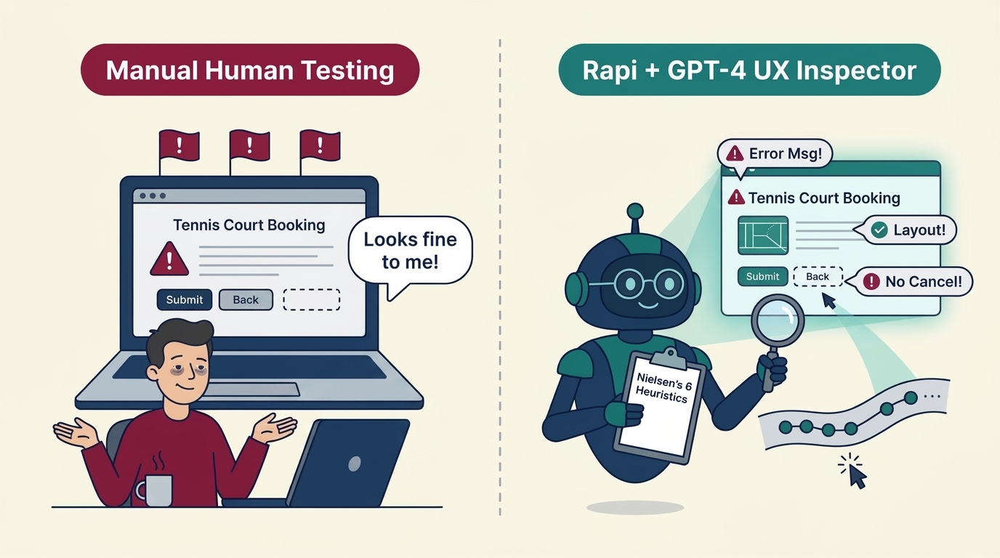
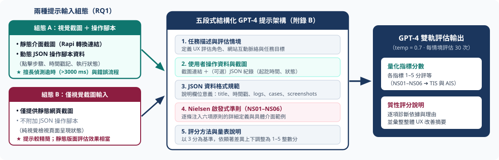
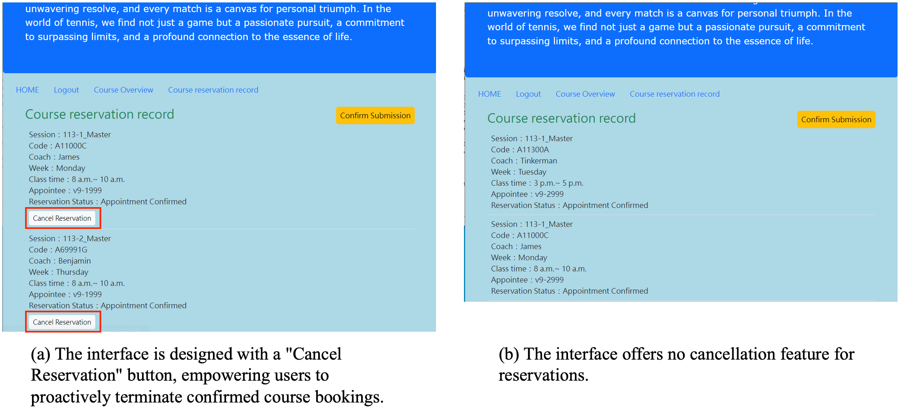
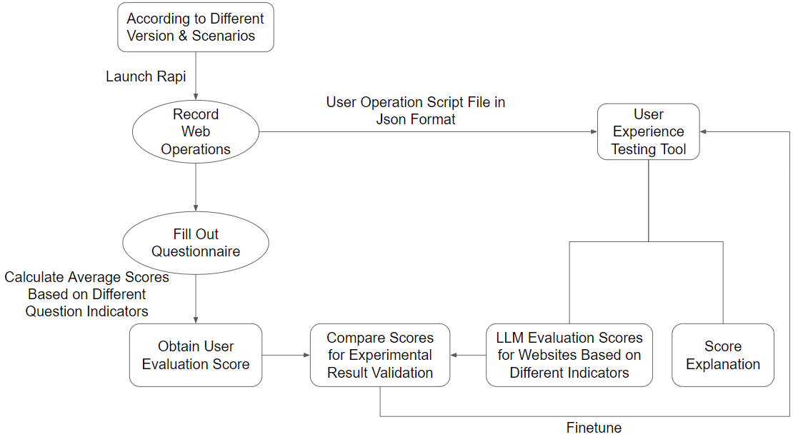

<!-- _class: lead -->

Electronics 2024 · 第 13 卷第 23 期 · 論文編號 4633（MDPI）

# 應用大型語言模型於使用者體驗測試

<strong>Applying Large Language Model to User Experience Testing</strong> 
整合 <strong>Rapi 網頁互動錄製</strong>、<strong>多模態提示詞工程</strong>與 <strong>Nielsen 可用性啟發式準則</strong>之 GPT-4 自動化 UX 檢測框架

<strong>薛念林（Nien-Lin Hsueh）*</strong>、<strong>Hsuen-Jen Lin</strong>、<strong>Lien-Chi Lai</strong> 
逢甲大學資訊工程學系（台中市 407） 
<code>nlhsueh@fcu.edu.tw</code> · <code>kobayasa209924@gmail.com</code> · <code>p1000433@mail.fcu.edu.tw</code>

發表日期：2024 年 11 月 24 日 · DOI: <code>https://doi.org/10.3390/electronics13234633</code> · 國科會計畫：NSTC112-2221-E-035-030-MY2

<!--
核心訊息：本研究提出結合 Rapi 網頁互動錄製、Nielsen 可用性啟發式準則與 GPT-4 的自動化使用者體驗檢測框架。
口說要點：
- 大家好，今天分享我們發表於 Electronics 2024 的研究，探討如何將大型語言模型應用於自動化使用者體驗（UX）測試。
- 面對人工測試昂貴與傳統自動化工具缺乏理論依據的雙重痛點，我們整合 Rapi 操作紀錄、畫面截圖與 Nielsen 準則，交由 GPT-4 進行多模態評估。
- 接下來我將依序介紹系統架構、網球預約實證案例，以及 GPT-4 與 16 位人類評估者的實證比較結果。
轉場：我們先從一個令人驚訝的實驗破題，看看為什麼需要這套自動化工具。
-->

---

## 破題：「看起來沒問題啊！」……還是我們漏掉了 90% 的 UX 缺陷？

<strong>核心洞察：</strong>人類受試者容易自我適應不良介面，導致召回率偏低（<strong>Recall = 0.10、F1 = 0.16</strong>）。本研究結合 <strong>Rapi 互動紀錄與截圖</strong>、<strong>GPT-4</strong> 與 <strong>Nielsen 啟發式準則</strong>，將偵測精確率提升至 <strong>0.84</strong>、F1 分數達 <strong>0.66</strong>。

<!--
核心訊息：人類受試者容易自我適應不良介面而漏掉高達 90% 的 UX 缺陷，結合 Rapi 與 GPT-4 則能大幅提升偵測表現。
口說要點：
- 畫面呈現了一個非常鮮明的對比：當人類面對不佳介面時，往往會下意識調整自己的操作去遷就系統，覺得「看起來沒問題」。
- 在我們的實驗中，這導致人類評估者的召回率只有 0.10、F1 分數僅 0.16。
- 相對地，將 Rapi 互動紀錄與截圖搭配 Nielsen 準則輸入 GPT-4，精確率可達 0.84、F1 分數提升至 0.66。
轉場：接下來透過簡報大綱，快速瀏覽今天報告的六個主要段落。
-->

---

## 簡報大綱

1

[**研究動機與問題（RQ1–RQ2）**](#4)
傳統人工測試與現有自動化工具的盲點，以及本研究兩大核心研究問題。

2

[**文獻回顧與研究缺口**](#6)
UX 評估方法、指標分類與自動化測試缺乏可用性理論整合的關鍵缺口。

3

[**自動化 UX 檢測工具架構**](#7)
Rapi + GPT-4 資料流架構、六大 Nielsen 啟發式準則與多模態提示詞設計。

4

[**實證案例：網球課程預約系統**](#10)
系統預約流程、介面版本對照、九大測試故事（S01–S09）與 TIS/AIS 分組設計。

5

[**實驗設計與 RQ1–RQ2 評估結果**](#12)
提示詞組態差異分析、GPT-4 與 16 位人類評估者之無母數統計檢定比較。

6

[**討論、研究限制與未來展望**](#16)
人機協作互補價值、研究限制、RQ 結論總覽圖與三大未來研究方向。

<!--
核心訊息：本次簡報從研究動機與文獻缺口出發，依序說明系統架構、網球預約案例、實驗統計結果與人機協作展望。
口說要點：
- 第一與第二部分先釐清人工 UX 測試與現有自動化工具的盲點與研究缺口。
- 第三與第四部分介紹 Rapi 加 GPT-4 的四階段流程、六大 Nielsen 準則與九組控制變因故事。
- 第五與第六部分展示 RQ1 與 RQ2 的無母數檢定結果，最後討論研究限制與未來方向。
轉場：首先進入第一章，說明我們啟動這項研究的核心動機。
-->

---

## 1.1 研究動機：為何傳統與現有自動化 UX 測試皆有不足？

<strong>填補關鍵缺口：</strong>多模態大型語言模型（如 <strong>GPT-4</strong>）兼具視覺理解與語意推理能力，使自動化工具得以超越單純的技術效能檢測，進一步評估<em>使用者認知負荷、互動細節與 Nielsen 可用性準則</em>。

<!--
核心訊息：多模態大型語言模型能同時處理視覺畫面與語意推理，填補人工測試高成本與傳統自動化工具忽略可用性理論之間的落差。
口說要點：
- 如圖所示，傳統人工 UX 測試雖然能捕捉真實主觀感受，但受試者招募、訪談與編碼既耗時又昂貴。
- 現有自動化網頁工具速度快，卻多停留在 HTML 語法或載入速度等技術層面，無法理解認知負荷與設計準則。
- 像 GPT-4 這類多模態 LLM 兼具視覺判讀與語意推理能力，讓自動化工具首度能依據 Nielsen 準則檢核互動細節。
轉場：基於這個動機，我們進一步聚焦出兩項具體的研究問題。
-->

---

## 1.2 研究目標與兩大研究問題

本研究開發一套結合 **Rapi 錄製工具**、**GPT-4** 與 **Nielsen 可用性啟發式準則**之自動化 UX 檢測工具，並深入探討兩項研究問題*（逐步揭示）*：

* 

RQ1 同時提供「截圖＋操作腳本」真的比「純截圖」更準嗎？

<strong>在提示詞中提供不同資訊</strong>（網頁截圖搭配 Rapi JSON 操作腳本 vs. 僅提供截圖），<strong>如何影響 GPT-4 進行使用者體驗偵測的準確性？</strong>

* 

RQ2 經啟發式準則引導的 LLM，能否在 UX 檢測上超越人類評估者？

<strong>使用最佳化提示詞後，GPT-4 在使用者體驗問題偵測上的表現，與人類評估者相比如何？</strong>

<strong>核心願景：</strong>大幅降低早期 UX 測試的人力與時間成本，同時提供高度一致、具理論依據的量化評分與質性改善建議。

<!--
核心訊息：本研究透過 RQ1 驗證多模態提示詞對偵測準確度的影響，並透過 RQ2 比較 GPT-4 與人類評估者的實戰表現。
口說要點：
- 第一個研究問題 RQ1 探討：在提示詞中同時提供截圖與 Rapi 操作腳本，是否真的比只提供純截圖更準確。
- 第二個研究問題 RQ2 則進一步比較：經過最佳化提示詞與啟發式準則引導的 GPT-4，與人類評估者相比表現如何。
- 我們的目標是在大幅降低早期 UX 測試成本的同時，維持一致且具理論根據的量化與質性回饋。
轉場：在介紹工具細節前，我們先回顧現有文獻並定位本研究的缺口。
-->

---

## 2. 文獻回顧：UX 評估方法、指標與自動化研究缺口

使用者體驗具有**主觀性、整體性、動態性與情境相依性** [1, 7]，現有人工方法與自動化工具各有明顯瓶頸：

| 評估類別 | 代表性方法與文獻 | 主要優勢 | 關鍵限制與不足 |
| :--- | :--- | :--- | :--- |
| **人工評估方法** [8] | 自陳問卷／訪談、專家觀察、生理量測 | 能直接捕捉真實主觀感受與情緒 | 成本高昂耗時，易受自陳偏差與觀察者效應影響 |
| **UX 評估指標** [9] | 效能、問題導向、自陳主觀、行為／生理指標 | 混合方法可建構完整 UX 視角 [10, 11] | 跨生命週期蒐集、編碼與對齊所需人力龐大 |
| **網頁可用性工具** [13] | 10 款熱門自動化工具（跨 9 網站、19 維度評估） | 快速檢核技術面（HTML、斷鏈、速度） | 忽略真正可用性問題、結果不一致、缺乏理論依據 |
| **ML / 負載 UI 工具** [14, 15] | AST 嵌入＋隨機森林（3.7% MAE）；負載＋UI 測試 | 精準預測更新對效能與載入時間之影響 | 偏重功能與速度指標，無法理解認知與設計準則 |
| **本研究方法** | **Rapi 網頁錄製 ＋ GPT-4 ＋ Nielsen 六大準則** | **低成本、高一致性、多模態且理論驅動** | **需審慎設計提示詞，高風險場域仍需人類把關** |

<strong>關鍵研究缺口：</strong>現有自動化測試框架幾乎未整合經典 UX 理論——如 <strong>Jakob Nielsen 十大啟發式準則 [2]</strong> 或 <strong>Donald Norman 設計原則 [16]</strong>。

<!--
核心訊息：現有自動化 UX 工具偏重技術效能，幾乎未整合 Jakob Nielsen 或 Donald Norman 等經典可用性理論。
口說要點：
- UX 本身具有主觀性、整體性與情境相依性，使得傳統問卷、觀察與生理量測面臨高人力成本與觀察者效應。
- 文獻曾評測 10 款熱門自動化網頁工具，發現結果不僅不一致，也普遍忽略真正的可用性問題；機器學習方法也多聚焦於載入時間預測。
- 本研究的突破點在於將 Nielsen 六大啟發式準則直接內嵌於 Rapi 加 GPT-4 的多模態檢測流程中。
轉場：接下來進入第三章，詳細說明這套自動化 UX 檢測工具的系統架構。
-->

---

## 3.1 自動化 UX 檢測工具架構（Rapi + GPT-4）

圖 1：結合 Rapi 錄製、Nielsen 啟發式準則與 GPT-4 評分系統之網站 UX 評估架構

### ⚙️ 四階段自動化評估流程
1. **互動錄製（`Rapi v4.0.0`）**：完整紀錄使用者點擊、鍵盤輸入、時間戳記、執行狀態與畫面截圖，輸出 **Operation Script File**（JSON）。
2. **雙軌資料分流**：
   - **文字腳本（Text Script）**：萃取結構化操作步驟與時間延遲紀錄。
   - **截圖連結轉換**：將靜態介面截圖轉為多模態模型可讀取之連結。
3. **啟發式準則引導評估**：將視覺與操作資料結合 **Nielsen 六大準則（NS01–NS06）** 輸入 GPT-4。
4. **雙軌評估結果**：同步輸出各指標 **1–5 分量化評分** 與 **質性評分說明**。

<!--
核心訊息：系統透過 Rapi 錄製操作歷程，分流為文字腳本與截圖連結，再結合 Nielsen 準則交由 GPT-4 產出量化分數與質性說明。
口說要點：
- 看左側圖 1，第一階段使用 Rapi v4.0.0 錄製使用者的點擊、鍵盤輸入、時間戳記與畫面截圖，輸出 JSON 操作腳本。
- 第二階段進行雙軌分流，一邊萃取結構化操作步驟與延遲時間，另一邊將截圖轉為模型可讀取的連結。
- 第三與第四階段結合六項 Nielsen 準則輸入 GPT-4，同步輸出 1 到 5 分的量化分數與具體質性評分說明。
轉場：接著我們看看實際寫入提示詞中的六項 Nielsen 可用性啟發式準則。
-->

---

## 3.2 採用之六項 Nielsen 可用性啟發式準則（NS01–NS06）

本研究精選與使用者感知最直接相關的 **六項 Nielsen 準則** [2]，並將完整定義與介面實例直接寫入 GPT-4 提示詞中（附錄 A）：

| 編號 | Nielsen 可用性啟發式準則 | 核心 UX 關注面向 | 提示詞內嵌具體規則與範例 |
| :---: | :--- | :--- | :--- |
| **NS01** | **系統狀態可見性** | 透過即時回饋讓使用者隨時掌握系統狀態 | 執行時間超過 `3000 ms` 時，必須顯示明確載入提示 |
| **NS02** | **使用者控制與自由** | 提供明確「緊急出口」以復原或離開誤操作 | 介面須提供明確的 `取消（Cancel）` 與 `返回（Back）` 按鈕 |
| **NS03** | **協助辨識、診斷與復原錯誤** | 以白話錯誤訊息指出問題並提供修正方向 | 登入或密碼格式錯誤時，明確提示違規原因而非沉默無反應 |
| **NS04** | **一致性與標準** | 介面風格、視覺層級與操作習慣符合通用規範 | `返回` 按鈕應置於 `確認／預約` 按鈕**左側**且視覺**較不搶眼** |
| **NS05** | **辨識而非回憶** | 降低記憶負荷，讓功能選項與歷史資訊清晰可見 | 提供易於存取的 `課程搜尋` 與 `預約歷史紀錄` 功能 |
| **NS06** | **系統與真實世界相符** | 採用使用者熟悉的語言與自然邏輯排列資訊 | 以符合日常習慣的**每週課表表格**呈現課程（而非平面清單） |

<!--
核心訊息：我們精選六項與使用者感知最直接相關的 Nielsen 準則（NS01 至 NS06），並轉化為具體可檢核的提示詞規則。
口說要點：
- 為了避免模型給出模糊評語，我們為每項準則提供明確判準，例如 NS01 規定執行時間超過 3000 毫秒必須出現載入提示。
- NS02 與 NS03 關注使用者控制權與錯誤復原，檢查是否提供明確的取消、返回鍵與白話登入錯誤提示。
- NS04 到 NS06 則涵蓋按鈕位置與視覺層級一致性、搜尋與歷史紀錄可見性，以及符合日常直覺的每週課表格式。
轉場：這些準則如何與截圖和操作腳本組合成完整提示詞？請看下一頁的管線設計。
-->

---

## 3.3 多模態提示詞工程管線（雙資料策略）

<strong>為何需要雙模態資料？</strong>截圖紀錄使用者<em>「看到了什麼」</em>（靜態版面、錯誤視窗、載入圖示），而 Rapi JSON 腳本紀錄使用者<em>「如何互動」</em>（嘗試次數、逾時 <code>>3000 ms</code>、導覽障礙）。

<!--
核心訊息：雙模態提示詞結合靜態截圖與動態操作腳本，讓 GPT-4 同時掌握使用者「看到了什麼」與「如何互動」。
口說要點：
- 我們的五段式提示詞依序設定評估角色、六項準則定義、任務情境、多模態證據與輸出格式要求。
- 為了回應 RQ1，我們設計了兩種輸入組態對照：僅視覺截圖輸入，以及視覺截圖搭配 Rapi 操作腳本。
- 截圖能呈現靜態版面與錯誤視窗，而 JSON 腳本則補足了重複嘗試、超過 3000 毫秒的延遲與導覽障礙等動態線索。
轉場：為了客觀驗證這套框架，我們建置了一個控制變因的實證系統，進入第四章案例介紹。
-->

---

## 4.1 實證案例：網球課程預約系統

圖 2：網球課程預約流程（首頁 ➔ 課程總覽 ➔ 登入驗證 ➔ 確認預約 ／ 預約紀錄與取消）

圖 3：案例 S09 對照 — (a) 預期介面提供「Cancel Reservation」vs. (b) 非預期介面缺少取消按鈕

### 🎾 控制變因 A/B 故事設計
- **四大核心功能**：課程列表、課程搜尋、課程預約、取消預約。
- **預期 vs. 非預期情境對照**：共設計 9 個故事（`S01`–`S09`），每個故事皆包含兩種版本：
  - **預期情境（Expected）**：嚴格遵循目標 Nielsen 準則。
  - **非預期情境（Unexpected）**：刻意違反單一目標準則，其餘介面條件維持不變。

<!--
核心訊息：我們以網球課程預約系統設計控制變因的 A/B 故事對照，精準隔離每一項啟發式準則違規。
口說要點：
- 上方圖 2 呈現完整的預約流程，包含首頁、課程總覽、登入驗證、確認預約以及歷史紀錄與取消功能。
- 左下方圖 3 以故事 S09 為例：預期版本提供明確的取消預約按鈕，非預期版本則刻意移除該按鈕，其餘介面完全相同。
- 透過這種控制變因的預期與非預期對照，我們能客觀衡量模型與人類是否真正偵測到該項 UX 缺陷。
轉場：接著瀏覽全部九個測試故事，以及 TIS 與 AIS 的分組分析策略。
-->

---

## 4.2 九大評估故事（S01–S09）與 TIS / AIS 分組策略

| 故事 | 測試介面面向 | 目標指標（TIS） | 預期情境（良好 UX） | 非預期情境（缺陷 UX） |
| :---: | :--- | :--- | :--- | :--- |
| **S01** | 登入失敗錯誤提示 | `NS01`, `NS03` | 登入失敗時顯示明確失敗訊息 | 登入失敗時**未顯示**任何訊息 |
| **S02** | 課程呈現格式 | `NS06` | 依每週順序以**表格**格式呈現 | 僅以單純**清單**格式呈現 |
| **S03** | 返回按鈕配色 | `NS04` | 返回按鈕視覺**較預約按鈕低調** | 返回按鈕視覺**較預約按鈕搶眼** |
| **S04** | 返回按鈕位置 | `NS04` | 返回按鈕置於預約按鈕**左側** | 返回按鈕置於預約按鈕**右側** |
| **S05** | 返回按鈕有無 | `NS02` | 介面提供返回按鈕 | 介面**未提供**返回按鈕 |
| **S06** | 課程搜尋功能 | `NS05` | 提供課程搜尋功能 | **未提供**課程搜尋功能 |
| **S07** | 載入狀態提示 | `NS01` | 系統載入時顯示進度提示 | 系統載入時**無任何**提示 |
| **S08** | 預約歷史紀錄 | `NS05` | 提供課程預約歷史紀錄功能 | **未提供**歷史紀錄功能 |
| **S09** | 取消預約功能 | `NS02` | 同時提供歷史紀錄與**取消預約** | 僅有歷史紀錄（**無取消功能**） |

<strong>TIS 與 AIS 分組分析：</strong><strong>TIS（目標指標分數）</strong>專注於該故事刻意變動之準則（如 <code>S06</code> 測 <code>NS05</code>）；<strong>AIS（輔助指標分數）</strong>涵蓋其餘 5 項非目標準則，用以檢驗介面改動是否產生間接外溢效應。

<!--
核心訊息：九大評估故事（S01 至 S09）完整覆蓋六項準則，並以目標指標分數（TIS）與輔助指標分數（AIS）檢驗直接敏感度與外溢效應。
口說要點：
- 表格列出九個故事，從 S01 的登入錯誤提示、S02 的課表格式，一路到 S07 的載入提示與 S09 的取消預約。
- 在統計分析上，TIS 專門衡量該故事刻意變動的那項目標準則，例如 S06 對應 NS05 課程搜尋。
- 而 AIS 則觀察其餘五項未更動的輔助準則，檢驗單一介面缺陷是否對其他指標產生連帶外溢影響。
轉場：介紹完案例後，我們進入第五章，說明實驗流程與統計檢定方法。
-->

---

## 5.1 實驗設計與無母數統計方法

圖 4：結合 Rapi 錄製、人類問卷與 LLM 評分之平行驗證實驗流程

### 🧪 人類評估者 vs. 自動化工具實驗規格
- **人類受試者實驗**：招募 **16 位受試者**（具 3 個月網頁與軟體工程訓練），每人限時 1 小時，隨機操作故事之預期與非預期版本。
  - 共回收 **54 份有效問卷**（涵蓋 **27 組**故事實例，`n = 27`），採 **11 題 5 點李克特量表**（附錄 C）。
- **自動化工具（`GPT-4`）**：直接輸入受試者以 **Rapi** 錄製之資料，設 `temperature = 0.7`，**每情境重複評估 30 次**，比較兩種提示組態。
- **無母數統計檢定** *（適用順序量表與小樣本）*：
  - **Mann–Whitney U 檢定**（`p < 0.05`、效果量 `r`）：檢驗預期 vs. 非預期之 TIS 區辨力。
  - **Wilcoxon 符號等級檢定**：檢驗成對 **AIS–TIS 一致性**。

<!--
核心訊息：本實驗採人類問卷與 LLM 平行驗證設計，以 16 位受試者的 54 份問卷對照 GPT-4 每情境 30 次重複評估。
口說要點：
- 如圖 4 所示，我們招募 16 位具網頁與軟體工程訓練的受試者，在 1 小時內隨機操作預期與非預期版本，共回收 54 份涵蓋 27 組故事實例的 11 題李克特問卷。
- 接著將受試者實際由 Rapi 錄製的資料直接輸入 GPT-4，在 temperature 0.7 下每情境重複評估 30 次，比較兩種提示詞組態。
- 由於分數屬順序量表且樣本數適中，我們採用 Mann–Whitney U 檢定分析 TIS 區辨力，並以 Wilcoxon 符號等級檢定檢驗成對 AIS 與 TIS 一致性。
轉場：首先來看 RQ1 的實驗結果：加入操作腳本究竟帶來多少提升？
-->

---

## 5.2 RQ1 實驗結果：視覺＋操作腳本 vs. 僅視覺截圖

0.84 vs. 0.71

<strong>精確率 Precision（+0.13）</strong>— 加入操作腳本顯著降低誤報

0.55 vs. 0.50

<strong>召回率 Recall（+0.05）</strong>— 偵測更多動態互動與狀態異常

0.66 vs. 0.64

<strong>F1 分數（+0.02）</strong>· 整體準確率相近（0.63 vs. 0.65）

### 📊 提示詞組態指標比較（表 4）
| 提示詞輸入組態 | 準確率 | 精確率 | 召回率 | F1 分數 |
| :--- | :---: | :---: | :---: | :---: |
| **視覺截圖 ＋ 操作腳本** | 0.63 | **0.84** | **0.55** | **0.66** |
| **僅視覺截圖輸入** | **0.65** | 0.71 | 0.50 | 0.64 |

<strong>RQ1 核心發現：</strong>加入動態操作腳本可大幅提升 <strong>精確率（+13%）</strong>與 <strong>召回率（+5%）</strong>，顯示提示詞設計應依評估任務類型靈活調配。

### 🔎 各情境細部表現（表 2 與表 3）
- **動態與複雜互動功能** *（加入操作腳本明顯勝出）*：
  - `S01–NS03`（登入錯誤提示）：達**大效果量 `r = 0.51`**（`p < 0.001`），優於純截圖 `r = 0.46`。
  - `S06–NS05`（課程搜尋）：達**中效果量 `r = 0.31`**（`p < 0.001`）。
  - `S05`、`S07`（載入提示）、`S08`（歷史紀錄）：**唯有附帶操作腳本時**才達統計顯著（`p ≤ 0.003`）。
- **靜態介面視覺元素** *（純截圖即可勝任）*：
  - 返回按鈕顏色與位置（`S03`、`S04`）兩組態表現相當。
  - `S09–NS02`（取消預約）僅在純截圖達顯著（`p = 0.013`, `r = 0.14`），顯示精簡提示在特定靜態情境下反而更聚焦。

<!--
核心訊息：在提示詞中加入 Rapi 操作腳本可使精確率提升 0.13（0.84 vs. 0.71）、召回率提升 0.05（0.55 vs. 0.50），對動態互動情境尤為關鍵。
口說要點：
- 從表 4 可以看到，截圖加操作腳本將精確率從 0.71 拉升至 0.84，召回率從 0.50 提升至 0.55，F1 達 0.66，大幅減少誤報。
- 細看表 2 與表 3，S01 登入錯誤診斷達到大效果量 r = 0.51；而缺少返回鍵（S05）、載入提示（S07）與歷史紀錄（S08）更唯有附帶操作腳本時才達統計顯著。
- 反之，對於按鈕配色或位置等靜態視覺元素，純截圖已能勝任，S09 甚至在精簡提示下更不易分心。
轉場：確認最佳提示詞組態後，下一頁我們進入 RQ2，看看 GPT-4 與人類評估者的正面對決。
-->

---

## 5.3 RQ2 實驗結果：GPT-4（最佳化提示）vs. 人類評估者

0.66 vs. 0.16

<strong>F1 分數（4.1 倍差距）</strong>— GPT-4 全面超越人類評估者

0.55 vs. 0.10

<strong>召回率（5.5 倍差距）</strong>— 人類受試者漏報高達 90% 缺陷

0.84 vs. 0.50

<strong>精確率（+0.34）</strong>· 準確率：<strong>0.63 vs. 0.33</strong>

### 📈 各項評估指標對比（表 4 與表 6）

<strong>準確率 Acc</strong>

0.63 vs 0.33

<strong>精確率 Prec</strong>

0.84 vs 0.50

<strong>召回率 Rec</strong>

0.55 vs 0.10

<strong>F1 分數</strong>

0.66 vs 0.16

### 🧠 為何人類評估者召回率如此偏低？
- **使用者適應偏誤（Adaptability Bias）**：人類在面對不佳設計時傾向**主動調整自身操作行為來遷就系統**，將非預期缺陷視為「正常現象」，導致評分過度保守。
- **顯著檢出項目稀少（表 5）**：人類在 10 組目標指標中僅顯著辨識出 **2 組**：
  - `S01–NS01`（登入狀態可見性，`p = 0.015`, `r = 0.47` 中）
  - `S04–NS04`（返回按鈕位置，`p = 0.035`, `r = 0.39` 中）
- **非預期一致性檢出為零**：人類未檢出任何一項 AIS–TIS 非預期顯著差異（**0/10**），而 GPT-4 成功標記 **4/10**。

<!--
核心訊息：GPT-4 的 F1 分數為人類評估者的 4.1 倍（0.66 vs. 0.16）、召回率高達 5.5 倍（0.55 vs. 0.10），主因在於人類的使用者適應偏誤。
口說要點：
- 左側條狀圖清楚呈現四項指標的差距：GPT-4 在準確率、精確率、召回率與 F1 上全面領先人類評估者。
- 人類召回率之所以僅有 0.10，關鍵在於「使用者適應偏誤」：受試者遇到不佳設計時會自動遷就系統，將缺陷視為正常並給出偏保守的分數。
- 在 10 組目標指標中，人類僅顯著檢出 S01–NS01 與 S04–NS04 兩組，且在非預期 AIS–TIS 一致性檢出為 0/10，遠低於 GPT-4 的 4/10。
轉場：接著我們透過完整總表，細看兩者在各個故事上的互補表現。
-->

---

## 5.4 各情境敏感度與 AIS–TIS 一致性總表（表 2、表 3、表 5）

| 故事 – 指標 | 測試 UX 元素 | GPT-4（截圖＋腳本）TIS `p` / `r` | GPT-4（僅截圖）TIS `p` / `r` | 人類評估者 TIS `p` / `r` | GPT-4（＋腳本）非預期 AIS–TIS |
| :--- | :--- | :---: | :---: | :---: | :---: |
| **S01 – NS01** | 登入錯誤狀態 | 0.317 / 0.16 (S) | 0.951 / 0.00 (N) | **0.015\*** / **0.47 (M)** | 0.196 |
| **S01 – NS03** | 錯誤診斷訊息 | **0.000\*** / **0.51 (L)** | **0.000\*** / **0.46 (M)** | 0.059 / 0.35 (M) | 0.207 |
| **S02 – NS06** | 每週課表 vs. 清單 | 0.218 / 0.07 (N) | 0.398 / 0.05 (N) | 0.937 / 0.02 (N) | 0.499 |
| **S03 – NS04** | 返回按鈕配色 | 0.083 / 0.03 (N) | 0.157 / 0.07 (N) | 0.542 / 0.12 (S) | **0.010\*** |
| **S04 – NS04** | 返回按鈕位置 | 1.000 / 0.06 (N) | 0.418 / 0.04 (N) | **0.035\*** / **0.39 (M)** | 0.440 |
| **S05 – NS02** | 返回按鈕有無 | **0.003\*** / 0.07 (N) | 0.107 / 0.09 (N) | 0.783 / 0.06 (N) | **0.026\*** |
| **S06 – NS05** | 課程搜尋功能 | **0.000\*** / **0.31 (M)** | **0.000\*** / **0.33 (M)** | 0.052 / 0.37 (M) | 0.562 |
| **S07 – NS01** | 載入狀態提示 | **0.000\*** / 0.08 (N) | 0.074 / 0.06 (N) | 0.845 / 0.04 (N) | **0.000\*** |
| **S08 – NS05** | 歷史紀錄功能 | **0.001\*** / 0.00 (N) | 0.153 / 0.08 (N) | 0.183 / 0.26 (S) | **0.000\*** |
| **S09 – NS02** | 取消預約功能 | 0.512 / 0.03 (N) | **0.013\*** / **0.14 (S)** | 0.054 / 0.37 (M) | 0.623 |

<strong>互補優勢明顯：</strong>GPT-4 擅長系統性檢核<strong>錯誤處理（<code>S01</code>）、功能完整性（<code>S05</code>、<code>S06</code>、<code>S08</code>）與載入回饋（<code>S07</code>）</strong>；人類直覺則對<strong>空間配置習慣（<code>S04</code>）</strong>具備獨特敏感度。

<!--
核心訊息：GPT-4 擅長系統性偵測錯誤處理、功能缺漏與載入回饋，而人類對按鈕左右配置等空間習慣仍保有獨特直覺。
口說要點：
- 觀察整份總表，GPT-4 搭配操作腳本能穩定抓出 S01 錯誤診斷、S05 返回鍵缺漏、S06 搜尋功能、S07 載入提示與 S08 歷史紀錄。
- 但值得特別注意的是 S04–NS04（返回按鈕位置左右互換）：GPT-4 沒有檢出顯著差異，人類卻立刻察覺並達到 p = 0.035、中效果量 r = 0.39。
- 此外，S02 課表與清單格式兩者皆未顯著區分，反映出偏主觀的版面偏好較難形成一致扣分。
轉場：這種鮮明的互補性，正是第六章討論人機協作模式的核心出發點。
-->

---

## 6.1 綜合討論與研究限制

### 🤝 邁向人機協作的 UX 評估流程
- **跨越功能測試邊界**：不同於僅關注載入時間的傳統自動化工具，GPT-4 能透過 Nielsen 準則解析介面語意、錯誤提示與認知負荷。
- **低成本早期把關**：在招募受試者前，先以 Rapi + GPT-4 快速篩出缺少控制項、遺漏錯誤回饋與不一致介面，顯著節省初期測試成本。
- **人類專家的不可取代性**：人類對空間人體工學（`S04`）、情感共鳴與文化脈絡仍具直覺優勢——最佳實務為<strong>「AI 全面初篩 ＋ 人類專家深度覆核」</strong>。

### ⚠️ 研究限制與效度威脅
- **樣本規模有限**：16 位受試者（54 份問卷、27 組故事實例）尚不足以涵蓋跨年齡層與跨領域之多元使用者群體。
- **環境干擾變因**：測試場地與網路延遲狀況可能對操作紀錄與主觀體驗造成額外變異。
- **UX 本質主觀性**：受試者背景與過往經驗差異，使單一通用評估標準難以完全消除個體落差。
- **基準情境設計偏差**：預期／非預期版本雖依循 Nielsen 準則建置，仍可能隱含研究者預設，未來需擴展至更多真實系統驗證。

<!--
核心訊息：實務上最理想的模式是「AI 全面初篩搭配人類專家深度覆核」，同時須正視樣本規模與環境變因等研究限制。
口說要點：
- 左側總結人機協作價值：在招募真人受試者前，先用 Rapi 加 GPT-4 快速掃描功能缺漏、錯誤提示與載入回饋，可大幅節省初期成本。
- 而涉及空間人體工學（如 S04）、情感共鳴與文化脈絡的判斷，仍須仰賴人類專家的直覺把關。
- 右側列出四項研究限制：16 位受試者的樣本代表性、場地與網路延遲干擾、UX 主觀差異，以及基準情境設計可能隱含的研究者預設。
轉場：最後我們用一張總覽圖回顧兩大研究問題的結論，並展望未來研究方向。
-->

---

## 6.2 結論與未來研究方向

<strong>🤝 1. 深化人機互補協作</strong> 探討醫療介面情感共鳴、在地化文化適切性等仰賴人類直覺之高階 UX 場域。

<strong>🔒 2. 多模態與 AI 倫理規範</strong> 整合語音／影片輸入，建立隱私邊界與金融／醫療等高風險介面之可靠度驗證機制。

<strong>📱 3. 擴展至行動裝置平台</strong> 發展行動端專屬啟發式準則、最佳化提示詞工程並定義 AI 與人類評估對齊指標。

<!--
核心訊息：多模態啟發式引導的 GPT-4 在精確率與召回率上展現顯著優勢，未來將朝人機協作、多元模態倫理與行動端準則三大方向推進。
口說要點：
- 上方視覺總覽統整了本研究結論：RQ1 證實截圖搭配操作腳本能顯著強化動態互動檢核；RQ2 顯示 GPT-4 召回率達人類 5.5 倍，並與人類空間直覺形成互補。
- 未來研究將聚焦三個面向：深化醫療等高情感場域的人機協作、整合語音與影片輸入並建立高風險介面隱私驗證規範，以及擴展至行動裝置專屬啟發式準則。
轉場：以上就是本次研究的完整分享，接下來進入結尾並歡迎大家交流提問。
-->

---

<!-- _class: closing -->

# 感謝您的聆聽！

應用大型語言模型於使用者體驗測試（Applying Large Language Model to User Experience Testing）

<strong>薛念林（Nien-Lin Hsueh）*</strong> &nbsp;·&nbsp; <code>nlhsueh@fcu.edu.tw</code> 
<strong>Hsuen-Jen Lin</strong> &nbsp;·&nbsp; <code>kobayasa209924@gmail.com</code> &nbsp;|&nbsp; <strong>Lien-Chi Lai</strong> &nbsp;·&nbsp; <code>p1000433@mail.fcu.edu.tw</code> 
逢甲大學資訊工程學系（Feng Chia University） 
發表期刊：<strong>Electronics 2024, 13, 4633</strong> · <code>https://doi.org/10.3390/electronics13234633</code> 
國科會計畫補助：NSTC112-2221-E-035-030-MY2 · 敬請指教與交流！

<!--
核心訊息：感謝聆聽，並提供論文 DOI、作者聯絡資訊與國科會計畫編號，開放現場提問交流。
口說要點：
- 感謝各位的聆聽。本研究完整論文、提示詞附錄與李克特量表皆已刊登於 Electronics 2024，歡迎透過畫面上的 DOI 查閱。
- 非常歡迎大家針對 Rapi 整合、提示詞工程設計或無母數統計結果提出指教與討論。
轉場：開放現場 Q&A 提問。
-->

