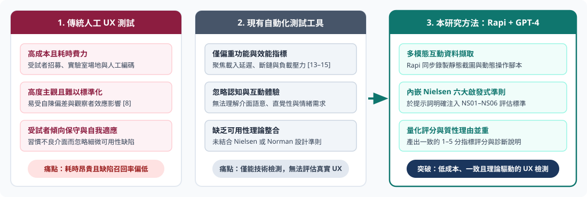
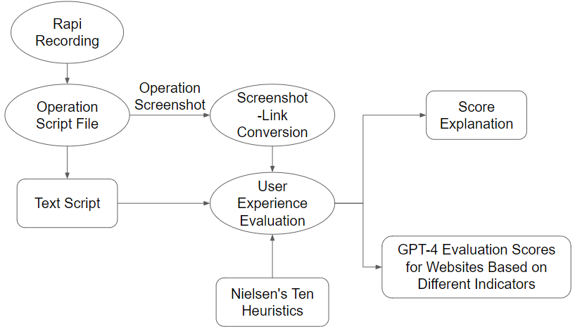
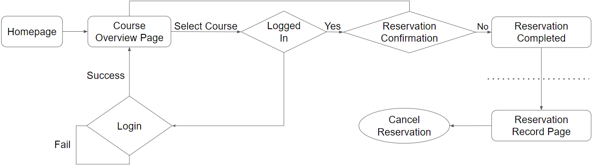
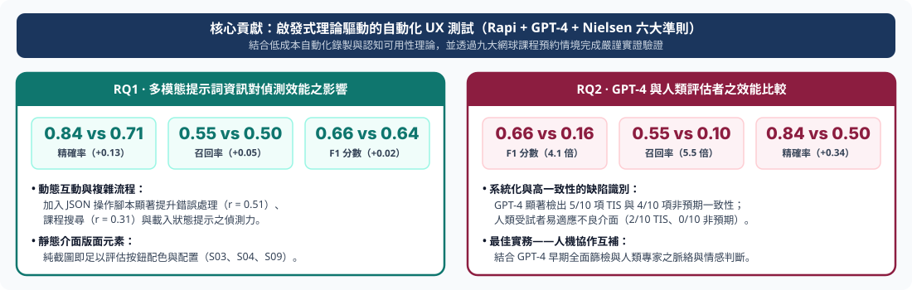

<!-- _class: lead -->

Electronics 2024 · 第 13 卷第 23 期 · 論文編號 4633（MDPI）

# 應用大型語言模型於使用者體驗測試

<strong>Applying Large Language Model to User Experience Testing</strong> 
整合 <strong>Rapi 網頁互動錄製</strong>、<strong>多模態提示詞工程</strong>與 <strong>Nielsen 可用性啟發式準則</strong>之 GPT-4 自動化 UX 檢測框架

<strong>薛念林（Nien-Lin Hsueh）*</strong>、<strong>Hsuen-Jen Lin</strong>、<strong>Lien-Chi Lai</strong> 
逢甲大學資訊工程學系（台中市 407） 
<code>nlhsueh@fcu.edu.tw</code> · <code>kobayasa209924@gmail.com</code> · <code>p1000433@mail.fcu.edu.tw</code>

發表日期：2024 年 11 月 24 日 · DOI: <code>https://doi.org/10.3390/electronics13234633</code> · 國科會計畫：NSTC112-2221-E-035-030-MY2

<!--
論文書目與研究定位：
本篇論文（Hsueh, Lin, & Lai, Electronics 2024, 13(23), 4633；2024 年 11 月 24 日發表；國科會計畫 NSTC112-2221-E-035-030-MY2 補助）探討如何運用多模態大型語言模型（GPT-4）結合經典人機互動（HCI）理論，實現自動化使用者體驗（UX）評估。

核心問題與研究貢獻：
- 傳統人工 UX 測試（實驗室觀察、問卷訪談、專家啟發式評估）受限於主觀性高、缺乏標準化、招募與資料編碼成本昂貴及觀察者效應。
- 現有自動化網頁測試工具多偏重技術效能（HTML 語法、斷鏈、載入速度），未能檢核認知負荷與可用性準則。
- 本研究整合 Rapi（v4.0.0）網頁互動錄製工具（輸出 JSON 操作紀錄與連續畫面截圖）、Jakob Nielsen 六大可用性啟發式準則（NS01–NS06）與 GPT-4，並於控制變因的網球課程預約系統上與 16 位人類評估者進行實證對照。
-->

---

## 破題：「看起來沒問題啊！」……還是我們漏掉了 90% 的 UX 缺陷？

<strong>核心洞察：</strong>人類受試者容易自我適應不良介面，導致召回率偏低（<strong>Recall = 0.10、F1 = 0.16</strong>）。本研究結合 <strong>Rapi 互動紀錄與截圖</strong>、<strong>GPT-4</strong> 與 <strong>Nielsen 啟發式準則</strong>，將偵測精確率提升至 <strong>0.84</strong>、F1 分數達 <strong>0.66</strong>。

<!--
核心實證發現與數值解讀：
本頁對照濃縮自論文第 4.4 節（表 6）與第 4.3 節（表 4）之關鍵實驗數據：
- 人類評估者的保守偏誤（Recall = 0.10、Precision = 0.50、Accuracy = 0.33、F1 = 0.16）：在涵蓋 27 組故事實例的 54 份問卷中，受試者展現顯著的「使用者適應偏誤（User Adaptability Bias）」。當面對遺漏按鈕或無錯誤回饋等不良介面時，人類傾向自行調整操作以遷就系統，將缺陷視為正常並給出保守評分，導致漏報高達 90% 的刻意植入缺陷。
- 多模態 LLM 的系統性偵測力（Precision = 0.84、Recall = 0.55、Accuracy = 0.63、F1 = 0.66）：將 Rapi JSON 互動腳本與畫面截圖結合 Nielsen 準則輸入 GPT-4 後，模型不會因習慣化而忽略違規，召回率達人類的 5.5 倍、F1 分數達 4.1 倍。
-->

---

## 簡報大綱

1

[**研究動機與問題（RQ1–RQ2）**](#4)
傳統人工測試與現有自動化工具的盲點，以及本研究兩大核心研究問題。

2

[**文獻回顧與研究缺口**](#6)
UX 評估方法、指標分類與自動化測試缺乏可用性理論整合的關鍵缺口。

3

[**自動化 UX 檢測工具架構**](#7)
Rapi + GPT-4 資料流架構、六大 Nielsen 啟發式準則與多模態提示詞設計。

4

[**實證案例：網球課程預約系統**](#10)
系統預約流程、介面版本對照、九大測試故事（S01–S09）與 TIS/AIS 分組設計。

5

[**實驗設計與 RQ1–RQ2 評估結果**](#12)
提示詞組態差異分析、GPT-4 與 16 位人類評估者之無母數統計檢定比較。

6

[**討論、研究限制與未來展望**](#16)
人機協作互補價值、研究限制、RQ 結論總覽圖與三大未來研究方向。

<!--
論文結構與附錄資源對應：
全文分為六大章節與三份支援重現性之附錄：
1. 緒論（第 1 節）：將 UX 測試置於軟體開發生命週期（從單元測試到使用者驗收測試）脈絡下，引用 Nielsen & Molich [2] 與 Alomari et al. [3] 闡述可用性與易學性之雙重必要，評述多模態模型（Flamingo [4]、Emu [5]）之進展，並提出 RQ1 與 RQ2。
2. 文獻回顧（第 2 節）：剖析 UX 定義分歧（Law et al. [1]、Vermeeren et al. [6]、Kashfi et al. [7]）、評估方法與指標分類（Inan et al. [8]、Albert & Tullis [9]）、混合方法案例 [10, 11] 及自動化測試工具之理論缺口 [12–15]。
3. 研究方法（第 3 節）：詳述 Rapi + GPT-4 評估架構（圖 1）、六項 Nielsen 準則（附錄 A）、五段式提示詞模板（附錄 B）及網球課程預約實證系統（圖 2–3、表 1）。
4. 實驗結果與分析（第 4 節）：說明人類與自動化平行驗證流程（圖 4、附錄 C）、TIS/AIS 分組策略與 Mann-Whitney U／Wilcoxon 符號等級檢定結果（表 2–6）。
5. 討論與研究限制（第 5 節）與結論（第 6 節）：彙整 RQ1–RQ2 發現、人機互補價值、效度威脅及三大未來研究方向。
-->

---

## 1.1 研究動機：為何傳統與現有自動化 UX 測試皆有不足？

<strong>填補關鍵缺口：</strong>多模態大型語言模型（如 <strong>GPT-4</strong>）兼具視覺理解與語意推理能力，使自動化工具得以超越單純的技術效能檢測，進一步評估<em>使用者認知負荷、互動細節與 Nielsen 可用性準則</em>。

<!--
理論動機與多模態技術契機：
- 可用性與易用性的雙重必要：論文援引兩項經典 HCI 觀點：Nielsen & Molich [2] 指出若系統無法滿足可用性需求，再容易操作亦無意義；Alomari et al. [3] 則指出若系統過於難用，即便功能齊全，使用者仍無法順利操作。
- 傳統自動化工具之盲區：現有自動化測試多聚焦於功能回歸與效能指標（頁面載入時間、DOM 結構錯誤），忽略使用者在互動過程中的認知負荷、操作阻礙與情緒反應。
- 多模態大型語言模型的突破：論文引用 Flamingo（Alayrac et al. [4]，結合視覺與語言預訓練模型，僅需少數範例即可處理多達 32 張影像或影片）與 Emu（Sun et al. [5]，透過自回歸端對端訓練處理單一或交錯多模態輸入，在零樣本與少樣本視覺問答表現優異），論證 GPT-4 具備同時判讀靜態畫面與動態文字紀錄的能力，可將經典可用性理論導入自動化 UX 檢測。
-->

---

## 1.2 研究目標與兩大研究問題

本研究開發一套結合 **Rapi 錄製工具**、**GPT-4** 與 **Nielsen 可用性啟發式準則**之自動化 UX 檢測工具，並深入探討兩項研究問題*（逐步揭示）*：

* 

RQ1 同時提供「截圖＋操作腳本」真的比「純截圖」更準嗎？

<strong>在提示詞中提供不同資訊</strong>（網頁截圖搭配 Rapi JSON 操作腳本 vs. 僅提供截圖），<strong>如何影響 GPT-4 進行使用者體驗偵測的準確性？</strong>

* 

RQ2 經啟發式準則引導的 LLM，能否在 UX 檢測上超越人類評估者？

<strong>使用最佳化提示詞後，GPT-4 在使用者體驗問題偵測上的表現，與人類評估者相比如何？</strong>

<strong>核心願景：</strong>大幅降低早期 UX 測試的人力與時間成本，同時提供高度一致、具理論依據的量化評分與質性改善建議。

<!--
研究目標與 RQ1、RQ2 之操作化設計：
本研究設定三項核心目標：（1）建置結合 GPT-4 影像理解與 Nielsen 啟發式準則的自動化 UX 檢測工具；（2）系統性檢驗提示詞內容與資料結構對模型偵測準確性的影響；（3）以最佳化提示詞基準比較 GPT-4 與人類評估者的實證表現。
- RQ1（提示詞模態消融實驗）：在完全相同的 Rapi 錄製工作階段下，對照「僅視覺截圖輸入」與「視覺截圖＋Rapi JSON 操作腳本」兩種組態，量化動態互動紀錄對精確率、召回率與 F1 之邊際貢獻。
- RQ2（人機評估基準比較）：將最佳化多模態提示詞之 GPT-4 評估結果，與 16 位受過網頁與軟體工程訓練的人類評估者在相同情境下填寫的 11 題 5 點李克特問卷進行統計對照。
- 實務目標：在軟體開發早期以低成本提供高一致性且具理論根據的 UX 量化評分與質性診斷。
-->

---

## 2. 文獻回顧：UX 評估方法、指標與自動化研究缺口

使用者體驗具有**主觀性、整體性、動態性與情境相依性** [1, 7]，現有人工方法與自動化工具各有明顯瓶頸：

| 評估類別 | 代表性方法與文獻 | 主要優勢 | 關鍵限制與不足 |
| :--- | :--- | :--- | :--- |
| **人工評估方法** [8] | 自陳問卷／訪談、專家觀察、生理量測 | 能直接捕捉真實主觀感受與情緒 | 成本高昂耗時，易受自陳偏差與觀察者效應影響 |
| **UX 評估指標** [9] | 效能、問題導向、自陳主觀、行為／生理指標 | 混合方法可建構完整 UX 視角 [10, 11] | 跨生命週期蒐集、編碼與對齊所需人力龐大 |
| **網頁可用性工具** [13] | 10 款熱門自動化工具（跨 9 網站、19 維度評估） | 快速檢核技術面（HTML、斷鏈、速度） | 忽略真正可用性問題、結果不一致、缺乏理論依據 |
| **ML / 負載 UI 工具** [14, 15] | AST 嵌入＋隨機森林（3.7% MAE）；負載＋UI 測試 | 精準預測更新對效能與載入時間之影響 | 偏重功能與速度指標，無法理解認知與設計準則 |
| **本研究方法** | **Rapi 網頁錄製 ＋ GPT-4 ＋ Nielsen 六大準則** | **低成本、高一致性、多模態且理論驅動** | **需審慎設計提示詞，高風險場域仍需人類把關** |

<strong>關鍵研究缺口：</strong>現有自動化測試框架幾乎未整合經典 UX 理論——如 <strong>Jakob Nielsen 十大啟發式準則 [2]</strong> 或 <strong>Donald Norman 設計原則 [16]</strong>。

<!--
文獻脈絡與自動化理論缺口深度剖析：
- UX 構念之複雜性：Kashfi et al. [7] 歸納 UX 具備主觀性、整體性、動態性、情境相依性與價值感五大特性，使標準化極具挑戰；Law et al. [1] 指出學界偏重享樂與情感面向，業界則重視功能與實用可用性；Vermeeren et al. [6] 強調業界缺乏可應用於開發早期且貫穿生命週期的多方法評估框架。
- 三類主要評估方法（Inan et al. [8]）：自陳量測（問卷／訪談）易於施測但受自陳偏差影響；觀察法較客觀但耗費人力且易受觀察者效應干擾；生理量測（腦波、心率、膚電反應）最客觀但設備與時間成本最高。
- UX 指標與混合方法：Albert & Tullis [9] 區分效能、問題導向、自陳主觀與行為／生理四大指標。實務上常採混合方法，如 Guimaraes et al. [10] 結合啟發式評估與結構化問卷檢視巴西免疫資訊系統，Mochammad et al. [11] 結合 UEQ 與可用性測試評估 Halodoc 行動醫療應用。
- 自動化工具之缺口：Nguyen et al. [12] 點出 UX 設計師與軟體／資安／維運工程師之間的回饋斷層；Namoun et al. [13] 以 19 維度架構評測 10 款熱門網頁可用性工具（橫跨 3 類共 9 個網站），發現工具過度偏重技術面、結果不一致且未整合可用性理論；Biringa & Kul [14] 以抽象語法樹（AST）嵌入搭配隨機森林預測軟體更新對時間效能之影響（MAE 3.7%）；Whiting [15] 結合負載測試與 UI 自動化建立效能測試預言（Test Oracle）。上述工具皆未納入 Jakob Nielsen 十大啟發式準則 [2] 或 Donald Norman 設計原則 [16]。
-->

---

## 3.1 自動化 UX 檢測工具架構（Rapi + GPT-4）

圖 1：結合 Rapi 錄製、Nielsen 啟發式準則與 GPT-4 評分系統之網站 UX 評估架構

### ⚙️ 四階段自動化評估流程
1. **互動錄製（`Rapi v4.0.0`）**：完整紀錄使用者點擊、鍵盤輸入、時間戳記、執行狀態與畫面截圖，輸出 **Operation Script File**（JSON）。
2. **雙軌資料分流**：
   - **文字腳本（Text Script）**：萃取結構化操作步驟與時間延遲紀錄。
   - **截圖連結轉換**：將靜態介面截圖轉為多模態模型可讀取之連結。
3. **啟發式準則引導評估**：將視覺與操作資料結合 **Nielsen 六大準則（NS01–NS06）** 輸入 GPT-4。
4. **雙軌評估結果**：同步輸出各指標 **1–5 分量化評分** 與 **質性評分說明**。

<!--
四階段資料流架構與設計原理（圖 1）：
本框架將人工耗時的互動觀察與截圖編碼轉化為可重現的自動化管線，確保評分客觀性與標準一致：
1. 互動錄製（Rapi v4.0.0）：於使用者執行網頁任務期間，精準紀錄每一步點擊、鍵盤輸入、執行狀態、起訖時間戳記（startTime / endTime）與頁面快照，輸出結構化 JSON 格式之 Operation Script File（包含瀏覽器版本如 Chrome 122.0.0.6、任務名稱、logs 與 snapshot）。
2. 雙軌資料分流：將 Operation Script File 拆解為兩條資料流——「文字腳本（Text Script）」萃取按時間排序的操作歷程與延遲資訊；「截圖連結轉換（Screenshot-Link Conversion）」將靜態畫面快照轉換為多模態模型可存取的影像連結。
3. 啟發式準則引導分析：將視覺截圖連結、文字操作腳本與 Nielsen 六大可用性準則定義同步輸入 GPT-4 進行跨模態語意推論。
4. 雙軌評估輸出：同時產出各指標的 1–5 分整數量化評分（以基準分 3 分為起點，依顯著優缺點加減調整）以及質性評分說明，兼顧統計比較與設計改善指引。
-->

---

## 3.2 採用之六項 Nielsen 可用性啟發式準則（NS01–NS06）

本研究精選與使用者感知最直接相關的 **六項 Nielsen 準則** [2]，並將完整定義與介面實例直接寫入 GPT-4 提示詞中（附錄 A）：

| 編號 | Nielsen 可用性啟發式準則 | 核心 UX 關注面向 | 提示詞內嵌具體規則與範例 |
| :---: | :--- | :--- | :--- |
| **NS01** | **系統狀態可見性** | 透過即時回饋讓使用者隨時掌握系統狀態 | 執行時間超過 `3000 ms` 時，必須顯示明確載入提示 |
| **NS02** | **使用者控制與自由** | 提供明確「緊急出口」以復原或離開誤操作 | 介面須提供明確的 `取消（Cancel）` 與 `返回（Back）` 按鈕 |
| **NS03** | **協助辨識、診斷與復原錯誤** | 以白話錯誤訊息指出問題並提供修正方向 | 登入或密碼格式錯誤時，明確提示違規原因而非沉默無反應 |
| **NS04** | **一致性與標準** | 介面風格、視覺層級與操作習慣符合通用規範 | `返回` 按鈕應置於 `確認／預約` 按鈕**左側**且視覺**較不搶眼** |
| **NS05** | **辨識而非回憶** | 降低記憶負荷，讓功能選項與歷史資訊清晰可見 | 提供易於存取的 `課程搜尋` 與 `預約歷史紀錄` 功能 |
| **NS06** | **系統與真實世界相符** | 採用使用者熟悉的語言與自然邏輯排列資訊 | 以符合日常習慣的**每週課表表格**呈現課程（而非平面清單） |

<!--
六項準則之選取依據與附錄 A 操作化規則：
考量研究範疇與網頁互動特性，作者從 Nielsen 十大準則中精選六項與使用者即時感知、系統回饋、操作自主性與認知負荷最直接相關之準則，並於附錄 A 轉化為具體可檢核的介面規則寫入 GPT-4 提示詞：
- NS01（系統狀態可見性）：系統應在合理時間內透過適當回饋讓使用者隨時掌握現況。提示詞內嵌明確門檻：當操作執行時間超過 3000 毫秒時，系統必須顯示明確的狀態／載入提示。
- NS02（使用者控制與自由）：使用者常因誤操作進入非預期狀態，介面須提供明確標示的「緊急出口」（如取消、返回、復原／重做按鈕），避免冗長復原流程。
- NS03（協助辨識、診斷與復原錯誤）：錯誤訊息須以白話自然語言撰寫（禁用抽象代碼），精確指出錯誤原因並提供修正方向（例如帳號註冊或登入密碼不符規定時，明確指出違反之密碼規則）。
- NS04（一致性與標準）：介面風格與配置須符合跨頁面與平台慣例，協助使用者遷移操作經驗並降低學習曲線。提示詞具體規定：返回按鈕應置於確認／預約按鈕左側，且確認按鈕在視覺上應更顯眼。
- NS05（辨識而非回憶）：透過讓功能選項與既有紀錄清晰可見，降低使用者跨頁記憶負擔（例如提供課程搜尋與預約歷史紀錄）。
- NS06（系統與真實世界相符）：採用使用者熟悉的語彙與自然邏輯排序呈現資訊（例如以每週課表表格呈現課程，或以垃圾桶圖示象徵刪除）。
-->

---

## 3.3 多模態提示詞工程管線（雙資料策略）

<strong>為何需要雙模態資料？</strong>截圖紀錄使用者<em>「看到了什麼」</em>（靜態版面、錯誤視窗、載入圖示），而 Rapi JSON 腳本紀錄使用者<em>「如何互動」</em>（嘗試次數、逾時 <code>>3000 ms</code>、導覽障礙）。

<!--
五段式結構化提示詞設計（附錄 B）與雙模態互補機制：
附錄 B 完整記錄送入 GPT-4 的五段式提示詞結構：
1. 任務與背景說明（Introduction and Context）：向模型說明輸入資料為紀錄網頁互動之 JSON 資料集，涵蓋操作動作、時間戳記、結果、快照與執行脈絡。
2. JSON 格式規格說明（JSON Format Explanation）：逐欄界定 `title`、`startTime`、`endTime`、`logs`、`cases` 與 `screenshots` 欄位語意，防止模型誤讀日誌結構。
3. 使用者操作資料（User Operation Data）：嵌入 Rapi 錄製之 JSON 片段（於「視覺＋操作腳本」組態納入；於「僅視覺截圖」消融組態移除）。
4. Nielsen 可用性準則說明（Nielsen's Usability Principles）：完整注入附錄 A 之 NS01–NS06 定義與具體範例。
5. 評估方法與輸出指令（Request for Evaluation）：要求 GPT-4 綜合快照與時間紀錄，針對各準則給予 1–5 整數評分（以 3 分為基準依顯著差異上下調整），並撰寫評分理由與整體總結。

雙模態策略之必要性：靜態截圖能呈現版面配置、按鈕層級與錯誤視窗，卻無法揭露載入耗時是否超過 3000 毫秒、使用者重複嘗試登入的次數或導覽受阻歷程；結合操作腳本可讓模型同時驗證「所見介面」與「互動行為」。
-->

---

## 4.1 實證案例：網球課程預約系統

圖 2：網球課程預約流程（首頁 ➔ 課程總覽 ➔ 登入驗證 ➔ 確認預約 ／ 預約紀錄與取消）

圖 3：案例 S09 對照 — (a) 預期介面提供「Cancel Reservation」vs. (b) 非預期介面缺少取消按鈕

### 🎾 控制變因 A/B 故事設計
- **四大核心功能**：課程列表、課程搜尋、課程預約、取消預約。
- **預期 vs. 非預期情境對照**：共設計 9 個故事（`S01`–`S09`），每個故事皆包含兩種版本：
  - **預期情境（Expected）**：嚴格遵循目標 Nielsen 準則。
  - **非預期情境（Unexpected）**：刻意違反單一目標準則，其餘介面條件維持不變。

<!--
控制變因實證平台與 A/B 情境設計（圖 2 與圖 3）：
為避免真實商業網站存在多重混淆變因，研究團隊自行建置「網球課程預約系統」作為實證測試平台，涵蓋四大核心功能：課程列表、課程搜尋、課程預約與取消預約。
- 系統預約流程（圖 2）：使用者從首頁進入課程總覽並選擇課程後，系統自動檢查登入狀態。未登入者導向登入頁（登入失敗則返回登入頁重試；登入成功則進入預約確認頁）。於確認頁選擇「確認預約」即寫入預約紀錄，選擇「取消」則導向預約紀錄頁。
- 控制變因雙版本設計：九大評估故事（S01–S09）皆嚴格配對「預期情境（Expected Scenario，完全遵循 Nielsen 準則）」與「非預期情境（Unexpected Scenario，刻意植入單一目標準則違規，其餘頁面與功能維持完全一致）」。
- 介面實例對照（圖 3，故事 S09）：兩版本皆呈現課程預約歷史紀錄，但預期介面（圖 3a）提供明確的「Cancel Reservation」取消按鈕，非預期介面（圖 3b）則移除取消功能，精準隔離 NS02（使用者控制與自由）之影響。
-->

---

## 4.2 九大評估故事（S01–S09）與 TIS / AIS 分組策略

| 故事 | 測試介面面向 | 目標指標（TIS） | 預期情境（良好 UX） | 非預期情境（缺陷 UX） |
| :---: | :--- | :--- | :--- | :--- |
| **S01** | 登入失敗錯誤提示 | `NS01`, `NS03` | 登入失敗時顯示明確失敗訊息 | 登入失敗時**未顯示**任何訊息 |
| **S02** | 課程呈現格式 | `NS06` | 依每週順序以**表格**格式呈現 | 僅以單純**清單**格式呈現 |
| **S03** | 返回按鈕配色 | `NS04` | 返回按鈕視覺**較預約按鈕低調** | 返回按鈕視覺**較預約按鈕搶眼** |
| **S04** | 返回按鈕位置 | `NS04` | 返回按鈕置於預約按鈕**左側** | 返回按鈕置於預約按鈕**右側** |
| **S05** | 返回按鈕有無 | `NS02` | 介面提供返回按鈕 | 介面**未提供**返回按鈕 |
| **S06** | 課程搜尋功能 | `NS05` | 提供課程搜尋功能 | **未提供**課程搜尋功能 |
| **S07** | 載入狀態提示 | `NS01` | 系統載入時顯示進度提示 | 系統載入時**無任何**提示 |
| **S08** | 預約歷史紀錄 | `NS05` | 提供課程預約歷史紀錄功能 | **未提供**歷史紀錄功能 |
| **S09** | 取消預約功能 | `NS02` | 同時提供歷史紀錄與**取消預約** | 僅有歷史紀錄（**無取消功能**） |

<strong>TIS 與 AIS 分組分析：</strong><strong>TIS（目標指標分數）</strong>專注於該故事刻意變動之準則（如 <code>S06</code> 測 <code>NS05</code>）；<strong>AIS（輔助指標分數）</strong>涵蓋其餘 5 項非目標準則，用以檢驗介面改動是否產生間接外溢效應。

<!--
九大測試故事矩陣（表 1）與 TIS / AIS 分組分析原理：
表 1 將 S01–S09 對應至 10 組「故事–目標指標」配對（其中 S01 同時檢核 NS01 與 NS03，其餘 S02–S09 各對應一項主要準則）：
- S01（NS01, NS03）：登入失敗時顯示明確失敗訊息 vs. 靜默無任何提示。
- S02（NS06）：依每週順序以表格呈現課表 vs. 缺乏時間脈絡的平面清單。
- S03（NS04）：返回按鈕視覺較預約按鈕低調 vs. 返回按鈕反較搶眼。
- S04（NS04）：返回按鈕置於預約按鈕左側 vs. 置於右側。
- S05（NS02）：提供返回按鈕 vs. 未提供返回按鈕。
- S06（NS05）：提供課程搜尋功能 vs. 未提供搜尋功能。
- S07（NS01）：載入過程顯示系統進度提示 vs. 無載入提示。
- S08（NS05）：提供預約歷史紀錄 vs. 未提供歷史紀錄。
- S09（NS02）：提供歷史紀錄與取消預約 vs. 僅有歷史紀錄而無取消功能。

TIS 與 AIS 分組分析設計（第 4.2 節）：
- TIS（Target Indicator Score，目標指標分數）僅聚焦於該故事刻意操弄的目標準則（如 S06 之 NS05），用以驗證預期與非預期版本間的直接區辨敏感度。
- AIS（Auxiliary Indicator Score，輔助指標分數）彙整其餘五項未更動之準則（如 S06 之 NS01–NS04、NS06），用以檢驗單一介面缺陷是否對整體評分產生間接外溢或一致的評分落差。
-->

---

## 5.1 實驗設計與無母數統計方法

圖 4：結合 Rapi 錄製、人類問卷與 LLM 評分之平行驗證實驗流程

### 🧪 人類評估者 vs. 自動化工具實驗規格
- **人類受試者實驗**：招募 **16 位受試者**（具 3 個月網頁與軟體工程訓練），每人限時 1 小時，隨機操作故事之預期與非預期版本。
  - 共回收 **54 份有效問卷**（涵蓋 **27 組**故事實例，`n = 27`），採 **11 題 5 點李克特量表**（附錄 C）。
- **自動化工具（`GPT-4`）**：直接輸入受試者以 **Rapi** 錄製之資料，設 `temperature = 0.7`，**每情境重複評估 30 次**，比較兩種提示組態。
- **無母數統計檢定** *（適用順序量表與小樣本）*：
  - **Mann–Whitney U 檢定**（`p < 0.05`、效果量 `r`）：檢驗預期 vs. 非預期之 TIS 區辨力。
  - **Wilcoxon 符號等級檢定**：檢驗成對 **AIS–TIS 一致性**。

<!--
平行驗證實驗規格與無母數統計選用依據（圖 4）：
- 人類受試者實驗流程：招募 16 位曾接受 3 個月網頁開發與軟體工程訓練之受試者，每人於 1 小時限時內隨機分配包含預期與非預期版本之故事（提早完成者加做其他故事），最終回收 54 份有效問卷，涵蓋 27 組故事實例（n = 27）。
- 問卷量表設計（附錄 C）：採用 11 題 5 點李克特量表涵蓋 NS01–NS06（第 1–2 題：系統狀態與合理回應時間；第 3–4 題：自由返回與取消／重做；第 5–6 題：清晰錯誤訊息與重大操作提醒；第 7–9 題：配色、版面一致性與通用網頁標準；第 10 題：低記憶負荷；第 11 題：符合真實世界習慣）。各故事使用完全相同問卷，避免提前暗示受試者植入缺陷之位置。
- 自動化工具評估規格：直接將受試者以 Rapi 錄製之操作紀錄與截圖輸入 GPT-4，設定 API `temperature = 0.7` 以觀察模型評分變異性，針對每個預期／非預期情境在兩種提示詞組態下各重複執行 30 次評估。
- 統計檢定方法：由於李克特量表屬順序尺度資料且人類樣本數適中（n = 27），不假設常態分佈，故以獨立樣本 Mann-Whitney U 檢定（alpha = 0.05）搭配效果量 r（N < 0.1、S = 0.1–0.3、M = 0.3–0.5、L > 0.5）檢驗預期與非預期之 TIS 差異，並以成對 Wilcoxon 符號等級檢定檢驗 AIS-TIS 一致性。
-->

---

## 5.2 RQ1 實驗結果：視覺＋操作腳本 vs. 僅視覺截圖

0.84 vs. 0.71

<strong>精確率 Precision（+0.13）</strong>— 加入操作腳本顯著降低誤報

0.55 vs. 0.50

<strong>召回率 Recall（+0.05）</strong>— 偵測更多動態互動與狀態異常

0.66 vs. 0.64

<strong>F1 分數（+0.02）</strong>· 整體準確率相近（0.63 vs. 0.65）

### 📊 提示詞組態指標比較（表 4）
| 提示詞輸入組態 | 準確率 | 精確率 | 召回率 | F1 分數 |
| :--- | :---: | :---: | :---: | :---: |
| **視覺截圖 ＋ 操作腳本** | 0.63 | **0.84** | **0.55** | **0.66** |
| **僅視覺截圖輸入** | **0.65** | 0.71 | 0.50 | 0.64 |

<strong>RQ1 核心發現：</strong>加入動態操作腳本可大幅提升 <strong>精確率（+13%）</strong>與 <strong>召回率（+5%）</strong>，顯示提示詞設計應依評估任務類型靈活調配。

### 🔎 各情境細部表現（表 2 與表 3）
- **動態與複雜互動功能** *（加入操作腳本明顯勝出）*：
  - `S01–NS03`（登入錯誤提示）：達**大效果量 `r = 0.51`**（`p < 0.001`），優於純截圖 `r = 0.46`。
  - `S06–NS05`（課程搜尋）：達**中效果量 `r = 0.31`**（`p < 0.001`）。
  - `S05`、`S07`（載入提示）、`S08`（歷史紀錄）：**唯有附帶操作腳本時**才達統計顯著（`p ≤ 0.003`）。
- **靜態介面視覺元素** *（純截圖即可勝任）*：
  - 返回按鈕顏色與位置（`S03`、`S04`）兩組態表現相當。
  - `S09–NS02`（取消預約）僅在純截圖達顯著（`p = 0.013`, `r = 0.14`），顯示精簡提示在特定靜態情境下反而更聚焦。

<!--
RQ1 深度解析：模態權衡與情境相依敏感度（表 2、表 3、表 4）：
對照「視覺截圖＋操作腳本」與「僅視覺截圖」兩種提示組態，數據顯示多模態資訊的增益具高度任務相依性：
- 整體分類指標（表 4）：加入 Rapi 操作腳本使精確率由 0.71 大幅升至 0.84（+0.13）、召回率由 0.50 升至 0.55（+0.05）、F1 由 0.64 升至 0.66（+0.02），顯著減少誤報並捕捉更多不一致問題；整體準確率則略為接近（0.63 vs. 0.65），反映在純靜態視覺情境下額外 JSON 文本未必帶來額外增益。
- 動態與狀態互動情境（操作腳本關鍵優勢）：S01-NS03（登入錯誤診斷）效果量由純截圖的中效果量 r = 0.46 躍升至大效果量 r = 0.51（U = 6968.0, Z = 8.35, p < 0.001）；此外，S05-NS02（返回按鈕有無，p = 0.003）、S07-NS01（載入提示，p < 0.001）與 S08-NS05（歷史紀錄，p = 0.001）唯有附帶操作腳本時才達統計顯著。
- 靜態介面視覺元素（純截圖即可勝任）：按鈕配色（S03）與位置（S04）兩組態表現相近；S09-NS02（取消預約按鈕）更僅在純截圖組態下達顯著（p = 0.013, r = 0.14；加腳本為 p = 0.512），提醒研究者針對靜態介面檢核時，精簡提示詞反而能避免多餘日誌分散模型注意力。
-->

---

## 5.3 RQ2 實驗結果：GPT-4（最佳化提示）vs. 人類評估者

0.66 vs. 0.16

<strong>F1 分數（4.1 倍差距）</strong>— GPT-4 全面超越人類評估者

0.55 vs. 0.10

<strong>召回率（5.5 倍差距）</strong>— 人類受試者漏報高達 90% 缺陷

0.84 vs. 0.50

<strong>精確率（+0.34）</strong>· 準確率：<strong>0.63 vs. 0.33</strong>

### 📈 各項評估指標對比（表 4 與表 6）

<strong>準確率 Acc</strong>

0.63 vs 0.33

<strong>精確率 Prec</strong>

0.84 vs 0.50

<strong>召回率 Rec</strong>

0.55 vs 0.10

<strong>F1 分數</strong>

0.66 vs 0.16

### 🧠 為何人類評估者召回率如此偏低？
- **使用者適應偏誤（Adaptability Bias）**：人類在面對不佳設計時傾向**主動調整自身操作行為來遷就系統**，將非預期缺陷視為「正常現象」，導致評分過度保守。
- **顯著檢出項目稀少（表 5）**：人類在 10 組目標指標中僅顯著辨識出 **2 組**：
  - `S01–NS01`（登入狀態可見性，`p = 0.015`, `r = 0.47` 中）
  - `S04–NS04`（返回按鈕位置，`p = 0.035`, `r = 0.39` 中）
- **非預期一致性檢出為零**：人類未檢出任何一項 AIS–TIS 非預期顯著差異（**0/10**），而 GPT-4 成功標記 **4/10**。

<!--
RQ2 深度解析：GPT-4 與人類評估者之表現落差（表 4、表 5、表 6）：
在完全相同的控制變因基準下，採用最佳化多模態提示詞之 GPT-4 在所有評估指標皆大幅領先 16 位人類評估者：
- 量化落差：準確率 0.63 vs. 0.33、精確率 0.84 vs. 0.50、召回率 0.55 vs. 0.10（高出 5.5 倍）、F1 分數 0.66 vs. 0.16（高出 4.1 倍）。
- 人類低召回率（0.10）之認知機制：論文將人類嚴重漏報歸因於「使用者適應偏誤（User Adaptability Bias）」。實際操作時，人類會主動繞過或適應不良設計，將非預期缺陷視為正常現象而給出偏保守的評分；此外，僅具 3 個月網頁與軟體工程訓練的受試者，在缺乏專門 UX 檢核訓練下，亦較難察覺細微的啟發式違規。
- 顯著檢出組數對照（表 5）：人類在 10 組目標配對中僅顯著檢出 2 組——S01-NS01（登入失敗狀態可見性，U = 67.5, Z = 2.43, p = 0.015, r = 0.47 中）與 S04-NS04（返回按鈕位置，U = 62.5, Z = 2.04, p = 0.035, r = 0.39 中）；另有三組落在邊緣未達顯著（S01-NS03 p = 0.059、S06-NS05 p = 0.052、S09-NS02 p = 0.054）。
- 非預期 AIS-TIS 一致性：人類檢出為 0/10，GPT-4（＋腳本）則檢出 4/10（S03、S05、S07、S08），展現模型對非標準介面異常的高敏銳度。
-->

---

## 5.4 各情境敏感度與 AIS–TIS 一致性總表（表 2、表 3、表 5）

| 故事 – 指標 | 測試 UX 元素 | GPT-4（截圖＋腳本）TIS `p` / `r` | GPT-4（僅截圖）TIS `p` / `r` | 人類評估者 TIS `p` / `r` | GPT-4（＋腳本）非預期 AIS–TIS |
| :--- | :--- | :---: | :---: | :---: | :---: |
| **S01 – NS01** | 登入錯誤狀態 | 0.317 / 0.16 (S) | 0.951 / 0.00 (N) | **0.015\*** / **0.47 (M)** | 0.196 |
| **S01 – NS03** | 錯誤診斷訊息 | **0.000\*** / **0.51 (L)** | **0.000\*** / **0.46 (M)** | 0.059 / 0.35 (M) | 0.207 |
| **S02 – NS06** | 每週課表 vs. 清單 | 0.218 / 0.07 (N) | 0.398 / 0.05 (N) | 0.937 / 0.02 (N) | 0.499 |
| **S03 – NS04** | 返回按鈕配色 | 0.083 / 0.03 (N) | 0.157 / 0.07 (N) | 0.542 / 0.12 (S) | **0.010\*** |
| **S04 – NS04** | 返回按鈕位置 | 1.000 / 0.06 (N) | 0.418 / 0.04 (N) | **0.035\*** / **0.39 (M)** | 0.440 |
| **S05 – NS02** | 返回按鈕有無 | **0.003\*** / 0.07 (N) | 0.107 / 0.09 (N) | 0.783 / 0.06 (N) | **0.026\*** |
| **S06 – NS05** | 課程搜尋功能 | **0.000\*** / **0.31 (M)** | **0.000\*** / **0.33 (M)** | 0.052 / 0.37 (M) | 0.562 |
| **S07 – NS01** | 載入狀態提示 | **0.000\*** / 0.08 (N) | 0.074 / 0.06 (N) | 0.845 / 0.04 (N) | **0.000\*** |
| **S08 – NS05** | 歷史紀錄功能 | **0.001\*** / 0.00 (N) | 0.153 / 0.08 (N) | 0.183 / 0.26 (S) | **0.000\*** |
| **S09 – NS02** | 取消預約功能 | 0.512 / 0.03 (N) | **0.013\*** / **0.14 (S)** | 0.054 / 0.37 (M) | 0.623 |

<strong>互補優勢明顯：</strong>GPT-4 擅長系統性檢核<strong>錯誤處理（<code>S01</code>）、功能完整性（<code>S05</code>、<code>S06</code>、<code>S08</code>）與載入回饋（<code>S07</code>）</strong>；人類直覺則對<strong>空間配置習慣（<code>S04</code>）</strong>具備獨特敏感度。

<!--
十組故事–指標總表之細部解讀（表 2、表 3、表 5）：
橫向比對三組實驗結果，可清晰看見 AI 與人類在偵測盲區上的高度互補性：
- GPT-4（＋腳本）之優勢項目：在規則明確、涉及功能完整性與動態回饋的情境表現穩健，包括 S01-NS03（p < 0.001, r = 0.51 大）、S06-NS05（p < 0.001, r = 0.31 中）、S05-NS02（p = 0.003）、S07-NS01（p < 0.001）與 S08-NS05（p = 0.001）。其中 S05、S07、S08 雖效果量 r 數值較小，但因 30 次重複評分的等級排序高度一致而達統計顯著，且在非預期 AIS-TIS 檢定中亦呈現顯著差異（S03 p = 0.010、S05 p = 0.026、S07 p < 0.001、S08 p < 0.001）。
- 人類的空間慣例與狀態直覺：在 S04-NS04（返回按鈕移至預約按鈕右側）上，人類敏銳察覺違背版面慣例（p = 0.035, r = 0.39 中），反觀 GPT-4 無論是否附帶腳本皆未能檢出（p = 1.000 / 0.418），凸顯人類對細微空間人體工學配置仍具不可取代的視覺直覺；此外，人類將登入失敗歸因於 NS01（p = 0.015），而 GPT-4 則主要歸因於 NS03（錯誤診斷）。
- 共同盲區（S02-NS06）：每週課表表格與平面清單的差異對 GPT-4（p = 0.218 / 0.398）與人類（p = 0.937）皆未達顯著，顯示涉及個人偏好之版面呈現格式較難形成一致性的負面扣分。
-->

---

## 6.1 綜合討論與研究限制

### 🤝 邁向人機協作的 UX 評估流程
- **跨越功能測試邊界**：不同於僅關注載入時間的傳統自動化工具，GPT-4 能透過 Nielsen 準則解析介面語意、錯誤提示與認知負荷。
- **低成本早期把關**：在招募受試者前，先以 Rapi + GPT-4 快速篩出缺少控制項、遺漏錯誤回饋與不一致介面，顯著節省初期測試成本。
- **人類專家的不可取代性**：人類對空間人體工學（`S04`）、情感共鳴與文化脈絡仍具直覺優勢——最佳實務為<strong>「AI 全面初篩 ＋ 人類專家深度覆核」</strong>。

### ⚠️ 研究限制與效度威脅
- **樣本規模有限**：16 位受試者（54 份問卷、27 組故事實例）尚不足以涵蓋跨年齡層與跨領域之多元使用者群體。
- **環境干擾變因**：測試場地與網路延遲狀況可能對操作紀錄與主觀體驗造成額外變異。
- **UX 本質主觀性**：受試者背景與過往經驗差異，使單一通用評估標準難以完全消除個體落差。
- **基準情境設計偏差**：預期／非預期版本雖依循 Nielsen 準則建置，仍可能隱含研究者預設，未來需擴展至更多真實系統驗證。

<!--
理論意涵與研究效度威脅（第 5.2 與 5.3 節）：
- 跨越傳統功能測試邊界：不同於僅能檢核回應速度與程式錯誤的傳統自動化工具，本研究證實將 Nielsen 啟發式準則融入多模態 LLM 提示詞後，自動化系統得以評估認知負荷、錯誤診斷清晰度與功能完整性等高階體驗維度。
- 人機協作混合流程：由於 GPT-4 擅長系統性全面掃描缺漏與回饋問題（高精確率與召回率），而人類專家對空間配置直覺（S04）、情感共鳴與脈絡語境具備優勢，論文主張最佳實務為分階段混合架構——於產品開發初期先以 Rapi + GPT-4 低成本快速初篩，再交由人類專家進行深度體驗覆核。
- 四項研究限制（第 5.3 節）：
  1. 樣本規模與代表性：16 位受試者（54 份問卷、27 組故事實例）且皆具相近網頁／軟體工程訓練背景，可能無法推論至跨年齡層與多元領域使用者。
  2. 環境干擾變因：測試場地條件與網路延遲波動可能引入未受控變異，影響操作時間紀錄與體驗感受。
  3. UX 本質主觀性：受試者背景與過往使用經驗差異，使單一通用評估標準難以完全消除個體知覺落差。
  4. 基準情境設計偏差：雖然預期／非預期版本皆依據 Nielsen 準則建置，設計過程仍可能隱含研究者主觀假設，未來須擴大至更多真實系統驗證。
-->

---

## 6.2 結論與未來研究方向

<strong>🤝 1. 深化人機互補協作</strong> 探討醫療介面情感共鳴、在地化文化適切性等仰賴人類直覺之高階 UX 場域。

<strong>🔒 2. 多模態與 AI 倫理規範</strong> 整合語音／影片輸入，建立隱私邊界與金融／醫療等高風險介面之可靠度驗證機制。

<strong>📱 3. 擴展至行動裝置平台</strong> 發展行動端專屬啟發式準則、最佳化提示詞工程並定義 AI 與人類評估對齊指標。

<!--
核心結論總結與三大未來研究方向（第 6 節）：
本研究證實結合 Rapi 網頁互動錄製與 Nielsen 啟發式準則引導之 GPT-4 提示詞，可建立快速、一致且具理論根據的自動化 UX 評估工具。回應 RQ1，整合視覺截圖與操作腳本可顯著提升精確率（0.84 vs. 0.71）、召回率（0.55 vs. 0.50）與 F1（0.66 vs. 0.64），對動態與狀態回饋檢核尤為關鍵，而純截圖則適合靜態視覺元素；回應 RQ2，GPT-4 在召回率（5.5 倍）與 F1（4.1 倍）上大幅超越人類評估者，同時與人類的空間配置直覺形成互補。

第 6 節規劃之三大未來研究方向：
1. 深化人機互補協作：系統性界定人類專業不可取代的高階 UX 場域，例如醫療應用介面之情感共鳴與在地化介面之文化適切性，建立 AI 效率與人類洞察的平衡分工。
2. 擴展多模態來源與 AI 倫理治理：整合語音（放聲思考）與影片輸入，同時建立透明的資料隱私邊界與可靠度驗證協議，確保金融、醫療等高風險介面評估之安全性與可信度。
3. 延伸至行動裝置平台與對齊指標：因應行動端手勢與螢幕特性，發展互補於 Nielsen 準則之平台專屬啟發式規則，依任務特性最佳化提示詞工程，並建立明確的 AI–人類評估對齊指標。
-->

---

<!-- _class: closing -->

# 感謝您的聆聽！

應用大型語言模型於使用者體驗測試（Applying Large Language Model to User Experience Testing）

<strong>薛念林（Nien-Lin Hsueh）*</strong> &nbsp;·&nbsp; <code>nlhsueh@fcu.edu.tw</code> 
<strong>Hsuen-Jen Lin</strong> &nbsp;·&nbsp; <code>kobayasa209924@gmail.com</code> &nbsp;|&nbsp; <strong>Lien-Chi Lai</strong> &nbsp;·&nbsp; <code>p1000433@mail.fcu.edu.tw</code> 
逢甲大學資訊工程學系（Feng Chia University） 
發表期刊：<strong>Electronics 2024, 13, 4633</strong> · <code>https://doi.org/10.3390/electronics13234633</code> 
國科會計畫補助：NSTC112-2221-E-035-030-MY2 · 敬請指教與交流！

<!--
論文引用與重現性附錄資訊：
- 完整書目：Hsueh, N.-L.; Lin, H.-J.; Lai, L.-C. Applying Large Language Model to User Experience Testing. Electronics 2024, 13(23), 4633. DOI: https://doi.org/10.3390/electronics13234633（開放取用，CC BY 4.0 授權）。
- 論文附錄資源：原文完整收錄附錄 A（NS01–NS06 啟發式準則完整定義與介面範例）、附錄 B（五段式 GPT-4 提示詞模板與 Rapi JSON 欄位說明）及附錄 C（11 題 5 點李克特 UX 評估問卷），可供後續研究直接複製或延伸。
- 計畫補助與資料取用：本研究獲台灣國家科學及技術委員會（NSTC）專題研究計畫 NSTC112-2221-E-035-030-MY2 補助；因原始實驗資料包含受試者個人資訊，相關資料集可逕洽通訊作者（nlhsueh@fcu.edu.tw）申請取用。
-->

