

<!-- _class: lead -->

Electronics 2026, 15, 2706 · Computing Education &amp; AI-Assisted Learning

# Help-Seeking in LLM-Assisted Learning: Behavioral Pathways and Their Limited Association with Subsequent Coding Process Efficiency

Analyzing <strong>732 Real-World Remediation Episodes</strong> (366 Students · 43 Assignments) to Uncover How Students Use LLM Conceptual Clarification in Mastery-Gated Programming

<strong>Lien-Chi Lai*</strong> and <strong>Nien-Lin Hsueh</strong> 
Department of Information Engineering and Computer Science, Feng Chia University, Taichung, Taiwan 
<code>p1000433@o365.fcu.edu.tw</code> · <code>nlhsueh@fcu.edu.tw</code>

Published: 18 June 2026 · DOI: 10.3390/electronics15122706 · Supported by NSTC, Taiwan R.O.C. (Grant NSTC114-2221-E-035-077).

<!--
Bibliographic & Empirical Scope:
Published in Electronics (2026, 15, 2706; DOI: 10.3390/electronics15122706; received 18 May 2026, accepted 16 June 2026, published 18 June 2026) by Lien-Chi Lai (corresponding author) and Nien-Lin Hsueh at Feng Chia University, Taichung, Taiwan (supported by NSTC grant NSTC114-2221-E-035-077).

Core Empirical & Theoretical Contribution:
Using complete, classroom-deployed interaction logs from 732 remediation episodes (366 non-CS first-year undergraduates across 43 programming assignments in Fall 2025), the paper examines (1) how students navigate the conceptual remediation branch of a mastery-gated LLM programming platform (DialoguEDU), (2) whether clarification pathways predict subsequent coding challenge process efficiency, and (3) what theoretical role on-demand LLM clarification plays—proposing the Selective Process-Support Mechanism.
-->

---

## Opening Hook: We Built a 24/7 AI Tutor — So Why Do 78% Smash "Retry"?

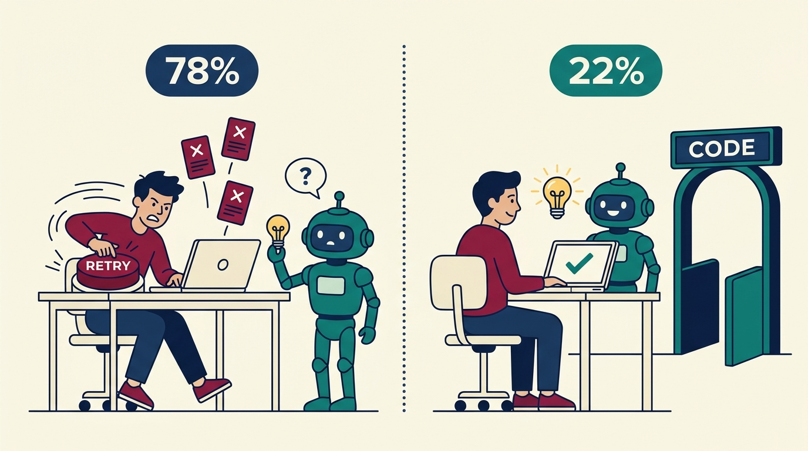

<strong>The Big Surprise:</strong> Even with instant LLM clarification sitting right beside the quiz, <strong>78.0% of remediation episodes ignore AI help</strong> and repeatedly smash "Retry." Yet when students ask early (Round 1), they clear remediation in half the rounds — even though downstream coding efficiency stays unchanged!

<!--
Empirical Paradox Framing the Study:
Although an on-demand LLM conceptual clarification assistant was embedded directly inside the remediation branch immediately following a failed multiple-choice assessment, 78.0% (571 / 732) of remediation episodes involved zero clarification interactions (pure retesting). Only 22.0% (161 / 732) engaged the LLM assistant at least once.

Dual-Level Finding:
1. Within-Remediation Timing Signal: Among clarifiers, 86.3% initiated clarification in Round 1, and single immediate clarifiers completed remediation in half as many median rounds as single delayed clarifiers (Mdn = 2.0 vs. 4.0; Cliff's δ = −0.912, 95% CI [−0.971, −0.835]), though with important definitional and sample-size caveats (n = 14 for delayed).
2. Downstream Null Association: Once students passed the 80% conceptual mastery gate and entered the personalized coding challenge, no remediation pathway showed a statistically significant association with coding active time or code snapshots (all MixedLM p > 0.05; all Cliff's |δ| ≤ 0.127). This divergence motivates distinguishing remediation-process support from downstream task-efficiency enhancement.
-->

---

## Presentation Outline

1

[**Motivation & Research Questions**](#4)
Why AI access ≠ effective help-seeking, classroom log gap, and RQ1–RQ3.

2

[**Related Work & Research Gap**](#6)
Remediation & SRL, LLMs in CS education, and adaptive help-seeking in ITS.

3

[**System Architecture & Methodology**](#7)
DialoguEDU mastery-gated workflow, UI cost asymmetry, 4 pathways & MixedLM.

4

[**Empirical Results (RQ1 & RQ2)**](#10)
Pathway distribution, timing effect (δ = −0.912), null coding efficiency & robustness.

5

[**Discussion, RQ3 Theory & Limitations**](#15)
Why 78% avoid help, Selective Process-Support Mechanism, and validity limits.

6

[**Conclusion & Future Work**](#18)
Visual synthesis of RQ1–RQ3 and actionable roadmap for proactive AI tutoring.

<!--
Paper Architecture & Analytical Flow:
Section 1 (Introduction) defines core terminology (clarification as operationalized help-seeking; behavioral pathway as episode-level clarification-and-retesting pattern) and poses RQ1 (descriptive), RQ2 (associative), and RQ3 (theoretical integration).
Section 2 (Related Work) synthesizes remediation and self-regulated learning (SRL), LLMs in programming education, and adaptive help-seeking in intelligent tutoring systems (ITS).
Section 3 (Materials and Methods) details DialoguEDU's two-stage mastery architecture (Gemini 2.5 Flash, temp = 0.7), UI interaction cost asymmetry, episode inclusion criteria, the 8-step rule-based dialog classifier, the four mutually exclusive pathways, and the statistical pipeline (Cliff's δ with 10,000 stratified bootstrap resamples + REML MixedLM + robustness checks).
Section 4 (Results) presents RQ1 pathway distributions, timing, functional coding, and round/duration effect sizes, followed by RQ2 ceiling effects, MixedLM estimates, code-variability subgroup checks, and idle-threshold sensitivity analyses.
Section 5 & 6 (Discussion, Limitations & Conclusions) interpret the 78% help avoidance and RQ2 null result, formalize the Selective Process-Support Mechanism, document eight validity limitations, and outline five future research directions.
-->

---

## 1.1 Motivation: Technological Access ≠ Effective Help-Seeking

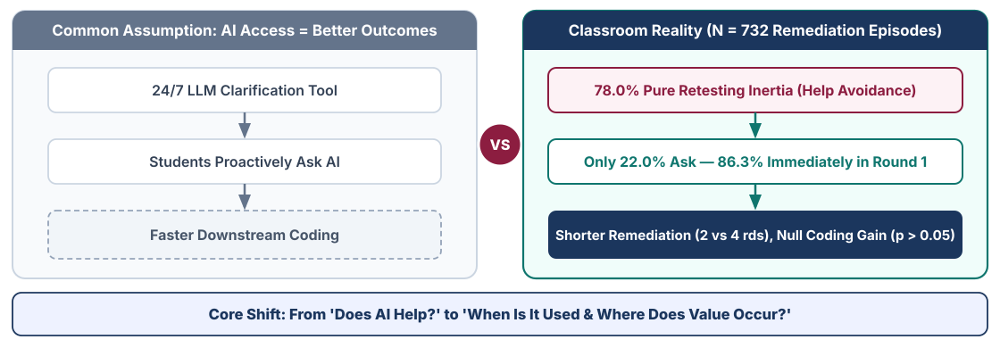

<strong>Two Research Gaps Addressed:</strong> (1) Most LLM-in-CS studies focus on <em>code generation/debugging</em> rather than <strong>conceptual assessment remediation</strong>; (2) Complete process-level behavioral logs from real classroom deployments remain scarce compared to lab experiments and surveys.

<!--
Why Technological Accessibility Alone Fails to Guarantee Effective Use:
In traditional classrooms, students wait for instructors or TAs to resolve conceptual misconceptions. LLMs remove latency by providing immediate, personalized conceptual explanations [1]. However, educational psychology [3, 4] and ITS research [5] consistently demonstrate that making help available does not ensure learners know when or how to use it adaptively.

Two Specific Gaps in Prior Literature:
1. Domain-Task Gap: Most computing-education research on LLMs studies code generation or debugging assistants [2, 6, 7], leaving conceptual assessment remediation—where students must repair conceptual misconceptions before coding—largely unexamined.
2. Methodological Gap: Existing studies predominantly rely on controlled lab experiments, surveys, interviews, or short-term usability evaluations [6, 7]. Complete, longitudinal, process-level behavioral logs from authentic classroom deployments—capturing both active help-seeking and silent help avoidance alongside downstream coding traces—remain scarce.

Mastery-Gating Advantage:
Adopting Bloom's mastery learning architecture [8] (requiring 80% MCQ accuracy before unlocking coding) makes the remediation loop directly observable in naturalistic logs without artificial experimental intrusion.
-->

---

## 1.2 Research Objectives & Three Research Questions

Using full interaction logs from a mastery-gated programming course (`N = 732` episodes), we investigate three linked questions *(revealed step-by-step)*:

* 

RQ1 · Descriptive How do students actually navigate LLM remediation?

<strong>What behavioral pathways emerge</strong> in terms of clarification occurrence, timing, frequency, functional type, remediation rounds (<i>R</i>), and duration?

* 

RQ2 · Associative Does seeking clarification speed up subsequent coding?

<strong>Are remediation pathways associated with subsequent coding process efficiency</strong> (active time &amp; code snapshots) after controlling for student and assignment differences?

* 

RQ3 · Theoretical What role does LLM clarification truly play in mastery learning?

<strong>Integrating RQ1 and RQ2, what is its theoretical mechanism</strong>, boundary conditions, and practical design implication for AI-assisted learning systems?

<!--
Three Interrelated Research Questions & Contributions:
- RQ1 (Descriptive Contribution): Maps the natural ecology of remediation across N = 732 episodes (366 students, 43 assignments), establishing an empirically derived, mutually exclusive, jointly exhaustive four-pathway taxonomy (Pure Retesting, Single Immediate, Single Delayed, Multiple Clarification) and quantifying clarification occurrence, round timing, frequency, functional message type, remediation rounds (R), and total remediation duration.
- RQ2 (Analytical Contribution): Tests whether remediation pathways predict subsequent coding challenge process efficiency—operationalized via active time (minutes) and code snapshot count—using dual cross-validation (non-parametric Cliff's δ and REML linear mixed-effect models controlling for student random intercepts and assignment fixed effects), plus code-variability and idle-cutoff robustness checks. Rigorously validating a null result counterbalances hype and overclaiming regarding AI learning tools.
- RQ3 (Theoretical Integration): Synthesizes RQ1 and RQ2 (without adding separate empirical tests) to define LLM clarification as a Selective Process-Support Mechanism, distinguishing within-remediation process support from downstream task-efficiency gains and showing that clarification timing correlates more strongly with remediation length than clarification occurrence alone.
-->

---

## 2. Related Work & Research Positioning

| Research Stream | Representative Prior Findings | Key Unresolved Gap |
| :--- | :--- | :--- |
| **Remediation & SRL** [5, 10, 11] | Effective learners monitor errors & adapt strategies; yet multi-retry systems trigger **retesting inertia**. Early feedback curbs misconceptions. | Difficult to separate timing benefits from prior ability in naturalistic settings. |
| **LLMs in CS Education** [1, 2, 12, 13] | Novices show highly individualized LLM usage [1]. Per-opportunity learning rates are remarkably consistent across conditions [13]. | Focuses mainly on code generation/debugging; conceptual remediation effects remain underexplored. |
| **Help-Seeking in ITS / AI** [3–7, 16] | Adaptive help-seeking is a core SRL skill, yet learners often show **help avoidance** or gaming [5]; feedback timing outweighs volume [16]. | Mostly small-scale qualitative studies, surveys, or controlled experiments [6, 7]. |
| **This Study (DialoguEDU)** | **732 naturalistic remediation episodes** (366 students, 43 assignments) tracing MCQ retries, LLM dialogs & code snapshots end-to-end. | **Connects process-level help-seeking pathways directly to subsequent coding efficiency.** |

<strong>Why Mastery Gating Helps Research:</strong> Requiring students to pass an 80% conceptual MCQ gate before coding makes the entire remediation loop directly observable in real classroom logs.

<!--
Synthesis of Three Literature Foundations (Section 2):
1. Remediation & Self-Regulated Learning (SRL): Zimmerman [10] models effective remediation as a cycle of metacognitive monitoring and strategy adjustment, yet Aleven & Koedinger [9] and Roll et al. [5] show that multi-retry digital assessments frequently induce retesting inertia—repeating attempts without reflecting. While immediate feedback outperforms delayed feedback in curbing persistent misconceptions [11], observational studies struggle to disentangle timing effects from baseline learner ability.
2. LLMs in Programming Education: Prather et al. [1] report high novice acceptance of LLMs alongside stark behavioral divergence (conceptual inquiry vs. passive code completion). VanLehn [12] argues step-level feedback shortens remediation, whereas Koedinger et al. [13] demonstrate an "astonishing regularity" in per-opportunity learning rates across diverse populations and instructional conditions—offering a key theoretical lens for why pathway variations may yield minimal downstream efficiency differences. Unlike pre-authored ITS item banks [14], real-time LLM question generation offers contextual flexibility while leaving generated-item quality evaluation open.
3. Adaptive Help-Seeking in ITS / AI: Building on Nelson-Le Gall [3], Ryan & Pintrich [4], and Butler & Winne [15], adaptive help-seeking balances avoiding help avoidance and avoiding over-reliance. Corbett & Anderson [16] show feedback timing and type matter more than feedback volume. Recent LLM help-seeking studies [6, 7] rely primarily on small-scale or experimental setups, whereas DialoguEDU provides full-semester naturalistic process logs linking conceptual remediation directly to coding trajectories.
-->

---

## 3.1 Mastery Learning Architecture (DialoguEDU)

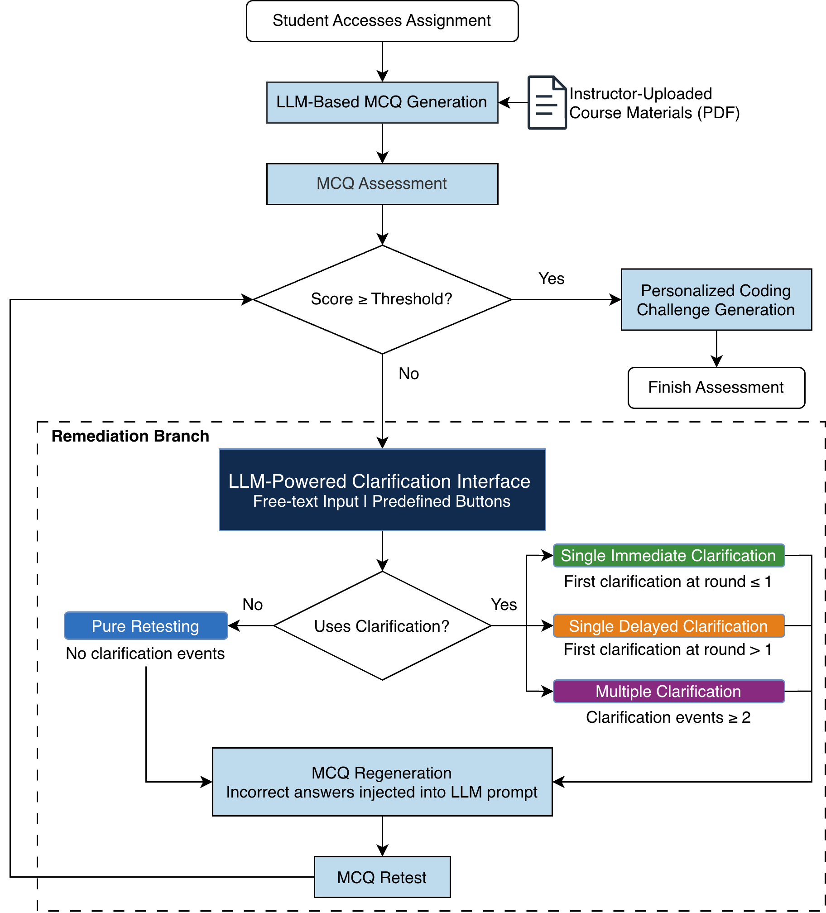

Fig. 1: Two-stage mastery-gated workflow &amp; remediation branch

### 🏗️ Two-Stage Mastery Gating [8]
- **Stage 1 (Conceptual MCQ)**: Dynamically generated from instructor PDFs via **Gemini 2.5 Flash** (`temp = 0.7`, direct prompt context, no RAG).
- **80% Mastery Threshold**: Students below threshold enter the **Remediation Branch** with **error-aware MCQ regeneration** targeting prior misconceptions.
- **LLM Clarification Interface**: Available anytime during remediation to explain concepts *without revealing MCQ answers*.
- **Stage 2 (Personalized Coding)**: Unlocked upon passing; tailored to each student's MCQ error history, graded by LLM + manual TA verification.

<!--
System Implementation & Technical Parameters (Section 3.1):
DialoguEDU implements a two-stage mastery-gated workflow [8] enforcing conceptual competence before procedural coding:
- Stage 1 (Conceptual MCQ Assessment): For each assignment, Google's Gemini 2.5 Flash (`gemini-2.5-flash`, `temperature = 0.7`, no custom response-length cap) dynamically extracts key concepts from instructor-uploaded PDF course materials supplied directly in the prompt context (no separate RAG pipeline) to generate configurable MCQ sets.
- Error-Aware Remediation Loop: Students must attain an instructor-set accuracy threshold (80%) to advance. Failing triggers the remediation branch, where incorrectly answered items from the prior attempt are injected into the generation prompt so the LLM produces new MCQs targeting the student's specific misconceptions.
- On-Demand Clarification Channel: Throughout remediation, both predefined buttons and free-text inputs route to Gemini 2.5 Flash under a system prompt instructing it to deliver conceptual explanations grounded in the course PDFs without revealing MCQ answers.
- Stage 2 (Personalized Coding Challenge): Upon passing the MCQ gate, the LLM generates a personalized coding task conditioned on the student's complete MCQ answering record (correct and incorrect items plus accumulated misconceptions; first-attempt passers receive tasks conditioned on their initial MCQ record). Code submissions undergo two-stage evaluation: automated LLM grading followed by manual TA verification. Because one model powers all components, observed patterns may be partly model-dependent.
-->

---

## 3.2 Student Interfaces & Interaction Cost Asymmetry

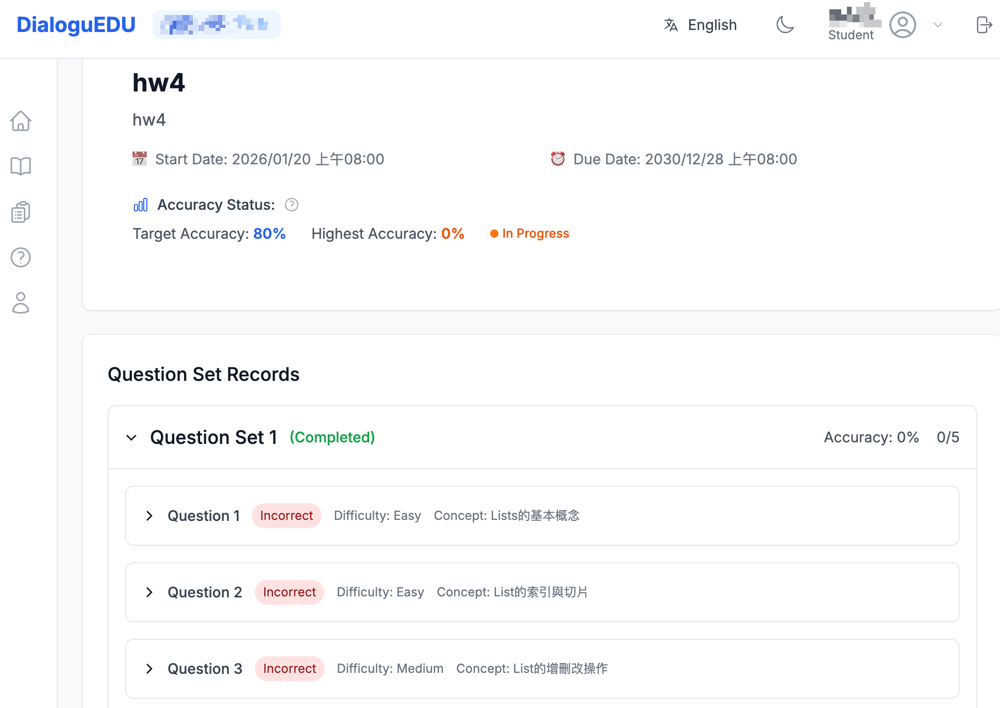

Fig. 2a: MCQ interface showing 80% mastery threshold &amp; marked errors

Fig. 2b: LLM assistant with predefined buttons &amp; free-text chat

<strong>Design Insight — Interaction Cost Asymmetry:</strong> Clicking <em>Retry</em> or a predefined button (<em>"Explain this concept"</em>, <em>"Why was my answer wrong?"</em>) takes far less cognitive effort than formulating a free-text question — nudging stressed learners toward passive retesting.

<!--
Interface Design & Behavioral Mechanics (Section 3.1, Fig. 2):
- MCQ Assessment Interface (Fig. 2a): Displays the 80% target accuracy threshold and explicitly flags incorrectly answered items, providing an immediate visual trigger for entering the remediation branch.
- LLM Clarification Interface (Fig. 2b): Combines a horizontal row of predefined one-click clarification buttons (e.g., "Explain this concept," "Why was my answer wrong?") with an open free-text input field.

Interaction Cost Asymmetry Mechanism:
Even with predefined buttons available, the interface establishes a gradient of interaction and cognitive cost: clicking "Retry" to attempt a regenerated MCQ requires minimal effort and zero verbal formulation; clicking a predefined button requires moderate engagement; composing a coherent free-text conceptual question demands substantial metacognitive articulation precisely at the moment of assessment failure when cognitive load peaks. This structural asymmetry helps explain why passive retesting dominates (78.0%) in naturalistic use.
-->

---

## 3.3 Dataset, Pathway Taxonomy & Analytical Pipeline

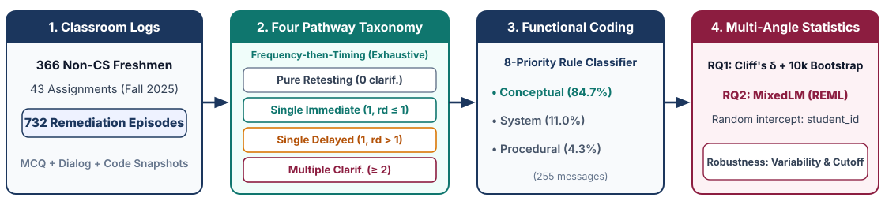

<i>Cliff's δ</i> &nbsp;=&nbsp;
#(<i>xi</i> &gt; <i>yj</i>) − #(<i>xi</i> &lt; <i>yj</i>)<i>nx</i> × <i>ny</i>
(10k Bootstrap 95% CI)

<strong>Romano [17] |δ| Thresholds:</strong> &lt;0.147 Negligible · &lt;0.33 Small · &lt;0.474 Med · ≥0.474 Large

<strong>MixedLM (REML):</strong> <code>log(Y) ~ pathway + assignment_id + (1 | student_id)</code>

<strong>Exhaustive Classification:</strong> Every episode (<code>set_number &gt; 1</code>, <code>N = 732</code>) is assigned deterministically by <strong>frequency first, then timing</strong> (0 excluded). RQ2 analyzes <code>N = 716</code> episodes with coding activity (<code>active_time &gt; 0</code>, 30-min idle cutoff).

<!--
Data Collection, Classification Rules & Statistical Specification (Sections 3.2–3.8):
- Participants & Ethics: 366 unique non-CS first-year undergraduates across 43 assignments in Fall 2025 (mean 2.0 remediation episodes/student, range 1–8; N = 732 episodes where `set_number > 1`). De-identified educational log data collected under normal course operation; exempt from IRB review under Taiwan's Human Subjects Research Act.
- 8-Step Rule-Based Dialog Classifier (Strict Priority Order): (1) Noise/laughter/pure digits -> exclude; (2) exact confirmation buttons -> confirm; (3) topic-generation keywords/buttons -> generate; (4) predefined clarification buttons -> clarification; (5) system-error keywords -> clarification; (6) procedural keywords (threshold, progress) -> clarification; (7) conceptual keywords, question marks, or open-text -> clarification; (8) remainder -> unknown. Non-quiz events inherit the current MCQ set's `retest_round`.
- Frequency-Then-Timing Pathway Rules (Table 1): Total clarification count is evaluated first (0 -> Pure Retesting; ≥2 -> Multiple Clarification regardless of timing). Only episodes with exactly 1 clarification are split by timing (`retest_round ≤ 1` -> Single Immediate; `retest_round > 1` -> Single Delayed). The Round-1 cutoff is empirically motivated (86.3% of first clarifications occurred in Round 1).
- Secondary Functional Coding (Table 2): Clarification messages are coded deterministically as System (error/display keywords), Procedural (passing criteria/progress keywords), or Conceptual (default fallback).
- Statistical Models (Python 3.10, `statsmodels`):
  * Cliff's δ = [#(x_i > y_j) − #(x_i < y_j)] / (n_x × n_y), with 10,000 stratified percentile bootstrap iterations (`seed = 42`) and Romano et al. [17] thresholds (0.147 / 0.33 / 0.474).
  * MixedLM (REML): `log(Y) ~ pathway_type (ref: pure_retesting) + assignment_id + (1 | student_id)` fitted on the first coding challenge per student × assignment (`N = 716`, 355 students; excluding 3 episodes not entering coding and 13 episodes with `active_time = 0`). Active time sums inter-snapshot intervals ≤ 30 min [18]. Residual Q–Q and fitted plots showed no severe normality/homoscedasticity violations.
-->

---

## 4.1 RQ1 Results: Pathway Distribution, Timing & Focus

78.0% (571/732)

<strong>Pure Retesting</strong> — only 22.0% (161) ever use AI clarification

86.3% (139/161)

<strong>First-Round Timing</strong> — help-seeking decisions happen immediately (Mdn = 1.0)

84.7% (216/255)

<strong>Conceptual Focus</strong> — vs. 11.0% System &amp; 4.3% Procedural

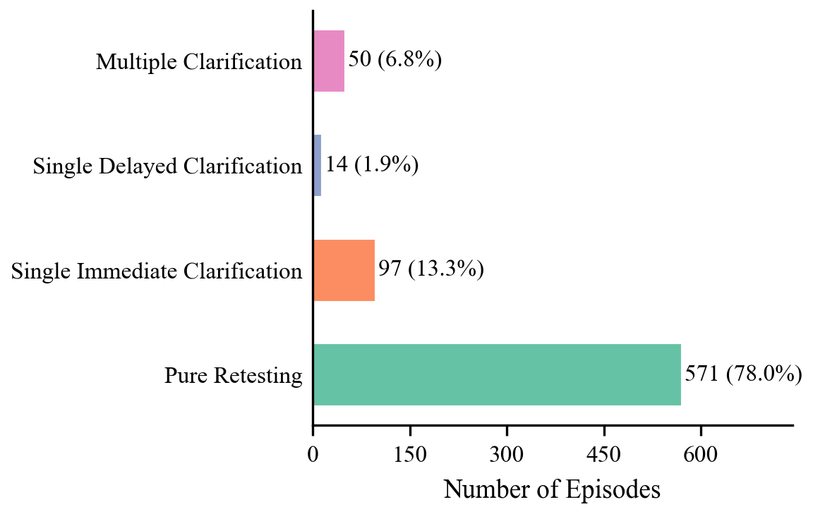

Fig. 3: Distribution across 4 mutually exclusive pathways (N = 732)

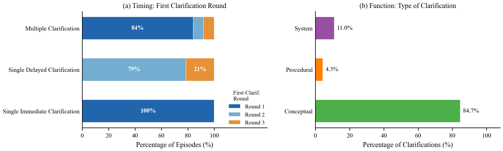

Fig. 4: (a) First clarification round; (b) Message functional type (n = 255)

<!--
Detailed RQ1 Behavioral Distributions (Sections 4.1.1–4.1.3):
1. Four-Pathway Occurrence (N = 732, Fig. 3):
   - Pure Retesting: 78.0% (n = 571)
   - Single Immediate Clarification: 13.3% (n = 97)
   - Multiple Clarification: 6.8% (n = 50; comprising 42 whose first clarification was in Round 1 and 8 whose first clarification was in Round 2+)
   - Single Delayed Clarification: 1.9% (n = 14)
   Overall, only 22.0% (n = 161) of remediation episodes included any clarification event.

2. First-Clarification Timing (n = 161, Fig. 4a):
   - Round 1: 86.3% (n = 139)
   - Round 2: 9.3% (n = 15)
   - Round 3: 4.3% (n = 7)
   - Median first clarification round = 1.0 (IQR = [1.0, 1.0]), showing that help-seeking is an immediate post-failure decision rather than a delayed fallback after repeated retries.

3. Clarification Frequency & Functional Type (255 Total Messages, Fig. 4b):
   - Frequency among clarifiers: Median = 1.0 (IQR = [1.0, 2.0]); 68.9% (111/161) asked once and 31.1% (50/161) asked ≥2 times (multiple-clarifier median = 2.0, IQR = [2.0, 3.0], max = 8 events).
   - Functional distribution: Conceptual 84.7% (216/255), System 11.0% (28/255), Procedural 4.3% (11/255). Because Conceptual is the rule-based default category, the authors note it is strictly "conceptual or otherwise unclassified."
-->

---

## 4.2 RQ1 Results: Remediation Rounds & Cliff's δ Effect Sizes

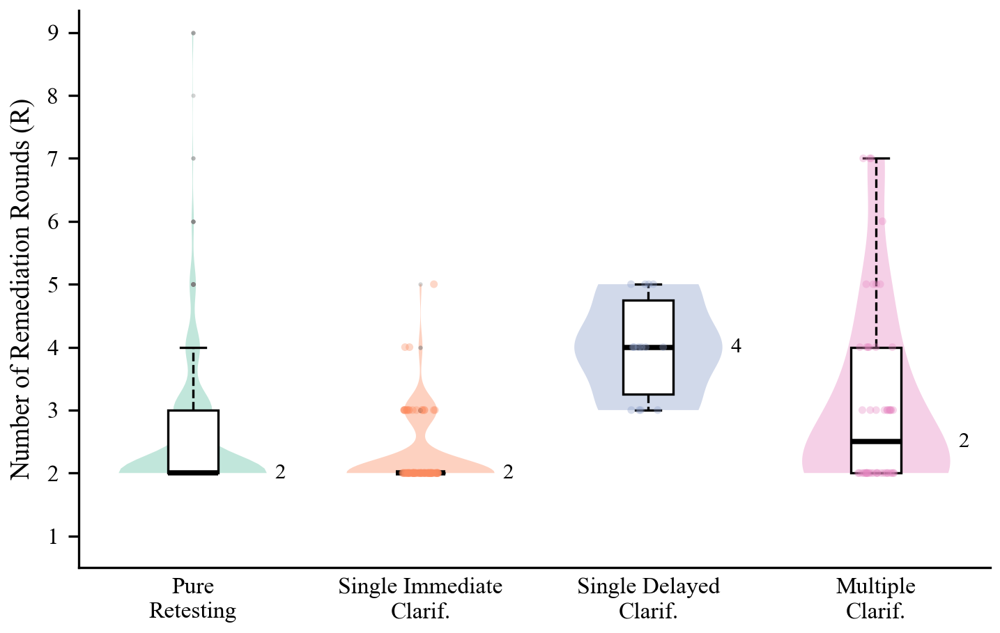

Fig. 5: Remediation rounds (R) — Immediate Mdn = 2.0 vs. Delayed Mdn = 4.0

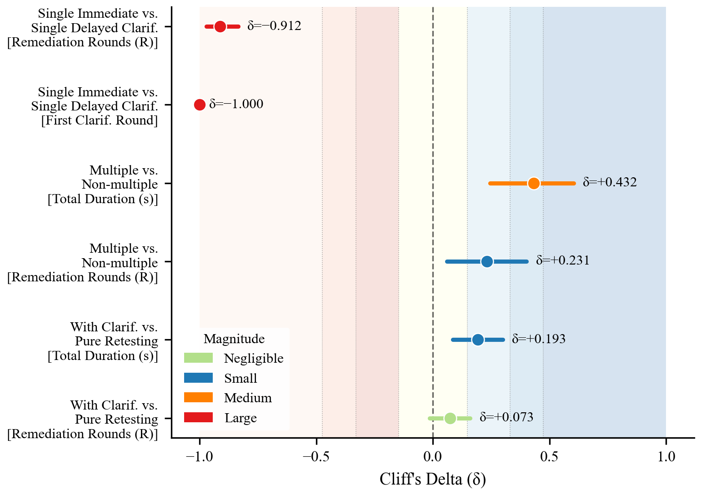

Fig. 6: Cliff's δ &amp; 95% Bootstrap CIs for RQ1 pairwise comparisons

| RQ1 Comparison (Table 4) | Outcome | n1 / n2 | Mdn1 vs. Mdn2 | Cliff's δ | 95% Bootstrap CI | Magnitude |
| :--- | :--- | :---: | :---: | :---: | :---: | :---: |
| With Clarif. vs. Pure Retest | Rounds / Dur. | 161 / 571 | 2.0 vs. 2.0 / 812s vs. 616s | +0.073 / +0.193 | [−0.014, 0.160] / [0.086, 0.299] | Negl. / Small |
| Multiple vs. Non-multiple | Rounds / Dur. | 50 / 111 | 2.5 vs. 2.0 / 1119s vs. 637s | +0.231 / +0.432 | [0.060, 0.401] / [0.246, 0.603] | Small / Med |
| **Single Immed. vs. Delayed** | **Rounds (<i>R</i>)** | **97 / 14** | **2.0 vs. 4.0** | **−0.912** | **[−0.971, −0.835]** | **Large** |

<strong>Methodological Caveat:</strong> The large <code>δ = −0.912</code> contrast is <em>partly definitional</em> (delayed clarifiers by construction occur at round ≥ 2) and based on <code>n = 14</code>; we interpret it descriptively rather than causally.

<!--
Detailed Remediation Process Metrics (Section 4.1.4, Tables 3 & 4):
1. Pathway-Level Descriptives (Table 3):
   - Pure Retesting (n = 571): R Mdn = 2.0 (M = 2.51); Duration Mdn = 616.0 s (M = 851.2 s).
   - Single Immediate (n = 97): R Mdn = 2.0 (M = 2.25); Duration Mdn = 569.0 s (M = 718.8 s).
   - Single Delayed (n = 14): R Mdn = 4.0 (M = 4.00); Duration Mdn = 1682.5 s (M = 1922.0 s).
   - Multiple Clarification (n = 50): R Mdn = 2.5 (M = 3.08); Duration Mdn = 1119.0 s (M = 1399.1 s).
   Note on Duration Sample Sizes: Duration comparisons use slightly smaller n (e.g., 134 vs. 161 for With Clarif.; 479 vs. 571 for Pure Retesting) because total duration required at least one validly timed MCQ set (positive elapsed time < 3600 s); episodes without valid set durations were excluded listwise from duration analyses while retained for R.

2. Pairwise Cliff's δ Interpretations (Table 4, Fig. 6):
   - With Clarification vs. Pure Retesting: Negligible in R (δ = +0.073, 95% CI [−0.014, 0.160]), Small in Duration (δ = +0.193, [0.086, 0.299]; Mdn 811.5 s vs. 616.0 s)—an expected time overhead from reading/writing dialogs.
   - Multiple vs. Non-Multiple: Small in R (δ = +0.231, [0.060, 0.401]) and Medium in Duration (δ = +0.432, [0.246, 0.603]; Mdn 1119.0 s vs. 637.0 s), reflecting deeper unresolved conceptual struggle.
   - Single Immediate vs. Single Delayed: Large in R (δ = −0.912, [−0.971, −0.835]; Mdn 2.0 vs. 4.0). Three Critical Caveats (Section 5.1): (a) Partly definitional—delayed clarification by construction occurs at Round ≥ 2 while R counts all rounds including pre-clarification retries; (b) potential prior-ability / metacognitive confounding; and (c) small delayed sample (n = 14). Hence interpreted strictly descriptively, not causally.
-->

---

## 4.3 RQ2 Results: Pass-Rate Ceiling & Raw Coding Efficiency

99.6% (729/732)

Successfully unlocked &amp; entered the coding challenge

97.3% Pass Rate

Severe <strong>ceiling effect</strong> across all pathways (96.8%–100%)

|δ| = 0.002 – 0.127

<strong>All negligible</strong> raw effects on active time &amp; code snapshots

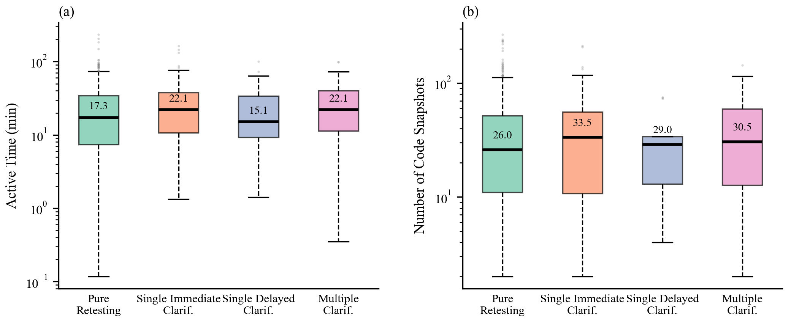

Fig. 7: Active time &amp; code snapshots on log scale (N = 716)

### 📊 Raw Process Efficiency (Tables 5 & 6)
| Pathway (<i>N</i>) | Active Mdn (IQR) | Snap. Mdn | Active δ (vs. PR) |
| :--- | :---: | :---: | :---: |
| **Pure Retesting** (559) | 17.3m [6.9, 33.5] | 26.0 | Ref. |
| **Single Immed.** (96) | 22.1m [10.6, 37.6] | 33.5 | +0.118 *(Negl.)* |
| **Single Delayed** (13) | 15.1m [9.2, 33.9] | 29.0 | +0.034 *(Negl.)* |
| **Multiple Clarif.** (48) | 22.1m [9.7, 38.6] | 30.5 | +0.127 *(Negl.)* |

- Every 95% Bootstrap CI spans zero; snapshot `|δ| ≤ 0.083` across all groups.

<!--
Pass-Rate Ceiling & Unadjusted RQ2 Comparisons (Sections 4.2.1–4.2.2, Tables 5 & 6):
1. Challenge Access & Severe Ceiling Effect:
   - 99.6% (729 / 732) of remediation episodes accessed the coding challenge (3 did not: 1 Single Delayed, 2 Pure Retesting, yielding n = 13 and n = 569 for snapshot analyses).
   - Overall AI-assessed pass rate was 97.3% (709 / 729): Pure Retesting 96.8% (551/569), Single Immediate 97.9% (95/97), Single Delayed 100% (13/13), Multiple Clarification 100% (50/50). Because pass rate is virtually saturated across all pathways, it cannot discriminate efficiency differences.
   - Active-time analyses further excluded 13 episodes (across 11 students) with `active_time = 0` (no recorded coding activity), yielding N = 716 episodes from 355 students.

2. Unadjusted Process Efficiency & Cliff's δ (Tables 5 & 6, Fig. 7):
   - Active Time (vs. Pure Retesting, n = 559, Mdn = 17.3 min): Single Immediate (n = 96, Mdn = 22.1) δ = +0.118 [0.000, 0.237]; Single Delayed (n = 13, Mdn = 15.1) δ = +0.034 [−0.289, 0.364]; Multiple (n = 48, Mdn = 22.1) δ = +0.127 [−0.047, 0.294].
   - Code Snapshots (vs. Pure Retesting, n = 569, Mdn = 26.0): Single Immediate (n = 97, Mdn = 33.5) δ = +0.083 [−0.045, 0.210]; Single Delayed (n = 13, Mdn = 29.0) δ = +0.002 [−0.275, 0.291]; Multiple (n = 50, Mdn = 30.5) δ = +0.046 [−0.129, 0.214].
   - Interpretation: All six estimates fall well below Romano's 0.147 small-effect threshold with CIs spanning zero, providing strong evidence of no practically meaningful unadjusted efficiency gain for well-sampled pathways, while Single Delayed (n = 13) remains statistically underpowered.
-->

---

## 4.4 RQ2 Results: Mixed-Effect Linear Models (Controlling Confounds)

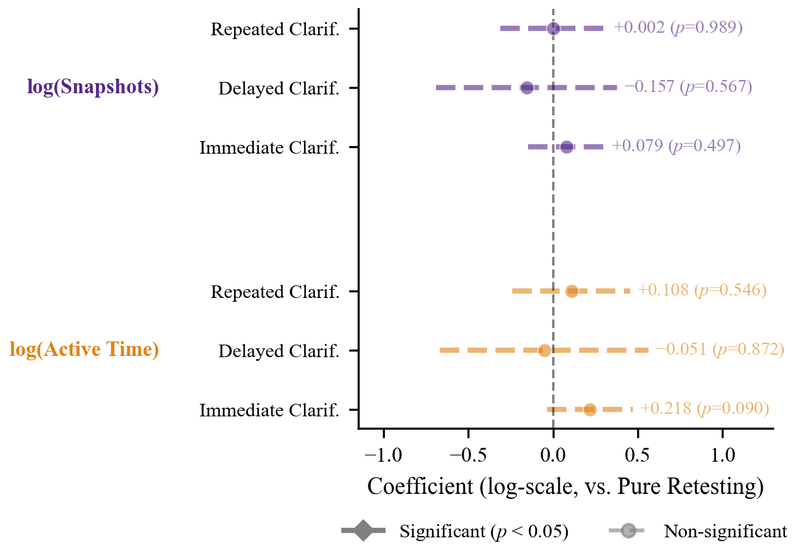

Fig. 8: MixedLM coefficients (log scale) &amp; 95% CIs vs. Pure Retesting

### 📉 MixedLM Results (Table 7 · N = 716, 355 Students)
Controls for **student random intercept** &amp; **assignment fixed effects** (43 assignments):

| Outcome | Pathway (vs. Pure Retest) | Coef. | 95% CI | <i>p</i> |
| :--- | :--- | :---: | :---: | :---: |
| `log(Active)` | Single Immediate | +0.218 | [−0.034, 0.471] | 0.090 *(ns)* |
| `log(Active)` | Single Delayed | −0.051 | [−0.667, 0.566] | 0.872 *(ns)* |
| `log(Active)` | Multiple Clarif. | +0.108 | [−0.242, 0.458] | 0.546 *(ns)* |
| `log(Snaps)` | Single Immediate | +0.079 | [−0.148, 0.305] | 0.498 *(ns)* |
| `log(Snaps)` | Single Delayed | −0.157 | [−0.692, 0.379] | 0.567 *(ns)* |
| `log(Snaps)` | Multiple Clarif. | +0.002 | [−0.312, 0.316] | 0.989 *(ns)* |

<strong>Robust Null Finding:</strong> None of the pathways reaches significance (all <code>p &gt; 0.05</code>), and the closest estimate (+0.218, ≈24% more time) points <em>away</em> from faster coding. Single Delayed (<code>n = 13</code>) remains underpowered/inconclusive.

<!--
Adjusted Modeling & Geometric-Mean Interpretation (Section 4.2.3, Table 7, Fig. 8):
To account for repeated episodes nested within students (random intercept `student_id`) and heterogeneity across the 43 tasks (fixed effect `assignment_id`), REML linear mixed-effect models were fitted to natural log-transformed outcomes (`N = 716`, 355 students, reference = Pure Retesting).

Model Fit Diagnostics & Variance Components:
- `log(Active Time)` model: Group Var = 0.274, Residual Scale = 1.009, Log-Likelihood = −1083.6.
- `log(Snapshots)` model: Group Var = 0.468, Residual Scale = 0.682, Log-Likelihood = −1019.2.
Substantial random-intercept variance confirms meaningful between-student differences, validating the mixed-effects specification.

Interpreting the Null Estimates:
Because outcomes are natural log-transformed, coefficients represent multiplicative effects on the geometric mean. The estimate closest to significance—Single Immediate Clarification on `log(Active Time)` (β = +0.218, 95% CI [−0.034, 0.471], p = 0.090)—corresponds to exp(0.218) ≈ 1.24, or roughly 24% MORE active time relative to Pure Retesting, moving opposite to the hypothesis that clarification speeds up coding. Multiple Clarification coefficients are small and positive (+0.108, p = 0.546; +0.002, p = 0.989), while Single Delayed coefficients are slightly negative (−0.051, p = 0.872; −0.157, p = 0.567) with wide confidence intervals due to n = 13 (inconclusive rather than proven null). For the well-powered Pure Retesting (n = 559) and Single Immediate (n = 96) groups, the data confidently rule out meaningful downstream efficiency gains.
-->

---

## 4.5 Robustness Checks: Code-Variability & Idle-Cutoff Sensitivity

To verify that external AI copy-pasting or the 30-min idle cutoff did not mask real effects, we ran two sensitivity checks (Section 4.2.4, Table 8):

| Subgroup (Partition: >50% length drop &amp; <50% similarity) | Pathway (vs. PR) | nclar / nPR | Active Time δ [95% CI] | Snapshots δ [95% CI] |
| :--- | :--- | :---: | :---: | :---: |
| **Stable Coding (`n = 531`, 72.8%)** | Single Immed. / Delayed / Mult. | 69 / 6 / 34 vs. 410 | +0.107 / −0.135 / +0.071 *(all span 0)* | +0.060 / −0.102 / +0.022 *(all span 0)* |
| **High Variability (`n = 198`, 27.2%)** | Single Immed. / Delayed / Mult. | 27 / 7 / 14 vs. 149 | **+0.148 / +0.173 / +0.258** *(small, span 0)* | +0.145 / +0.120 / +0.082 *(all span 0)* |

### 🔍 94,249 Snapshot-Pair Audit
- **82.8%** of consecutive code edits changed **< 5%** of the code; only **8.1%** exceeded 20%.
- Confirms authentic iterative debugging rather than wholesale external AI pasting — validating the stable-group null result.

### ⏱️ Idle-Threshold Sensitivity (15 / 30 / 60 min)
- Re-estimating MixedLM under **15 min (`N = 715`)** and **60 min (`N = 717`)** cutoffs yields identical conclusions.
- Single Immediate `log(Active)` stays `0.168 / 0.218 / 0.158` (`all p > 0.09`); all other pathways `p > 0.31`.

<!--
Sensitivity & Integrity Verification (Section 4.2.4, Table 8):
1. Code-Variability Subgroup Partition (Testing External AI Copy-Paste Confounding):
   - Criterion: Any coding episode containing at least one snapshot exhibiting both >50% length reduction and <50% sequence similarity (via Python `difflib.SequenceMatcher`) was classified as High Variability (n = 198, 27.2% snapshot sample; 197 active-time sample); all others formed the Stable group (n = 531, 72.8% snapshot sample; 519 active-time sample).
   - Stable Subgroup Results: All Cliff's δ estimates for both active time (−0.135 to +0.107) and snapshots (−0.102 to +0.060) remained negligible with 95% CIs spanning zero.
   - High-Variability Subgroup Results: Active-time estimates reached the small-effect threshold across all three clarification pathways (Single Immediate δ = +0.148 [−0.075, 0.365]; Single Delayed δ = +0.173 [−0.204, 0.584]; Multiple δ = +0.258 [−0.066, 0.568]), meaning clarifiers spent slightly more active time, though every CI still spanned zero and snapshot effects remained negligible (0.082 to 0.145). Whether high variability reflects exploratory refactoring, external AI use, or distinct problem-solving styles cannot be determined from logs alone.
   - 94,249 Snapshot-Pair Micro-Audit (Section 5.2): 82.8% of consecutive edits altered <5% of code and only 8.1% altered >20%, corroborating authentic incremental debugging rather than wholesale code pasting.

2. Active-Time Idle-Cutoff Sensitivity (15 / 30 / 60 min):
   - Re-running the MixedLM at 15 min (N = 715) and 60 min (N = 717) vs. 30 min (N = 716) left all substantive conclusions unchanged: Single Immediate `log(Active Time)` β = 0.168 (15 min), 0.218 (30 min), 0.158 (60 min) (all p > 0.09); all other pathway coefficients had p > 0.31.
-->

---

## 5.1 Discussion: Why 78% Avoid Help & Why RQ2 Is Null

### 🚫 Three Drivers of 78.0% Help Avoidance (RQ1)
1. **Illusion of Knowing (Overconfidence)** [15]: After a first failure, students underestimate conceptual gaps and assume a quick retry will suffice.
2. **Cognitive Load at Failure**: Formulating a coherent question demands metacognitive effort right when cognitive resources are most strained.
3. **Interface-Induced Retesting Inertia**: Clicking *Retry* has a lower interaction cost than typing a free-text question, reinforcing passive trial-and-error.

- Meanwhile, **Multiple Clarifiers** (`Mdn = 1119s` vs. `637s`, `δ = 0.432`) likely signal deeper conceptual struggles requiring multi-turn scaffolding.

### 🧩 Five Explanations for the RQ2 Null Result
1. **Mastery-Gating Equalization**: Everyone must clear the **80% MCQ gate** before coding — equalizing entering conceptual competence across pathways!
2. **Ceiling Compression**: A **97.3%** pass rate leaves limited variance for pathway effects to surface.
3. **Narrow Observation Window**: Captures only the immediately following task, not delayed cross-assignment transfer.
4. **Learner Heterogeneity**: Individual depth of processing dilutes group-level averages toward zero.
5. **Regularity of Learning Rates** [13]: Per-opportunity learning gains are remarkably stable across instructional variations.

<!--
Theoretical Mechanisms Explaining Both Core Empirical Findings (Sections 5.1–5.2):
1. Why 78.0% Default to Pure Retesting (SRL & Help-Avoidance Literature):
   - Strategic Inertia & Illusion of Knowing [10, 15]: Following an initial failure, students overestimate their conceptual grasp and expect a quick re-read/retry to clear the threshold.
   - Failure-Point Cognitive Load: Articulating a precise conceptual query requires metacognitive effort precisely when working memory is depleted by error feedback.
   - Interface-Induced Retesting Inertia: One-click Retry has far lower interaction cost than formulating free-text questions, reinforcing help avoidance [5].
   - Conversely, early Round-1 clarification (86.3%) aligns with Nelson's metacognitive monitoring framework [19] (rapid error detection and control), while Multiple Clarification (Mdn 1119 s vs. 637 s, δ = 0.432) signals deeper unresolved confusion requiring multi-turn scaffolding.

2. Why RQ2 Yields a Robust Null Result (Five Complementary Explanations):
   - Mastery-Gating Equalization (Primary Structural Mechanism): Because every learner—regardless of pathway—must pass the identical 80% MCQ threshold before unlocking coding, the remediation branch equalizes entering conceptual competence across pathways. Thus, the RQ2 null is partly an intended structural consequence of mastery learning rather than proof that clarification lacks value.
   - Ceiling Compression: A 97.3% coding pass rate compresses variance in process-efficiency proxies.
   - Narrow Observation Window: Measuring only the immediately subsequent task cannot capture delayed cross-assignment transfer.
   - Individual Processing Heterogeneity: Varying depth of cognitive engagement with identical LLM explanations dilutes group-average effects toward zero.
   - Learning-Rate Regularity [13] & Step-Level Feedback [12]: Aligns with Koedinger et al.'s invariant per-opportunity learning rate and VanLehn's distinction between immediate step-level remediation support and task-level transfer.
-->

---

## 5.2 RQ3 Theory: Selective Process-Support Mechanism & Design

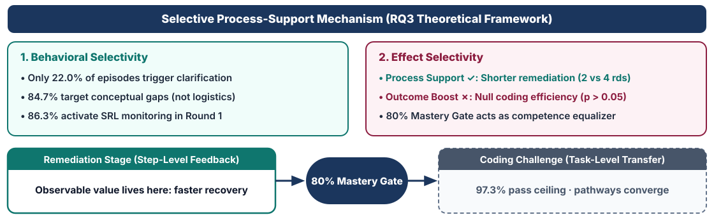

<strong>Actionable Design Implication (System-Triggered Prompting):</strong> Don't wait for stressed novices to self-initiate! Proactively prompt clarification in <strong>Round 1</strong> or after <strong>2 consecutive failures</strong> (e.g., <em>"You've missed this twice — ask AI to clarify the concept?"</em>) to lower the metacognitive entry barrier.

<!--
Theoretical Framework Formalization (Section 5.3):
Synthesizing RQ1 and RQ2, the paper proposes that in mastery-gated LLM programming systems [8], on-demand clarification operates as a Selective Process-Support Mechanism rather than a uniform determinant of downstream learning outcomes. The authors explicitly frame this as an empirically grounded hypothesis from observational data requiring experimental validation.

Two Dimensions of "Selectivity":
1. Behavioral Selectivity: Only 22.0% of remediation episodes invoke clarification, and 84.7% of those inquiries target conceptual confusion rather than procedural or system queries—indicating selective activation for specific cognitive impasses.
2. Effect Selectivity: Observable correlates concentrate within the remediation process itself (early clarifiers navigating remediation in fewer rounds, subject to the definitional caveat) rather than in downstream coding efficiency (RQ2 null), echoing adaptive learning research [14] showing instructional support is valuable when it helps learners traverse activities more smoothly even when final mastery rates converge.

Process Support vs. Outcome Enhancement & Concrete Design Implication:
- In SRL terms [10], early clarification reflects active metacognitive monitoring and strategy adjustment, whereas passive retesting reflects unactivated monitoring; in VanLehn's framework [12], clarification delivers step-level misconception feedback.
- Actionable Redesign (System-Triggered vs. Self-Triggered Prompting): Rather than waiting for strained novices to self-initiate, systems should proactively surface a low-friction prompt in Round 1 or after two consecutive failures (e.g., "You have failed this assessment twice; would you like to ask the AI to clarify the relevant concept?"). Testing whether system-triggered prompting matches or outperforms self-triggered clarification is a direct experimental next step.
-->

---

## 5.3 Limitations & Threats to Validity

### ⚖️ Causal & Sample Limits
- **No Prior-Ability Pretest**: Observational design cannot separate self-selection (stronger SRL skills) from causal timing effects.
- **Sample Imbalance**: Pure Retesting (`n = 571`) vs. Single Delayed (`n = 14`) yields wide CIs and low power for delayed clarifiers.
- **Definitional Overlap**: `δ = −0.912` partly reflects counting rounds prior to Round-2+ clarification.

### 📏 Measurement & Trajectories
- **Ceiling & Proxy Validity**: 97.3% pass rate forces reliance on active time & snapshots, where longer time may reflect *deeper exploration* rather than inefficiency.
- **Single-Task Window**: Cannot observe delayed transfer across later assignments.
- **Episode Independence**: Does not yet model within-student help-seeking evolution across the semester.

### 🤖 Classification & Scope
- **Rule-Based Coding**: Deterministic & reproducible, but no human IRR; default *Conceptual* bucket (84.7%) may include minor unclassified residuals.
- **Unanalyzed LLM Quality**: Response accuracy & pedagogical clarity were not scored.
- **Single Context**: One university, one introductory non-CS course, single backbone (**Gemini 2.5 Flash**).

<!--
Comprehensive Account of Eight Study Limitations (Section 5.4):
1. No Prior-Ability or Motivation Covariates: Naturalistic observation without pretest or placement scores prevents separating behavioral pathway effects from pre-existing ability or SRL skill differences; causal inference is therefore precluded.
2. Severe Sample Imbalance: Pathway sizes range from n = 571 (Pure Retesting) down to n = 14 (Single Delayed; n = 13 in RQ2), producing wide confidence intervals and low statistical power for delayed clarifiers.
3. Definitional Overlap in Timing Effect: The large Cliff's δ = −0.912 contrast partly reflects constructing Single Delayed at Round ≥ 2 while counting all pre-clarification rounds inside R.
4. Ceiling Effects & Proxy Validity: The 97.3% coding pass rate forced reliance on active time and snapshot count, which have imperfect ecological validity—more time or snapshots can reflect thorough autonomous exploration rather than inefficiency.
5. Narrow Single-Task Observation Window: Evaluating only the immediately following coding task misses potential cumulative or delayed transfer across later assignments.
6. Unmodeled Within-Student Trajectories: Episodes nested within students were modeled via random intercepts rather than longitudinal growth models, leaving semester-long evolution of help-seeking habits unexamined.
7. Rule-Based Coding Without Human IRR: Deterministic keyword rules guarantee reproducibility but lack human inter-rater reliability; because Conceptual (84.7%) is the fallback default, it may include minor unclassified residuals.
8. Unanalyzed LLM Response Quality & Single-Context External Validity: The study logged student behavior without scoring LLM explanation accuracy or pedagogical quality, and reflects one university, one non-CS introductory course, and a single model (Gemini 2.5 Flash).
-->

---

## 6. Conclusion & Future Work

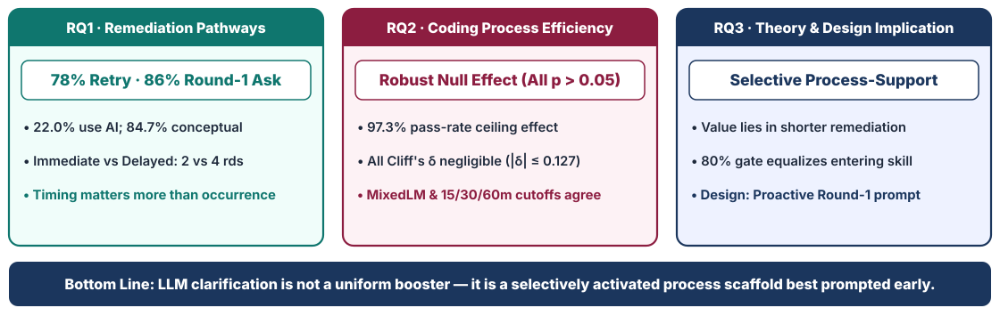

<strong>🧪 1. Randomized Prompting Trials</strong> Test system-triggered vs. self-triggered Round-1 prompts with baseline pretests to establish causality.

<strong>📈 2. Longitudinal Trajectories</strong> Track cross-assignment transfer and within-student help-seeking habit evolution across a full semester.

<strong>🌐 3. Multi-Site &amp; Response Audits</strong> Replicate across institutions &amp; LLMs while evaluating AI explanation quality and human-validated coding.

<!--
Synthesis of Empirical & Theoretical Conclusions (Section 6):
- RQ1 (Descriptive): In naturalistic mastery-gated remediation (N = 732), 78.0% of episodes rely exclusively on retesting; among the 22.0% using LLM clarification, 86.3% decide in Round 1 and 84.7% ask conceptual questions. Single immediate clarifiers complete remediation in fewer rounds than single delayed clarifiers (Mdn 2.0 vs. 4.0, δ = −0.912, interpreted descriptively due to definitional overlap and n = 14).
- RQ2 (Associative): Both non-parametric Cliff's δ (all |δ| ≤ 0.127) and REML MixedLM controlling for student and assignment effects (all p > 0.05) converge on a robust null result for downstream coding active time and snapshots, verified across code-variability subgroups and 15/30/60-min idle cutoffs.
- RQ3 (Theoretical & Practical): Reframing LLM clarification as a Selective Process-Support Mechanism shifts design focus from expecting universal downstream speedups to lowering the metacognitive barrier via proactive Round-1 / post-failure system-triggered prompts.

Five-Point Future Research Roadmap (Section 6):
1. Randomized controlled trials assigning proactive clarification prompts at fixed remediation points to establish causal efficacy.
2. Longitudinal multi-assignment tracking to detect delayed conceptual transfer across a full semester.
3. Inclusion of baseline prior-knowledge covariates (pretests or placement exams) to isolate behavioral effects from ability confounds.
4. Multi-institution, multi-course, and multi-LLM replications paired with human-validated coding and AI response-quality audits.
5. Within-student trajectory modeling to examine how novice help-seeking strategies evolve with platform experience.
-->

---

<!-- _class: closing -->

# Thank You for Your Attention!

Help-Seeking in LLM-Assisted Learning: Behavioral Pathways and Their Limited Association with Subsequent Coding Process Efficiency

<strong>Lien-Chi Lai*</strong> &nbsp;·&nbsp; <code>p1000433@o365.fcu.edu.tw</code> 
<strong>Nien-Lin Hsueh</strong> &nbsp;·&nbsp; <code>nlhsueh@fcu.edu.tw</code> 
Department of Information Engineering and Computer Science, Feng Chia University 
Published in <strong>Electronics 2026, 15, 2706</strong> &nbsp;·&nbsp; <code>https://doi.org/10.3390/electronics15122706</code> 
Grant: NSTC114-2221-E-035-077 · Questions &amp; Discussion Welcome!

<!--
Reference & Archival Metadata:
- Title: Help-Seeking in LLM-Assisted Learning: Behavioral Pathways and Their Limited Association with Subsequent Coding Process Efficiency
- Authors: Lien-Chi Lai (corresponding author, p1000433@o365.fcu.edu.tw) and Nien-Lin Hsueh (nlhsueh@fcu.edu.tw)
- Affiliation: Department of Information Engineering and Computer Science, Feng Chia University, Taichung 40724, Taiwan
- Publication: Electronics 2026, 15, 2706 (Published 18 June 2026; Open Access CC BY)
- DOI: https://doi.org/10.3390/electronics15122706
- Funding: National Science and Technology Council (NSTC), Taiwan R.O.C., grant NSTC114-2221-E-035-077
- Keywords: large language models; programming education; remediation learning; clarification behavior; learning pathway analysis; mastery learning
-->

