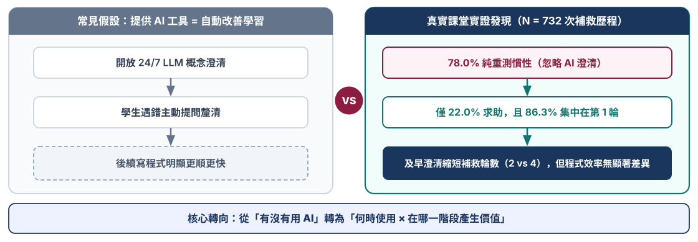
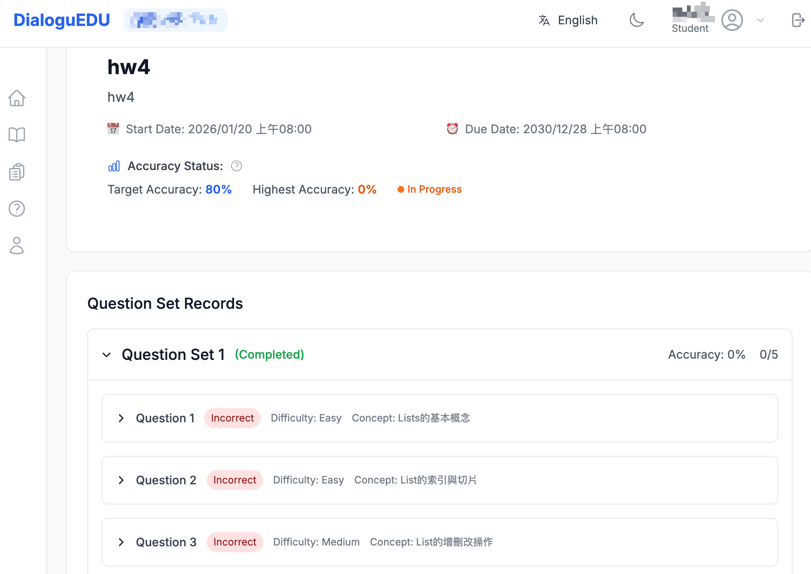
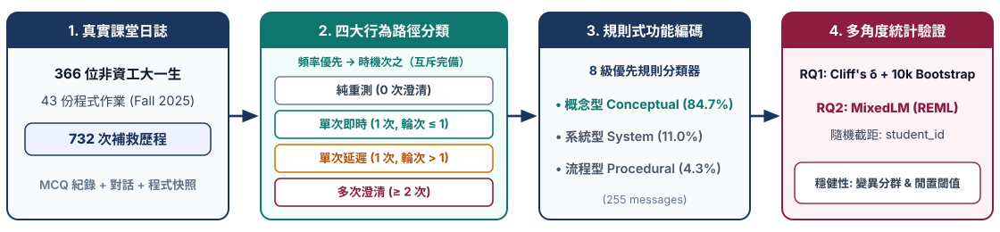
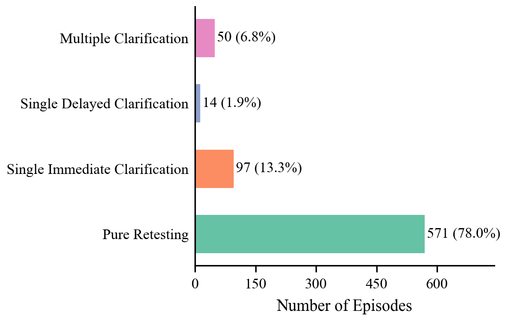

<!-- _class: lead -->

Electronics 2026, 15, 2706 · 資訊教育與 AI 輔助學習

# LLM 輔助學習中的求助行為：補救行為路徑及其與後續程式編寫歷程效率之有限關聯

<strong>Help-Seeking in LLM-Assisted Learning</strong>：透過真實課堂 <strong>732 次補救學習歷程</strong>（366 位學生 · 43 份作業），剖析學生在精熟學習系統中的 AI 概念澄清行為與實證效益

<strong>Lien-Chi Lai*</strong> ＆ <strong>薛念林（Nien-Lin Hsueh）</strong> 
逢甲大學資訊工程學系（Department of Information Engineering and Computer Science, Feng Chia University） 
<code>p1000433@o365.fcu.edu.tw</code> · <code>nlhsueh@fcu.edu.tw</code>

刊登於 MDPI Electronics (2026 年 6 月 18 日) · DOI: 10.3390/electronics15122706 · 國科會計畫補助：NSTC114-2221-E-035-077

---

## 破題：我們打造了 24 小時 AI 助教，為何 78% 學生只顧著狂按「重測」？

<strong>驚人的課堂真相：</strong> 即使 AI 概念澄清功能就放在測驗旁邊，仍有 <strong>78.0% 的補救歷程完全忽略 AI</strong>、反覆狂按「重測」！反觀及早（第 1 輪）主動求助的學生，補救輪數減半，但後續寫程式的效率卻呈現出乎意料的「無顯著差異」。

---

## 簡報大綱（Presentation Outline）

1

[**研究動機與三大問題**](#4)
為何「技術可用」不等於「有效求助」，以及本研究欲回答的 RQ1–RQ3。

2

[**文獻回顧與研究定位**](#6)
補救學習與自我調整學習（SRL）、LLM 程式教育與智慧家教求助研究。

3

[**系統架構與研究方法**](#7)
DialoguEDU 兩階段精熟門檻、介面成本不對稱、四大路徑分類與 MixedLM。

4

[**實證結果（RQ1 & RQ2）**](#10)
路徑分布、時機效應（δ = −0.912）、後續寫碼無顯著差異與雙重穩健性檢驗。

5

[**深度討論、RQ3 理論與限制**](#15)
78% 迴避求助三大成因、選擇性歷程支持機制與研究效度限制。

6

[**結論與未來研究方向**](#18)
RQ1–RQ3 核心視覺統整與主動提示式 AI 助教設計藍圖。

---

## 1.1 研究動機：技術可用性 ≠ 有效的求助行為

<strong>本研究填補的兩大缺口：</strong> (1) 現有 LLM 程式教育多聚焦於<em>程式碼生成／除錯</em>，極少探討<strong>概念評量補救中的澄清求助</strong>；(2) 相較於實驗室測試或問卷，真實課堂部署的<strong>完整歷程日誌分析</strong>仍十分稀缺。

---

## 1.2 研究目標與三大研究問題（RQ1–RQ3）

我們分析精熟學習程式課程中的真實互動日誌（`N = 732` 次補救歷程），依序探討三大核心問題 *(逐項展開)*：

* 

RQ1 · 描述性 學生進入補救分支後，實際上都怎麼跟 AI 互動？

<strong>呈現出哪些行為路徑？</strong> 澄清行為的發生率、首次時機、頻率與功能類型為何？不同路徑在補救輪數（<i>R</i>）與耗時上有何差異？

* 

RQ2 · 關聯性 補救時問 AI，真的會讓接下來寫程式更順、更快嗎？

<strong>不同補救路徑是否與後續程式挑戰效率相關</strong>（活躍時間與程式碼快照數）？在控制學生個體差異與作業難度後是否依然成立？

* 

RQ3 · 理論整合 LLM 概念澄清在精熟學習中究竟扮演什麼理論角色？

<strong>整合 RQ1 與 RQ2 發現</strong>，應如何界定其運作機制、邊界條件，並轉化為具體的 AI 教學系統設計建議？

---

## 2. 文獻回顧與本研究定位

| 研究脈絡 | 代表性既有發現 | 尚未解決的關鍵缺口 |
| :--- | :--- | :--- |
| **補救學習與 SRL** [5, 10, 11] | 有效學習者會監控錯誤並調整策略；但在允許重考的系統中常陷入**重測慣性**；及時回饋有助阻止迷思延續。 | 觀察資料中難以區分「及時回饋效益」與「學生先備能力」差異。 |
| **LLM 程式教育** [1, 2, 12, 13] | 初學者對 LLM 使用高度分歧 [1]；Koedinger 等人指出單位練習機會的學習速率在不同教學條件下高度一致 [13]。 | 多集中於程式碼生成與除錯，缺乏概念評量補救與後續寫碼之連結。 |
| **ITS / AI 求助行為** [3–7, 16] | 適應性求助是 SRL 核心，但學生常出現**求助迴避**或鑽漏洞 [5]；回饋時機與類型比總量更關鍵 [16]。 | 多採小規模質性訪談、問卷或控制實驗，缺乏長期自然課堂日誌 [6, 7]。 |
| **本研究（DialoguEDU）** | **732 次真實補救歷程**（366 位學生、43 份作業），完整串聯選擇題重測、AI 對話與程式編寫快照。 | **直接銜接「補救求助路徑」與「後續程式歷程效率」的實證驗證。** |

<strong>為何精熟門檻設計極具研究價值？</strong> 學生必須先通過 80% 概念選擇題才能解鎖程式題，讓「答錯 ➔ 求助或重測 ➔ 寫程式」的完整歷程在自然課堂中完全可視化。

---

## 3.1 精熟學習系統架構（DialoguEDU）

圖 1：兩階段精熟門檻工作流程與補救分支（Student Workflow）

### 🏗️ 兩階段精熟門檻設計 [8]
- **第一階段（概念選擇題 MCQ）**：由 **Gemini 2.5 Flash**（`temp = 0.7`，直接以教師 PDF 教材為上下文，無額外 RAG）動態出題。
- **80% 精熟門檻**：未達標即進入**補救分支**，系統將錯題注入提示詞，進行**錯誤感知式（Error-Aware）重出題**，精準鎖定迷思。
- **LLM 澄清介面**：補救期間隨時可提問，系統提示詞約束 AI 僅解釋概念、**不直接給答案**。
- **第二階段（個人化程式挑戰）**：達標後依據學生完整作答與迷思紀錄客製程式題，採 LLM 初評 + 助教人工複核。

---

## 3.2 學生互動介面與「操作成本不對稱」

圖 2a：MCQ 概念評量介面（顯示 80% 門檻與錯題標記）

圖 2b：LLM 澄清介面（預設快捷按鈕 + 自由文字輸入框）

<strong>關鍵介面洞察 — 操作成本不對稱（Interaction Cost Asymmetry）：</strong> 按一下「重測」或預設按鈕（如<em>「解釋這個概念」</em>、<em>「為何我答錯？」</em>）的認知阻力遠低於自行組織文字提問，無形中助長了被動重測慣性。

---

## 3.3 資料集、四大行為路徑與統計分析流程

<i>Cliff's δ</i> &nbsp;=&nbsp;
#(<i>xi</i> &gt; <i>yj</i>) − #(<i>xi</i> &lt; <i>yj</i>)<i>nx</i> × <i>ny</i>
(10,000 次 Bootstrap 95% CI)

<strong>Romano [17] |δ| 標準：</strong> &lt;0.147 可忽略 · &lt;0.33 小 · &lt;0.474 中 · ≥0.474 大

<strong>線性混合效應模型：</strong> <code>log(Y) ~ pathway + assignment_id + (1 | student_id)</code>

<strong>互斥完備分類：</strong> 所有進入補救的歷程（<code>set_number &gt; 1</code>，<code>N = 732</code>）依<strong>「頻率優先、時機次之」</strong>全數歸類（0 筆排除）；RQ2 納入有實際寫碼紀錄之 <code>N = 716</code> 筆（排除閒置 &gt; 30 分鐘間隔）。

---

## 4.1 RQ1 實證結果：路徑分布、求助時機與功能類型

78.0% (571/732)

<strong>純重測路徑</strong> — 僅 22.0%（161 次）曾使用 AI 澄清功能

86.3% (139/161)

<strong>集中於第 1 輪</strong> — 是否求助幾乎在首錯後立即決定（中位數 1.0）

84.7% (216/255)

<strong>概念型提問</strong> — 遠高於系統型（11.0%）與流程型（4.3%）

圖 3：四大互斥行為路徑分布（N = 732）

圖 4：(a) 首次澄清輪次分布；(b) 255 則訊息功能類型分布

---

## 4.2 RQ1 實證結果：補救輪數與 Cliff's δ 效果量分析

圖 5：補救輪數 (R) — 單次即時中位數 2.0 vs. 單次延遲 4.0

圖 6：RQ1 成對比較之 Cliff's δ 與 95% Bootstrap 信賴區間

| RQ1 成對比較（Table 4） | 指標 | n1 / n2 | 中位數 Mdn1 vs. Mdn2 | Cliff's δ | 95% 信賴區間 | 效果量 |
| :--- | :--- | :---: | :---: | :---: | :---: | :---: |
| 有澄清 vs. 純重測 | 輪數 / 總耗時 | 161 / 571 | 2.0 vs. 2.0 / 812s vs. 616s | +0.073 / +0.193 | [−0.014, 0.160] / [0.086, 0.299] | 可忽略 / 小 |
| 多次澄清 vs. 單次澄清 | 輪數 / 總耗時 | 50 / 111 | 2.5 vs. 2.0 / 1119s vs. 637s | +0.231 / +0.432 | [0.060, 0.401] / [0.246, 0.603] | 小 / 中 |
| **單次即時 vs. 單次延遲** | **輪數 (<i>R</i>)** | **97 / 14** | **2.0 vs. 4.0** | **−0.912** | **[−0.971, −0.835]** | **大效果量** |

<strong>嚴謹解讀提醒：</strong> <code>δ = −0.912</code> 具<em>部分定義性重疊</em>（單次延遲依定義必發生於第 2 輪後）且樣本數小（<code>n = 14</code>），故應視為描述性特徵，不可過度推論為因果關係。

---

## 4.3 RQ2 實證結果：通過率天花板與原始寫碼效率

99.6% (729/732)

順利通過精熟門檻並進入後續程式挑戰

97.3% 通過率

顯著<strong>天花板效應</strong>（各路徑均達 96.8%–100%）

|δ| = 0.002 – 0.127

活躍時間與快照數之原始效果量<strong>全數可忽略</strong>

圖 7：各路徑活躍時間與程式碼快照數分布（對數尺度，N = 716）

### 📊 原始歷程效率統計（Tables 5 & 6）
| 行為路徑 (<i>N</i>) | 活躍時間中位數 (IQR) | 快照數中位數 | 活躍時間 δ (vs. 純重測) |
| :--- | :---: | :---: | :---: |
| **純重測** (559) | 17.3 分 [6.9, 33.5] | 26.0 | 基準組 |
| **單次即時** (96) | 22.1 分 [10.6, 37.6] | 33.5 | +0.118 *(可忽略)* |
| **單次延遲** (13) | 15.1 分 [9.2, 33.9] | 29.0 | +0.034 *(可忽略)* |
| **多次澄清** (48) | 22.1 分 [9.7, 38.6] | 30.5 | +0.127 *(可忽略)* |

- 所有 95% 信賴區間均跨越 0；程式碼快照數 `|δ| ≤ 0.083`。

---

## 4.4 RQ2 實證結果：線性混合效應模型（控制混淆變項）

圖 8：線性混合效應模型迴歸係數（對數尺度）與 95% CI

### 📉 MixedLM 分析結果（Table 7 · N = 716，355 位學生）
控制**學生隨機截距**與**43 份作業難度固定效應**後：

| 結果指標 | 路徑（相對於純重測） | 係數 Coef. | 95% CI | <i>p</i> 值 |
| :--- | :--- | :---: | :---: | :---: |
| `log(活躍時間)` | 單次即時澄清 | +0.218 | [−0.034, 0.471] | 0.090 *(ns)* |
| `log(活躍時間)` | 單次延遲澄清 | −0.051 | [−0.667, 0.566] | 0.872 *(ns)* |
| `log(活躍時間)` | 多次澄清 | +0.108 | [−0.242, 0.458] | 0.546 *(ns)* |
| `log(快照數)` | 單次即時澄清 | +0.079 | [−0.148, 0.305] | 0.498 *(ns)* |
| `log(快照數)` | 單次延遲澄清 | −0.157 | [−0.692, 0.379] | 0.567 *(ns)* |
| `log(快照數)` | 多次澄清 | +0.002 | [−0.312, 0.316] | 0.989 *(ns)* |

<strong>穩健的無顯著發現（Null Result）：</strong> 所有路徑皆未達統計顯著（<code>p &gt; 0.05</code>），最接近顯著的單次即時（+0.218，約多花 24% 時間）方向亦非「加速寫碼」；單次延遲組（<code>n = 13</code>）檢定力不足，屬尚未定論。

---

## 4.5 穩健性檢驗：程式碼變異分群與閒置閾值敏感度

為確認是否受外部 AI 貼上程式碼或 30 分鐘閒置門檻干擾，本研究進行兩項敏感度測試（Section 4.2.4, Table 8）：

| 變異分群（條件：單次長度縮減 >50% 且相似度 <50%） | 路徑（vs. 純重測） | nclar / nPR | 活躍時間 δ [95% CI] | 快照數 δ [95% CI] |
| :--- | :--- | :---: | :---: | :---: |
| **穩定編寫組（`n = 531`, 72.8%）** | 即時 / 延遲 / 多次 | 69 / 6 / 34 vs. 410 | +0.107 / −0.135 / +0.071 *(全跨 0)* | +0.060 / −0.102 / +0.022 *(全跨 0)* |
| **高變異組（`n = 198`, 27.2%）** | 即時 / 延遲 / 多次 | 27 / 7 / 14 vs. 149 | **+0.148 / +0.173 / +0.258** *(小、跨 0)* | +0.145 / +0.120 / +0.082 *(全跨 0)* |

### 🔍 94,249 組連續快照變動稽核
- **82.8%** 的連續修改幅度小於 **5%**；僅 **8.1%** 超過 20%。
- 證實學生以**漸進式自主除錯**為主，非整段貼上外部 AI 解答，確保穩定組的無顯著結論反映真實學習情境。

### ⏱️ 閒置門檻敏感度（15 / 30 / 60 分鐘）
- 改以 **15 分鐘（`N = 715`）** 與 **60 分鐘（`N = 717`）** 重估 MixedLM，結論完全一致。
- 單次即時 `log(活躍時間)` 係數分別為 `0.168 / 0.218 / 0.158`（全數 `p > 0.09`），其餘路徑皆 `p > 0.31`。

---

## 5.1 深度討論：為何 78% 迴避求助？為何 RQ2 無顯著差異？

### 🚫 78.0% 迴避求助的三大機制（RQ1）
1. **知識錯覺與過度自信** [15]：首次答錯後低估概念漏洞，以為再重考一次就能過關。
2. **失敗當下的認知負荷**：剛答錯時認知資源最緊繃，自行組織精準提問的後設認知門檻過高。
3. **介面誘發之重測慣性**：按「重測」的操作成本遠低於打字提問，形成阻力最小路徑。

- 此外，**多次澄清組**耗時顯著更長（`1119s` vs. `637s`，`δ = 0.432`），反映更深層的概念困惑與多輪鷹架需求。

### 🧩 RQ2 無顯著差異的五大詮釋
1. **精熟門檻的起點均等效應**：不論走哪條路徑，皆須達到 **80% 門檻**才解鎖寫碼，大幅抹平了進入程式題時的先備落差！
2. **高通過率天花板壓縮**：**97.3%** 的過關率壓縮了效率指標的變異空間。
3. **觀察視窗過窄**：僅追蹤緊接在後的單一程式題，未捕捉跨作業延遲遷移。
4. **個體認知處理異質性**：不同學生吸收相同 AI 回覆的深度差異大，稀釋群體均值。
5. **學習速率高度規律性** [13]：單位練習機會的學習增益對教學條件變異具高度穩健性。

---

## 5.2 RQ3 理論定位：選擇性歷程支持機制與系統設計啟示

<strong>具體教學系統設計建議（系統主動觸發提示）：</strong> 別被動等焦慮的初學者自己提問！應在<strong>第 1 輪補救</strong>或<strong>連續失敗 2 次後</strong>自動彈出提示（例如：<em>「您已連續未達標兩次，是否請 AI 協助釐清這個核心概念？」</em>），大幅降低求助認知門檻。

---

## 5.3 研究限制與效度威脅（Limitations）

### ⚖️ 因果推論與樣本不均
- **缺乏先備能力前測**：觀察性研究無法排除自我選擇偏誤（SRL 較強的學生可能更早問也更快過關）。
- **樣本高度不平衡**：純重測（`n = 571`）vs. 單次延遲（`n = 14`），延遲組檢定力受限。
- **定義性重疊**：`δ = −0.912` 部分源自延遲組必發生於第 2 輪後。

### 📏 指標效度與動態軌跡
- **代理指標生態效度**：97.3% 天花板迫使改用活躍時間與快照數，但花更多時間亦可能代表*深度探索*而非低效。
- **單次作業視窗**：無法評估多週後的長期知識遷移。
- **尚未建模個體演變**：將同一學生的多次歷程視為獨立事件，未追蹤整學期求助習慣的變化。

### 🤖 編碼方式與外部效度
- **規則式自動編碼**：具高度可重現性，但無人工評分者信度；預設歸入*概念型*（84.7%）可能略為高估。
- **未評估 AI 回覆品質**：LLM 解釋的正確性與教學適切性尚未納入調節變項。
- **單一情境限制**：單一大學非資工大一課程與單一模型（**Gemini 2.5 Flash**）。

---

## 6. 結論與未來研究方向

<strong>🧪 1. 隨機分派介入實驗</strong> 比較「系統主動提示」與「學生自主求助」並納入前測控制，驗證因果效應。

<strong>📈 2. 跨學期縱貫軌跡</strong> 追蹤多次作業間的延遲遷移效應，並建模學生個體求助策略隨經驗的演變。

<strong>🌐 3. 跨校複現與回覆品質稽核</strong> 拓展至多校、多款 LLM，並結合人工抽樣驗證 AI 解釋品質與功能編碼效度。

---

<!-- _class: closing -->

# 感謝聆聽！敬請指教

LLM 輔助學習中的求助行為：補救行為路徑及其與後續程式編寫歷程效率之有限關聯

<strong>Lien-Chi Lai*</strong> &nbsp;·&nbsp; <code>p1000433@o365.fcu.edu.tw</code> 
<strong>薛念林（Nien-Lin Hsueh）</strong> &nbsp;·&nbsp; <code>nlhsueh@fcu.edu.tw</code> 
逢甲大學資訊工程學系（Department of Information Engineering and Computer Science, FCU） 
刊登期刊：<strong>Electronics 2026, 15, 2706</strong> &nbsp;·&nbsp; <code>https://doi.org/10.3390/electronics15122706</code> 
國科會計畫補助：NSTC114-2221-E-035-077 · 歡迎交流與提問！

