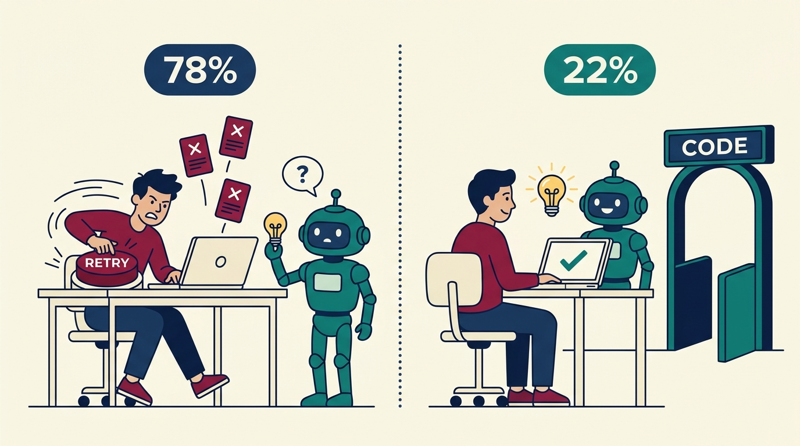
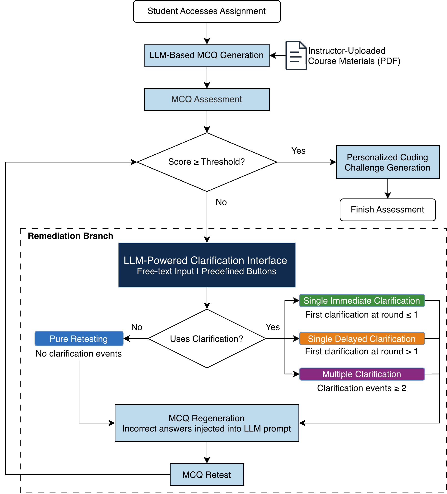
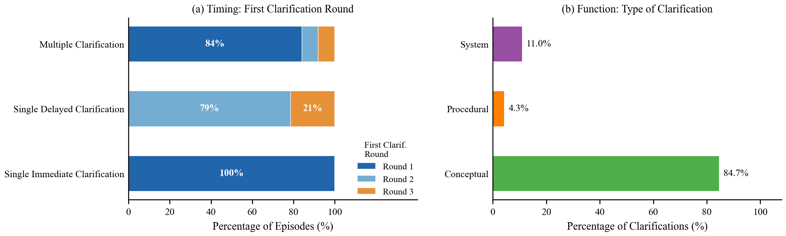
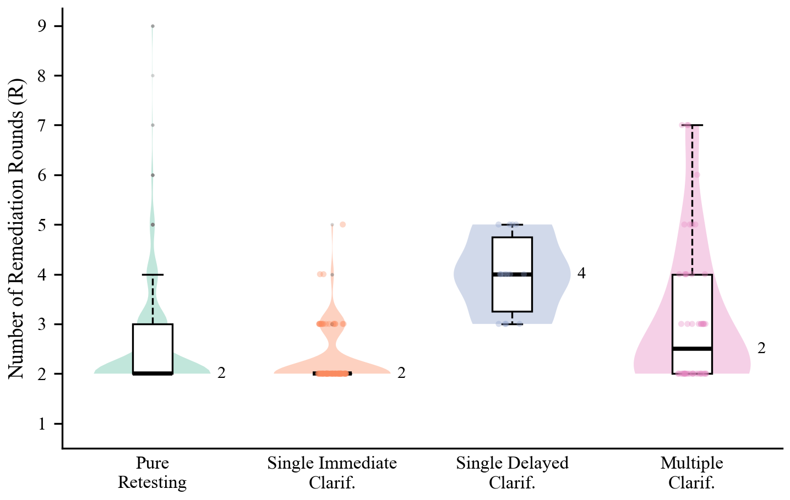
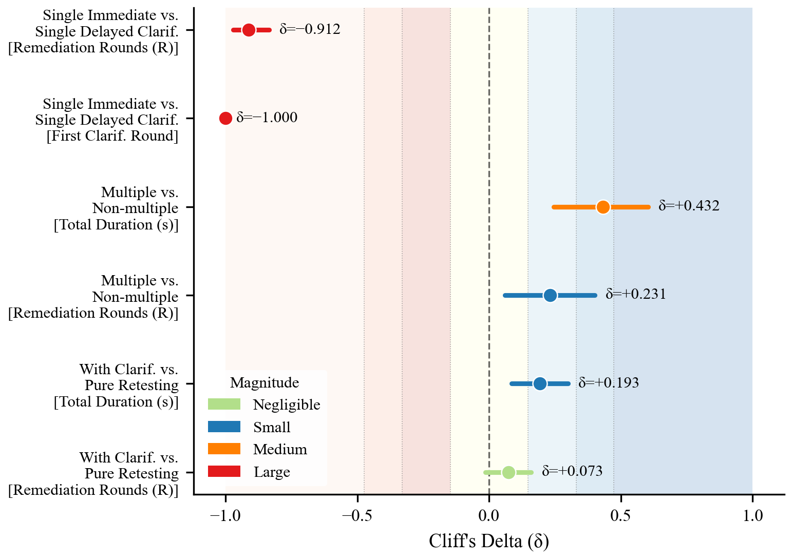
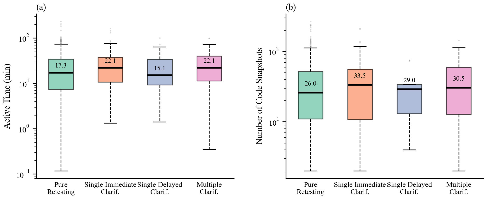
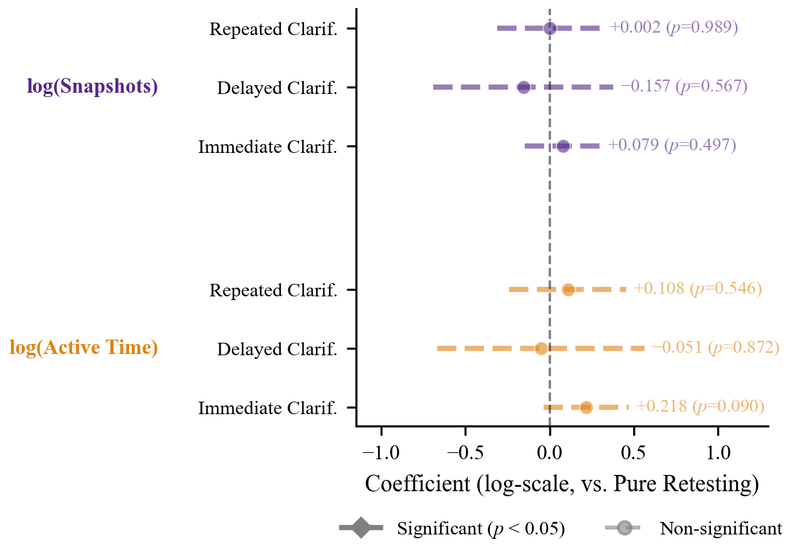
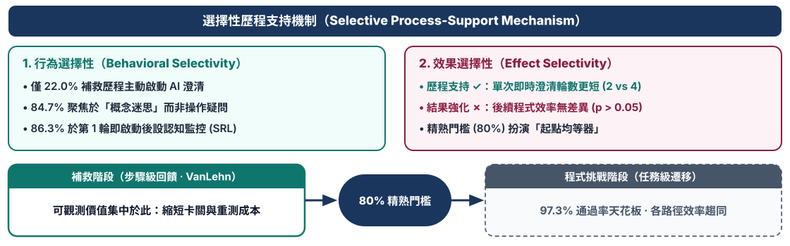
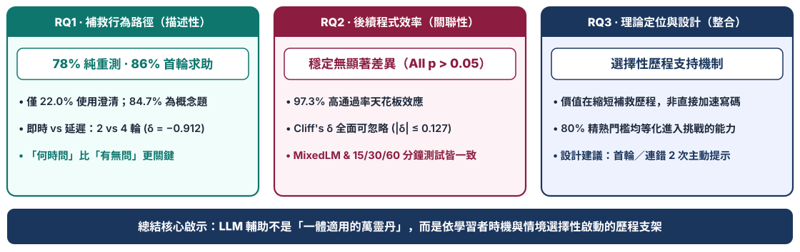

<!-- _class: lead -->

Electronics 2026, 15, 2706 · 資訊教育與 AI 輔助學習

# LLM 輔助學習中的求助行為：補救行為路徑及其與後續程式編寫歷程效率之有限關聯

<strong>Help-Seeking in LLM-Assisted Learning</strong>：透過真實課堂 <strong>732 次補救學習歷程</strong>（366 位學生 · 43 份作業），剖析學生在精熟學習系統中的 AI 概念澄清行為與實證效益

<strong>Lien-Chi Lai*</strong> ＆ <strong>薛念林（Nien-Lin Hsueh）</strong> 
逢甲大學資訊工程學系（Department of Information Engineering and Computer Science, Feng Chia University） 
<code>p1000433@o365.fcu.edu.tw</code> · <code>nlhsueh@fcu.edu.tw</code>

刊登於 MDPI Electronics (2026 年 6 月 18 日) · DOI: 10.3390/electronics15122706 · 國科會計畫補助：NSTC114-2221-E-035-077

<!--
論文基本資訊與研究規模：
本論文由逢甲大學資訊工程學系賴連智（通訊作者）與薛念林教授發表於《Electronics》（2026, 15, 2706；DOI: 10.3390/electronics15122706；2026 年 6 月 18 日出版），研究獲國科會專題計畫 NSTC114-2221-E-035-077 支持。

核心實證與理論貢獻：
研究分析 2025 年秋季學期真實部署於非資工系大一必修程式課程之完整互動日誌，共涵蓋 732 筆補救學習事件（366 位學生、43 項作業）。論文系統性探討三大問題：（1）學生在精熟門檻型 LLM 教學平台（DialoguEDU）的補救分支中採取哪些行為路徑；（2）不同求助路徑是否與後續寫碼挑戰之歷程效率相關；（3）整合上述結果，提出 LLM 澄清功能於精熟學習系統中的理論定位——「選擇性歷程支持機制（Selective Process-Support Mechanism）」。
-->

---

## 破題：我們打造了 24 小時 AI 助教，為何 78% 學生只顧著狂按「重測」？

<strong>驚人的課堂真相：</strong> 即使 AI 概念澄清功能就放在測驗旁邊，仍有 <strong>78.0% 的補救歷程完全忽略 AI</strong>、反覆狂按「重測」！反觀及早（第 1 輪）主動求助的學生，補救輪數減半，但後續寫程式的效率卻呈現出乎意料的「無顯著差異」。

<!--
貫穿全篇的實證悖論：
即便即時可用的 LLM 概念澄清介面就設置於選擇題測驗（MCQ）失敗後的補救分支旁，真實課堂紀錄卻顯示高達 78.0%（571 / 732）的補救事件完全未進行任何澄清互動（純重測路徑），僅有 22.0%（161 / 732）至少呼叫過一次 AI 澄清。

雙層次關鍵發現：
1. 補救階段的時機訊號：在有求助的學生中，86.3% 於第一輪補救即立即發問；且「單次即時澄清」之中位數補救輪數僅為「單次延遲澄清」的一半（Mdn = 2.0 vs. 4.0；Cliff's δ = −0.912, 95% CI [−0.971, −0.835]），惟論文亦嚴謹指出此對比具部分定義重疊與延遲組樣本偏小（n = 14）之限制。
2. 下游寫碼的虛無結果：一旦學生通過 80% 概念門檻進入個人化寫碼挑戰，無論先前採取何種補救路徑，後續活躍寫碼時間與程式碼快照數均無顯著差異（所有 MixedLM p > 0.05；所有 Cliff's |δ| ≤ 0.127）。此一反差正是區分「補救歷程支持」與「下游任務效能提升」的理論起點。
-->

---

## 簡報大綱（Presentation Outline）

1

[**研究動機與三大問題**](#4)
為何「技術可用」不等於「有效求助」，以及本研究欲回答的 RQ1–RQ3。

2

[**文獻回顧與研究定位**](#6)
補救學習與自我調整學習（SRL）、LLM 程式教育與智慧家教求助研究。

3

[**系統架構與研究方法**](#7)
DialoguEDU 兩階段精熟門檻、介面成本不對稱、四大路徑分類與 MixedLM。

4

[**實證結果（RQ1 & RQ2）**](#10)
路徑分布、時機效應（δ = −0.912）、後續寫碼無顯著差異與雙重穩健性檢驗。

5

[**深度討論、RQ3 理論與限制**](#15)
78% 迴避求助三大成因、選擇性歷程支持機制與研究效度限制。

6

[**結論與未來研究方向**](#18)
RQ1–RQ3 核心視覺統整與主動提示式 AI 助教設計藍圖。

<!--
論文結構與論證脈絡：
第一章（緒論）於開篇即固定核心術語（「澄清 clarification」作為求助行為的操作型定義；「行為路徑 behavioral pathway」指單一補救事件中澄清與重測的組合型態），並提出描述性（RQ1）、關聯性（RQ2）與理論整合（RQ3）三大研究問題。
第二章（相關研究）綜整補救學習與自我調節學習（SRL）、LLM 程式教育應用，以及智慧教學系統（ITS）中之適應性求助研究。
第三章（研究方法）詳述 DialoguEDU 兩階段精熟學習架構（Gemini 2.5 Flash，temp = 0.7）、介面操作成本不對稱、8 層優先序規則式對話分類器、四大互斥且窮盡行為路徑，以及統計分析流程（Cliff's δ 與 10,000 次分層 Bootstrap、REML 線性混合效應模型與穩健性檢驗）。
第四章（實證結果）依序呈現 RQ1 路徑分布、時機、功能類型與輪數／時長效果量，以及 RQ2 通過率天花板效應、MixedLM 控制後估計、程式碼變異分群與閒置閾值敏感度分析。
第五、六章（討論、限制與結論）剖析 78% 迴避求助成因與 RQ2 虛無結果之五項解釋，建構「選擇性歷程支持機制」，誠實列出八項效度限制並規劃五項未來研究方向。
-->

---

## 1.1 研究動機：技術可用性 ≠ 有效的求助行為

<strong>本研究填補的兩大缺口：</strong> (1) 現有 LLM 程式教育多聚焦於<em>程式碼生成／除錯</em>，極少探討<strong>概念評量補救中的澄清求助</strong>；(2) 相較於實驗室測試或問卷，真實課堂部署的<strong>完整歷程日誌分析</strong>仍十分稀缺。

<!--
技術可近性不等於有效求助：
傳統課堂中，學生遭遇概念卡關必須等待教師或助教回應；LLM 雖提供 24 小時即時且個人化的概念解說 [1]，但教育心理學 [3, 4] 與智慧教學系統（ITS）[5] 數十年來的實證均指出，提供協助管道並不自動轉化為適應性求助（adaptive help-seeking）。

本研究回應的兩大文獻缺口：
1. 任務情境缺口：既有 LLM 程式教育研究多聚焦於程式碼生成與除錯輔助 [2, 6, 7]，針對「概念評量補救（conceptual assessment remediation）」中學生如何尋求 LLM 澄清並銜接後續寫碼的研究極為匱乏。
2. 方法論缺口：既有文獻多採控制實驗、問卷、訪談或短期可用性評估 [6, 7]，少有運用真實課堂長期部署之完整互動日誌，同時追蹤「主動求助」與「沈默迴避」之歷程行為。

精熟學習門檻的研究優勢：
採用 Bloom 精熟學習架構 [8]（通過 80% 概念 MCQ 門檻方能解鎖寫碼挑戰），使補救歷程、澄清互動與後續寫碼表現於真實課程中自然且完整地被系統記錄，具備高度生態效度。
-->

---

## 1.2 研究目標與三大研究問題（RQ1–RQ3）

我們分析精熟學習程式課程中的真實互動日誌（`N = 732` 次補救歷程），依序探討三大核心問題 *(逐項展開)*：

* 

RQ1 · 描述性 學生進入補救分支後，實際上都怎麼跟 AI 互動？

<strong>呈現出哪些行為路徑？</strong> 澄清行為的發生率、首次時機、頻率與功能類型為何？不同路徑在補救輪數（<i>R</i>）與耗時上有何差異？

* 

RQ2 · 關聯性 補救時問 AI，真的會讓接下來寫程式更順、更快嗎？

<strong>不同補救路徑是否與後續程式挑戰效率相關</strong>（活躍時間與程式碼快照數）？在控制學生個體差異與作業難度後是否依然成立？

* 

RQ3 · 理論整合 LLM 概念澄清在精熟學習中究竟扮演什麼理論角色？

<strong>整合 RQ1 與 RQ2 發現</strong>，應如何界定其運作機制、邊界條件，並轉化為具體的 AI 教學系統設計建議？

<!--
三大研究問題與三層次學術貢獻：
- RQ1（描述性貢獻）：運用 732 筆真實課堂補救事件（366 位學生、43 項作業）建立由資料歸納且互斥窮盡的「四大行為路徑分類框架」（純重測、單次即時澄清、單次延遲澄清、多次澄清），量化澄清發生率、首次求助輪次、求助頻率、訊息功能類型、補救輪數（R）與總耗時。
- RQ2（分析性貢獻）：結合非母數效果量（Cliff's δ）、線性混合效應模型（MixedLM，同時控制學生隨機截距與作業固定效應），以及程式碼變異分群與閒置閾值敏感度檢驗，從多角度嚴謹驗證澄清路徑與後續寫碼歷程效率（活躍時間、程式碼快照數）之關聯。對虛無結果（null result）進行高規格穩健驗證，有助於平衡學界與業界對 AI 輔助學習工具成效的過度宣稱。
- RQ3（理論性貢獻）：整合 RQ1 與 RQ2 之實證結果（不額外引入新統計檢定），將 LLM 澄清功能定位為「選擇性歷程支持機制」，區分「補救歷程效率」與「後續任務效率」兩個效益層級，並凸顯求助「時機（何時問）」較「發生與否（有沒有問）」與補救長度具更強關聯。
-->

---

## 2. 文獻回顧與本研究定位

| 研究脈絡 | 代表性既有發現 | 尚未解決的關鍵缺口 |
| :--- | :--- | :--- |
| **補救學習與 SRL** [5, 10, 11] | 有效學習者會監控錯誤並調整策略；但在允許重考的系統中常陷入**重測慣性**；及時回饋有助阻止迷思延續。 | 觀察資料中難以區分「及時回饋效益」與「學生先備能力」差異。 |
| **LLM 程式教育** [1, 2, 12, 13] | 初學者對 LLM 使用高度分歧 [1]；Koedinger 等人指出單位練習機會的學習速率在不同教學條件下高度一致 [13]。 | 多集中於程式碼生成與除錯，缺乏概念評量補救與後續寫碼之連結。 |
| **ITS / AI 求助行為** [3–7, 16] | 適應性求助是 SRL 核心，但學生常出現**求助迴避**或鑽漏洞 [5]；回饋時機與類型比總量更關鍵 [16]。 | 多採小規模質性訪談、問卷或控制實驗，缺乏長期自然課堂日誌 [6, 7]。 |
| **本研究（DialoguEDU）** | **732 次真實補救歷程**（366 位學生、43 份作業），完整串聯選擇題重測、AI 對話與程式編寫快照。 | **直接銜接「補救求助路徑」與「後續程式歷程效率」的實證驗證。** |

<strong>為何精熟門檻設計極具研究價值？</strong> 學生必須先通過 80% 概念選擇題才能解鎖程式題，讓「答錯 ➔ 求助或重測 ➔ 寫程式」的完整歷程在自然課堂中完全可視化。

<!--
三大文獻脈絡與研究定位（第二章）：
1. 補救學習與自我調節學習（SRL）：Zimmerman [10] 將有效補救界定為後設認知監控與策略調整的循環，但 Aleven & Koedinger [9] 與 Roll 等人 [5] 指出，在允許重複作答的數位評量環境中，學生常陷入「重測慣性（retesting inertia）」而缺乏反思調整。雖然即時回饋比延遲回饋更能抑制迷思概念延續 [11]，但在自然觀察場域中，時機效益往往難以與學生先備能力分離。
2. LLM 於程式設計教育：Prather 等人 [1] 發現初學者對 LLM 接受度高但使用行為高度分歧（部分聚焦概念澄清，部分僅依賴自動補全）。VanLehn [12] 指出步驟層級（step-level）回饋能有效縮短補救歷程；然而 Koedinger 等人 [13] 揭示學生「單次練習機會之學習速率」在跨族群與跨教學條件下呈現驚人的一致性（astonishing regularity），這為本研究 RQ2 出現虛無結果提供重要的認知科學解釋框架。相較傳統依賴預建題庫的適性系統 [14]，LLM 即時出題具高度彈性，但生成題目品質評估仍待深化。
3. ITS 與 AI 環境中之求助行為：承襲 Nelson-Le Gall [3]、Ryan & Pintrich [4] 與 Butler & Winne [15]，適應性求助是 SRL 的核心能力，但學生在 ITS 中普遍傾向「迴避求助（help avoidance）」或「操弄系統（gaming the system）」[5]；Corbett & Anderson [16] 亦證實回饋時機與類型比總量更關鍵。既有 LLM 求助研究多屬小規模質性或實驗介入 [6, 7]，本研究則以全學期自然日誌將概念補救直接銜接至寫碼歷程。
-->

---

## 3.1 精熟學習系統架構（DialoguEDU）

圖 1：兩階段精熟門檻工作流程與補救分支（Student Workflow）

### 🏗️ 兩階段精熟門檻設計 [8]
- **第一階段（概念選擇題 MCQ）**：由 **Gemini 2.5 Flash**（`temp = 0.7`，直接以教師 PDF 教材為上下文，無額外 RAG）動態出題。
- **80% 精熟門檻**：未達標即進入**補救分支**，系統將錯題注入提示詞，進行**錯誤感知式（Error-Aware）重出題**，精準鎖定迷思。
- **LLM 澄清介面**：補救期間隨時可提問，系統提示詞約束 AI 僅解釋概念、**不直接給答案**。
- **第二階段（個人化程式挑戰）**：達標後依據學生完整作答與迷思紀錄客製程式題，採 LLM 初評 + 助教人工複核。

<!--
DialoguEDU 系統設計與技術規格（第 3.1 節）：
系統落實兩階段精熟學習門檻架構 [8]，確保學生先具備概念理解再進入程序性寫碼：
- 第一階段（概念 MCQ 評量）：系統統一呼叫 Google Gemini 2.5 Flash（`gemini-2.5-flash`，`temperature = 0.7`，未設自訂回覆長度上限），將教師上傳之 PDF 教材直接置入提示詞脈絡中（未使用獨立 RAG 管線），即時萃取核心概念並生成可設定題數之選擇題。
- 錯誤感知補救迴圈（Error-Aware Regeneration）：學生須達教師設定之正確率門檻（80%）方能解鎖寫碼；未達門檻則進入補救分支，系統將前一輪答錯題目注入出題提示詞，驅動 LLM 針對該生特定迷思概念重新生成新題組，循環直至達標。
- 即時 LLM 澄清介面：補救期間隨時開放，無論點選預設按鈕或自由輸入文字，均導向同一個 Gemini 2.5 Flash 模型，並透過系統提示詞限制其「僅提供根植於課程 PDF 的概念解說，不得洩漏 MCQ 答案」。
- 第二階段（個人化寫碼挑戰）：通過門檻後，系統將學生跨輪次的完整 MCQ 答題紀錄與累積迷思概念注入出題提示詞，生成對應該生弱點的個人化程式題（首輪即通過者則依初試紀錄生成）。程式碼採「LLM 初評 + 助教人工複核」兩階段評分。因所有生成與澄清皆由單一模型驅動，研究亦註明觀察結果可能具部分模型相依性。
-->

---

## 3.2 學生互動介面與「操作成本不對稱」

圖 2a：MCQ 概念評量介面（顯示 80% 門檻與錯題標記）

圖 2b：LLM 澄清介面（預設快捷按鈕 + 自由文字輸入框）

<strong>關鍵介面洞察 — 操作成本不對稱（Interaction Cost Asymmetry）：</strong> 按一下「重測」或預設按鈕（如<em>「解釋這個概念」</em>、<em>「為何我答錯？」</em>）的認知阻力遠低於自行組織文字提問，無形中助長了被動重測慣性。

<!--
互動介面配置與操作成本不對稱（第 3.1 節、圖 2）：
- MCQ 評量介面（圖 2a）：清楚呈現 80% 精熟門檻並標記答錯題目，作為觸發補救分支的明確視覺訊號。
- LLM 澄清介面（圖 2b）：同時提供一排預設澄清按鈕（如「解釋這個概念」、「為什麼我的答案錯了？」）與自由文字輸入框。

操作成本不對稱機制（Interaction Cost Asymmetry）：
介面在客觀上形成了明顯的認知與操作成本梯度：按一下「重測」鍵幾乎零阻力且無需組織語言；點選預設按鈕需中等注意力；而自行撰寫結構清晰的文字提問，則在測驗受挫、認知資源最吃緊的瞬間要求最高額的後設認知投入。這種介面設計上的成本落差，正是推動多數學生傾向被動重複試錯（78.0% 純重測）的關鍵行為誘因之一。
-->

---

## 3.3 資料集、四大行為路徑與統計分析流程

<i>Cliff's δ</i> &nbsp;=&nbsp;
#(<i>xi</i> &gt; <i>yj</i>) − #(<i>xi</i> &lt; <i>yj</i>)<i>nx</i> × <i>ny</i>
(10,000 次 Bootstrap 95% CI)

<strong>Romano [17] |δ| 標準：</strong> &lt;0.147 可忽略 · &lt;0.33 小 · &lt;0.474 中 · ≥0.474 大

<strong>線性混合效應模型：</strong> <code>log(Y) ~ pathway + assignment_id + (1 | student_id)</code>

<strong>互斥完備分類：</strong> 所有進入補救的歷程（<code>set_number &gt; 1</code>，<code>N = 732</code>）依<strong>「頻率優先、時機次之」</strong>全數歸類（0 筆排除）；RQ2 納入有實際寫碼紀錄之 <code>N = 716</code> 筆（排除閒置 &gt; 30 分鐘間隔）。

<!--
資料處理、分類規則與統計模型細節（第 3.2–3.8 節）：
- 樣本與倫理規範：2025 年秋季學期非資工系大一必修程式課，366 位學生於 43 項作業共產生 732 筆進入補救分支（`set_number > 1`）的事件（每人平均 2.0 筆，範圍 1–8 筆）。資料於分析前完全去識別化，屬常規教學情境之去識別日誌分析，依台灣《人體研究法》屬免審範疇。
- 八層優先序規則式對話分類器：依序判定（1）雜訊／笑聲／純數字 ➔ exclude；（2）完全比對確認按鈕 ➔ confirm；（3）主題生成關鍵字／按鈕 ➔ generate；（4）預設澄清按鈕 ➔ clarification；（5）系統錯誤關鍵字 ➔ clarification；（6）程序規則關鍵字（門檻、進度）➔ clarification；（7）概念關鍵字、問號句型或開放文字 ➔ clarification；（8）其餘 ➔ unknown。非測驗事件一律繼承所屬 MCQ 題組之 `retest_round`。
- 先頻率、後時機之路徑判定（表 1）：先檢視全事件澄清總次數（0 次 ➔ 純重測；≥ 2 次 ➔ 多次澄清，不論首次發問輪次）；僅對恰好 1 次澄清者依時機切分（`retest_round ≤ 1` ➔ 單次即時澄清；`retest_round > 1` ➔ 單次延遲澄清）。四大路徑互斥且窮盡，732 筆全數歸類零排除；以第 1 輪為界係源於經驗分布（86.3% 發生於第 1 輪）。
- 功能類型次分類（表 2）：具系統錯誤／顯示異常關鍵字歸為 System；具通過標準／進度查詢關鍵字歸為 Procedural；其餘預設歸為 Conceptual（無人工評分者信度 IRR）。
- 統計推論規格（Python 3.10、`statsmodels`）：
  * Cliff's δ = [#(x_i > y_j) − #(x_i < y_j)] / (n_x × n_y)，採 10,000 次分層百分位 Bootstrap（`seed = 42`）與 Romano 等人 [17] 閾值（0.147 / 0.33 / 0.474）。
  * MixedLM（REML）：`log(Y) ~ pathway_type（基準組：純重測）+ assignment_id + (1 | student_id)`，以每生每作業之首次寫碼挑戰為觀察值（排除 3 筆未進寫碼及 13 筆 `active_time = 0`，最終 `N = 716`、355 位學生）。活躍時間採相鄰快照間隔 ≤ 30 分鐘累加 [18]；殘差 Q–Q 圖與配適圖確認無嚴重違反常態與同質變異假設。
-->

---

## 4.1 RQ1 實證結果：路徑分布、求助時機與功能類型

78.0% (571/732)

<strong>純重測路徑</strong> — 僅 22.0%（161 次）曾使用 AI 澄清功能

86.3% (139/161)

<strong>集中於第 1 輪</strong> — 是否求助幾乎在首錯後立即決定（中位數 1.0）

84.7% (216/255)

<strong>概念型提問</strong> — 遠高於系統型（11.0%）與流程型（4.3%）

圖 3：四大互斥行為路徑分布（N = 732）

圖 4：(a) 首次澄清輪次分布；(b) 255 則訊息功能類型分布

<!--
RQ1 行為路徑、時機與功能分布詳解（第 4.1.1–4.1.3 節）：
1. 四大路徑分布（N = 732，圖 3）：
   - 純重測（Pure Retesting）：78.0%（n = 571）
   - 單次即時澄清（Single Immediate）：13.3%（n = 97）
   - 多次澄清（Multiple Clarification）：6.8%（n = 50；包含 42 筆首次澄清於第 1 輪且總次數 ≥ 2 者，以及 8 筆首次澄清於第 2 輪以後且總次數 ≥ 2 者）
   - 單次延遲澄清（Single Delayed）：1.9%（n = 14）
   總計僅 22.0%（n = 161）之補救事件曾使用 AI 澄清功能。

2. 首次澄清時機高度集中（n = 161，圖 4a）：
   - 第 1 輪：86.3%（139 筆）；第 2 輪：9.3%（15 筆）；第 3 輪：4.3%（7 筆）。
   - 首次澄清輪次中位數為 1.0（IQR = [1.0, 1.0]），證明學生是否求助幾乎是在初次失敗後「立即決策」，而非歷經多次挫敗後的漸進覺醒。

3. 澄清頻率與功能分布（共 255 則訊息，圖 4b）：
   - 求助頻率中位數為 1.0 次（IQR = [1.0, 2.0]），68.9%（111/161）僅問一次，31.1%（50/161）達兩次以上（多次組中位數 2.0 次，IQR = [2.0, 3.0]，單一事件最高達 8 次）。
   - 訊息功能以「概念澄清」佔 84.7%（216 則）居絕對主導，系統問題佔 11.0%（28 則），程序規則佔 4.3%（11 則）。由於概念類屬規則式預設分類，作者特別註明其嚴格語意為「概念性或其他未歸類訊息」。
-->

---

## 4.2 RQ1 實證結果：補救輪數與 Cliff's δ 效果量分析

圖 5：補救輪數 (R) — 單次即時中位數 2.0 vs. 單次延遲 4.0

圖 6：RQ1 成對比較之 Cliff's δ 與 95% Bootstrap 信賴區間

| RQ1 成對比較（Table 4） | 指標 | n1 / n2 | 中位數 Mdn1 vs. Mdn2 | Cliff's δ | 95% 信賴區間 | 效果量 |
| :--- | :--- | :---: | :---: | :---: | :---: | :---: |
| 有澄清 vs. 純重測 | 輪數 / 總耗時 | 161 / 571 | 2.0 vs. 2.0 / 812s vs. 616s | +0.073 / +0.193 | [−0.014, 0.160] / [0.086, 0.299] | 可忽略 / 小 |
| 多次澄清 vs. 單次澄清 | 輪數 / 總耗時 | 50 / 111 | 2.5 vs. 2.0 / 1119s vs. 637s | +0.231 / +0.432 | [0.060, 0.401] / [0.246, 0.603] | 小 / 中 |
| **單次即時 vs. 單次延遲** | **輪數 (<i>R</i>)** | **97 / 14** | **2.0 vs. 4.0** | **−0.912** | **[−0.971, −0.835]** | **大效果量** |

<strong>嚴謹解讀提醒：</strong> <code>δ = −0.912</code> 具<em>部分定義性重疊</em>（單次延遲依定義必發生於第 2 輪後）且樣本數小（<code>n = 14</code>），故應視為描述性特徵，不可過度推論為因果關係。

<!--
補救歷程指標與 Cliff's δ 效果量深度解讀（第 4.1.4 節、表 3 與表 4）：
1. 各路徑補救輪數（R）與總時長描述統計（表 3）：
   - 純重測（n = 571）：R 中位數 2.0（平均 2.51）；時長中位數 616.0 秒（平均 851.2 秒）。
   - 單次即時澄清（n = 97）：R 中位數 2.0（平均 2.25）；時長中位數 569.0 秒（平均 718.8 秒）。
   - 單次延遲澄清（n = 14）：R 中位數 4.0（平均 4.00）；時長中位數 1682.5 秒（平均 1922.0 秒）。
   - 多次澄清（n = 50）：R 中位數 2.5（平均 3.08）；時長中位數 1119.0 秒（平均 1399.1 秒）。
   註：表 4 時長比較之有效樣本數略小於 R（例如有澄清組為 134 vs. 161、純重測組為 479 vs. 571），係因總時長僅納入具至少一輪有效計時（正值且 < 3600 秒）的 MCQ 題組，採成對排除（listwise exclusion），而 R 則於全部 732 筆事件皆有定義。

2. 成對效果量與方法論警示（表 4、圖 6）：
   - 有澄清 vs. 純重測：R 差異可忽略（δ = +0.073, 95% CI [−0.014, 0.160]），總時長呈小幅增加（δ = +0.193, [0.086, 0.299]；811.5 秒 vs. 616.0 秒），屬與 AI 對話閱讀之合理時間成本。
   - 多次 vs. 非多次澄清：R 呈小效果（δ = +0.231），時長呈中效果（δ = +0.432；1119.0 秒 vs. 637.0 秒），反映深層概念混淆需多輪互動排除。
   - 單次即時 vs. 單次延遲：R 呈大幅效果（δ = −0.912, [−0.971, −0.835]；2.0 vs. 4.0 輪）。論文於第 5.1 節提出三項嚴格警示：（a）部分定義重疊——延遲組按定義必發生於第 2 輪之後，而 R 計入澄清前的所有重測輪數；（b）先備能力與後設認知能力之自我選擇混淆；（c）延遲組僅 n = 14 檢定力不足。因此必須作描述性而非因果性解讀。
-->

---

## 4.3 RQ2 實證結果：通過率天花板與原始寫碼效率

99.6% (729/732)

順利通過精熟門檻並進入後續程式挑戰

97.3% 通過率

顯著<strong>天花板效應</strong>（各路徑均達 96.8%–100%）

|δ| = 0.002 – 0.127

活躍時間與快照數之原始效果量<strong>全數可忽略</strong>

圖 7：各路徑活躍時間與程式碼快照數分布（對數尺度，N = 716）

### 📊 原始歷程效率統計（Tables 5 & 6）
| 行為路徑 (<i>N</i>) | 活躍時間中位數 (IQR) | 快照數中位數 | 活躍時間 δ (vs. 純重測) |
| :--- | :---: | :---: | :---: |
| **純重測** (559) | 17.3 分 [6.9, 33.5] | 26.0 | 基準組 |
| **單次即時** (96) | 22.1 分 [10.6, 37.6] | 33.5 | +0.118 *(可忽略)* |
| **單次延遲** (13) | 15.1 分 [9.2, 33.9] | 29.0 | +0.034 *(可忽略)* |
| **多次澄清** (48) | 22.1 分 [9.7, 38.6] | 30.5 | +0.127 *(可忽略)* |

- 所有 95% 信賴區間均跨越 0；程式碼快照數 `|δ| ≤ 0.083`。

<!--
通過率天花板效應與未調整寫碼效率（第 4.2.1–4.2.2 節、表 5 與表 6）：
1. 進入率與嚴重天花板效應：
   - 732 筆補救事件中，99.6%（729 筆）成功解鎖並進入寫碼挑戰（僅 3 筆未進入：單次延遲 1 筆、純重測 2 筆，故快照分析樣本為 n = 13 與 n = 569）。
   - 整體 AI 評定寫碼通過率高達 97.3%（709 / 729）：純重測 96.8%（551/569）、單次即時 97.9%（95/97）、單次延遲 100%（13/13）、多次澄清 100%（50/50）。高度飽和的通過率使其無法作為區分路徑優劣的敏感指標，故改採活躍寫碼時間（分鐘）與程式碼快照數作為歷程效率代理變項。
   - 活躍時間分析進一步排除 13 筆 `active_time = 0`（橫跨 11 位學生，無實際寫碼紀錄）之事件，最終 MixedLM 分析樣本為 N = 716（355 位學生）。

2. 原始非母數比較（表 5 與表 6、圖 7）：
   - 活躍時間（對照純重測組 n = 559、中位數 17.3 分鐘）：單次即時（n = 96, Mdn = 22.1）δ = +0.118 [0.000, 0.237]；單次延遲（n = 13, Mdn = 15.1）δ = +0.034 [−0.289, 0.364]；多次澄清（n = 48, Mdn = 22.1）δ = +0.127 [−0.047, 0.294]。
   - 快照數（對照純重測組 n = 569、中位數 26.0）：單次即時 δ = +0.083；單次延遲 δ = +0.002；多次澄清 δ = +0.046。
   - 所有效果量均遠低於 0.147 可忽略門檻且 95% 信賴區間全數橫跨 0，對大樣本路徑構成強烈的「無實質效率差異」證據；惟單次延遲組（n = 13）因檢定力不足仍屬未定論（inconclusive）。
-->

---

## 4.4 RQ2 實證結果：線性混合效應模型（控制混淆變項）

圖 8：線性混合效應模型迴歸係數（對數尺度）與 95% CI

### 📉 MixedLM 分析結果（Table 7 · N = 716，355 位學生）
控制**學生隨機截距**與**43 份作業難度固定效應**後：

| 結果指標 | 路徑（相對於純重測） | 係數 Coef. | 95% CI | <i>p</i> 值 |
| :--- | :--- | :---: | :---: | :---: |
| `log(活躍時間)` | 單次即時澄清 | +0.218 | [−0.034, 0.471] | 0.090 *(ns)* |
| `log(活躍時間)` | 單次延遲澄清 | −0.051 | [−0.667, 0.566] | 0.872 *(ns)* |
| `log(活躍時間)` | 多次澄清 | +0.108 | [−0.242, 0.458] | 0.546 *(ns)* |
| `log(快照數)` | 單次即時澄清 | +0.079 | [−0.148, 0.305] | 0.498 *(ns)* |
| `log(快照數)` | 單次延遲澄清 | −0.157 | [−0.692, 0.379] | 0.567 *(ns)* |
| `log(快照數)` | 多次澄清 | +0.002 | [−0.312, 0.316] | 0.989 *(ns)* |

<strong>穩健的無顯著發現（Null Result）：</strong> 所有路徑皆未達統計顯著（<code>p &gt; 0.05</code>），最接近顯著的單次即時（+0.218，約多花 24% 時間）方向亦非「加速寫碼」；單次延遲組（<code>n = 13</code>）檢定力不足，屬尚未定論。

<!--
線性混合效應模型與幾何平均解讀（第 4.2.3 節、表 7 與圖 8）：
為嚴格控制同一學生跨作業重複出現的組內相依性（學生隨機截距 `student_id`）及 43 項作業之難度差異（作業固定效應 `assignment_id`），研究以純重測為基準組，針對自然對數轉換後之 `log(Active Time)` 與 `log(Snapshots)` 配適 REML 混合效應模型（N = 716、355 位學生）。

模型變異數組成與配適指標：
- `log(Active Time)` 模型：Group Var = 0.274、Scale = 1.009、Log-Likelihood = −1083.6。
- `log(Snapshots)` 模型：Group Var = 0.468、Scale = 0.682、Log-Likelihood = −1019.2。
顯著的組間變異證實學生個體差異極大，採用混合效應模型完全必要。

係數方向與統計意義解讀：
因依變項取自然對數，迴歸係數對應幾何平均數之乘數效應。最接近顯著的估計值——單次即時澄清對 `log(Active Time)` 之係數為 +0.218（95% CI [−0.034, 0.471], p = 0.090）——相當於 exp(0.218) ≈ 1.24，亦即比純重測多花約 24% 活躍時間，方向甚至與「澄清能加速寫碼」的假設相反。多次澄清亦呈微小正值（+0.108, p = 0.546；+0.002, p = 0.989），單次延遲則為微小負值（−0.051, p = 0.872；−0.157, p = 0.567）且信賴區間極寬。綜合 Cliff's δ 與 MixedLM 雙重交叉驗證，RQ2 確立穩健的虛無結果。
-->

---

## 4.5 穩健性檢驗：程式碼變異分群與閒置閾值敏感度

為確認是否受外部 AI 貼上程式碼或 30 分鐘閒置門檻干擾，本研究進行兩項敏感度測試（Section 4.2.4, Table 8）：

| 變異分群（條件：單次長度縮減 >50% 且相似度 <50%） | 路徑（vs. 純重測） | nclar / nPR | 活躍時間 δ [95% CI] | 快照數 δ [95% CI] |
| :--- | :--- | :---: | :---: | :---: |
| **穩定編寫組（`n = 531`, 72.8%）** | 即時 / 延遲 / 多次 | 69 / 6 / 34 vs. 410 | +0.107 / −0.135 / +0.071 *(全跨 0)* | +0.060 / −0.102 / +0.022 *(全跨 0)* |
| **高變異組（`n = 198`, 27.2%）** | 即時 / 延遲 / 多次 | 27 / 7 / 14 vs. 149 | **+0.148 / +0.173 / +0.258** *(小、跨 0)* | +0.145 / +0.120 / +0.082 *(全跨 0)* |

### 🔍 94,249 組連續快照變動稽核
- **82.8%** 的連續修改幅度小於 **5%**；僅 **8.1%** 超過 20%。
- 證實學生以**漸進式自主除錯**為主，非整段貼上外部 AI 解答，確保穩定組的無顯著結論反映真實學習情境。

### ⏱️ 閒置門檻敏感度（15 / 30 / 60 分鐘）
- 改以 **15 分鐘（`N = 715`）** 與 **60 分鐘（`N = 717`）** 重估 MixedLM，結論完全一致。
- 單次即時 `log(活躍時間)` 係數分別為 `0.168 / 0.218 / 0.158`（全數 `p > 0.09`），其餘路徑皆 `p > 0.31`。

<!--
雙重穩健性檢驗深度解析（第 4.2.4 節、表 8）：
1. 程式碼變異分群分析（檢驗外部 AI 複製貼上之潛在混淆）：
   - 分群標準：若單一寫碼歷程中曾出現任一快照同時滿足「程式碼長度驟降 > 50%」且「`difflib.SequenceMatcher` 序列相似度 < 50%」，則歸類為「高變異組（High Variability，快照樣本 n = 198、佔 27.2%；活躍時間樣本 n = 197）」，其餘為「穩定寫碼組（Stable，n = 531、佔 72.8%；活躍時間樣本 n = 519）」。
   - 穩定寫碼組結果：所有澄清路徑對活躍時間（δ = −0.135 至 +0.107）與快照數（δ = −0.102 至 +0.060）均落於可忽略區間且 95% CI 全跨 0。
   - 高變異組結果：三條澄清路徑在活躍時間上皆出現小效果正值（單次即時 δ = +0.148 [−0.075, 0.365]、單次延遲 δ = +0.173 [−0.204, 0.584]、多次 δ = +0.258 [−0.066, 0.568]），顯示高變異學習者若先澄清，後續寫碼投入時間略長，但所有信賴區間仍橫跨 0，且快照數效果皆可忽略（0.082 至 0.145）。高變異成因（探索式重寫、外部 AI 輔助或特定解題風格）尚無法僅憑日誌判定。
   - 94,249 組相鄰快照微觀稽核（第 5.2 節）：高達 82.8% 的相鄰編輯變動幅度小於 5%，僅 8.1% 超過 20%，證實大多數學生確實進行漸進式自主除錯而非整段貼上外部程式碼，強化穩定組虛無結果之真實性。

2. 活躍時間閒置閾值敏感度（15 / 30 / 60 分鐘）：
   - 將閒置切除門檻由 30 分鐘（N = 716）分別調整為 15 分鐘（N = 715）與 60 分鐘（N = 717）重新估計 MixedLM，結論完全不變：單次即時澄清對 `log(Active Time)` 係數分別為 0.168、0.218、0.158（全數 p > 0.09），其餘所有路徑係數皆 p > 0.31。
-->

---

## 5.1 深度討論：為何 78% 迴避求助？為何 RQ2 無顯著差異？

### 🚫 78.0% 迴避求助的三大機制（RQ1）
1. **知識錯覺與過度自信** [15]：首次答錯後低估概念漏洞，以為再重考一次就能過關。
2. **失敗當下的認知負荷**：剛答錯時認知資源最緊繃，自行組織精準提問的後設認知門檻過高。
3. **介面誘發之重測慣性**：按「重測」的操作成本遠低於打字提問，形成阻力最小路徑。

- 此外，**多次澄清組**耗時顯著更長（`1119s` vs. `637s`，`δ = 0.432`），反映更深層的概念困惑與多輪鷹架需求。

### 🧩 RQ2 無顯著差異的五大詮釋
1. **精熟門檻的起點均等效應**：不論走哪條路徑，皆須達到 **80% 門檻**才解鎖寫碼，大幅抹平了進入程式題時的先備落差！
2. **高通過率天花板壓縮**：**97.3%** 的過關率壓縮了效率指標的變異空間。
3. **觀察視窗過窄**：僅追蹤緊接在後的單一程式題，未捕捉跨作業延遲遷移。
4. **個體認知處理異質性**：不同學生吸收相同 AI 回覆的深度差異大，稀釋群體均值。
5. **學習速率高度規律性** [13]：單位練習機會的學習增益對教學條件變異具高度穩健性。

<!--
雙核心實證結果之理論機制剖析（第 5.1–5.2 節）：
1. 為何 78.0% 呈現迴避求助（對照 SRL 與求助文獻）：
   - 策略慣性與知識錯覺（Illusion of Knowing）[10, 15]：初次答錯後，學生容易低估自身迷思深度，誤以為重新作答一次即可過關。
   - 失敗瞬間的認知負荷高峰：當測驗失利、工作記憶最吃緊之際，要求學生反思並組織精準的概念問題，反而使其轉向阻力最小的重試路徑。
   - 介面誘發的重測慣性：一鍵重測的操作成本遠低於撰寫自由文字提問，系統性助長迴避求助（help avoidance）[5]。
   - 相對地，第 1 輪即求助（86.3%）符合 Nelson 後設認知監控架構 [19]（即時偵測落差並啟動調控），而多次澄清組耗時倍增（Mdn 1119 秒 vs. 637 秒，δ = 0.432）則反映深層迷思需多輪鷹架方能化解。

2. 為何 RQ2 呈現穩健虛無結果（五大互補解釋）：
   - 精熟門檻均等化效應（Mastery-Gating Equalization，最核心結構因素）：系統強制所有學生——不論走哪條路徑——皆須跨越相同的 80% MCQ 門檻才能解鎖寫碼。補救分支因此扮演了「能力均等器（equalizer）」，進入寫碼階段時各組概念精熟度已被拉齊，故 RQ2 虛無結果在相當程度上是精熟學習架構的預期產物，而非澄清無效之證明。
   - 天花板壓縮效應：97.3% 寫碼通過率壓縮了效率指標的可變異空間。
   - 單一任務觀察窗限制：僅追蹤緊接在後的寫碼題，難以捕捉跨作業的延遲遷移效應。
   - 個體認知加工異質性：不同能力與動機學生對同一則 AI 解說的吸收深度差異極大，使群體平均效果趨近於零。
   - 學習速率恆定規律 [13] 與步驟層級回饋 [12]：呼應 Koedinger 等人發現單次練習學習率跨條件高度穩定，以及 VanLehn 區分即時步驟補救與任務層級遷移之觀點。
-->

---

## 5.2 RQ3 理論定位：選擇性歷程支持機制與系統設計啟示

<strong>具體教學系統設計建議（系統主動觸發提示）：</strong> 別被動等焦慮的初學者自己提問！應在<strong>第 1 輪補救</strong>或<strong>連續失敗 2 次後</strong>自動彈出提示（例如：<em>「您已連續未達標兩次，是否請 AI 協助釐清這個核心概念？」</em>），大幅降低求助認知門檻。

<!--
RQ3 理論架構形式化：選擇性歷程支持機制（第 5.3 節）：
整合 RQ1 與 RQ2，論文主張在精熟門檻型 LLM 程式教學系統 [8] 中，澄清互動並非「學習結果的決定因素」，而是扮演「選擇性歷程支持機制（Selective Process-Support Mechanism）」。作者嚴謹界定此為根植於觀察性相關證據所提出的理論假說，仍待隨機實驗驗證。

「選擇性（Selective）」的雙重意涵：
1. 行為選擇性：僅 22.0% 事件啟動澄清，且 84.7% 集中於概念困難，顯示學生僅針對特定認知瓶頸選擇性啟用，而非將其作為泛用補救工具。
2. 效應選擇性：可觀測的關聯訊號集中於「補救歷程內部」（RQ1：早期澄清者輪數較少，伴隨定義重疊警示），而非「下游寫碼效率」（RQ2 虛無結果），這與適性學習文獻 [14] 強調「即便最終通過率收斂，協助學習者更順暢度過學習歷程本身即具教學價值」的觀點高度契合。

區分「歷程支持」與「結果增強」及實務設計啟示：
- 於 SRL 理論 [10] 中，早期澄清對應後設認知監控與策略選擇；於 VanLehn 架構 [12] 中，則對應針對特定迷思的步驟層級回饋。
- 具體系統再設計（系統主動觸發 vs. 學生自主觸發）：不應被動等待認知超載的初學者自行發問，而應於第 1 輪補救或連續失敗兩次後由系統主動彈出低門檻提示（例如：「你已連續兩次未達門檻，是否要請 AI 澄清相關概念？」），藉以降低求助的後設認知啟動門檻；比較「系統觸發」與「自主觸發」之效果差異亦是極具價值的後續實驗議題。
-->

---

## 5.3 研究限制與效度威脅（Limitations）

### ⚖️ 因果推論與樣本不均
- **缺乏先備能力前測**：觀察性研究無法排除自我選擇偏誤（SRL 較強的學生可能更早問也更快過關）。
- **樣本高度不平衡**：純重測（`n = 571`）vs. 單次延遲（`n = 14`），延遲組檢定力受限。
- **定義性重疊**：`δ = −0.912` 部分源自延遲組必發生於第 2 輪後。

### 📏 指標效度與動態軌跡
- **代理指標生態效度**：97.3% 天花板迫使改用活躍時間與快照數，但花更多時間亦可能代表*深度探索*而非低效。
- **單次作業視窗**：無法評估多週後的長期知識遷移。
- **尚未建模個體演變**：將同一學生的多次歷程視為獨立事件，未追蹤整學期求助習慣的變化。

### 🤖 編碼方式與外部效度
- **規則式自動編碼**：具高度可重現性，但無人工評分者信度；預設歸入*概念型*（84.7%）可能略為高估。
- **未評估 AI 回覆品質**：LLM 解釋的正確性與教學適切性尚未納入調節變項。
- **單一情境限制**：單一大學非資工大一課程與單一模型（**Gemini 2.5 Flash**）。

<!--
八項研究限制與效度威脅總覽（第 5.4 節）：
1. 缺乏先備能力與動機共變項：自然觀察設計未納入前測或分級測驗成績，無法排除高後設認知／高先備知識學生同時更早求助且更快通過之自我選擇混淆，故禁止因果推論。
2. 路徑樣本極度不平衡：純重測高達 n = 571，單次延遲組僅 n = 14（RQ2 僅 n = 13），導致延遲組信賴區間寬廣、統計檢定力不足，相關發現屬初步性質。
3. 時機效果的定義重疊：δ = −0.912 有一部分源自「單次延遲組定義於第 2 輪後發問，但結果變項 R 計入澄清前所有輪次」之結構性必然。
4. 天花板效應與代理指標效度：97.3% 通過率迫使研究改用活躍時間與快照數，但較長寫碼時間亦可能反映更深入的自主探索，未必等同低效率。
5. 單一任務觀察窗限制：僅觀測緊接於後的單次寫碼挑戰，無法捕捉跨多項作業之累積遷移效應。
6. 未建模學生個體歷時軌跡：跨學期巢狀於同一學生的求助習慣可能隨系統熟悉度演變，現行模型僅以隨機截距處理而未建立成長軌跡模型。
7. 規則式分類缺乏人工信度（IRR）：關鍵字優先序規則確保可重現性，但無人工評分者一致性檢定；且因概念類（84.7%）屬預設歸類，可能輕微高估並混入少量殘餘未分類訊息。
8. 未評估 AI 回覆品質與單一場域外部效度：本研究聚焦學生行為而未評分 LLM 解說之正確性與教學品質；資料亦僅來自單一大學、單一非資工入門課與單一模型（Gemini 2.5 Flash），跨場域推論須謹慎。
-->

---

## 6. 結論與未來研究方向

<strong>🧪 1. 隨機分派介入實驗</strong> 比較「系統主動提示」與「學生自主求助」並納入前測控制，驗證因果效應。

<strong>📈 2. 跨學期縱貫軌跡</strong> 追蹤多次作業間的延遲遷移效應，並建模學生個體求助策略隨經驗的演變。

<strong>🌐 3. 跨校複現與回覆品質稽核</strong> 拓展至多校、多款 LLM，並結合人工抽樣驗證 AI 解釋品質與功能編碼效度。

<!--
研究總結與五大未來方向（第六章）：
- RQ1（描述層次）：在 732 筆真實精熟補救事件中，澄清行為稀少且具高度選擇性（78.0% 純重測；22.0% 澄清者中 86.3% 於第 1 輪決策、84.7% 聚焦概念問題）。單次即時澄清輪數顯著少於單次延遲澄清（Mdn 2.0 vs. 4.0，δ = −0.912，因部分定義重疊與 n = 14 採描述性解讀）。
- RQ2（關聯層次）：Cliff's δ（全數 |δ| ≤ 0.127）與控制學生隨機截距及作業固定效應之 REML MixedLM（全數 p > 0.05）一致指向穩健的虛無結果，且通過程式碼變異分群與 15/30/60 分鐘閒置閾值敏感度檢驗。
- RQ3（理論與設計層次）：提出「選擇性歷程支持機制」假說，指出精熟門檻均等化了進入寫碼前的概念能力，而澄清的實質價值落在補救歷程內部；最具可操作性的設計啟示為於第 1 輪補救或連續失敗後主動觸發系統澄清提示。

未來五大延伸研究方向（第六章）：
1. 隨機分派介入實驗：針對固定補救節點之系統主動提示進行隨機對照試驗，確立因果效應。
2. 縱貫跨作業追蹤：拉長觀察窗口至整學期多項作業，檢驗澄清行為之延遲學習遷移。
3. 納入先備知識共變項：導入前測成績或能力指標，分離先備能力與求助路徑之獨立效應。
4. 跨校、跨課程、跨模型複製與回覆品質稽核：擴展外部效度，並結合人工抽樣驗證分類規則與 LLM 解說品質評分。
5. 學生內部歷時行為軌跡建模：追蹤個別學生隨學期推進的求助策略演變。
-->

---

<!-- _class: closing -->

# 感謝聆聽！敬請指教

LLM 輔助學習中的求助行為：補救行為路徑及其與後續程式編寫歷程效率之有限關聯

<strong>Lien-Chi Lai*</strong> &nbsp;·&nbsp; <code>p1000433@o365.fcu.edu.tw</code> 
<strong>薛念林（Nien-Lin Hsueh）</strong> &nbsp;·&nbsp; <code>nlhsueh@fcu.edu.tw</code> 
逢甲大學資訊工程學系（Department of Information Engineering and Computer Science, FCU） 
刊登期刊：<strong>Electronics 2026, 15, 2706</strong> &nbsp;·&nbsp; <code>https://doi.org/10.3390/electronics15122706</code> 
國科會計畫補助：NSTC114-2221-E-035-077 · 歡迎交流與提問！

<!--
論文索引與聯絡資訊備忘：
- 論文篇名：Help-Seeking in LLM-Assisted Learning: Behavioral Pathways and Their Limited Association with Subsequent Coding Process Efficiency
- 作者群：賴連智（Lien-Chi Lai，通訊作者，p1000433@o365.fcu.edu.tw）、薛念林（Nien-Lin Hsueh，nlhsueh@fcu.edu.tw）
- 所屬機構：逢甲大學資訊工程學系（Department of Information Engineering and Computer Science, Feng Chia University, Taichung 40724, Taiwan）
- 發表期刊：Electronics 2026, 15, 2706（2026 年 6 月 18 日出版，CC BY 開放取用）
- DOI：https://doi.org/10.3390/electronics15122706
- 補助計畫：國科會專題研究計畫 NSTC114-2221-E-035-077
- 關鍵詞：large language models; programming education; remediation learning; clarification behavior; learning pathway analysis; mastery learning
-->

