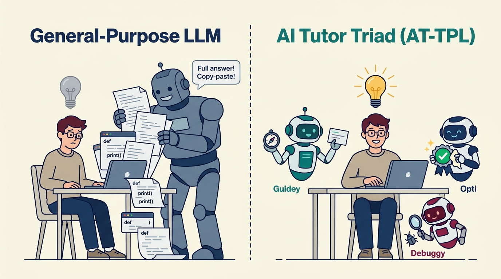
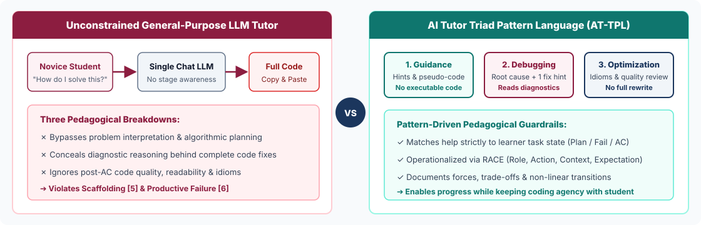
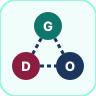
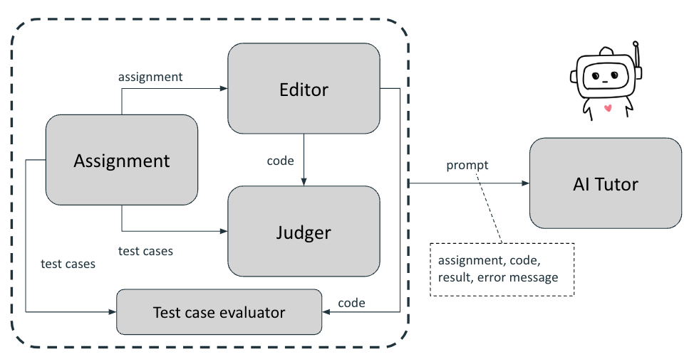
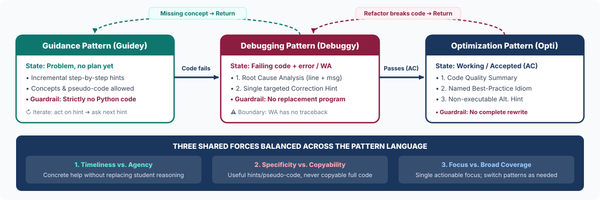
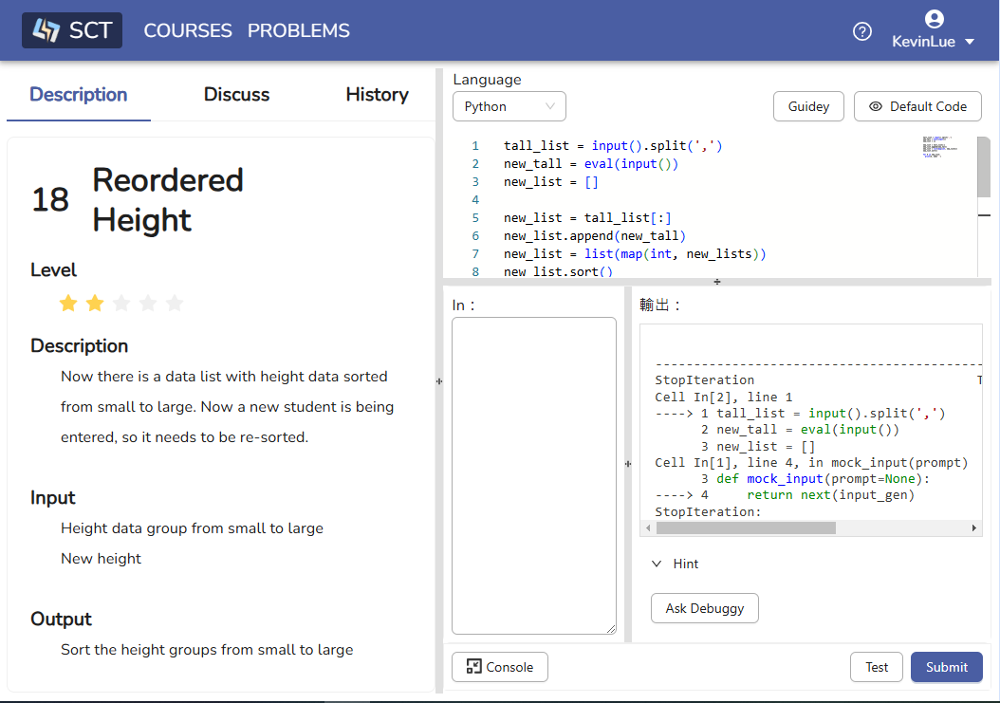
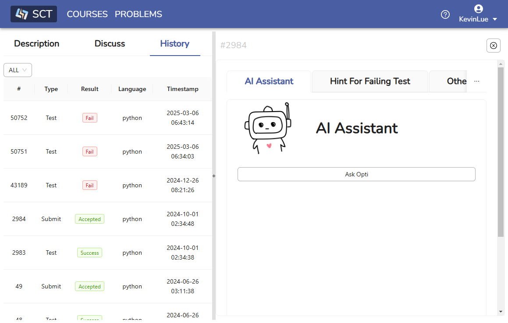
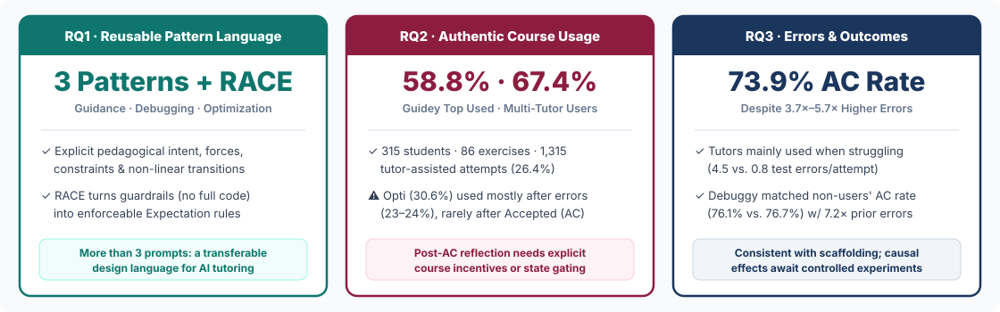

<!-- _class: lead -->

Journal of Information Science and Engineering (JISE) · 2026

# AI Tutor Triad Pattern: Structuring Conversational Guidance in Programming Education

<strong>AT-TPL</strong> (AI Tutor Triad Pattern Language): Decomposing LLM Programming Assistance into Specialized <strong>Guidance</strong>, <strong>Debugging</strong>, and <strong>Optimization</strong> Patterns via RACE Prompts in Smart Coding Tutor

<strong>Nien-Lin Hsueh+</strong>, <strong>Lien-Chi Lai</strong>, and <strong>Ying-Chang Lu</strong> 
Department of Information Engineering and Computer Science, Feng Chia University, Taichung, Taiwan 
<code>nlhsueh@fcu.edu.tw</code> · <code>p1000433@o365.fcu.edu.tw</code> · <code>m1305878@o365.fcu.edu.tw</code>

Supported by the National Science and Technology Council (NSTC), Taiwan R.O.C., under grant NSTC 114-2221-E-035-077.

<!--
Bibliographic & Research Overview:
This paper (Hsueh, Lai, & Lu, Department of Information Engineering and Computer Science, Feng Chia University, Taichung, Taiwan; JISE 2026, supported by NSTC grant 114-2221-E-035-077) introduces the AI Tutor Triad Pattern Language (AT-TPL) for introductory programming education.

Core Thesis:
Rather than exposing students to an unconstrained, general-purpose Large Language Model (LLM) chat interface, AT-TPL decomposes recurring programming help-seeking situations into three specialized, interconnected pedagogical patterns: Guidance (problem understanding and initial planning), Debugging (error diagnosis and targeted repair), and Optimization (post-correctness reflection on readability, efficiency, and idiomatic practices).

Empirical Scope:
Each pattern is formally documented using the classic pattern-language schema (intent, motivation, context, problem, forces, solution, consequences, and related patterns), operationalized in the Smart Coding Tutor (SCT) online judge via the RACE prompt framework, and observed across an authentic Fall 2024 university Python course (315 students, 86 exercises, 4,982 total attempts, 1,315 tutor-assisted attempts).
-->

---

## Opening Hook: "Here's the Full Answer!" ... Wait, What Did You Learn?

<strong>The Core Idea:</strong> A general-purpose LLM dumps copy-paste solutions that bypass student thinking. <strong>AT-TPL</strong> replaces one generic chat with a <strong>triad of specialized AI tutor patterns</strong> — <strong>Guidey</strong>, <strong>Debuggy</strong>, and <strong>Opti</strong> — calibrated to each stage of programming work.

<!--
Pedagogical Problem Framing:
General-purpose LLMs can immediately produce explanations, debugging advice, and complete executable programs [1, 2, 3], yet this responsiveness frequently undermines learning. As Hellas et al. [14] and Prather et al. [4] observe, unconstrained models often supply full solutions that were never requested or lack calibration to the learner's current task state.

Why Decomposing into a Triad Matters:
Novice programmers must simultaneously translate problem statements into abstract logical structures, master syntax, interpret diagnostics, and develop problem-solving strategies. When executable code is handed over immediately, students lose the cognitive work of interpreting input/output specifications, designing algorithms, and tracing faults. AT-TPL addresses this by replacing a single monolithic chat persona with three state-aligned tutor patterns: Guidey (initial planning without executable code), Debuggy (root-cause diagnosis anchored in tracebacks without full replacement code), and Opti (post-acceptance code quality review without full rewrites).
-->

---

## Presentation Outline

1

[**Introduction & Research Questions**](#4)
Why general-purpose LLMs undermine scaffolding and our three core RQs.

2

[**Related Work & Comparison**](#6)
Comparing CodeHelp, CS50 tools, CodeAid, and Iris against AT-TPL (Table 1).

3

[**SCT & AT-TPL Pattern Language**](#7)
System design, shared forces, non-linear transitions, RACE prompts, and all 3 patterns.

4

[**Empirical Course Deployment**](#14)
315 students, 86 Python exercises, 1,315 tutor-assisted attempts, error & AC analysis.

5

[**Discussion & Pedagogical Trade-Offs**](#18)
Specificity vs. cognitive offloading, state gating, and proficiency effects.

6

[**Conclusion & Future Work**](#19)
Visual synthesis of RQ1–RQ3 conclusions and 3-pillar research roadmap.

<!--
Paper Organization & Analytical Progression:
Section 1 (Introduction) motivates why unconstrained LLMs conflict with scaffolding and productive failure, and frames the study's observational design: documenting what help students seek and how LLMs can be structured before conducting controlled causal comparisons.
Section 2 (Related Work) synthesizes literature on LLM code generation, prompt engineering, pattern languages, and four guardrail-based AI tutors (CodeHelp, CS50 tools, CodeAid, and Iris).
Section 3 (Smart Coding Tutor & AT-TPL) details the SCT online judge architecture, the RACE prompt framework, shared forces, state-driven pattern transitions, and full specifications for Guidey, Debuggy, and Opti.
Section 4 (Empirical Study) reports usage distributions, state-alignment vs. state-mismatch findings, error-frequency disparities, acceptance outcomes, and course-level historical context.
Section 5 (Discussion & Conclusion) examines recurring pedagogical trade-offs (specificity vs. cognitive offloading, state gating vs. autonomy, proficiency differences) and outlines three future research directions.
-->

---

## 1.1 Motivation: Why General-Purpose LLM Tutors Fall Short

<strong>Pedagogical Grounding:</strong> Effective tutoring follows <strong>Scaffolding</strong> [5] (enable progress without replacing the learner's work) and <strong>Productive Failure</strong> [6] (help learners organize and refine ideas after initial struggle) — requiring explicit constraints on <em>what</em> and <em>when</em> an LLM replies.

<!--
Theoretical Foundations:
1. Scaffolding (Wood, Bruner, & Ross, 1976 [5]): Effective instructional support enables a learner to make progress on tasks just beyond independent reach while leaving responsibility for the cognitive work with the learner. Providing complete executable code violates this principle by substituting the tutor's reasoning for the student's.
2. Productive Failure (Kapur, 2008 [6]): Allowing learners to wrestle with an initial attempt before receiving targeted instructional consolidation helps them organize, test, and refine their own mental models. Premature, over-complete LLM outputs short-circuit this productive struggle.
3. Empirical Evidence on Unconstrained LLMs: Prior studies show that while Codex and ChatGPT can boost immediate completion rates [10, 11], outcomes depend heavily on how students interact with the tool and how prompts are worded [3]. Savelka et al. [8] further demonstrate that GPT-4 easily passes introductory programming assessments, highlighting the urgency of explicit pedagogical constraints on both what an LLM outputs and when it intervenes [7].
-->

---

## 1.2 Research Focus & Three Guiding Questions

Before testing causal efficacy in controlled trials, we first investigate **what help students seek** and **how LLMs should be structured** *(revealed step-by-step)*:

* 

RQ1 How do we turn ad-hoc prompts into a reusable pedagogical design language?

<strong>How can LLM programming assistance be structured as a pattern language (AT-TPL)</strong> specifying intent, forces, RACE guardrails, and state-driven transitions?

* 

RQ2 Which forms of AI help do students actually reach for in a real course?

<strong>How do learners use Guidance, Debugging, and Optimization patterns</strong> across task states in an authentic 315-student Python course?

* 

RQ3 Who uses the AI tutors, and do struggling students reach working solutions?

<strong>How does tutor usage relate to student error frequencies and final Accepted (AC) outcomes</strong> compared with non-assisted attempts?

<!--
Methodological Rationale for an Observational First Step:
The authors explicitly position this work as an observational field study rather than a randomized controlled trial. Their epistemological argument is sequential: before testing whether one AI tutoring intervention causally outperforms another, educators must first establish (1) a formal design vocabulary for structuring stage-specific AI support and (2) an empirical account of what kinds of help students actually seek in an authentic course.

Alignment with the Paper's Contributions:
- RQ1 (Design Formalization): Adapts Alexander's pattern-language tradition [15] and White et al.'s prompt-pattern catalog [16] into a domain-grounded educational pattern language (AT-TPL) that separates pedagogical design principles from concrete RACE prompt realizations.
- RQ2 (Authentic Usage Patterns): Examines voluntary pattern selection across 4,982 attempts (1,315 tutor-assisted) to verify whether students naturally differentiate among planning, debugging, and optimization support, and to detect behavioral mismatches such as premature use of Opti.
- RQ3 (Struggle & Recovery Profile): Compares error frequencies across testing, submission, and runtime phases alongside final judge verdicts (AC, PA, WA, RE) between tutor-assisted and independent attempts, establishing baseline evidence for future quasi-experimental evaluations.
-->

---

## 2. Related Work: Comparing AI Programming Tutors (Table 1)

Existing guardrail tutors embed help-to-situation mappings implicitly inside tool-specific UIs; **AT-TPL** formalizes them as a reusable pattern language.

| AI Tutor | Help-Seeking Situations Covered | Forms of AI Assistance & Guardrails |
| :--- | :--- | :--- |
| **CodeHelp** [17, 18] | Cannot start or cannot fix code *(undistinguished single form)* | Hints, conceptual explanation, root cause & correction hints *(2nd LLM strips code)* |
| **CS50 tools** [21] | Start, fix code, or improve style *(across separate tools)* | Hints, code explanation, root cause hints, `style50` syntactic formatting rules |
| **CodeAid** [19] | Cannot start or cannot fix code *(5 user-selected templates)* | Hints, explanation, pseudo-code; root cause & correction hints |
| **Iris** [20] | Cannot start or cannot fix code *(single chat role)* | Strictest uniform guardrail: subtle hints & counter-questions only *(no pseudo-code)* |
| **AT-TPL (Ours)** | **Start, fix failing code, AND refine post-AC code *(3 patterns)*** | **Calibrated per state: Hints/pseudo-code (`Guidey`); Root cause (`Debuggy`); Quality/idioms (`Opti`)** |

<strong>Key Insight:</strong> Prompt constraints are a <em>design intent rather than an absolute guarantee</em> (e.g., CS50 Duck occasionally leaked fixes [22]), making explicit documentation of forces, consequences, and safeguards essential.

<!--
Comparative Analysis of Guardrail-Based AI Tutors:
Prior systems embed pedagogical constraints inside tool-specific interfaces, differing along two key dimensions:
1. Coverage of Help-Seeking Situations:
   - CodeHelp [17, 18] uses a single request form collecting optional code and error messages without distinguishing initial planning from debugging at the role level; it relies on a secondary LLM pass to strip executable code blocks.
   - Iris [20] integrates exercise statements, student code, and build/test feedback into a single chat role with the strictest uniform constraint: subtle hints, counter-questions, and general best-practice suggestions only, prohibiting executable code, pseudo-code, and concrete steps even during debugging.
   - CodeAid [19] separates starting and debugging across five user-selected feature templates (including General Question, Help Write Code, Help Fix Code, and standalone line-by-line code explanation) and permits pseudo-code during initial guidance.
   - CS50 tools [21] span all three situations across separate utilities (CS50 Duck, Explain Highlighted Code, and style50), but style50 enforces syntactic formatting rules rather than post-acceptance algorithmic efficiency or idiomatic refactoring.

Distinctive Contribution & Shared Limitation:
AT-TPL formalizes all three situations—including post-AC code quality via Optimization—into a reusable pattern language with explicit context, forces, consequences, and transitions. Importantly, the paper cites Yang et al. [22] showing that CS50 Duck occasionally leaked corrected code during debugging despite prompt constraints; hence, prompt rules constitute design intent rather than an absolute guarantee, a caveat that equally applies to AT-TPL's RACE prompts.
-->

---

## 3.1 Smart Coding Tutor (SCT): Online Judge + AI Assistants

Fig. 1: Architecture of the Smart Coding Tutor (SCT) online judge system

### ⚙️ Integrated Learning Loop
- Combines **Assignment Module**, **Code Editor**, **Automated Judger**, **Hidden Test-Case Evaluator**, and **AI Tutors**.
- Passes rich context (`assignment`, `code`, `verdict`, `error message`) to the selected tutor pattern.

### 📋 Six Submission Verdicts
- **AC** (Accepted): Passes all hidden test cases.
- **PA** (Partially Accepted): Passes a subset only.
- **RE** (Runtime Error): Division by zero, index/memory error.
- **WA** (Wrong Answer): Runs but outputs wrong result.
- **TLE** (Time Limit Exceeded) · **CE** (Compilation Error).

<!--
System Architecture & Pedagogical Loop:
Smart Coding Tutor (SCT) is an online judge platform [9] combining an assignment module, an in-browser code editor, an automated judger, a hidden test-case evaluator, and embedded AI assistants. Hidden test cases serve a dual pedagogical function: objectively verifying functional correctness while prompting novices to consider boundary conditions, edge cases, and alternative algorithms in an iterative software-development workflow.

Contextual Grounding of AI Tutors:
Because the AI assistants operate inside the online judge environment, every tutor invocation is grounded in structured execution context—including the problem specification, input/output format rules, the student's current code, submission verdicts, and compiler/runtime tracebacks—rather than relying solely on a novice's potentially vague verbal description.

Automated Judge Verdict Taxonomy:
SCT classifies submissions into six standard verdicts that operationally define the learner's task state:
- AC (Accepted): Satisfies all constraints and passes every hidden test case.
- PA (Partially Accepted): Passes only a subset of hidden test cases (often signaling edge-case defects).
- RE (Runtime Error): Terminates abnormally during execution (e.g., division by zero, index out-of-bounds, memory violation).
- WA (Wrong Answer): Executes to completion without exceptions but produces incorrect output.
- TLE (Time Limit Exceeded): Exceeds the execution time budget (inefficient algorithmic complexity or infinite loop).
- CE (Compilation Error): Fails syntax parsing/compilation prior to execution.
-->

---

## 3.2 AT-TPL as a Pattern Language: Transitions & Shared Forces

AT-TPL is **not** three isolated prompts — it is an interconnected pattern language governed by **learner task states** and **three shared forces**.

<!--
Pattern-Language Formalism:
Following Alexander et al. [15], AT-TPL treats the three tutors not as isolated prompt templates but as an interconnected language where every pattern shares an eight-part schema: Intent, Motivation, Context, Problem, Forces, Solution (split into design principles and RACE prompt realization), Consequences, and Related Patterns.

Three Shared Forces Across the Language:
1. Timeliness & Concreteness vs. Independent Reasoning: Learners require actionable, timely help, yet overly complete responses displace their own problem-solving effort.
2. Specific Artifact Utility vs. Copy-Paste Risk: Concrete artifacts (examples, fixes, refactored code) are maximally informative, yet executable artifacts can be copied without comprehension.
3. Focused Scope vs. Unaddressed Root Gaps: Restricting a response to a single issue preserves usability and prevents cognitive overload, yet the learner's true underlying difficulty may lie outside that narrow focus.

Non-Linear State Transitions & Partial Adoption:
Although the canonical workflow progresses from Guidance (problem without plan, or code written but not yet executed) to Debugging (failing code) to Optimization (working AC solution), transitions are non-linear: a debugging failure exposing a conceptual gap routes back to Guidance, and an optimization edit introducing a defect routes back to Debugging. Empirically, 67.4% of AI-using students combined multiple patterns across the semester. A notable boundary case is Wrong Answer (WA): it represents a failure without an exception traceback, leaving Debugging with weaker diagnostic input. Finally, the language supports partial instantiation (e.g., deploying only Debugging remains a valid subset) and future extension.
-->

---

## 3.3 The RACE Prompt Framework: Structuring AI Tutors

**RACE** [23] decomposes LLM instructions into four structured prompt engineering slots:

### 🎭 **R** — Role
Defines the AI's **persona, expertise, and pedagogical stance**.
- *In AT-TPL*: Anchors an educator who withholds full answers or a debugging specialist.

### 🎯 **A** — Action
Specifies the exact **single task or verb** the AI must perform.
- *In AT-TPL*: Limits help to hints only, isolating one root cause, or one quality issue.

### 🧩 **C** — Context
Provides **background, artifacts, and the learner's task state**.
- *In AT-TPL*: Supplies problem & I/O specs, failing code + tracebacks, or working AC code.

### 🛡️ **E** — Expectation
Sets strict **output format, length, style, and guardrail rules**.
- *In AT-TPL*: Enforces **no executable code**, no greetings, and 2- or 3-part responses.

<strong>Why RACE?</strong> AT-TPL is framework-agnostic, yet RACE is chosen because <code>Role / Action / Context</code> map directly to tutor, help type, and learner state, while <code>Expectation</code> gives <strong>pedagogical guardrails</strong> explicit output rules.

<!--
Definition & Rationale of the RACE Prompt Framework (Section 3.2):
Prompt engineering is essential for controlling LLM behavior in human-computer interaction. This study adopts RACE [23] (Role, Action, Context, Expectation), a general four-component prompt structure not specific to education:
- Role: Defines the AI's persona, domain expertise, and pedagogical stance (e.g., an educator encouraging independent reasoning vs. a debugging specialist).
- Action: Specifies the exact task or verb the AI must execute, narrowing scope to a single form of help so open-ended phrasing does not invite full solutions.
- Context: Supplies necessary background, learner artifacts, and execution state (problem + I/O rules without code; failing code + traceback; or a working program).
- Expectation: Constrains output format, length, style, and explicit pedagogical rules (e.g., withholding executable Python code, omitting greetings, enforcing structured output sections).

Framework Independence vs. Practical Fit:
The authors note that AT-TPL does not depend exclusively on RACE—any prompt framework providing an explicit slot for output constraints can implement the patterns. RACE was chosen specifically because (1) Role, Action, and Context align naturally with the tutor persona, assistance type, and learner situation defined in each pattern, and (2) Expectation operationalizes pedagogical guardrails as unambiguous output rules.
-->

---

## 3.3 (Cont.) Implementing Patterns via RACE (Table 2)

We operationalize AT-TPL using **RACE** [23] because `Expectation` gives pedagogical guardrails an explicit home as output rules:

| Pattern | **R**ole (Stance & Expertise) | **A**ction (Single Help Type) | **C**ontext (Learner State) | **E**xpectation (Output Rules) |
| :--- | :--- | :--- | :--- | :--- |
| **Guidance** (`Guidey`) | Educator encouraging independent thinking *(withholds answers)* | Hints & conceptual explanation only *(avoids full solution)* | Problem statement & I/O rules; pseudo-code OK *(no code yet)* | **No executable code**; hints only; no greetings |
| **Debugging** (`Debuggy`) | Debugging expert + educator *(reads diagnostics)* | Isolate **1 root cause** & propose **1 fix** *(focuses on fault)* | Failing code + error message *(explain, do not guide)* | **2-part output** (Root Cause, Correction Hint); no full code |
| **Optimization** (`Opti`) | Educator in code quality & efficiency *(post-AC review)* | Identify **1 major issue** & **1 strategy** *(avoids overload)* | Working program; idiomatic Python reference | **3-part output** (Summary, Best Practice, Alt. Hint); **no rewrite** |

<strong>Domain Transferability:</strong> The pattern form and scaffolding stance transfer directly to math or language tutoring; only programming-specific <code>Context</code> & <code>Expectation</code> elements (I/O specs, tracebacks, AC verdict, Python idioms) are domain-bound.

<!--
Why the RACE Framework Is Used:
AT-TPL is conceptually independent of any single prompt engineering framework; any structured notation that supports explicit output constraints can implement it. The authors adopt RACE [23] (Role, Action, Context, Expectation) because its four slots map cleanly onto pattern elements and give pedagogical guardrails an explicit home:
- Role (R): Encodes both domain expertise and pedagogical stance (e.g., an educator who withholds answers vs. a debugging engineer who reads diagnostics).
- Action (A): Constrains the tutor to a single type of help (e.g., isolate one root cause, identify one major issue), preventing open-ended tasks that invite full solutions or overwhelm novices.
- Context (C): Specifies the exact learner artifact and state available at invocation (problem + I/O rules without code; failing code + traceback; or a functional program evaluated against idiomatic Python).
- Expectation (E): Operationalizes pedagogical guardrails as strict output formatting and prohibition rules (e.g., no executable Python code, no greetings, mandatory two-part or three-part response structures).

General vs. Domain-Specific Transferability:
The paper distinguishes domain-general tutoring principles (the pattern schema, Role framing, hints before answers, scaffolding without solving) from programming-specific elements residing in Context and Expectation (online-judge I/O specifications, exception tracebacks, AC verdicts, the pseudo-code vs. executable-code boundary, and idiomatic Python standards). Porting AT-TPL to mathematics or language learning preserves the pattern structure and general principles while substituting only those domain-bound Context and Expectation elements.
-->

---

## 3.4 Pattern 1: Guidance Pattern (`Guidey`)

### 🎯 Intent, Context & Forces
- **Intent**: Help construct an initial solution strategy while keeping implementation with the student.
- **Context**: Student has the problem & I/O rules, but does not know how to start *(button at top-right of editor)*.
- **Forces Balanced**:
  - Timely concrete help vs. replacing reasoning
  - Multiple constraints vs. cognitive overload
  - Clarifying via pseudo-code vs. copyable Python code

### 🛠️ RACE Solution
- **Small-step scaffolding**: Restate requirement, name concept, or suggest next sub-goal.
- **Incremental interaction**: Student acts on a hint, then requests another if still stuck.
- **Guardrail**: Pseudo-code permitted; **strictly no executable Python code** or greetings.

### ⚠️ Consequences, Risks & Transitions
- **Benefits**: Provides a structured entry point while keeping coding agency with the learner.
- **Trade-offs & Risks**:
  - *Lower immediate satisfaction*: Hints feel less convenient than full solutions.
  - *Hint-chaining*: Students may request hints back-to-back without acting, shifting reasoning to the AI.
  - *Unverified misdirection*: A misread problem statement has no program output to catch it.
  - *Proficiency gap* [4]: Redundant for strong students; pseudo-code may still feel abstract for novices.
- **Transitions**: Failing implementation ➔ **Debugging**; working solution ➔ **Optimization**.

<!--
Full Pattern Specification (Section 3.4.1):
- Context & UI Placement: Triggered when a student has received an assignment with requirements and I/O constraints, is planning or writing initial code, and does not know how to start. Accessible via the Guidey button at the top-right of the SCT code editor (Fig. 2a).
- Exact Deployed RACE Prompt:
  * Role: "You are an excellent programming educator who provides clear guidance and encourages independent thinking. As a Python teaching assistant, you focus on guiding students through problem-solving."
  * Action: "Provide step-by-step guidance, hints, and conceptual explanations to lead the student to a correct and efficient solution."
  * Context: Specifies that the problem has requirements, I/O rules, and format constraints; explicitly permits pseudo-code as a teaching tool while strictly prohibiting executable Python code.
  * Expectation: Forbids executable Python code to prevent copying, forbids greetings to maintain focus, and restricts output to hints and guidance without direct answers.
- Interaction-Level Scaffolding: Cognitive load is controlled incrementally—students are expected to act on one hint (e.g., restating a requirement, naming a concept, or tackling the next sub-goal) before requesting another.

Documented Consequences & Risks:
1. Reduced Immediate Satisfaction: Students seeking rapid homework completion may perceive hints as less helpful than complete solutions.
2. Hint-Chaining Risk: Because another hint is always available, learners may repeatedly request hints without attempting code, effectively transferring reasoning to the tutor.
3. Unverified Misdirection: If the LLM misinterprets a subtle problem constraint, the student has no execution output yet to detect the flawed plan.
4. Proficiency Moderation [4]: Step-by-step hints can feel redundant and slow for students who already have a workable plan, whereas pseudo-code may remain too abstract for complete novices.
-->

---

## 3.5 Pattern 2: Debugging Pattern (`Debuggy`)

Fig. 2a: SCT interface — <code>Guidey</code> (top-right) &amp; <code>Ask Debuggy</code> (below console error)

### 🔍 Explicit Diagnosis, Student-Owned Fix
- **Intent**: Isolate the cause of a concrete failure and guide a targeted correction.
- **RACE Solution**: References exact **traceback + failing line**; enforces **2-part output**:
  1. *Root Cause Analysis* (concise why)
  2. *Correction Hint* (targeted fix / pseudo-code, **no full program**)

### ⚠️ Boundary Case & Risks
- **Wrong Answer (WA) gap**: No traceback exists, weakening diagnostic input and raising incomplete-diagnosis risk [14].
- **Diagnostic dependency**: Beginners may apply fixes without learning to read tracebacks themselves.
- **Transitions**: Missing concept ➔ **Guidance**; passing code ➔ **Optimization**.

<!--
Full Pattern Specification (Section 3.4.2):
- Context & UI Placement: Triggered when a student holds non-functional code along with an error message or failed judge result. As shown in Fig. 2a, Ask Debuggy appears directly beneath the console error output while Guidey remains at the top-right of the editor.
- Exact Deployed RACE Prompt:
  * Role: "You are an expert Python Debugging Engineer and an effective educator" specializing in isolating runtime and syntax errors with clear, targeted explanations.
  * Action: Analyze code and error output, isolate the single most likely root cause, and propose the single best fix (avoiding exhaustive multi-issue lists that obscure the immediate fault).
  * Context: Requires both the non-functional code snippet and complete error message (traceback); mandates referencing the error message and failing line explicitly, and shifts pedagogical mode ("Your task is not to guide, but to explain and correct the mistake").
  * Expectation: Enforces a two-part output—(1) Root Cause Analysis (concise explanation of why the error occurred) and (2) Correction Hint (a specific suggestion or pseudo-code fragment)—while prohibiting complete executable Python code.

Boundary Case & Pedagogical Trade-Offs:
- Single-Fix Commitment & WA Limitation: Committing to one root cause increases the risk of incomplete or inaccurate diagnosis, a known failure mode in LLM responses to novice requests [14]. This risk peaks on Wrong Answer (WA) verdicts, where no exception traceback exists; the prompt's requirement to cite an error message cannot be satisfied, forcing diagnosis solely from the problem statement, code, and judge verdict.
- Diagnostic Dependency: Because Debuggy demonstrates how to read the traceback, novices who gain the largest short-term relief also face the highest risk of applying correction hints passively without developing independent traceback-reading skills.
-->

---

## 3.6 Pattern 3: Optimization Pattern (`Opti`)

Fig. 2b: SCT History tab — <code>Ask Opti</code> assistant for post-solution quality review

### ✨ Post-AC Reflection Without Full Rewrites
- **Intent**: Foster readability, efficiency, and idiomatic Python *after* a working (`AC`) solution exists.
- **RACE 3-Part Output**:
  1. *Code Quality Summary* (strengths & gaps)
  2. *Named Best-Practice Suggestion* (e.g., list comprehension)
  3. *Non-Executable Alternative Hint* (**no full rewrite**)

### ⚠️ Prompt Limitation & Adoption Reality
- **Deployed prompt drift**: Role/Action emphasized *performance*, while Context emphasized *readability* — noted transparently for revision (Table 2).
- **Voluntary adoption**: Low post-AC motivation; students often clicked `Opti` *before* achieving AC (un-gated UI).

<!--
Full Pattern Specification (Section 3.4.3):
- Context & UI Placement: Intended for students who already have a functional program or an Accepted (AC) verdict and want to examine readability, efficiency, and idiomatic Python practices. Accessed via the Ask Opti button beneath "AI Assistant" in the SCT submission history tab (Fig. 2b).
- Exact Deployed RACE Prompt & Self-Reported Drift:
  * Deployed Role: "high-performance computing and efficiency analysis" educator focusing on Python best practices.
  * Deployed Action: Identify the most significant performance bottleneck, explain the optimization principle (e.g., reducing nested loops), and propose an optimization strategy.
  * Deployed Context: Functional code snippet; focus on readability, conciseness, and idiomatic Python (e.g., list comprehensions, built-in functions).
  * Deployed Expectation: Strict three-part output—(1) Code Quality Summary (strengths and areas for improvement), (2) Best Practice Suggestion (named principle/idiom), and (3) Alternative Solution Hint (non-executable description)—with no complete executable rewrite.
  * Transparent Implementation Critique: The authors explicitly acknowledge an internal inconsistency in the deployed prompt: Role and Action emphasized performance/HPC, whereas Context targeted readability and idioms. They classify this as an implementation flaw rather than a pattern flaw, specifying a revised design in Table 2 where Role is a code-quality educator and readability is primary, with efficiency secondary.

Adoption Reality & Risks:
Because AC signals task completion, voluntary Opti usage was lowest (30.6% of tutor-assisted attempts) and post-AC engagement was rare. Performance-framed advice risks encouraging premature optimization, and unfamiliar idioms can replace student-readable code with unmaintainable code. Moreover, because SCT did not gate Opti by task state, students frequently invoked it after submission errors (23.1%) and runtime errors (24.4%).
-->

---

## 4.1 Empirical Study: Authentic Course Deployment & Usage

Deployed in **Fall 2024** university Python course (Taiwan) across engineering, business, and social science majors:

315 Students

Across <strong>86 Python exercises</strong> in an authentic full-semester course

1,315 / 4,982

<strong>26.4%</strong> tutor-assisted attempts (73.6% completed independently)

67.4% Multi-Tutor

Of AI-using students combined <strong>more than one tutor pattern</strong>

### 📊 Pattern Usage Share Among 1,315 Tutor-Assisted Attempts *(non-exclusive; sum > 100%)*

<strong>Guidance (Guidey)</strong>

58.8% (773)

<strong>Debugging (Debuggy)</strong>

47.7% (627)

<strong>Optimization (Opti)</strong>

30.6% (402)

<!--
Study Setting & Unit of Analysis (Section 4.1):
- Course Context: Deployed during the 2024 Fall Semester in a university Python programming course in Taiwan enrolling 315 students across diverse majors (engineering, business, and social sciences) completing 86 programming exercises.
- Definition of an Attempt: One student's complete work sequence on a single exercise, aggregating all test runs, submissions, and AI tutor requests up to the final judge verdict.
- Corpus Volume: Out of 4,982 total attempts, 1,315 (26.4%) were tutor-assisted (at least one AI tutor request), while 3,667 (73.6%) were completed independently without AI assistance.

Usage Distribution & Multi-Pattern Adoption:
Among the 1,315 tutor-assisted attempts, individual pattern shares are non-exclusive (summing to 137.1% > 100%) because a single attempt frequently invoked multiple tutors:
- Guidance (Guidey): 58.8% (773 / 1,315 attempts), indicating that problem interpretation and initial algorithm planning represented the single largest source of novice help-seeking.
- Debugging (Debuggy): 47.7% (627 / 1,315 attempts).
- Optimization (Opti): 30.6% (402 / 1,315 attempts).
- Cross-Pattern Switching: At the student level, 67.4% of students who used AI tutors invoked more than one specialized pattern over the semester, empirically supporting the view that learners differentiate among distinct tutoring needs rather than relying on a single role.
-->

---

## 4.2 Usage Contexts: Expected vs. Observed Student Behavior

Observing *when* students invoked each pattern revealed both expected alignment and a striking behavioral mismatch:

### ✅ Debugging Context (Aligned)
- Testing-phase errors occurred in **37.5%** (`1,869 / 4,982`) of all attempts.
- **30.2%** (`564 / 1,869`) of those error-encountering attempts invoked **Debuggy**.
- High **Guidey (58.8%)** & **Multi-Tutor (67.4%)** use confirms students actively switch patterns across problem-solving stages.

### ⚠️ Optimization Context (State Mismatch!)
- **Intended context**: Post-`AC` reflection on code readability and Python idioms.
- **Observed reality**: Students rarely clicked `Opti` after `AC` — instead invoking it after:
  - **Submission errors**: **23.1%** (`373 / 1,614`)
  - **Runtime errors**: **24.4%** (`150 / 615`)
- **Why?** Because `Opti` was **not gated by task state**, struggling students treated it as another general help button, and stopped once `AC` signaled task completion.

<strong>Design Takeaway:</strong> Separating patterns conceptually is not enough — supporting post-acceptance code quality requires <strong>state-based UI gating</strong> or <strong>explicit course incentives</strong>.

<!--
State-Alignment Analysis (Section 4.1):
Evaluating when each tutor was called relative to execution events reveals a sharp contrast between Debugging and Optimization:

1. Debugging Context (Strong Alignment):
   - Testing-phase errors occurred in 37.5% (1,869 / 4,982) of all course attempts.
   - Among those error-encountering attempts, 30.2% (564 / 1,869) invoked Debuggy, closely matching the pattern's intended context (failing code with diagnostic output).

2. Optimization Context (Pronounced State Mismatch):
   - Across all 4,982 attempts, submission errors occurred in 32.4% (1,614 / 4,982) and runtime errors occurred in 12.3% (615 / 4,982).
   - Opti was invoked in 23.1% (373 / 1,614) of attempts with submission errors and 24.4% (150 / 615) of attempts with runtime errors.
   - Conversely, continued interaction with Opti after reaching an Accepted (AC) verdict was rare.

Underlying Mechanisms & Design Implications:
Two structural factors explain this mismatch: (a) an AC verdict provides strong psychological closure, leaving little intrinsic incentive to refactor working code unless explicitly graded or structured into course activities; and (b) because SCT left the Opti button unconstrained by task state, struggling students treated Opti as an additional fallback help button when stuck on errors. Introducing state-based UI gating (enabling Opti only post-AC) would eliminate state misuse, though at the trade-off of restricting learner autonomy.
-->

---

## 4.3 Errors & Acceptance Outcomes (Table 3 & Debuggy Analysis)

73.9% AC Rate

<strong>972 / 1,315</strong> tutor-assisted attempts reached Accepted (PA: 12.6%, WA: 3.3%, RE: 2.7%)

3.7× – 5.7× Errors

Tutor users had far more errors, showing tutors were sought <strong>when struggling</strong>

76.1% vs. 76.7%

Debuggy users matched non-users' AC rate despite <strong>7.2 vs. 1.0</strong> prior test errors

### 📊 Mean Errors per Attempt (Table 3)
| Error Phase | With AI Tutor | Without AI Tutor | Ratio |
| :--- | :---: | :---: | :---: |
| **Testing Errors** | **4.5** *(max 99)* | 0.8 | **5.7×** |
| **Submission Errors** | **3.3** *(max 68)* | 0.6 | **5.1×** |
| **Runtime Errors** | **0.7** *(max 20)* | 0.2 | **3.7×** |

### 🛡️ Debugging Scaffolding Signal
- Among **1,869** attempts with testing errors:
  - **Debuggy users** (`n = 564`): **76.1% AC** (`429/564`), only **2.5%** (`14/564`) remained stuck in CE/RE — despite **7.2×** more test errors beforehand.
  - **Non-users**: **76.7% AC** (with only 1.0 test error).
- *Consistent with* a scaffolding effect, though self-selection prevents causal proof.

<!--
Error Profile & Outcome Analysis (Section 4.2):
1. Overall Verdict Distribution (1,315 Tutor-Assisted Attempts):
   - Accepted (AC): 73.9% (972 / 1,315)
   - Partially Accepted (PA): 12.6%
   - Wrong Answer (WA): 3.3%
   - Runtime Error (RE): 2.7%
   (Remaining ~7.5% reflect other non-AC terminal states such as CE/TLE or unsubmitted runs.)

2. Error Disparity Between Tutor-Assisted vs. Independent Attempts (Table 3):
   - Testing-phase errors: mean 4.5 (max 99 in a single attempt) with AI tutor vs. 0.8 without (5.7x ratio).
   - Submission errors: mean 3.3 (max 68) with AI tutor vs. 0.6 without (5.1x ratio).
   - Runtime errors: mean 0.7 (max 20) with AI tutor vs. 0.2 without (3.7x ratio).
   Interpretation: High error counts indicate that students primarily triggered AI tutors when encountering genuine difficulty; the authors caution that error counts reflect help-seeking under struggle rather than serving as a direct proxy for baseline programming ability.

3. Focused Comparison on Testing-Error Attempts (n = 1,869):
   - Attempts that invoked Debuggy (n = 564) had experienced substantially more prior testing errors (mean 7.2 vs. 1.0 for non-Debuggy error attempts), yet achieved a 76.1% AC rate (429 / 564)—virtually matching the 76.7% AC rate of non-Debuggy attempts—with only 2.5% (14 / 564) remaining stuck in CE or RE.
   - Causal Caveat: Because students self-selected whether to invoke tutors, this convergence is consistent with a scaffolding effect for struggling learners but does not constitute causal proof.
-->

---

## 4.4 Course-Level Context & Methodological Honesty

### 📈 Historical Cohort Context
- Relative to earlier offerings of the same Python course:
  - **Class average score**: ~55 ➔ **~75**
  - **Course dropout rate**: ~10% ➔ **~2%**
- **Transparent Framing**: Cohort, instruction, and assessment also changed across semesters; reported strictly as **deployment context**, *not* causal proof of AI tutor impact.

### 🔬 Observational Scope & Limitations
- **Self-selection bias**: Students freely chose whether and which tutor to invoke; comparisons are descriptive.
- **Prompt guardrails ≠ guarantee**: As seen in CS50 Duck [22], LLM prompts express design intent; post-generation checks or audits are needed to verify zero code leakage.
- **Why observe first?** Knowing *which* help students actually seek is a prerequisite for designing fair controlled comparisons.

<!--
Course-Level Historical Context (Section 4.3):
Compared with earlier offerings of the same introductory Python course, the Fall 2024 deployment coincided with two notable macro-level shifts:
- Class average score rose from approximately 55 to approximately 75.
- Course dropout rate fell from nearly 10% to approximately 2%.

Epistemological Boundaries & Methodological Caveats:
1. Confounding Factors in Historical Comparisons: Cohort composition, instructional delivery, and assessment design all changed across semesters. The authors explicitly report these course-level shifts strictly as ecological deployment context and decline to attribute them causally to SCT or AT-TPL.
2. Self-Selection Bias: Within the semester, students freely decided whether and when to request AI support, preventing clean causal isolation of tutor efficacy from learner motivation or persistence.
3. Guardrail Compliance Is Not Guaranteed: Echoing findings from CS50 Duck [22], RACE Expectation rules encode pedagogical intent rather than deterministic enforcement; without automated post-generation filters (like CodeHelp's secondary LLM pass [17] or Iris's self-checks [20]) or response audits, occasional leakage of executable code remains possible.
4. Value of Observational Groundwork: Documenting authentic help-seeking distributions and state-mismatch failure modes provides the empirical prerequisites needed to design fair, well-calibrated controlled comparisons in future work.
-->

---

## 5. Discussion: Recurring Trade-Offs & Design Safeguards

Across all three patterns, one fundamental tension recurs: **making help more concrete and usable simultaneously opens the door to cognitive offloading**.

### ⚖️ 1. Specificity vs. Agency
- AT-TPL does not magically eliminate over-reliance; instead, it **pinpoints exactly where the risk arises** (e.g., hint-chaining in `Guidey`, skipping traceback reading in `Debuggy`).
- Enables targeted safeguards: **hint budgets**, **explain-before-next-hint** prompts, and **gradual fading**.

### 🚪 2. State Gating vs. Autonomy
- Leaving `Opti` un-gated led to **23%–24% misuse after errors** instead of post-AC reflection.
- **Task-state gating** (unlocking `Opti` only after `AC`) prevents mismatch at the cost of restricting learner choice — a deliberate course-level trade-off.

### 🎓 3. Proficiency-Dependent Effects
- **Beginners**: Gain the most immediate relief from `Debuggy`, but face the highest risk of diagnostic dependency and unmaintainable `Opti` idioms.
- **Advanced learners**: Find `Guidey`'s step-by-step hints slow, yet benefit most from `Opti`'s best-practice vocabulary.

<!--
Synthesis of Cross-Pattern Pedagogical Tensions (Sections 3.4 & 5):
A single structural tension recurs across Guidance, Debugging, and Optimization: increasing the specificity and immediate utility of AI assistance simultaneously widens the opportunity for students to substitute the tutor's reasoning for their own. AT-TPL does not eliminate this risk; rather, its formal Consequences analysis pinpoints the exact interaction points where over-reliance emerges so course designers can deploy targeted safeguards.

Three Core Design Axes:
1. Specificity vs. Learner Agency:
   - Risk nodes: sequential hint-chaining in Guidey without intervening code edits; passive fix application in Debuggy without learning to parse tracebacks.
   - Recommended safeguards: interaction-level hint budgets, mandatory self-explanation prompts (requiring learners to explain a fix before unlocking further hints), and gradual scaffolding fading.
2. State-Based Gating vs. Learner Autonomy:
   - Un-gated Opti access produced 23.1% (submission-error) and 24.4% (runtime-error) off-state invocations while post-AC usage remained rare.
   - Locking Opti until an AC verdict enforces pedagogical alignment, while pairing it with explicit reflection assignments or rubric incentives addresses post-AC motivational drop-off.
3. Proficiency-Dependent Effects [4]:
   - Novices gain the largest short-term recovery from Debuggy yet face the highest risks of diagnostic dependency, abstract pseudo-code barriers in Guidey, and unmaintainable idiomatic rewrites in Opti.
   - More proficient learners may find incremental Guidey hints redundant yet possess the foundational fluency needed to internalize Opti's named best-practice vocabulary.
-->

---

## 6. Conclusion & Future Work

<strong>🧪 1. Quasi-Experimental Trials</strong> Compare AT-TPL against (a) 1-line role-only LLMs without pattern guardrails and (b) full-solution tutors.

<strong>🎛️ 2. Adaptive Scaffolding & Fading</strong> Adapt hint granularity to learner proficiency, fade support over time, and require self-explanations.

<strong>🧩 3. Expand the Pattern Language</strong> Add Reflection, Test-Case Reasoning, and Code-Reading patterns beyond the core triad.

<!--
Summary of Contributions (Section 5):
AT-TPL advances AI-assisted programming education beyond ad-hoc prompt crafting by contributing:
1. A formal, reusable three-pattern design language (Guidance, Debugging, Optimization) specifying shared forces, eight-part pattern documentation, and non-linear state transitions.
2. A concrete RACE-based operationalization inside Smart Coding Tutor (SCT) with explicit Expectation guardrails and transparent documentation of implementation limitations (such as Opti's performance-vs.-readability prompt drift).
3. An empirical account from 315 students across 86 exercises (4,982 attempts; 1,315 tutor-assisted), demonstrating 67.4% multi-tutor adoption, 73.9% overall AC rate among assisted attempts, 76.1% AC recovery among heavily struggling Debuggy users (7.2 vs. 1.0 prior test errors), and the practical necessity of task-state gating for post-AC optimization.

Three-Pillar Future Research Agenda:
1. Controlled / Quasi-Experimental Comparisons: Evaluate AT-TPL against two specific baselines—(a) a general-purpose LLM given only one-line role labels without pattern guardrails (isolating what pattern constraints add beyond persona labels) and (b) an unconstrained full-solution tutor (quantifying what learning is lost when guardrails are removed).
2. Adaptive Scaffolding & Anti-Reliance Mechanisms: Dynamically adjust hint granularity to learner proficiency and interaction history, fade scaffolding over time, and require learner self-explanations before additional support.
3. Pattern-Language Expansion: Extend the core triad with additional recurring programming-learning patterns, specifically a Reflection Pattern, a Test-Case Reasoning Pattern, and a Code-Reading Pattern.
-->

---

<!-- _class: closing -->

# Thank You for Your Attention!

AI Tutor Triad Pattern: Structuring Conversational Guidance in Programming Education

<strong>Nien-Lin Hsueh+</strong> &nbsp;·&nbsp; <code>nlhsueh@fcu.edu.tw</code> 
<strong>Lien-Chi Lai</strong> &nbsp;·&nbsp; <code>p1000433@o365.fcu.edu.tw</code> &nbsp;|&nbsp; <strong>Ying-Chang Lu</strong> &nbsp;·&nbsp; <code>m1305878@o365.fcu.edu.tw</code> 
Department of Information Engineering and Computer Science, Feng Chia University 
Journal of Information Science and Engineering (JISE), 2026 · Grant: NSTC 114-2221-E-035-077

<!--
Reference & Archival Metadata:
- Title: AI Tutor Triad Pattern: Structuring Conversational Guidance in Programming Education
- Authors: Nien-Lin Hsueh (corresponding author, nlhsueh@fcu.edu.tw), Lien-Chi Lai (p1000433@o365.fcu.edu.tw), and Ying-Chang Lu (m1305878@o365.fcu.edu.tw)
- Affiliation: Department of Information Engineering and Computer Science, Feng Chia University, Taichung, Taiwan
- Venue: Journal of Information Science and Engineering (JISE), 2026
- Funding: National Science and Technology Council (NSTC), Taiwan R.O.C., grant NSTC 114-2221-E-035-077
- Keywords: pattern language, programming education, large language model, pedagogical scaffolding, online judge system
-->

