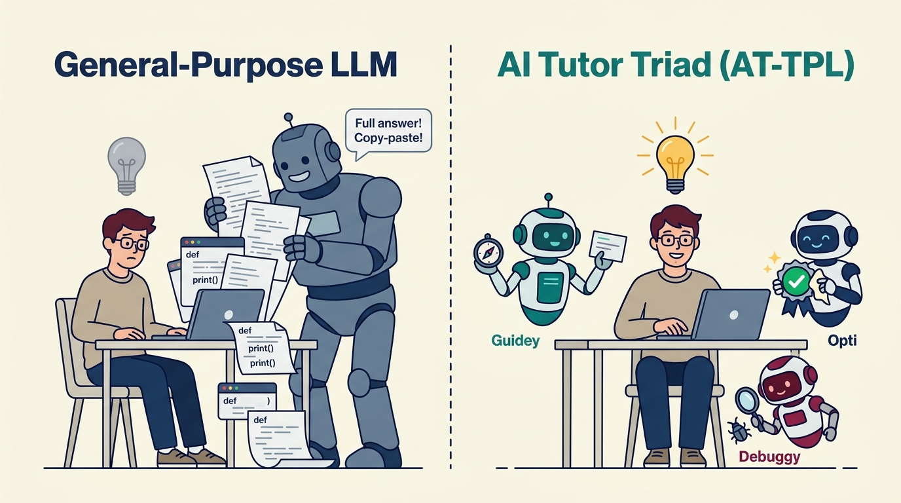
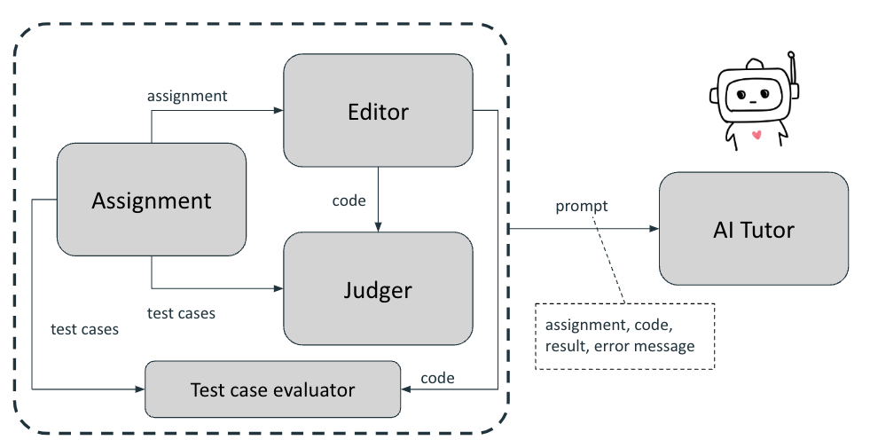
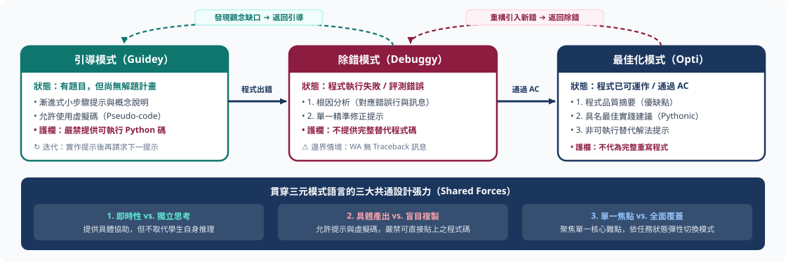
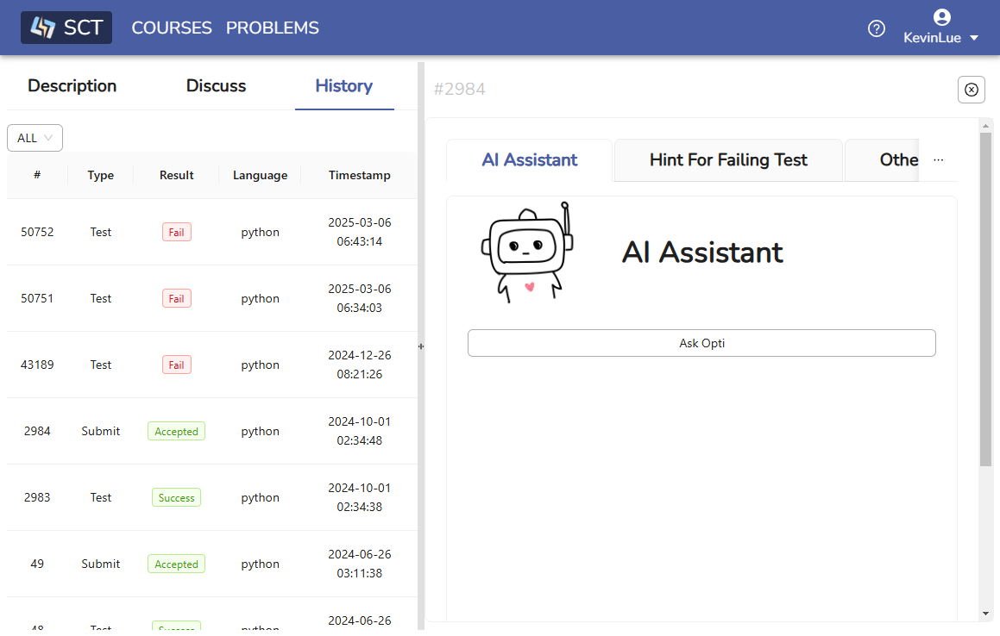
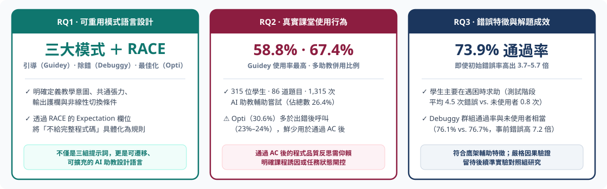

<!-- _class: lead -->

Journal of Information Science and Engineering (JISE) · 2026

# AI 助教三元模式：結構化程式設計教育中的對話式引導

AI Tutor Triad Pattern: Structuring Conversational Guidance in Programming Education

提出 <strong>AT-TPL（AI 助教三元模式語言）</strong>：將程式學習輔助解構為<strong>引導（Guidance）</strong>、<strong>除錯（Debugging）</strong>與<strong>最佳化（Optimization）</strong>三大專責模式，並透過 RACE 提示框架落實於 Smart Coding Tutor 線上評測系統

<strong>薛念林（Nien-Lin Hsueh）+</strong>、<strong>Lien-Chi Lai</strong>、<strong>Ying-Chang Lu</strong> 
逢甲大學資訊工程學系（Department of Information Engineering and Computer Science, Feng Chia University） 
<code>nlhsueh@fcu.edu.tw</code> · <code>p1000433@o365.fcu.edu.tw</code> · <code>m1305878@o365.fcu.edu.tw</code>

本研究獲國科會（NSTC）專題研究計畫補助：NSTC 114-2221-E-035-077

<!--
核心訊息：本研究提出 AT-TPL（AI 助教三元模式語言），將程式設計的 LLM 輔助結構化為引導、除錯與最佳化三大專責模式，並落實於 Smart Coding Tutor 系統中。
口說要點：
- 大家好，我是逢甲大學資訊工程學系的薛念林，今天分享我們發表在 JISE 2026 的研究，共同作者為賴連祈與盧盈彰。
- 這篇研究的核心目標，是把零散的 LLM 提示詞整理為可重用的教學設計模式語言，並透過 RACE 提示框架落實到真實課堂。
轉場：在介紹系統與模式設計之前，我們先看一個大家在程式課堂上最常遇到的現象。
-->

---

## 破題：「完整解答給你了！」⋯⋯等等，那學生學到了什麼？

<strong>核心洞見：</strong> 通用型 LLM 常直接傾倒可複製貼上的完整解答，架空學生的獨立思考。<strong>AT-TPL</strong> 以<strong>三位專責 AI 助教模式</strong>（<strong>Guidey</strong>、<strong>Debuggy</strong>、<strong>Opti</strong>）取代單一聊天機器人，精準配合程式設計各階段的學習需求。

<!--
核心訊息：通用型 LLM 習慣直接給出可複製貼上的完整解答，而 AT-TPL 則透過三位專責助教模式，依解題階段提供恰如其分的鷹架引導。
口說要點：
- 請看這張對照圖：左邊是常見的通用型聊天機器人，學生一問就吐出完整程式碼，作業雖然交出去了，思考卻被跳過。
- 右邊是我們提出的 AT-TPL，將單一助教拆分為 Guidey（起始引導）、Debuggy（錯誤診斷）與 Opti（通過後優化），精準對應不同學習階段。
轉場：接下來我用這份大綱快速說明今天報告的六個部分。
-->

---

## 簡報大綱

1

[**研究動機與核心問題**](#4)
通用型 LLM 為何破壞教學鷹架，以及本研究的三項核心探究問題。

2

[**文獻回顧與系統比較**](#6)
比較 CodeHelp、CS50 工具、CodeAid、Iris 與 AT-TPL（表 1）。

3

[**SCT 系統與 AT-TPL 模式語言**](#7)
系統架構、共通設計張力、非線性切換、RACE 提示框架與三大模式詳解。

4

[**真實課堂實證研究**](#13)
315 位學生、86 道 Python 題目、1,315 次助教輔助嘗試之使用與成效分析。

5

[**討論與教學權衡**](#17)
具體協助 vs. 認知外包、狀態閘控 vs. 學習自主、以及程度差異效應。

6

[**結論與未來研究方向**](#18)
RQ1–RQ3 結論視覺化總結與三大未來研究藍圖。

<!--
核心訊息：本次簡報依序涵蓋研究動機、文獻比較、AT-TPL 模式語言設計、315 位學生的實證部署、教學權衡討論與未來藍圖。
口說要點：
- 我們會先說明為何通用型 LLM 容易破壞教學鷹架，並與 CodeHelp、CS50、CodeAid、Iris 等系統做系統性比較。
- 接著深入介紹 Smart Coding Tutor 平台、RACE 提示框架與三大模式的設計細節。
- 最後分享 1,315 次助教輔助嘗試的課堂實證數據，以及我們歸納出的關鍵教學權衡。
轉場：首先，讓我們從研究動機與背後的教學理論談起。
-->

---

## 1.1 研究動機：為何通用型 LLM 助教難以勝任程式教學？

<strong>教學理論基礎：</strong> 有效的 AI 輔助須符合<strong>鷹架理論（Scaffolding）</strong>[5]（協助前進但不取代學生工作）與<strong>有效失敗（Productive Failure）</strong>[6]（於初步嘗試後協助整理想法），因此必須明確規範 LLM 的回應邊界與時機。

<!--
核心訊息：有效的 AI 程式輔導必須兼顧鷹架理論與有效失敗，因此不能只靠開放式對話，而必須明確規範 LLM 回應的內容與時機。
口說要點：
- 如圖所示，未受約束的通用 LLM 對所有問題都傾向直接給解答，導致過度協助與認知外包。
- 依據鷹架理論與有效失敗原則，好的助教應該幫助學生跨過卡關點、在初步嘗試後整理想法，而不是替學生把程式寫完。
- 這正是我們提出三元模式語言、依任務狀態設定護欄的出發點。
轉場：基於這個動機，我們訂定了三項循序漸進的核心研究問題。
-->

---

## 1.2 研究目標與三大核心探究問題

在進行嚴格對照實驗驗證因果效果之前，本研究先釐清**學生在真實課堂尋求何種協助**以及**如何結構化 LLM 回應** *(逐步呈現)*：

* 

RQ1 如何將零散提示詞轉化為可重用的教學模式語言？

<strong>如何將 LLM 程式輔助結構化為模式語言（AT-TPL）</strong>，明確規範教學意圖、共通張力、RACE 護欄與任務狀態切換？

* 

RQ2 學生在真實課程中實際會求助哪一類 AI 助教？

在 315 位學生的 Python 課程中，<strong>學生如何跨階段使用引導、除錯與最佳化三種模式</strong>？實際行為是否符合預期？

* 

RQ3 哪些學生最常使用助教？遇困後能否成功解題？

<strong>AI 助教使用行為與學生的錯誤頻率、最終通過率（AC）之間有何關聯</strong>？與未使用助教的嘗試相比呈現何種特徵？

<!--
核心訊息：在進行嚴格的因果對照實驗之前，本研究先釐清如何形式化設計模式語言，以及學生在真實課堂中究竟如何使用這些助教。
口說要點：
- RQ1 聚焦設計面：如何把零散提示詞轉化為包含意圖、張力、RACE 護欄與狀態切換的 AT-TPL 模式語言。
- RQ2 聚焦行為面：在 315 位學生的 Python 課堂中，學生實際上如何使用引導、除錯與最佳化三種模式。
- RQ3 聚焦成效面：助教使用行為與錯誤頻率、最終通過率（AC）之間呈現什麼樣的關聯。
轉場：在進入我們的設計前，先來看看既有 AI 程式助教文獻的現況與缺口。
-->

---

## 2. 文獻回顧：AI 程式設計助教系統比較（表 1）

現有具教學護欄的 AI 助教多將「學習情境 ➔ 協助形式」隱含在特定工具介面中；**AT-TPL** 則將其形式化為可重用之設計模式語言。

| AI 助教系統 | 涵蓋之求助情境 | AI 輔助形式與護欄機制 |
| :--- | :--- | :--- |
| **CodeHelp** [17, 18] | 不知如何開始或不知如何除錯 *(單一表單未區分角色)* | 概念提示、根因分析與修正提示 *(以二次 LLM 過濾程式碼區塊)* |
| **CS50 tools** [21] | 開始解題、除錯或改善風格 *(分散於多個獨立工具)* | 提示、程式講解、除錯提示，以及 `style50` 語法格式建議 |
| **CodeAid** [19] | 不知如何開始或不知如何除錯 *(5 種功能模板自選)* | 概念說明、程式解釋、虛擬碼；根因分析與修正提示 |
| **Iris** [20] | 不知如何開始或不知如何除錯 *(單一對話角色)* | 最嚴格統一護欄：僅給微提示與反問 *(禁止虛擬碼與具體步驟)* |
| **AT-TPL（本研究）** | **開始規劃、錯誤診斷，以及通過後品質優化 *(三大模式)*** | **依狀態校準：提示/虛擬碼（`Guidey`）；根因提示（`Debuggy`）；慣用語法審查（`Opti`）** |

<strong>關鍵觀察：</strong> 提示詞限制屬於<em>設計意圖而非絕對保證</em>（例如 CS50 Duck 偶爾仍在除錯時洩漏完整修正碼 [22]），因此明確記錄張力、後果與後續防護機制至關重要。

<!--
核心訊息：既有具護欄的 AI 助教多將求助邏輯隱含在特定介面中，而 AT-TPL 進一步將其形式化，並補齊通過測資後的程式碼優化階段。
口說要點：
- 表 1 比較了 CodeHelp、CS50 工具、CodeAid 與 Iris：這些系統都試圖阻止 AI 直接給答案，但護欄粒度差異很大，例如 Iris 嚴格禁止虛擬碼，CodeAid 則提供五種模板。
- 大多數系統只涵蓋「開始寫」與「除錯」，AT-TPL 則明確納入第三個「通過 AC 後的品質優化」模式。
- 另外如 CS50 Duck 的經驗所示，提示詞限制只是設計意圖而非絕對保證，因此明確記錄張力與風險非常重要。
轉場：接下來，我們看看承載這套模式語言的 Smart Coding Tutor 系統架構。
-->

---

## 3.1 Smart Coding Tutor（SCT）：整合 AI 助教之線上評測系統

圖 1：Smart Coding Tutor（SCT）線上評測與 AI 助教整合架構

### ⚙️ 互動式迭代開發迴圈
- 整合**作業模組**、**程式編輯器**、**自動評測器**、**隱藏測資評估器**與**專責 AI 助教**。
- 自動將脈絡資訊（`題目`、`程式碼`、`評測結果`、`錯誤訊息`）傳入對應助教模式。

### 📋 六種自動評測結果（Verdicts）
- **AC**（Accepted）：通過所有隱藏測資。
- **PA**（Partially Accepted）：僅通過部分測資。
- **RE**（Runtime Error）：執行期錯誤（如除以零、索引越界）。
- **WA**（Wrong Answer）：輸出結果錯誤。
- **TLE**（逾時） · **CE**（編譯錯誤）。

<!--
核心訊息：Smart Coding Tutor 將線上自動評測系統與專責 AI 助教整合在同一迴圈中，讓每次求助都帶有完整的執行脈絡。
口說要點：
- 圖 1 展示 SCT 的完整互動迴圈：學生閱讀題目、撰寫程式、提交評測並接受隱藏測資檢驗。
- 因為 AI 助教直接內嵌在系統內，每次呼叫都會自動帶入題目、程式碼、評測判決與錯誤訊息。
- 系統回傳的六種評測結果（從 AC 到 PA、RE、WA、TLE、CE），正是驅動學生切換不同助教模式的任務狀態。
轉場：這些任務狀態如何把三個模式串聯成一套有機的模式語言？請看下一頁。
-->

---

## 3.2 AT-TPL 模式語言：非線性狀態切換與三大共通張力

AT-TPL 並非三組互不相干的提示詞，而是由**學習任務狀態**驅動、且共同平衡**三大設計張力**的模式語言。

<!--
核心訊息：AT-TPL 不是三組孤立的提示詞，而是由學習任務狀態驅動非線性切換、並共同平衡三大共通張力的模式語言。
口說要點：
- 從這張狀態切換圖可以看到，寫程式的歷程是非線性的：學生可能先用 Guidey 起步、出錯後轉用 Debuggy、發現觀念缺口再回到 Guidey，通過 AC 後才進入 Opti。
- 三個模式背後都在處理相同的三大設計張力：具體協助與自主思考、認知負荷與資訊完整、以及護欄限制與使用體驗。
轉場：確定了模式結構後，我們如何用標準化的提示詞框架把這些護欄寫進系統？
-->

---

## 3.3 以 RACE 框架落實模式規範（表 2）

我們採用 **RACE** [23] 框架實作提示詞，因 `Expectation` 能將教學護欄明確轉化為輸出規則：

| 模式 | **R**ole（角色與立場） | **A**ction（單一核心任務） | **C**ontext（學習者當下狀態） | **E**xpectation（輸出護欄） |
| :--- | :--- | :--- | :--- | :--- |
| **引導模式** (`Guidey`) | 鼓勵獨立思考的教學者 *(立場：不直接給答案)* | 僅提供提示與觀念說明 *(避免開放任務吐出全解)* | 題目需求與 I/O 規則；允許虛擬碼 *(尚無程式碼)* | **嚴禁可執行程式碼**；僅給提示；省略寒暄問候 |
| **除錯模式** (`Debuggy`) | 除錯專家兼教學者 *(專精解讀診斷訊息)* | 定位**單一根因**並提出**單一修正** *(避免失焦)* | 失敗程式碼與錯誤訊息 *(目標為解釋，而非引導)* | **兩段式輸出**（根因分析、修正提示）；不給完整碼 |
| **最佳化模式** (`Opti`) | 程式品質與效率教學者 *(正確後的檢視)* | 指出**最關鍵問題**與**一項策略** *(避免初學者負荷過重)* | 可正常運作之程式；以 Pythonic 慣用語法為基準 | **三段式輸出**（品質摘要、最佳實踐、替代提示）；**不完整重寫** |

<strong>跨領域可遷移性：</strong> 模式結構與鷹架立場可直接遷移至數學或語言教學；僅 <code>Context</code> 與 <code>Expectation</code> 中之程式專屬元素（I/O 規格、Traceback、AC 判決、Python 慣用語法）隨領域替換。

<!--
核心訊息：我們採用 RACE 框架來實作 AT-TPL，因為 Expectation 區塊能把教學護欄明確轉化為嚴格的輸出規則。
口說要點：
- 表 2 整理了三大模式的 Role、Action、Context 與 Expectation 設計。
- Guidey 嚴禁輸出可執行程式碼；Debuggy 鎖定單一根因與單一修正提示，採兩段式輸出；Opti 則以三段式檢視通過測資的程式，但不替學生重寫。
- 值得一提的是，這套模式結構與鷹架立場可直接遷移到數學或語言教學，只需替換 Context 與 Expectation 中的領域細節。
轉場：接下來我們逐一檢視這三個模式的設計細節、介面與潛在風險，首先看引導模式 Guidey。
-->

---

## 3.4 模式一：引導模式（Guidance Pattern · `Guidey`）

### 🎯 意圖、情境與設計張力
- **意圖**：協助學生建構初步解題策略，同時將實作責任保留給學生。
- **情境**：學生剛讀完題目與 I/O 規範，但不知如何下筆 *(按鈕位於編輯器右上方)*。
- **平衡之張力**：
  - 及時具體協助 vs. 取代獨立推理
  - 多重題目限制 vs. 認知負荷過重
  - 虛擬碼澄清思路 vs. 可執行碼助長抄襲

### 🛠️ RACE 解法設計
- **小步幅鷹架**：重述需求、點出核心概念或建議下一子目標。
- **互動層漸進**：學生先嘗試實作提示，若仍卡關再請求下一條提示。
- **輸出護欄**：允許虛擬碼，**嚴禁提供可執行 Python 程式碼**與客套問候。

### ⚠️ 後果、風險與模式切換
- **優勢**：提供結構化起點，確保程式撰寫由學生主導。
- **權衡與風險**：
  - *即時滿足感較低*：部分學生覺得提示不如完整解答方便。
  - *連續索取提示*：學生可能未實作就連續點擊提示，變相將推理交給 AI。
  - *誤讀題意風險*：此時尚無程式輸出可驗證，若提示誤解題意恐誤導方向。
  - *程度差異* [4]：對程度佳者顯得冗長，對零基礎者虛擬碼仍可能過於抽象。
- **切換**：實作後出錯 ➔ **除錯模式**；完成可執行解 ➔ **最佳化模式**。

<!--
核心訊息：引導模式（Guidey）透過小步幅鷹架協助學生建構初步解題思路，同時嚴格禁止輸出可執行的 Python 程式碼。
口說要點：
- Guidey 位於編輯器右上角，服務剛看完題目卻不知如何下筆的學生，允許使用概念說明與虛擬碼來釐清思路。
- 我們採用互動層漸進策略：給一個小提示讓學生動手寫，真的還卡住再要下一個。
- 右側誠實列出風險與權衡：即時滿足感較低、學生可能連續狂點提示而不實作、缺乏執行輸出容易誤讀題意，且不同程度學生的感受差異大。
轉場：當學生動手實作並遇到錯誤訊息時，就會自然切換到第二個模式：除錯模式 Debuggy。
-->

---

## 3.5 模式二：除錯模式（Debugging Pattern · `Debuggy`）

圖 2a：SCT 介面 — 編輯器右上角 <code>Guidey</code> 與錯誤輸出區下方 <code>Ask Debuggy</code>

### 🔍 明確示範診斷，修正交還學生
- **意圖**：協助學生定位具體失敗原因並進行精準修正。
- **RACE 解法**：強制引用 **Traceback 與出錯行號**，並輸出**兩大區塊**：
  1. *根因分析（Root Cause Analysis）*：簡明解釋為何出錯
  2. *修正提示（Correction Hint）*：具體修正方向或虛擬碼，**不給完整替代程式**

### ⚠️ 邊界情境與風險
- **WA 邊界限制**：邏輯錯誤（Wrong Answer）無 Traceback 可供參照，診斷依據較弱，增加不完整診斷風險 [14]。
- **診斷依賴**：初學者短期獲益最大，但也最容易依賴 AI 解讀錯誤訊息。
- **切換**：發現觀念缺口 ➔ **引導模式**；修正通過 ➔ **最佳化模式**。

<!--
核心訊息：除錯模式（Debuggy）結合 Traceback 與出錯行號，以兩段式輸出示範錯誤診斷，但將實際修改程式碼的責任留給學生。
口說要點：
- 圖 2a 展示 SCT 介面：右上角是 Guidey，而 Ask Debuggy 直接出現在錯誤訊息下方，讓學生出錯時能即時診斷。
- Debuggy 強制輸出「根因分析」與「修正提示」兩大區塊，不提供完整替代程式碼。
- 它的主要邊界限制在於邏輯錯誤（WA）沒有 Traceback 可供參考，容易導致診斷不完整；此外初學者也可能過度依賴 AI 而忽略自行閱讀錯誤訊息。
轉場：當程式終於修好並通過測試（AC）後，就輪到第三個模式 Opti 登場。
-->

---

## 3.6 模式三：最佳化模式（Optimization Pattern · `Opti`）

圖 2b：SCT 歷史紀錄分頁 — 供通過測試後檢視程式品質的 <code>Ask Opti</code> 按鈕

### ✨ 通過 AC 後的品質反思，不代為重寫
- **意圖**：在程式正確運作（`AC`）後，引導學生思考可讀性、效率與 Python 最佳實踐。
- **RACE 三段式輸出**：
  1. *程式品質摘要*（優點與改進空間）
  2. *具名最佳實踐建議*（如改用 List Comprehension）
  3. *非可執行替代提示*（**禁止完整改寫**）

### ⚠️ 實作限制與自願使用挑戰
- **部署版提示偏移**：實務部署時 Role/Action 偏重*效能瓶頸*，而 Context 偏重*可讀性*，論文已誠實記錄並於表 2 提出修正規範。
- **自願使用偏低**：通過 AC 後多數學生視為任務結束；且因未設狀態閘控，常在出錯時誤用。

<!--
核心訊息：最佳化模式（Opti）引導學生在通過 AC 後反思程式可讀性與 Pythonic 寫法，但在無狀態閘控下也暴露了自願使用率低與誤用的挑戰。
口說要點：
- 圖 2b 顯示位於歷史紀錄分頁的 Ask Opti，採三段式輸出：品質摘要、具名最佳實踐建議，以及非可執行的替代提示。
- 我們在論文中也透明揭露了一項部署時的提示偏移：原始部署版的 Role/Action 偏重效能、Context 偏重可讀性，並已在表 2 提出修正版本。
- 更有趣的是，因為介面沒有鎖定必須先 AC 才能按，許多學生在程式還沒過關時就點了 Opti。
轉場：接下來，讓我們透過 315 位學生的真實課堂實證數據，驗證這些現象。
-->

---

## 4.1 實證研究：真實課程部署規模與使用分布

於 **2024 年秋季學期**部署於台灣某大學 Python 課程，涵蓋工程、商管與社會科學等多元背景學生：

315 位學生

橫跨 <strong>86 道 Python 程式題</strong>之完整學期真實課堂

1,315 / 4,982

<strong>26.4%</strong> 為 AI 助教輔助嘗試（73.6% 由學生獨立完成）

67.4% 併用多助教

使用 AI 工具的學生中，近七成<strong>結合使用兩種以上模式</strong>

### 📊 1,315 次助教輔助嘗試中各模式使用占比 *(單次嘗試可併用多助教，總和 > 100%)*

<strong>引導模式（Guidey）</strong>

58.8% (773)

<strong>除錯模式（Debuggy）</strong>

47.7% (627)

<strong>最佳化模式（Opti）</strong>

30.6% (402)

<!--
核心訊息：在 315 位學生、86 道題目的真實課堂中，26.4% 的嘗試使用了 AI 助教，且近七成 AI 使用者會跨階段併用多種模式。
口說要點：
- 本研究於 2024 年秋季學期部署於跨學院的 Python 課程，共累積 4,982 次解題嘗試，其中 1,315 次呼叫了 AI 助教。
- 下方長條圖顯示各模式占比（單次嘗試可併用多助教）：Guidey 最高達 58.8%（773 次），Debuggy 次之為 47.7%（627 次），Opti 為 30.6%（402 次）。
- 有高達 67.4% 的 AI 使用者結合兩種以上模式，證實學生確實會依情境需要不同角色，而非只想要單一聊天機器人。
轉場：然而，深入分析學生「何時」點選各個助教後，我們發現了預期與現實的顯著落差。
-->

---

## 4.2 使用情境分析：預期設計 vs. 學生實際行為

觀察學生呼叫各模式的實際時機，呈現出「除錯符合預期」與「最佳化明顯錯位」的對照現象：

### ✅ 除錯情境（符合設計預期）
- 所有嘗試中有 **37.5%**（`1,869 / 4,982`）在測試階段發生錯誤。
- 其中 **30.2%**（`564 / 1,869`）的出錯嘗試呼叫了 **Debuggy**。
- **Guidey（58.8%）** 高居首位且 **67.4%** 併用多助教，顯示學生確實依不同解題卡關階段切換求助模式。

### ⚠️ 最佳化情境（任務狀態錯位！）
- **原始設計意圖**：取得 `AC` 後用於反思程式可讀性與慣用語法。
- **實際觀察結果**：學生鮮少在 `AC` 後呼叫 `Opti`，反而多在失敗時使用：
  - **提交錯誤後使用**：**23.1%**（`373 / 1,614`）
  - **執行期錯誤後使用**：**24.4%**（`150 / 615`）
- **原因剖析**：SCT 未以任務狀態鎖定 `Opti` 按鈕，遇困學生將其視為一般求救管道；而通過 `AC` 後缺乏反思誘因。

<strong>教學設計啟示：</strong> 僅在概念上區分模式並不足夠——要促成通過測試後的程式碼品質學習，必須搭配<strong>任務狀態閘控（State-Based Gating）</strong>或<strong>明確課程活動誘因</strong>。

<!--
核心訊息：Debuggy 的使用時機與預期高度一致，但 Opti 卻因缺乏任務狀態閘控而在出錯時被大量誤用。
口說要點：
- 左欄顯示，所有嘗試中有 37.5% 遇到測試錯誤，其中 30.2% 呼叫了 Debuggy，完全符合除錯模式的設計預期。
- 但看右欄，學生極少在通過 AC 後反思程式品質，反而是在提交錯誤後有 23.1%、執行期錯誤後有 24.4% 呼叫了 Opti。
- 原因很清楚：系統沒有鎖定按鈕狀態，焦慮的學生把 Opti 當成另一個求救管道，而一旦拿到 AC 就覺得任務結束了。
轉場：接著我們來看看，使用這些 AI 助教的學生錯誤特徵為何？他們最後有成功過關嗎？
-->

---

## 4.3 錯誤特徵與最終通過率分析（表 3 與 Debuggy 深度比較）

73.9% 通過率

<strong>972 / 1,315</strong> 助教輔助嘗試最終達 AC（PA 12.6%、WA 3.3%、RE 2.7%）

錯誤高出 3.7–5.7 倍

助教使用者的平均錯誤次數顯著較高，顯示主要用於<strong>解題遇困時</strong>

76.1% vs. 76.7%

Debuggy 群組通過率追平未使用者，儘管事前測試錯誤高達 <strong>7.2 vs. 1.0</strong>

### 📊 各階段平均錯誤次數比較（表 3）
| 錯誤發生階段 | 使用 AI 助教 | 未使用 AI 助教 | 倍數 |
| :--- | :---: | :---: | :---: |
| **測試階段錯誤** | **4.5** *(最高 99)* | 0.8 | **5.7×** |
| **提交階段錯誤** | **3.3** *(最高 68)* | 0.6 | **5.1×** |
| **執行期錯誤** | **0.7** *(最高 20)* | 0.2 | **3.7×** |

### 🛡️ Debuggy 鷹架輔助訊號
- 在 **1,869** 次發生測試錯誤的嘗試中：
  - **使用 Debuggy**（`n = 564`）：**76.1% 通過 AC**（`429/564`），僅 **2.5%**（`14/564`）停留在 CE/RE 狀態——儘管事前平均錯誤高達 **7.2 倍**。
  - **未使用 Debuggy**：**76.7% 通過 AC**（事前僅 1.0 次錯誤）。
- 此結果*符合*鷹架輔助特徵，但因學生自主選擇使用，尚不構成因果證明。

<!--
核心訊息：呼叫 AI 助教的學生錯誤次數高出 3.7 到 5.7 倍，代表他們多在遇困時求助；而使用 Debuggy 的學生最終通過率追平了未使用者。
口說要點：
- 整體而言，助教輔助嘗試的 AC 通過率達 73.9%，而表 3 清楚顯示助教使用者的平均測試錯誤高達 4.5 次（對比未使用者 0.8 次，高出 5.7 倍），提交錯誤也高出 5.1 倍。
- 若聚焦在 1,869 次發生測試錯誤的嘗試：使用 Debuggy 的 564 次嘗試事前平均錯了 7.2 倍，但最終通過率高達 76.1%，幾乎追平未使用者的 76.7%，且僅 2.5% 停留在 CE 或 RE。
- 這與鷹架輔助效果高度一致，但因學生為自願選用，我們謹慎定位為觀察性訊號而非因果證明。
轉場：我們也將這些結果放回歷屆課程脈絡中，並誠實界定本研究的方法論邊界。
-->

---

## 4.4 課程層級背景與研究方法論誠實界定

### 📈 歷屆課程背景變化
- 相較於往年同門 Python 課程：
  - **班級平均成績**：約 55 分 ➔ **約 75 分**
  - **課程停修／退選率**：近 10% ➔ **約 2%**
- **嚴謹界定**：歷屆學生群體、教學與評量方式亦有調整，故僅作為**部署脈絡參考**，*不將其歸因為 AI 助教之單一因果效果*。

### 🔬 觀察性研究範圍與限制
- **自選偏誤（Self-Selection）**：學生自由決定是否求助，故所有比較屬描述性實證紀錄。
- **護欄屬意圖非保證**：如 CS50 Duck 經驗 [22]，提示詞約束仍可能被突破，未來需結合事後過濾或稽核。
- **為何先觀察再對照？**：先掌握真實課堂中「學生究竟尋求何種幫助」，方能設計公平且具生態效度的對照實驗。

<!--
核心訊息：課程平均成績與退選率在部署期間顯著改善，但我們嚴謹地將其界定為部署背景，而非 AI 助教的單一因果證明。
口說要點：
- 相較往年同門課程，班級平均從約 55 分提升至約 75 分，退選率由近 10% 降至約 2%。
- 由於不同學期的學生組成、教學與評量也有調整，我們刻意不將其過度解讀為因果效應。
- 先透過自然課堂觀察釐清「學生究竟尋求何種幫助」與「護欄哪裡容易失效」，是未來設計公平對照實驗的必要前提。
轉場：綜合整學期的觀察，我們歸納出三大反覆出現的教學設計權衡。
-->

---

## 5. 討論：核心教學權衡與設計防護建議

三大模式反覆面臨同一項核心張力：**協助愈具體、愈能立即派上用場，就愈容易讓學生以 AI 推理取代自身思考**。

### ⚖️ 1. 具體協助 vs. 自主思考
- AT-TPL 無法憑空消除過度依賴，但能**精準標示風險發生的節點**（如 `Guidey` 連續點提示、`Debuggy` 略過閱讀 Traceback）。
- 讓教師得以對症下藥：加入**提示次數上限**、**要求先解釋再給下一提示**與**漸進撤除鷹架**。

### 🚪 2. 狀態閘控 vs. 學習自主
- 未設狀態限制導致 `Opti` 在出錯後被誤用達 **23%–24%**。
- 導入**任務狀態閘控**（通過 AC 後才解鎖 `Opti`）可消除情境錯位，但代價是限縮學生自由選擇權，需依課程目標權衡。

### 🎓 3. 學習者程度差異效應
- **初學者**：短期從 `Debuggy` 獲益最多，但也最容易產生診斷依賴，或套用看不懂的 `Opti` 慣用語法。
- **進階學生**：可能覺得 `Guidey` 步調過慢，卻最能吸收 `Opti` 帶來的程式碼品質詞彙與重構思維。

<!--
核心訊息：讓 AI 協助更具體的同時必然提高認知外包風險，而 AT-TPL 的價值在於精準標示風險節點，讓教師能對症加入防護機制。
口說要點：
- 第一是具體協助與自主思考的權衡：AT-TPL 清楚定位出 Guidey 連續點提示與 Debuggy 略讀 Traceback 等風險點，方便後續加入提示次數上限或先解釋再給提示的機制。
- 第二是狀態閘控與學習自主：將 Opti 限制於 AC 後解鎖可消除 23% 到 24% 的錯位使用，但同時限縮了學生的自由度。
- 第三是程度差異效應：初學者從 Debuggy 獲益最大但也最容易依賴，進階學生則最能吸收 Opti 的重構與最佳實踐思維。
轉場：最後，讓我用一張視覺總結圖回顧三大研究問題的結論與未來研究藍圖。
-->

---

## 6. 結論與未來研究方向

<strong>🧪 1. 準實驗對照驗證</strong> 與「單行角色指令（無護欄）」及「直接給全解助教」對照，量化模式護欄之實際學習增益。

<strong>🎛️ 2. 自適應鷹架與漸進撤除</strong> 依學生程度與進度動態調整提示深度，逐步撤除提示並要求學生自我解釋修正理由。

<strong>🧩 3. 擴充模式語言家族</strong> 於三元核心外新增反思模式、測資推理模式與程式碼閱讀模式，構築完整教學設計語言。

<!--
核心訊息：AT-TPL 透過 RACE 護欄建構了可重用的三元助教模式語言，課堂實證也為未來的準實驗、自適應鷹架與模式擴充指明方向。
口說要點：
- 上方圖表統整了 RQ1 到 RQ3 的核心成果：形式化的三元模式語言、67.4% 多助教併用與 Opti 狀態閘控洞見，以及 Debuggy 遇困學生達 76.1% 通過率的鷹架訊號。
- 未來我們將推進三大方向：一是與單行指令及全解助教進行準實驗對照；二是加入依程度動態調整與漸進撤除的自適應鷹架；三是擴充反思、測資推理與程式碼閱讀等新模式。
轉場：感謝各位的專心聆聽，接下來歡迎大家提問與指教。
-->

---

<!-- _class: closing -->

# 感謝您的聆聽！

AI 助教三元模式：結構化程式設計教育中的對話式引導 
AI Tutor Triad Pattern: Structuring Conversational Guidance in Programming Education

<strong>薛念林（Nien-Lin Hsueh）+</strong> &nbsp;·&nbsp; <code>nlhsueh@fcu.edu.tw</code> 
<strong>Lien-Chi Lai</strong> &nbsp;·&nbsp; <code>p1000433@o365.fcu.edu.tw</code> &nbsp;|&nbsp; <strong>Ying-Chang Lu</strong> &nbsp;·&nbsp; <code>m1305878@o365.fcu.edu.tw</code> 
逢甲大學資訊工程學系（Feng Chia University） 
Journal of Information Science and Engineering (JISE), 2026 · 國科會計畫：NSTC 114-2221-E-035-077

<!--
核心訊息：感謝聽眾並開放提問，交流 AT-TPL 模式設計、RACE 提示護欄與課堂實證經驗。
口說要點：
- 再次感謝大家的聆聽，畫面上是我們團隊的聯絡方式以及 JISE 2026 的發表資訊。
- 非常歡迎大家針對三元模式設計、狀態閘控或課堂實證分析提出問題與建議。
轉場：進入現場 Q&A 交流時間。
-->

