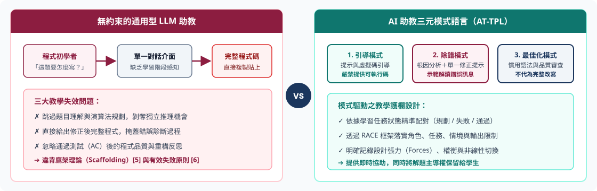
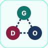
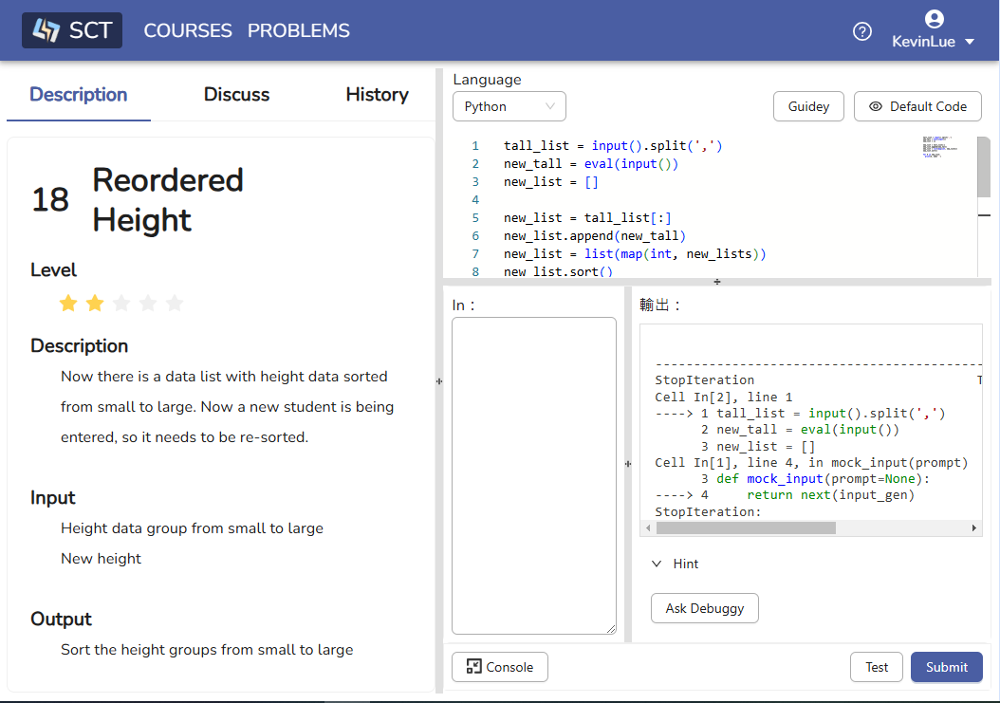

<!-- _class: lead -->

Journal of Information Science and Engineering (JISE) · 2026

# AI 助教三元模式：結構化程式設計教育中的對話式引導

AI Tutor Triad Pattern: Structuring Conversational Guidance in Programming Education

提出 <strong>AT-TPL（AI 助教三元模式語言）</strong>：將程式學習輔助解構為<strong>引導（Guidance）</strong>、<strong>除錯（Debugging）</strong>與<strong>最佳化（Optimization）</strong>三大專責模式，並透過 RACE 提示框架落實於 Smart Coding Tutor 線上評測系統

<strong>薛念林（Nien-Lin Hsueh）+</strong>、<strong>Lien-Chi Lai</strong>、<strong>Ying-Chang Lu</strong> 
逢甲大學資訊工程學系（Department of Information Engineering and Computer Science, Feng Chia University） 
<code>nlhsueh@fcu.edu.tw</code> · <code>p1000433@o365.fcu.edu.tw</code> · <code>m1305878@o365.fcu.edu.tw</code>

本研究獲國科會（NSTC）專題研究計畫補助：NSTC 114-2221-E-035-077

<!--
論文基本資訊與核心主張：
本論文由逢甲大學資訊工程學系薛念林教授（通訊作者）、賴連智與呂盈昌共同發表於《Journal of Information Science and Engineering (JISE)》（2026），研究獲國科會計畫 NSTC 114-2221-E-035-077 支持。

研究核心論點：
通用型大型語言模型（LLM）雖能即時回應程式設計問題，但往往缺乏對學習階段的敏銳度，甚至直接給出完整可執行程式碼，削弱學生獨立推理與演算法規劃的機會。為此，本文提出「AI 助教三元模式語言（AI Tutor Triad Pattern Language, AT-TPL）」，將程式學習歷程中反覆出現的求助情境解構為三個專職且彼此關聯的教學模式：引導模式（Guidance Pattern）、除錯模式（Debugging Pattern）與最佳化模式（Optimization Pattern）。

實證規模與貢獻：
每一模式均以經典模式語言格式（意圖、動機、情境、問題、張力、解法、後果與關聯模式）進行形式化紀錄，並透過 RACE 提示詞框架實作於 Smart Coding Tutor（SCT）線上評測系統中。研究團隊於 2024 年秋季學期之大學 Python 課程進行真實場域部署（315 位學生、86 道題目、4,982 次作答嘗試，其中 1,315 次使用 AI 助教），同時貢獻可重用的教學模式語言與真實課堂行為實證紀錄。
-->

---

## 破題：「完整解答給你了！」⋯⋯等等，那學生學到了什麼？

<strong>核心洞見：</strong> 通用型 LLM 常直接傾倒可複製貼上的完整解答，架空學生的獨立思考。<strong>AT-TPL</strong> 以<strong>三位專責 AI 助教模式</strong>（<strong>Guidey</strong>、<strong>Debuggy</strong>、<strong>Opti</strong>）取代單一聊天機器人，精準配合程式設計各階段的學習需求。

<!--
教學問題脈絡：
通用型 LLM 能迅速產生解釋、除錯建議與完整程式碼 [1, 2, 3]，但在初學程式設計（CS1）情境中，這種過度即時且完整的協助常與學習目標背道而馳。Hellas 等人 [14] 與 Prather 等人 [4] 的研究皆指出，未受約束的 LLM 經常主動提供學生未請求的完整解答，或給出與當前解題階段不符的回應。

為何需要三元模式分工：
程式設計初學者必須同時處理問題語意轉譯、抽象邏輯建構、語法規則、錯誤診斷與解題策略等多重認知負荷。若一開始即取得可直接複製執行的解答，學生便失去解讀輸入輸出規格、構思演算法與追蹤邏輯錯誤的鍛鍊機會。AT-TPL 據此將單一通用聊天介面拆解為三種依任務狀態校準的專職助教：Guidey（協助起步規劃但禁用可執行碼）、Debuggy（依據錯誤追蹤訊息診斷單一根因而不代寫整份程式）與 Opti（於程式通過評測後引導品質反思而不全面改寫）。
-->

---

## 簡報大綱

1

[**研究動機與核心問題**](#4)
通用型 LLM 為何破壞教學鷹架，以及本研究的三項核心探究問題。

2

[**文獻回顧與系統比較**](#6)
比較 CodeHelp、CS50 工具、CodeAid、Iris 與 AT-TPL（表 1）。

3

[**SCT 系統與 AT-TPL 模式語言**](#7)
系統架構、共通設計張力、非線性切換、RACE 提示框架與三大模式詳解。

4

[**真實課堂實證研究**](#13)
315 位學生、86 道 Python 題目、1,315 次助教輔助嘗試之使用與成效分析。

5

[**討論與教學權衡**](#17)
具體協助 vs. 認知外包、狀態閘控 vs. 學習自主、以及程度差異效應。

6

[**結論與未來研究方向**](#18)
RQ1–RQ3 結論視覺化總結與三大未來研究藍圖。

<!--
論文架構與論證脈絡：
第一章（緒論）從鷹架理論與建設性失敗出發，說明通用型 LLM 為何難以直接滿足教學需求，並闡明本研究採取「先觀察、後比較」的實證策略：先形式化模式語言並記錄真實課堂的求助樣態，再為後續對照實驗奠基。
第二章（相關研究）回顧 LLM 輔助程式教育、提示工程與模式語言文獻，並於表 1 系統性比較 CodeHelp、CS50 工具組、CodeAid、Iris 與 AT-TPL 的求助情境覆蓋與護欄設計。
第三章（SCT 與 AT-TPL）詳述 Smart Coding Tutor 線上評測系統架構、RACE 提示框架、三大共通張力、非線性狀態切換條件，以及 Guidey、Debuggy、Opti 之完整模式規格。
第四章（實證研究）分析 315 位學生於 86 道練習題之使用分布、預期與實際使用情境之落差（特別是 Opti 的狀態錯置）、錯誤次數倍數差異、最終 AC 通過率及課程歷史背景。
第五章（討論與結論）統整具體協助與認知外包、狀態閘控與學習自主、以及不同程式程度學生之差異效應，並提出三項未來研究方向。
-->

---

## 1.1 研究動機：為何通用型 LLM 助教難以勝任程式教學？

<strong>教學理論基礎：</strong> 有效的 AI 輔助須符合<strong>鷹架理論（Scaffolding）</strong>[5]（協助前進但不取代學生工作）與<strong>有效失敗（Productive Failure）</strong>[6]（於初步嘗試後協助整理想法），因此必須明確規範 LLM 的回應邊界與時機。

<!--
理論基礎與文獻依據：
1. 鷹架理論（Scaffolding，Wood, Bruner, & Ross, 1976 [5]）：良好的教學支持應協助學生跨越當前能力邊界以推進任務，同時將核心思考與實作責任保留給學習者。直接輸出完整解答違反鷹架原則，等同以 AI 的推理取代學生的認知歷程。
2. 建設性失敗（Productive Failure，Kapur, 2008 [6]）：讓學習者先經歷初步嘗試與受控挫折，再給予適切的後續引導，有助於其重新組織與精煉心智模型。過早且過度完整的 LLM 解答會截斷此一深層建構歷程。
3. 既有 LLM 程式教育實證：Kazemitabaar 等人 [10] 與 Sun 等人 [11] 發現 Codex 與 ChatGPT 雖可提升任務完成度，但學習成效高度取決於互動方式與提示語句 [3]；Savelka 等人 [8] 亦證實 GPT-4 已能輕易通過大學程式評量，凸顯必須透過明確的教學規範約束 LLM 回應的「內容邊界」與「介入時機」[7]。
-->

---

## 1.2 研究目標與三大核心探究問題

在進行嚴格對照實驗驗證因果效果之前，本研究先釐清**學生在真實課堂尋求何種協助**以及**如何結構化 LLM 回應** *(逐步呈現)*：

* 

RQ1 如何將零散提示詞轉化為可重用的教學模式語言？

<strong>如何將 LLM 程式輔助結構化為模式語言（AT-TPL）</strong>，明確規範教學意圖、共通張力、RACE 護欄與任務狀態切換？

* 

RQ2 學生在真實課程中實際會求助哪一類 AI 助教？

在 315 位學生的 Python 課程中，<strong>學生如何跨階段使用引導、除錯與最佳化三種模式</strong>？實際行為是否符合預期？

* 

RQ3 哪些學生最常使用助教？遇困後能否成功解題？

<strong>AI 助教使用行為與學生的錯誤頻率、最終通過率（AC）之間有何關聯</strong>？與未使用助教的嘗試相比呈現何種特徵？

<!--
為何先採取觀察型實證研究：
論文明確將本研究定位為「真實課堂之觀察型實證（observational study）」，而非隨機對照實驗。其方法論邏輯在於：在檢驗特定 AI 助教是否具因果療效之前，學界必須先釐清兩個前置問題：學生在真實程式學習中究竟尋求哪些類型的協助？以及如何將 LLM 結構化以對應這些需求？唯有先掌握真實使用行為，未來才能設計公平且具生態效度的對照實驗。

三大研究問題與論文貢獻對應：
- RQ1（模式語言形式化）：承襲 Alexander 的建築模式語言傳統 [15] 與 White 等人的提示模式目錄 [16]，將零散提示詞升格為具明確意圖、張力、RACE 護欄與狀態切換規則的 AT-TPL。
- RQ2（真實課堂使用樣態）：透過 315 位學生、4,982 次嘗試（1,315 次助教輔助）的完整紀錄，檢視三種模式在各任務狀態下的實際使用比例、跨模式切換率，並揭露無狀態閘控所導致的行為錯置。
- RQ3（遇困特徵與通過結果）：比對使用與未使用 AI 助教者在測試、提交與執行期之錯誤頻率，以及最終評測結果（AC、PA、WA、RE），為後續準實驗建立關鍵的描述性基準。
-->

---

## 2. 文獻回顧：AI 程式設計助教系統比較（表 1）

現有具教學護欄的 AI 助教多將「學習情境 ➔ 協助形式」隱含在特定工具介面中；**AT-TPL** 則將其形式化為可重用之設計模式語言。

| AI 助教系統 | 涵蓋之求助情境 | AI 輔助形式與護欄機制 |
| :--- | :--- | :--- |
| **CodeHelp** [17, 18] | 不知如何開始或不知如何除錯 *(單一表單未區分角色)* | 概念提示、根因分析與修正提示 *(以二次 LLM 過濾程式碼區塊)* |
| **CS50 tools** [21] | 開始解題、除錯或改善風格 *(分散於多個獨立工具)* | 提示、程式講解、除錯提示，以及 `style50` 語法格式建議 |
| **CodeAid** [19] | 不知如何開始或不知如何除錯 *(5 種功能模板自選)* | 概念說明、程式解釋、虛擬碼；根因分析與修正提示 |
| **Iris** [20] | 不知如何開始或不知如何除錯 *(單一對話角色)* | 最嚴格統一護欄：僅給微提示與反問 *(禁止虛擬碼與具體步驟)* |
| **AT-TPL（本研究）** | **開始規劃、錯誤診斷，以及通過後品質優化 *(三大模式)*** | **依狀態校準：提示/虛擬碼（`Guidey`）；根因提示（`Debuggy`）；慣用語法審查（`Opti`）** |

<strong>關鍵觀察：</strong> 提示詞限制屬於<em>設計意圖而非絕對保證</em>（例如 CS50 Duck 偶爾仍在除錯時洩漏完整修正碼 [22]），因此明確記錄張力、後果與後續防護機制至關重要。

<!--
既有護欄型 AI 程式助教深度比較（表 1）：
既有系統多將「求助情境與協助形式之對應」隱含於特定工具的介面與提示詞中，並在覆蓋範圍與直接程度上呈現顯著差異：
1. 求助情境覆蓋度：
   - CodeHelp [17, 18] 與 Iris [20] 主要涵蓋「不知如何起步」與「不知如何修錯」兩種情境，但未在角色層級加以區分：CodeHelp 以單一表單收集選填程式碼與錯誤訊息，Iris 則於單一聊天介面自動擷取題目、程式碼與建置／測試回饋。
   - CodeAid [19] 將起步與除錯拆分為五種由學生自行點選的功能模板（如 General Question、Help Write Code、Help Fix Code 等），並額外提供逐行程式解說。
   - CS50 工具組 [21] 透過獨立工具（CS50 Duck、Explain Highlighted Code、style50）橫跨三種情境，但 style50 偏重語法排版格式規則，不同於 AT-TPL 最佳化模式聚焦於通過評測後的程式品質、效率與 Pythonic 重構。
2. 回應直接度與護欄可靠性：
   - Iris 採取最嚴格的一致性限制，即使在除錯階段亦禁用可執行碼、虛擬碼與具體步驟，僅提供微提示與反問 [20]；CodeHelp 則以第二階段 LLM 過濾並移除程式碼區塊 [17]；CodeAid 與 AT-TPL 則在起步階段允許虛擬碼，於除錯階段結合根因分析與修正提示。
   - 論文特別引用 Yang 等人 [22] 對 CS50 Duck 的評估：即使提示詞明定禁令，模型在除錯時仍偶爾直接洩漏修正後程式碼。因此，提示詞護欄本質上是「設計意圖」而非絕對保證，此限制同樣適用於本研究的 RACE 提示詞，亦凸顯明確紀錄模式張力、後果與防護機制之重要性。
-->

---

## 3.1 Smart Coding Tutor（SCT）：整合 AI 助教之線上評測系統

圖 1：Smart Coding Tutor（SCT）線上評測與 AI 助教整合架構

### ⚙️ 互動式迭代開發迴圈
- 整合**作業模組**、**程式編輯器**、**自動評測器**、**隱藏測資評估器**與**專責 AI 助教**。
- 自動將脈絡資訊（`題目`、`程式碼`、`評測結果`、`錯誤訊息`）傳入對應助教模式。

### 📋 六種自動評測結果（Verdicts）
- **AC**（Accepted）：通過所有隱藏測資。
- **PA**（Partially Accepted）：僅通過部分測資。
- **RE**（Runtime Error）：執行期錯誤（如除以零、索引越界）。
- **WA**（Wrong Answer）：輸出結果錯誤。
- **TLE**（逾時） · **CE**（編譯錯誤）。

<!--
SCT 系統架構與互動迴圈：
Smart Coding Tutor（SCT）為一套結合線上評測系統（Online Judge [9]）與多角色 AI 助教的互動教學平台，整合題目模組、線上程式編輯器、自動評測器（Automated Judger）、隱藏測資評估器與 AI 虛擬助教。隱藏測資不僅用於自動判定功能正確性，更促使學生思考邊界條件（edge cases）與替代演算法，模擬真實軟體開發的迭代歷程。

執行脈絡自動注入優勢：
由於 AI 助教深度內嵌於線上評測迴圈之中，學生每次呼叫助教時，系統能直接結合題目敘述、輸入輸出規格、當前程式碼、評測判定結果與錯誤追蹤訊息（traceback），避免初學者因無法精準描述問題而導致 AI 回應失準。

六大標準評測結果與任務狀態定義：
SCT 透過六種標準評測判定回饋程式狀態，同時界定學習者所處的任務階段：
- AC（Accepted）：符合所有限制並通過全部隱藏測資。
- PA（Partially Accepted）：僅通過部分測資（常反映邊界條件遺漏）。
- RE（Runtime Error）：執行期發生例外錯誤（如除以零、索引越界、記憶體違規）。
- WA（Wrong Answer）：程式能正常執行結束，但輸出結果錯誤。
- TLE（Time Limit Exceeded）：超出執行時間限制（演算法效率不足或無窮迴圈）。
- CE（Compilation Error）：語法錯誤導致無法成功編譯。
-->

---

## 3.2 AT-TPL 模式語言：非線性狀態切換與三大共通張力

AT-TPL 並非三組互不相干的提示詞，而是由**學習任務狀態**驅動、且共同平衡**三大設計張力**的模式語言。

<!--
模式語言的形式化結構：
AT-TPL 並非三組彼此獨立的提示詞，而是遵循 Alexander 模式語言架構 [15] 所建構的互連設計語言。每個模式皆包含八項標準欄位：意圖（Intent）、動機（Motivation）、情境（Context）、問題（Problem）、張力（Forces）、解法（Solution，細分為設計原則與 RACE 實作）、後果（Consequences）與關聯模式（Related Patterns）。

貫穿全語言的三大共通張力（Shared Forces）：
1. 及時具體協助 vs. 獨立推理空間：學生需要即時且可執行的方向，但過於完整的協助會直接取代其自主思考。
2. 具體產出實用性 vs. 直接複製風險：範例、修正碼或重構版本雖最具參考價值，但一旦成為可執行程式碼，便極易被未經理解地複製貼上。
3. 單一焦點易用性 vs. 潛在核心缺口：將回應聚焦於單一重點能避免認知超載，但學生真正的困難有時落在該焦點之外。

非線性狀態切換與邊界情境：
主路徑雖為「引導（有題目但無計畫，或已開始撰寫但尚未執行）➔ 除錯（程式執行失敗）➔ 最佳化（已獲 AC 之可運作程式）」，但實際切換具高度非線性：除錯若暴露根本概念缺口可退回引導，最佳化若改出新錯誤則轉回除錯。學期資料顯示，67.4% 的 AI 使用者跨模式併用多種助教。值得留意的是「WA（錯誤答案）」屬於特殊邊界情境：雖屬失敗狀態而適用除錯模式，卻缺乏例外 traceback，使診斷輸入明顯弱化。此外，系統亦可僅實作語言子集（如單獨部署除錯模式）或依需求擴充新模式。
-->

---

## 3.3 以 RACE 框架落實模式規範（表 2）

我們採用 **RACE** [23] 框架實作提示詞，因 `Expectation` 能將教學護欄明確轉化為輸出規則：

| 模式 | **R**ole（角色與立場） | **A**ction（單一核心任務） | **C**ontext（學習者當下狀態） | **E**xpectation（輸出護欄） |
| :--- | :--- | :--- | :--- | :--- |
| **引導模式** (`Guidey`) | 鼓勵獨立思考的教學者 *(立場：不直接給答案)* | 僅提供提示與觀念說明 *(避免開放任務吐出全解)* | 題目需求與 I/O 規則；允許虛擬碼 *(尚無程式碼)* | **嚴禁可執行程式碼**；僅給提示；省略寒暄問候 |
| **除錯模式** (`Debuggy`) | 除錯專家兼教學者 *(專精解讀診斷訊息)* | 定位**單一根因**並提出**單一修正** *(避免失焦)* | 失敗程式碼與錯誤訊息 *(目標為解釋，而非引導)* | **兩段式輸出**（根因分析、修正提示）；不給完整碼 |
| **最佳化模式** (`Opti`) | 程式品質與效率教學者 *(正確後的檢視)* | 指出**最關鍵問題**與**一項策略** *(避免初學者負荷過重)* | 可正常運作之程式；以 Pythonic 慣用語法為基準 | **三段式輸出**（品質摘要、最佳實踐、替代提示）；**不完整重寫** |

<strong>跨領域可遷移性：</strong> 模式結構與鷹架立場可直接遷移至數學或語言教學；僅 <code>Context</code> 與 <code>Expectation</code> 中之程式專屬元素（I/O 規格、Traceback、AC 判決、Python 慣用語法）隨領域替換。

<!--
採用 RACE 提示詞框架的設計理據：
AT-TPL 本身不綁定特定提示框架，凡能明確承載輸出限制的結構化框架皆可實作本模式語言。研究團隊選用 RACE 框架 [23]（Role、Action、Context、Expectation），主因在於其四個元件與模式語言元素高度對應，且 Expectation 為教學護欄提供明確的規則落點：
- Role（角色）：同時界定領域專長與教學立場（例如「保留答案、鼓勵獨立思考的教育者」與「擅長解讀診斷訊息的除錯工程師」）。
- Action（行動）：嚴格限定單一協助類型（例如僅提供提示、僅鎖定單一根因、僅聚焦最主要品質議題），避免開放式任務誘使 LLM 吐出完整解答或讓初學者無所適從。
- Context（脈絡）：精確描述學習者當下持有的工件與狀態（僅有題目與 I/O 規格、持有失敗程式與 traceback、或已具備可運作程式並以 Pythonic 標準檢視）。
- Expectation（預期）：將教學護欄轉化為具體輸出格式與禁令（如嚴禁輸出可執行 Python 程式碼、省略寒暄、強制兩段式或三段式結構）。

跨領域可遷移性分析：
論文清楚區分「跨領域通用教學原則」（模式八段式結構、角色立場設定、先提示後解答、鷹架而不代勞）與「程式設計領域特有元素」（位於 Context 與 Expectation 的線上評測 I/O 規格、錯誤 traceback、AC 判定、虛擬碼與可執行碼之分界，以及 Pythonic 品質準則）。若將 AT-TPL 遷移至數學或語言學習領域，僅需保留模式架構與通用原則，替換領域專屬的 Context 與 Expectation 即可。
-->

---

## 3.4 模式一：引導模式（Guidance Pattern · `Guidey`）

### 🎯 意圖、情境與設計張力
- **意圖**：協助學生建構初步解題策略，同時將實作責任保留給學生。
- **情境**：學生剛讀完題目與 I/O 規範，但不知如何下筆 *(按鈕位於編輯器右上方)*。
- **平衡之張力**：
  - 及時具體協助 vs. 取代獨立推理
  - 多重題目限制 vs. 認知負荷過重
  - 虛擬碼澄清思路 vs. 可執行碼助長抄襲

### 🛠️ RACE 解法設計
- **小步幅鷹架**：重述需求、點出核心概念或建議下一子目標。
- **互動層漸進**：學生先嘗試實作提示，若仍卡關再請求下一條提示。
- **輸出護欄**：允許虛擬碼，**嚴禁提供可執行 Python 程式碼**與客套問候。

### ⚠️ 後果、風險與模式切換
- **優勢**：提供結構化起點，確保程式撰寫由學生主導。
- **權衡與風險**：
  - *即時滿足感較低*：部分學生覺得提示不如完整解答方便。
  - *連續索取提示*：學生可能未實作就連續點擊提示，變相將推理交給 AI。
  - *誤讀題意風險*：此時尚無程式輸出可驗證，若提示誤解題意恐誤導方向。
  - *程度差異* [4]：對程度佳者顯得冗長，對零基礎者虛擬碼仍可能過於抽象。
- **切換**：實作後出錯 ➔ **除錯模式**；完成可執行解 ➔ **最佳化模式**。

<!--
引導模式完整規格（第 3.4.1 節）：
- 適用情境與介面位置：學生已取得題目與輸入輸出限制，正處於規劃或起草階段但不知如何下筆；Guidey 按鈕配置於 SCT 程式碼編輯器右上角（見圖 2a）。
- SCT 實際部署之 RACE 提示設計：
  * Role：優秀的程式設計教育者與 Python 助教，提供清晰引導並鼓勵獨立思考。
  * Action：提供循序漸進的引導、提示與概念解釋，帶領學生走向正確且有效的解法。
  * Context：明確交代題目需求、輸入輸出與格式限制，授權使用虛擬碼（pseudo-code）作為教學工具，但嚴格禁止可執行 Python 程式碼。
  * Expectation：嚴禁輸出可執行 Python 碼以防抄襲、禁用寒暄語以維持專注、回應僅限提示與引導而不給直接答案。
- 互動層級的漸進鷹架：透過「小步幅拆解（重述需求、點出關鍵概念、建議下一個子目標）」控制認知負荷，理想互動流程為學生先依據前一條提示實際嘗試，卡關後再請求下一條提示。

模式後果與潛在風險：
1. 即時滿意度較低：相較於直接取得完整解答，部分學生可能主觀覺得僅給提示不夠方便。
2. 連續點提示（Hint-Chaining）風險：由於隨時可再請求提示，部分學生可能未實際動手便接連索取提示，將思考責任轉嫁給 AI。
3. 未經驗證的誤導風險：若 AI 誤讀題目條件，此時學生尚未有程式執行輸出可供驗證，可能被導入錯誤解題方向。
4. 程度差異效應 [4]：對已有解題構想的熟練學生而言，逐步提示顯得冗長拖慢進度；對毫無基礎的初學者而言，虛擬碼仍可能過於抽象而難以轉化為程式碼。
-->

---

## 3.5 模式二：除錯模式（Debugging Pattern · `Debuggy`）

圖 2a：SCT 介面 — 編輯器右上角 <code>Guidey</code> 與錯誤輸出區下方 <code>Ask Debuggy</code>

### 🔍 明確示範診斷，修正交還學生
- **意圖**：協助學生定位具體失敗原因並進行精準修正。
- **RACE 解法**：強制引用 **Traceback 與出錯行號**，並輸出**兩大區塊**：
  1. *根因分析（Root Cause Analysis）*：簡明解釋為何出錯
  2. *修正提示（Correction Hint）*：具體修正方向或虛擬碼，**不給完整替代程式**

### ⚠️ 邊界情境與風險
- **WA 邊界限制**：邏輯錯誤（Wrong Answer）無 Traceback 可供參照，診斷依據較弱，增加不完整診斷風險 [14]。
- **診斷依賴**：初學者短期獲益最大，但也最容易依賴 AI 解讀錯誤訊息。
- **切換**：發現觀念缺口 ➔ **引導模式**；修正通過 ➔ **最佳化模式**。

<!--
除錯模式完整規格（第 3.4.2 節）：
- 適用情境與介面位置：學生已撰寫出無法正常運作的程式碼片段，並收到錯誤訊息或未通過評測的結果。如圖 2a 所示，Ask Debuggy 按鈕位於主控台錯誤輸出區下方，與右上角的 Guidey 形成情境分工。
- SCT 實際部署之 RACE 提示設計：
  * Role：兼具高效教學能力的 Python 除錯專家，擅長快速定位執行期與語法錯誤。
  * Action：分析學生程式碼與錯誤輸出，鎖定單一最可能的根本原因，並提出單一最佳修正方向（避免一次列舉多項缺失而掩蓋當下主因）。
  * Context：同時輸入失敗程式碼與完整錯誤訊息（traceback），強制要求回應必須明確引用錯誤訊息與出錯行號，且明確切換教學定位（「你的任務不是引導，而是解釋並協助修正錯誤」）。
  * Expectation：強制輸出為兩大區塊——（1）Root Cause Analysis（精簡說明錯誤成因）與（2）Correction Hint（具體修正建議或虛擬碼片段），且嚴禁輸出完整或可執行的 Python 解答碼。

邊界條件與權衡風險：
- 單一修正承諾與 WA 診斷缺口：鎖定單一根因雖有助聚焦，卻也提高診斷不完整或誤判的風險（Hellas 等人 [14] 曾回報 LLM 對初學者求助常給出不完整診斷）。此風險在「Wrong Answer（WA）」判定時最高，因為 WA 沒有例外 traceback，提示詞要求引用錯誤訊息的條件無法成立，助教僅能憑題目、程式碼與判定結果推敲。
- 診斷依賴風險：由於 Debuggy 代為解讀 traceback，短期受益最大的初學者也最容易只套用修正提示，而未真正學會自行閱讀與推理錯誤訊息。
-->

---

## 3.6 模式三：最佳化模式（Optimization Pattern · `Opti`）

圖 2b：SCT 歷史紀錄分頁 — 供通過測試後檢視程式品質的 <code>Ask Opti</code> 按鈕

### ✨ 通過 AC 後的品質反思，不代為重寫
- **意圖**：在程式正確運作（`AC`）後，引導學生思考可讀性、效率與 Python 最佳實踐。
- **RACE 三段式輸出**：
  1. *程式品質摘要*（優點與改進空間）
  2. *具名最佳實踐建議*（如改用 List Comprehension）
  3. *非可執行替代提示*（**禁止完整改寫**）

### ⚠️ 實作限制與自願使用挑戰
- **部署版提示偏移**：實務部署時 Role/Action 偏重*效能瓶頸*，而 Context 偏重*可讀性*，論文已誠實記錄並於表 2 提出修正規範。
- **自願使用偏低**：通過 AC 後多數學生視為任務結束；且因未設狀態閘控，常在出錯時誤用。

<!--
最佳化模式完整規格（第 3.4.3 節）：
- 適用情境與介面位置：專為已寫出可運作程式或已取得 Accepted（AC）判定、欲進一步檢視效能、可讀性與 Python 最佳實務的學生設計；Ask Opti 按鈕配置於 SCT 歷史紀錄分頁「AI Assistant」文字下方（見圖 2b）。
- SCT 實際部署之 RACE 提示與自我檢討：
  * 實際部署之 Role 與 Action：設定為專精高效能運算（HPC）與效率分析的程式教育者，首要目標為找出最顯著效能瓶頸、解釋最佳化原則（如減少巢狀迴圈）並提出策略。
  * 實際部署之 Context 與 Expectation：針對可運作程式碼檢視可讀性、精簡度與 Pythonic 寫法（如列表生成式、內建函式），強制輸出三段式結構——（1）Code Quality Summary（優缺點摘要）、（2）Best Practice Suggestion（具名最佳實務建議）與（3）Alternative Solution Hint（非可執行替代思路提示），且嚴禁完整重寫程式碼。
  * 實作落差的誠實揭露：論文坦承實際部署版本存在內部不一致——Role 與 Action 偏重「效能」，Context 卻強調「可讀性與慣用語」。作者明言此為實作面瑕疵而非模式本身問題，並於表 2 提出修正規格：將 Role 改為「程式品質教育者」，並於 Action 以可讀性為首要準則、效率為次要考量。

採用現況與教學風險：
由於 AC 本身即代表作業完成，學生自願使用 Opti 的動機偏低（僅佔助教輔助嘗試的 30.6%），且通過 AC 後持續反思者甚少。此外，偏重效能的建議容易誘發過早最佳化（premature optimization），而初學者若盲目套用尚未理解的 Pythonic 寫法，反而可能將原本看得懂的程式改寫為無法維護的程式碼。加上介面未依任務狀態進行閘控，學生大量在提交錯誤（23.1%）與執行期錯誤（24.4%）後誤用 Opti。
-->

---

## 4.1 實證研究：真實課程部署規模與使用分布

於 **2024 年秋季學期**部署於台灣某大學 Python 課程，涵蓋工程、商管與社會科學等多元背景學生：

315 位學生

橫跨 <strong>86 道 Python 程式題</strong>之完整學期真實課堂

1,315 / 4,982

<strong>26.4%</strong> 為 AI 助教輔助嘗試（73.6% 由學生獨立完成）

67.4% 併用多助教

使用 AI 工具的學生中，近七成<strong>結合使用兩種以上模式</strong>

### 📊 1,315 次助教輔助嘗試中各模式使用占比 *(單次嘗試可併用多助教，總和 > 100%)*

<strong>引導模式（Guidey）</strong>

58.8% (773)

<strong>除錯模式（Debuggy）</strong>

47.7% (627)

<strong>最佳化模式（Opti）</strong>

30.6% (402)

<!--
實證場域與分析單位界定（第 4.1 節）：
- 課程背景：本研究於 2024 年秋季學期在台灣一所大學的 Python 程式設計課程部署 SCT，涵蓋工程、商管與社會科學等跨學院背景共 315 位學生，分析範圍包含 86 道程式設計練習題。
- 「嘗試（Attempt）」之操作型定義：指單一學生針對單一題目的完整作答歷程，涵蓋最終評測結果出爐前的所有測試執行、提交紀錄與 AI 助教請求。
- 整體資料規模：全學期共計 4,982 次嘗試，其中 1,315 次（26.4%）屬於助教輔助嘗試（至少呼叫一次 AI 助教），其餘 3,667 次（73.6%）則由學生獨立完成。

三大模式使用分布與跨模式併用：
在 1,315 次助教輔助嘗試中，各模式使用比率為非互斥統計（因單次嘗試可呼叫多個助教，故總和 137.1% 大於 100%）：
- 引導模式（Guidey）：使用率最高，達 58.8%（773 / 1,315 次），顯示問題理解與初步演算法規劃是學生最普遍的鷹架需求。
- 除錯模式（Debuggy）：居次，佔 47.7%（627 / 1,315 次）。
- 最佳化模式（Opti）：佔 30.6%（402 / 1,315 次）。
- 多助教併用比例：在曾使用 AI 工具的學生中，高達 67.4% 曾向超過一種專職助教求助，實證支持學習者在真實解題中確實需要依階段切換不同型態的教學支援。
-->

---

## 4.2 使用情境分析：預期設計 vs. 學生實際行為

觀察學生呼叫各模式的實際時機，呈現出「除錯符合預期」與「最佳化明顯錯位」的對照現象：

### ✅ 除錯情境（符合設計預期）
- 所有嘗試中有 **37.5%**（`1,869 / 4,982`）在測試階段發生錯誤。
- 其中 **30.2%**（`564 / 1,869`）的出錯嘗試呼叫了 **Debuggy**。
- **Guidey（58.8%）** 高居首位且 **67.4%** 併用多助教，顯示學生確實依不同解題卡關階段切換求助模式。

### ⚠️ 最佳化情境（任務狀態錯位！）
- **原始設計意圖**：取得 `AC` 後用於反思程式可讀性與慣用語法。
- **實際觀察結果**：學生鮮少在 `AC` 後呼叫 `Opti`，反而多在失敗時使用：
  - **提交錯誤後使用**：**23.1%**（`373 / 1,614`）
  - **執行期錯誤後使用**：**24.4%**（`150 / 615`）
- **原因剖析**：SCT 未以任務狀態鎖定 `Opti` 按鈕，遇困學生將其視為一般求救管道；而通過 `AC` 後缺乏反思誘因。

<strong>教學設計啟示：</strong> 僅在概念上區分模式並不足夠——要促成通過測試後的程式碼品質學習，必須搭配<strong>任務狀態閘控（State-Based Gating）</strong>或<strong>明確課程活動誘因</strong>。

<!--
使用情境對齊度深度剖析（第 4.1 節）：
檢視學生呼叫各模式時的執行狀態，呈現出「除錯高度對齊、最佳化嚴重錯置」的鮮明對比：

1. 除錯模式（符合預期情境）：
   - 全體 4,982 次嘗試中，有 37.5%（1,869 次）在測試階段遭遇錯誤。
   - 在這 1,869 次遇錯嘗試中，有 30.2%（564 次）呼叫了 Debuggy，精準對應其「具錯誤回饋之失敗程式碼」設計情境。

2. 最佳化模式（顯著的狀態錯置）：
   - 全體嘗試中，提交階段發生錯誤者佔 32.4%（1,614 / 4,982），執行期錯誤佔 12.3%（615 / 4,982）。
   - Opti 在提交錯誤嘗試中的使用率達 23.1%（373 / 1,614），在執行期錯誤嘗試中更達 24.4%（150 / 615）；反觀學生在獲得 AC 之後繼續使用 Opti 精進程式品質的案例卻相當罕見。

成因機制與介面設計啟示：
此現象源於雙重因素：其一，AC 判定帶來明確的任務終結感，缺乏額外課程活動或評分誘因時，學生極少主動投入 AC 後重構；其二，SCT 未對 Opti 實施任務狀態閘控，導致卡關學生將其視為另一個通用求救按鈕。這證實僅在概念與提示詞層面區分模式尚不足夠，後續系統設計須結合「狀態閘控（僅於 AC 後解鎖 Opti）」或明確的品質反思任務設計。
-->

---

## 4.3 錯誤特徵與最終通過率分析（表 3 與 Debuggy 深度比較）

73.9% 通過率

<strong>972 / 1,315</strong> 助教輔助嘗試最終達 AC（PA 12.6%、WA 3.3%、RE 2.7%）

錯誤高出 3.7–5.7 倍

助教使用者的平均錯誤次數顯著較高，顯示主要用於<strong>解題遇困時</strong>

76.1% vs. 76.7%

Debuggy 群組通過率追平未使用者，儘管事前測試錯誤高達 <strong>7.2 vs. 1.0</strong>

### 📊 各階段平均錯誤次數比較（表 3）
| 錯誤發生階段 | 使用 AI 助教 | 未使用 AI 助教 | 倍數 |
| :--- | :---: | :---: | :---: |
| **測試階段錯誤** | **4.5** *(最高 99)* | 0.8 | **5.7×** |
| **提交階段錯誤** | **3.3** *(最高 68)* | 0.6 | **5.1×** |
| **執行期錯誤** | **0.7** *(最高 20)* | 0.2 | **3.7×** |

### 🛡️ Debuggy 鷹架輔助訊號
- 在 **1,869** 次發生測試錯誤的嘗試中：
  - **使用 Debuggy**（`n = 564`）：**76.1% 通過 AC**（`429/564`），僅 **2.5%**（`14/564`）停留在 CE/RE 狀態——儘管事前平均錯誤高達 **7.2 倍**。
  - **未使用 Debuggy**：**76.7% 通過 AC**（事前僅 1.0 次錯誤）。
- 此結果*符合*鷹架輔助特徵，但因學生自主選擇使用，尚不構成因果證明。

<!--
錯誤特徵與最終通過率實證解讀（第 4.2 節）：
1. 助教輔助嘗試之最終評測分布（n = 1,315）：
   - Accepted（AC）：73.9%（972 / 1,315）
   - Partially Accepted（PA）：12.6%
   - Wrong Answer（WA）：3.3%
   - Runtime Error（RE）：2.7%
   （其餘約 7.5% 屬其他未通過狀態，如 CE、TLE 或未完成提交。）

2. 使用與未使用 AI 助教之錯誤次數對比（表 3）：
   - 測試階段錯誤：有使用助教平均 4.5 次（單次嘗試最高達 99 次），未使用為 0.8 次（約 5.7 倍）。
   - 提交階段錯誤：有使用助教平均 3.3 次（最高 68 次），未使用為 0.6 次（約 5.1 倍）。
   - 執行期錯誤：有使用助教平均 0.7 次（最高 20 次），未使用為 0.2 次（約 3.7 倍）。
   解讀重點：顯著偏高的錯誤次數顯示學生主要是在遭遇卡關與反覆失敗時才求助 AI 助教；論文亦提醒，錯誤數反映的是當下遇困情境，不宜直接等同於學生整體的程式能力指標。

3. 測試階段遇錯嘗試（n = 1,869）之 Debuggy 聚焦比較：
   - 呼叫 Debuggy 的 564 次嘗試事前平均經歷高達 7.2 次測試錯誤（未使用者僅 1.0 次），但最終 AC 通過率仍達 76.1%（429 / 564），幾乎追平未使用者的 76.7%，且最終仍停留在編譯或執行期錯誤狀態者僅佔 2.5%（14 / 564）。
   - 因果界限提醒：因是否呼叫助教由學生自行選擇（self-selection），此數據高度符合「協助遇困者脫困之鷹架效應」，但本身尚不足以確立嚴格因果推論。
-->

---

## 4.4 課程層級背景與研究方法論誠實界定

### 📈 歷屆課程背景變化
- 相較於往年同門 Python 課程：
  - **班級平均成績**：約 55 分 ➔ **約 75 分**
  - **課程停修／退選率**：近 10% ➔ **約 2%**
- **嚴謹界定**：歷屆學生群體、教學與評量方式亦有調整，故僅作為**部署脈絡參考**，*不將其歸因為 AI 助教之單一因果效果*。

### 🔬 觀察性研究範圍與限制
- **自選偏誤（Self-Selection）**：學生自由決定是否求助，故所有比較屬描述性實證紀錄。
- **護欄屬意圖非保證**：如 CS50 Duck 經驗 [22]，提示詞約束仍可能被突破，未來需結合事後過濾或稽核。
- **為何先觀察再對照？**：先掌握真實課堂中「學生究竟尋求何種幫助」，方能設計公平且具生態效度的對照實驗。

<!--
課程層級歷史對照背景（第 4.3 節）：
相較於過往同門 Python 課程的開課紀錄，本次導入 SCT 與 AT-TPL 的學期在總體指標上出現明顯正向變化：
- 班級平均成績由約 55 分提升至約 75 分。
- 課程退選率由近 10% 下降至約 2%。

方法論誠實與研究限制界定：
1. 歷史世代混淆因子：跨學期比較必然伴隨學生組成（cohort）、教學方式與評量設計之變動，因此論文嚴謹聲明上述總體指標僅作為「真實部署之生態背景」，絕不將其直接歸因為 AI 助教的單一因果效果。
2. 自我選擇偏差（Self-Selection Bias）：學期內學生可自由決定是否使用與選擇何種助教，故組間比較屬描述性實證，無法完全隔離學習動機或堅持度等潛在變項。
3. 提示詞護欄非絕對保證：參照 CS50 Duck [22] 之既有經驗，RACE 的 Expectation 規則代表教學設計意圖而非硬性系統保證；若缺乏如 CodeHelp 的二次 LLM 過濾 [17] 或 Iris 的自我檢查機制 [20]，模型仍存在偶發洩漏可執行程式碼之風險。
4. 先觀察後對照的學術價值：釐清真實課堂中的求助分布與狀態錯置問題，正是設計下一階段公平對照實驗的必要前置工作。
-->

---

## 5. 討論：核心教學權衡與設計防護建議

三大模式反覆面臨同一項核心張力：**協助愈具體、愈能立即派上用場，就愈容易讓學生以 AI 推理取代自身思考**。

### ⚖️ 1. 具體協助 vs. 自主思考
- AT-TPL 無法憑空消除過度依賴，但能**精準標示風險發生的節點**（如 `Guidey` 連續點提示、`Debuggy` 略過閱讀 Traceback）。
- 讓教師得以對症下藥：加入**提示次數上限**、**要求先解釋再給下一提示**與**漸進撤除鷹架**。

### 🚪 2. 狀態閘控 vs. 學習自主
- 未設狀態限制導致 `Opti` 在出錯後被誤用達 **23%–24%**。
- 導入**任務狀態閘控**（通過 AC 後才解鎖 `Opti`）可消除情境錯位，但代價是限縮學生自由選擇權，需依課程目標權衡。

### 🎓 3. 學習者程度差異效應
- **初學者**：短期從 `Debuggy` 獲益最多，但也最容易產生診斷依賴，或套用看不懂的 `Opti` 慣用語法。
- **進階學生**：可能覺得 `Guidey` 步調過慢，卻最能吸收 `Opti` 帶來的程式碼品質詞彙與重構思維。

<!--
跨模式共通之教學權衡與防護架構（第 3.4 節與第 5 節）：
貫穿 Guidey、Debuggy 與 Opti 的根本張力在於：讓 AI 協助越具體、越能即時派上用場，同時就越容易開啟學生將推理外包給 AI 的大門。AT-TPL 的價值不在於宣稱能徹底根除過度依賴，而在於透過形式化的「後果（Consequences）」分析，精準標示出風險在何處產生，讓教師與系統設計者能對症佈署防護機制。

三大核心設計權衡軸線：
1. 協助具體度 vs. 學習主體性：
   - 風險節點：Guidey 中未動手便連續索取提示（hint-chaining）；Debuggy 中直接照提示改碼卻未學習閱讀 traceback。
   - 對應防護：設定提示次數上限（hint budgets）、要求學生先解釋修正原理再解鎖下一次協助（self-explanation），以及隨熟練度漸進撤除鷹架（fading）。
2. 任務狀態閘控 vs. 學習自主權：
   - 放任 Opti 無狀態限制導致 23.1%（提交錯誤）與 24.4%（執行期錯誤）的離題誤用，且 AC 後自願反思偏低。
   - 以任務狀態閘控（僅於 AC 後開放 Opti）可有效避免錯置，但代價是限縮學生自由選擇權；搭配課程反思活動或評分誘因則可補強 AC 後動機。
3. 程式程度差異效應 [4]：
   - 初學者從 Debuggy 獲得最大即時脫困效益，卻也面臨最高診斷依賴風險，且可能覺得 Guidey 虛擬碼過於抽象，或套用 Opti 慣用語後反而看不懂自己的程式。
   - 進階學習者容易覺得 Guidey 的逐步提示拖慢節奏，卻最能吸收 Opti 所提供的具名最佳實務詞彙與重構觀念。
-->

---

## 6. 結論與未來研究方向

<strong>🧪 1. 準實驗對照驗證</strong> 與「單行角色指令（無護欄）」及「直接給全解助教」對照，量化模式護欄之實際學習增益。

<strong>🎛️ 2. 自適應鷹架與漸進撤除</strong> 依學生程度與進度動態調整提示深度，逐步撤除提示並要求學生自我解釋修正理由。

<strong>🧩 3. 擴充模式語言家族</strong> 於三元核心外新增反思模式、測資推理模式與程式碼閱讀模式，構築完整教學設計語言。

<!--
研究總結與核心貢獻（第 5 節）：
AT-TPL 將 AI 輔助程式教學從零散的提示詞技巧提升為可重用、可分析、可擴充的教學設計語言，具體貢獻涵蓋三層面：
1. 形式化三元模式語言（RQ1）：完整定義引導、除錯、最佳化三大模式之八段式規格、共通張力與非線性狀態切換規則。
2. RACE 護欄實作與透明檢討：於 Smart Coding Tutor 中透過 RACE 落實防抄襲與結構化回饋護欄，並誠實揭露 Opti 部署版提示詞在效能與可讀性間的語意偏移。
3. 真實課堂大規模實證（RQ2、RQ3）：於 315 位學生、86 道題目（4,982 次嘗試、1,315 次助教輔助）中，記錄 67.4% 跨模式併用率、73.9% 助教輔助 AC 通過率、Debuggy 重度遇錯組（事前錯誤 7.2 vs. 1.0 次）達 76.1% 之 AC 追平表現，以及 Opti 無閘控誤用之實務教訓。

未來三大研究方向：
1. 準實驗因果比較：設計兩組關鍵對照基準——（a）僅給單行角色標籤、不含模式護欄的通用 LLM（檢驗模式規範相較單純角色設定的增量價值），以及（b）無限制直接給完整解答的助教（量化缺乏護欄所流失的學習成效）。
2. 自適應鷹架與防依賴機制：依據學生能力、作答歷程與互動歷史動態調整提示粒度，逐步淡出鷹架，並要求學生在獲得進一步協助前先說明自身理解或修正理由。
3. 模式語言擴充：在核心三元模式之外，擴充「反思模式（Reflection Pattern）」、「測資推理模式（Test-Case Reasoning Pattern）」與「程式閱讀模式（Code-Reading Pattern）」，建構更完整的程式學習模式語言。
-->

---

<!-- _class: closing -->

# 感謝您的聆聽！

AI 助教三元模式：結構化程式設計教育中的對話式引導 
AI Tutor Triad Pattern: Structuring Conversational Guidance in Programming Education

<strong>薛念林（Nien-Lin Hsueh）+</strong> &nbsp;·&nbsp; <code>nlhsueh@fcu.edu.tw</code> 
<strong>Lien-Chi Lai</strong> &nbsp;·&nbsp; <code>p1000433@o365.fcu.edu.tw</code> &nbsp;|&nbsp; <strong>Ying-Chang Lu</strong> &nbsp;·&nbsp; <code>m1305878@o365.fcu.edu.tw</code> 
逢甲大學資訊工程學系（Feng Chia University） 
Journal of Information Science and Engineering (JISE), 2026 · 國科會計畫：NSTC 114-2221-E-035-077

<!--
論文索引與聯絡資訊備忘：
- 論文篇名：AI Tutor Triad Pattern: Structuring Conversational Guidance in Programming Education
- 作者群：薛念林（Nien-Lin Hsueh，通訊作者，nlhsueh@fcu.edu.tw）、賴連智（Lien-Chi Lai，p1000433@o365.fcu.edu.tw）、呂盈昌（Ying-Chang Lu，m1305878@o365.fcu.edu.tw）
- 所屬機構：逢甲大學資訊工程學系（Department of Information Engineering and Computer Science, Feng Chia University, Taichung, Taiwan）
- 發表期刊：Journal of Information Science and Engineering (JISE), 2026
- 補助計畫：國科會專題研究計畫 NSTC 114-2221-E-035-077
- 關鍵詞：pattern language, programming education, large language model, pedagogical scaffolding, online judge system
-->

