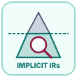

<!-- _class: lead -->

Academic Conference Presentation · Multi-Agent Requirements Engineering

# Enhancing Requirements Engineering Efficiency through a Multi-Agent AI Framework

<strong>PLANT</strong> (Platform for muLtiple Agent-based requiremeNt developmenT): Coordinating Specialized AI Roles, Knowledge Grounding, and Task-Adaptive Mediation

<strong>Nien-Lin Hsueh+</strong> and <strong>Shu-Hsien Liao</strong> 
Department of Information Engineering and Computer Science, Feng Chia University, Taichung, Taiwan 
<code>nlhsueh@fcu.edu.tw</code> · <code>m1325977@o365.fcu.edu.tw</code>

Supported by the National Science and Technology Council (NSTC), Taiwan R.O.C., under grant NSTC114-2221-E-035-077.

<!--
Paper Context & Core Contribution:
- Published in the Journal of Information Science and Engineering (JISE, 2026) by Nien-Lin Hsueh and Shu-Hsien Liao (Department of Information Engineering and Computer Science, Feng Chia University; NSTC grant NSTC114-2221-E-035-077).
- Full framework name: PLANT (Platform for muLtiple Agent-based requiremeNt developmenT), an end-to-end multi-agent Requirements Engineering (RE) platform coordinating six specialized LLM roles—User, Analyst, Expert, Modeler, Mediator, and Documenter.
- Core methodological contributions: (1) Simultaneous Stakeholder Prompting (SSP) for unbiased multi-persona elicitation; (2) external regulatory/standards grounding and PlantUML structural validation; (3) Hybrid-Communication-with-Mediator for task-adaptive switching between Simultaneous-Talk and One-by-One dialogue; and (4) Human-in-the-Loop (HITL) deadlock adjudication feeding into an IEEE 29148-compliant SRS with traceable Design Rationales (DR).
- Empirical scope: Evaluated across 5 software systems (103 ground-truth implicit requirements) and 100 requirement conflict pairs on GPT-4.1 and Gemini 3 Flash, alongside an explicit quality-cost trade-off analysis.
-->

---

## Opening Hook: "Done in 6 Turns!" ... Or Did We Miss Half the System?

<strong>The Big Idea:</strong> A single LLM acts like an eager "yes-man" that stops at surface features. <strong>PLANT</strong> replaces the solo interviewer with a <strong>specialized multi-agent requirements team</strong> that uncovers hidden NFRs, catches conflicts, and logs traceable rationales.

<!--
Behavioral Contrast: Single-Agent Premature Convergence vs. Multi-Agent Depth:
- In empirical elicitation trials (Table 6), single-agent LLM interviewers terminated early after an average of only 6.20 turns (GPT-4.1) or 6.00 turns (Gemini 3 Flash), despite being permitted up to 20 turns.
- Root causes identified in the paper: Single-agent LLMs suffer from sycophancy bias and premature convergence (Du et al. [3]), prematurely assuming requirements are complete once surface-level functional features (Interaction and Content) are covered—leaving Security, Safety, Reliability, and Performance largely unexamined.
- Multi-agent resolution: By distributing elicitation, regulatory auditing, and behavioral modeling across specialized agents coordinated by a Mediator, PLANT sustains 13.00 to 17.00 productive turns, systematically uncovering implicit Non-Functional Requirements (NFRs), surfacing latent conflicts, and recording traceable Meeting Minutes (MoM).
-->

---

## Presentation Outline

1

[**Introduction & Research Questions**](#4)
Why single-agent LLMs fail in Requirements Engineering and our three RQs (RQ1–RQ3).

2

[**Related Work & Research Gap**](#6)
Comparison of LLM & multi-agent RE frameworks (Table 1).

3

[**PLANT Framework & Mediation**](#7)
Six agent roles, 4-stage workflow, SSP, knowledge grounding, and hybrid communication.

4

[**Experimental Setup & RQ1–RQ3 Results**](#12)
103 implicit requirements (5 systems), 100 conflict pairs, and cost-effectiveness analysis.

5

[**Discussion & Threats to Validity**](#17)
Expected component contributions and internal / construct / external validity.

6

[**Conclusion & Future Work**](#19)
Visual synthesis of RQ1–RQ3 conclusions and roadmap for specification-driven development.

<!--
Paper Structural Roadmap:
- Section 1 (Introduction) frames the critical role of rigorous IEEE 29148 specifications in the AI-Augmented Software Development (AASD) era and defines RQ1 through RQ3.
- Section 2 (Related Work) reviews LLM applications across elicitation, analysis, and specification, comparing PLANT against representative single- and multi-agent frameworks (Table 1).
- Section 3 (Approach) details PLANT's six agent roles (Table 2), four-stage iterative workflow (Fig. 2), Simultaneous Stakeholder Prompting (SSP, Fig. 3), external knowledge grounding, and Mediator-guided hybrid communication (Fig. 4).
- Section 4 (Experimental Evaluation) specifies datasets (Table 3), prompt schemas (Table 4), automated evaluation protocols, quantitative results for RQ1 to RQ3 (Tables 5 to 10), expected component contributions, and threats to validity.
- Section 5 (Conclusion) synthesizes core findings and outlines future work toward fixed-budget ablations, human SRS evaluation, and Specification-Driven Development (SDD).
-->

---

## 1.1 Motivation: Why Single-Agent LLMs Fall Short in RE

<strong>Why RE Matters in the AASD Era:</strong> Even as AI accelerates coding, rapid iteration produces fragmented architectures without a rigorous <strong>IEEE 29148 SRS</strong> — especially for non-functional requirements (NFRs) like security, privacy, and reliability.

<!--
Theoretical Motivation in the AASD Era:
- AI-Augmented Software Development (AASD, Ozkaya [1]) shifts software engineers from manual coders to supervisors and decision makers. However, accelerated AI code generation without a rigorous IEEE 29148 Software Requirements Specification (SRS) amplifies architectural fragmentation and downstream maintenance costs as systems scale.
- Organizational bottleneck: Traditional RE depends on experienced system analysts conducting multi-round stakeholder meetings to reconcile competing priorities—especially NFRs (security, privacy, performance, reliability, scalability), which are both primary conflict sources and the most frequently overlooked early requirements. Junior-analyst shortages often curtail these iterations.
- Why LLMs help, yet single agents fail: LLMs encode broad standards knowledge and excel at detail-intensive artifact consolidation, but single-agent virtual interviewers (e.g., Korn et al. [2]) conflate stakeholder elicitation, domain compliance, and modeling within one context window, triggering sycophancy bias and early exit (Du et al. [3]).
-->

---

## 1.2 Research Objectives & Three Research Questions

We empirically quantify **PLANT** on two foundational upstream RE tasks and its computational resource trade-off *(revealed step-by-step)*:

* 

RQ1 Can specialized agents uncover what stakeholders forget to say?

<strong>How effectively does PLANT discover implicit requirements</strong> — especially overlooked NFRs — across diverse software systems?

* 

RQ2 Can structured deliberation catch hidden requirement clashes?

<strong>How effectively does PLANT identify requirement conflicts</strong> compared with a single-agent classifier?

* 

RQ3 When is multi-agent deliberation worth the extra tokens & time?

<strong>How cost-effective is PLANT</strong> in terms of token consumption, runtime, API cost, and marginal IRE gain per 1M tokens?

<!--
Scope of Empirical Evaluation (RQ1 to RQ3):
- Although PLANT's complete workflow generates UML diagrams, Meeting Minutes (MoM), Design Rationales, and IEEE 29148 SRS drafts (available in the public repository), the paper's controlled quantitative evaluation focuses rigorously on two foundational upstream RE bottlenecks plus resource economics:
  - RQ1 (Implicit Requirement Elicitation): Evaluates recall of unstated functional and non-functional requirements (IRE) and early-turn questioning efficiency (TKQR) across 5 diverse domains (103 ground-truth IRs).
  - RQ2 (Requirement Conflict Identification): Evaluates pairwise classification (Macro F1 and Conflict-class Precision, Recall, F1) across 100 balanced requirement pairs from Hospital Management (70) and Food Delivery (30).
  - RQ3 (Cost-Effectiveness): Quantifies token consumption, wall-clock runtime, API cost (US$), marginal IRE gain per additional 1M tokens, and unit cost per elicited IR across GPT-4.1 and Gemini 3 Flash to delineate practical deployment boundaries.
-->

---

## 2. Related Work & Architectural Comparison (Table 1)

Existing LLM-based RE frameworks rarely integrate **task-adaptive negotiation** and **traceable design rationales** end-to-end.

| Approach | Core Description | Elicit. | Analysis | Spec. | Multi-Agent | Negot. | Trace. |
| :--- | :--- | :---: | :---: | :---: | :---: | :---: | :---: |
| LLMREI [2] / RECOVER [7] | Virtual interviews to elicit & structure requirements | ✓ | × | × | × | × | × |
| Elicitron [8] | Simulates usage scenarios & agent-based interviews | ✓ | ✓ | × | ✓ | × | × |
| MAD [9] | Multi-agent debate for requirement classification | × | ✓ | × | ✓ | ✓ | × |
| ReqInOne [10] | Single-agent workflow to analyze & generate SRS | × | ✓ | ✓ | × | × | × |
| MARE [11] / iReDev [12] | Multi-agent role division & shared workspace / KG | ✓ | ✓ | ✓ | ✓ | × | × |
| **Our Approach (PLANT)** | **End-to-end roles, mediator-guided negotiation & traceable DR** | **✓** | **✓** | **✓** | **✓** | **✓** | **✓** |

<strong>Key Research Gap:</strong> Even recent multi-agent systems (MARE, iReDev) rely on sequential handoffs without a dedicated <strong>Mediator</strong> that dynamically switches communication modes, escalates deadlocks to humans, or logs structured design rationales.

<!--
Comparative Positioning in RE Literature (Table 1):
- Single-stage / single-agent tools: LLMREI [2] (33 simulated interviews, >73% valid requirement extraction via zero-shot/CoT) and RECOVER [7] focus strictly on elicitation; ReqInOne [10] targets single-agent analysis and SRS drafting; formal-logic contradiction detectors (Gärtner & Göhlich [14]) and use-case extractors (Eisenreich et al. [15]) address isolated analysis tasks.
- Early multi-agent RE systems: Elicitron [8] simulates user personas for elicitation/analysis without negotiation or SRS specification; MAD [9] applies multi-agent debate solely to requirement classification.
- End-to-end multi-agent peers: MARE [11] assigns elicitation, modeling, validation, and specification roles communicating via a shared workspace; iReDev [12] augments multi-agent refinement with custom domain knowledge graphs.
- Distinct gap addressed by PLANT: Neither MARE nor iReDev includes a dedicated Mediator that dynamically switches communication topologies per discussion goal, escalates deadlocked trade-offs to Human-in-the-Loop (HITL) review (emphasized by Arora et al. [6]), or structures multi-round negotiation logs into explicit Design Rationales linked to SRS clauses.
-->

---

## 3.1 PLANT Framework Overview & Six Specialized Roles

Fig. 1: Overview of the PLANT framework

### 🤖 Six Specialized Agents (Table 2)
- **User**: Simulates first-person stakeholder personas (usage scenarios, pain points).
- **Analyst**: Structures requirements, defines scope boundaries, flags conflicts.
- **Expert**: Audits against external domain regulations, privacy laws & ISO 25010.
- **Modeler**: Builds & validates PlantUML models (use-case, class, sequence).
- **Mediator**: Plans agenda, switches communication modes, escalates deadlocks.
- **Documenter**: Compiles IEEE 29148 SRS & traceable Design Rationale (DR).

<!--
Six Specialized Agent Profiles & Responsibilities (Fig. 1, Table 2 & Table 4):
- User (Multiple Stakeholders): Configured via SSP to adopt confirmed stakeholder personas concurrently, outputting structured JSON of first-person usage scenarios, operational pain points, expected features, and concerns.
- Analyst (Experienced System Analyst): Extracts atomic requirements from stakeholder remarks, partitions In-Scope vs. Out-of-Scope boundaries, identifies pairwise conflicts with rationales, and maintains the evolving requirements draft.
- Expert (Experienced Domain Expert): Queries PLANT's external Document Library and search tools to audit drafts against domain regulations, personal-data protection laws, payment guidelines, and ISO/IEC 25010 quality attributes, citing specific supporting clauses.
- Modeler (Experienced Requirement Modeler): Translates requirements into PlantUML use-case, class, and sequence diagrams, invoking a syntax and consistency validation tool to expose missing actors, states, or exception timeouts.
- Mediator (Experienced Requirement Mediator): Formulates bounded round agendas, selects Simultaneous-Talk vs. One-by-One strategies, evaluates consensus, writes MoM, and triggers HITL escalation on deadlocks.
- Documenter (Experienced Requirement Documenter): Compiles the converged draft into an IEEE 29148 SRS with acceptance criteria and synthesizes multi-round MoM logs into a traceable Design Rationale document.
-->

---

## 3.2 Four-Stage Iterative Collaboration Process

Fig. 2: Four-stage iterative workflow in PLANT

### 🔄 Beyond Single-Pass Generation
1. **Stage 1 · Elicitation (SSP)**: From a rough idea, `User` simulates multiple stakeholders concurrently to capture diverse expectations.
2. **Stage 2 · Multi-Perspective Analysis**: `Analyst` scopes & detects conflicts; `Expert` audits regulations; `Modeler` validates PlantUML flows in parallel.
3. **Stage 3 · Mediated Negotiation**: Up to `r` bounded rounds; `Mediator` resolves conflicts, logs `MoM`, and updates drafts/models.
4. **Stage 4 · Specification & Rationale**: `Documenter` compiles an **IEEE 29148 SRS** linked directly to multi-round `MoM` rationales.

<!--
Four-Stage Iterative Workflow Mechanics (Fig. 2):
- Stage 1 (Elicitation via SSP): Starting from a human Proposer's rough system idea, PLANT proposes candidate stakeholder personas (confirmed by the human user), and the User agent simulates them concurrently to collect broad initial needs without sequential anchoring.
- Stage 2 (Parallel Multi-Perspective Analysis, Grounding & Modeling): Analyst structures user requirements, sets scope boundaries, and flags initial conflicts; Expert audits against external regulations/standards; Modeler builds and validates PlantUML models. Analyst consolidates these parallel outputs into a baseline requirements draft and conflict report.
- Stage 3 (Mediator-Guided Iterative Negotiation): Across at most r bounded rounds, the Mediator extracts open issues and unresolved conflicts, dynamically applies Simultaneous-Talk or One-by-One dialogue, escalates high-impact deadlocks to HITL if needed, logs Meeting Minutes (MoM), and triggers synchronous updates to drafts, conflict reports, and UML models.
- Stage 4 (Specification & Design Rationale Generation): Upon convergence or reaching round r, Documenter compiles the IEEE 29148 SRS and links each requirement back to originating stakeholder remarks, conflict deliberations, and MoM rulings.
-->

---

## 3.3 Simultaneous Stakeholder Prompting & Knowledge Grounding

Fig. 3: Simultaneous Stakeholder Prompting (SSP) — independent multi-persona brainstorming

### 🗣️ Unbiased Stakeholder Elicitation (SSP)
- Extends Solo Performance Prompting (SPP) [19] using **Simultaneous-Talk** [4]: personas (e.g., *Customer*, *Courier*, *Restaurateur*) generate needs independently without anchoring on prior speakers.

### 📚 External Knowledge & UML Consistency
- **Expert** queries uploaded laws/standards (ISO 29148, ISO 25010, privacy laws) during initial audit and on-demand negotiation.
- **Modeler** runs PlantUML syntax/consistency checks to expose missing exception paths (e.g., *courier order timeout & reassignment*).

<!--
Unbiased Elicitation (SSP), Two-Point Knowledge Retrieval & Model Validation (Fig. 3):
- Simultaneous Stakeholder Prompting (SSP): Extends Solo Performance Prompting (SPP, Wang et al. [19]) with Simultaneous-Talk (Chan et al. [4]). Independent personas (e.g., consumer prioritizing convenience/payments, restaurant owner focusing on peak-hour order control, courier prioritizing routing and earnings transparency) generate requirements concurrently before observing peers, eliminating first-speaker anchoring.
- Two-point External Knowledge Grounding: Users upload project documents, privacy/payment regulations, ISO/IEC/IEEE 29148 [18], and ISO/IEC 25010 [20] into the Document Library. Expert retrieves passages (1) during initial Stage 2 auditing and (2) on demand during Stage 3 negotiation whenever regulatory or technical feasibility questions arise.
- Noise & contradiction handling: Expert filters retrieved chunks against the confirmed in-scope boundary and cites explicit constraints; during One-by-One negotiation, Analyst and Modeler cross-examine whether cited constraints clash with functional workflows, escalating unresolved policy conflicts to HITL.
- Tool-assisted PlantUML validation: Formalizing sequence and use-case diagrams systematically reveals lifecycle omissions—for instance, exposing that courier order acceptance lacks a timeout and automatic reassignment path.
-->

---

## 3.4 Mediator-Guided Negotiation Process

Fig. 4: Mediator-guided bounded negotiation & HITL escalation

### ⚖️ Structured Agenda & Bounded Rounds
- At the start of each round (`1 ≤ t ≤ r`), the **Mediator** categorizes agenda issues into 4 types:
  1. Open-question exploration
  2. New-requirement supplementation
  3. Requirement trade-off evaluation
  4. Conflict resolution
- **Consensus** ➔ Recorded in Meeting Minutes (`MoM`), triggering draft & UML updates.
- **Deadlock / High-Impact Trade-Off** ➔ Packaged with candidate options for **Human-in-the-Loop (HITL)** adjudication.

<!--
Bounded Agenda Planning & Consensus / HITL Protocol (Fig. 4):
- Round initialization (1 <= t <= r): The Mediator inspects the current requirements draft, unresolved conflict report, and open issues, organizing them into a four-category agenda: (1) open-question exploration, (2) new-requirement supplementation, (3) requirement trade-off evaluation, and (4) conflict resolution.
- Consensus evaluation: After participating agents complete their turn on an agenda item, the Mediator checks whether all roles agree on a concrete resolution and no further clarification is requested. Resolved items are recorded in Meeting Minutes (MoM), which directly drive end-of-round updates to the requirements draft, conflict report, and PlantUML diagrams.
- Deadlock & high-impact escalation: When substantive disagreement persists after deliberation or an issue entails a strategic business trade-off (e.g., strict privacy deletion vs. dispute-audit retention), the Mediator packages competing rationales and candidate options for Human-in-the-Loop adjudication rather than forcing an arbitrary LLM vote.
-->

---

## 3.5 Hybrid-Communication-with-Mediator

While *Simultaneous-Talk* and *One-by-One* originate from ChatEval [4], PLANT's novelty is **task-adaptive dynamic switching** orchestrated by the `Mediator`.

<!--
Task-Adaptive Communication Switching (Hybrid-Communication-with-Mediator):
- Attribution vs. novelty: The paper explicitly notes that Simultaneous-Talk and One-by-One primitives originate from ChatEval (Chan et al. [4]) and are not claimed as new primitives. PLANT's methodological innovation is embedding a dedicated Mediator that dynamically selects and switches between these modes based on the specific RE objective of each agenda item.
- Divergent Expansion -> Simultaneous-Talk (Issue Types 1 & 2: open questions, new requirements): Analyst, Expert, and Modeler generate probing questions or gap assessments independently within the same turn without viewing peer outputs. This prevents early anchoring, curbs groupthink, and maximizes orthogonal coverage across functional scope, domain compliance, and behavioral states.
- Convergent Resolution -> One-by-One (Issue Types 3 & 4: trade-offs, conflict resolution): Agents deliberate sequentially (Analyst -> Expert -> Modeler), inspecting preceding arguments to verify whether candidate compromises violate domain laws or state-transition logic until reaching a mutually consistent verdict.
-->

---

## 4.1 Experimental Setup & Evaluation Metrics

<i>IREt</i> &nbsp;=&nbsp;
<i>Et</i><i>Rt</i>
&nbsp;× 100%
(Recall of unique IRs)

<i>TKQRt</i> &nbsp;=&nbsp;
∑ <i>ht,i</i> / log2(<i>i</i> + 1)∑ 1 / log2(<i>i</i> + 1)
&nbsp;× 100%
(Early-turn efficiency)

<strong>Strictly Automated Fair Comparison:</strong> During RQ1 &amp; RQ2 benchmark runs, <strong>0 human interventions</strong> occurred (<code>temperature = 0</code>, max <code>r = 20</code>), with independent <strong>GPT-5.2</strong> as LLM-as-a-Judge.

<!--
Benchmark Design, Baselines & Reproducibility Protocol (Tables 3 & 4):
- RQ1 Benchmark (103 IRs across 5 systems): Adopts 4 cases from ReqElicitGym [21] (Stock Report, Hospital Management, Ticket Booking, Vocabulary Learning—originally 36 functional IRs covering Interaction, Content, Style) and expands them using ISO/IEC 25010 [20] with 6 NFR categories (Reliability, Compatibility, Flexibility, Performance, Security, Safety) plus a newly constructed 5th multi-stakeholder case, Food Delivery (19 IRs), manually verified for non-overlap.
- RQ2 Benchmark (100 balanced pairs): Uses all 35 Conflict pairs plus 35 randomly sampled Neutral pairs from the Hospital Management subset of the CN dataset [22] (70 pairs), alongside 30 manually verified balanced pairs (15 Conflict, 15 Neutral) for Food Delivery.
- Baseline rationale: Compared against a single-agent LLM baseline on identical backbones (GPT-4.1 and Gemini 3 Flash). Peer multi-agent frameworks (MARE, iReDev, MAD) could not be directly executed because MARE/iReDev generate static drafts rather than turn-by-turn ReqElicitGym interviews (and iReDev requires custom domain KGs), while MAD targets requirement type classification without compatible open-source pipelines.
- Strict automation & metrics: HITL disabled (0 human interventions), temperature = 0, max r = 20 turns (RQ1), 3 independent runs reporting Mean +/- Std (RQ2). An LLM-based oracle simulated user discloses ground-truth IRs only when directly probed; an independent GPT-5.2 LLM-as-a-Judge (following G-Eval [23]) evaluates semantic hits, verified by authors. IRE_t = (E_t / R_t) * 100% measures unique IR recall; TKQR_t applies a 1 / log2(i + 1) logarithmic turn discount to reward early-turn discovery.
-->

---

## 4.2 RQ1 Case Study: Multi-Angle Probing in Food Delivery

Under **Simultaneous-Talk**, three agents independently probe the same abnormal-order scenario from distinct professional angles (Table 5):

| Agent Role | Independent Probing Question | Uncovered Stakeholder Need |
| :--- | :--- | :--- |
| **Analyst** | Should handling options apply to all abnormal scenarios or specific delays / courier no-shows? | *"Contact customer service" must always be available on exceptions.* |
| **Expert** | If real phone numbers are hidden and users only use **built-in in-app chat/voice**, does that satisfy you? | **Hit IR!** *"Yes — do not expose real phone numbers; use in-app anonymous call forwarding with dispute logs."* |
| **Modeler** | Should real-time handling options be restricted according to **order lifecycle states**? | *Cancellation depends on order state & refund policy with clear reasons.* |

<strong>Why Multi-Angle Probing Works:</strong> While Analyst and Modeler check functional rules and state transitions, the <strong>Expert</strong> surfaces a critical <strong>security &amp; privacy implicit requirement</strong> completely omitted from the initial description.

<!--
Qualitative Trace of Orthogonal Multi-Angle Probing (Table 5):
- Scenario: Abnormal order handling in the Food Delivery case under Mediator-selected Simultaneous-Talk.
- Orthogonal probing in a single turn:
  - Analyst probes functional exception scope ("all abnormal scenarios vs. specific delays/courier no-shows"), confirming that "contact customer service" must always remain accessible.
  - Modeler probes lifecycle state constraints ("restricting cancellation by order state"), clarifying state-dependent cancellation tied to refund policies and explicit reason display.
  - Expert independently probes privacy compliance ("hiding real phone numbers via built-in in-app chat/voice"), directly triggering the oracle stakeholder to reveal a ground-truth Security/Privacy implicit requirement: prohibiting direct exposure of customer and courier phone numbers, favoring anonymous call forwarding with dispute-accessible logs.
- Diagnostic takeaway: Because agents do not observe each other's draft questions before speaking, functional questioning does not anchor the Expert away from regulatory and privacy auditing.
-->

---

## 4.3 RQ1 Results: Implicit Requirement Elicitation (103 IRs)

54.28% vs. 16.77%

Mean IRE with <strong>GPT-4.1</strong> (54 vs. 17 IRs · <strong>3.2×</strong> gain)

46.79% vs. 18.90%

Mean IRE with <strong>Gemini 3 Flash</strong> (48 vs. 19 IRs · <strong>2.5×</strong> gain)

13–17 vs. ~6 Turns

Prevents premature termination (TKQR: 55.0% / 64.9%)

### 🏆 NFR Breakthrough (GPT-4.1 · Table 7)

<strong>Security (12 IRs)</strong>

10 vs. 2

<strong>Safety (3 IRs)</strong>

3 vs. 0

<strong>Reliability (7 IRs)</strong>

5 vs. 0

<strong>Compatibility (10)</strong>

7 vs. 3

<strong>Performance (6)</strong>

4 vs. 0

### 📊 Case-Level IRE (%) — Table 6
| System Case | Base (GPT) | PLANT (GPT) | Base (Gem) | PLANT (Gem) |
| :--- | :---: | :---: | :---: | :---: |
| Stock Report | 17.65 | **82.35** | 23.53 | **52.94** |
| Hospital Mgmt | 19.05 | **47.62** | 23.81 | **47.62** |
| Ticket Booking | 13.04 | **43.48** | 8.70 | **39.13** |
| Vocab Learning | 13.04 | **34.78** | 17.39 | **52.17** |
| Food Delivery | 21.05 | **63.16** | 21.05 | **42.11** |

<!--
Quantitative Analysis of Implicit Requirement Elicitation (Tables 6 & 7):
- Overall IRE gains: Across all 5 systems, PLANT elevates mean IRE from 16.77% (Std 3.23) to 54.28% (Std 16.78) on GPT-4.1 (54 vs. 17 of 103 IRs; 3.2x gain) and from 18.90% (Std 5.60) to 46.79% (Std 5.44) on Gemini 3 Flash (48 vs. 19 IRs; 2.5x gain). Case-level highlights on GPT-4.1 include Stock Report (82.35% vs. 17.65%) and Food Delivery (63.16% vs. 21.05%).
- NFR breakthrough (Table 7): Single-agent baselines concentrate on surface Interaction and Content (11/17 hits on GPT-4.1; 13/19 on Gemini 3 Flash) and score 0 on Reliability (0/7), Performance (0/6), and Safety (0/3), with only 2/12 on Security. PLANT (GPT-4.1) uncovers 10/12 Security, 3/3 Safety, 5/7 Reliability, 7/10 Compatibility, and 4/6 Performance (while Style remains 0/10 for PLANT, reflecting its engineering-constraint emphasis).
- Interaction depth & TKQR nuance: PLANT sustains 17.00 turns (GPT-4.1) and 13.00 turns (Gemini 3 Flash) vs. 6.20 and 6.00 for baselines. PLANT's mean TKQR is slightly lower (54.95% vs. 61.35% on GPT-4.1; 64.87% vs. 70.43% on Gemini 3 Flash) because multi-agent runs invest early turns establishing scope and structural context before uncovering deep NFRs in later turns. The paper notes that IRE is recall-oriented and deeper probing can yield tangential candidates, mitigated in deployment by scope filtering and HITL review.
-->

---

## 4.4 RQ2 Results: Requirement Conflict Identification (100 Pairs)

Using **One-by-One** deliberation (e.g., *retain complete chat logs* vs. *delete chat records after resolution*), Analyst, Expert, and Modeler cross-check functional rules, privacy obligations, and state transitions (Tables 8 & 9).

| Dataset | Method | LLM Backbone | Macro F1 (%) | Conflict Precision | Conflict Recall | Conflict F1 (%) |
| :--- | :--- | :--- | :---: | :---: | :---: | :---: |
| **Hospital Mgmt** (70 pairs) | Baseline | GPT-4.1 / Gemini 3 | 81.33 / 72.52 | 86.67 / 79.30 | 74.29 / 61.91 | 80.00 / 69.51 |
| **Hospital Mgmt** (70 pairs) | **PLANT** | **GPT-4.1 / Gemini 3** | **90.91 / 89.46** | 86.66 / 84.35 | **97.14 / 97.14** | **91.51 / 90.28** |
| **Food Delivery** (30 pairs) | Baseline | GPT-4.1 / Gemini 3 | 89.90 / 86.43 | 100.0 / 100.0 | 80.00 / 73.33 | 88.89 / 84.62 |
| **Food Delivery** (30 pairs) | **PLANT** | **GPT-4.1 / Gemini 3** | **95.55 / 96.66** | 95.69 / 93.75 | **95.55 / 100.0** | **95.55 / 96.77** |

<strong>RQ2 Finding:</strong> Single-agent baselines are overly conservative (missing 20%–38% of conflicts). PLANT lifts <strong>Conflict-class Recall to 95.55%–100.00%</strong> and <strong>Conflict F1 by +6.66 to +20.77 pts</strong> while avoiding false alarms on distinct data scopes.

<!--
Quantitative Analysis of Pairwise Conflict Identification (Tables 8 & 9):
- Deliberation mechanics (Table 8): On a Food Delivery pair pitting "retain complete customer-service conversation records" against "delete chat records and personal contact info after resolution," One-by-One sequential review allows Analyst (contradictory data retention policy), Expert (mutually exclusive personal-data retention vs. deletion obligations), and Modeler (incompatible process/state lifecycle) to converge on Conflict. Conversely, when requirements govern distinct data scopes (e.g., hiding a deleted address from the front-end UI vs. retaining an anonymized hash in backend audit logs), sequential cross-checking prevents false-positive conflict alarms.
- Hospital Management (70 pairs, Mean +/- Std across 3 runs): Macro F1 jumps from 81.33 +/- 0.00% to 90.91 +/- 1.81% (GPT-4.1) and from 72.52 +/- 0.08% to 89.46 +/- 1.37% (Gemini 3 Flash). Conflict-class Recall surges from 74.29% and 61.91% to 97.14% on both models, lifting Conflict F1 by +11.51 pts (GPT-4.1) and +20.77 pts (Gemini 3 Flash).
- Food Delivery (30 pairs): Macro F1 rises from 89.90% to 95.55% (GPT-4.1) and from 86.43% to 96.66% (Gemini 3 Flash). Single-agent baselines achieve 100% precision only by being overly conservative—flagging obvious lexical contradictions while missing 20.00% to 26.67% of true conflicts. PLANT raises Conflict Recall to 95.55% (GPT-4.1) and 100.00% (Gemini 3 Flash), lifting Conflict F1 by +6.66 and +12.15 pts.
-->

---

## 4.5 RQ3 Results: Cost-Effectiveness & Deployment Trade-Off

| LLM Backbone | Elicited IRs (Base / PLANT) | Avg. Tokens (k) (Base / PLANT) | Avg. Runtime (Base / PLANT) | Avg. Cost (US$) (Base / PLANT) | IRE Gain / 1M Tok. | Cost per IR (PLANT / Base) |
| :--- | :---: | :---: | :---: | :---: | :---: | :---: |
| **GPT-4.1** | 17 / **54** | 40.3 / **3,761** (`93.4×`) | 134s / **3,700s** (`27.6×`) | $0.12 / **$8.14** | **9.65%** | **$0.1507** / $0.0071 |
| **Gemini 3 Flash** | 19 / **48** | 39.4 / **9,811** (`248.8×`) | 114s / **4,173s** (`36.6×`) | $0.07 / **$6.71** | **2.88%** | **$0.1399** / $0.0036 |

### ✅ When PLANT Is Highly Cost-Effective
- Medium-to-large, **compliance-sensitive**, or multi-stakeholder projects at project inception.
- Spending **~1 hour & US\$6.71–\$8.14** (~US\$0.14–\$0.15 per IR) to uncover **2.5×–3.2× more NFRs** is far cheaper than late-stage rework or security defects.

### ⚡ When a Single-Agent Is Preferable
- Rapid prototyping, simple single-user apps, or real-time brainstorming requiring **sub-minute latency** and minimal API budget.

<!--
Resource Footprint, Marginal Return & Deployment Economics (Table 10):
- Per-case resource comparison (averaged over the 5 RQ1 cases):
  - GPT-4.1: Baseline uses 40.26k tokens, 134s, US$0.1206; PLANT uses 3,761.03k tokens (93.4x), 3,700s (27.6x), and US$8.1368 (67.5x), yielding a marginal IRE gain of 9.65% per additional 1M tokens. Unit cost per elicited IR is 69.65k tokens, 68.51s, and US$0.1507 (vs. 2.37k, 7.85s, US$0.0071 for baseline).
  - Gemini 3 Flash: Baseline uses 39.43k tokens, 114s, US$0.0688; PLANT uses 9,810.93k tokens (248.8x), 4,173s (36.6x), and US$6.7145 (97.6x), yielding 2.88% IRE gain per additional 1M tokens and US$0.1399 per elicited IR (204.39k tokens, 86.94s).
- Cross-backbone insight: While Gemini 3 Flash achieves slightly lower total monetary cost ($6.71 vs. $8.14), GPT-4.1 is substantially more token-efficient (3.76M vs. 9.81M tokens; 9.65% vs. 2.88% IRE gain per 1M tokens) and discovers more IRs (54 vs. 48).
- Practical decision boundary: Because requirements elicitation occurs infrequently at project inception or major releases—and missed NFRs or conflicts are among the costliest post-implementation defects—spending ~1 hour and US$6.71 to $8.14 to uncover 2.5x to 3.2x more implicit requirements is highly economical for medium-to-large, compliance-sensitive, or multi-stakeholder systems. Single-agent LLMs remain preferable for rapid prototyping or sub-minute interactive brainstorming.
-->

---

## 4.6 Component Contribution Analysis

Although a full combinatorial ablation is left for future work, our aspect-level breakdown (Table 7) and qualitative traces clarify each component's role:

### 🧩 Analyst + User Only vs. +Expert & +Modeler
- **Single-Agent Baseline** approximates *Analyst + User* only — capturing primarily *Interaction* & *Content* (11/17 GPT-4.1 hits) while scoring **0** on *Reliability*, *Performance*, and *Safety*.
- Adding **Expert** directly drives *Security* (**9–10/12**), *Safety* (**2–3/3**), and regulatory *Compatibility* discovery.
- Adding **Modeler** uncovers *Reliability* (**2–5/7**) and state-transition edge cases via PlantUML validation.

### 🧭 Role of Mediator & Hybrid Communication
- Without the **Mediator** consolidating open issues and dynamically switching modes:
  - Pure *One-by-One* brainstorming risks **early anchoring** and groupthink.
  - Uncoordinated parallel dialogue risks **redundant questioning** and unresolved deadlocks.
- Controlled 4-way ablation under **matched turn & token budgets** is a top priority for future work.

<!--
Expected Architectural Contributions & Planned Ablation Design (Section 4.3):
- Inferring role impact from aspect-level evidence (Table 7) and dialogue traces:
  - Analyst + User baseline proxy: The single-agent baseline mirrors a solo analyst interviewing a user—capturing primarily Interaction and Content (11/17 GPT-4.1 hits; 13/19 Gemini hits) while scoring 0 on Reliability, Performance, and Safety.
  - Expert contribution: External regulatory and ISO 25010 auditing directly drives breakthroughs in Security (9 to 10 of 12), Safety (2 to 3 of 3), and regulatory Compatibility (6 to 7 of 10), as well as legal data-retention conflict detection.
  - Modeler contribution: Formalizing use-case, class, and sequence diagrams via PlantUML validation systematically exposes Reliability requirements (2 to 5 of 7) and state-transition edge cases (e.g., timeout reassignment).
  - Mediator & Hybrid Communication contribution: Dynamically pairing Simultaneous-Talk (for divergent probing) with One-by-One (for convergent conflict resolution) prevents both the early anchoring of pure sequential brainstorming and the redundant, non-converging chatter of uncoordinated parallel agents.
- Future controlled ablation: A 4-way ablation (without Mediator, Analyst + User only, without Expert/KB, and One-by-One only) under matched turn and token budgets is prioritized for future work.
-->

---

## 4.7 Threats to Validity

### 🔍 Internal Validity
- **Interaction Budget**: PLANT runs 13–17 turns vs. ~6 turns (93–249× tokens); gains reflect *both* role specialization and deeper interaction.
- **Live Web Search**: While local Document Library docs were static (`temp = 0`), caching live search snapshots will strengthen reproducibility.

### 🎯 Construct Validity
- **Simulated Users & LLM Judge**: Oracle simulated users may be more cooperative than real clients; multi-judge & human studies are needed.
- **Recall Focus & Scope**: IRE does not penalize out-of-scope questions (mitigated by scope filtering/HITL); downstream SRS & UML quality was not yet quantitatively scored.

### 🌐 External Validity
- **Dataset Scale**: Evaluated on 5 system cases (103 IRs) across finance, healthcare, transport, education & logistics, plus 100 conflict pairs.
- **Broader Baselines**: Future work will expand to larger industrial repositories and task-adapted multi-agent baselines.

<!--
Methodological Threats to Validity (Section 4.3):
- Internal Validity:
  - Interaction & token budget asymmetry: PLANT runs 13 to 17 turns vs. ~6 turns and consumes 93.4x to 248.8x more tokens; observed IRE gains reflect the combined effect of role specialization and deeper interaction horizons rather than role division alone.
  - External retrieval reproducibility: Although temperature = 0 and local Document Library files were static, live web search queries can drift over time; caching all external retrieval snapshots will strengthen reproducibility.
- Construct Validity:
  - Oracle simulated user & single LLM judge: Following ReqElicitGym [21] and G-Eval [23], RQ1 relies on a simulated user (potentially more cooperative than real stakeholders) and a single GPT-5.2 judge (potential evaluator bias), warranting multi-judge consensus and human-subject interviews.
  - Recall-only metric & downstream scope: IRE does not penalize false-positive or over-specified candidate requirements (managed in practice via scope filtering and HITL). Additionally, quantitative experiments evaluated upstream elicitation (RQ1) and conflict classification (RQ2) rather than directly scoring downstream SRS quality, hallucination rates, or traceability accuracy.
- External Validity:
  - Dataset scale: While the 5 cases (103 IRs) and 100 conflict pairs span finance, healthcare, transportation, education, and e-commerce logistics, larger industrial repositories and task-adapted multi-agent baselines are needed for broader generalization.
-->

---

## 5. Conclusion & Future Work

<strong>🧪 1. Fixed-Budget Ablations</strong> Isolate Expert, Modeler & Mediator gains under matched token/turn budgets against multi-agent baselines.

<strong>👩‍💻 2. Human SRS Evaluation</strong> Quantitatively assess UML completeness, factual grounding & DR traceability with practitioners.

<strong>⚙️ 3. Spec-Driven Development</strong> Feed PLANT's traceable IEEE 29148 SRS directly into automated test-case & code generation [24].

<!--
Synthesis of Empirical Conclusions & Research Roadmap:
- Core conclusions across RQ1 to RQ3:
  - RQ1: Specialized multi-agent probing with external knowledge grounding elevates implicit requirement recall by 2.5x to 3.2x (54.28% on GPT-4.1; 46.79% on Gemini 3 Flash), overcoming single-agent premature termination (~6 turns) and unlocking critical NFRs.
  - RQ2: Mediator-guided One-by-One deliberation raises Conflict-class Recall to 95.55% to 100.00% and Macro F1 to 89.46% to 96.66%, resolving single-agent conservatism while preserving precision across distinct data scopes.
  - RQ3: Computational overhead (93.4x to 248.8x tokens; 27.6x to 36.6x runtime; US$6.71 to $8.14 per system) yields ~US$0.14 to $0.15 per uncovered IR, proving practical for high-stakes, compliance-critical inception phases.
- Three concrete future directions: (1) Controlled fixed-budget ablations and direct comparisons against task-adapted multi-agent baselines; (2) human practitioner evaluation of UML completeness, factual grounding, hallucination rates, and Design Rationale traceability; and (3) feeding PLANT's traceable IEEE 29148 SRS into Specification-Driven Development (SDD, Piskala [24]) for automated test-case and code generation.
-->

---

<!-- _class: closing -->

# Thank You for Your Attention!

Enhancing Requirements Engineering Efficiency through a Multi-Agent AI Framework (PLANT)

<strong>Nien-Lin Hsueh+</strong> &nbsp;·&nbsp; <code>nlhsueh@fcu.edu.tw</code> 
<strong>Shu-Hsien Liao</strong> &nbsp;·&nbsp; <code>m1325977@o365.fcu.edu.tw</code> 
Department of Information Engineering and Computer Science, Feng Chia University 
Online Repository & Artifacts: <code>https://dummyjack.github.io/PLANT-Manual/</code> 
Grant: NSTC114-2221-E-035-077 · Questions & Discussion Welcome!

<!--
Publication, Artifact Repository & Attribution Summary:
- Full Citation: Nien-Lin Hsueh and Shu-Hsien Liao, "Enhancing Requirements Engineering Efficiency through a Multi-Agent AI Framework," Journal of Information Science and Engineering (JISE), 2026, Department of Information Engineering and Computer Science, Feng Chia University, Taichung 407, Taiwan.
- Public Artifacts & Reproducibility Package: Complete system documentation, verbatim agent prompt templates (summarized in Table 4), sample IEEE 29148 SRS outputs, PlantUML diagrams, and Design Rationale logs are openly accessible at https://dummyjack.github.io/PLANT-Manual/.
- Funding Acknowledgment: Supported by the National Science and Technology Council (NSTC), Taiwan R.O.C., under grant NSTC114-2221-E-035-077.
-->

