

<!-- _class: lead -->

Academic Conference Presentation · Multi-Agent Requirements Engineering

# Enhancing Requirements Engineering Efficiency through a Multi-Agent AI Framework

<strong>PLANT</strong> (Platform for muLtiple Agent-based requiremeNt developmenT): Coordinating Specialized AI Roles, Knowledge Grounding, and Task-Adaptive Mediation

<strong>Nien-Lin Hsueh+</strong> and <strong>Shu-Hsien Liao</strong> 
Department of Information Engineering and Computer Science, Feng Chia University, Taichung, Taiwan 
<code>nlhsueh@fcu.edu.tw</code> · <code>m1325977@o365.fcu.edu.tw</code>

Supported by the National Science and Technology Council (NSTC), Taiwan R.O.C., under grant NSTC114-2221-E-035-077.

<!--
Key Takeaway: PLANT is a multi-agent Requirements Engineering framework combining specialized AI roles, external knowledge grounding, and task-adaptive mediation.

Talking Points:
- Good morning everyone. Today we present PLANT — Platform for muLtiple Agent-based requiremeNt developmenT — developed at Feng Chia University.
- As AI accelerates downstream coding, upstream Requirements Engineering becomes the true bottleneck; PLANT addresses this by coordinating six specialized agents rather than relying on a single LLM.
- This work is supported by Taiwan's National Science and Technology Council (NSTC).

Transition: Let's open with a familiar scenario that shows why a solo LLM interviewer often falls short.
-->

---

## Opening Hook: "Done in 6 Turns!" ... Or Did We Miss Half the System?

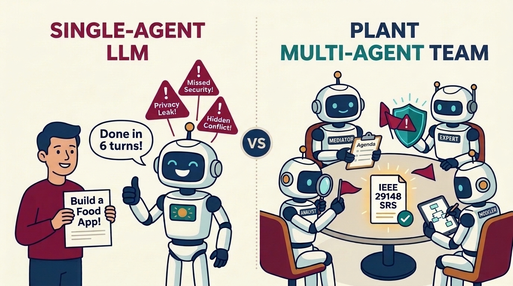

<strong>The Big Idea:</strong> A single LLM acts like an eager "yes-man" that stops at surface features. <strong>PLANT</strong> replaces the solo interviewer with a <strong>specialized multi-agent requirements team</strong> that uncovers hidden NFRs, catches conflicts, and logs traceable rationales.

<!--
Key Takeaway: A single LLM tends to act like an eager "yes-man" that stops after ~6 turns, whereas PLANT's multi-agent team digs deeper to uncover hidden NFRs and conflicts.

Talking Points:
- Imagine asking a single LLM to elicit requirements: after about six polite turns covering surface features, it declares "Done!" — leaving privacy, security, and edge cases untouched.
- PLANT replaces that solo interviewer with a coordinated multi-agent team of specialists who challenge assumptions, cross-check regulations, and log traceable design rationales.
- That shift from single-pass chatting to structured teamwork is the big idea behind PLANT.

Transition: Here is an overview of what we will cover in today's presentation.
-->

---

## Presentation Outline

1

[**Introduction & Research Questions**](#4)
Why single-agent LLMs fail in Requirements Engineering and our three RQs (RQ1–RQ3).

2

[**Related Work & Research Gap**](#6)
Comparison of LLM & multi-agent RE frameworks (Table 1).

3

[**PLANT Framework & Mediation**](#7)
Six agent roles, 4-stage workflow, SSP, knowledge grounding, and hybrid communication.

4

[**Experimental Setup & RQ1–RQ3 Results**](#12)
103 implicit requirements (5 systems), 100 conflict pairs, and cost-effectiveness analysis.

5

[**Discussion & Threats to Validity**](#17)
Expected component contributions and internal / construct / external validity.

6

[**Conclusion & Future Work**](#19)
Visual synthesis of RQ1–RQ3 conclusions and roadmap for specification-driven development.

<!--
Key Takeaway: We present the motivation and RQs, our six-role PLANT architecture and hybrid mediation, empirical results across 103 IRs and 100 conflict pairs, and future directions.

Talking Points:
- First, we motivate why single-agent LLMs struggle in RE and introduce our three research questions (RQ1 to RQ3).
- Next, we position PLANT against recent multi-agent RE frameworks and walk through its six roles, four-stage workflow, and hybrid communication mechanism.
- Finally, we share empirical evaluations on implicit requirement elicitation, conflict detection, and cost-effectiveness, followed by component analysis and validity threats.

Transition: Let's start by unpacking why single-agent LLMs fall short in Requirements Engineering.
-->

---

## 1.1 Motivation: Why Single-Agent LLMs Fall Short in RE

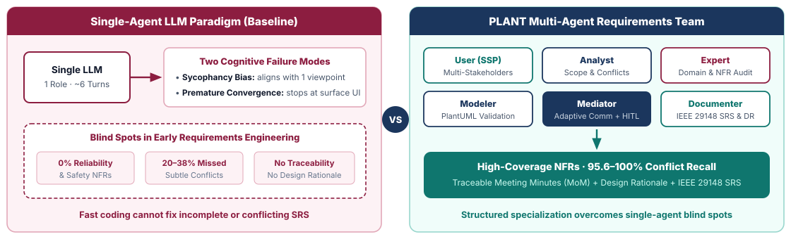

<strong>Why RE Matters in the AASD Era:</strong> Even as AI accelerates coding, rapid iteration produces fragmented architectures without a rigorous <strong>IEEE 29148 SRS</strong> — especially for non-functional requirements (NFRs) like security, privacy, and reliability.

<!--
Key Takeaway: In the AI-assisted software development era, single-agent LLMs overlook critical NFRs and conflicts, making structured multi-agent RE essential for IEEE 29148 quality.

Talking Points:
- As shown in the diagram, a single LLM conflates stakeholder elicitation, domain auditing, modeling, and specification in one context window, leading to shallow interviews and missed constraints.
- In the AASD era, faster coding without a rigorous IEEE 29148 SRS only produces fragmented architectures faster — especially when security, privacy, and reliability NFRs are missing.
- PLANT separates these cognitive responsibilities across specialized agents so critical requirements are systematically audited.

Transition: To rigorously test this approach, we formulated three core research questions.
-->

---

## 1.2 Research Objectives & Three Research Questions

We empirically quantify **PLANT** on two foundational upstream RE tasks and its computational resource trade-off *(revealed step-by-step)*:

* 

RQ1 Can specialized agents uncover what stakeholders forget to say?

<strong>How effectively does PLANT discover implicit requirements</strong> — especially overlooked NFRs — across diverse software systems?

* 
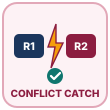

RQ2 Can structured deliberation catch hidden requirement clashes?

<strong>How effectively does PLANT identify requirement conflicts</strong> compared with a single-agent classifier?

* 
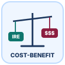

RQ3 When is multi-agent deliberation worth the extra tokens & time?

<strong>How cost-effective is PLANT</strong> in terms of token consumption, runtime, API cost, and marginal IRE gain per 1M tokens?

<!--
Key Takeaway: We empirically evaluate PLANT on implicit requirement discovery (RQ1), conflict identification (RQ2), and computational cost-effectiveness (RQ3).

Talking Points:
- RQ1 evaluates how effectively PLANT uncovers implicit requirements — especially overlooked non-functional requirements — across five diverse software systems.
- RQ2 tests whether multi-role deliberation catches hidden requirement conflicts better than a single-agent classifier.
- RQ3 examines the practical trade-off: given extra tokens, runtime, and API cost, when is multi-agent deliberation genuinely worth the investment?

Transition: Let's compare PLANT with existing LLM and multi-agent RE frameworks in the literature.
-->

---

## 2. Related Work & Architectural Comparison (Table 1)

Existing LLM-based RE frameworks rarely integrate **task-adaptive negotiation** and **traceable design rationales** end-to-end.

| Approach | Core Description | Elicit. | Analysis | Spec. | Multi-Agent | Negot. | Trace. |
| :--- | :--- | :---: | :---: | :---: | :---: | :---: | :---: |
| LLMREI [2] / RECOVER [7] | Virtual interviews to elicit & structure requirements | ✓ | × | × | × | × | × |
| Elicitron [8] | Simulates usage scenarios & agent-based interviews | ✓ | ✓ | × | ✓ | × | × |
| MAD [9] | Multi-agent debate for requirement classification | × | ✓ | × | ✓ | ✓ | × |
| ReqInOne [10] | Single-agent workflow to analyze & generate SRS | × | ✓ | ✓ | × | × | × |
| MARE [11] / iReDev [12] | Multi-agent role division & shared workspace / KG | ✓ | ✓ | ✓ | ✓ | × | × |
| **Our Approach (PLANT)** | **End-to-end roles, mediator-guided negotiation & traceable DR** | **✓** | **✓** | **✓** | **✓** | **✓** | **✓** |

<strong>Key Research Gap:</strong> Even recent multi-agent systems (MARE, iReDev) rely on sequential handoffs without a dedicated <strong>Mediator</strong> that dynamically switches communication modes, escalates deadlocks to humans, or logs structured design rationales.

<!--
Key Takeaway: Unlike prior frameworks that use static sequential handoffs, PLANT unifies end-to-end RE stages with Mediator-guided dynamic negotiation and traceable Design Rationales.

Talking Points:
- Looking at Table 1, early systems like LLMREI and RECOVER focus on single-agent interviews, while MAD focuses only on classification debate.
- Even recent multi-agent platforms like MARE and iReDev rely on fixed sequential pipelines without structured conflict negotiation or rationale traceability.
- PLANT is the only framework in this comparison that covers all six dimensions, introducing a dedicated Mediator that switches communication modes, escalates deadlocks to humans, and logs Design Rationales.

Transition: Let's look inside the PLANT framework and meet its six specialized agent roles.
-->

---

## 3.1 PLANT Framework Overview & Six Specialized Roles

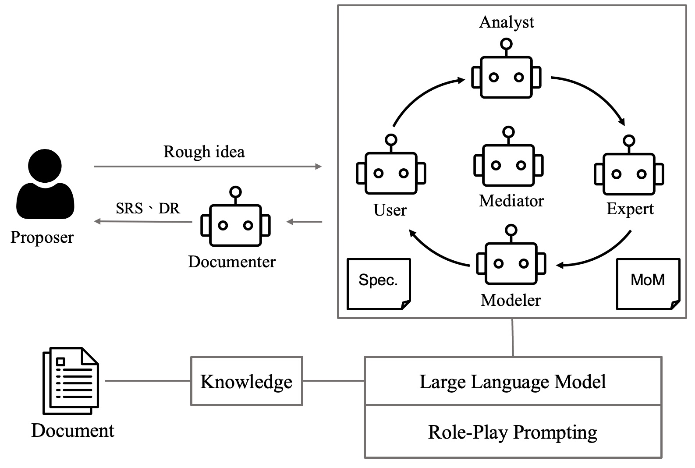

Fig. 1: Overview of the PLANT framework

### 🤖 Six Specialized Agents (Table 2)
- **User**: Simulates first-person stakeholder personas (usage scenarios, pain points).
- **Analyst**: Structures requirements, defines scope boundaries, flags conflicts.
- **Expert**: Audits against external domain regulations, privacy laws & ISO 25010.
- **Modeler**: Builds & validates PlantUML models (use-case, class, sequence).
- **Mediator**: Plans agenda, switches communication modes, escalates deadlocks.
- **Documenter**: Compiles IEEE 29148 SRS & traceable Design Rationale (DR).

<!--
Key Takeaway: PLANT coordinates six distinct agents — User, Analyst, Expert, Modeler, Mediator, and Documenter — mirroring a real-world requirements engineering team.

Talking Points:
- Figure 1 shows how the six roles interact around shared drafts, external knowledge documents, and UML artifacts.
- User simulates first-person stakeholders, Analyst defines scope and flags conflicts, Expert audits against laws and ISO 25010, and Modeler validates PlantUML diagrams.
- Crucially, the Mediator orchestrates agendas and communication modes, while the Documenter compiles the final IEEE 29148 SRS linked to traceable Design Rationales.

Transition: Next, let's trace how these six roles collaborate across PLANT's four-stage workflow.
-->

---

## 3.2 Four-Stage Iterative Collaboration Process

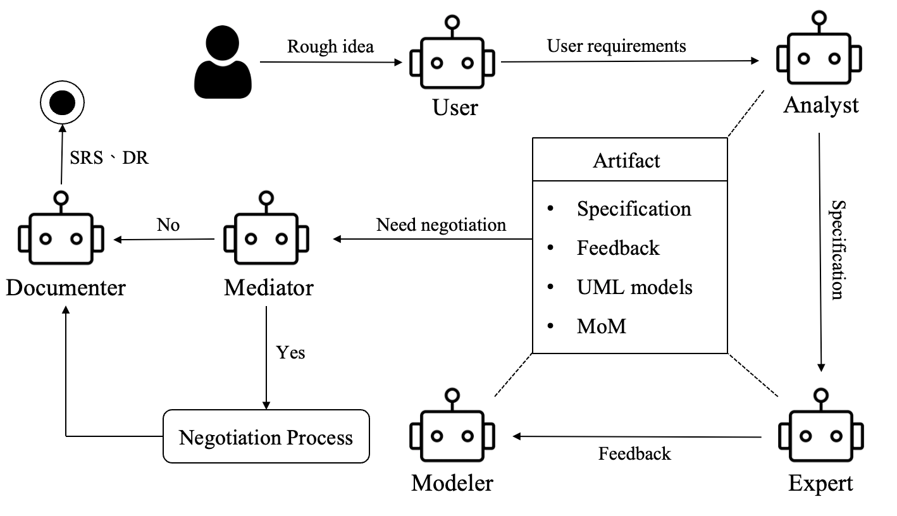

Fig. 2: Four-stage iterative workflow in PLANT

### 🔄 Beyond Single-Pass Generation
1. **Stage 1 · Elicitation (SSP)**: From a rough idea, `User` simulates multiple stakeholders concurrently to capture diverse expectations.
2. **Stage 2 · Multi-Perspective Analysis**: `Analyst` scopes & detects conflicts; `Expert` audits regulations; `Modeler` validates PlantUML flows in parallel.
3. **Stage 3 · Mediated Negotiation**: Up to `r` bounded rounds; `Mediator` resolves conflicts, logs `MoM`, and updates drafts/models.
4. **Stage 4 · Specification & Rationale**: `Documenter` compiles an **IEEE 29148 SRS** linked directly to multi-round `MoM` rationales.

<!--
Key Takeaway: PLANT replaces single-pass SRS generation with a four-stage iterative loop spanning unbiased elicitation, parallel auditing, bounded negotiation, and rationale-linked documentation.

Talking Points:
- In Stage 1, the User agent runs Simultaneous Stakeholder Prompting (SSP) to gather diverse needs from a rough idea.
- In Stage 2, Analyst, Expert, and Modeler inspect those needs in parallel — checking scope, regulations, and PlantUML flows.
- Stage 3 runs up to r bounded negotiation rounds led by the Mediator, recording consensus in Meeting Minutes (MoM) before Stage 4 compiles the IEEE 29148 SRS and Design Rationale.

Transition: Let's zoom in on two key mechanisms in Stages 1 and 2: SSP and external knowledge grounding.
-->

---

## 3.3 Simultaneous Stakeholder Prompting & Knowledge Grounding

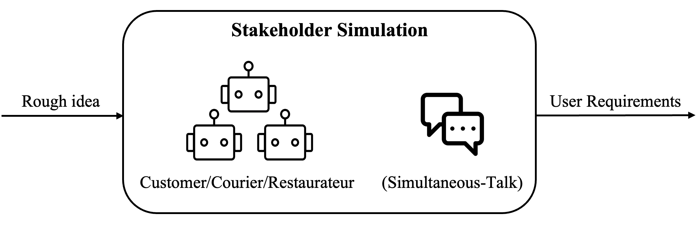

Fig. 3: Simultaneous Stakeholder Prompting (SSP) — independent multi-persona brainstorming

### 🗣️ Unbiased Stakeholder Elicitation (SSP)
- Extends Solo Performance Prompting (SPP) [19] using **Simultaneous-Talk** [4]: personas (e.g., *Customer*, *Courier*, *Restaurateur*) generate needs independently without anchoring on prior speakers.

### 📚 External Knowledge & UML Consistency
- **Expert** queries uploaded laws/standards (ISO 29148, ISO 25010, privacy laws) during initial audit and on-demand negotiation.
- **Modeler** runs PlantUML syntax/consistency checks to expose missing exception paths (e.g., *courier order timeout & reassignment*).

<!--
Key Takeaway: SSP prevents early anchoring during stakeholder brainstorming, while external knowledge retrieval and PlantUML validation ground the team in real standards and exception flows.

Talking Points:
- Figure 3 illustrates SSP: extending Solo Performance Prompting with Simultaneous-Talk, personas such as Customer, Courier, and Restaurateur generate needs independently before seeing each other's output.
- Meanwhile, the Expert queries uploaded standards like ISO 29148, ISO 25010, and privacy regulations both initially and on demand during negotiation.
- The Modeler runs PlantUML syntax and consistency checks to surface missing lifecycle exceptions, such as courier order timeouts and reassignment.

Transition: When these perspectives uncover ambiguities or clashes, how does the Mediator guide resolution?
-->

---

## 3.4 Mediator-Guided Negotiation Process

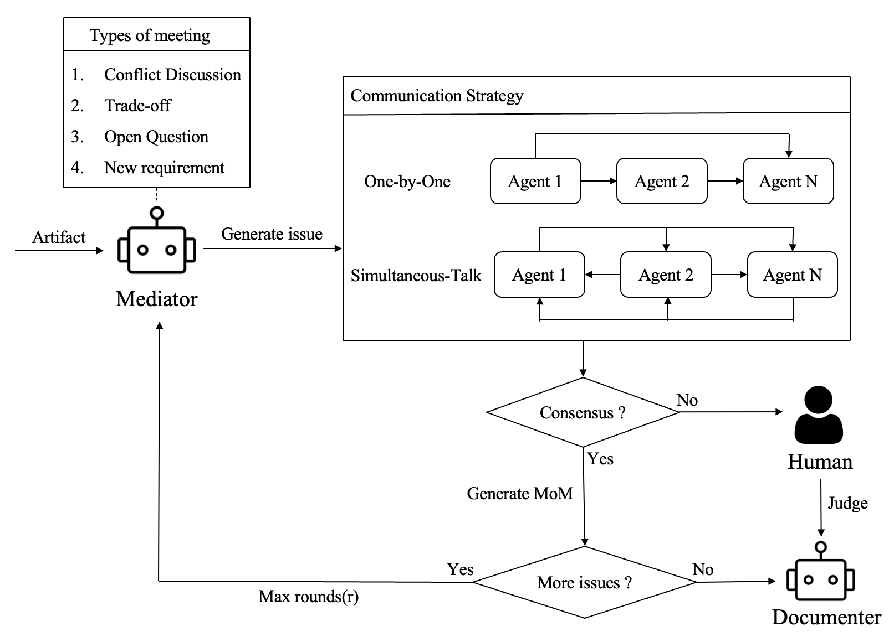

Fig. 4: Mediator-guided bounded negotiation & HITL escalation

### ⚖️ Structured Agenda & Bounded Rounds
- At the start of each round (`1 ≤ t ≤ r`), the **Mediator** categorizes agenda issues into 4 types:
  1. Open-question exploration
  2. New-requirement supplementation
  3. Requirement trade-off evaluation
  4. Conflict resolution
- **Consensus** ➔ Recorded in Meeting Minutes (`MoM`), triggering draft & UML updates.
- **Deadlock / High-Impact Trade-Off** ➔ Packaged with candidate options for **Human-in-the-Loop (HITL)** adjudication.

<!--
Key Takeaway: The Mediator classifies agenda items into four issue types, resolves consensus into Meeting Minutes within bounded rounds, and escalates deadlocks to human experts (HITL).

Talking Points:
- At the start of each round (1 to r), the Mediator organizes open items into four categories: Open Questions, New Requirements, Trade-offs, and Conflict Discussions.
- Resolved items are written into Meeting Minutes (MoM), which automatically trigger updates to both the requirement draft and UML models.
- If agents reach a deadlock or face a high-impact business trade-off, the Mediator packages the arguments and candidate options for Human-in-the-Loop adjudication.

Transition: A core innovation inside this negotiation loop is how the Mediator dynamically switches communication modes.
-->

---

## 3.5 Hybrid-Communication-with-Mediator

While *Simultaneous-Talk* and *One-by-One* originate from ChatEval [4], PLANT's novelty is **task-adaptive dynamic switching** orchestrated by the `Mediator`.

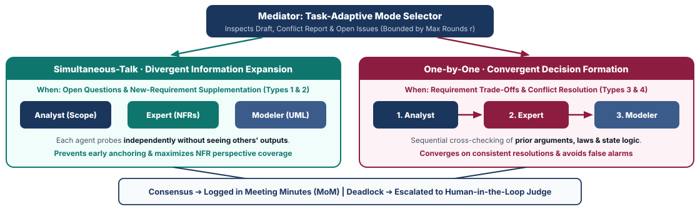

<!--
Key Takeaway: PLANT's Mediator dynamically switches between Simultaneous-Talk for divergent exploration and One-by-One dialogue for convergent conflict resolution.

Talking Points:
- While Simultaneous-Talk and One-by-One originate from ChatEval, applying only one mode throughout RE causes either anchoring bias or uncoordinated repetition.
- As shown in the diagram, the Mediator selects Simultaneous-Talk for open questions and new-requirement exploration so Analyst, Expert, and Modeler probe independently without groupthink.
- For trade-offs and conflict resolution, it switches to One-by-One deliberation so agents directly critique and refine each other's arguments until consensus is reached.

Transition: Now let's move to our empirical evaluation and review the experimental setup and metrics.
-->

---

## 4.1 Experimental Setup & Evaluation Metrics

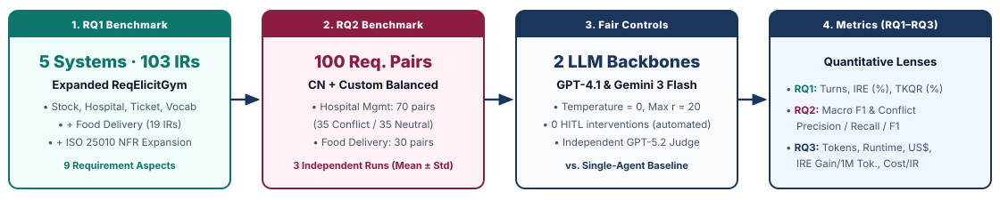

<i>IREt</i> &nbsp;=&nbsp;
<i>Et</i><i>Rt</i>
&nbsp;× 100%
(Recall of unique IRs)

<i>TKQRt</i> &nbsp;=&nbsp;
∑ <i>ht,i</i> / log2(<i>i</i> + 1)∑ 1 / log2(<i>i</i> + 1)
&nbsp;× 100%
(Early-turn efficiency)

<strong>Strictly Automated Fair Comparison:</strong> During RQ1 &amp; RQ2 benchmark runs, <strong>0 human interventions</strong> occurred (<code>temperature = 0</code>, max <code>r = 20</code>), with independent <strong>GPT-5.2</strong> as LLM-as-a-Judge.

<!--
Key Takeaway: We benchmarked PLANT against a single-agent baseline across 5 systems (103 IRs) and 100 conflict pairs with zero human intervention and an independent GPT-5.2 judge.

Talking Points:
- To guarantee a strictly automated and fair comparison, HITL was turned off (0 human interventions), temperature was set to 0, and rounds were capped at 20.
- For RQ1, we measure IRE (recall of unique implicit requirements) and TKQR (an NDCG-style metric rewarding early-turn discovery), judged semantically by an independent GPT-5.2 model.
- For RQ2, we evaluate Macro F1, Conflict Precision, Recall, and F1 across 70 Hospital Management pairs and 30 Food Delivery pairs on both GPT-4.1 and Gemini 3 Flash.

Transition: Before looking at aggregate scores, let's see a concrete Food Delivery example of multi-angle probing in action.
-->

---

## 4.2 RQ1 Case Study: Multi-Angle Probing in Food Delivery

Under **Simultaneous-Talk**, three agents independently probe the same abnormal-order scenario from distinct professional angles (Table 5):

| Agent Role | Independent Probing Question | Uncovered Stakeholder Need |
| :--- | :--- | :--- |
| **Analyst** | Should handling options apply to all abnormal scenarios or specific delays / courier no-shows? | *"Contact customer service" must always be available on exceptions.* |
| **Expert** | If real phone numbers are hidden and users only use **built-in in-app chat/voice**, does that satisfy you? | **Hit IR!** *"Yes — do not expose real phone numbers; use in-app anonymous call forwarding with dispute logs."* |
| **Modeler** | Should real-time handling options be restricted according to **order lifecycle states**? | *Cancellation depends on order state & refund policy with clear reasons.* |

<strong>Why Multi-Angle Probing Works:</strong> While Analyst and Modeler check functional rules and state transitions, the <strong>Expert</strong> surfaces a critical <strong>security &amp; privacy implicit requirement</strong> completely omitted from the initial description.

<!--
Key Takeaway: Under Simultaneous-Talk, Analyst, Expert, and Modeler probe the same abnormal-order scenario from complementary angles, surfacing a hidden privacy requirement.

Talking Points:
- Look at Table 5: given the exact same abnormal-order scenario, the Analyst asks about customer service availability and the Modeler checks cancellation rules across order lifecycle states.
- Simultaneously, the Expert asks whether real phone numbers should be hidden in favor of built-in anonymous in-app chat or voice calls.
- That single Expert question hits a critical security and privacy implicit requirement that was completely absent from the initial problem description.

Transition: How does this multi-angle advantage scale across all 103 implicit requirements in five systems?
-->

---

## 4.3 RQ1 Results: Implicit Requirement Elicitation (103 IRs)

54.28% vs. 16.77%

Mean IRE with <strong>GPT-4.1</strong> (54 vs. 17 IRs · <strong>3.2×</strong> gain)

46.79% vs. 18.90%

Mean IRE with <strong>Gemini 3 Flash</strong> (48 vs. 19 IRs · <strong>2.5×</strong> gain)

13–17 vs. ~6 Turns

Prevents premature termination (TKQR: 55.0% / 64.9%)

### 🏆 NFR Breakthrough (GPT-4.1 · Table 7)

<strong>Security (12 IRs)</strong>

10 vs. 2

<strong>Safety (3 IRs)</strong>

3 vs. 0

<strong>Reliability (7 IRs)</strong>

5 vs. 0

<strong>Compatibility (10)</strong>

7 vs. 3

<strong>Performance (6)</strong>

4 vs. 0

### 📊 Case-Level IRE (%) — Table 6
| System Case | Base (GPT) | PLANT (GPT) | Base (Gem) | PLANT (Gem) |
| :--- | :---: | :---: | :---: | :---: |
| Stock Report | 17.65 | **82.35** | 23.53 | **52.94** |
| Hospital Mgmt | 19.05 | **47.62** | 23.81 | **47.62** |
| Ticket Booking | 13.04 | **43.48** | 8.70 | **39.13** |
| Vocab Learning | 13.04 | **34.78** | 17.39 | **52.17** |
| Food Delivery | 21.05 | **63.16** | 21.05 | **42.11** |

<!--
Key Takeaway: PLANT boosts implicit requirement recall by 3.2x on GPT-4.1 (54.28% vs. 16.77%) and 2.5x on Gemini 3 Flash, driven by major breakthroughs in NFR discovery.

Talking Points:
- Across all five systems, PLANT sustains 13 to 17 productive turns compared to the baseline's premature ~6-turn exit, lifting mean IRE from 16.77% to 54.28% on GPT-4.1 and from 18.90% to 46.79% on Gemini 3 Flash.
- The left bar chart highlights the NFR breakthrough on GPT-4.1: Security jumps from 2 to 10 out of 12, Safety from 0 to 3, Reliability from 0 to 5, and Performance from 0 to 4.
- Table 6 confirms that PLANT outperforms the single-agent baseline on every single system case across both LLM backbones.

Transition: Next, let's examine RQ2 — how well does PLANT's One-by-One deliberation detect requirement conflicts?
-->

---

## 4.4 RQ2 Results: Requirement Conflict Identification (100 Pairs)

Using **One-by-One** deliberation (e.g., *retain complete chat logs* vs. *delete chat records after resolution*), Analyst, Expert, and Modeler cross-check functional rules, privacy obligations, and state transitions (Tables 8 & 9).

| Dataset | Method | LLM Backbone | Macro F1 (%) | Conflict Precision | Conflict Recall | Conflict F1 (%) |
| :--- | :--- | :--- | :---: | :---: | :---: | :---: |
| **Hospital Mgmt** (70 pairs) | Baseline | GPT-4.1 / Gemini 3 | 81.33 / 72.52 | 86.67 / 79.30 | 74.29 / 61.91 | 80.00 / 69.51 |
| **Hospital Mgmt** (70 pairs) | **PLANT** | **GPT-4.1 / Gemini 3** | **90.91 / 89.46** | 86.66 / 84.35 | **97.14 / 97.14** | **91.51 / 90.28** |
| **Food Delivery** (30 pairs) | Baseline | GPT-4.1 / Gemini 3 | 89.90 / 86.43 | 100.0 / 100.0 | 80.00 / 73.33 | 88.89 / 84.62 |
| **Food Delivery** (30 pairs) | **PLANT** | **GPT-4.1 / Gemini 3** | **95.55 / 96.66** | 95.69 / 93.75 | **95.55 / 100.0** | **95.55 / 96.77** |

<strong>RQ2 Finding:</strong> Single-agent baselines are overly conservative (missing 20%–38% of conflicts). PLANT lifts <strong>Conflict-class Recall to 95.55%–100.00%</strong> and <strong>Conflict F1 by +6.66 to +20.77 pts</strong> while avoiding false alarms on distinct data scopes.

<!--
Key Takeaway: PLANT raises conflict-class recall to 95.55%–100.00% and improves Conflict F1 by +6.66 to +20.77 points across both datasets and LLM backbones.

Talking Points:
- Single-agent baselines are overly conservative, missing 20% to 38% of real conflicts — for example, scoring only 61.91% recall on Hospital Management with Gemini 3 Flash.
- By letting Analyst, Expert, and Modeler cross-check functional rules, privacy obligations, and state transitions one by one, PLANT lifts Conflict Recall to 97.14% on Hospital Management and up to 100.0% on Food Delivery.
- Importantly, this recall surge preserves strong precision by correctly distinguishing non-conflicting requirements that operate on separate data scopes.

Transition: Impressive quality gains always raise a practical question in RQ3: how much do tokens and runtime cost?
-->

---

## 4.5 RQ3 Results: Cost-Effectiveness & Deployment Trade-Off

| LLM Backbone | Elicited IRs (Base / PLANT) | Avg. Tokens (k) (Base / PLANT) | Avg. Runtime (Base / PLANT) | Avg. Cost (US$) (Base / PLANT) | IRE Gain / 1M Tok. | Cost per IR (PLANT / Base) |
| :--- | :---: | :---: | :---: | :---: | :---: | :---: |
| **GPT-4.1** | 17 / **54** | 40.3 / **3,761** (`93.4×`) | 134s / **3,700s** (`27.6×`) | $0.12 / **$8.14** | **9.65%** | **$0.1507** / $0.0071 |
| **Gemini 3 Flash** | 19 / **48** | 39.4 / **9,811** (`248.8×`) | 114s / **4,173s** (`36.6×`) | $0.07 / **$6.71** | **2.88%** | **$0.1399** / $0.0036 |

### ✅ When PLANT Is Highly Cost-Effective
- Medium-to-large, **compliance-sensitive**, or multi-stakeholder projects at project inception.
- Spending **~1 hour & US\$6.71–\$8.14** (~US\$0.14–\$0.15 per IR) to uncover **2.5×–3.2× more NFRs** is far cheaper than late-stage rework or security defects.

### ⚡ When a Single-Agent Is Preferable
- Rapid prototyping, simple single-user apps, or real-time brainstorming requiring **sub-minute latency** and minimal API budget.

<!--
Key Takeaway: PLANT consumes 93x–249x more tokens (~1 hour, US$6.71–$8.14 per system), which is highly cost-effective for compliance-critical projects at ~US$0.14–$0.15 per uncovered IR.

Talking Points:
- Table 10 lays out the exact trade-off: on GPT-4.1, PLANT averages 3.76M tokens, 3,700 seconds, and $8.14 per system, delivering 9.65% IRE gain per million tokens and $0.1507 per elicited IR.
- Gemini 3 Flash costs slightly less ($6.71 per system, $0.1399 per IR) but consumes more tokens (9.81M), making GPT-4.1 more token-efficient.
- In practice, spending ~$7 to $8 and one hour upfront to catch 2.5x to 3.2x more NFRs is far cheaper than late-stage rework, whereas single-agent LLMs remain preferable for rapid sub-minute prototyping.

Transition: Let's also examine what each agent and mechanism contributes to these gains.
-->

---

## 4.6 Component Contribution Analysis

Although a full combinatorial ablation is left for future work, our aspect-level breakdown (Table 7) and qualitative traces clarify each component's role:

### 🧩 Analyst + User Only vs. +Expert & +Modeler
- **Single-Agent Baseline** approximates *Analyst + User* only — capturing primarily *Interaction* & *Content* (11/17 GPT-4.1 hits) while scoring **0** on *Reliability*, *Performance*, and *Safety*.
- Adding **Expert** directly drives *Security* (**9–10/12**), *Safety* (**2–3/3**), and regulatory *Compatibility* discovery.
- Adding **Modeler** uncovers *Reliability* (**2–5/7**) and state-transition edge cases via PlantUML validation.

### 🧭 Role of Mediator & Hybrid Communication
- Without the **Mediator** consolidating open issues and dynamically switching modes:
  - Pure *One-by-One* brainstorming risks **early anchoring** and groupthink.
  - Uncoordinated parallel dialogue risks **redundant questioning** and unresolved deadlocks.
- Controlled 4-way ablation under **matched turn & token budgets** is a top priority for future work.

<!--
Key Takeaway: Aspect-level traces show that Expert drives Security/Safety discovery, Modeler exposes Reliability edge cases, and Mediator prevents anchoring and deadlocks.

Talking Points:
- While full combinatorial ablation is planned for future work, Table 7 clearly separates component roles: the single-agent baseline (approximating Analyst + User) captures surface interaction and content but scores 0 on Reliability, Performance, and Safety.
- Adding the Expert directly unlocks Security (9 to 10 of 12), Safety (2 to 3 of 3), and regulatory Compatibility; adding the Modeler uncovers Reliability (2 to 5 of 7) via PlantUML checks.
- Without the Mediator dynamically switching modes, pure One-by-One risks groupthink while uncoordinated parallel talk leads to redundancy and deadlocks.

Transition: Before concluding, let's candidly review the threats to validity in our study.
-->

---

## 4.7 Threats to Validity

### 🔍 Internal Validity
- **Interaction Budget**: PLANT runs 13–17 turns vs. ~6 turns (93–249× tokens); gains reflect *both* role specialization and deeper interaction.
- **Live Web Search**: While local Document Library docs were static (`temp = 0`), caching live search snapshots will strengthen reproducibility.

### 🎯 Construct Validity
- **Simulated Users & LLM Judge**: Oracle simulated users may be more cooperative than real clients; multi-judge & human studies are needed.
- **Recall Focus & Scope**: IRE does not penalize out-of-scope questions (mitigated by scope filtering/HITL); downstream SRS & UML quality was not yet quantitatively scored.

### 🌐 External Validity
- **Dataset Scale**: Evaluated on 5 system cases (103 IRs) across finance, healthcare, transport, education & logistics, plus 100 conflict pairs.
- **Broader Baselines**: Future work will expand to larger industrial repositories and task-adapted multi-agent baselines.

<!--
Key Takeaway: We identify key internal, construct, and external validity threats — notably budget asymmetry, simulated oracle users, and dataset scale — to guide future validation.

Talking Points:
- For internal validity, PLANT runs more turns and tokens than the single-agent baseline, so gains reflect both role specialization and deeper interaction; caching live web search snapshots will further improve reproducibility.
- For construct validity, simulated oracle users may be more cooperative than real clients, and downstream SRS/UML quality was not yet scored quantitatively.
- For external validity, our 5 systems (103 IRs) and 100 conflict pairs span five domains, and expanding to larger industrial repositories and multi-agent baselines is our next priority.

Transition: Let's wrap up with a visual synthesis of our RQ1 to RQ3 conclusions and our future roadmap.
-->

---

## 5. Conclusion & Future Work

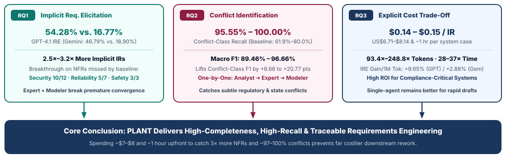

<strong>🧪 1. Fixed-Budget Ablations</strong> Isolate Expert, Modeler & Mediator gains under matched token/turn budgets against multi-agent baselines.

<strong>👩‍💻 2. Human SRS Evaluation</strong> Quantitatively assess UML completeness, factual grounding & DR traceability with practitioners.

<strong>⚙️ 3. Spec-Driven Development</strong> Feed PLANT's traceable IEEE 29148 SRS directly into automated test-case & code generation [24].

<!--
Key Takeaway: PLANT validates that specialized roles and task-adaptive mediation dramatically improve upstream RE completeness and conflict detection at a practical project-inception cost.

Talking Points:
- The visual synthesis summarizes our three core conclusions: 2.5x to 3.2x higher implicit requirement recall (RQ1), 95.6% to 100% conflict recall (RQ2), and ~$0.14 to $0.15 per IR for high-stakes systems (RQ3).
- Looking ahead, we focus on three concrete directions: fixed-budget four-way ablations, human practitioner evaluation of SRS and UML artifacts, and feeding PLANT's traceable IEEE 29148 SRS into Specification-Driven Development for automated testing and coding.

Transition: Thank you for your attention — we welcome your questions and discussion.
-->

---

<!-- _class: closing -->

# Thank You for Your Attention!

Enhancing Requirements Engineering Efficiency through a Multi-Agent AI Framework (PLANT)

<strong>Nien-Lin Hsueh+</strong> &nbsp;·&nbsp; <code>nlhsueh@fcu.edu.tw</code> 
<strong>Shu-Hsien Liao</strong> &nbsp;·&nbsp; <code>m1325977@o365.fcu.edu.tw</code> 
Department of Information Engineering and Computer Science, Feng Chia University 
Online Repository & Artifacts: <code>https://dummyjack.github.io/PLANT-Manual/</code> 
Grant: NSTC114-2221-E-035-077 · Questions & Discussion Welcome!

<!--
Key Takeaway: Thank the audience, share the public PLANT manual repository, and invite Q&A.

Talking Points:
- Thank you very much for listening.
- Our public manual, sample SRS outputs, and artifacts are available at the GitHub Pages link shown here, and we welcome any questions about PLANT's mediation design, evaluation, or future SDD integration.

Transition: Open the floor for Q&A.
-->

