

<!-- _class: lead -->

學術會議專題報告 · 多代理人需求工程

# 透過多代理人 AI 框架提升需求工程效率

Enhancing Requirements Engineering Efficiency through a Multi-Agent AI Framework (PLANT)

結合專業角色分工、外部領域知識引導、任務自適應調解（Hybrid Communication）與人機協作（HITL）之需求開發平台

<strong>薛念林（Nien-Lin Hsueh）+</strong>、<strong>Shu-Hsien Liao</strong> 
逢甲大學 資訊工程學系（Feng Chia University, Taichung, Taiwan） 
<code>nlhsueh@fcu.edu.tw</code> · <code>m1325977@o365.fcu.edu.tw</code>

國科會專題研究計畫補助：NSTC114-2221-E-035-077

---

## 破題思考：「6 輪就搞定！」⋯⋯還是漏掉了半個系統？

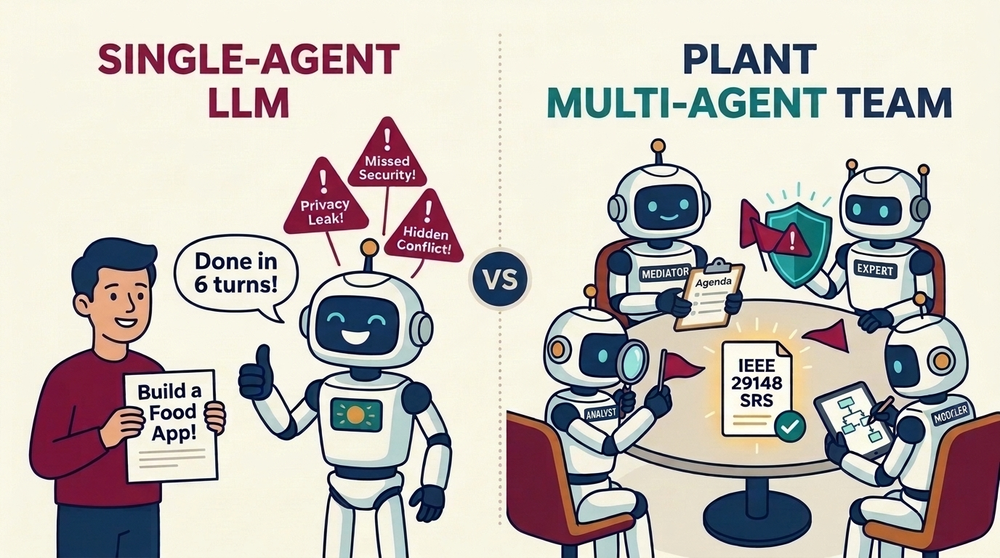

<strong>核心破題構想：</strong> 單一 LLM 容易淪為「點頭稱是的應聲蟲」，聊完表面功能就草草收工。<strong>PLANT</strong> 打造一支<strong>專業分工的多代理人需求團隊</strong>，主動揪出遺漏的資安／隱私需求與潛在衝突，並留下完整決策軌跡。

---

## 簡報大綱（Outline）

1

[**研究動機與三大研究問題**](#4)
單一代理人 LLM 在需求工程的盲區，以及本研究之 RQ1–RQ3。

2

[**文獻回顧與架構比較**](#6)
現有 LLM 與多代理人需求工程框架之功能對照（Table 1）。

3

[**PLANT 框架與自適應調解機制**](#7)
六大專業角色、四階段迭代流程、SSP、外部知識庫與混合溝通調解。

4

[**實證設計與 RQ1–RQ3 結果**](#12)
5 大系統（103 項隱性需求）、100 組衝突配對，以及品質與成本權衡分析。

5

[**元件貢獻分析與效度威脅**](#17)
各代理人角色之預期貢獻，以及內部／構念／外部效度反思。

6

[**結論與未來研究方向**](#19)
RQ1–RQ3 核心發現全景概念圖，以及邁向規格驅動開發（SDD）藍圖。

---

## 1.1 研究動機：為何單一代理人 LLM 難以勝任需求工程？

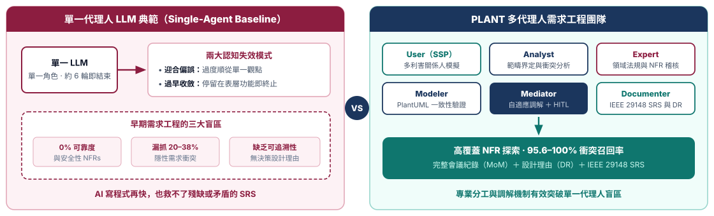

<strong>AI 輔助開發（AASD）時代的關鍵：</strong> AI 寫程式越快，若缺乏嚴謹的 <strong>IEEE 29148 SRS</strong>（特別是資安、隱私、可靠度等非功能性需求），系統擴張後越容易演變為難以維護的碎裂架構。

---

## 1.2 研究目標與三大研究問題（RQ1–RQ3）

本研究聚焦於兩大上游需求核心任務與計算成本權衡，進行嚴謹量化評估 *（逐步揭曉）*：

* 
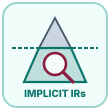

RQ1 專業分工的 AI 團隊，能挖出客戶「忘了說」的需求嗎？

<strong>PLANT 發掘隱性需求（Implicit Requirements）的成效為何？</strong>特別是容易被忽略的非功能性需求（NFRs）。

* 
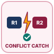

RQ2 多角色交叉審議，能否抓出暗藏的規格矛盾？

<strong>PLANT 辨識需求衝突（Requirement Conflicts）的準確度與召回率</strong>，相較單一代理人表現為何？

* 
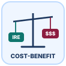

RQ3 多代理人協作多花的時間與 Token，到底划不划算？

<strong>PLANT 在需求開發中的成本效益為何？</strong>（Token 消耗、執行時間、API 費用與單位需求成本）

---

## 2. 文獻回顧與架構比較（Table 1）

既有 LLM 需求工程研究多缺乏**任務自適應的衝突調解機制**與**可追溯的設計理由（Design Rationale）紀錄**。

| 相關研究 | 核心作法說明 | 引出 | 分析 | 規格 | 多代理 | 協商 | 追溯 |
| :--- | :--- | :---: | :---: | :---: | :---: | :---: | :---: |
| LLMREI [2] / RECOVER [7] | 以單一虛擬訪談者進行需求訪談與整理 | ✓ | × | × | × | × | × |
| Elicitron [8] | 模擬產品使用情境與代理訪談以探索需求 | ✓ | ✓ | × | ✓ | × | × |
| MAD [9] | 透過多代理人辯論提升需求分類準確度 | × | ✓ | × | ✓ | ✓ | × |
| ReqInOne [10] | 單一代理人工作流分析需求並產出 SRS | × | ✓ | ✓ | × | × | × |
| MARE [11] / iReDev [12] | 多代理人分工搭配共享工作區或領域知識圖譜 | ✓ | ✓ | ✓ | ✓ | × | × |
| **本研究（PLANT）** | **整合六大角色、調解者自適應協商與完整設計理由追溯** | **✓** | **✓** | **✓** | **✓** | **✓** | **✓** |

<strong>研究缺口：</strong> 即便是 MARE 與 iReDev，仍採循序交接模式，缺少能依議題動態切換溝通策略、遇僵局升級交由人類專家（HITL）裁決並沉澱設計理由的 <strong>Mediator</strong> 角色。

---

## 3.1 PLANT 框架總覽與六大專業代理人角色

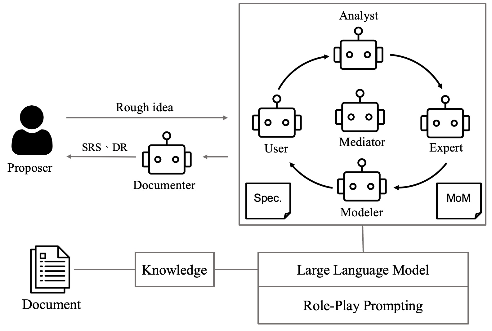

Fig. 1：PLANT 多代理人需求工程框架總覽

### 🤖 六大專業代理人角色（Table 2）
- **User**：模擬多方利害關係人第一人稱視角（使用情境與痛點）。
- **Analyst**：結構化需求、界定系統範疇（In/Out-of-Scope）並揪出衝突。
- **Expert**：檢索外部文件庫，稽核領域法規、個資保護與 ISO 25010。
- **Modeler**：繪製並以工具驗證 PlantUML（使用案例、類別、循序圖）。
- **Mediator**：規劃議程、動態切換溝通模式、遇僵局啟動 HITL 裁決。
- **Documenter**：彙整會議紀錄（MoM），產出 **IEEE 29148 SRS** 與設計理由（DR）。

---

## 3.2 四階段迭代需求協作流程

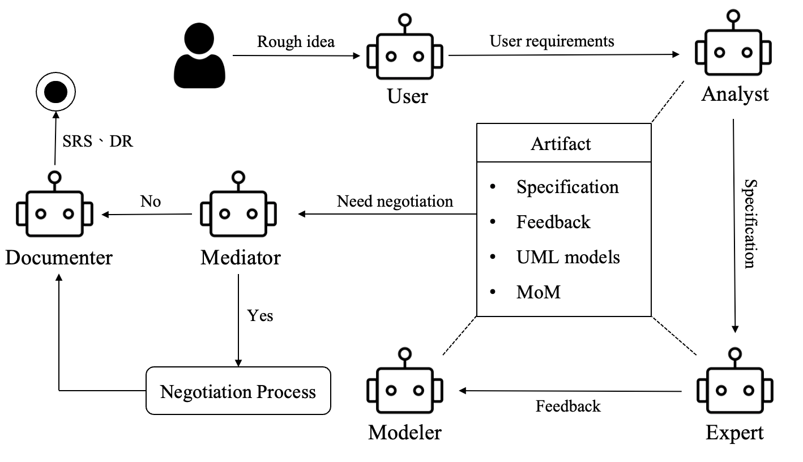

Fig. 2：PLANT 四階段迭代協作與產出物更新流程

### 🔄 告別「單次生成」的迭代精煉
1. **階段一 · 同步利害關係人引出（SSP）**：從初步構想出發，由 `User` 同步模擬多方角色，廣泛收集期待與痛點。
2. **階段二 · 多視角分析、知識稽核與建模**：`Analyst` 界定範疇與衝突、`Expert` 查核法規、`Modeler` 驗證 PlantUML 並行運作。
3. **階段三 · 調解者引導之迭代協商**：於上限 `r` 輪內由 `Mediator` 調度討論、寫入 `MoM` 並同步更新草案與模型。
4. **階段四 · 規格與設計理由產出**：收斂後由 `Documenter` 產出符合 **IEEE 29148** 之 SRS 並串聯完整設計理由（DR）。

---

## 3.3 同步利害關係人提示（SSP）與外部知識驗證

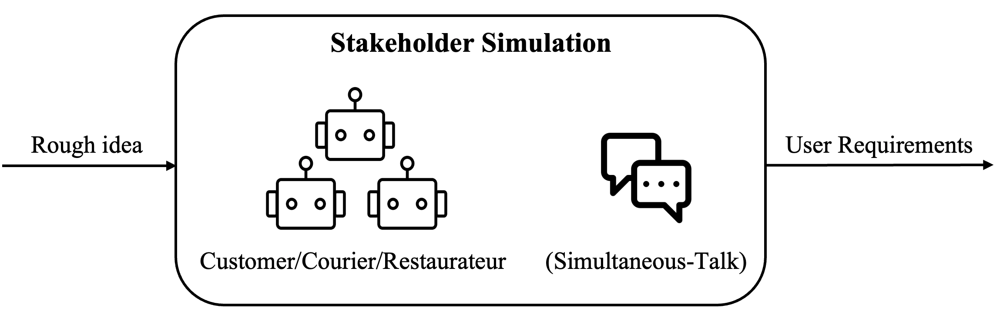

Fig. 3：同步利害關係人提示（SSP）— 獨立多角色並行發想

### 🗣️ 避免偏誤的多角色並行引出（SSP）
- 延伸 Solo Performance Prompting（SPP）[19]，採 **Simultaneous-Talk** [4] 讓不同角色（如消費者、外送員、餐廳業者）互不干擾地獨立提出需求，避免被先發言者帶偏。

### 📚 外部領域知識與 PlantUML 一致性檢查
- **Expert** 於初審與協商兩階段檢索文件庫（ISO 29148、ISO 25010、個資法規），引用具體條文佐證建議。
- **Modeler** 透過 PlantUML 語法與流程檢查揭露遺漏例外（例如*外送員接單逾時自動轉派機制*）。

---

## 3.4 調解者引導之協商流程（Mediator-Guided Negotiation）

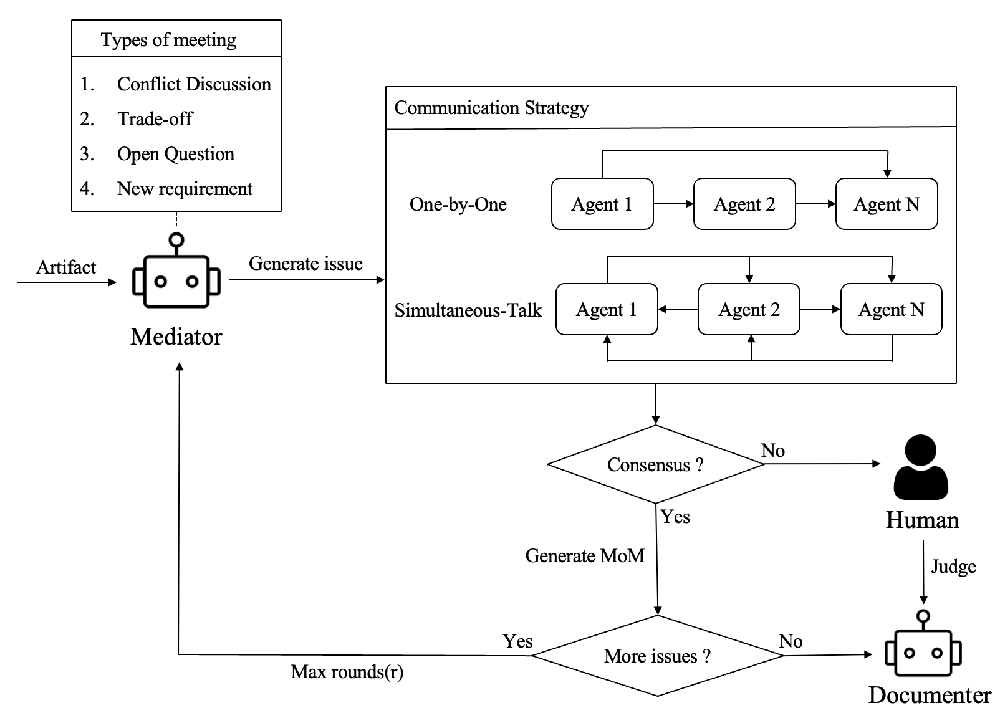

Fig. 4：調解者引導之有限輪數協商與 HITL 升級機制

### ⚖️ 結構化議程與有限輪數收斂
- 每輪開始（`1 ≤ t ≤ r`），**Mediator** 檢視最新草案與衝突報告，將議題分為四大類：
  1. 開放問題探索（Open Question）
  2. 新需求補充（New Requirement）
  3. 需求權衡評估（Trade-off）
  4. 需求衝突解決（Conflict Discussion）
- **達成共識** ➔ 記錄於會議紀錄（`MoM`），驅動草案與 UML 同步更新。
- **持續僵局／重大商業權衡** ➔ 彙整各方論點與候選方案，交由**人類專家（HITL）**裁決。

---

## 3.5 任務自適應混合溝通機制（Hybrid Communication）

PLANT 的核心創新在於由 `Mediator` 依議題目標，在 **Simultaneous-Talk**（發散探索）與 **One-by-One**（收斂決策）之間動態切換。

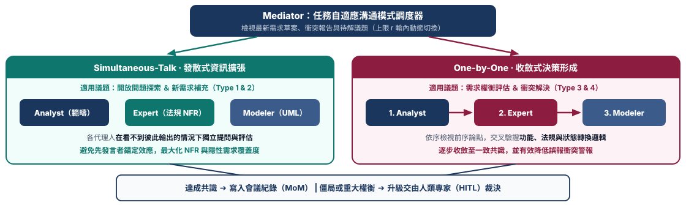

---

## 4.1 實證實驗設計與評估指標

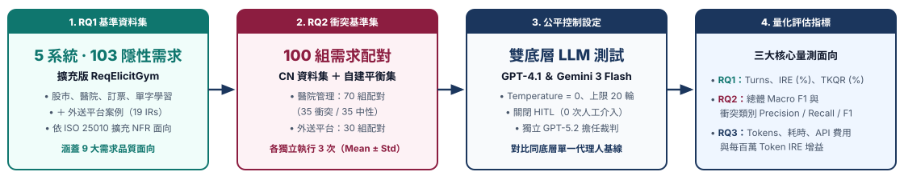

<i>IREt</i> &nbsp;=&nbsp;
<i>Et</i><i>Rt</i>
&nbsp;× 100%
（隱性需求召回率）

<i>TKQRt</i> &nbsp;=&nbsp;
∑ <i>ht,i</i> / log2(<i>i</i> + 1)∑ 1 / log2(<i>i</i> + 1)
&nbsp;× 100%
（早期輪次提問效率）

<strong>嚴格自動化公平評測：</strong> RQ1 與 RQ2 基準測試皆關閉 HITL（<strong>0 次人工介入</strong>，`temperature = 0`，上限 20 輪），並由獨立之 **GPT-5.2** 擔任 LLM-as-a-Judge 判定語意命中。

---

## 4.2 RQ1 案例剖析：外送平台之多視角深度探勘（Table 5）

在 **Simultaneous-Talk** 模式下，三位代理人針對同一異常訂單情境，從各自專業視角獨立提問：

| 代理人角色 | 獨立探勘提問角度 | 成功引出之利害關係人真實需求 |
| :--- | :--- | :--- |
| **Analyst** | 異常處理選項（聯繫客服／取消訂單）應適用於所有異常，或僅限延遲與外送員爽約？ | *任何異常情境下「聯繫客服」皆須可用，其餘視情況提供。* |
| **Expert** | 若系統**隱藏雙方真實電話號碼**，改採 App 內建聊天或匿名轉接通話，是否符合需求？ | **命中隱性需求！** *不應直接暴露顧客與外送員電話，須改採 App 內匿名通話並留存爭議紀錄。* |
| **Modeler** | 異常即時處理選項是否應依**訂單生命週期狀態**限制（例如特定階段禁止取消）？ | *取消權限依訂單狀態與退款政策決定，但須清楚呈現原因。* |

<strong>多視角互補價值：</strong> 當 Analyst 與 Modeler 釐清功能規則與狀態限制時，<strong>Expert</strong> 成功挖出原始需求描述隻字未提的<strong>資安與個資隱私隱性需求</strong>。

---

## 4.3 RQ1 實證結果：隱性需求引出成效（103 項 IRs）

54.28% vs. 16.77%

<strong>GPT-4.1</strong> 平均 IRE（54 vs. 17 項 · <strong>3.2 倍</strong>提升）

46.79% vs. 18.90%

<strong>Gemini 3 Flash</strong> 平均 IRE（48 vs. 19 項 · <strong>2.5 倍</strong>提升）

13–17 vs. ~6 輪

突破過早終止（TKQR：54.95% / 64.87%）

### 🏆 非功能性需求（NFR）關鍵突破（GPT-4.1 · Table 7）

<strong>資安 Security (12)</strong>

10 vs. 2

<strong>安全 Safety (3)</strong>

3 vs. 0

<strong>可靠 Reliability (7)</strong>

5 vs. 0

<strong>相容 Compat. (10)</strong>

7 vs. 3

<strong>效能 Perf. (6)</strong>

4 vs. 0

### 📊 五大系統案例 IRE (%) 比較 — Table 6
| 系統案例 | 基線 (GPT) | PLANT (GPT) | 基線 (Gem) | PLANT (Gem) |
| :--- | :---: | :---: | :---: | :---: |
| 股市報告 | 17.65 | **82.35** | 23.53 | **52.94** |
| 醫院管理 | 19.05 | **47.62** | 23.81 | **47.62** |
| 線上訂票 | 13.04 | **43.48** | 8.70 | **39.13** |
| 單字學習 | 13.04 | **34.78** | 17.39 | **52.17** |
| 外送平台 | 21.05 | **63.16** | 21.05 | **42.11** |

---

## 4.4 RQ2 實證結果：需求衝突辨識成效（100 組配對）

透過 **One-by-One** 依序審議（例：*客服須完整保留對話紀錄* vs. *結案後立即刪除對話與聯絡方式*），Analyst、Expert 與 Modeler 交叉查核資料留存規則、個資法規與狀態生命週期（Tables 8 & 9）。

| 資料集 | 方法 | 底層模型 | 總體 Macro F1 | 衝突精確率 | 衝突召回率 | 衝突類別 F1 |
| :--- | :--- | :--- | :---: | :---: | :---: | :---: |
| **醫院管理**（70 組） | 單一基線 | GPT-4.1 / Gemini 3 | 81.33 / 72.52 | 86.67 / 79.30 | 74.29 / 61.91 | 80.00 / 69.51 |
| **醫院管理**（70 組） | **PLANT** | **GPT-4.1 / Gemini 3** | **90.91 / 89.46** | 86.66 / 84.35 | **97.14 / 97.14** | **91.51 / 90.28** |
| **外送平台**（30 組） | 單一基線 | GPT-4.1 / Gemini 3 | 89.90 / 86.43 | 100.0 / 100.0 | 80.00 / 73.33 | 88.89 / 84.62 |
| **外送平台**（30 組） | **PLANT** | **GPT-4.1 / Gemini 3** | **95.55 / 96.66** | 95.69 / 93.75 | **95.55 / 100.0** | **95.55 / 96.77** |

<strong>RQ2 發現：</strong> 單一基線過於保守（漏抓 20%–38% 衝突）。PLANT 將**衝突召回率大幅拉升至 95.55%–100.00%**，衝突 F1 提升 **+6.66 至 +20.77 個百分點**，且能區分前後端資料範疇以避免誤報。

---

## 4.5 RQ3 實證結果：成本效益與實務導入權衡（Table 10）

| 底層 LLM | 命中 IR 數（基線 / PLANT） | 平均 Token (k)（基線 / PLANT） | 平均執行時間（基線 / PLANT） | 平均 API 費用（基線 / PLANT） | 每 1M Tok. IRE 增益 | 單一 IR 成本（PLANT / 基線） |
| :--- | :---: | :---: | :---: | :---: | :---: | :---: |
| **GPT-4.1** | 17 / **54** | 40.3 / **3,761** (`93.4×`) | 134s / **3,700s** (`27.6×`) | $0.12 / **$8.14** | **9.65%** | **$0.1507** / $0.0071 |
| **Gemini 3 Flash** | 19 / **48** | 39.4 / **9,811** (`248.8×`) | 114s / **4,173s** (`36.6×`) | $0.07 / **$6.71** | **2.88%** | **$0.1399** / $0.0036 |

### ✅ 何時採用 PLANT 最具投資報酬率？
- 中大型、**高合規／高資安敏感**，或多利害關係人專案之初期啟動階段。
- 投入約 **1 小時與 US\$6.71–\$8.14**（每項隱性需求僅約 US\$0.14–\$0.15）即可多發掘 **2.5×–3.2× 隱性需求**，遠比後期返工或資安漏洞修復划算。

### ⚡ 何時單一代理人更合適？
- 快速原型開發（Rapid Prototyping）、簡單單人工具，或需要**一分鐘內即時回應**且預算極度受限的腦力激盪場景。

---

## 4.6 各元件貢獻分析與未來消融實驗規劃

雖受資源限制尚未進行全組合消融實驗，但從面向細分數據（Table 7）與對話軌跡可清楚推論各關鍵元件之貢獻：

### 🧩 僅 Analyst + User vs. 加入 Expert 與 Modeler
- **單一基線**近似僅有 *Analyst + User*：主要命中表層*互動*與*內容*（GPT-4.1 佔 11/17），在*可靠度*、*效能*與*安全性*全數掛零（`0`）。
- 加入 **Expert** 後直接驅動*資安*（**9–10/12**）、*安全性*（**2–3/3**）與法規*相容性*之發現。
- 加入 **Modeler** 後透過 PlantUML 流程驗證，有效揭露*可靠度*（**2–5/7**）與狀態轉換邊界例外。

### 🧭 Mediator 與混合溝通模式之關鍵角色
- 若缺乏 **Mediator** 統整待解議題並動態切換溝通策略：
  - 全程僅用 *One-by-One* 發想易產生**早期錨定**與從眾效應。
  - 無調度的並行對話則容易重複提問、難以收斂僵局。
- 後續將於**固定輪數與固定 Token 預算**下進行四組受控消融實驗。

---

## 4.7 研究效度威脅（Threats to Validity）

### 🔍 內部效度（Internal）
- **互動深度與預算**：PLANT 執行 13–17 輪（基線約 6 輪）並消耗較多 Token，成效反映「角色分工」與「互動深度」之綜合效果。
- **外部檢索變異**：雖本地文件庫固定（`temp = 0`），未來將快取即時網路搜尋結果以提升重現性。

### 🎯 構念效度（Construct）
- **模擬用戶與 LLM 裁判**：模擬用戶可能較真實客戶配合，單一裁判模型亦可能有偏好；後續將引入多裁判與真人受試者訪談。
- **召回導向與範疇**：IRE 不懲罰過度延伸問題（實務賴範疇過濾與 HITL 收斂）；下游 SRS 與 UML 品質尚未納入本次量化評分。

### 🌐 外部效度（External）
- **資料集規模**：本次涵蓋 5 大跨領域系統（金融、醫療、交通、教育、外送物流，共 103 IRs）與 100 組衝突配對。
- **更多基線比較**：未來將擴展至大型產業需求庫與更多多代理人基準系統。

---

## 5. 結論與未來研究方向

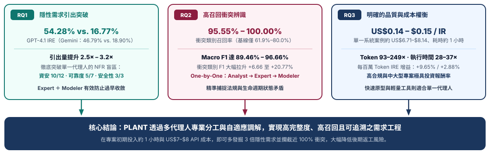

<strong>🧪 1. 固定預算消融實驗</strong> 在對等 Token 與輪數預算下，與其他多代理人基線對比並拆解各元件獨立貢獻。

<strong>👩‍💻 2. 真人專家 SRS 評估</strong> 邀請實務工程師量化評估產出之 UML 模型、事實依據與設計理由可追溯性。

<strong>⚙️ 3. 規格驅動開發（SDD）</strong> 將 PLANT 可追溯的 IEEE 29148 SRS 銜接至下游自動化測試案例與程式碼生成 [24]。

---

<!-- _class: closing -->

# 感謝聆聽 · 敬請指教！

透過多代理人 AI 框架提升需求工程效率（PLANT） 
Enhancing Requirements Engineering Efficiency through a Multi-Agent AI Framework

<strong>薛念林（Nien-Lin Hsueh）+</strong> &nbsp;·&nbsp; <code>nlhsueh@fcu.edu.tw</code> 
<strong>Shu-Hsien Liao</strong> &nbsp;·&nbsp; <code>m1325977@o365.fcu.edu.tw</code> 
逢甲大學 資訊工程學系（Feng Chia University） 
公開系統文件與範例產出：<code>https://dummyjack.github.io/PLANT-Manual/</code> 
國科會計畫補助：NSTC114-2221-E-035-077 · 歡迎提問與交流！

