

<!-- _class: lead -->

Academic Conference Presentation · Programming Education & Learning Analytics

# Application and Analysis of a Tiered LLM-Based Programming Assistance Mechanism in Programming Learning

Transforming AI Assistance from an Unregulated Aid into a Controllable, Recordable, and Analyzable Instructional Intervention

<strong>Nien-Lin Hsueh+</strong> and <strong>Ying-Chang Lu</strong> 
Department of Information Engineering and Computer Science, Feng Chia University, Taichung, Taiwan 
<code>nlhsueh@fcu.edu.tw</code> · <code>m1305878@o365.fcu.edu.tw</code>

Supported by the National Science and Technology Council (NSTC), Taiwan R.O.C., under grant NSTC114-2221-E-035-077.

---

## Opening Hook: What If Using AI Came With an "AI Tax"?

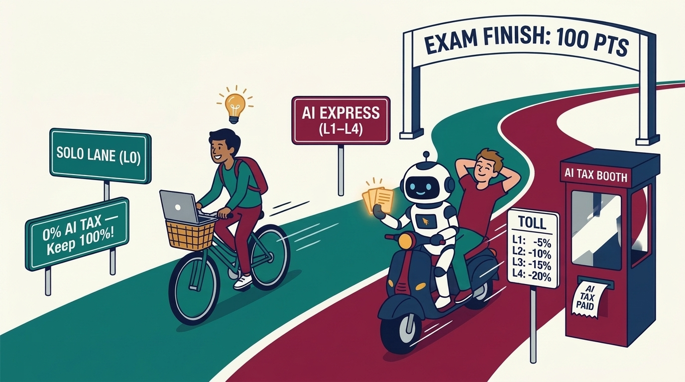

<strong>The Big Idea:</strong> Don't close the highway — <strong>put a tollbooth on the AI Express Lane!</strong> Students can still request tiered AI guidance when stuck, while an explicit <strong>AI Tax (0%–20%)</strong> keeps scores fair, transparent, and interpretable.

---

## Presentation Outline

1

[**Introduction & Research Questions**](#4)
Assessment challenges of open LLM use and our four research questions (RQ1–RQ4).

2

[**Related Work & Research Gap**](#6)
Comparison of LLM programming tutors and the lack of formal assessment integration.

3

[**Methodology: Tiered AI, AI Tax & LADI**](#7)
Five-level AI tutor, proactive prompts, reflection checks, EPC, and LADI index.

4

[**Smart Coding Tutor (SCT) System**](#11)
System architecture, level-based prompt builder, and student interfaces.

5

[**Empirical Study & Results (RQ1–RQ4)**](#13)
Evaluation with 112 Python students across 3 formal assessments (9 tasks).

6

[**Conclusion & Future Work**](#20)
Key pedagogical implications, limitations, and directions for longitudinal study.

---

## 1.1 Motivation: The Assessment Dilemma in AI-Assisted Learning

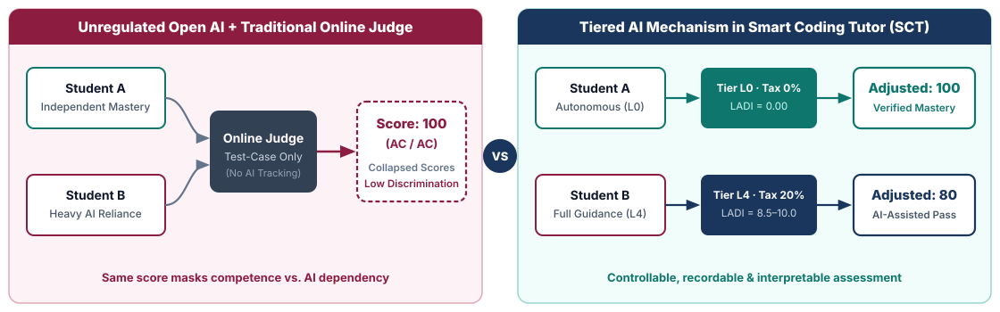

<strong>Core Design Philosophy:</strong> The goal is <strong>not to prohibit AI</strong>, but to transform AI assistance into a <strong>controllable, tiered, and recordable</strong> instructional intervention that preserves assessment interpretability.

---

## 1.2 Research Objectives & Four Research Questions

To evaluate whether **Smart Coding Tutor (SCT)** balances scaffolding with assessment integrity, we investigate **four core questions** *(revealed step-by-step)*:

* 
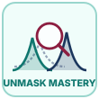

RQ1 Can we unmask true mastery?

Can a tiered AI assistance mechanism improve the <strong>discriminative power</strong> of programming task assessment?

* 

RQ2 Do higher tiers rescue stuck learners?

What are the <strong>support effects</strong> of different AI assistance levels (L0–L4) during the problem-solving process?

* 

RQ3 How do students budget their "AI Tax"?

What <strong>AI usage strategies and behavioral patterns</strong> emerge when support carries an explicit assessment cost?

* 
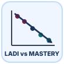

RQ4 Does mastery reduce AI dependency?

What is the relationship between students' <strong>AI dependency (LADI)</strong> and their conceptual learning outcomes?

---

## 2. Related Work & Research Gap

Prior LLM-based programming tutors focus on specific support features, but remain **add-on tools** weakly integrated with formal online judging workflows.

| Study | Analyt. | Assess. | Levels | Behav. | Depend. | Platform | Reflect. | Initiative1 |
| :--- | :---: | :---: | :---: | :---: | :---: | :---: | :---: | :--- |
| CodeAid [7] | | | | ✓ | | | | Adaptive |
| CodeHelp [6] | ✓ | | | ✓ | | | | Adaptive |
| Gipy [5] | | | | ✓ | | | | Adaptive |
| CodeRunner Agent [8] | ✓ | | | | | ✓ | ✓ | Proactive |
| Owlgorithm [9] | | | | | | ✓ | ✓ | Proactive |
| **This Study (SCT)** | **✓** | **✓** | **✓** | **✓** | **✓** | **✓** | **✓** | **Proactive** |

<strong>Key Research Gap:</strong> Existing studies rarely distinguish <strong>assistance intensity</strong>, track <strong>multi-level escalation histories</strong>, or quantify how <strong>AI dependency</strong> relates to assessment discrimination. 
1 <strong>Initiative Roles (Yan et al. [12]):</strong> <strong>Adaptive</strong> AI responds reactively only after explicit learner requests; <strong>Proactive</strong> AI monitors learner state (e.g., stagnation, repeated errors) and initiates timely prompts or reflection.

---

## 3.1 Five-Level Tiered AI Tutor & AI Tax Rate

Each problem begins at **L0**. Students choose when to escalate, while explicit feedback boundaries prevent direct submittable code generation.

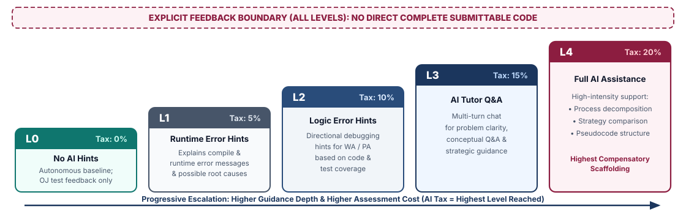

<strong>AI Tax Rate Rule:</strong> Calculated by the <strong>highest assistance level reached</strong> per problem (rather than call frequency), capturing the maximum external support mobilized and translating it into an observable assessment cost.

---

## 3.2 Proactive Learning Support & Post-Completion Consolidation

Inspired by Yan et al.'s **Proactive Assistant** role [12], SCT couples **stagnation-triggered reminders** during problem solving with **post-AC conceptual consolidation**.

<strong>Key Pedagogical Principle:</strong> Proactive prompts preserve <strong>learner agency</strong> (never auto-solving), while post-completion checks shift learning from <em>passing test cases</em> toward <strong>durable conceptual mastery</strong>.

---

## 3.3 Quantifying Escalation: Escalation Profile Coefficient (EPC)

Observing only the *final level* cannot distinguish **gradual help-seeking** from **abrupt high-level reliance** (`s`: start level, `f`: final level, `m`: effective levels experienced, `λ = 0.3`).

<i>EPC</i> &nbsp;=&nbsp;
<i>s</i>4
&nbsp;+&nbsp; <i>λ</i> &nbsp;( 1 −
<i>m</i><i>f</i> − <i>s</i> + 1
)

<strong>Two Behavioral Signals:</strong> <code>s / 4</code> captures <strong>initial dependency</strong>; <code>1 − m / (f − s + 1)</code> measures <strong>escalation sparsity</strong> (skipping intermediate tiers increases the dependency leap).

---

## 3.4 Level-Anchored Dependency Index (LADI)

LADI maps multi-level AI usage onto a continuous **`[0, 10]`** scale, using final intensity `2f` as the primary band anchor and `+2 EPC` to capture within-band escalation behavior.

<i>LADI</i> &nbsp;=
{

0, &nbsp;&nbsp;&nbsp;&nbsp;&nbsp;&nbsp;&nbsp;&nbsp;&nbsp;&nbsp;&nbsp;&nbsp;&nbsp;&nbsp;&nbsp;&nbsp;&nbsp;&nbsp;&nbsp;&nbsp; <i>f</i> = 0
2<i>f</i> + 2<i>EPC</i>, &nbsp;&nbsp;&nbsp;&nbsp;&nbsp; <i>f</i> ∈ {1, 2, 3, 4}

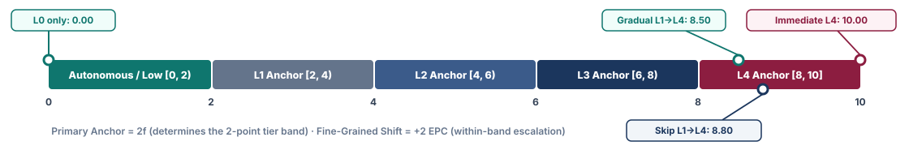

<strong>Analytical Advantage:</strong> Two students both reaching <strong>L4</strong> are cleanly separated by process trajectory (<code>8.50</code> gradual vs. <code>8.80</code> skip-step vs. <code>10.00</code> immediate), with <code>λ</code> tunable across course contexts.

---

## 4.1 Smart Coding Tutor (SCT) System Architecture

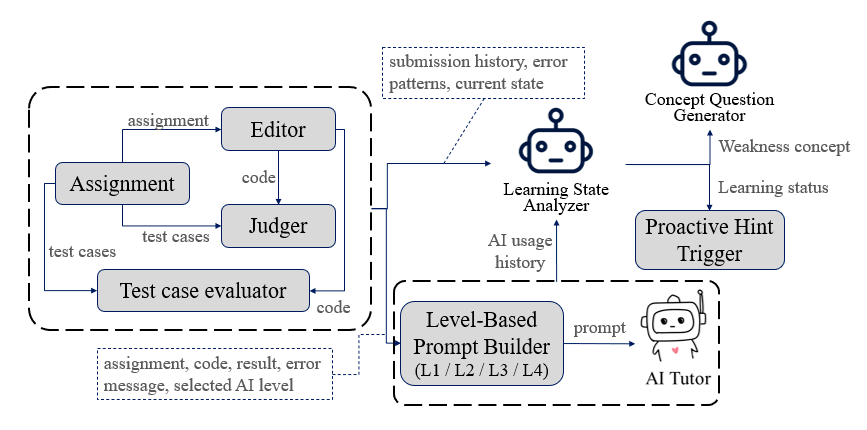

Fig. 1: System architecture of Smart Coding Tutor (SCT)

### ⚙️ Integrated Platform Modules
- **Online Judge Core**: Assignment, Editor, Judger, and Test Case Evaluator reporting standard statuses (`AC`, `PA`, `WA`, `RE`, `TLE`, `CE`).
- **Level-Based Prompt Builder**: Injects problem context, code, error output, and selected tier (L1–L4) into the AI Tutor.
- **Learning State Analyzer**: Monitors submission history, error patterns, and AI usage to drive:
  - **Proactive Hint Trigger** (stagnation alerts)
  - **Concept Question Generator** (weakness checks)

---

## 4.2 SCT User Interface: Tiered AI Support in Action

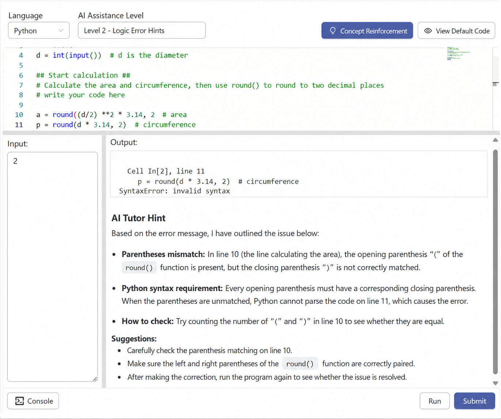

(a) L1 Runtime / Syntax Error Hint Interface

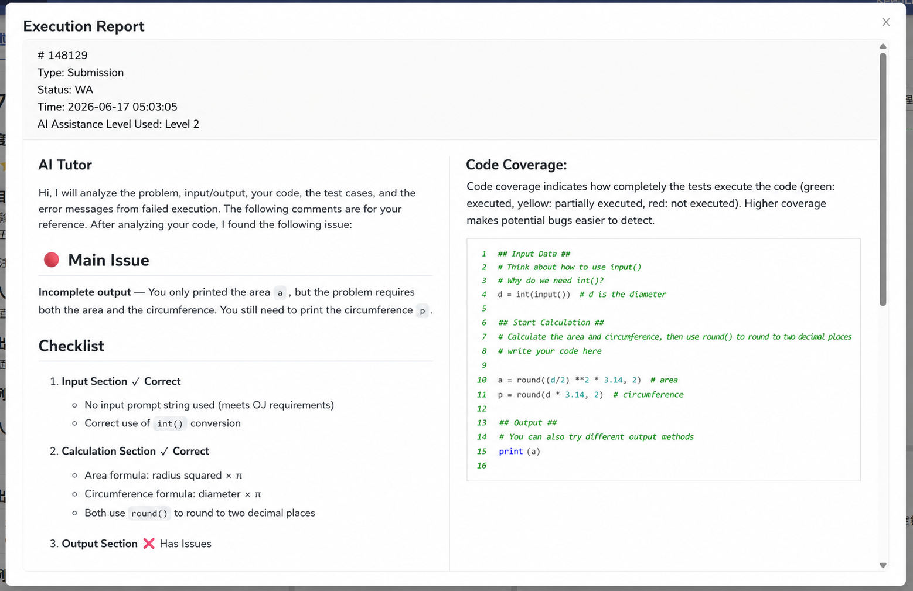

(b) L2 Logic Error Hint & Code Coverage Checklist

<strong>Multi-Turn Escalation (L3 & L4):</strong> Higher levels unlock a conversational AI Tutor chat supporting follow-up concept Q&A (L3) and structured solution decomposition / pseudocode guidance (L4), with full interaction logging.

---

## 5.1 Empirical Study Design & Context

### 🧪 Strict Experimental Controls
- **External generative AI tools were strictly prohibited** during all three formal assessments.
- All AI interactions occurred exclusively inside **SCT**, guaranteeing complete logging of level switches, prompts, and submission outcomes.

### 📊 Core Evaluation Alignment
- **RQ1**: Raw vs. tier-adjusted scores & IT vs. Non-IT `t`-tests.
- **RQ2**: Exact-level completion ratios across L0–L4.
- **RQ3 & RQ4**: AI tax four-quadrant profiles, LADI distribution, and correlation with conceptual understanding.

---

## 5.2 RQ1: Tiered AI Improves Assessment Discrimination

0.219 ➔ 0.324

Programming–Conceptual correlation <code>r</code> (vs. open-AI <code>r = 0.136</code>)

52.7% ➔ 13.4%

Full-score concentration sharply reduced (less ceiling effect)

3.93 / 5.0

Student agreement (<code>n = 56</code>) that tiered mode is more discriminative

| Assessment Metric (IT vs. Non-IT Group) | IT Mean | Non-IT Mean | `t(110)` | `p`-value | 95% CI |
| :--- | :---: | :---: | :---: | :---: | :---: |
| Raw Programming Score (Before Adjustment) | 81.46 | 71.63 | 1.76 | `.0818` (n.s.) | `[−1.26, 20.91]` |
| **Tier-Adjusted Score (After AI Tax)** | **73.42** | **62.25** | **2.24** | **`.0270*`** | **`[1.29, 21.05]`** |

<strong>Finding (RQ1):</strong> Incorporating AI assistance cost reduces score clustering and reveals that <strong>IT-background students scored significantly higher than non-IT students</strong> after adjustment (<code>73.42</code> vs. <code>62.25</code>, <code>p = .0270</code>), unmasking differences hidden in raw scores.

---

## 5.3 RQ2: Hierarchical Support Effects Across AI Levels

Completion ratio = percentage of records accessing a level that reached `AC` **at that exact level** without further upgrading.

<strong>L0 (Autonomous)</strong>

81.55%

<strong>L1 (Runtime Hints)</strong>

21.05%

<strong>L2 (Logic Hints)</strong>

34.88%

<strong>L3 (AI Tutor Q&A)</strong>

43.64%

<strong>L4 (Full Guidance)</strong>

80.41%

<strong>Finding (RQ2):</strong> 32.39% of valid records stayed at <strong>L0</strong> (autonomous baseline, 81.55% <code>AC</code>). Among AI-assisted records, completion ratios rose monotonically from <strong>21.05% (L1) to 80.41% (L4)</strong>, confirming distinct hierarchical and compensatory support effects.

---

## 5.4 RQ3: Usage Strategies & Four-Quadrant Analysis

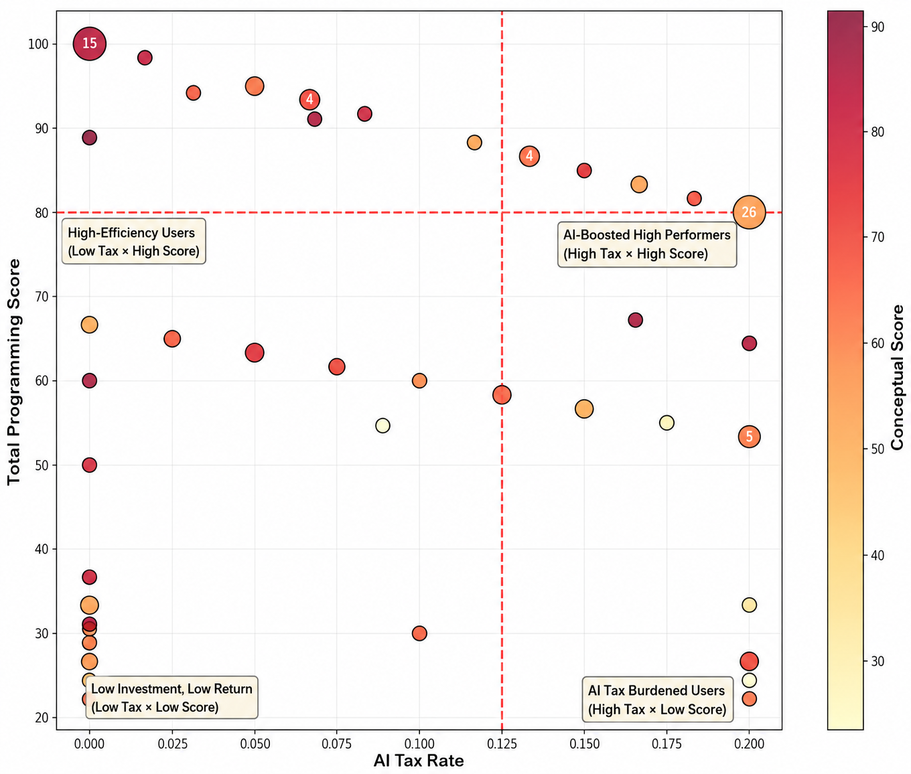

Fig. 3: Four-quadrant analysis (medians: Tax = 0.125, Score = 80)

### 🎯 Differentiated Trade-Off Patterns
- Average AI level negatively correlates with conceptual understanding (**`r = −0.368`**) ➔ usage reflects learning needs, not random clicks.
- **AI-Boosted High Performers (30.36%)**: High tax, high output — leverage deep AI guidance effectively.
- **High-Efficiency Users (25.00%)**: Low tax, high output — strong independent mastery.
- **Low Investment, Low Return (25.89%)**: Low tax, low output — under-utilization or delayed escalation.
- **AI Tax-Burdened Users (18.75%)**: High tax, low output — struggle to translate AI hints into working code.

---

## 5.5 RQ4: Stratified (Bimodal) Distribution of LADI

Rather than clustering around moderate dependency, students clearly **stratified into low-dependency and high-dependency groups**.

<strong>[0, 2) Low</strong>

32.39%

<strong>[2, 4) Mild</strong>

3.46%

<strong>[4, 6) Moderate</strong>

5.97%

<strong>[6, 8) Elevated</strong>

11.64%

<strong>[8, 10] High</strong>

46.54%

<strong>Key Observation:</strong> Nearly <strong>79%</strong> of student records fall in the two extremes — <strong>32.39%</strong> in <code>[0, 2)</code> and <strong>46.54%</strong> in <code>[8, 10]</code> — highlighting polarized needs for external scaffolding under formal assessment pressure.

---

## 5.6 RQ4: LADI vs. Conceptual Understanding Performance

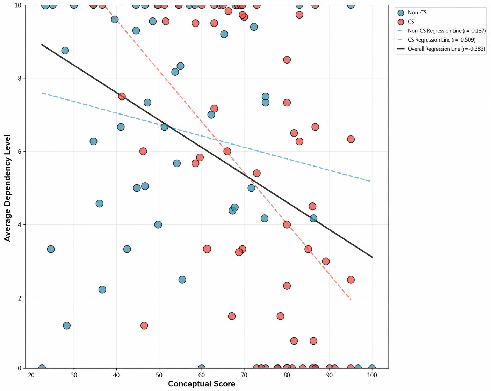

Fig. 4: Conceptual score vs. LADI by departmental background

### 📉 Criterion-Related Evidence for LADI
- **Overall Correlation**: Moderate negative correlation (**`r = −0.383`**) — stronger conceptual understanding aligns with lower AI dependency.
- **By Background**:
  - **IT Majors**: **`r = −0.509`** (clear decline in reliance as concepts strengthen).
  - **Non-IT Majors**: **`r = −0.187`** (still rely on AI for syntax & implementation scaffolding).
- **By Academic Year**:
  - 4th-year: **`r = −0.779`** | 3rd-year: `r = −0.353`
  - 2nd-year: `r = −0.350` | 1st-year: `r = +0.150`

---

## 5.7 Discussion & Pedagogical Implications

### 🏫 Instructional & Assessment Insights
- **Restoring Fairness Without Bans**: Linking tiered AI support to explicit AI tax rates preserves student access to scaffolding while keeping scores interpretable.
- **Tailoring Support for Non-IT Novices**: Lower correlation (`r = −0.187`) among non-IT students suggests conceptual gains alone do not eliminate syntax/debugging barriers.
- **Early Risk Identification**: Four-quadrant profiles help instructors spot *Tax-Burdened* (18.75%) and *Under-Utilizing* (25.89%) students early.

### 🔬 Methodological Reflections & Limits
- **Correlational, Not Causal**: LADI shows preliminary criterion-related validity (`r = −0.383`), but cannot yet establish causal direction between dependency and mastery.
- **Proactive Timing Gap**: Student satisfaction with proactive prompt timing averaged only **`2.96 / 5.0`**, indicating stagnation thresholds and trigger frequency need calibration.
- **Single-Course Context**: Generalizability of `λ = 0.3` and tier tax weights requires cross-course validation.

---

## 6. Conclusion & Future Work

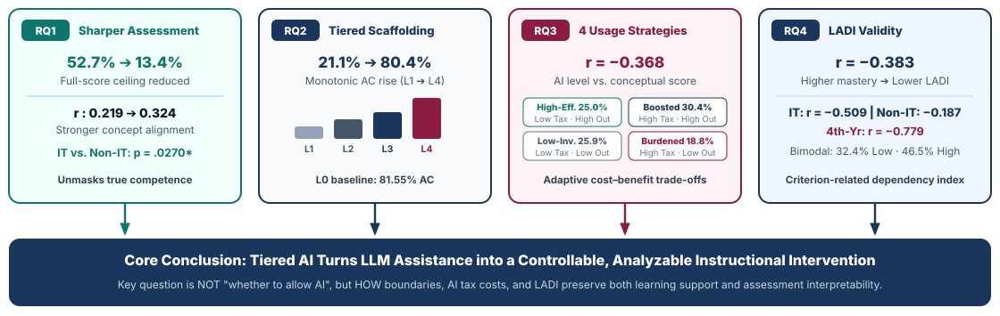

<strong>🚀 1. Longitudinal & Cross-Course</strong> Validate LADI stability and long-term independent coding transfer across semesters.

<strong>🔔 2. Smarter Proactive Timing</strong> Refine stagnation thresholds & trigger frequency to lift satisfaction above <code>2.96 / 5.0</code>.

<strong>🎛️ 3. Parameter Calibration</strong> Empirically tune <code>λ</code> and AI tax schedules across task difficulties & languages.

---

<!-- _class: closing -->

# Thank You for Your Attention!

Application and Analysis of a Tiered LLM-Based Programming Assistance Mechanism in Programming Learning

<strong>Nien-Lin Hsueh+</strong> &nbsp;·&nbsp; <code>nlhsueh@fcu.edu.tw</code> 
<strong>Ying-Chang Lu</strong> &nbsp;·&nbsp; <code>m1305878@o365.fcu.edu.tw</code> 
Department of Information Engineering and Computer Science, Feng Chia University 
Grant: NSTC114-2221-E-035-077 · Questions & Discussion Welcome!

