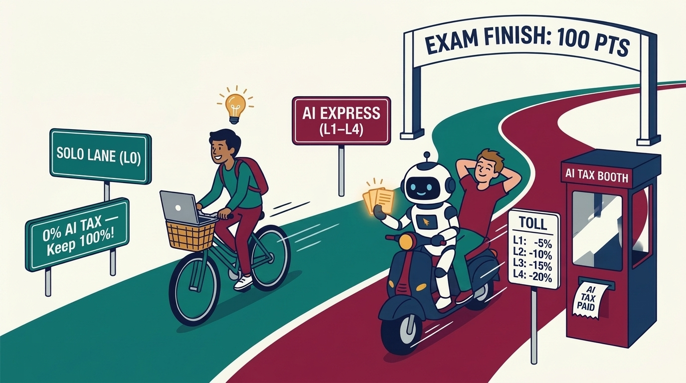
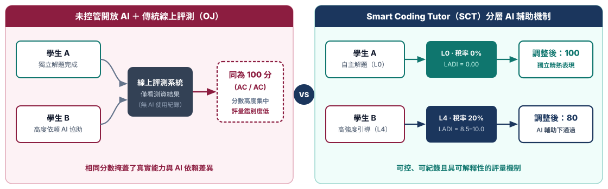
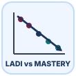
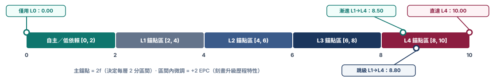
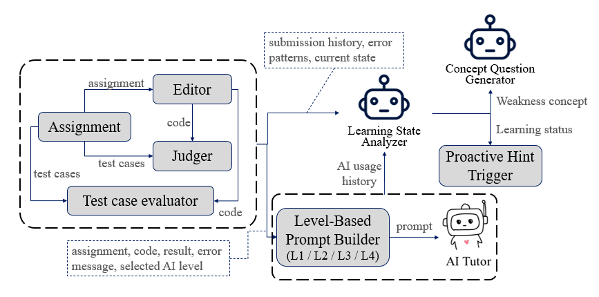
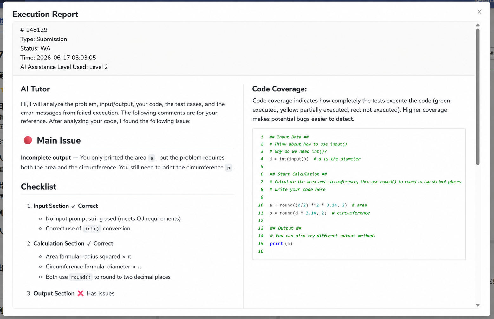
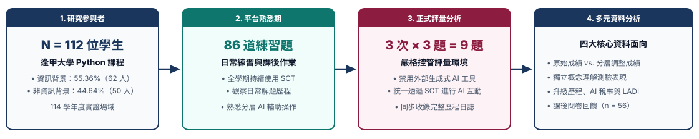

<!-- _class: lead -->

學術會議專題報告 · 程式設計教育與學習分析

# 分層式大型語言模型程式輔助機制於程式學習之應用與分析

Application and Analysis of a Tiered LLM-Based Programming Assistance Mechanism in Programming Learning

將 AI 輔助從「未受控管的外掛工具」轉化為「可控、可紀錄、可分析」的教學介入機制

<strong>薛念林（Nien-Lin Hsueh）+</strong>、<strong>Ying-Chang Lu</strong> 
逢甲大學 資訊工程學系（Feng Chia University, Taichung, Taiwan） 
<code>nlhsueh@fcu.edu.tw</code> · <code>m1305878@o365.fcu.edu.tw</code>

國科會專題研究計畫補助：NSTC114-2221-E-035-077

<!--
核心訊息：我們將大型語言模型的程式輔助從未受控管的外掛工具，轉化為可控、可紀錄且具評量鑑別力的分層教學介入機制。

口說要點：
- 各位老師與先進大家好，今天要分享的是我們在逢甲大學開發的 Smart Coding Tutor（SCT），探討如何將分層式 LLM 輔助正式導入程式設計學習與評量。
- 面對生成式 AI，與其全面禁止或完全放任，我們主張讓輔助行為變得透明、分級且可量化分析。
- 本研究承蒙國科會專題研究計畫補助支持。

轉場：首先，我們用一個輕鬆的日常比喻來破題，看看為什麼會提出「AI 稅」的概念。
-->

---

## 破題思考：如果使用 AI 協助也要繳交「AI 稅（AI Tax）」？

<strong>核心破題構想：</strong> 與其全面封閉道路，不如在 AI 快速道上設立<strong>分級收費站</strong>！學生卡關時仍可獲得分層引導，但透過明確的 <strong>AI 稅率（0%–20%）</strong>，讓評量成績維持公平、透明與可解釋性。

<!--
核心訊息：在 AI 快速道上設立「分級收費站（0% 至 20% AI 稅）」，讓學生在卡關時仍能獲得引導，同時守住評量的公平與透明。

口說要點：
- 大家可以看這張插畫：如果把程式考試比喻成高速公路，全面禁止 AI 就像封閉道路，而完全開放則會讓大家一路飆到滿分，看不出誰真正會寫程式。
- 我們的作法是在 AI 快速道設立分級收費站：學生可以依需要申請不同層級的提示，但每一層都對應 0% 到 20% 的明確扣分成本。
- 這樣一來，AI 輔助就從黑箱依賴轉化為學生自主權衡的透明決策。

轉場：接下來我用簡報大綱快速說明今天的報告脈絡。
-->

---

## 簡報大綱（Outline）

1

[**研究動機與四大研究問題**](#4)
開放式 AI 帶來的評量鑑別度困境，以及本研究之 RQ1–RQ4。

2

[**文獻回顧與研究缺口**](#6)
現有 LLM 程式助教系統比較，與正式評量流程整合之不足。

3

[**研究方法：分層 AI、AI 稅率與 LADI**](#7)
五級分層助教、主動提示與反思檢核、以及 EPC 與 LADI 指標。

4

[**Smart Coding Tutor（SCT）系統設計**](#11)
整合式系統架構、分層提示建構器與學生端操作介面。

5

[**實證研究與分析結果（RQ1–RQ4）**](#13)
112 位逢甲 Python 修課生、3 次正式評量共 9 道題目之實證分析。

6

[**結論與未來研究方向**](#20)
RQ1–RQ4 核心發現全景圖、教學啟示與後續精進規劃。

<!--
核心訊息：本次報告依序涵蓋評量困境、五級分層與 LADI 指標設計、SCT 系統實作，以及 112 位修課生的實證結果。

口說要點：
- 第一、二部分說明開放式 AI 帶來的評量挑戰、四大研究問題，以及既有文獻的缺口。
- 第三、四部分介紹五級分層助教、主動提示與反思閉環、EPC 與 LADI 依賴指標，以及 SCT 平台架構。
- 第五、六部分則呈現逢甲 112 位 Python 修課生在三次正式評量中的實證發現與未來方向。

轉場：讓我們先深入探討開放式 AI 在程式評量中所面臨的核心困境。
-->

---

## 1.1 研究動機：AI 輔助程式學習中的評量困境

<strong>核心設計理念：</strong> 本研究的目的<strong>並非禁止學生使用 AI</strong>，而是將 AI 輔助轉化為<strong>可控、分層且可紀錄</strong>的教學介入，讓成績能真實反映能力與輔助程度。

<!--
核心訊息：未受控管的開放 AI 容易造成分數天花板與滿分假象，而分層機制能在保留鷹架支持的同時還原成績可解釋性。

口說要點：
- 從圖中對比可以看到，當學生能自由使用外部 AI 時，新手與熟手都能交出正確程式碼，導致分數高度集中、難以分辨真實理解程度。
- 但如果一味禁止，又剝奪了初學者即時排錯與學習的機會。
- 因此我們的核心理念不是禁用 AI，而是把它納入評測平台，變成可控、分層、全程留痕的教學介入。

轉場：基於這個設計理念，我們進一步聚焦出四個核心研究問題。
-->

---

## 1.2 研究目標與四大研究問題（RQ1–RQ4）

為驗證 **Smart Coding Tutor（SCT）** 是否能兼顧「鷹架支持」與「評量效度」，本研究探討以下**四大問題** *（逐步揭曉）*：

* 

RQ1 我們能否揭開滿分假象、還原真實能力？

分層 AI 輔助機制是否能提升程式評量任務的<strong>成績鑑別度</strong>？

* 

RQ2 較高層級的提示真的能救起卡關學生嗎？

不同 AI 輔助層級（L0–L4）在解題過程中各自產生何種<strong>支持效果</strong>？

* 

RQ3 面對「AI 稅」，學生會怎麼精打細算？

在具備明確評量成本的分層機制下，學生展現哪些<strong>使用策略與行為模式</strong>？

* 

RQ4 概念越扎實，就越不依賴 AI 嗎？

學生的 <strong>AI 依賴程度（LADI）</strong>與其概念理解學習成效之間存在何種關聯？

<!--
核心訊息：本研究透過四大問題，全面驗證評量鑑別度（RQ1）、分層支持效果（RQ2）、使用策略（RQ3）與依賴關聯（RQ4）。

口說要點：
- RQ1 檢驗納入明確 AI 稅率後，是否真能揭開滿分假象、還原學生真實能力差異。
- RQ2 探討從 L0 到 L4 五個層級的提示，是否能對卡關學生產生階梯式的實質幫助。
- RQ3 與 RQ4 則進一步分析學生面對 AI 稅時的成本權衡策略，以及我們提出的 LADI 依賴指標與概念理解之間的關聯。

轉場：在介紹方法之前，我們先看看 SCT 與現有 LLM 程式助教研究的差異。
-->

---

## 2. 文獻回顧與研究缺口（Table 1）

既有 LLM 程式助教多聚焦於單一輔助功能，且多屬**外掛式工具**，缺乏與正式線上評測（OJ）流程的深度整合。

| 相關研究 | 學習分析 | 評量鑑別 | 強度分層 | 行為分析 | 依賴量化 | 平台整合 | 反思支持 | 主動性角色1 |
| :--- | :---: | :---: | :---: | :---: | :---: | :---: | :---: | :--- |
| CodeAid [7] | | | | ✓ | | | | Adaptive（適應型） |
| CodeHelp [6] | ✓ | | | ✓ | | | | Adaptive（適應型） |
| Gipy [5] | | | | ✓ | | | | Adaptive（適應型） |
| CodeRunner Agent [8] | ✓ | | | | | ✓ | ✓ | Proactive（主動型） |
| Owlgorithm [9] | | | | | | ✓ | ✓ | Proactive（主動型） |
| **本研究（SCT）** | **✓** | **✓** | **✓** | **✓** | **✓** | **✓** | **✓** | **Proactive（主動型）** |

<strong>關鍵研究缺口：</strong> 既有研究較少同時區分<strong>輔助強度層級</strong>、追蹤<strong>跨層升級歷程</strong>，並解析 AI 依賴程度與評量鑑別度間的關聯。 
1 <strong>主動性角色定義（Yan 等人框架 [12]）：</strong><strong>Adaptive（適應型）</strong>係被動等待學生主動提問或觸發錯誤後才回應；<strong>Proactive（主動型）</strong>則由系統持續監控學習狀態（如停滯、重複錯誤），於適當時機主動介入提醒或引導反思。

<!--
核心訊息：既有 LLM 程式助教多屬外掛式單點工具，缺乏輔助強度分層、跨層依賴量化與正式評測流程的整合。

口說要點：
- 從 Table 1 可見，CodeAid、CodeHelp 與 Gipy 多偏向被動回應的適應型工具，而 CodeRunner Agent 與 Owlgorithm 開始導入平台整合與主動反思。
- 然而，目前仍缺乏同時整合強度分層、評量鑑別、跨層升級追蹤與依賴量化的完整系統。
- 本研究開發的 SCT 一次補齊這八個維度，並落實 Yan 等人提出的主動型助教角色。

轉場：接下來我們具體看看 SCT 的五級分層助教與 AI 稅率是如何設計的。
-->

---

## 3.1 五級分層 AI 助教與 AI 稅率設計

每道題目皆從 **L0** 開始，由學生依解題卡關狀態自主決定是否升級，全層級皆設明確邊界以防直接給出完整解答。

<strong>AI 稅率計費原則：</strong> 以學生在單題中實際動用的<strong>最高 AI 輔助層級</strong>（而非呼叫次數）作為該題之 AI 使用成本，將外部輔助強度轉化為可觀察的評量指標。

<!--
核心訊息：每道題目皆從完全自主的 L0 起步，學生可依卡關情況逐級解鎖至 L4，並依該題動用的最高層級計算 AI 稅率。

口說要點：
- 圖中的階梯清楚呈現五個層級：從 L0 無輔助，到 L1 語法與執行錯誤提示、L2 邏輯除錯提示、L3 對話式 AI 助教問答，一直到 L4 完整思路拆解與虛擬碼引導。
- 每個層級都有嚴格的提示邊界，絕不直接給出可直接貼上送出的完整程式碼。
- 特別要強調的是，AI 稅率（0% 至 20%）是看單題最高動用層級而非呼叫次數，避免學生因為怕多扣分而不敢追問釐清觀念。

轉場：除了學生主動升級之外，SCT 也結合了系統主動監控與完成後反思機制。
-->

---

## 3.2 主動式學習支持與完成後概念鞏固

借鏡 Yan 等人的<strong>主動式助手（Proactive Assistant）</strong>架構 [12]，SCT 串聯「解題中停滯提醒」與「通過測資後之概念鞏固」。

<strong>教學調節原則：</strong> 主動提示保留<strong>學習者主導權</strong>（絕不越俎代庖），而完成後的概念檢核與反思則引導學習從「通過測資」走向「穩定概念理解與遷移」。

<!--
核心訊息：SCT 將解題中的停滯主動提醒，與通過測資（AC）後的概念檢核串成閉環，引導學生從「通過測資」走向「真正理解」。

口說要點：
- 在解題階段，系統持續監控停滯時間與重複錯誤；一旦偵測到卡關，便主動跳出友善提醒，但不越俎代庖直接給答案，保留學習者主導權。
- 當學生順利拿到 AC 後，系統會根據其錯誤與互動歷程生成針對性的概念題與反思檢核。
- 透過這套主動閉環，讓高強度輔助不會淪為短期代工，而是能沉澱為穩定的概念遷移。

轉場：接著我們要解決一個關鍵問題：如何精準量化學生在多層級之間的求助路徑，而不只是看最後停在哪一層？
-->

---

## 3.3 量化升級歷程：升級剖面係數（EPC）

僅觀察*是否使用 AI* 或*最終層級*，無法區分「循序漸進求助」與「直接跳往高強度依賴」（`s`：起始層級、`f`：最終層級、`m`：實際經歷有效層級數、`λ = 0.3`）。

<i>EPC</i> &nbsp;=&nbsp;
<i>s</i>4
&nbsp;+&nbsp; <i>λ</i> &nbsp;( 1 −
<i>m</i><i>f</i> − <i>s</i> + 1
)

<strong>兩項關鍵行為訊號：</strong> <code>s / 4</code> 刻畫解題初期的<strong>初始依賴</strong>；<code>1 − m / (f − s + 1)</code> 衡量升級路徑的<strong>稀疏程度</strong>（跳過越多中間層級，代表越明顯的依賴躍升）。

<!--
核心訊息：升級剖面係數（EPC）能有效區分「循序漸進求助」與「直接跳級依賴」，補足只看最終層級的盲點。

口說要點：
- 請看圖中三條路徑，三位學生最後都抵達 L4，但背後的學習行為截然不同。
- EPC 公式包含兩個行為訊號：前項 s / 4 反映一開始就動用高層級的初始依賴；後項透過 λ = 0.3 衡量升級路徑的稀疏度，跳過越多中間層級，數值越高。
- 因此，一步步嘗試後才升上 L4 的學生，EPC 會明顯低於一開始就直衝 L4 的學生。

轉場：我們再將 EPC 與最終層級錨點結合，建構出 0 到 10 分的連續指標 LADI。
-->

---

## 3.4 層級錨定依賴指標（LADI）

LADI 將分層機制下的 AI 使用行為映射至 **`[0, 10]`** 連續量尺，以最終層級 `2f` 為主錨點，並透過 `+2 EPC` 細分區間內的升級歷程。

<i>LADI</i> &nbsp;=
{

0, &nbsp;&nbsp;&nbsp;&nbsp;&nbsp;&nbsp;&nbsp;&nbsp;&nbsp;&nbsp;&nbsp;&nbsp;&nbsp;&nbsp;&nbsp;&nbsp;&nbsp;&nbsp;&nbsp;&nbsp; <i>f</i> = 0
2<i>f</i> + 2<i>EPC</i>, &nbsp;&nbsp;&nbsp;&nbsp;&nbsp; <i>f</i> ∈ {1, 2, 3, 4}

<strong>指標分析優勢：</strong> 即使兩位學生最終皆抵達 <strong>L4</strong>，LADI 仍能精細區辨其歷程差異（漸進 <code>8.50</code> vs. 跳級 <code>8.80</code> vs. 直達 <code>10.00</code>），且 <code>λ</code> 可依課程情境調整校準。

<!--
核心訊息：層級錨定依賴指標（LADI）以 2f 作為主區間錨點、搭配 +2 EPC 細分歷程，將複雜的多層求助行為映射至 [0, 10] 連續量尺。

口說要點：
- 全程自主在 L0 完成的紀錄為 0 分；有啟用 AI 的紀錄則依最終層級落在對應區間，再透過 +2 EPC 拉開組內差距。
- 如圖下方量尺所示，同樣抵達 L4 的三種情境可清楚區辨為漸進 8.50、跳級 8.80 與直達 10.00。
- 這種設計既保留層級的直覺可解釋性，又能透過 λ 參數因應不同課程彈性校準。

轉場：了解理論與指標後，讓我們來看看 SCT 平台在工程架構上是如何實現的。
-->

---

## 4.1 Smart Coding Tutor（SCT）系統架構

Fig. 1：Smart Coding Tutor（SCT）整合式系統架構

### ⚙️ 四大核心整合模組
- **線上評測核心（OJ Core）**：整合題目管理、程式碼編輯器、評測器與測資評估，即時回報 `AC`、`PA`、`WA`、`RE`、`TLE`、`CE` 狀態。
- **分層提示建構器（Level-Based Prompt Builder）**：依據題目、程式碼、錯誤訊息與所選層級（L1–L4）動態組裝提示送往 AI Tutor。
- **學習狀態分析器（Learning State Analyzer）**：整合提交歷程、錯誤模式與 AI 使用紀錄，驅動：
  - **主動提示觸發器（Proactive Hint Trigger）**
  - **弱點概念題生成器（Concept Question Generator）**

<!--
核心訊息：SCT 將線上評測核心、分層提示建構器與學習狀態分析器整合在同一平台，確保輔助控管與資料留痕無縫銜接。

口說要點：
- 左側為線上評測核心（OJ Core），負責題目管理、編輯器、評測與即時狀態回報（AC、PA、WA、RE、TLE、CE）。
- 中間的分層提示建構器會將題意、學生程式碼、錯誤訊息與所選層級打包成受控提示送往 AI Tutor，確保回應不越界。
- 右側的學習狀態分析器持續追蹤提交與錯誤模式，即時驅動主動提示觸發器與弱點概念題生成器。

轉場：我們也準備了實際的學生端操作畫面，讓大家更有臨場感。
-->

---

## 4.2 SCT 學生端操作介面（L1 與 L2 實景）

(a) L1 語法與執行時期錯誤提示介面

(b) L2 邏輯除錯提示與程式碼覆蓋率檢核表

<strong>多輪對話升級（L3 & L4）：</strong> 較高層級提供多輪對話式 AI 助教介面，支援概念釐清與策略討論（L3），乃至流程拆解與虛擬碼結構引導（L4），全程同步寫入行為日誌。

<!--
核心訊息：低層級（L1、L2）提供結構化錯誤診斷與覆蓋率檢核表，高層級（L3、L4）則開啟多輪對話式引導並全程紀錄。

口說要點：
- 左圖是 L1 介面，專注於幫初學者解讀語法與執行時期錯誤訊息，培養自行看懂錯誤報告的能力。
- 右圖是 L2 介面，提供邏輯除錯方向與程式碼覆蓋率檢核表，引導學生自行找出邏輯漏洞。
- 若學生進一步升級至 L3 或 L4，就會開啟多輪對話視窗進行觀念問答或虛擬碼結構拆解，所有對話都完整寫入後端日誌。

轉場：有了完整系統與日誌收集機制後，接下來進入我們的課堂實證研究設計。
-->

---

## 5.1 實證研究設計與實驗場域

### 🧪 嚴謹實驗控管
- 三次正式評量期間**全面禁用外部生成式 AI 工具**。
- 所有 AI 輔助互動皆須透過 **SCT 平台**進行，確保層級切換、對話內容與提交結果之資料完整性。

### 📊 對應四大研究問題之驗證
- **RQ1**：原始成績 vs. 分層調整成績、資訊與非資訊背景 `t` 檢定。
- **RQ2**：L0–L4 各層級不升級即達成 `AC` 之完成率。
- **RQ3 & RQ4**：AI 稅率四象限分群、LADI 雙峰分布與概念理解相關分析。

<!--
核心訊息：我們於逢甲大學 Python 課程進行實證，蒐集 112 位學生在 3 次正式評量（共 9 題）中的完整互動與概念成績。

口說要點：
- 為了確保資料純淨度，三次正式評量期間全面禁用外部生成式 AI 工具，所有輔助行為都必須在 SCT 平台內完成。
- 這樣我們就能精準對齊每一筆層級切換、提示對話、提交結果，以及獨立施測的概念理解分數。
- 右側卡片列出各項資料與 RQ1 到 RQ4 的驗證對應關係。

轉場：接著我們逐一揭曉四大研究問題的實證結果，先看 RQ1 評量鑑別度。
-->

---

## 5.2 RQ1 實證結果：分層機制顯著提升評量鑑別度

0.219 ➔ 0.324

程式實作與概念理解相關 <code>r</code> 提升（對比先期開放 AI 僅 <code>0.136</code>）

52.7% ➔ 13.4%

滿分學生比例大幅下降，有效緩解分數天花板集中現象

3.93 / 5.0

學生問卷（<code>n = 56</code>）高度認同分層模式較開放模式更具鑑別度

| 評量指標（資訊背景 vs. 非資訊背景獨立樣本 `t` 檢定） | 資訊背景均分 | 非資訊背景均分 | `t(110)` | `p` 值 | 95% 信賴區間 |
| :--- | :---: | :---: | :---: | :---: | :---: |
| 原始程式實作成績（未扣 AI 稅） | 81.46 | 71.63 | 1.76 | `.0818`（未達顯著） | `[−1.26, 20.91]` |
| **分層調整後成績（納入 AI 稅率）** | **73.42** | **62.25** | **2.24** | **`.0270*`（達顯著）** | **`[1.29, 21.05]`** |

<strong>RQ1 發現：</strong> 納入 AI 輔助成本後，不僅降低滿分集中現象，更使<strong>資訊背景學生的調整後成績顯著高於非資訊背景學生</strong>（<code>73.42</code> vs. <code>62.25</code>，<code>p = .0270</code>），還原了原本被原始高分所掩蓋的能力與 AI 依賴差異。

<!--
核心訊息：納入 AI 稅率後，滿分集中比例從 52.7% 大幅降至 13.4%，並成功顯現資訊與非資訊背景學生的顯著能力差異。

口說要點：
- 請看上方三個指標：程式實作與概念理解的相關係數從 0.219 提升到 0.324（遠高於先期開放 AI 的 0.136），滿分比例也從超過五成降到 13.4%，大幅緩解天花板效應。
- 下方 t 檢定表顯示，未扣稅的原始成績在兩組間未達顯著（p = .0818），但納入 AI 稅率後，資訊背景均分顯著高於非資訊背景（73.42 vs. 62.25，p = .0270）。
- 學生問卷也給予 3.93 / 5.0 的高度正面肯定，認同分層模式更具鑑別力。

轉場：確認鑑別度提升後，我們來看 RQ2：不同層級的提示真的能救起卡關學生嗎？
-->

---

## 5.3 RQ2 實證結果：各輔助層級展現階梯式支持效果

完成率定義 ＝ 曾使用該層級的紀錄中，**未再升級即於該層達成 `AC`** 之比例。

<strong>L0（自主解題）</strong>

81.55%

<strong>L1（執行錯誤提示）</strong>

21.05%

<strong>L2（邏輯錯誤提示）</strong>

34.88%

<strong>L3（AI 助教問答）</strong>

43.64%

<strong>L4（完整高強度引導）</strong>

80.41%

<strong>RQ2 發現：</strong> 約 32.39% 有效紀錄全程維持 <strong>L0</strong>（自主基準，<code>AC</code> 率達 81.55%）；在啟用 AI 的紀錄中，完成率從 <strong>L1 的 21.05% 單調遞增至 L4 的 80.41%</strong>，顯示高層級具備明確的補償性支持效果，且人工抽樣亦確認回應符合邊界規範。

<!--
核心訊息：在啟用 AI 的紀錄中，不升級即達成 AC 的完成率從 L1 的 21.05% 單調遞增至 L4 的 80.41%，證實清晰的階梯式支持效果。

口說要點：
- 首先，約有 32.39% 的有效答題紀錄全程停留在 L0 自主解題，且 AC 完成率高達 81.55%，展現穩固的自主基準群體。
- 針對需要協助的紀錄，各層級的當層完成率呈現穩定爬升：L1 為 21.05%、L2 為 34.88%、L3 為 43.64%，到 L4 達到 80.41%。
- 這代表低層級確實守住了提示邊界，而高層級也發揮了實質的補償性鷹架作用。

轉場：既然高層級這麼有效，學生在面對扣分成本時會怎麼做選擇？我們來看 RQ3 的四象限分析。
-->

---

## 5.4 RQ3 實證結果：使用策略與 AI 稅率四象限分析

Fig. 3：AI 稅率與程式成績四象限分析（中位數：稅率 0.125、分數 80）

### 🎯 差異化成本效益權衡模式
- 平均 AI 使用層級與概念理解呈負相關（**`r = −0.368`**）➔ AI 使用反映真實學習需求，而非隨機點擊。
- **高稅高產出（AI 助攻高效型，30.36%）**：善用高強度引導成功轉化為高實作成績。
- **低稅高產出（高效自主型，25.00%）**：僅需少量或無需 AI 輔助即展現高度精熟。
- **低稅低產出（低投入低回報型，25.89%）**：可能未善用可用提示，或卡關時過晚升級。
- **高稅低產出（高稅負擔型，18.75%）**：即使獲得高強度提示，仍難以轉化為正確程式碼。

<!--
核心訊息：AI 稅率與成績呈現四種鮮明使用策略，且平均層級與概念分數呈負相關（r = −0.368），顯示求助行為反映真實學習需求。

口說要點：
- 我們以中位數（稅率 0.125、分數 80）劃分四個象限，清楚看見不同族群的權衡模式。
- 高表現族群分為兩類：AI 助攻高效型（30.36%）善用高強度引導拿到高分，高效自主型（25.00%）則靠自身實力低稅拿高分。
- 更具教學價值的是下方兩群高風險學生：25.89% 屬於低投入低回報型（太晚求助或未善用提示），另有 18.75% 屬於高稅負擔型，即便動用高層級提示仍難以轉化為正確程式。

轉場：接著進入 RQ4，我們先檢視整體 LADI 依賴指標的分布型態。
-->

---

## 5.5 RQ4 實證結果：LADI 呈現顯著雙峰分層分布

學生並未集中於中度依賴區間，而是明顯**分化為「低依賴自主群」與「高依賴求助群」**。

<strong>[0, 2) 低依賴</strong>

32.39%

<strong>[2, 4) 輕度依賴</strong>

3.46%

<strong>[4, 6) 中度依賴</strong>

5.97%

<strong>[6, 8) 較高依賴</strong>

11.64%

<strong>[8, 10] 高度依賴</strong>

46.54%

<strong>關鍵觀察：</strong> 合計近 <strong>79%</strong> 的答題紀錄落於兩端極值區間 — <code>[0, 2)</code> 佔 <strong>32.39%</strong>、<code>[8, 10]</code> 佔 <strong>46.54%</strong>，凸顯在正式評量情境下學生對外部鷹架之需求呈現高度兩極化。

<!--
核心訊息：學生的 LADI 指標呈現顯著雙峰分布，合計近 79% 的紀錄落在低依賴 [0, 2) 與高依賴 [8, 10] 兩個極端區間。

口說要點：
- 從長條圖可以一眼看出，學生並未集中在中間地帶，而是明顯分化為兩極：低依賴 [0, 2) 佔 32.39%，高度依賴 [8, 10] 佔 46.54%。
- 中間三個區間合計僅佔約 21%。
- 這反映出在正式評量壓力下，學習者一旦突破自主解題門檻，往往會傾向一路升級至完整引導以確保通過測資。

轉場：那麼，LADI 分數高低與學生真實的概念理解表現之間，究竟有多強的關聯呢？
-->

---

## 5.6 RQ4 實證結果：LADI 與概念理解表現之關聯

Fig. 4：概念理解分數與 LADI 指標之分群迴歸散佈圖

### 📉 LADI 之初步效標關聯效度證據
- **整體相關性**：呈中度負相關（**`r = −0.383`**）— 概念理解越佳的學生，整體 AI 依賴程度越低。
- **依學科背景分組**：
  - **資訊背景學生**：**`r = −0.509`**（隨概念提升，依賴度顯著下降）。
  - **非資訊背景學生**：**`r = −0.187`**（即便概念提升，仍受限於語法熟練度與實作經驗而需輔助）。
- **依年級分析**：
  - 大四：**`r = −0.779`** ｜ 大三：`r = −0.353`
  - 大二：`r = −0.350` ｜ 大一：`r = +0.150`

<!--
核心訊息：LADI 與概念理解呈現中度負相關（r = −0.383），且在資訊背景（r = −0.509）與高年級學生（大四 r = −0.779）中尤為顯著。

口說要點：
- 整體而言，概念理解越扎實的學生，AI 依賴度越低（r = −0.383），為 LADI 提供了初步的效標關聯效度證據。
- 按背景拆解後發現有趣差異：資訊生呈現明顯負相關（r = −0.509），但非資訊生僅為 −0.187，代表非資訊生即使懂觀念，仍可能因語法與除錯熟練度不足而需要 AI 協助。
- 依年級來看，負相關強度隨年級穩定加深，大四學生高達 r = −0.779。

轉場：整理完所有實證數據後，讓我們一起反思教學實務啟示與研究限制。
-->

---

## 5.7 綜合討論、教學啟示與研究限制

### 🏫 教學與評量實務啟示
- **不禁止 AI 也能守住公平性**：透過分層設計與明確 AI 稅率，兼顧新手的鷹架支持與成績之可解釋性。
- **差異化輔導非資訊背景新手**：非資訊生負相關較弱（`r = −0.187`），顯示其除概念外仍需語法與除錯實作引導。
- **及早辨識高風險學習族群**：四象限分析可協助教師提前關注「高稅負擔型（18.75%）」與「低投入低回報型（25.89%）」學生。

### 🔬 方法學反思與研究限制
- **相關而非因果**：LADI 與概念分數之負相關（`r = −0.383`）屬初步效標關聯證據，尚無法直接推論因果方向。
- **主動提示時機仍待優化**：學生對主動式提示介入時機之滿意度平均僅 **`2.96 / 5.0`**，停滯偵測門檻與觸發頻率須進一步校準。
- **單一課程脈絡**：權重參數 `λ = 0.3` 與各層稅率之跨課程穩健性仍須後續驗證。

<!--
核心訊息：分層機制讓教師不禁用 AI 也能兼顧公平並及早預警高風險學生，但主動提示時機與因果推論仍待後續強化。

口說要點：
- 在教學實務上，教師可透過四象限分析及早介入高稅負擔型（18.75%）與低投入低回報型（25.89%）學生，並針對非資訊生補強語法與除錯實作。
- 在方法學反思上，目前 LADI 與概念分數屬相關而非因果證據，且學生對主動提示介入時機的滿意度僅 2.96 / 5.0，顯示停滯觸發門檻還需要微調。
- 此外，權重 λ = 0.3 與稅率設計也需要在不同程式課程中進一步驗證穩健性。

轉場：最後，我們用一張全景圖總結四大研究發現與後續規劃。
-->

---

## 6. 結論與未來研究方向

<strong>🚀 1. 跨課程與縱貫式驗證</strong> 跨學期與不同程式課程檢驗 LADI 穩定性，以及長期獨立解題遷移成效。

<strong>🔔 2. 優化主動式提示時機</strong> 精進停滯偵測模型與觸發頻率，提升介入滿意度（突破目前 <code>2.96 / 5.0</code>）。

<strong>🎛️ 3. 參數與稅率實證校準</strong> 依題目難度與程式語言特性，系統性校準權重 <code>λ</code> 與各層級 AI 稅率。

<!--
核心訊息：SCT 在四大研究問題上皆展現正向實證，未來將朝跨課程縱貫驗證、精準主動提示與參數校準三大方向持續推進。

口說要點：
- 上方全景圖串聯了本研究四項核心成果：還原評量鑑別度（RQ1）、驗證階梯式助推（RQ2）、刻畫四象限策略（RQ3），以及建立具效度證據的雙峰 LADI 指標（RQ4）。
- 下方三項是我們的後續藍圖：推動跨學期縱貫研究驗證長期獨立解題遷移、優化停滯偵測以拉升主動提示滿意度，並依難度與語言實證校準 λ 與 AI 稅率。

轉場：以上是我們今天的分享，感謝各位聆聽。
-->

---

<!-- _class: closing -->

# 感謝聆聽 · 敬請指教！

分層式大型語言模型程式輔助機制於程式學習之應用與分析 
Application and Analysis of a Tiered LLM-Based Programming Assistance Mechanism in Programming Learning

<strong>薛念林（Nien-Lin Hsueh）+</strong> &nbsp;·&nbsp; <code>nlhsueh@fcu.edu.tw</code> 
<strong>Ying-Chang Lu</strong> &nbsp;·&nbsp; <code>m1305878@o365.fcu.edu.tw</code> 
逢甲大學 資訊工程學系（Feng Chia University） 
國科會計畫補助：NSTC114-2221-E-035-077 · 歡迎提問與交流！

<!--
核心訊息：感謝與會先進聆聽，歡迎針對分層 AI 助教設計、AI 稅率或 LADI 指標提出寶貴建議。

口說要點：
- 再次感謝各位老師與同學的專注聆聽。
- 畫面上是我們團隊的聯絡信箱，非常歡迎大家針對 SCT 系統設計、評量稅率或學習分析指標提問交流。

轉場：接下來開放現場提問與討論。
-->

