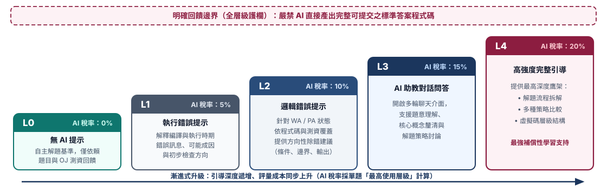
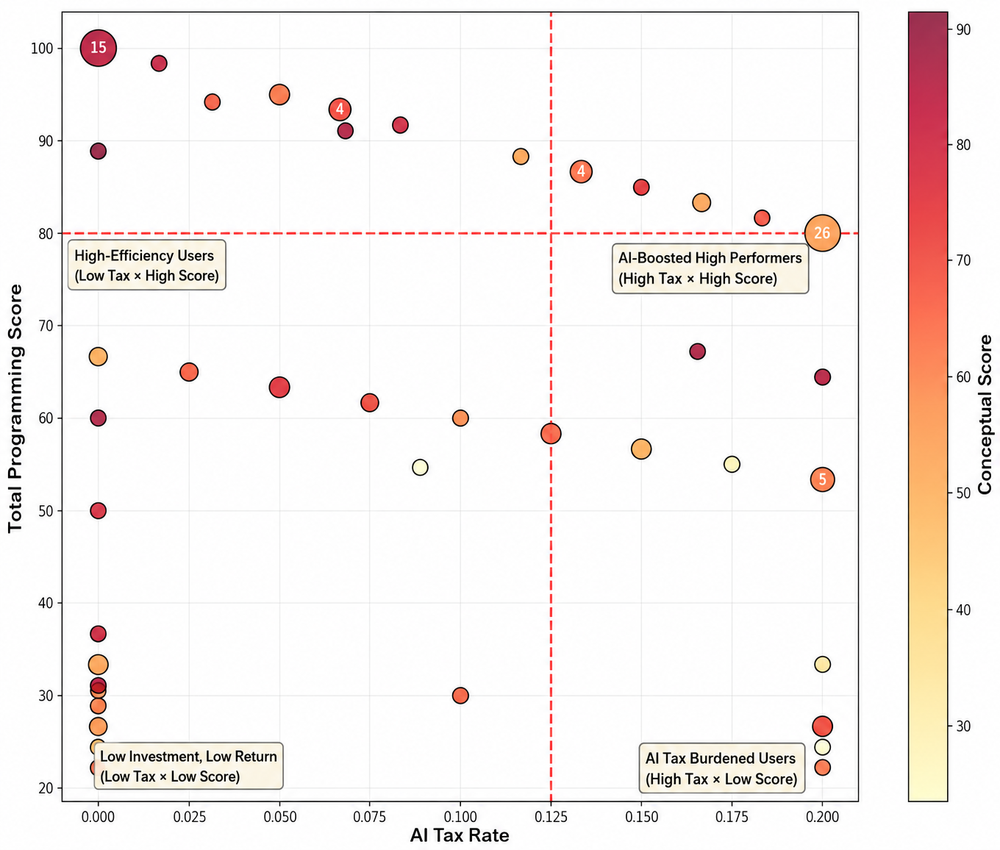
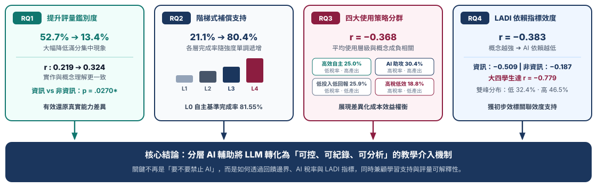

<!-- _class: lead -->

學術會議專題報告 · 程式設計教育與學習分析

# 分層式大型語言模型程式輔助機制於程式學習之應用與分析

Application and Analysis of a Tiered LLM-Based Programming Assistance Mechanism in Programming Learning

將 AI 輔助從「未受控管的外掛工具」轉化為「可控、可紀錄、可分析」的教學介入機制

<strong>薛念林（Nien-Lin Hsueh）+</strong>、<strong>Ying-Chang Lu</strong> 
逢甲大學 資訊工程學系（Feng Chia University, Taichung, Taiwan） 
<code>nlhsueh@fcu.edu.tw</code> · <code>m1305878@o365.fcu.edu.tw</code>

國科會專題研究計畫補助：NSTC114-2221-E-035-077

<!--
論文背景與核心貢獻：
- 本論文發表於《Journal of Information Science and Engineering (JISE)》，作者為逢甲大學資訊工程學系薛念林（Nien-Lin Hsueh）與 Ying-Chang Lu，研究獲國科會計畫 NSTC114-2221-E-035-077 補助。
- 核心研究問題：當大型語言模型（LLM）導入程式設計評量時，學生最終通過測資的成績往往同時混雜了「獨立程式實作能力」與「對 AI 提示或解題結構之依賴程度」，導致傳統線上評測分數喪失可解釋性與鑑別度。
- 主要貢獻：本研究設計並實作 Smart Coding Tutor（SCT）線上解題平台，整合五級分層 AI 助教機制（L0 至 L4）、明確之 AI 稅率（0% 至 20%）、停滯觸發式主動提示、完成後概念檢核與反思回饋，並提出「層級錨定依賴指標（LADI）」，於逢甲大學 112 位 Python 修課生中完成實證驗證。
-->

---

## 破題思考：如果使用 AI 協助也要繳交「AI 稅（AI Tax）」？

<strong>核心破題構想：</strong> 與其全面封閉道路，不如在 AI 快速道上設立<strong>分級收費站</strong>！學生卡關時仍可獲得分層引導，但透過明確的 <strong>AI 稅率（0%–20%）</strong>，讓評量成績維持公平、透明與可解釋性。

<!--
「AI 稅（AI Tax）」之教學設計理念：
- 程式設計教育正面臨兩難：若全面禁止生成式 AI，初學者將失去即時排錯解釋與學習動機鷹架；若完全開放外部 AI，則不同概念理解程度的學生皆可產出正確程式碼，造成嚴重天花板效應與分數失真。
- 制度運作機制：SCT 不採禁止策略，而是將 AI 輔助內嵌於正式評測平台中，並針對不同強度的提示層級設定公開透明的扣分成本（AI 稅率：L0 為 0% 至 L4 為 20%）。
- 評量學理意義：將隱性的外部依賴轉化為顯性的自我調節決策，使教師能在保留鷹架支持的同時，清晰區辨「獨立完成」與「高度輔助完成」，維持評量公平性與分數可解釋性。
-->

---

## 簡報大綱（Outline）

1

[**研究動機與四大研究問題**](#4)
開放式 AI 帶來的評量鑑別度困境，以及本研究之 RQ1–RQ4。

2

[**文獻回顧與研究缺口**](#6)
現有 LLM 程式助教系統比較，與正式評量流程整合之不足。

3

[**研究方法：分層 AI、AI 稅率與 LADI**](#7)
五級分層助教、主動提示與反思檢核、以及 EPC 與 LADI 指標。

4

[**Smart Coding Tutor（SCT）系統設計**](#11)
整合式系統架構、分層提示建構器與學生端操作介面。

5

[**實證研究與分析結果（RQ1–RQ4）**](#13)
112 位逢甲 Python 修課生、3 次正式評量共 9 道題目之實證分析。

6

[**結論與未來研究方向**](#20)
RQ1–RQ4 核心發現全景圖、教學啟示與後續精進規劃。

<!--
論文結構與章節導覽：
- 第 1 節（緒論）剖析開放式 LLM 造成之評量鑑別度困境，並提出涵蓋評量效度、分層支持、使用策略與 AI 依賴之四大研究問題（RQ1 至 RQ4）。
- 第 2 節（文獻回顧）綜述 LLM 程式助教、語意回饋自動評分、題目生成與主動式教學 AI 框架，並以 Table 1 對照五個代表性系統。
- 第 3 節（研究方法）形式化定義五級分層助教、AI 稅率計費規則、主動式學習支持、完成後概念鞏固、升級剖面係數（EPC）與層級錨定依賴指標（LADI）。
- 第 4 節介紹 SCT 整合式系統架構與分層介面；第 5 節呈現 112 位學生於 3 次正式評量（共 9 題）之實證分析；第 6 節總結教學啟示、研究限制與未來方向。
-->

---

## 1.1 研究動機：AI 輔助程式學習中的評量困境

<strong>核心設計理念：</strong> 本研究的目的<strong>並非禁止學生使用 AI</strong>，而是將 AI 輔助轉化為<strong>可控、分層且可紀錄</strong>的教學介入，讓成績能真實反映能力與輔助程度。

<!--
理論背景與實證動機：
- LLM 輔助效益與評量隱憂：LLM 具備自然語言錯誤解釋、程式修復、對話輔導與語意回饋能力（Ozkaya [1]、Liu 等人 [2]、Pereira & Mello [3]），可減輕大班程式教學中個別指導與人工批改負擔（Messer 等人 [4]）。
- 傳統線上評測系統（OJ）之盲區：既有的自動評測高度仰賴測資比對與輸出正確性，無法觀測學生的推理品質、除錯歷程或所動用的外部輔助強度（Messer 等人 [4]、Gabbay & Cohen [5]）。
- 先期課程觀測數據：在先期完全開放 AI 輔助的課程觀察中，程式實作成績高度集中於高分區，而概念理解成績卻相當離散；AI 使用次數與概念理解分數之相關係數僅達 r = 0.136，證實未經分層校準的分數難以反映真實獨立解題能力。
- 設計哲學：呼應人機協作與教育 AI 設計原則（Kazemitabaar 等人 [7]、Chen 等人 [10]、Yan [12]），SCT 旨在將 AI 轉化為可控、可紀錄且可分析的教學介入，而非單純禁用。
-->

---

## 1.2 研究目標與四大研究問題（RQ1–RQ4）

為驗證 **Smart Coding Tutor（SCT）** 是否能兼顧「鷹架支持」與「評量效度」，本研究探討以下**四大問題** *（逐步揭曉）*：

* 

RQ1 我們能否揭開滿分假象、還原真實能力？

分層 AI 輔助機制是否能提升程式評量任務的<strong>成績鑑別度</strong>？

* 

RQ2 較高層級的提示真的能救起卡關學生嗎？

不同 AI 輔助層級（L0–L4）在解題過程中各自產生何種<strong>支持效果</strong>？

* 

RQ3 面對「AI 稅」，學生會怎麼精打細算？

在具備明確評量成本的分層機制下，學生展現哪些<strong>使用策略與行為模式</strong>？

* 

RQ4 概念越扎實，就越不依賴 AI 嗎？

學生的 <strong>AI 依賴程度（LADI）</strong>與其概念理解學習成效之間存在何種關聯？

<!--
四大研究問題（RQ1 至 RQ4）之檢驗維度：
- RQ1（評量鑑別度）：檢驗將 AI 輔助強度與明確稅率納入成績計算後，是否能有效緩解滿分集中現象、提升程式實作與概念理解分數之一致性，並揭露不同背景學生的真實能力差異。
- RQ2（分層支持效果）：驗證 L0 至 L4 五個層級在嚴格守住不直接給答案的邊界下，是否能呈現具區辨力的階梯式支持（以不升級即於該層達成 AC 之完成率衡量）。
- RQ3（使用策略與行為模式）：探討在具備明確評量成本的制度下，學生如何依據自身概念掌握與卡關狀態權衡輔助強度與分數扣除，並剖析四象限投入產出分群。
- RQ4（AI 依賴與學習成效）：檢視 LADI 指標之分布特徵及其與獨立概念理解成績之關聯，並跨學科背景（資訊 vs. 非資訊）與年級（大一至大四）檢驗其初步效標關聯效度。
-->

---

## 2. 文獻回顧與研究缺口（Table 1）

既有 LLM 程式助教多聚焦於單一輔助功能，且多屬**外掛式工具**，缺乏與正式線上評測（OJ）流程的深度整合。

| 相關研究 | 學習分析 | 評量鑑別 | 強度分層 | 行為分析 | 依賴量化 | 平台整合 | 反思支持 | 主動性角色1 |
| :--- | :---: | :---: | :---: | :---: | :---: | :---: | :---: | :--- |
| CodeAid [7] | | | | ✓ | | | | Adaptive（適應型） |
| CodeHelp [6] | ✓ | | | ✓ | | | | Adaptive（適應型） |
| Gipy [5] | | | | ✓ | | | | Adaptive（適應型） |
| CodeRunner Agent [8] | ✓ | | | | | ✓ | ✓ | Proactive（主動型） |
| Owlgorithm [9] | | | | | | ✓ | ✓ | Proactive（主動型） |
| **本研究（SCT）** | **✓** | **✓** | **✓** | **✓** | **✓** | **✓** | **✓** | **Proactive（主動型）** |

<strong>關鍵研究缺口：</strong> 既有研究較少同時區分<strong>輔助強度層級</strong>、追蹤<strong>跨層升級歷程</strong>，並解析 AI 依賴程度與評量鑑別度間的關聯。 
1 <strong>主動性角色定義（Yan 等人框架 [12]）：</strong><strong>Adaptive（適應型）</strong>係被動等待學生主動提問或觸發錯誤後才回應；<strong>Proactive（主動型）</strong>則由系統持續監控學習狀態（如停滯、重複錯誤），於適當時機主動介入提醒或引導反思。

<!--
文獻定位與研究缺口（Table 1 解析）：
- 適應型（Adaptive／被動回應）助教：CodeAid [7] 透過概念說明、虛擬碼與逐行引導避免直接給出完整解答；CodeHelp [6] 限制回應於錯誤定位與修正方向；Gipy [5] 將 LLM 回饋結合 MOOC 測試導向回饋。此類研究雖探討求助行為，但多為獨立外掛工具，與正式線上評量流程整合度低。
- 主動型（Proactive）與反思導向平台：CodeRunner Agent [8] 整合教材、執行結果與學習紀錄以支持自我調節學習；Owlgorithm [9] 於競程課程中導入引導式自我解釋與解題後反思。兩者皆對應 Yan [12] 框架中的主動型角色。
- 自動回饋與主動介入之文獻警示：既有文獻指出 LLM 程式碼審查之一致性仍不穩定（Liu 等人 [2]、Estévez-Ayres 等人 [15]），即便回饋品質高仍需結構化設計以維持學習者自主權（Cao 等人 [17]），且過度頻繁的主動介入反會降低滿意度與自主感（Chen 等人 [10]、CodingGenie [18]）。
- 本研究填補之缺口：既有五套系統均未在正式 OJ 評測流程內，同時整合強度分層、評量成本鑑別、跨層升級追蹤與連續依賴指標（LADI），SCT 一次補齊此八大維度。
-->

---

## 3.1 五級分層 AI 助教與 AI 稅率設計

每道題目皆從 **L0** 開始，由學生依解題卡關狀態自主決定是否升級，全層級皆設明確邊界以防直接給出完整解答。

<strong>AI 稅率計費原則：</strong> 以學生在單題中實際動用的<strong>最高 AI 輔助層級</strong>（而非呼叫次數）作為該題之 AI 使用成本，將外部輔助強度轉化為可觀察的評量指標。

<!--
五級分層 AI 助教與 AI 稅率規則（Table 2）：
- L0（無 AI 提示，稅率 0%）：每道題目的預設起點。學生僅依賴題目敘述、自行測試與 OJ 評測狀態完成作答，構成自主解題基準。
- L1（執行錯誤提示，稅率 5%）：針對編譯錯誤（CE）或執行時期錯誤（RE），解釋錯誤訊息、可能成因與檢查方向。
- L2（邏輯錯誤提示，稅率 10%）：針對程式可執行但獲得 WA 或 PA 之狀況，提供條件判斷、邊界案例、資料結構與輸入輸出處理等除錯方向。
- L3（AI 助教問答，稅率 15%）：開放多輪對話介面，由學生主動提問以獲得概念釐清與解題策略說明。
- L4（完整高強度引導，稅率 20%）：提供解題流程拆解、策略比較與虛擬碼層級架構說明，但全層級皆設有明確回饋邊界，禁止直接產出可貼上送出的完整解答。
- 稅率計費學理依據：高層級包含低層級支持並深化引導深度。AI 稅率係依學生在單題中實際動用的「最高層級」計算，而非呼叫次數或平均強度，藉此反映解題過程所動用的最大外部鷹架程度，同時避免學生因擔心重複扣分而不敢在同層級內追問釐清觀念。
-->

---

## 3.2 主動式學習支持與完成後概念鞏固

借鏡 Yan 等人的<strong>主動式助手（Proactive Assistant）</strong>架構 [12]，SCT 串聯「解題中停滯提醒」與「通過測資後之概念鞏固」。

<strong>教學調節原則：</strong> 主動提示保留<strong>學習者主導權</strong>（絕不越俎代庖），而完成後的概念檢核與反思則引導學習從「通過測資」走向「穩定概念理解與遷移」。

<!--
主動式學習支持與完成後概念鞏固機制：
- 理論依據：借鏡 Yan [12] 之「主動式助手（Proactive Assistant）」角色框架。在程式學習中，學生常在未主動求助的狀態下陷入停滯，若系統僅被動等待提問，支持往往介入過晚。
- 累積式停滯偵測：SCT 將「停滯」視為累積性歷程而非單一失敗事件，綜合監測測試與提交結果變化、重複性錯誤、連續失敗次數與停滯時間，以降低誤觸發並對齊真實需求。
- 保留學習者主導權：主動機制定位為「提示提醒」而非「自動塞入回饋」。系統僅主動詢問是否需要協助，是否啟用 AI 與選擇哪一層級完全由學生自主決定。
- 完成後雙軌鞏固：通過測資（AC）不代表真正理解核心概念。學生獲得 AC 後，系統依據題目脈絡、答題歷程與重複錯誤紀錄，提供：（1）概念檢核（Concept Checks）確認核心觀念並診斷迷思；（2）反思導向回饋（Reflection-Oriented Feedback）引導學生回顧策略選擇並思考如何遷移至相似題型。
-->

---

## 3.3 量化升級歷程：升級剖面係數（EPC）

僅觀察*是否使用 AI* 或*最終層級*，無法區分「循序漸進求助」與「直接跳往高強度依賴」（`s`：起始層級、`f`：最終層級、`m`：實際經歷有效層級數、`λ = 0.3`）。

<i>EPC</i> &nbsp;=&nbsp;
<i>s</i>4
&nbsp;+&nbsp; <i>λ</i> &nbsp;( 1 −
<i>m</i><i>f</i> − <i>s</i> + 1
)

<strong>兩項關鍵行為訊號：</strong> <code>s / 4</code> 刻畫解題初期的<strong>初始依賴</strong>；<code>1 − m / (f − s + 1)</code> 衡量升級路徑的<strong>稀疏程度</strong>（跳過越多中間層級，代表越明顯的依賴躍升）。

<!--
升級剖面係數（EPC）之數學定義與行為意涵：
- 設計動機：僅觀測是否使用 AI 或最終停留層級 f，無法區分「循序嘗試 L1 -> L2 -> L3 -> L4 的漸進求助者」與「一開始便直衝 L4 的高強度依賴者」。
- 公式定義：EPC = (s / 4) + lambda * (1 - m / (f - s + 1))，其中 s 為起始使用層級（1 至 4）、f 為最終最高層級（1 至 4）、m 為實際經歷的有效輔助層級數、lambda 為稀疏度權重參數（本研究初始設定為 0.3）。
- 第一項（s / 4）衡量初始依賴：解題初期即啟用愈高層級，起始依賴值愈大（例如 s = 1 時為 0.25，s = 4 時達 1.00）。
- 第二項（lambda * (1 - m / (f - s + 1))）衡量升級路徑稀疏度：分母 (f - s + 1) 為起訖層級間的完整跨距。若學生依序經歷所有中間層級，則 m = f - s + 1（稀疏度為 0，屬於密集漸進求助）；若跳過中間層級以極少步數直達高層，則稀疏度提高，反映明顯的依賴躍升。
- 抵達 f = 4 之數值範例（lambda = 0.3）：循序漸進（L1->L2->L3->L4，s=1, m=4）得 EPC = 0.25；跳級升級（L1->L4，s=1, m=2）得 EPC = 0.40；直達高層（僅 L4，s=4, m=1）得 EPC = 1.00。
-->

---

## 3.4 層級錨定依賴指標（LADI）

LADI 將分層機制下的 AI 使用行為映射至 **`[0, 10]`** 連續量尺，以最終層級 `2f` 為主錨點，並透過 `+2 EPC` 細分區間內的升級歷程。

<i>LADI</i> &nbsp;=
{

0, &nbsp;&nbsp;&nbsp;&nbsp;&nbsp;&nbsp;&nbsp;&nbsp;&nbsp;&nbsp;&nbsp;&nbsp;&nbsp;&nbsp;&nbsp;&nbsp;&nbsp;&nbsp;&nbsp;&nbsp; <i>f</i> = 0
2<i>f</i> + 2<i>EPC</i>, &nbsp;&nbsp;&nbsp;&nbsp;&nbsp; <i>f</i> ∈ {1, 2, 3, 4}

<strong>指標分析優勢：</strong> 即使兩位學生最終皆抵達 <strong>L4</strong>，LADI 仍能精細區辨其歷程差異（漸進 <code>8.50</code> vs. 跳級 <code>8.80</code> vs. 直達 <code>10.00</code>），且 <code>λ</code> 可依課程情境調整校準。

<!--
層級錨定依賴指標（LADI）之公式結構與分析優勢：
- 分段定義：當 f = 0（全程無 AI 自主解題）時，LADI = 0；當 f 屬於 {1, 2, 3, 4} 時，LADI = 2f + 2*EPC。
- 連續值域 [0, 10]：透過 2f 將紀錄錨定於對應層級的主區間（2、4、6、8），再以 +2*EPC（最大為 2.0，發生於 s = f = 4 且 m = 1）在區間內細分升級歷程，使所有多層級行為皆能映射至 [0, 10] 連續量尺。
- 區間內歷程鑑別力：以前頁抵達 L4 的三種路徑為例（lambda = 0.3），漸進升級之 LADI 為 8.50，跳級升級為 8.80，直達 L4 則為 10.00，精準呈現同層級背後的行為差異。
- 參數可調適性：主錨點 2f 確保最終輔助強度為依賴判定的核心結構，而權重 lambda 則控制升級歷程對總分的影響比例，未來可依不同課程脈絡、題目難度或理論假設進行校準。
-->

---

## 4.1 Smart Coding Tutor（SCT）系統架構

Fig. 1：Smart Coding Tutor（SCT）整合式系統架構

### ⚙️ 四大核心整合模組
- **線上評測核心（OJ Core）**：整合題目管理、程式碼編輯器、評測器與測資評估，即時回報 `AC`、`PA`、`WA`、`RE`、`TLE`、`CE` 狀態。
- **分層提示建構器（Level-Based Prompt Builder）**：依據題目、程式碼、錯誤訊息與所選層級（L1–L4）動態組裝提示送往 AI Tutor。
- **學習狀態分析器（Learning State Analyzer）**：整合提交歷程、錯誤模式與 AI 使用紀錄，驅動：
  - **主動提示觸發器（Proactive Hint Trigger）**
  - **弱點概念題生成器（Concept Question Generator）**

<!--
Smart Coding Tutor（SCT）平台系統架構（Fig. 1）：
- 單一封閉整合環境：SCT 將題目管理、程式碼編輯、自動評測、分層 AI 輔助、學習狀態分析與行為日誌記錄整合於同一平台，使學生在同一脈絡中完成作答、除錯與反思，並同步保存完整研究歷程資料。
- 線上評測核心（OJ Core）：採用標準線上評測狀態標籤，包含 Accepted（AC）、Partially Accepted（PA）、Wrong Answer（WA）、Runtime Error（RE）、Time Limit Exceeded（TLE）與 Compilation Error（CE），即時提供執行回饋並作為 AI 觸發與行為分析依據。
- 分層提示建構器（Level-Based Prompt Builder）：將題目敘述、學生現行程式碼、編譯／執行錯誤輸出與所選層級（L1 至 L4）動態封裝為受控提示送往 AI Tutor，嚴格落實各層回饋邊界。
- 學習狀態分析器（Learning State Analyzer）：整合提交紀錄、錯誤模式、停滯狀態與 AI 使用歷程，即時驅動「主動提示觸發器」與「弱點概念題生成器」。
-->

---

## 4.2 SCT 學生端操作介面（L1 與 L2 實景）

(a) L1 語法與執行時期錯誤提示介面

(b) L2 邏輯除錯提示與程式碼覆蓋率檢核表

<strong>多輪對話升級（L3 & L4）：</strong> 較高層級提供多輪對話式 AI 助教介面，支援概念釐清與策略討論（L3），乃至流程拆解與虛擬碼結構引導（L4），全程同步寫入行為日誌。

<!--
SCT 學生端分層介面實作細節（Fig. 2a 與 Fig. 2b）：
- 自主升級與留痕控制：每題起始於 L0，學生需透過「AI assistance level」選單主動切換層級；平台完整記錄啟用時點、切換歷程與互動內容，供後續策略與依賴分析。
- 低層級結構化診斷介面（L1 與 L2）：Fig. 2a 為 L1 錯誤訊息提示介面，針對 CE／RE 解讀錯誤堆疊、可能原因與排查方向；Fig. 2b 為 L2 邏輯錯誤提示介面，針對可執行但獲 WA／PA 的程式，提供邏輯檢視建議與程式碼覆蓋率檢核表，引導檢查條件分支、邊界值、資料使用與 I/O 處理。
- 高層級多輪對話介面（L3 與 L4）：升級至 L3 或 L4 後開啟對話式 AI 助教視窗，支援學生依前輪回覆持續追問；L3 側重題意理解、概念釐清與策略討論，L4 則提供流程拆解、策略比較與虛擬碼結構說明。
-->

---

## 5.1 實證研究設計與實驗場域

### 🧪 嚴謹實驗控管
- 三次正式評量期間**全面禁用外部生成式 AI 工具**。
- 所有 AI 輔助互動皆須透過 **SCT 平台**進行，確保層級切換、對話內容與提交結果之資料完整性。

### 📊 對應四大研究問題之驗證
- **RQ1**：原始成績 vs. 分層調整成績、資訊與非資訊背景 `t` 檢定。
- **RQ2**：L0–L4 各層級不升級即達成 `AC` 之完成率。
- **RQ3 & RQ4**：AI 稅率四象限分群、LADI 雙峰分布與概念理解相關分析。

<!--
實證研究場域、樣本組成與實驗控管：
- 場域與對象：於 114 學年度逢甲大學 Python 程式設計課程實施，共計 112 位修課學生參與，其中資訊相關背景佔 55.36%（62 人）、非資訊背景佔 44.64%（50 人），涵蓋大一至大四學生。
- 練習與正式評量資料：學期間學生於 SCT 完成 86 題日常練習與作業，以確保熟悉平台操作並建立學習歷程觀察；核心量化分析聚焦於 3 次正式課堂評量（每次 3 題，合計 9 道程式實作題），並搭配獨立施測之概念理解評量與課後問卷（回收有效樣本 n = 56）。
- 嚴謹內部效度控管：三次正式評量期間嚴格禁止使用任何外部生成式 AI 工具，所有 AI 輔助互動皆必須於 SCT 平台內完成，確保層級切換、對話日誌、停滯事件與評測結果具備 100% 資料完整性。
-->

---

## 5.2 RQ1 實證結果：分層機制顯著提升評量鑑別度

0.219 ➔ 0.324

程式實作與概念理解相關 <code>r</code> 提升（對比先期開放 AI 僅 <code>0.136</code>）

52.7% ➔ 13.4%

滿分學生比例大幅下降，有效緩解分數天花板集中現象

3.93 / 5.0

學生問卷（<code>n = 56</code>）高度認同分層模式較開放模式更具鑑別度

| 評量指標（資訊背景 vs. 非資訊背景獨立樣本 `t` 檢定） | 資訊背景均分 | 非資訊背景均分 | `t(110)` | `p` 值 | 95% 信賴區間 |
| :--- | :---: | :---: | :---: | :---: | :---: |
| 原始程式實作成績（未扣 AI 稅） | 81.46 | 71.63 | 1.76 | `.0818`（未達顯著） | `[−1.26, 20.91]` |
| **分層調整後成績（納入 AI 稅率）** | **73.42** | **62.25** | **2.24** | **`.0270*`（達顯著）** | **`[1.29, 21.05]`** |

<strong>RQ1 發現：</strong> 納入 AI 輔助成本後，不僅降低滿分集中現象，更使<strong>資訊背景學生的調整後成績顯著高於非資訊背景學生</strong>（<code>73.42</code> vs. <code>62.25</code>，<code>p = .0270</code>），還原了原本被原始高分所掩蓋的能力與 AI 依賴差異。

<!--
RQ1 評量鑑別度提升之統計證據：
- 與概念理解之一致性提升：先期完全開放 AI 模式下，AI 使用次數與概念理解成績相關僅為 r = 0.136；導入 SCT 分層評量後，程式實作成績與概念理解成績之皮爾森相關係數，由未調整原始分數的 r = 0.219 提升至納入 AI 稅率後的 r = 0.324。
- 有效緩解分數天花板效應：滿分學生比例由原始成績的 52.7% 大幅下降至調整後的 13.4%，顯示分數分布不再過度集中於頂端，鑑別力顯著回升。
- 資訊與非資訊背景獨立樣本 t 檢定：在未扣稅的原始成績上，資訊生（M = 81.46）與非資訊生（M = 71.63）之差異未達統計顯著，t(110) = 1.76，p = .0818，95% CI [-1.26, 20.91]；納入分層 AI 稅率調整後，資訊生均分顯著高於非資訊生（M = 73.42 vs. 62.25），t(110) = 2.244，p = .0270，95% CI [1.29, 21.05]。此結果顯示原始高分掩蓋了非資訊生仰賴較高強度 AI 輔助的現象。
- 學生主觀認同：56 份問卷中，學生對「分層模式較完全開放模式更具評量鑑別度」的平均認同度達 3.93 / 5.0，與量化數據相互呼應。
-->

---

## 5.3 RQ2 實證結果：各輔助層級展現階梯式支持效果

完成率定義 ＝ 曾使用該層級的紀錄中，**未再升級即於該層達成 `AC`** 之比例。

<strong>L0（自主解題）</strong>

81.55%

<strong>L1（執行錯誤提示）</strong>

21.05%

<strong>L2（邏輯錯誤提示）</strong>

34.88%

<strong>L3（AI 助教問答）</strong>

43.64%

<strong>L4（完整高強度引導）</strong>

80.41%

<strong>RQ2 發現：</strong> 約 32.39% 有效紀錄全程維持 <strong>L0</strong>（自主基準，<code>AC</code> 率達 81.55%）；在啟用 AI 的紀錄中，完成率從 <strong>L1 的 21.05% 單調遞增至 L4 的 80.41%</strong>，顯示高層級具備明確的補償性支持效果，且人工抽樣亦確認回應符合邊界規範。

<!--
RQ2 各輔助層級之階梯式支持效果解析：
- 完成率操作型定義：若學生解題過程曾進入某層級，該紀錄計入該層級的「使用次數」；但僅當學生在該層級「未再進一步升級即達成 AC」時，始計入該層級的「完成案例」（例如路徑 L1 -> L2 -> L4 在 L1、L2、L4 皆計為使用，但僅在 L4 計為完成）。
- 自主解題基準群體（L0）：約 32.39% 的有效答題紀錄全程維持於 L0，且其 AC 完成率高達 81.55%。論文特別強調，L0 高完成率並非意味 AI 輔助多餘，而是反映該族群本身已具備獨立解題能力，無須動用外部鷹架。
- 啟用 AI 後之單調遞增補償效應：在動用 AI 的紀錄中，當層完成率隨輔助強度穩定攀升：L1 為 21.05%、L2 為 34.88%、L3 為 43.64%、L4 達 80.41%。低層級可在不洩漏解答前提下協助部分學生排除語法或邏輯障礙，而高層級則對深度卡關者發揮顯著補償性支持。
- 提示邊界稽核：研究團隊針對互動日誌進行人工抽樣檢視，確認 LLM 回應整體符合各層設定之邊界規範。
-->

---

## 5.4 RQ3 實證結果：使用策略與 AI 稅率四象限分析

Fig. 3：AI 稅率與程式成績四象限分析（中位數：稅率 0.125、分數 80）

### 🎯 差異化成本效益權衡模式
- 平均 AI 使用層級與概念理解呈負相關（**`r = −0.368`**）➔ AI 使用反映真實學習需求，而非隨機點擊。
- **高稅高產出（AI 助攻高效型，30.36%）**：善用高強度引導成功轉化為高實作成績。
- **低稅高產出（高效自主型，25.00%）**：僅需少量或無需 AI 輔助即展現高度精熟。
- **低稅低產出（低投入低回報型，25.89%）**：可能未善用可用提示，或卡關時過晚升級。
- **高稅低產出（高稅負擔型，18.75%）**：即使獲得高強度提示，仍難以轉化為正確程式碼。

<!--
RQ3 使用策略與四象限成本效益分群（Fig. 3）：
- 需求驅動的層級選擇：學生的平均 AI 使用層級與概念理解成績呈中度負相關（r = -0.368），顯示概念較佳者傾向使用較低層級，概念較弱者則較常升級至高層級，證實 AI 使用強度反映真實學習需求而非隨機點擊或全面依賴。
- 四象限劃分與族群意涵（Fig. 3）：以樣本中位數（AI 稅率 = 0.125、程式實作成績 = 80）將 112 位學生分為四類：
  1. 高稅高產出（AI 助攻高效型，30.36%）：能有效消化高強度引導並轉化為高程式實作表現。
  2. 低稅高產出（高效自主型，25.00%）：僅憑少量或無 AI 輔助即達成高分。兩類高產出族群合計超過全班半數（55.36%）。
  3. 低稅低產出（低投入低回報型，25.89%）：稅率偏低但成績不理想，顯示可能未善用平台可用提示，或於卡關時過晚決定升級。
  4. 高稅低產出（高稅負擔型，18.75%）：即使動用高強度提示仍無法順利轉化為正確程式碼，屬於最需教師介入補強基礎實作能力之高風險族群。
-->

---

## 5.5 RQ4 實證結果：LADI 呈現顯著雙峰分層分布

學生並未集中於中度依賴區間，而是明顯**分化為「低依賴自主群」與「高依賴求助群」**。

<strong>[0, 2) 低依賴</strong>

32.39%

<strong>[2, 4) 輕度依賴</strong>

3.46%

<strong>[4, 6) 中度依賴</strong>

5.97%

<strong>[6, 8) 較高依賴</strong>

11.64%

<strong>[8, 10] 高度依賴</strong>

46.54%

<strong>關鍵觀察：</strong> 合計近 <strong>79%</strong> 的答題紀錄落於兩端極值區間 — <code>[0, 2)</code> 佔 <strong>32.39%</strong>、<code>[8, 10]</code> 佔 <strong>46.54%</strong>，凸顯在正式評量情境下學生對外部鷹架之需求呈現高度兩極化。

<!--
RQ4 LADI 指標之雙峰分層分布特徵：
- 五個區間之實際占比分布：
  - [0, 2) 低依賴：32.39%
  - [2, 4) 輕度依賴：3.46%
  - [4, 6) 中度依賴：5.97%
  - [6, 8) 較高依賴：11.64%
  - [8, 10] 高度依賴：46.54%
- 雙峰極化現象：合計高達 78.93%（近八成）的答題紀錄落於兩端極值區間（[0, 2) 與 [8, 10]），中間三個過渡區間合計僅佔 21.07%。
- 學習行為解讀：在正式計分評量的時間與成績壓力下，學生並未均勻分布於中度依賴區帶，而是呈現明確分化——具備獨立能力者全程停留於 L0，一旦遭遇 L1／L2 無法迅速排除的解題瓶頸，便傾向一路升級至 L4 結構化引導以確保通過測資。
-->

---

## 5.6 RQ4 實證結果：LADI 與概念理解表現之關聯

Fig. 4：概念理解分數與 LADI 指標之分群迴歸散佈圖

### 📉 LADI 之初步效標關聯效度證據
- **整體相關性**：呈中度負相關（**`r = −0.383`**）— 概念理解越佳的學生，整體 AI 依賴程度越低。
- **依學科背景分組**：
  - **資訊背景學生**：**`r = −0.509`**（隨概念提升，依賴度顯著下降）。
  - **非資訊背景學生**：**`r = −0.187`**（即便概念提升，仍受限於語法熟練度與實作經驗而需輔助）。
- **依年級分析**：
  - 大四：**`r = −0.779`** ｜ 大三：`r = −0.353`
  - 大二：`r = −0.350` ｜ 大一：`r = +0.150`

<!--
RQ4 LADI 與概念理解之關聯及分群調節效應（Fig. 4）：
- 整體效標關聯證據：LADI 與概念理解成績呈現中度負相關（r = -0.383），略強於單純平均層級（r = -0.368），顯示納入升級歷程後的指標更能敏感反映概念掌握與 AI 依賴之間的對應關係。
- 學科背景調節差異：資訊背景學生的負相關明顯較強（r = -0.509），隨著概念理解提升，AI 依賴度清晰下降；非資訊背景學生之負相關則較弱（r = -0.187），主因在於其即便理解抽象概念，仍受限於語法熟練度不足、實作經驗有限或除錯流程尚未穩定，故在寫作階段仍需仰賴 AI 鷹架。
- 年級演化趨勢：負相關強度隨年級穩定加深——大四（r = -0.779）、大三（r = -0.353）、大二（r = -0.350），而大一新生則呈微弱正相關（r = +0.150），反映先備知識、程式經驗與自我調節成熟度會影響概念轉化為獨立解題的效率。
- 統計推論界線：本分析屬橫斷面相關檢定，僅能提供 LADI 的初步效標關聯效度證據，尚無法直接推論「低理解導致高依賴」或「高依賴削弱理解」之單向因果關係。
-->

---

## 5.7 綜合討論、教學啟示與研究限制

### 🏫 教學與評量實務啟示
- **不禁止 AI 也能守住公平性**：透過分層設計與明確 AI 稅率，兼顧新手的鷹架支持與成績之可解釋性。
- **差異化輔導非資訊背景新手**：非資訊生負相關較弱（`r = −0.187`），顯示其除概念外仍需語法與除錯實作引導。
- **及早辨識高風險學習族群**：四象限分析可協助教師提前關注「高稅負擔型（18.75%）」與「低投入低回報型（25.89%）」學生。

### 🔬 方法學反思與研究限制
- **相關而非因果**：LADI 與概念分數之負相關（`r = −0.383`）屬初步效標關聯證據，尚無法直接推論因果方向。
- **主動提示時機仍待優化**：學生對主動式提示介入時機之滿意度平均僅 **`2.96 / 5.0`**，停滯偵測門檻與觸發頻率須進一步校準。
- **單一課程脈絡**：權重參數 `λ = 0.3` 與各層稅率之跨課程穩健性仍須後續驗證。

<!--
教學實務啟示與方法學限制反思：
- 兼顧公平與支持之評量範式：透過五級分層邊界與公開 AI 稅率，教師無須全面禁用 AI，即可有效緩解分數壓縮並保留成績可解釋性。
- 精準教學介入依據：四象限分群與背景分析為差異化輔導提供明確座標——針對低投入低回報型（25.89%）加強求助時機引導；針對高稅負擔型（18.75%）與非資訊背景新手（r = -0.187）補強語法熟練度、除錯步驟與程式實作演練。
- 主動提示時機之實證限制：課後問卷顯示學生對「主動式提示介入時機」的平均滿意度僅為 2.96 / 5.0。此發現呼應 Chen 等人 [10] 之研究，指出停滯偵測門檻、觸發頻率與介入節奏若未精準校準，易干擾學習專注度或降低自主感受。
- 推論範圍與參數限制：本研究資料來自單一 Python 課程（N = 112），且權重參數（lambda = 0.3）與每層 5% 之線性稅率屬初始設定，其跨課程與跨語言穩健性仍待驗證。
-->

---

## 6. 結論與未來研究方向

<strong>🚀 1. 跨課程與縱貫式驗證</strong> 跨學期與不同程式課程檢驗 LADI 穩定性，以及長期獨立解題遷移成效。

<strong>🔔 2. 優化主動式提示時機</strong> 精進停滯偵測模型與觸發頻率，提升介入滿意度（突破目前 <code>2.96 / 5.0</code>）。

<strong>🎛️ 3. 參數與稅率實證校準</strong> 依題目難度與程式語言特性，系統性校準權重 <code>λ</code> 與各層級 AI 稅率。

<!--
四大研究問題總結與未來研究藍圖：
- 實證成果總覽：
  - RQ1：分層稅率將滿分集中率由 52.7% 降至 13.4%，程式與概念相關由 r = 0.219 升至 0.324，並顯現資訊與非資訊背景之顯著差異（p = .0270）。
  - RQ2：除 32.39% 自主基準紀錄（L0，AC 率 81.55%）外，啟用 AI 之當層完成率由 L1（21.05%）單調遞增至 L4（80.41%），驗證階梯式補償支持。
  - RQ3：四象限分析揭露多元成本效益策略，且平均層級與概念分數呈負相關（r = -0.368），顯示求助具真實需求依據。
  - RQ4：LADI 呈顯著雙峰分布（兩端合計 78.93%）並與概念理解呈中度負相關（r = -0.383；資訊生 r = -0.509；大四 r = -0.779）。
- 後續三大精進方向：（1）開展跨課程與跨學期縱貫研究，檢驗 LADI 穩定性、因果動態與長期獨立解題遷移成效；（2）優化停滯偵測演算法與主動提示頻率，使介入滿意度突破 2.96 / 5.0；（3）依程式語言與題目難度系統性實證校準 lambda 與稅率結構。
-->

---

<!-- _class: closing -->

# 感謝聆聽 · 敬請指教！

分層式大型語言模型程式輔助機制於程式學習之應用與分析 
Application and Analysis of a Tiered LLM-Based Programming Assistance Mechanism in Programming Learning

<strong>薛念林（Nien-Lin Hsueh）+</strong> &nbsp;·&nbsp; <code>nlhsueh@fcu.edu.tw</code> 
<strong>Ying-Chang Lu</strong> &nbsp;·&nbsp; <code>m1305878@o365.fcu.edu.tw</code> 
逢甲大學 資訊工程學系（Feng Chia University） 
國科會計畫補助：NSTC114-2221-E-035-077 · 歡迎提問與交流！

<!--
論文出處與核心論點摘要：
- 論文資訊：Nien-Lin Hsueh 與 Ying-Chang Lu，〈Application and Analysis of a Tiered LLM-Based Programming Assistance Mechanism in Programming Learning〉，《Journal of Information Science and Engineering (JISE)》，逢甲大學資訊工程學系。
- 計畫致謝：本研究承蒙中華民國國家科學及技術委員會（NSTC）專題研究計畫補助，計畫編號 NSTC114-2221-E-035-077。
- 核心學術主張：將生成式 AI 融入程式設計教育的關鍵，並非「全面禁止或完全放任」的二元抉擇，而是如何透過明確的輔助邊界、可觀測的制度成本（AI 稅率）與歷程導向依賴指標（LADI），在支持學生完成任務的同時，守住正式評量結果的解釋效度。
-->

