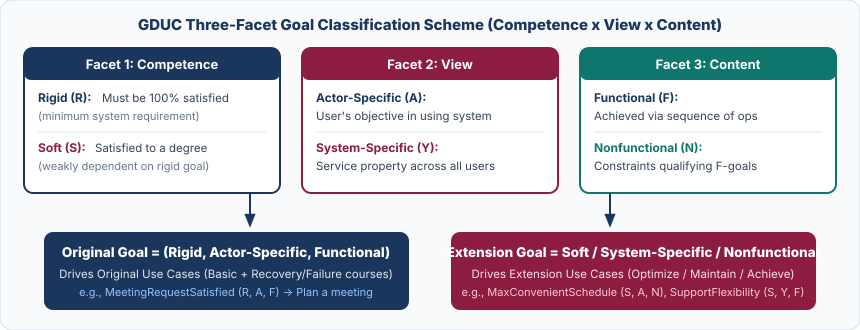
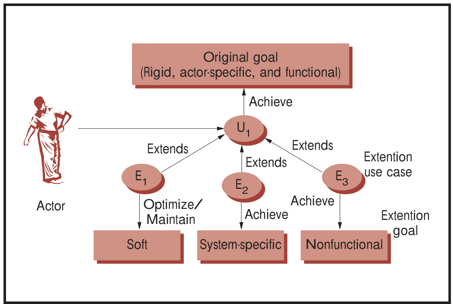
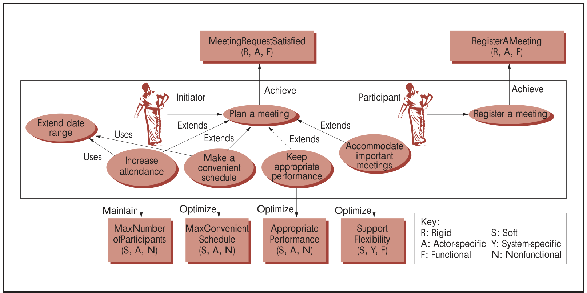
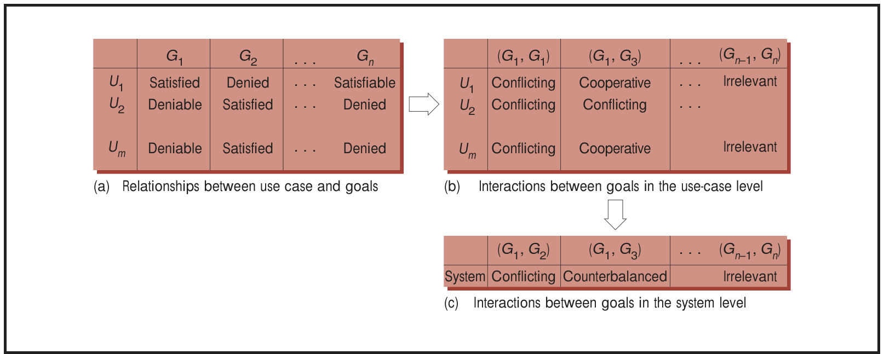
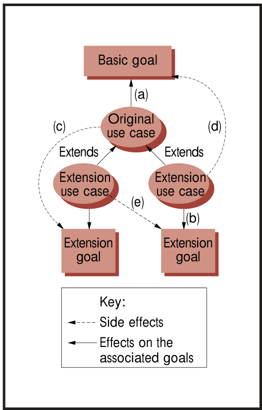

<!-- _class: lead -->

IEEE Software · Feature Article · Vol. 16, No. 4, pp. 92–101 · July/August 1999

# Analyzing User Requirements by Use Cases: A Goal-Driven Approach

<strong>GDUC (Goal-Driven Use Cases)</strong>: Extending Use-Case Modeling with Faceted Goals to Capture Nonfunctional Requirements and Systematically Evaluate Requirement Interactions

<strong>Jonathan Lee</strong> &nbsp;·&nbsp; <code>yjlee@se01.csie.ncu.edu.tw</code> 
<strong>Nien-Lin Xue</strong> &nbsp;·&nbsp; <code>nien@se01.csie.ncu.edu.tw</code> 
Department of Computer Science and Information Engineering, National Central University, Chungli 32054, Taiwan

© 1999 IEEE · Supported by National Science Council (Taiwan), Grants NSC87-2213-E-008-024 and NSC88-2213-E-008-006

<!--
Bibliographic Metadata & Historical Significance:
- Paper Title: Analyzing User Requirements by Use Cases: A Goal-Driven Approach
- Authors: Jonathan Lee (Professor) and Nien-Lin Xue (PhD Student), Department of Computer Science and Information Engineering, National Central University, Taiwan.
- Venue: IEEE Software, Vol. 16, No. 4 (July/August 1999), pp. 92–101 (Feature Article).
- Role in Research Lineage: This seminal IEEE Software paper introduced the Goal-Driven Use Cases (GDUC) methodology, establishing the faceted goal classification scheme (Competence, View, Content), systematic derivation of original and extension use cases, and the formal three-step goal interaction evaluation pipeline that directly served as the foundation for the authors' subsequent 2001 IST paper on structuring Fuzzy Object-Oriented Models.
-->

---

## Outline

1

<a href="#3">Motivation &amp; Theoretical Foundations</a> Why classical use cases fall short on NFRs and interactions, and how GDUC bridges goals and use cases.

2

<a href="#5">Identifying Actors &amp; Faceted Goals</a> Primary vs. secondary actors and the three-facet goal taxonomy (Competence, View, Content).

3

<a href="#7">Building Goal-Driven Use-Case Models</a> Original vs. extension use cases (extends), abstract reuse (uses), and the Meeting Scheduler specification.

4

<a href="#10">Three-Step Goal Evaluation Pipeline</a> Five use-case–goal predicates, direct effects vs. side effects, and interaction matrices.

5

<a href="#12">Formal System-Level Interaction Rules</a> Use-case vs. system-level predicates (cp, cf), three derivation rules, and worked Meeting Scheduler proofs.

6

<a href="#14">Benefits &amp; Future Research Roadmap</a> Key takeaways of GDUC and the roadmap toward Fuzzy OOM and AHP prioritization.

<!--
Article Structure Overview:
1. Introduction (pp. 92–93): Contrasts user-centered use-case strengths with two major limitations (NFRs and requirement interactions), introducing GDUC's four pillars.
2. Goal-Driven Use Cases & Actors (pp. 93–94): Synthesizes Jacobson, Dardenne, and Mylopoulos; defines primary and secondary actors.
3. Identifying Goals (pp. 94–95): Introduces the 3-facet classification scheme (Competence, View, Content).
4. Building Use-Case Models (pp. 95–97, p. 100): Details Original Use Cases, Extension Use Cases (3 triggers), Refinement via `uses`, and the boxed Sample Use Case (`Plan a meeting`).
5. Goal Evaluation (pp. 97–99): Presents the 3-step evaluation pipeline, 5 predicates, direct vs. side effects, and formal system-level interaction equations for original–original, original–extension, and extension–extension goal pairs.
6. Conclusion & Future Work (pp. 99–100): Summarizes GDUC benefits and previews Fuzzy OOM and AHP prioritization.
-->

---

## 1. Motivation: Why Classical Use Cases Need Goals

<h3>Strengths &amp; Gaps of Classical Use Cases</h3>

<strong>Strengths:</strong> User-centered elicitation; manages complexity by isolating one actor's usage aspect at a time.  
<strong>Two Critical Problems:</strong> 
1. <strong>No systematic NFR handling</strong>: Quality attributes are crucial to system success, yet use cases focus almost solely on functional flows. 
2. <strong>No requirement interaction analysis</strong>: Conflicting or cooperative interactions among requirements are unaddressed in use-case models.

<h3>Four Pillars of GDUC</h3>

Inspired by <strong>procedural logic</strong> (Georgeff &amp; Lansky 1986 — associating every process with a purpose), <strong>GDUC</strong>: 
1. Uses <strong>goals</strong> to structure use-case models &amp; derive use cases. 
2. Differentiates <strong>soft vs. rigid goals</strong> to handle imprecise NFRs. 
3. <strong>Embeds goal information</strong> directly inside use cases. 
4. Analyzes <strong>requirement interactions</strong> via goal–use-case relationships.

<strong>Benchmark Case Study:</strong> The <strong>Meeting Scheduler</strong> problem (Potts et al. 1994) illustrates GDUC end-to-end — turning a vague, contradictory mission statement into a structured specification.

<!--
Problem Statement & Procedural Logic Inspiration (pp. 92–93):
While Jacobson's use cases excel at user-centered complexity management, Dano et al. and Regnell et al. noted their weakness in formalization and large-scale structuring. Lee and Xue identify two deeper requirements-engineering gaps:
1. Nonfunctional requirements (NFRs) such as convenience, performance, and flexibility have no principled place in classical use-case diagrams.
2. Interactions among requirements (conflicts and synergies) remain invisible until late design.
Drawing on Georgeff & Lansky's procedural logic ("every process serves a purpose"), GDUC binds each use case to an explicit goal to be achieved, optimized, or maintained.
-->

---

## 1.2 Theoretical Foundations & GDUC Construction Workflow

<h3>Use-Case Mechanics</h3>

• <strong>Actor</strong>: Role played by a category of users. 
• <strong>Basic vs. Alternative Courses</strong>: Simplest path vs. variants &amp; errors. 
• <strong><code>extends</code></strong>: Embeds extended behavior into base UC. 
• <strong><code>uses</code></strong>: Extracts shared fragments into abstract UC for reuse.

<h3>Goal-Oriented Roots</h3>

• <strong>Dardenne et al. [13]</strong>: Nonoperational goals achieved via operational constraints on actions/objects. 
• <strong>Mylopoulos et al. [14]</strong>: NFR goals are rarely binary-satisfied; evaluated by positive/negative contributions &amp; labeling. 
• <strong>Cockburn [16]</strong>: Linking use cases with user goals.

<h3>GDUC 3-Step Process</h3>

<strong>Step 1:</strong> Identify <strong>actors</strong> (primary &amp; secondary users interacting directly).  
<strong>Step 2:</strong> Identify <strong>goals</strong> via a 3-facet classification scheme.  
<strong>Step 3:</strong> Build &amp; refine <strong>use-case models</strong> (original ➔ extension ➔ abstract reuse).

<strong>Core Philosophy:</strong> Goal-based RE focuses on <strong>why</strong> systems are constructed, providing rationale to justify requirements; use cases focus on <strong>how</strong> actors interact with the system. GDUC unifies both views.

<!--
Synthesis of Prior Work (pp. 93–94):
GDUC fuses two complementary traditions:
- Jacobson's Use-Case Driven Engineering: provides `extends` (behavioral extension) and `uses` (factoring common behavior) alongside basic/alternative courses.
- Goal-Oriented RE (Dardenne et al. 1993; Mylopoulos et al. 1992): explains why requirements exist and recognizes that NFRs are satisfied to degrees rather than all-or-nothing.
GDUC operationalizes this fusion through a clean three-step acquisition workflow (Actors -> Faceted Goals -> Use-Case Models), followed by a three-step evaluation workflow.
-->

---

## 2. Identifying Actors & Three-Facet Goal Classification

**Step 1 — Identifying Actors** (Meeting Scheduler):
- **Primary Actors** (perform main system tasks): `Initiator` (initiates meeting, notifies, resolves conflicts) and `Participant` (registers, inputs date/location/equipment preferences).
- **Secondary Actor** (supervises &amp; maintains system): `Operator`.

GDUC's three-facet goal classification scheme mapping goals to Original vs. Extension use cases.

<!--
Actors & Three-Facet Taxonomy (pp. 93–95):
1. Competence Facet: Rigid (R) goals define minimum requirements that must be completely satisfied; Soft (S) goals define desirable properties satisfied partially and are weakly dependent on their rigid goal (e.g., `MaxConvenientSchedule` and `MaxNumberofParticipants` are meaningless if `MeetingRequestSatisfied` fails).
2. View Facet: Actor-specific (A) goals capture an individual actor's objectives, whereas System-specific (Y) goals capture properties the system must uphold across all users (e.g., dynamically replanning to accommodate a more important meeting -> `SupportFlexibility`).
3. Content Facet: Functional (F) goals are achieved by executing a sequence of operations, whereas Nonfunctional (N) goals act as constraints qualifying their associated functional goals.
-->

---

## 2.2 Faceted Goal Classification: Meeting Scheduler Example

Applying the `(Competence, View, Content)` taxonomy to the Meeting Scheduler requirements cleanly separates minimum functional cores from soft, system-wide, and nonfunctional extensions:

| Goal Name | Competence | View | Content | Role in GDUC | Associated Use Case |
| :--- | :--- | :--- | :--- | :--- | :--- |
| `MeetingRequestSatisfied` | **Rigid (R)** | **Actor (A)** | **Functional (F)** | **Original Goal** | `Plan a meeting` (Achieve) |
| `RegisterAMeeting` | **Rigid (R)** | **Actor (A)** | **Functional (F)** | **Original Goal** | `Register a meeting` (Achieve) |
| `MaxNumberofParticipants` | **Soft (S)** | **Actor (A)** | **Nonfunctional (N)** | **Extension Goal** | `Increase attendance` (Maintain) |
| `MaxConvenientSchedule` | **Soft (S)** | **Actor (A)** | **Nonfunctional (N)** | **Extension Goal** | `Make a convenient schedule` (Optimize) |
| `AppropriatePerformance` | **Soft (S)** | **Actor (A)** | **Nonfunctional (N)** | **Extension Goal** | `Keep appropriate performance` (Optimize) |
| `SupportFlexibility` | **Soft (S)** | **System (Y)** | **Functional (F)** | **Extension Goal** | `Accommodate important meetings` (Optimize) |

<strong>Weak Dependence Principle:</strong> Soft goals (`MaxNumberofParticipants`, `MaxConvenientSchedule`) are <strong>weakly dependent</strong> on `MeetingRequestSatisfied` — participant count and convenience are meaningless if no meeting is scheduled.

<!--
Worked Classification Analysis (pp. 94–95):
Notice how every goal receives an unambiguous triple (Competence, View, Content):
- Only (R, A, F) goals become Original Goals — guaranteeing that the base use-case model covers every actor's mandatory functional baseline without clutter.
- Any goal deviating on even one facet (Soft, System-specific, or Nonfunctional) becomes an Extension Goal, handled modularly via `extends` use cases.
- Notice also the distinction between Optimize vs. Maintain: `Make a convenient schedule` optimizes convenience beyond the basic meeting plan, whereas `Increase attendance` maintains the full participant count when recovery courses threaten to drop attendees.
-->

---

## 3. Building & Refining Use-Case Models with Goals

Each use case is a process to **achieve**, **optimize**, or **maintain** a goal (extending Cockburn [16]):

1. **Original Use Cases** (`U1`): Associated with an actor to **achieve** an original goal `⟨R, A, F⟩`. Includes **Basic Course** + **Alternative Course** (Recovery / Failure).
2. **Extension Use Cases** (`extends`): Created for 3 cases:
   - `E1`: **Optimize / Maintain** a **Soft** goal.
   - `E2`: **Achieve** a **System-specific** goal.
   - `E3`: **Achieve** a **Nonfunctional** goal (qualifying constraint).
3. **Refinement (`uses`)**: Extract common fragments into an **abstract use case** with **no associated goal** (e.g., `Extend date range`).

Figure 1. Deriving original (U1) and extension (E1, E2, E3) use cases from faceted goals.

<!--
Critical Distinction Between `extends` and `uses` in GDUC (pp. 95–97):
Although both `extends` and `uses` insert an additional subsequence into a base use-case flow, GDUC draws a sharp semantic boundary between them:
- In an `extends` relationship, BOTH the original use case and the extension use case own explicit goals to achieve, optimize, or maintain.
- In a `uses` relationship, the extracted abstract use case exists purely to enhance modularity and reusability and has NO goal associated with it.
For instance, both `Increase attendance` and `Make a convenient schedule` may need to extend a meeting's date range; factoring `Extend date range` via `uses` eliminates duplication without inventing artificial goals.
-->

---

## 3.2 Meeting Scheduler: Complete Goal-Driven Use-Case Model

Figure 2. Goal-driven use-case model for the Meeting Scheduler system (Lee &amp; Xue, IEEE Software 1999).

<strong>Model Reading:</strong> Top layer = Original Goals <code>(R, A, F)</code>; Middle layer = Actors, Original UCs, Extension UCs (<code>extends</code>), &amp; Abstract UC (<code>uses</code>); Bottom layer = Extension Goals (Soft / System / Nonfunctional).

<!--
Structural Walkthrough of Figure 2 (pp. 95–96):
- Two original use cases satisfy the two rigid, actor-specific, functional goals: `Plan a meeting` (Initiator -> `MeetingRequestSatisfied`) and `Register a meeting` (Participant -> `RegisterAMeeting`).
- Four extension use cases extend `Plan a meeting`:
  1. `Increase attendance` -> Maintain `MaxNumberofParticipants (S, A, N)`.
  2. `Make a convenient schedule` -> Optimize `MaxConvenientSchedule (S, A, N)`.
  3. `Keep appropriate performance` -> Optimize `AppropriatePerformance (S, A, N)`.
  4. `Accommodate important meetings` -> Optimize `SupportFlexibility (S, Y, F)`.
- One abstract use case (`Extend date range`) is shared via `uses` by both `Increase attendance` and `Make a convenient schedule`.
-->

---

## 3.3 Sample Use Case Specification: Planning a Meeting

From the paper's boxed specification (*"Sample Use Case: Planning a Meeting"*, p. 100) — **Goal:** `MeetingRequestSatisfied (R, A, F)`:

<h3>Basic Course (Nominal Path)</h3>

1. Initiator issues a meeting request. 
2. System auto-fills submission date; initiator enters date range, locations, meeting type, potential attendees &amp; importance levels. 
3. Initiator notifies attendees: active participants enter equipment needs; important participants enter preferred locations; exclusive &amp; preference sets lie inside date range. 
4. System computes schedule within date range, outside all exclusive sets, with available room + equipment + minimum lead time. 
5. System lists feasible schedules; initiator picks one &amp; notifies all participants.

<h3>Alternative Courses (Recovery &amp; Failure)</h3>

<strong>Strong Schedule Conflict Recovery / Failure:</strong> 
System notifies initiator to choose: 
• Ask a participant to remove a date from exclusive set; 
• Propose a low-importance participant to withdraw; 
• Extend the date range; or 
• <strong>Cancel the meeting</strong> (failure course — elicited because problem statements omitted cancellation rules!).  
<strong>Equipment Unavailability:</strong> 
Initiator proposes new locations (restarts round) or cancels meeting and notifies all participants.

<!--
Requirements Elicitation Value of Recovery vs. Failure Courses (pp. 95, 100):
Separating alternative courses into Recovery Courses (restoring the original goal `MeetingRequestSatisfied`) and Failure Courses (handling unrecoverable failure) directly uncovers missing requirements! As the authors note on p. 95, the original Meeting Scheduler problem statement never specified when a meeting should be canceled; forcing analysts to define the failure course for `MeetingRequestSatisfied` immediately exposed this elicitation gap.
Furthermore, notice how recovery actions (e.g., proposing a low-importance participant withdraw) can impair the soft goal `MaxNumberofParticipants`, motivating the `Increase attendance` extension use case to maintain that soft goal.
-->

---

## 4. Goal Evaluation: Three-Step Requirements Evaluation Pipeline

Real-world requirements inevitably contradict one another. GDUC evaluates interactions systematically through **three matrix transformations**:

Figure 3. GDUC's three steps: (a) Use-case–Goal predicates ➔ (b) Use-case-level interactions ➔ (c) System-level interactions.

1. **(a) UC–Goal Analysis**: Determine each use case's direct effects &amp; side effects on every goal.
2. **(b) Use-Case-Level Pairwise Interactions**: Derive whether `(Gi, Gj)` cooperate, conflict, or are irrelevant w.r.t. each `Uk`.
3. **(c) System-Level Amalgamation**: Aggregate across base &amp; extension use cases to classify system-wide goal interactions.

<!--
Evaluation Pipeline Architecture (pp. 96–97):
Figure 3 visually summarizes GDUC's bottom-up evaluation mechanics:
- Matrix (a) has rows U1..Um and columns G1..Gn, populated with the 5 predicates (`Satisfied`, `Denied`, `Satisfiable`, `Deniable`, `Independent`).
- Matrix (b) transforms pairs of columns from (a) into pairwise goal relations (`Conflicting`, `Cooperative`, `Irrelevant`) per use case Uk.
- Matrix (c) amalgamates rows across the use-case model into a single system-level verdict (`Conflicting`, `Cooperative`, `Counterbalanced`, `Irrelevant`) for every goal pair (Gi, Gj).
-->

---

## 4.1 Use-Case–Goal Relationships: Direct Effects & Side Effects

Adopted **5 predicates** (extending Mylopoulos et al. [14]):
- `satisfied` / `denied`: completely achieved or ceased.
- `satisfiable` / `deniable`: partially satisfied or impaired.
- `independent`: unaffected by performing the use case.

**Direct Effects (solid arrows) vs. Side Effects (dashed arrows):**
- **(a) Original UC ➔ Basic Goal**: `satisfied` (basic/recovery) or `denied` (failure).
- **(b) Extension UC ➔ Extension Goal**: `satisfied` (rigid) or `satisfiable` (soft).
- **(c) Original UC ➔ Extension Goal**: Succeeding `Plan a meeting` partially satisfies `MaxConvenientSchedule` (`satisfiable`).
- **(d) Extension UC ➔ Basic Goal**: System-specific `Accommodate important meetings` may cancel a meeting (`denied`).
- **(e) Extension UC ➔ Other Extension Goal**: `Increase attendance` helps `MaxConvenientSchedule` (`satisfiable`), whereas `Keep appropriate performance` halts convenience negotiation (`deniable`).

Figure 4. Direct effects (a, b) and side effects (c, d, e) between use cases and goals.

<!--
Side-Effect Mechanics in Figure 4 (p. 97):
A major contribution of GDUC is making hidden side effects explicit:
- Arrow (c) captures positive spillover from achieving an original goal to its weakly dependent soft extension goals.
- Arrow (d) highlights a crucial rule: an extension use case generally does NOT impair its own original goal, EXCEPT when the extension serves a system-specific goal (like `SupportFlexibility` overriding an individual initiator's meeting).
- Arrow (e) exposes cross-extension interference — both positive (`Increase attendance` extending the date range also makes `MaxConvenientSchedule` satisfiable) and negative (`Keep appropriate performance` terminating negotiation makes `MaxConvenientSchedule` deniable).
-->

---

## 4.2 Use-Case-Level & System-Level Goal Interactions

<h3>Use-Case Level (w.r.t. specific <code>Uk</code>)</h3>

Defined by boolean predicates <code>cpUk(Gi, Gj)</code> and <code>cfUk(Gi, Gj)</code>:  
• <strong>Conflicting</strong> (<code>cfUk = True</code>): One goal increases while the other decreases after <code>Uk</code> (e.g., <code>satisfiable</code> vs. <code>deniable</code>). 
• <strong>Cooperative</strong> (<code>cpUk = True</code>): Both increase (positively) or both decrease (negatively). 
• <strong>Irrelevant</strong> (both <code>False</code>): Neither changes.  
<em>Contrast with Boehm &amp; In's QARCC [17]:</em> QARCC analyzes domain-independent architecture/quality conflicts; GDUC analyzes <strong>domain-specific requirement conflicts</strong> via use cases.

<h3>System Level: <code>Rs(Gi, Gj) = ⟨cp, cf⟩</code></h3>

Amalgamating related use cases yields <strong>four system-level relations</strong>:

| `Rs(Gi, Gj)` | Meaning |
| :--- | :--- |
| `⟨False, False⟩` | **Irrelevant** |
| `⟨True, False⟩` | **Cooperative** |
| `⟨False, True⟩` | **Conflicting** |
| `⟨True, True⟩` | **Counterbalanced** |

By reflexivity, every goal cooperates with itself: <code>Rs(Gi, Gi) = ⟨True, False⟩</code>.

<!--
Use-Case vs. System Level Semantics (pp. 98–99):
- At the use-case level, `make a convenient schedule` yields `satisfiable` for `MaxConvenientSchedule` and `deniable` for `AppropriatePerformance`, giving `cf_{make a convenient schedule}(MaxConvenientSchedule, AppropriatePerformance) = True`.
- At the system level, two goals can cooperate in one use case while conflicting in another; the pair ⟨cp, cf⟩ = ⟨True, True⟩ captures this nuanced "Counterbalanced" state instead of collapsing it prematurely.
- Distinction from QARCC (Boehm & In 1996): QARCC targets generic, domain-independent conflicts between architectural strategies and quality attributes (e.g., layered architecture improving portability at the expense of performance), whereas GDUC discovers requirement-level conflicts grounded in the target domain's concrete use cases.
-->

---

## 4.3 Formal System-Level Derivation Rules & Worked Proofs

Given original goals `Gi, Gj` (with UCs `Ui, Uj`) and extension goals `Gi1, Gj1` (with UCs `Ui1, Uj1`), GDUC defines **three formal derivation cases**:

<strong>Case 1 (Original–Original):</strong> 
cp(Gi, Gj) = cpUi(Gi, Gj) ∨ cpUj(Gi, Gj) &nbsp;&nbsp;|&nbsp;&nbsp; cf(Gi, Gj) = cfUi(Gi, Gj) ∨ cfUj(Gi, Gj) 
<strong>Case 2 (Original–Extension, weak dependence on Gj):</strong> 
cp(Gi, Gj1) = cp(Gi, Gj) ∨ cpUi(Gi, Gj1) ∨ cpUj1(Gi, Gj1) &nbsp;&nbsp;(and analogously for cf) 
<strong>Case 3 (Extension–Extension):</strong> 
cp(Gi1, Gj1) = cp(Gi1, Gj) ∨ cp(Gi, Gj1) ∨ cpUi1(Gi1, Gj1) ∨ cpUj1(Gi1, Gj1) &nbsp;&nbsp;(and analogously for cf)

<h3>Proof 1: <code>GMRS</code> vs. <code>GMCS</code> (Case 2)</h3>

<code>cp(GMRS, GMCS) = cp(GMRS, GMRS) ∨ cpUPM ∨ cpUMCS = True</code> 
<code>cf(GMRS, GMCS) = cf(GMRS, GMRS) ∨ cfUPM ∨ cfUMCS = False</code> 
➔ <strong>Cooperative</strong> <code>⟨True, False⟩</code>

<h3>Proof 2: <code>GMCS</code> vs. <code>GAP</code> (Case 3)</h3>

<code>cp(GMCS, GAP) = cp(GMCS, GMRS) ∨ ... = False</code> (excl. base self) 
<code>cf(GMCS, GAP) = cf(GMCS, GMRS) ∨ cf(GAP, GMRS) ∨ cfUMCS ∨ cfUKAP = True</code> 
➔ <strong>Conflicting</strong> <code>⟨False, True⟩</code>

<!--
Recursive System-Level Derivation Equations (pp. 98–99, Figure 5):
GDUC's derivation rules are cleanly stratified by weak dependence:
1. Original–Original (Gi, Gj): Checks cooperation/conflict over their respective original use cases Ui and Uj.
2. Original–Extension (Gi, Gj1): Because Gj1 is only achieved/optimized if its base original goal Gj is satisfied, the system-level relation Rs(Gi, Gj) must be included alongside use-case evaluations over Ui and Uj1. In Proof 1, since G_MCS extends G_MRS and cp(G_MRS, G_MRS) = True (reflexivity), G_MRS and G_MCS cooperate.
3. Extension–Extension (Gi1, Gj1): Combines cross-level interactions (Gi1 with Gj, and Gi with Gj1) plus direct extension use-case evaluations (Ui1 and Uj1). In Proof 2, evaluating `make a convenient schedule` (U_MCS) and `keep appropriate performance` (U_KAP) yields `cf(G_MCS, G_AP) = True`, rigorously proving the system-level conflict between convenience and performance.
-->

---

## 5. Benefits & Future Research Roadmap

<h3>Three Core Benefits of GDUC</h3>

1. <strong>Structuring Mechanism</strong>: Systematically guides the derivation and modular organization of use-case specifications via faceted goals.  
2. <strong>Bridging Domain &amp; System</strong>: Connects high-level domain descriptions with functional and nonfunctional system requirements.  
3. <strong>Soft &amp; Conflicting Requirements</strong>: Makes soft NFRs explicit and provides a formal 3-step calculus to detect requirement conflicts early.

<h3>Two Planned Extensions (Directly Realized in 2001!)</h3>

<strong>1. Fuzzy Object-Oriented Modeling (FOOM):</strong> 
Transition GDUC's goal interactions into the system-analysis object model to manage conflicting AND imprecise requirements using fuzzy objects.  
<strong>2. AHP Goal Prioritization:</strong> 
Apply the <strong>Analytic Hierarchy Process (AHP)</strong> (Karlsson &amp; Ryan 1997; Saaty) to distinguish critical requirements from mere adornments for conflict resolution.

<strong>Historical Lineage:</strong> Both future directions proposed on p. 100 of this 1999 IEEE Software paper were directly fulfilled in the authors' follow-up <strong>2001 Information and Software Technology (IST)</strong> paper!

<!--
Conclusion & Research Continuity (pp. 99–100):
GDUC demonstrated that goals play a dual role in requirements acquisition: structuring use-case specifications and formally evaluating requirement interactions.
Notably, the paper's two concluding future-work commitments — (1) extending object-oriented analysis models with fuzzy logic to utilize GDUC's goal interactions, and (2) prioritizing goals via AHP — became the exact core contributions of Lee, Xue & Kuo (IST 2001, "Structuring requirement specifications with goals"), forming a cohesive multi-year research arc.
-->

---

<!-- _class: closing -->

# Thank You for Your Attention!

Analyzing User Requirements by Use Cases: A Goal-Driven Approach

<strong>Jonathan Lee</strong> &nbsp;·&nbsp; <code>yjlee@se01.csie.ncu.edu.tw</code> 
<strong>Nien-Lin Xue</strong> &nbsp;·&nbsp; <code>nien@se01.csie.ncu.edu.tw</code> 
Department of Computer Science and Information Engineering, National Central University, Taiwan 
IEEE Software, Vol. 16, No. 4 (July/August 1999), pp. 92–101 · Grants: NSC87-2213-E-008-024, NSC88-2213-E-008-006

<!--
Archival Reference:
- Citation: J. Lee and N.-L. Xue, "Analyzing User Requirements by Use Cases: A Goal-Driven Approach," IEEE Software, Vol. 16, No. 4, pp. 92–101, July/August 1999.
- Publisher: IEEE Computer Society (0740-7459/99/$10.00 © 1999 IEEE).
- Funding: National Science Council (Taiwan) under grants NSC87-2213-E-008-024 and NSC88-2213-E-008-006.
-->

