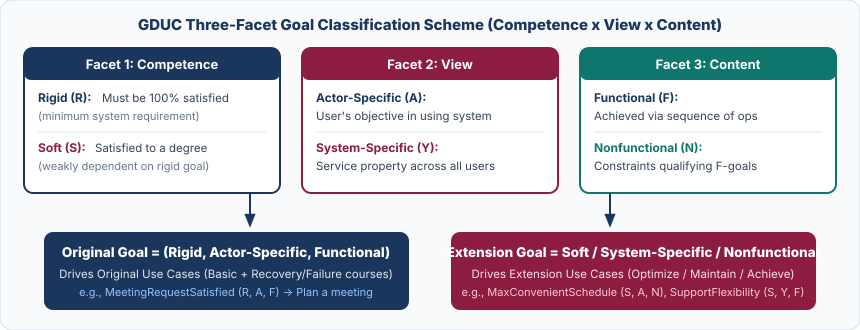
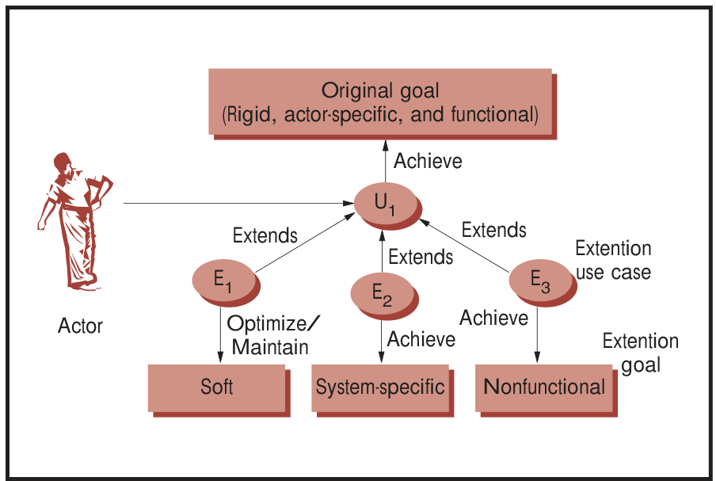
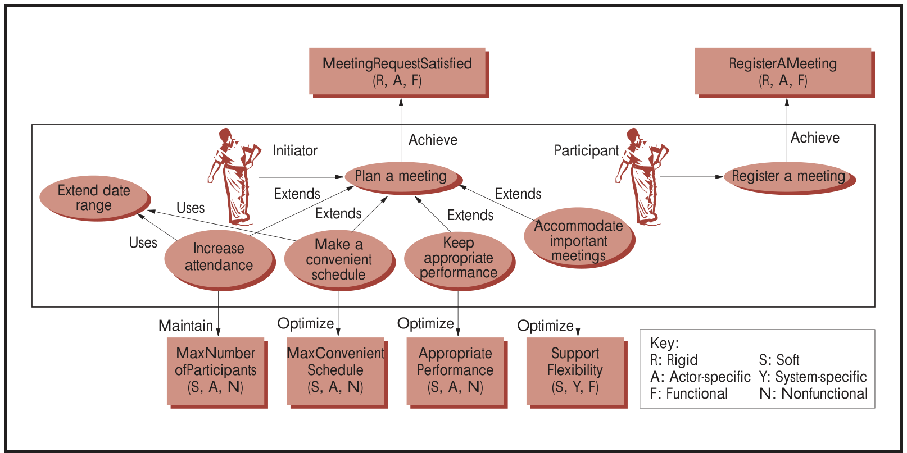
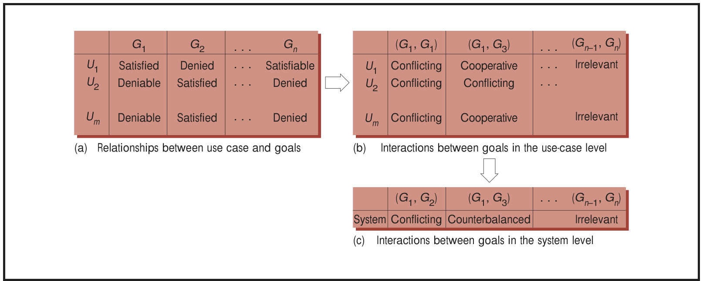
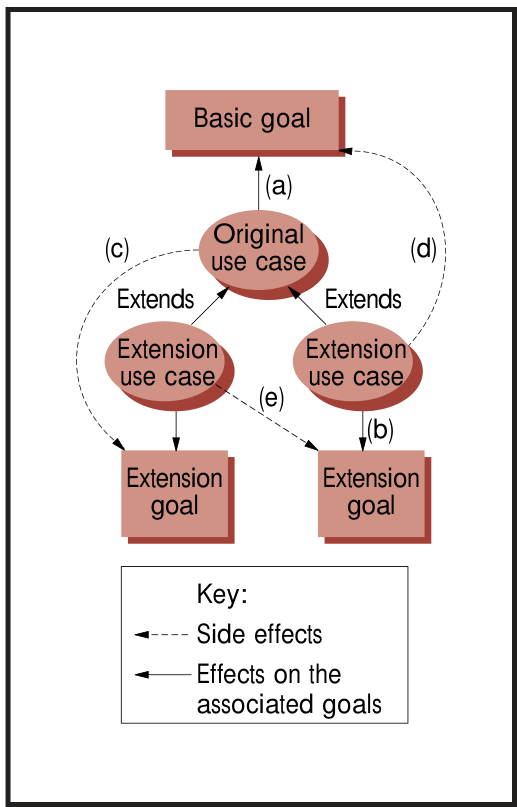

<!-- _class: lead -->

IEEE Software · 專題論文 · 第 16 卷第 4 期，頁 92–101 · 1999 年 7/8 月

# 以使用案例分析使用者需求：目標導向方法

Analyzing User Requirements by Use Cases: A Goal-Driven Approach

<strong>GDUC（目標導向使用案例）</strong>：以三面向目標延伸使用案例塑模，系統化納管非功能性需求並形式化評估需求間互動關係

<strong>李允中（Jonathan Lee）</strong> &nbsp;·&nbsp; <code>yjlee@se01.csie.ncu.edu.tw</code> 
<strong>薛念林（Nien-Lin Xue）</strong> &nbsp;·&nbsp; <code>nien@se01.csie.ncu.edu.tw</code> 
國立中央大學資訊工程學系（中壢 32054）

© 1999 IEEE · 國科會專題研究計畫補助：NSC87-2213-E-008-024 ＆ NSC88-2213-E-008-006

<!--
論文索引與歷史定位：
- 論文篇名：Analyzing User Requirements by Use Cases: A Goal-Driven Approach
- 作者群：李允中（Jonathan Lee，教授）、薛念林（Nien-Lin Xue，博士生），國立中央大學資訊工程學系。
- 發表期刊：IEEE Software, Vol. 16, No. 4 (July/August 1999), pp. 92–101。
- 學術傳承：這篇發表於頂尖實務期刊 IEEE Software 的奠基論文首度提出「目標導向使用案例（GDUC）」方法論，建立三面向目標分類、原始／延伸使用案例推導與三步驟目標互動評估公式，直接奠定後續 2001 年 IST 論文（以目標結構化模糊物件導向模型）之理論基石。
-->

---

## 簡報大綱

1

<a href="#3">研究動機與理論基礎</a> 為何傳統使用案例難以處理非功能性需求與需求互動，以及 GDUC 的四大支柱。

2

<a href="#5">辨識參與者與三面向目標分類</a> 主要／次要參與者區分，與「能力、視角、內容」三面向目標分類法。

3

<a href="#7">建構目標導向使用案例模型</a> 原始與延伸使用案例（extends）、抽象重用（uses）與會議排程完整範例規格。

4

<a href="#10">三步驟目標評估流程</a> 五種使用案例–目標述詞、直接效果與三類副作用路徑及互動矩陣轉換。

5

<a href="#12">系統層級互動形式化推導</a> 使用案例層級與系統層級述詞（cp, cf）、三類推導公式與會議排程證明。

6

<a href="#14">核心效益與未來研究藍圖</a> GDUC 三大效益及指向模糊物件塑模（FOOM）與 AHP 優先權之研究路線。

<!--
全文架構導覽：
1. 緒論（頁 92–93）：點出傳統使用案例欠缺非功能性需求與需求互動分析兩大缺口，提出 GDUC 四大支柱。
2. 目標導向使用案例與參與者（頁 93–94）：整合 Jacobson、Dardenne 與 Mylopoulos 觀點，區分主要／次要參與者。
3. 目標辨識（頁 94–95）：建立能力、視角、內容三面向目標分類法。
4. 建構使用案例模型（頁 95–97、頁 100）：詳述原始使用案例、三類延伸使用案例、uses 精煉與頁 100 完整範例規格框。
5. 目標評估（頁 97–99）：提出三步驟矩陣轉換、五種述詞、直接／副作用路徑，以及原始–原始、原始–延伸、延伸–延伸三類系統層級公式。
6. 結論與未來研究（頁 99–100）：總結效益並預告模糊物件模型（FOOM）與 AHP 目標排序。
-->

---

## 1. 研究動機：為何傳統使用案例需要目標導引？

<h3>傳統使用案例之優勢與兩大缺口</h3>

<strong>優勢：</strong>以使用者為中心擷取需求；一次聚焦單一角色互動，大幅降低需求分析複雜度。  
<strong>兩大關鍵問題：</strong> 
1. <strong>缺乏非功能性需求（NFR）系統化處理</strong>：品質屬性攸關系統成敗，但使用案例偏重功能流程。 
2. <strong>未處理需求間互動關係</strong>：需求擷取階段中彼此衝突或合作之互動在使用案例中無從呈現。

<h3>GDUC 四大核心支柱</h3>

受<strong>程序邏輯</strong>（Georgeff &amp; Lansky 1986——每個程序皆對應一項目的）啟發，<strong>GDUC</strong> 主張： 
1. 以<strong>目標</strong>結構化使用案例模型並推導使用案例。 
2. 區分<strong>柔性與剛性目標</strong>以處理不精確非功能需求。 
3. 將<strong>目標資訊內嵌</strong>於使用案例規格之中。 
4. 透過目標與使用案例關係分析<strong>需求間互動</strong>。

<strong>基準示範案例：</strong>全文採用需求工程界公認基準——<strong>會議排程問題（Meeting Scheduler）</strong>（Potts et al. 1994），示範如何將模糊且矛盾的任務敘述轉化為清晰規格。

<!--
研究問題與程序邏輯啟發（頁 92–93）：
Jacobson 所提出的使用案例雖擅長以使用者視角管理複雜度，但既有研究已指出其在形式化與大型模型管理上存有侷限。李允中與薛念林進一步點出兩項更深層的需求工程痛點：
1. 非功能性品質需求（如排程便利性、效能、彈性）難以系統化融入傳統使用案例圖。
2. 需求之間的衝突與協同互動無法在使用案例階段被顯性化分析。
因此 GDUC 借鏡程序邏輯思想，將每一個使用案例視為為達成、最佳化或維護特定目標而執行的程序。
-->

---

## 1.2 理論基礎與 GDUC 三步驟建構流程

<h3>使用案例基礎機制</h3>

• <strong>參與者（Actor）</strong>：展現相似互動行為之使用者角色。 
• <strong>基本／替代流程</strong>：最單純成功路徑 vs. 變異與錯誤處理。 
• <strong><code>extends</code></strong>：將延伸行為嵌入既有使用案例。 
• <strong><code>uses</code></strong>：萃取共通片段為抽象使用案例以利重用。

<h3>目標導向理論根基</h3>

• <strong>Dardenne 等人 [13]</strong>：目標屬非操作性目的，須透過滿足操作性約束達成。 
• <strong>Mylopoulos 等人 [14]</strong>：NFR 目標鮮少二分滿足，須以正負貢獻與標記程序評估。 
• <strong>Cockburn [16]</strong>：將使用案例與使用者目標連結。

<h3>GDUC 建構三步驟</h3>

<strong>步驟 1：</strong>辨識直接與系統互動之<strong>參與者</strong>（主要與次要）。  
<strong>步驟 2：</strong>依<strong>三面向分類法</strong>辨識系統與使用者目標。  
<strong>步驟 3：</strong>建構並精煉<strong>使用案例模型</strong>（原始 ➔ 延伸 ➔ 抽象重用）。

<strong>核心哲學：</strong>目標導向方法回答系統建構的<strong>「為何（Why）」</strong>並提供需求理由；使用案例回答使用者互動的<strong>「如何（How）」</strong>。GDUC 將兩者無縫融合。

<!--
理論融合脈絡（頁 93–94）：
GDUC 結合兩大需求工程傳統：
- Jacobson 使用案例驅動法：具備結構化關係（extends 與 uses）與基本／替代流程敘事能力。
- 目標導向需求工程（Dardenne et al. 1993；Mylopoulos et al. 1992）：提供理由正當化與非功能性需求部分滿足的語意基礎。
GDUC 將此融合落地為清楚的三步驟模型建構流程，並銜接後續的三步驟目標互動評估流程。
-->

---

## 2. 辨識參與者與三面向目標分類法

<strong>步驟 1 — 辨識參與者</strong>（會議排程系統）：
- <strong>主要參與者（Primary Actors）</strong>（執行主要系統任務）：<code>Initiator</code>（發起會議、通知、決策衝突）與 <code>Participant</code>（登記會議、輸入時間／地點／設備偏好）。
- <strong>次要參與者（Secondary Actor）</strong>（維護與監督系統）：<code>Operator</code>。

GDUC 三面向目標分類法（能力 × 視角 × 內容）及其對原始／延伸使用案例之映射。

<!--
參與者與三面向目標分類（頁 93–95）：
1. 能力面向（Competence）：剛性目標（Rigid, R）為系統最低必要條件，必須完全滿足；柔性目標（Soft, S）代表理想品質特性，可部分滿足且「弱相依」於對應的剛性目標（若會議請求根本未被滿足，出席人數或便利性即無意義）。
2. 視角面向（View）：參與者特定目標（A）為個別角色使用系統之目的；系統特定目標（Y）為系統服務所有使用者時須維持之整體性質（如動態重排以容納更重要會議 -> `SupportFlexibility`）。
3. 內容面向（Content）：功能性目標（F）透過一系列操作達成；非功能性目標（N）則作為約束條件來限定相關功能性目標。
-->

---

## 2.2 三面向分類實例：會議排程系統目標一覽

將 <code>(能力, 視角, 內容)</code> 三元分類套用至會議排程需求，可精準區隔最低功能核心與各類延伸目標：

| 目標名稱 | 能力 | 視角 | 內容 | GDUC 角色 | 對應使用案例 |
| :--- | :--- | :--- | :--- | :--- | :--- |
| `MeetingRequestSatisfied` | **剛性 (R)** | **參與者 (A)** | **功能性 (F)** | **原始目標** | `Plan a meeting`（達成） |
| `RegisterAMeeting` | **剛性 (R)** | **參與者 (A)** | **功能性 (F)** | **原始目標** | `Register a meeting`（達成） |
| `MaxNumberofParticipants` | **柔性 (S)** | **參與者 (A)** | **非功能 (N)** | **延伸目標** | `Increase attendance`（維護） |
| `MaxConvenientSchedule` | **柔性 (S)** | **參與者 (A)** | **非功能 (N)** | **延伸目標** | `Make a convenient schedule`（最佳化） |
| `AppropriatePerformance` | **柔性 (S)** | **參與者 (A)** | **非功能 (N)** | **延伸目標** | `Keep appropriate performance`（最佳化） |
| `SupportFlexibility` | **柔性 (S)** | **系統 (Y)** | **功能性 (F)** | **延伸目標** | `Accommodate important meetings`（最佳化） |

<strong>弱相依原則：</strong>柔性目標（<code>MaxNumberofParticipants</code>、<code>MaxConvenientSchedule</code>）皆<strong>弱相依</strong>於 <code>MeetingRequestSatisfied</code>——若會議無法排成，出席人數與便利性便失去意義。

<!--
會議排程分類解析（頁 94–95）：
- 唯獨同時滿足 (R, A, F) 之目標屬於「原始目標」，確保基礎使用案例模型乾淨俐落、直指各角色之最低必要功能。
- 凡具備 Soft、System-specific 或 Nonfunctional 任一特徵者即歸類為「延伸目標」，透過 `extends` 模組化掛載。
- 注意「最佳化（Optimize）」與「維護（Maintain）」之細微差異：`Make a convenient schedule` 進一步最佳化排程便利性；而 `Increase attendance` 則在基本流程遇衝突、回復流程恐導致成員退出時，出面「維護」最大出席人數。
-->

---

## 3. 以目標推導與精煉使用案例模型

每個使用案例皆為<strong>達成（achieve）</strong>、<strong>最佳化（optimize）</strong>或<strong>維護（maintain）</strong>特定目標之程序（延伸 Cockburn [16]）：

1. <strong>原始使用案例</strong>（<code>U1</code>）：對應參與者以<strong>達成</strong>原始目標 <code>⟨R, A, F⟩</code>，包含<strong>基本流程</strong>與<strong>替代流程</strong>（回復／失敗）。
2. <strong>延伸使用案例</strong>（<code>extends</code>）：依三種情境建立：
   - <code>E1</code>：<strong>最佳化／維護柔性目標</strong>。
   - <code>E2</code>：<strong>達成系統特定目標</strong>。
   - <code>E3</code>：<strong>達成非功能性目標</strong>（限定約束）。
3. <strong>模型精煉（<code>uses</code>）</strong>：萃取多個使用案例之共通行為為<strong>抽象使用案例</strong>，且<strong>不關聯任何目標</strong>（如 <code>Extend date range</code>）。

圖 1. 依三面向目標推導原始使用案例（U1）與三類延伸使用案例（E1, E2, E3）。

<!--
GDUC 中 `extends` 與 `uses` 的本質差異（頁 95–97）：
雖然兩者都會將額外操作子序列插入基礎流程，GDUC 給出了清晰的語意判準：
- `extends` 關係中，原始與延伸使用案例「雙方皆有各自對應之目標」需要達成、最佳化或維護。
- `uses` 關係中，被萃取出的抽象使用案例純粹為了提升重用性與消除重複，本身「不具關聯目標」。
例如 `Increase attendance` 與 `Make a convenient schedule` 皆會用到延長會議日期區間，故將 `Extend date range` 抽離為抽象使用案例並以 `uses` 連結。
-->

---

## 3.2 會議排程系統之完整目標導向使用案例模型

圖 2. 會議排程系統之目標導向使用案例模型（Lee &amp; Xue, IEEE Software 1999）。

<strong>圖面閱讀層次：</strong>最上層＝原始目標 <code>(R, A, F)</code>；中層＝參與者、原始使用案例、延伸使用案例（<code>extends</code>）與抽象使用案例（<code>uses</code>）；最下層＝延伸目標（柔性／系統／非功能）。

<!--
圖 2 結構解析（頁 95–96）：
- 兩個原始使用案例負責兩項剛性功能目標：`Plan a meeting`（Initiator -> `MeetingRequestSatisfied`）與 `Register a meeting`（Participant -> `RegisterAMeeting`）。
- 四個延伸使用案例皆延伸自 `Plan a meeting`：
  1. `Increase attendance` -> 維護 `MaxNumberofParticipants (S, A, N)`。
  2. `Make a convenient schedule` -> 最佳化 `MaxConvenientSchedule (S, A, N)`。
  3. `Keep appropriate performance` -> 最佳化 `AppropriatePerformance (S, A, N)`。
  4. `Accommodate important meetings` -> 最佳化 `SupportFlexibility (S, Y, F)`。
- 一個抽象使用案例 `Extend date range` 透過 `uses` 由 `Increase attendance` 與 `Make a convenient schedule` 共用。
-->

---

## 3.3 範例使用案例規格：規劃會議（Planning a Meeting）

整理自原論文第 100 頁專欄（<em>Sample Use Case: Planning a Meeting</em>）——<strong>目標：</strong><code>MeetingRequestSatisfied (R, A, F)</code>：

<h3>基本流程（Basic Course）</h3>

1. 發起人送出會議請求。 
2. 系統自動填入提交日期；發起人填寫日期區間、候選地點、會議類型、潛在參與者及重要度等級。 
3. 發起人通知成員填寫資料：主動參與者填設備需求；重要參與者填偏好地點；排除與偏好日期須落於區間內。 
4. 系統於區間內避開所有排除日期，尋得符合設備需求且滿足前置時間下限之可用會議室。 
5. 系統列出可行排程，由發起人選定並通知所有參與者。

<h3>替代流程（回復與失敗流程）</h3>

<strong>強烈時程衝突之回復／失敗流程：</strong> 
系統通知發起人並提供四選項： 
• 通知成員自排除集合移除某日期； 
• 建議低重要度成員退出該會議； 
• 延長會議日期區間；或 
• <strong>取消會議</strong>（失敗流程——原始題目未寫明取消時機，藉此成功補齊需求！）。  
<strong>設備無法滿足：</strong> 
發起人可改提新地點重啟排程，或取消會議並通知全體成員。

<!--
回復／失敗流程對需求擷取的實質貢獻（頁 95、100）：
GDUC 強制將替代流程拆分為「回復流程（挽救原始目標）」與「失敗流程（目標無法回復時之處置）」，可直接揭露需求文件中的遺漏！如原文第 95 頁指出，會議排程原始問題陳述並未說明何時應取消會議，透過撰寫失敗流程即刻補齊此項隱性需求。同時，回復流程中「請低重要度成員退出」會損害柔性目標 `MaxNumberofParticipants`，這也直接驅動了延伸使用案例 `Increase attendance` 的設計。
-->

---

## 4. 目標評估：三步驟需求互動評估流程

真實系統需求往往相互矛盾。GDUC 透過<strong>三階段矩陣轉換</strong>系統化評估目標間互動：

圖 3. GDUC 需求評估三步驟：(a) 使用案例–目標關係 ➔ (b) 使用案例層級互動 ➔ (c) 系統層級互動。

1. <strong>(a) 使用案例–目標分析</strong>：檢驗執行各使用案例對每個目標的直接效果與副作用。
2. <strong>(b) 使用案例層級成對互動</strong>：針對單一使用案例 <code>Uk</code> 推導兩目標 <code>(Gi, Gj)</code> 為合作、衝突或無關。
3. <strong>(c) 系統層級整體彙整</strong>：跨原始與延伸使用案例整合，得出系統層級四元目標互動結果。

<!--
三步驟矩陣轉換架構（頁 96–97）：
圖 3 呈現由底而上的自動化分析邏輯：
- 矩陣 (a)：列為使用案例 U1..Um，欄為目標 G1..Gn，填入五種述詞（Satisfied、Denied、Satisfiable、Deniable、Independent）。
- 矩陣 (b)：兩兩比對 (a) 中同一列的不同目標欄位，得出各使用案例下的目標對關係（Conflicting、Cooperative、Irrelevant）。
- 矩陣 (c)：整合所有相關使用案例列，收斂為整體系統對每一目標對 (Gi, Gj) 的最終判定（Conflicting、Cooperative、Counterbalanced、Irrelevant）。
-->

---

## 4.1 使用案例與目標關係：直接效果與副作用路徑

採用並擴充 Mylopoulos 等人 [14] 之<strong>五種述詞</strong>：
- <code>satisfied</code> / <code>denied</code>：目標完全達成或完全中止。
- <code>satisfiable</code> / <code>deniable</code>：目標部分滿足或部分受損。
- <code>independent</code>：不受該使用案例執行影響。

<strong>直接效果（實線）vs. 副作用（虛線）：</strong>
- <strong>(a) 原始 UC ➔ 基本目標</strong>：<code>satisfied</code>（基本／回復）或 <code>denied</code>（失敗）。
- <strong>(b) 延伸 UC ➔ 延伸目標</strong>：<code>satisfied</code>（剛性）或 <code>satisfiable</code>（柔性）。
- <strong>(c) 原始 UC ➔ 延伸目標</strong>：成功執行 <code>Plan a meeting</code> 亦使 <code>MaxConvenientSchedule</code> 達 <code>satisfiable</code>。
- <strong>(d) 延伸 UC ➔ 基本目標</strong>：系統特定延伸 <code>Accommodate important meetings</code> 可能取消既有會議（<code>denied</code>）。
- <strong>(e) 延伸 UC ➔ 其他延伸目標</strong>：<code>Increase attendance</code> 順帶助益便利性（<code>satisfiable</code>），但 <code>Keep appropriate performance</code> 中斷協商使便利性變為 <code>deniable</code>。

圖 4. 使用案例與目標間之直接效果（a, b）與副作用（c, d, e）。

<!--
圖 4 副作用規則解析（頁 97）：
GDUC 將隱藏於流程中的三種跨目標副作用攤在陽光下：
- 路徑 (c)：原始使用案例成功執行時，對其弱相依柔性延伸目標產生正向外溢。
- 路徑 (d)：一般而言延伸使用案例不會損害其原始目標，唯一的例外是「系統特定延伸使用案例」（例如 `SupportFlexibility` 為了整體系統彈性而取消個別發起人的會議）。
- 路徑 (e)：跨延伸使用案例之連帶影響——可能是正向的（`Increase attendance` 延長日期區間同時助益 `MaxConvenientSchedule`），也可能是負向的（`Keep appropriate performance` 終止便利性協商而損害 `MaxConvenientSchedule`）。
-->

---

## 4.2 使用案例層級與系統層級目標互動

<h3>使用案例層級（針對特定 <code>Uk</code>）</h3>

以布林述詞 <code>cpUk(Gi, Gj)</code> 與 <code>cfUk(Gi, Gj)</code> 定義：  
• <strong>衝突</strong>（<code>cfUk = True</code>）：執行 <code>Uk</code> 後一目標滿足度上升、另一目標下降（如 <code>satisfiable</code> vs. <code>deniable</code>）。 
• <strong>合作</strong>（<code>cpUk = True</code>）：兩者同步上升（正向）或同步下降（負向）。 
• <strong>無關</strong>（兩者皆 <code>False</code>）：兩者滿足度皆無變化。  
<em>與 Boehm &amp; In QARCC [17] 之對照：</em>QARCC 處理領域無關之架構–品質衝突；GDUC 則聚焦於使用案例脈絡下之<strong>領域特定需求衝突</strong>。

<h3>系統層級：<code>Rs(Gi, Gj) = ⟨cp, cf⟩</code></h3>

彙整相關使用案例後產生<strong>四種系統層級關係</strong>：

| `Rs(Gi, Gj)` | 系統層級語意 |
| :--- | :--- |
| `⟨False, False⟩` | **無關（Irrelevant）** |
| `⟨True, False⟩` | **合作（Cooperative）** |
| `⟨False, True⟩` | **衝突（Conflicting）** |
| `⟨True, True⟩` | **制衡（Counterbalanced）** |

依反身性定義，任一目標恆與自身合作：<code>Rs(Gi, Gi) = ⟨True, False⟩</code>。

<!--
使用案例層級與系統層級語意（頁 98–99）：
- 在使用案例層級，執行 `make a convenient schedule` 時，`MaxConvenientSchedule` 為 `satisfiable`、`AppropriatePerformance` 為 `deniable`，故 `cf_{make a convenient schedule}(MaxConvenientSchedule, AppropriatePerformance) = True`。
- 在系統層級，兩目標可能於甲使用案例中合作、於乙使用案例中衝突，述詞對 ⟨True, True⟩ 即精準保留此種「制衡（Counterbalanced）」狀態。
- 與 QARCC（Boehm & In 1996）之差異：QARCC 鎖定跨領域通用的品質屬性與架構策略衝突（如分層架構提升可攜性但損及效能），GDUC 則從目標領域的具體使用案例發掘需求層級衝突。
-->

---

## 4.3 系統層級形式化推導規則與會議排程證明

設原始目標 <code>Gi, Gj</code>（對應 <code>Ui, Uj</code>）與延伸目標 <code>Gi1, Gj1</code>（對應 <code>Ui1, Uj1</code>），GDUC 定義<strong>三類系統層級推導公式</strong>：

<strong>規則 1（原始–原始）：</strong> 
cp(Gi, Gj) = cpUi(Gi, Gj) ∨ cpUj(Gi, Gj) &nbsp;&nbsp;|&nbsp;&nbsp; cf(Gi, Gj) = cfUi(Gi, Gj) ∨ cfUj(Gi, Gj) 
<strong>規則 2（原始–延伸，納入弱相依基礎 Gj）：</strong> 
cp(Gi, Gj1) = cp(Gi, Gj) ∨ cpUi(Gi, Gj1) ∨ cpUj1(Gi, Gj1) &nbsp;&nbsp;（cf 同理） 
<strong>規則 3（延伸–延伸）：</strong> 
cp(Gi1, Gj1) = cp(Gi1, Gj) ∨ cp(Gi, Gj1) ∨ cpUi1(Gi1, Gj1) ∨ cpUj1(Gi1, Gj1) &nbsp;&nbsp;（cf 同理）

<h3>證明 1：<code>GMRS</code> vs. <code>GMCS</code>（規則 2）</h3>

<code>cp(GMRS, GMCS) = cp(GMRS, GMRS) ∨ cpUPM ∨ cpUMCS = True</code> 
<code>cf(GMRS, GMCS) = cf(GMRS, GMRS) ∨ cfUPM ∨ cfUMCS = False</code> 
➔ 判定為<strong>合作</strong> <code>⟨True, False⟩</code>

<h3>證明 2：<code>GMCS</code> vs. <code>GAP</code>（規則 3）</h3>

<code>cp(GMCS, GAP) = cp(GMCS, GMRS) ∨ ... = False</code>（排除自身反身） 
<code>cf(GMCS, GAP) = cf(GMCS, GMRS) ∨ cf(GAP, GMRS) ∨ cfUMCS ∨ cfUKAP = True</code> 
➔ 判定為<strong>衝突</strong> <code>⟨False, True⟩</code>

<!--
三類遞迴系統層級公式解析（頁 98–99，原圖 5）：
GDUC 的系統層級互動公式依循「弱相依層次」逐層展開：
1. 原始–原始：直接聯集兩原始使用案例 Ui、Uj 之判定結果。
2. 原始–延伸：因延伸目標 Gj1 弱相依於原始目標 Gj，故須將 Rs(Gi, Gj) 納入聯集。在證明 1 中，因 G_MCS 延伸自 G_MRS，由反身性 cp(G_MRS, G_MRS) = True 即推出兩者合作。
3. 延伸–延伸：同時考量交叉層級互動（Gi1 對 Gj、Gi 對 Gj1）與兩延伸使用案例（Ui1、Uj1）之直接判定。證明 2 綜合 `make a convenient schedule`（U_MCS）與 `keep appropriate performance`（U_KAP）之衝突結果，嚴格證實排程便利性與系統效能於系統層級相互衝突。
-->

---

## 5. 核心效益與未來研究藍圖

<h3>GDUC 三大核心效益</h3>

1. <strong>系統化結構機制</strong>：以三面向目標引導使用案例規格之推導與模組化組織。  
2. <strong>銜接領域與系統需求</strong>：形式化串聯高階領域敘述與功能性／非功能性系統需求互動。  
3. <strong>納管柔性與衝突需求</strong>：使模糊非功能需求顯性化，並以三步驟公式及早偵測需求衝突。

<h3>兩大未來研究方向（於 2001 年完整兌現！）</h3>

<strong>1. 模糊物件導向塑模（FOOM）：</strong> 
將 GDUC 所得之目標互動直接延伸至系統分析物件模型，以模糊物件同時處理衝突與不精確需求。  
<strong>2. AHP 目標優先權排序：</strong> 
導入<strong>層級分析法（AHP）</strong>（Karlsson &amp; Ryan 1997；Saaty），區分關鍵核心需求與次要修飾需求以輔助衝突化解。

<strong>研究脈絡印證：</strong>本篇 1999 年 IEEE Software 論文於第 100 頁預告的兩大方向——<strong>FOOM 物件模型整合</strong>與 <strong>AHP 權重排序</strong>——隨即於團隊 <strong>2001 年 IST 論文</strong>中完整實現！

<!--
結論與研究延續性（頁 99–100）：
GDUC 證實「目標資訊」在需求擷取階段兼具雙重角色：一方面作為結構化機制推導使用案例，另一方面作為嚴謹形式基礎評估需求間互動。本論文結尾提出的兩大未來方向（以模糊物件導向模型管理衝突與不精確需求、以 AHP 量化目標重要性），精準銜接至 Lee, Xue & Kuo（IST 2001, "Structuring requirement specifications with goals"），展現出高度連貫的系統性研究藍圖。
-->

---

<!-- _class: closing -->

# 感謝您的聆聽！

以使用案例分析使用者需求：目標導向方法（GDUC） 
Analyzing User Requirements by Use Cases: A Goal-Driven Approach

<strong>李允中（Jonathan Lee）</strong> &nbsp;·&nbsp; <code>yjlee@se01.csie.ncu.edu.tw</code> 
<strong>薛念林（Nien-Lin Xue）</strong> &nbsp;·&nbsp; <code>nien@se01.csie.ncu.edu.tw</code> 
國立中央大學資訊工程學系（中壢 32054） 
IEEE Software, Vol. 16, No. 4 (1999), pp. 92–101 · 國科會計畫：NSC87-2213-E-008-024 ＆ NSC88-2213-E-008-006

<!--
論文引用資訊：
- J. Lee and N.-L. Xue, "Analyzing User Requirements by Use Cases: A Goal-Driven Approach," IEEE Software, Vol. 16, No. 4, pp. 92–101, July/August 1999.
- 出版商：IEEE Computer Society。
- 補助計畫：國科會專題研究計畫 NSC87-2213-E-008-024 與 NSC88-2213-E-008-006。
-->

