

<!-- _class: quote-hero -->

# 格言裡的軟體工程
### 穿越半世紀的先驅智慧與重大事件

重要事件 · 關鍵人物 · 時代迴響 
<strong>薛念林 教授</strong>

---

<!-- _class: quote-hero -->

## 導引：為什麼以格言看歷史？

軟體工程不是刻在象牙塔裡的數學定理，而是一部**人類在失控專案與系統崩潰中摸索前進的奮鬥史**。

每一句能被傳唱數十年的經典格言，背後都有一段驚心動魄的歷史困境、一次深沉的反思，以及留給後世工程師的認知躍遷。

今天，我們藉由十八位傳奇先驅的十八句經典，重新漫步這段壯闊的工程演進史。

---

<!-- _class: quote-hero -->

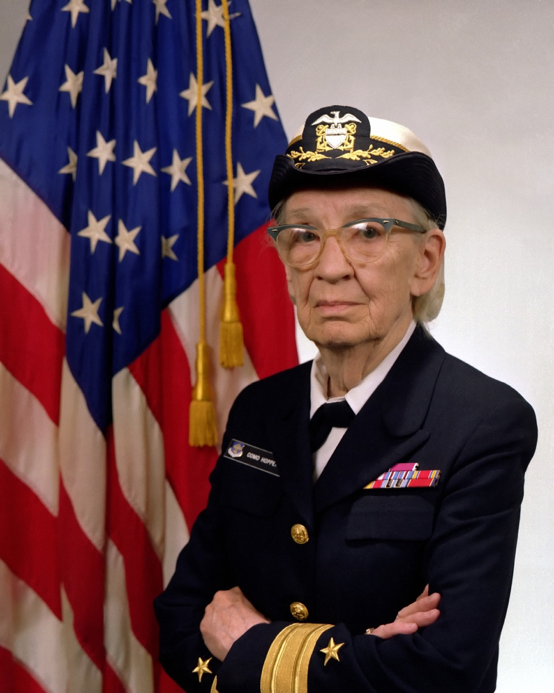

“First actual case of bug being found.”

這是史上第一個真正被發現的「Bug」。

— Grace Hopper, 1947

---

<!-- _class: full-comic -->
<!--
【葛麗絲·霍普生平四格分鏡解析】
Panel 1：拆解時鐘的好奇少女 —— 自幼拆解 7 個鬧鐘探索機械內部構造，展現過人天賦。
Panel 2：操縱 Mark II 的海軍先鋒 —— 穿上海軍制服，帶領團隊操控 15 公尺長之巨型機電計算機。
Panel 3：夾出飛蛾登錄歷史 Bug —— 1947 年在 Relay #70 夾出飛蛾並黏在實驗日誌上，幽默寫下這行名言。
Panel 4：發明編譯器與 COBOL —— 首創以人類英文自然語法編程，被尊為「軟體工程教母」。
-->

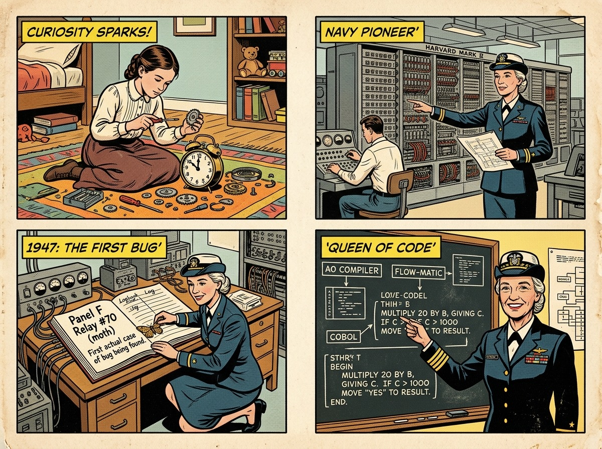

---

## 霍普與那隻被電死的飛蛾

<strong>葛麗絲·霍普 (Grace Hopper, 1906–1992)</strong>：美國海軍准將、計算機先驅與「編譯器之母」，一生致力於讓人類能用白話英文編寫程式。

  

    

      <h3>⚙️ 1947 年 9 月 9 日午後的計算機</h3>
      
長達 15 公尺的 Harvard Mark II 正在運算時頻發錯誤。團隊逐一排查數千個機械繼電器，在 <strong>Panel F 第 70 號繼電器</strong>觸點縫隙裡，找到了一隻被電死受困的飛蛾。

    

    

      <h3>📝 工作日誌上的幽默題字</h3>
      
霍普將飛蛾用透明膠帶貼在實驗日誌上，幽默題上此句。「Bug」正式登錄為計算機工程詞彙，並催生了 <strong>Debugging（除錯）</strong> 這一核心實務。

    

    

      <h3>🔧 從物理硬體障礙到思維邏輯盲點</h3>
      
早期計算機的 Bug 來自外在生物闖入；但霍普深刻洞察到，未來的軟體系統將成千上萬倍地複雜，程式碼中的邏輯盲點才是工程師終生必須對抗的真正幽靈。

    

  

  

    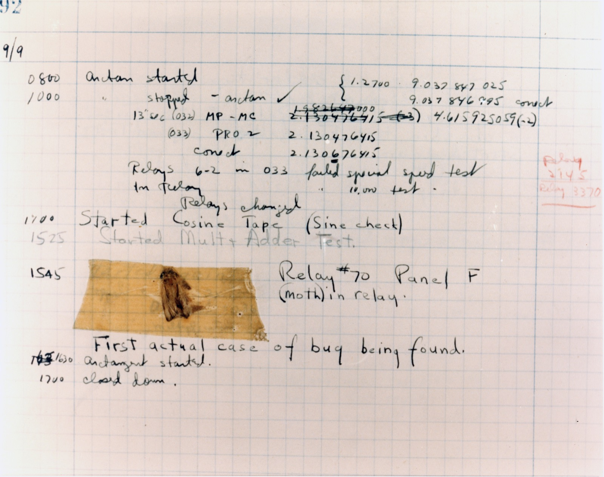
    
珍藏於美國國立歷史博物館的 1947 年 Mark II 歷史日誌原件

  

---

## Therac-25 悲劇：軟體 Bug 成了致命殺手

  

    

      <h3>💥 致命的競態條件 (Race Condition)</h3>
      
1985–1987 年間，醫療放射線治療儀 Therac-25 在操作員快速輸入指令的極端情況下，偶發觸發了變數溢位與並行競態漏洞，導致高能電子束未經衰減直接射入病患體內。

    

    

      <h3>⚠️ 純軟體控制的殘酷代價</h3>
      
設計團隊移除了上一代機器的機械物理聯鎖，過度信任軟體安全檢查。機器釋放出高達正常劑量 100 倍的致命超量輻射，奪走多名癌症患者寶貴生命。

    

    

      <h3>🛡️ 航太與醫療系統安全標準的誕生</h3>
      
這場事故震驚全球工程界，人類痛悟軟體不能只靠事後測試。它直接催生了關鍵生命系統的形式化安全分析標準與 IEC 62304 醫療軟體生命週期規範。

    

  

  

    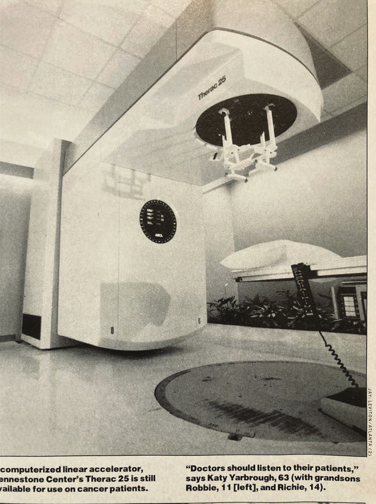
    
1985 年因軟體邏輯 Bug 釀成致命醫療事故的 Therac-25 實機照

  

---

## CrowdStrike 藍白大當機：一行邊界漏洞癱瘓全球

  

    

      <h3>🌍 2024 年 7 月 19 日的全球數位休克</h3>
      
資安防護軟體 Falcon 驅動更新中暗藏一個指標越界 Bug——讀取第 21 個通道資料時未作邊界檢查，透過雲端自動推播，全球超過 850 萬台 Windows 伺服器在幾分鐘內同步崩潰陷入藍屏死循環。

    

    

      <h3>🔍 關鍵驅動層漏洞與 CI/CD 防線失守</h3>
      
這段運行於核心態 (Kernel Mode) 的代碼未經過充分的虛擬測試環境驗證，且缺乏分批灰度發布（Canary Deployment）機制，導致單一邊界錯誤引發全球骨牌效應。

    

    

      💡 <strong>格言深意</strong>：霍普當年抓出的一隻 5 公分小飛蛾，如今已演變成足以讓全球航班停飛、醫院急診停擺的巨大風暴。Bug 不再是窗外飛進來的意外，而是人類自己留下的思維盲點。
    

  

  

    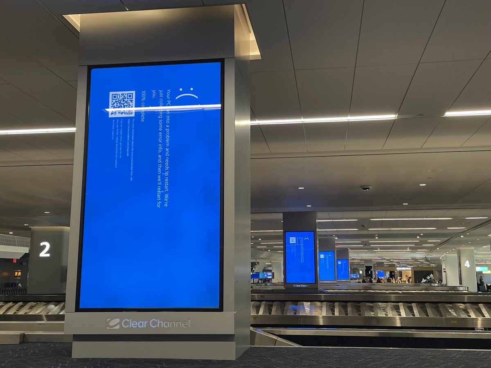
    
2024 年 7 月紐約機場航班資訊看板因 CrowdStrike 更新集體藍屏當機

  

---

<!-- _class: quote-hero -->

“Program testing can be used to show the presence of bugs, but never to show their absence!”

軟體測試只能證明程式有錯，永遠無法證明程式無錯！

— Edsger W. Dijkstra, 1970

---

<!-- _class: full-comic -->
<!--
【戴克斯特拉生平四格分鏡解析】
Panel 1：手寫證明的嚴謹青年 —— 荷蘭數學物理高材生，堅持用羽毛筆手寫公式推導程式正確性。
Panel 2：手捧最短路徑演算法 —— 喝咖啡 20 分鐘構思出 Dijkstra 演算法，奠定全球網路路由基礎。
Panel 3：反對 GOTO 與北約演講 —— 在 1968 年發表反對 GOTO 檄文，並在 NATO 軟體工程大會振聾發聵提出測試極限定理。
Panel 4：榮獲圖靈獎的科學泰斗 —— 1972 年摘得圖靈獎桂冠，以嚴謹數學結構將寫程式提升為科學。
-->

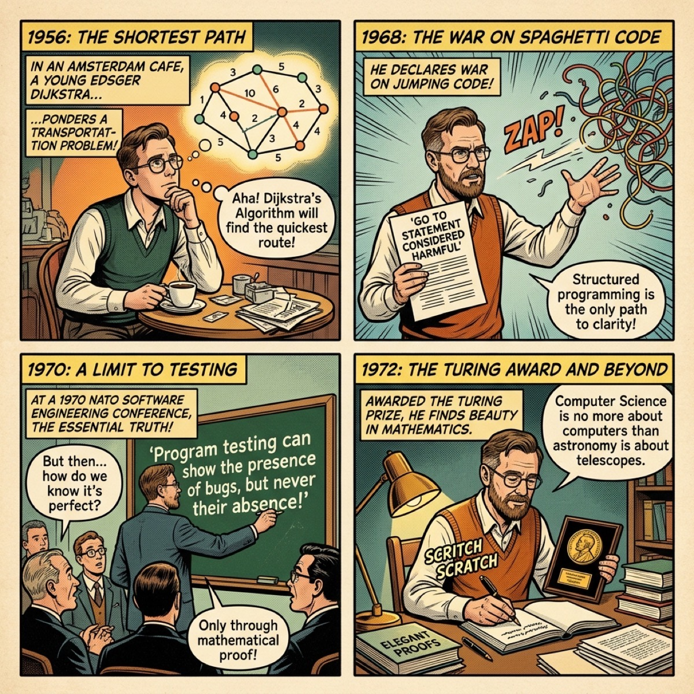

---

## 戴克斯特拉與 1970 年的清醒警鐘

<strong>艾茲赫爾·戴克斯特拉 (1930–2002)</strong>：荷蘭計算機科學家、圖靈獎得主，結構化編程的奠基者，以無比犀利的洞察力與對代碼數學正確性的嚴苛追求著稱。

  

    

      <h3>📜 1970 年布魯塞爾會議上的震撼發言</h3>
      
當時軟體產業陷入第一次「軟體危機」，工程師深信只要測試案例跑得夠多，系統就萬無一失。戴克斯特拉當頭棒喝：輸入空間是天文數字，測試覆蓋永遠只是浩瀚大海中的一滴水。

    

    

      <h3>🔢 輸入窮舉的數學不可能性</h3>
      
即使是一個簡單的 64 位元整數相加函式，要窮舉 264 × 264 種可能，當前最快超級電腦也要運算數萬年。窮舉不可能，測試就必然存在盲區。

    

    

      <h3>📐 形式化演算法與結構化編程革命</h3>
      
戴克斯特拉主張：軟體品質不能依賴盲目試錯，必須建立在嚴謹的抽象與邏輯證明之上。他倡導消除 GOTO 混亂跳轉，奠定了現代結構化編程範式。

    

  

  

    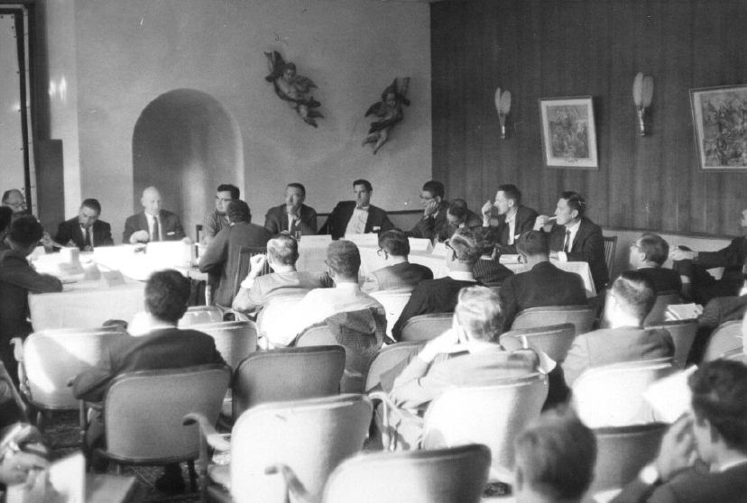
    
1968/1970 年 NATO 軟體工程大會現場，計算機科學界首次直面軟體危機

  

---

## Intel Pentium 浮點漏洞：90 億分之一的漏網之魚

  

    

      <h3>🔬 90 億分之一的極罕見除法錯誤</h3>
      
1994 年，英特爾奔騰 (Pentium) 處理器被數學教授發現 FDIV 除法存在瑕疵。在查表硬體中，原本應有 1066 個常數，工程師疏忽漏填了其中 5 個，導致極特定除法產生百萬分之一的微小偏差。

    

    

      <h3>🧪 數十億次常規測試下的盲目自信</h3>
      
英特爾在出廠前執行了天文數字級別的隨機指令測試，所有基準測試「全綠通行」。但漏網之魚正巧躲在機率極低的極端邊界組合裡，直到純數論研究者推導時才現形。

    

    

      <h3>💸 召回損失 4.75 億美元與晶片驗證變革</h3>
      
面對全球科學家與用戶質疑，英特爾被迫全面無條件召回更換，直接蒸發 4.75 億美元。此事件推動了晶片硬體設計導入形式化證明（Formal Verification）。

    

  

  

    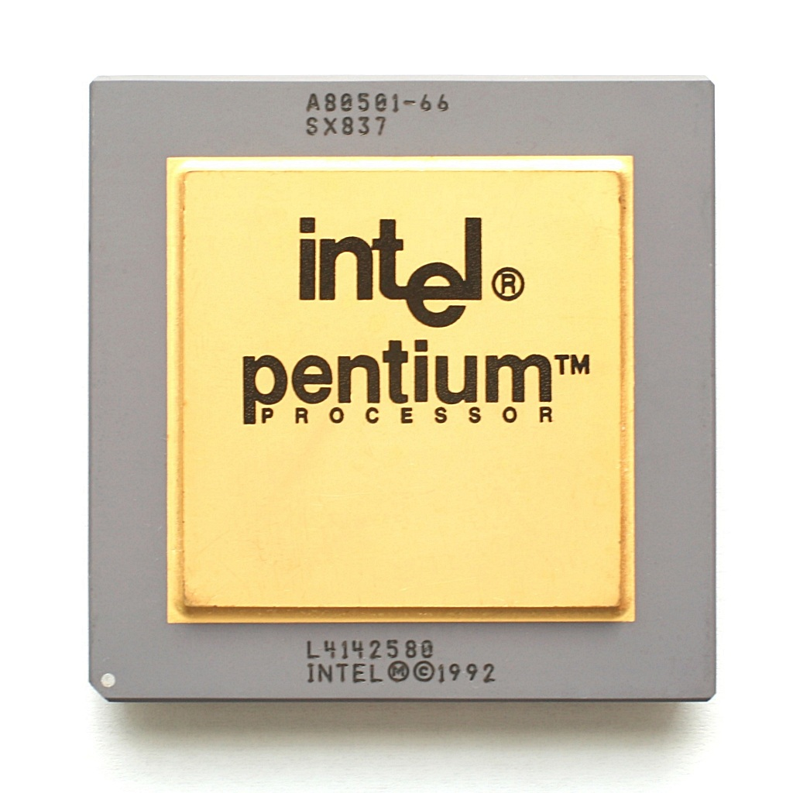
    
1994 年因 FDIV 浮點除法硬體漏洞引發全面召回的 Intel Pentium 處理器

  

---

## 自駕車 Corner Cases 與 LLM 幻覺：全綠測試後的盲區

  

    

      <h3>🚗 自駕車面對真實世界的無窮邊界 (Corner Cases)</h3>
      
自動駕駛在封閉場地測試與百萬公里模擬中全部通過，但真實街頭有突然橫躺的床墊、倒映落日的反光水窪或穿著萬聖節服裝的行人，邊界情境難以窮盡。

    

    

      <h3>🤖 大語言模型基準測試下的「偶發幻覺」</h3>
      
當今的大型語言模型在數千道基準考題上取得 90%+ 的優異成績，看似無懈可擊，但在特定上下文或提示詞誘導下，仍會言之鑿鑿地給出荒謬的錯誤答案。

    

    

      💡 <strong>格言深意</strong>：測試就像黑夜裡的探照燈，照亮的地方沒有怪物，不代表黑暗深處沒有危險。不要把「所有測試通過」誤讀為「系統完美無暇」。
    

  

  

    
    
自動駕駛遭遇極端長尾場景（翻覆側躺大貨車），現有測試集難以完全涵蓋

  

---

<!-- _class: quote-hero -->

“Testing is the process of executing a program with the intent of finding errors.”

測試是為了「發現錯誤」而執行程式的過程。

— Glenford Myers, 1979

---

<!-- _class: full-comic -->
<!--
【格倫福德·邁爾斯生平四格分鏡解析】
Panel 1：IBM 系統研究室的沉思者 —— 觀察無數工程師寫出「只求綠燈通過」的自我安慰測試。
Panel 2：下筆著書立說《軟體測試藝術》 —— 1979 年出版經典專著，首次將心理學與哲學引入軟體測試。
Panel 3：醫院體檢的犀利隱喻 —— 拿聽診器檢查代碼：「去醫院是為了查病，不是為了證明自己健康！」
Panel 4：現代軟體品質學派奠基 —— 激勵全球 QA 團隊以「主動擊穿系統缺陷」為崇高榮譽。
-->

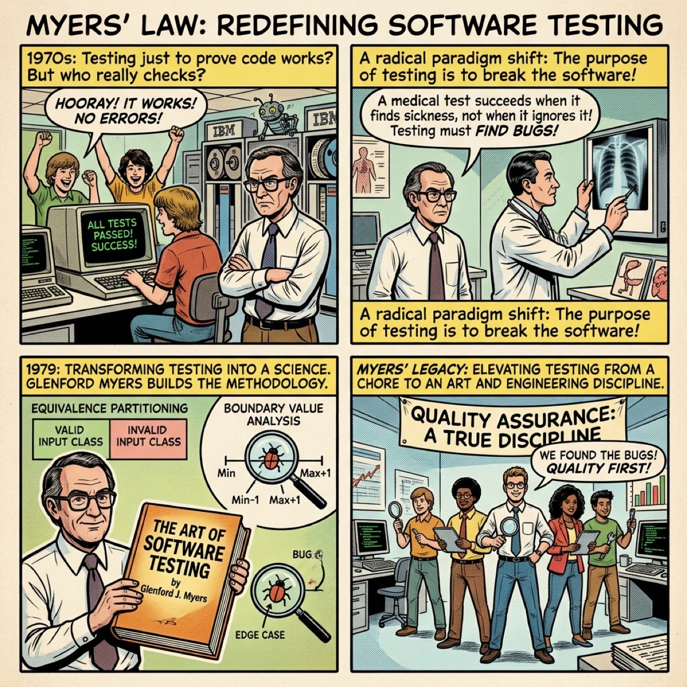

---

## 邁爾斯與測試心理學的破局

<strong>格倫福德·邁爾斯 (Glenford Myers, 1946–)</strong>：軟體測試先驅、作家兼企業家，1979 年出版《軟體測試藝術》(The Art of Software Testing)，徹底重塑了軟體工程界對「測試」的認知架構。

  

    

      <h3>🩺 去醫院做體檢的精準隱喻</h3>
      
邁爾斯問工程師：如果你花大錢去醫院做全面健康檢查，醫生走出診間說『恭喜，沒查出任何毛病』，但你轉身就昏倒，這場體檢有何價值？去醫院是為了查出隱疾，測試也是如此。

    

    

      <h3>🔄 顛覆「證明程式正常」的心理偏誤</h3>
      
在邁爾斯之前，多數工程師寫測試的目標是『證明我的程式能跑』。邁爾斯指出這是致命的確認偏誤——成功的測試不是看著全部綠燈拍手，而是設計刁鑽案例把 Bug 揪出來！

    

    

      <h3>🏆 重新定義測試成功：抓出缺陷才是高價值</h3>
      
一個沒抓到任何錯誤的測試案例，往往價值有限；一個成功讓系統拋出異常、揭露崩潰邊界的測試，才是真正拯救專案的無價之寶。

    

  

  

    
    
邁爾斯在《軟體測試藝術》中提出的醫療診斷隱喻：測試是為了診斷病灶

  

---

## 火星氣候探測者號：誰也不疑的「全綠」代價

  

    

      <h3>🚀 1.25 億美元的公制與英制單位低級混淆</h3>
      
1999 年 9 月，NASA 火星氣候探測者號進入火星大氣層時失聯燒毀。調查揭露：洛克希德馬丁團隊軟體輸出的是英制單位「磅·秒」，而噴氣推進實驗室系統默認輸入為公制「牛頓·秒」。

    

    

      <h3>🟢 各自模組單元測試「全綠通過」的盲點</h3>
      
兩邊團隊各自進行了詳盡的單元測試，每個元件的邏輯皆正常運作，單元測試報告一片綠油油。但沒有人帶著「懷疑介面合約」的破壞心態執行跨系統整合測試。

    

    

      <h3>🛰️ 系統整合合約測試 (Contract Testing) 的興起</h3>
      
這場災難讓航太界與分散式微服務領域痛定思痛，確立了強型別單位驗證、介面消費者驅動契約測試（Consumer-Driven Contracts）等嚴格規範。

    

  

  

    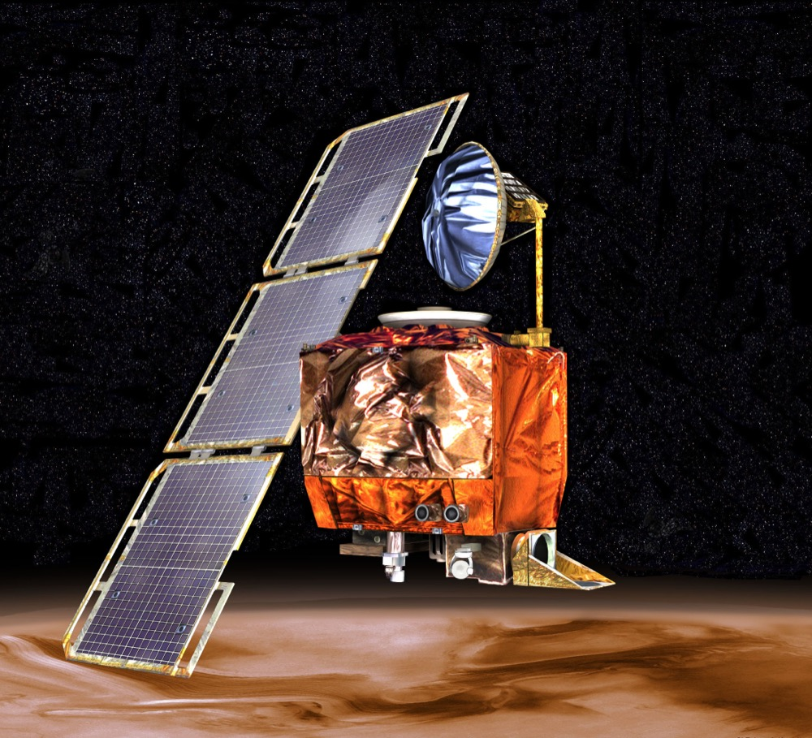
    
1999 年因單位轉換缺陷在火星大氣層解體燒毀的火星氣候探測者號

  

---

## Netflix 混亂工程：以主動搞破壞為榮的極致實踐

  

    

      <h3>🐒 Chaos Monkey：在生產環境釋放「搗蛋猴」</h3>
      
Netflix 將邁爾斯的破壞思維推向極致：開發 Chaos Monkey 程式，在上班時間無預警、隨機關閉生產環境中的伺服器實例與資料庫節點。

    

    

      <h3>🛡️ 從「假設萬無一失」轉向「韌性工程 (Resilience)」</h3>
      
工程師不再祈禱系統永不宕機，而是強迫軟體架構在任何節點突然陣亡時，皆能自動降級、優雅容錯、自動轉移流量，徹底治癒系統脆性。

    

    

      💡 <strong>格言深意</strong>：如果你的測試總是一帆風順、滿眼綠燈，那只代表你的測試缺乏想像力。真正高水準的工程文化，敢於在平日主動把系統逼到極限。
    

  

  

    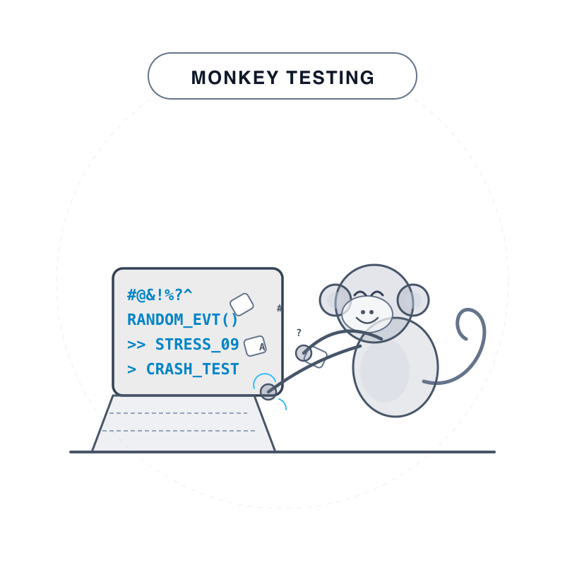
    
Netflix Chaos Monkey 混亂工程圖騰，開創主動破壞系統驗證韌性的先河

  

---

<!-- _class: quote-hero -->

“There was no second chance. We all knew that.”

我們沒有第二次機會。每個人都深知這一點。

— Margaret Hamilton, 1969

---

<!-- _class: full-comic -->
<!--
【瑪格麗特·漢密爾頓生平四格分鏡解析】
Panel 1：MIT 實驗室的年輕母親 —— 帶著小女兒在麻省理工實驗室日夜推導阿波羅導航演算法。
Panel 2：與等身阿波羅代碼手稿合影 —— 站在手寫的阿波羅太空導航程式碼旁，代碼厚度超越她自身高度。
Panel 3：登月三分鐘優先權調度破局 —— 1202 警報響起，非同步優先權調度自動砍掉多餘任務，力挽狂瀾。
Panel 4：獲得總統自由勳章 —— 創造「軟體工程」名詞，獲頒美國最高平民榮譽，名垂青史。
-->

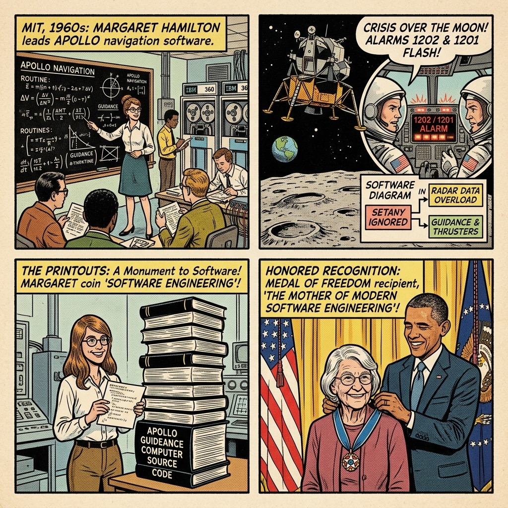

---

## 漢密爾頓與阿波羅 11 號的驚魂三分鐘

<strong>瑪格麗特·漢密爾頓 (1936–)</strong>：MIT 儀器實驗室軟體工程處處長，創造了「Software Engineering」一詞，主持阿波羅導航電腦 (AGC) 飛行軟體開發。

  

    

      <h3>🌕 1969 年 7 月 20 日登月艙降落前的生死 3 分鐘</h3>
      
距離月球表面僅數百公尺時，阿波羅 11 號座艙警報驟響：<strong>1202 與 1201 代碼</strong>閃爍。雷達硬體開關位置錯誤，每秒灌入巨量無效中斷，AGC 電腦運算負載瞬間衝破 100%。

    

    

      <h3>⚙️ 非同步優先級排程 (Priority Scheduling) 的奇蹟</h3>
      
漢密爾頓預先設計了非同步排程系統：電腦自動判定雷達資料為低優先級，果斷拋棄非核心任務，將寶貴的 CPU 週期 100% 集中於維持著陸推進噴射！

    

    

      <h3>👩‍💻 「軟體工程」正式誕生於這場嚴苛考驗</h3>
      
當時男性硬體工程師普遍輕視軟體。漢密爾頓堅持將代碼編寫視為一門具備嚴謹規格與可靠性驗證的獨立工程學門，從此確立了「軟體工程」的歷史地位。

    

  

  

    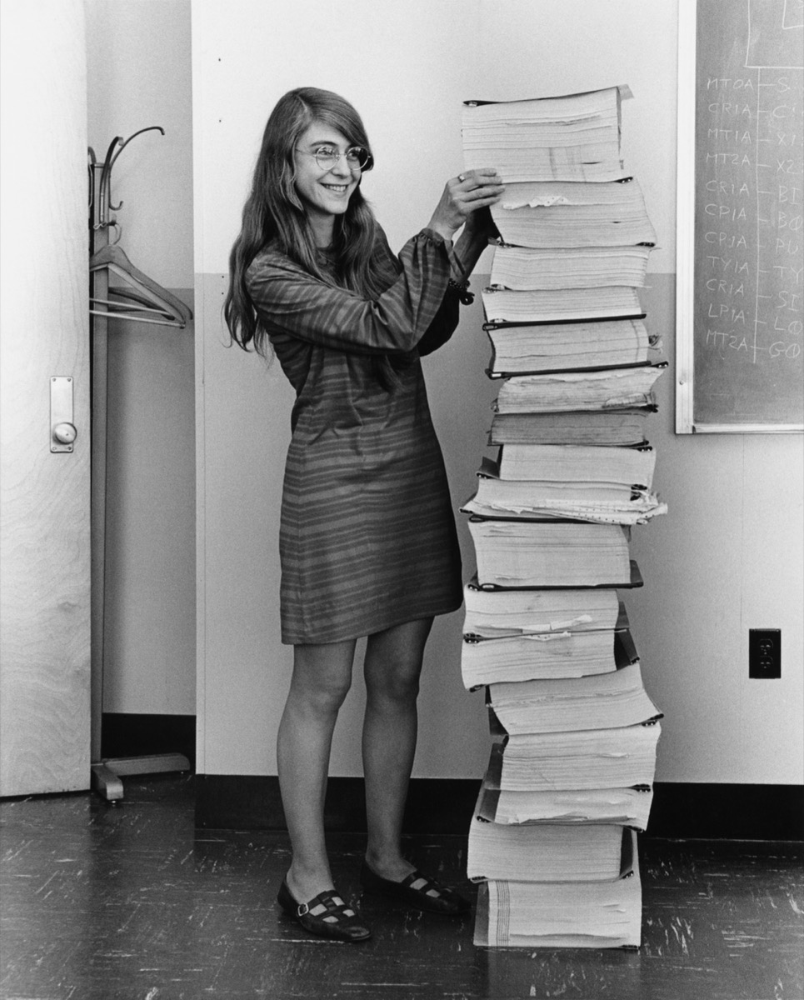
    
1969 年漢密爾頓與麻省理工團隊親手編寫的阿波羅 11 號登月導航軟體代碼堆疊合影

  

---

## 水手一號：漏掉一條上線導致火箭偏航自毀

  

    

      <h3>🚀 1962 年升空 293 秒後的驚天爆炸</h3>
      
美國第一艘金星探測太空船「水手一號」(Mariner 1) 發射升空不到 5 分鐘，火箭突然劇烈偏離航道，地面控制中心被迫引爆摧毀，1850 萬美元瞬間灰飛煙滅。

    

    

      <h3>📝 手寫數學公式漏掉一條上橫線 (Overbar)</h3>
      
調查發現：手寫導航規格中的光滑平移導引速度公式漏了一條上劃線（代表時間平均光滑）。工程師轉譯為 FORTRAN 代碼時，將微小常規抖動誤算為巨幅偏航。

    

    

      <h3>🔍 規格審查 (Specification Review) 制度的建立</h3>
      
這場災難成為歷史上代價最昂貴的「標點符號錯誤」，直接催生了 NASA 全套嚴謹的同儕代碼走查 (Code Walkthrough) 與需求追溯矩陣。

    

  

  

    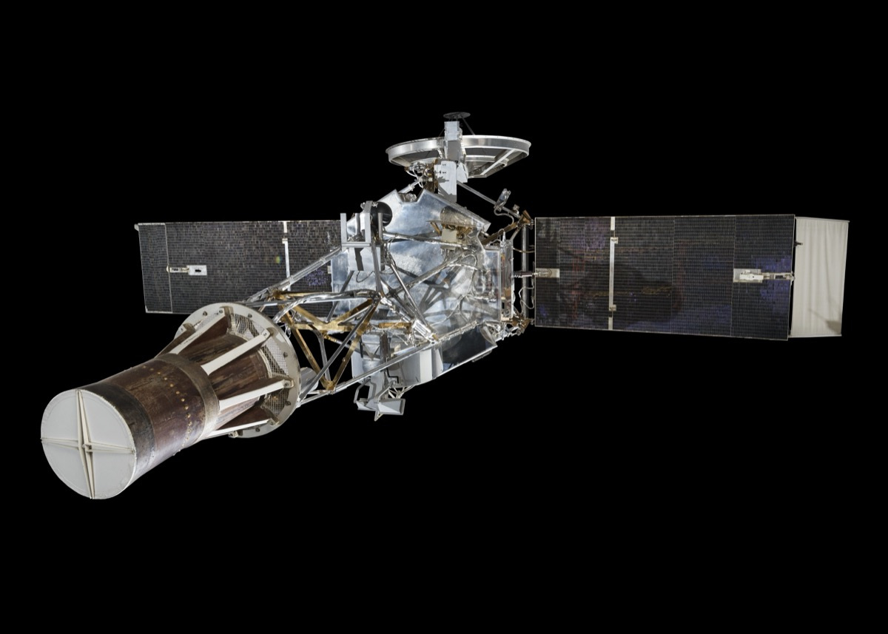
    
1962 年水手一號火箭發射瞬間，隨後因導航代碼符號疏漏偏航自毀

  

---

## SpaceX 航太容錯：三重冗餘架構傳承先驅遺產

  

    

      <h3>🛰️ 三重模組冗餘 (TMR) 與即時投票容錯機制</h3>
      
現代 SpaceX 獵鷹 9 號與天龍號太空船，每台發動機控制電腦均配備三顆獨立雙核心 x86 處理器，各節點各自計算並透過乙太網路進行微秒級多數決投票。

    

    

      <h3>⚡ 對抗宇宙射線引發的「單粒子翻轉 (Single Event Upset)」</h3>
      
太空輻射會隨機翻轉晶片記憶體中的位元。軟體系統能自動識別並隔離異常運算單元，在動態重啟節點的同時，火箭姿態控制絲毫不受中斷。

    

    

      💡 <strong>格言深意</strong>：在沒有第二次機會的極限場景裡，系統的偉大不在於永遠不出意外，而在於面對未預期的硬體故障與超載時，軟體依然能精準做出最關鍵的取捨。
    

  

  

    
    
承襲漢密爾頓容錯設計哲學的 SpaceX 獵鷹 9 號火箭成功回收降落

  

---

<!-- _class: quote-hero -->

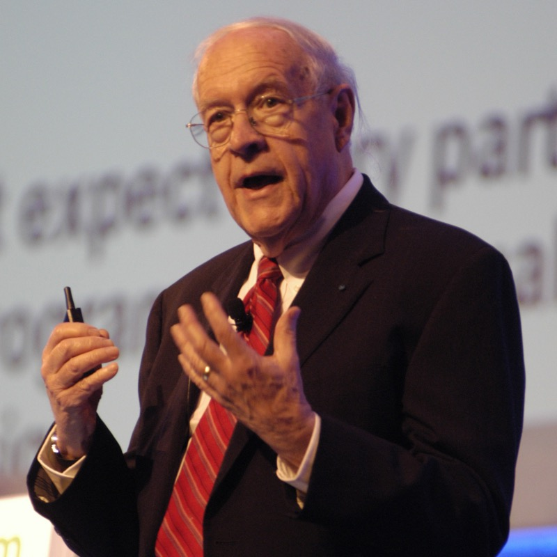

“Adding manpower to a late software project makes it later.”

向延遲的軟體專案增加人手，只會使它更加延遲。

— Fred Brooks, 1975

---

<!-- _class: full-comic -->
<!--
【佛瑞德·布魯克斯生平四格分鏡解析】
Panel 1：IBM System/360 總架構師 —— 統領史上最龐大硬體相容性專案，取得輝煌商業成功。
Panel 2：OS/360 軟體焦油坑泥潭 —— 投入 5000 人月卻陷入無盡延期，深刻體悟軟體開發本質困境。
Panel 3：人月神話與外科手術團隊 —— 寫下傳世名著《人月神話》，提出著名的「布魯克斯法則」。
Panel 4：榮獲圖靈獎啟迪後世 —— 1999 年獲頒圖靈獎，成為軟體專案管理與系統架構永恆燈塔。
-->

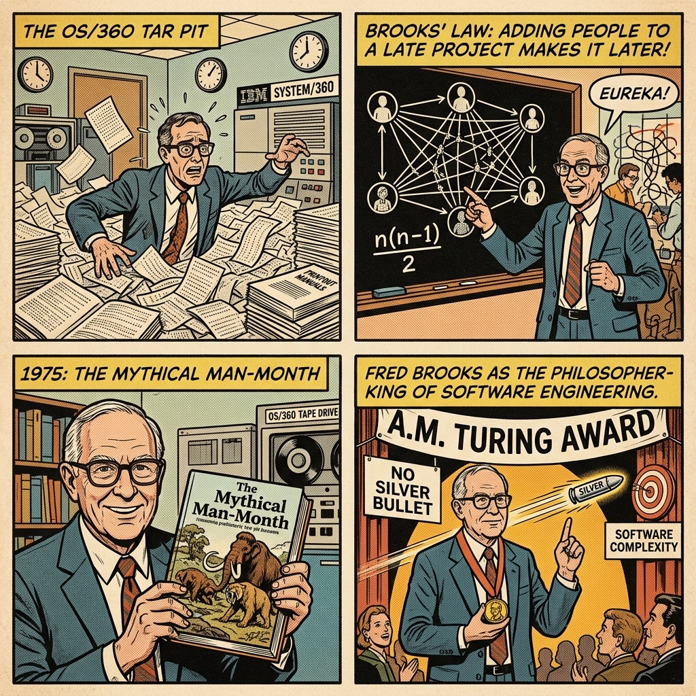

---

## 布魯克斯與價值 5 億美元的焦油坑

<strong>佛瑞德·布魯克斯 (Fred Brooks, 1931–2022)</strong>：圖靈獎得主、IBM System/360 總設計師與 OS/360 專案主管，被譽為「軟體專案管理之父」。

  

    

      <h3>🧱 史上最昂貴的專案焦油坑：OS/360</h3>
      
1960 年代中期，IBM 研發統一相容的作業系統 OS/360，動用數千名程式設計師、耗資超過 5 億美元（在當時比原子彈研發還貴），專案卻陷入延期數年的泥潭中。

    

    

      <h3>🔀 人員溝通成本呈 n(n-1)/2 指數級暴增</h3>
      
布魯克斯深刻發現：增加新人不僅無法提升產能，還需要老手停下手頭工作進行培訓；而溝通管道隨人數呈二次方爆炸，導致整合會議與衝突協調吞噬一切精力。

    

    

      <h3>📖 《人月神話》破除工時等於產能的迷思</h3>
      
「九個孕婦無法在一個月內生出一個孩子。」布魯克斯將軟體的本質複雜性剖析得淋漓盡致，確立了軟體工程不是單純人力密集的搬磚活動。

    

  

  

    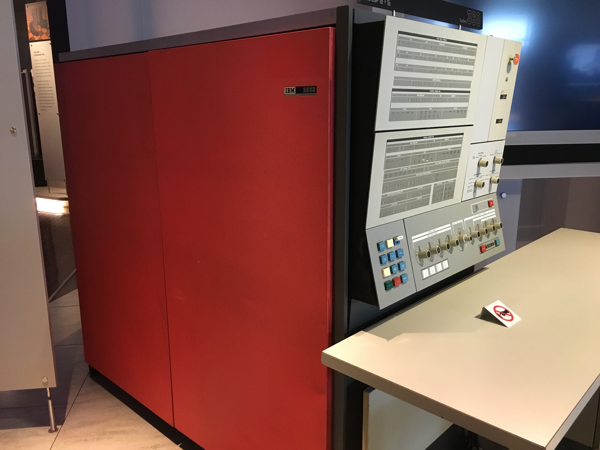
    
1964 年改變電腦工業版圖的 IBM System/360 巨型機，其 OS 專案催生了《人月神話》

  

---

## 丹佛機場行李系統：加人加錢的溝通災難

  

    

      <h3>🧳 延期 16 個月、每天虧損 110 萬美元的自動化噩夢</h3>
      
1994 年丹佛國際機場斥資數億美元，企圖打造覆蓋全機場的無人自動行李分揀軌道車。然而軟體在實測時，小車頻繁相撞、行李被軌道拋飛卡死。

    

    

      <h3>🏃‍♂️ 盲目加派數百名承包商與工程師進場救火</h3>
      
管理層試圖以投入龐大人力挽救進度，結果各家供應商代碼規格不一、通訊協定衝突，無休止的介面摩擦讓系統死鎖問題更加失控。

    

    

      <h3>📉 最終被迫放棄全面自動化退回傳統人工搬運</h3>
      
這場災難導致整個機場推遲一年多啟用，成為現代專案管理學科中印證「布魯克斯法則」的最著名現代反面案例。

    

  

  

    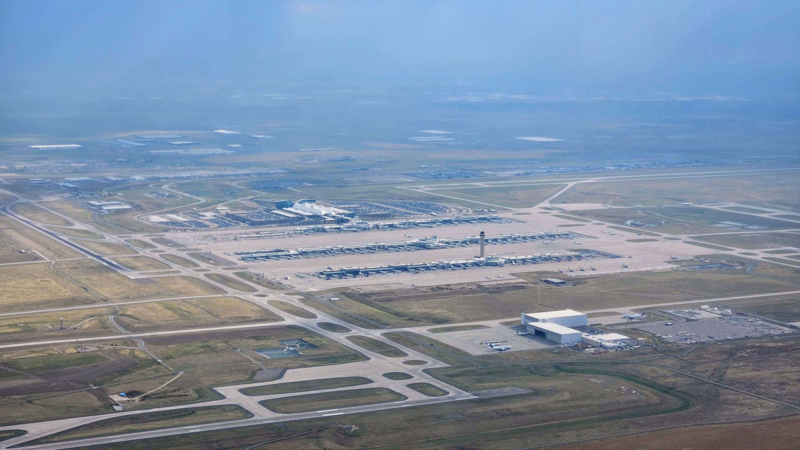
    
丹佛國際機場全自動行李分揀系統測試時小車擠成一團的歷史現場

  

---

## 雙披薩原則：現代敏捷對布魯克斯法則的回應

  

    

      <h3>🍕 亞馬遜 Amazon 的「雙披薩團隊 (Two-Pizza Team)」</h3>
      
傑夫·貝佐斯依據布魯克斯洞見立下鐵律：任何軟體團隊規模絕不能超過兩張大披薩能餵飽的人數（約 6–8 人），徹底限制溝通複雜度。

    

    

      <h3>📦 微服務架構與康威定律的終極協調</h3>
      
將龐大的單體系統 (Monolith) 拆解為自治的微服務，每個小團隊全權負責各自服務的生命週期，透過定義良好的 API 合約溝通，告別跨部門扯皮。

    

    

      💡 <strong>格言深意</strong>：軟體開發的真正瓶頸從來不是程式碼的鍵入速度，而是人與人之間概念完整性的傳遞與協調。解耦系統，首先要解耦組織架構。
    

  

  

    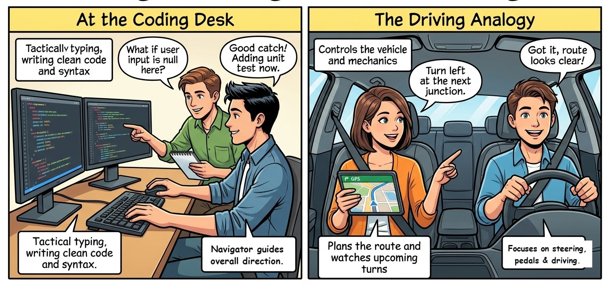
    
現代敏捷小團隊專注敏捷協作，以極小溝通界面取代大規模人員堆砌

  

---

<!-- _class: quote-hero -->

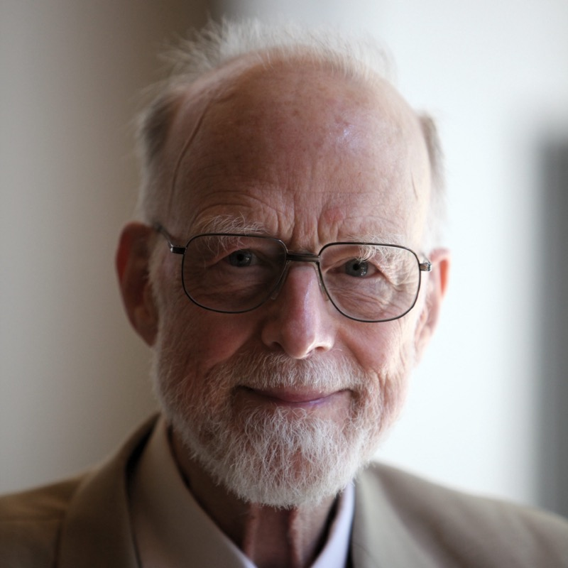

“I call it my billion-dollar mistake. It was the invention of the null pointer in 1965.”

我稱之為我的十億美元錯誤。那就是在 1965 年發明了 Null 指標。

— Sir Tony Hoare, 2009

---

<!-- _class: full-comic -->
<!--
【東尼·霍爾生平四格分鏡解析】
Panel 1：快速排序演算法的發明者 —— 1960 年在牛津大學提出 Quicksort，奠定現代高效搜尋排序基石。
Panel 2：偷懶加入 null 留下一生遺憾 —— 1965 年設計 ALGOL W 型別系統時，圖省事加入 null 引數指針。
Panel 3：QCon 大會痛心疾首的懺悔 —— 2009 年登上倫敦 QCon 演講台，沉痛定性其為「十億美元的代價」。
Panel 4：倡導形式化驗證的爵士宗師 —— 提出霍爾邏輯 (Hoare Logic) 與 CSP，引領安全程式語言文藝復興。
-->

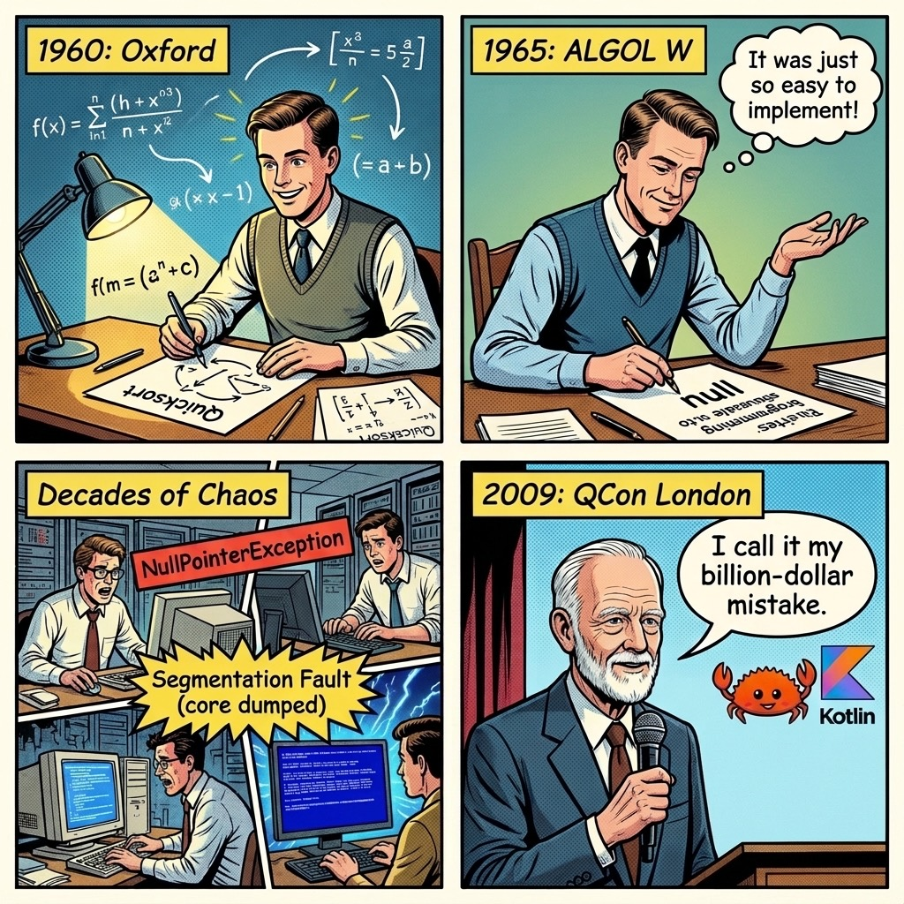

---

## 霍爾與 1965 年偷懶打開的潘朵拉魔盒

<strong>查爾斯·安東尼·理查·霍爾爵士 (1934–)</strong>：圖靈獎得主、快速排序法發明者，計算機形式化驗證學術宗師，2000 年獲英國女王冊封為爵士。

  

    

      <h3>💡 1965 年設計 ALGOL W 語言時的「順手為之」</h3>
      
當時霍爾正在設計物件導向語言先驅 ALGOL W 的型別系統。為了讓編譯器實作起來最簡單無痛，他設計了一個能賦值給任何物件參照的通配符——<code>null</code>。

    

    

      <h3>💸 2009 年 QCon 演講上的深切自責與反思</h3>
      
「那時實作 null 太容易了，我抵擋不住誘惑。在此後的四十年裡，它引發了難以計數的系統崩潰與安全漏洞，造成了超過十億美元的痛苦與損失。」

    

    

      <h3>💥 NullPointerException 成為軟體史上最普遍的災難</h3>
      
不論是 C 語言的 Segmentation Fault，還是 Java 著名的 NPE，空指標成為半個世紀以來無數深夜工程師值班被叫醒的頭號夢魘。

    

  

  

    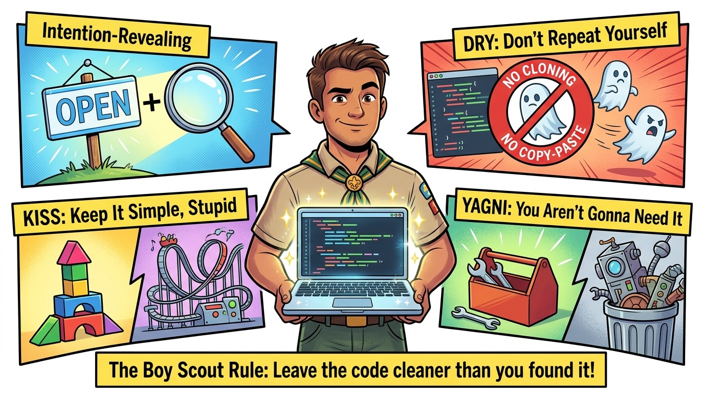
    
無數程式工程師與計算機系統因 NullPointer 崩潰與記憶體段錯誤付出慘痛代價

  

---

## 莫里斯蠕蟲：空指標與緩衝區溢位的首場風暴

  

    

      <h3>🐛 1988 年莫里斯蠕蟲感染全美 10% 互聯網主機</h3>
      
康奈爾大學學生羅伯特·莫里斯撰寫了史上第一隻互聯網蠕蟲病毒，在短短數小時內感染了全美約 6000 台 Unix 主機，造成大面積網路中斷。

    

    

      <h3>🔓 利用 <code>gets()</code> 緩衝區溢位與空指標檢查缺失</h3>
      
病毒利用 Unix 指標越界與 sendmail 中缺乏 null 結尾防禦的漏洞，強行覆蓋函式堆疊的返回位址，奪取伺服器 root 執行權限。

    

    

      <h3>⚠️ 計算機安全應變小組 (CERT) 的火線成立</h3>
      
這場事故推動全球計算機科學界成立 CERT 應變體系，讓業界徹底驚覺：指標操作與記憶體不安全，直接攸關國家數位基礎安全。

    

  

  

    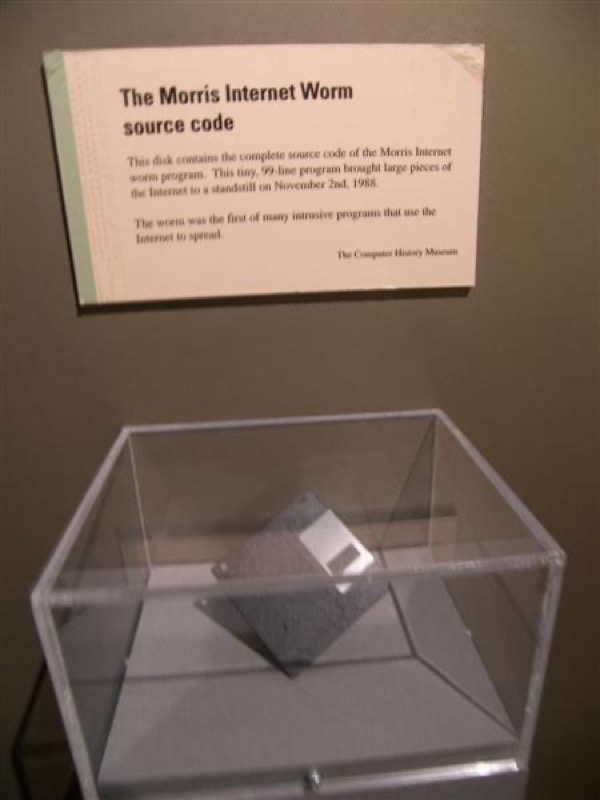
    
1988 年儲存莫里斯蠕蟲原始碼的磁片原件，珍藏於波士頓科學博物館

  

---

## 現代空安全革命：Rust 與 Kotlin 的徹底根治

  

    

      <h3>🦀 Rust 語言宣告「消滅 Null」的革命性型別系統</h3>
      
Rust 徹底移除了原生 null 指標，取而代之的是強制的 <code>Option&lt;T&gt;</code> 列舉型別，強迫開發者在編譯期必須顯式處理為空的所有可能，達成編譯期記憶體安全。

    

    

      <h3>📱 Kotlin 與 Swift 的語法級空安全防線</h3>
      
現代行動端語言全面引入 <code>String?</code> 與安全呼叫符 <code>?.</code>，將過去在執行期隨機引爆的當機問題，100% 截殺在編譯階段。

    

    

      💡 <strong>格言深意</strong>：在基礎架構與底層設計中，一個為了節省五分鐘而妥協的「偷懶捷徑」，往後整個文明與後世工程師要付出數十年的沉重維護代價來填坑。
    

  

  

    
    
Rust 官方識別標誌，代表現代系統級程式語言對記憶體安全與無 Null 的終極承諾

  

---

<!-- _class: quote-hero -->

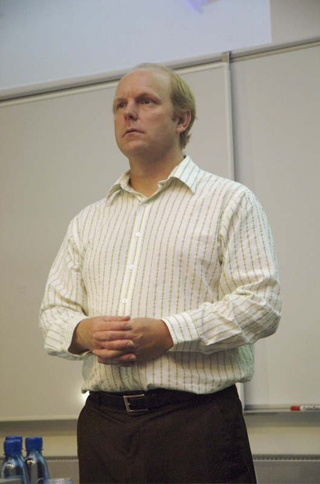

“Test-first programming is not really about testing; it's about design.”

測試先行 (TDD) 的本質不是測試，而是設計。

— Kent Beck, 2002

---

<!-- _class: full-comic -->
<!--
【肯特·貝克生平四格分鏡解析】
Panel 1：克萊斯勒 C3 薪資系統危機 —— 面對一團混亂的古老專案，大膽提出極限編程 (XP)。
Panel 2：紅燈-綠燈-重構三部曲 —— 構思測試驅動開發 (TDD)，將寫測試變成設計與解耦的探索羅盤。
Panel 3：敏捷宣言雪鳥峰會創始 —— 2001 年與 16 位大師在雪山簽署敏捷宣言，掀起全球開發模式巨浪。
Panel 4：現代工程紀律的引領者 —— 倡導結對編程與持續集成，其思想深深烙印在現代軟體工程基因中。
-->

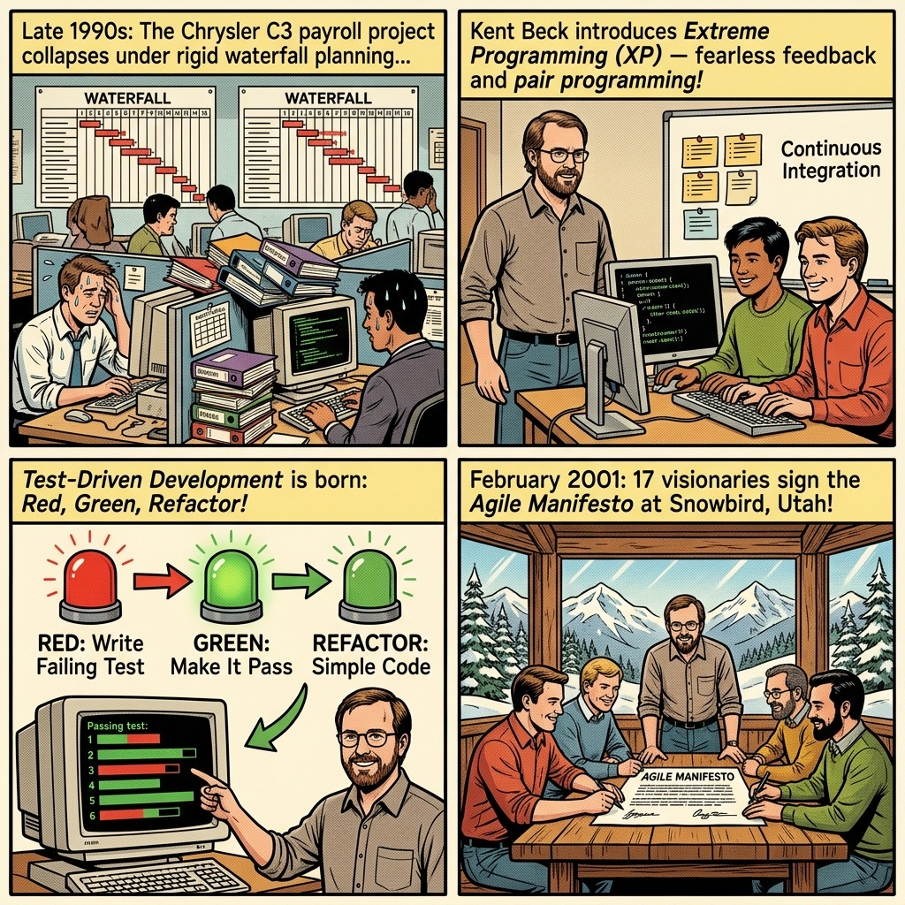

---

## 貝克與極限編程的「紅綠重構」革命

<strong>肯特·貝克 (Kent Beck, 1961–)</strong>：極限編程 (XP) 創始人、敏捷宣言起草者之一、TDD (測試驅動開發) 倡導者，曾任 Facebook 與 Gusto 頂級架構教練。

  

    

      <h3>🚗 克萊斯勒薪資系統 C3 專案的破局實驗</h3>
      
1996 年，克萊斯勒薪資專案嚴重超期失控。貝克受邀接手，毅然打破厚重的瀑布流程，要求所有工程師「先寫會失敗的測試，才允許寫下一行生產代碼」。

    

    

      <h3>🔄 紅燈、綠燈、重構 (Red-Green-Refactor) 的小步快跑</h3>
      
先寫一個失敗的測試（紅燈），用最精簡的代碼讓它通過（綠燈），然後安心消除壞味道（重構）。測試驅動迫使工程師從「呼叫者視角」設計乾淨模組。

    

    

      <h3>🛡️ 測試不是負擔，而是大膽重構的勇氣之網</h3>
      
貝克指出：多數工程師不敢修改爛代碼，是因為害怕改壞其他地方。唯有擁有一張綿密自動化測試保護網，開發者才能無所畏懼地持續改良設計。

    

  

  

    
    
極限編程 (XP) 經典實踐：結對編程 (Pair Programming) 與即時反饋驅動開發

  

---

## 騎士資本 45 分鐘浩劫：未經測試代碼的毀滅代價

  

    

      <h3>⚡ 2012 年 8 月 1 日開盤後的驚魂 45 分鐘</h3>
      
美國最大高頻交易做市商騎士資本 (Knight Capital) 部署新交易演算法。美股開盤後 45 分鐘內，系統以每秒數千筆的速度瘋狂高買低賣，瞬間累積數百億巨額曝險。

    

    

      <h3>🗑️ 八台伺服器漏更一台，誤觸發八年前廢棄死代碼</h3>
      
工程師手動更新伺服器，第八台未部署成功；當新標誌發送至舊代碼時，意外啟動了缺乏重構且未經端到端測試的除役功能「Power Peg」，不可收拾。

    

    

      <h3>🛑 蒸發 4.6 億美元導致破產清算</h3>
      
公司在短短 45 分鐘內淨虧損 4.6 億美元，直接走向破產清算。此事件成為軟體工程缺乏自動化驗證與 CI/CD 嚴格防線的最昂貴教訓。

    

  

  

    
    
2012 年紐約證券交易所騎士資本股價崩跌圖表，45 分鐘蒸發 4.6 億美元

  

---

## 現代 CI/CD 自動化流水線：貝克哲學的終極具象

  

    

      <h3>🚀 每天部署數萬次的現代科技巨擘實踐</h3>
      
從 GitHub Actions 到 GitLab CI，全球工程團隊如今在每一次 <code>git push</code> 時自動執行成千上萬個單元測試，徹底落實貝克「持續整合」的原始理念。

    

    

      <h3>🎯 金絲雀發布 (Canary Releases) 與特性開關 (Feature Flags)</h3>
      
代碼不再積累數月才發布，而是透過特性開關與小批量灰度發布動態分流，使單次變更的風險降至趨近於零。

    

    

      💡 <strong>格言深意</strong>：測試先行不是為了填寫品質報告表格，而是為了在動筆寫下實現之前，強迫你的大腦先想清楚這個介面究竟該長成什麼模樣。
    

  

  

    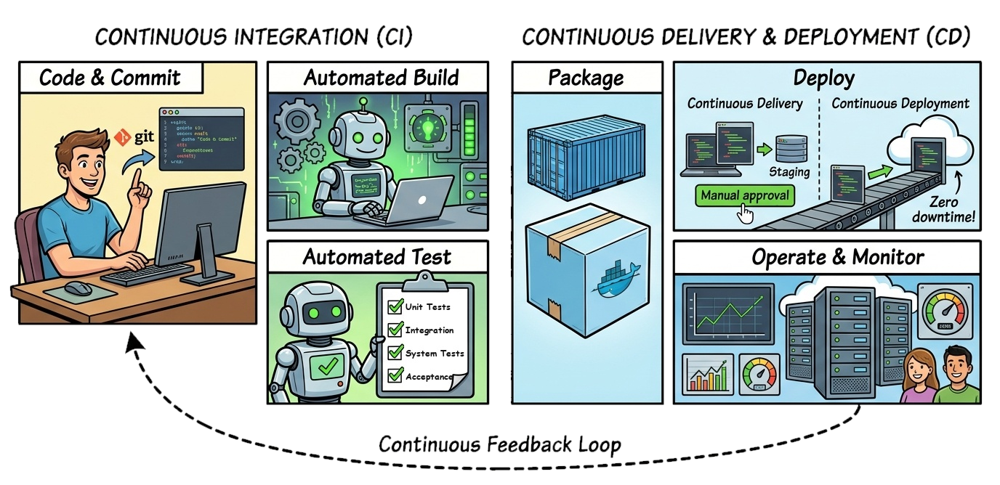
    
現代持續整合與持續部署 (CI/CD) 自動化流水線控制台，全綠通過方可上線

  

---

<!-- _class: quote-hero -->

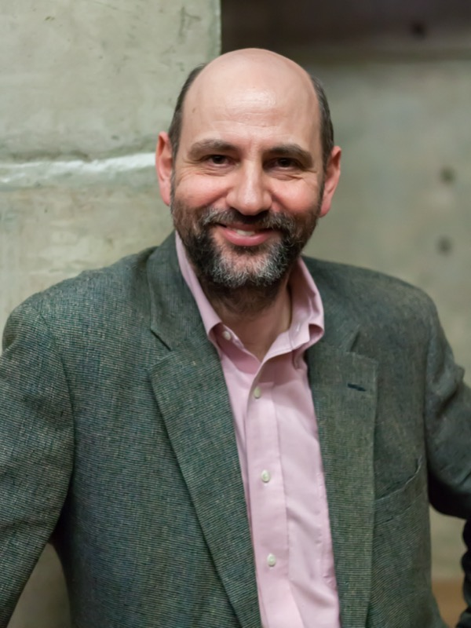

“Any fool can write code that a computer can understand. Good programmers write code that humans can understand.”

任何傻瓜都能寫出電腦看得懂的代碼。優秀的程式設計師寫的是人類能看懂的代碼。

— Martin Fowler, 1999

---

<!-- _class: full-comic -->
<!--
【馬丁·福勒生平四格分鏡解析】
Panel 1：ThoughtWorks 首席科學家 —— 穿梭於全球大型企業專案，診斷成千上萬遺留系統的架構病灶。
Panel 2：筆耕不輟著成《重構》聖經 —— 1999 年出版《Refactoring》，系統化定義提取函式等精微手術手法。
Panel 3：提出「代碼壞味道」聞名遐邇 —— 與肯特·貝克共創「Code Smell」隱喻，教導工程師辨識架構腐化。
Panel 4：微服務與架構演進宗師 —— 在其個人網站撰寫無數經典架構模式散文，持續啟發幾代工程師。
-->

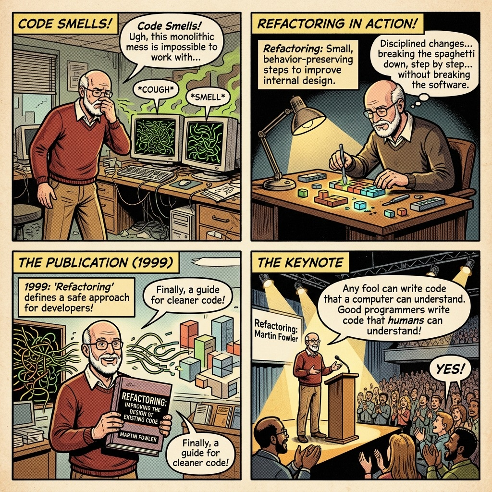

---

## 福勒與「代碼壞味道」的重構革命

<strong>馬丁·福勒 (Martin Fowler, 1963–)</strong>：ThoughtWorks 首席科學家、軟體架構宗師，1999 年出版《重構：改善既有代碼的設計》，掀起代碼整潔革命。

  

    

      <h3>📚 1999 年《重構》問世：為代碼進行微創手術</h3>
      
在福勒之前，「重構」只是一種民間口頭說法。福勒將改善代碼結構的過程形式化為數十種命名明確的操作清單（如 Extract Method、Inline Variable），讓代碼修復有章可循。

    

    

      <h3>🦨 著名隱喻「代碼壞味道」(Code Smells)</h3>
      
福勒指出代碼腐化並非瞬間發生，而是發出淡淡的壞味道：過長的函式、龐大的類別、發散式變更、重複的代碼。工程師必須培養敏銳的嗅覺及早介入。

    

    

      <h3>🔧 重構的嚴格定義：不改變外在行為</h3>
      
重構的關鍵鐵律是：在完全不改變軟體外部行為的前提下，單純改善其內部架構。這要求每次微小變動都有自動化測試即時護航。

    

  

  

    
    
馬丁·福勒的重構哲學：代碼首先是寫給未來的同事（以及未來的自己）看的

  

---

## 健保網站 HealthCare.gov：未經重構的技術債崩潰

  

    

      <h3>🏛️ 2013 年 10 月美國平價健保網站上線首日徹底癱瘓</h3>
      
耗資超過 10 億美元打造的聯邦健保網站 HealthCare.gov 正式對外開放。全美數百萬民眾湧入註冊，結果首日只有 6 個人成功完成投保，系統全線崩潰。

    

    

      <h3>🕸️ 55 家外包承包商堆疊出的未解耦技術債巨獸</h3>
      
調查發現：數十家廠商各行其是，架構深層耦合，缺乏全局架構治理。大量長達數千行的龐大函式與無人敢動的黑箱模組，在面對真實高並發時全面鎖死。

    

    

      <h3>🚑 矽谷工程特工隊入駐：拆解微服務與全面重構</h3>
      
歐巴馬政府緊急調派 Google、Twitter 頂尖工程師組成特工隊進駐，以現代重構手法大刀闊斧拆解瓶頸模組，用六週時間讓系統奇蹟復活。

    

  

  

    
    
2013 年 HealthCare.gov 上線首日崩潰畫面，成為政府大型 IT 忽視架構維護的警鐘

  

---

## 簡潔架構與 AI 協同：代碼可讀性的永恆真理

  

    

      <h3>🤖 生成式 AI 時代：代碼讀寫比例的急劇傾斜</h3>
      
在 Copilot 與大語言模型一秒生成數十行代碼的今天，代碼產出的門檻已降至歷史最低；但若代碼晦澀難懂，人類審查與維護的成本將呈指數級飆升。

    

    

      <h3>📖 「可讀性」是人機通訊與團隊傳承的最優協定</h3>
      
清晰的領域模型命名、單一職責的小型函式，不僅能讓人類工程師在 30 秒內理清脈絡，更能讓 AI 精準理解上下文並給出高品質修復建議。

    

    

      💡 <strong>格言深意</strong>：代碼的生命週期中，有 90% 的時間處於被閱讀、理解與修改的狀態，只有 10% 是第一次寫下的那一刻。寫出讓人愉悅理解的代碼，是工程師最高級別的同理心。
    

  

  

    
    
清晰可讀的代碼架構是人類工程師與 AI 助理順暢協同溝通的核心橋樑

  

---

<!-- _class: quote-hero -->

“Design is not just what it looks like and feels like. Design is how it works.”

設計不只是外觀與感覺。設計是它如何運作。

— Steve Jobs, 2003

---

<!-- _class: full-comic -->
<!--
【史蒂夫·賈伯斯生平四格分鏡解析】
Panel 1：車庫起步的麥金塔革命 —— 1984 年推出初代 Macintosh，將滑鼠與圖形介面帶入人類日常生活。
Panel 2：慘遭驅逐到 NeXT 涅槃 —— 在 NeXT 開發出劃時代物件導向系統 NeXTSTEP，為日後 macOS 奠定神級底座。
Panel 3：回歸蘋果力挽狂瀾 —— 砍掉 70% 臃腫產品線，以極簡軟硬一體哲學打造 iMac、iPod 與 OS X。
Panel 4：iPhone 發表點石成金 —— 2007 年手持 iPhone 宣告「重新發明手機」，開啟全球行動觸控軟體黃金時代。
-->

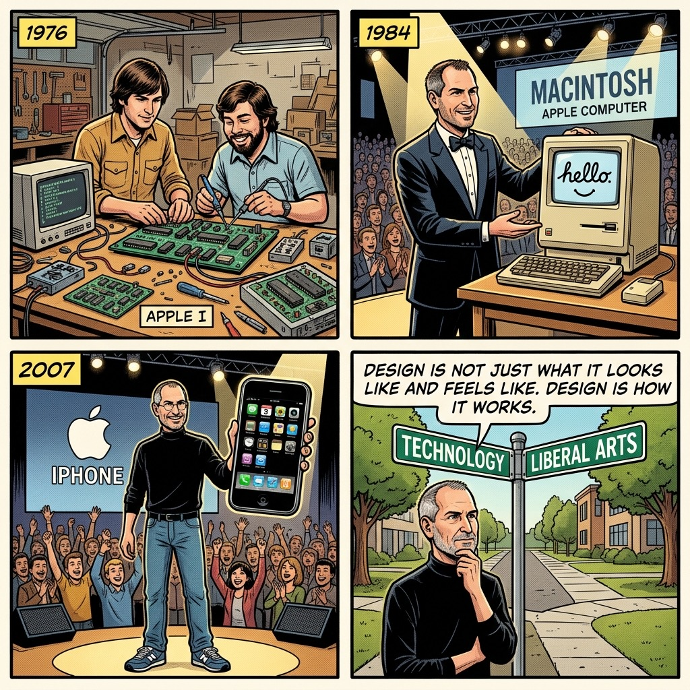

---

## 賈伯斯與 1984 年 Macintosh 的人機互動革命

<strong>史蒂夫·賈伯斯 (Steve Jobs, 1955–2011)</strong>：蘋果共同創辦人，以對產品體驗與軟硬體無縫融合的極致苛求，多次徹底重塑了個人電腦、音樂與行動通訊產業。

  

    

      <h3>🖥️ 1984 年初代 Macintosh：圖形化介面與滑鼠的降臨</h3>
      
在個人電腦仍是黑底綠字命列終端的時代，賈伯斯率領團隊打造了支援圖形視窗、下拉式選單與向量字型的初代 Mac，徹底改變了人類與電腦互動的本質。

    

    

      <h3>🎨 「設計是它如何運作」：軟硬一體化的哲學根基</h3>
      
賈伯斯堅決反對「工程師把內部做好、設計師隨後套上漂亮外殼」的外觀論。他堅持視窗重疊的即時重繪、滾動時的物理加速度，每處底層軟體架構皆是設計的核心。

    

    

      <h3>🎛️ 嚴苛到內部電路板佈線的工匠堅持</h3>
      
他曾要求工程師將即使裝在機殼內部、用戶一生也看不見的印刷電路板線路排得整整齊齊：「偉大的木匠在做衣櫃時，不會在背面用劣質夾板。」

    

  

  

    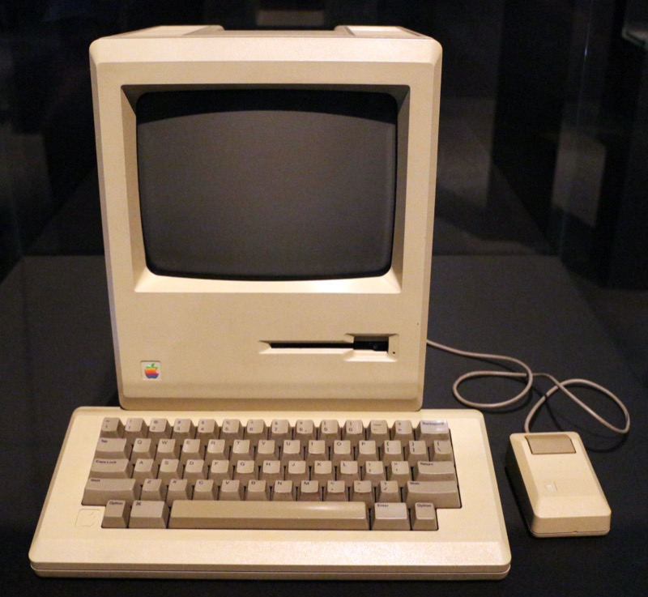
    
1984 年初代 Apple Macintosh，將直覺圖形使用者介面 (GUI) 推向普及

  

---

## 掌上電腦 Newton：不成熟技術推進的殘酷滑鐵盧

  

    

      <h3>📝 1993 年 Apple Newton MessagePad 的野心與慘敗</h3>
      
在賈伯斯被逐出蘋果期間，蘋果耗資數億美元推出全球首款個人數位助理 (PDA) Newton，主打手寫辨識與無鍵盤操作，野心勃勃企圖顛覆世界。

    

    

      <h3>📉 手寫辨識率低下成為深夜脫口秀的嘲笑對象</h3>
      
底層神經網路手寫辨識演算法尚未成熟，經常將使用者的重要備忘錄辨識為啼笑皆非的胡言亂語（甚至出現在《辛普森家庭》劇中遭到無情嘲諷）。

    

    

      <h3>🚪 1997 年賈伯斯重返蘋果第一件事：砍掉 Newton</h3>
      
賈伯斯果斷終止了該專案，留給業界深遠反思：若核心互動流程（運作機制）未能達到毫無挫折的流暢度，再前衛的概念也只會淪為工程玩具。

    

  

  

    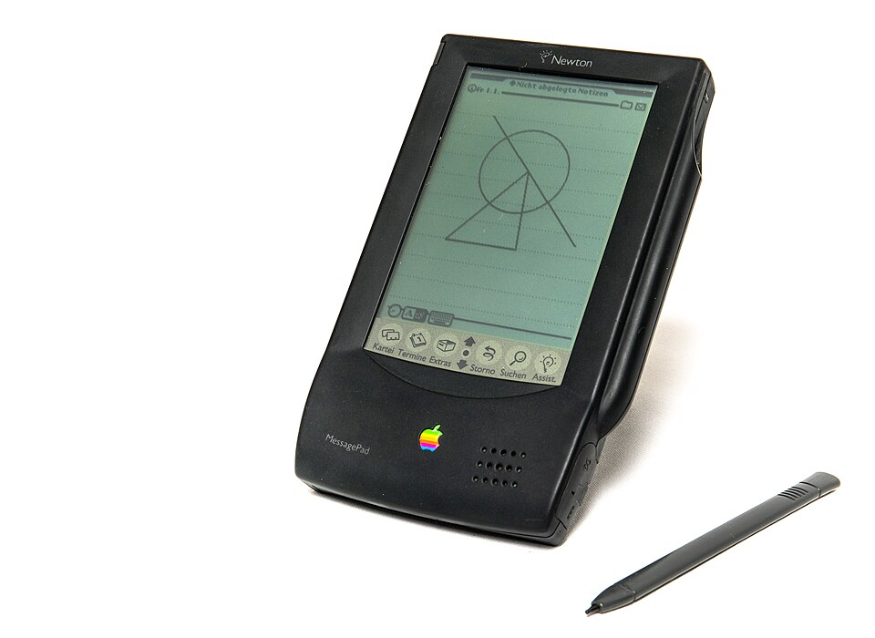
    
1993 年因手寫辨識軟體演算法不成熟而遭遇滑鐵盧的 Apple Newton 實機

  

---

## iPhone 與 App Store：軟體定義世界的終極典範

  

    

      <h3>📱 2007 年初代 iPhone：多點觸控 (Multi-Touch) 與物理慣性</h3>
      
告別塑膠鍵盤與手寫筆，電容式多點觸控加上底層 Core Animation 打造的橡皮筋回彈與慣性滾動，讓操作軟體如同直接觸摸實體物件。

    

    

      <h3>🌐 App Store 平台生態系統引爆全球軟體文藝復興</h3>
      
軟體工程不再局限於大型伺服器或桌面軟體，數百萬名獨立開發者透過 iOS SDK 創造了叫車、外送、社群與行動支付等數十兆美元規模的數位生活。

    

    

      💡 <strong>格言深意</strong>：軟體工程師容易沉迷於優化演算法的時間複雜度，卻忘記了真實世界對系統的唯一評判標準，是用戶每一次點擊、等待與操作時所感受到的流暢與心靈共鳴。
    

  

  

    
    
2007 年賈伯斯在 Macworld 發表會向全世界揭幕初代 iPhone

  

---

<!-- _class: quote-hero -->

“Measuring programming progress by lines of code is like measuring aircraft building progress by weight.”

用程式碼行數來衡量編程進度，就像用飛機的重量來衡量建造進度一樣荒謬。

— Bill Gates, 1982

---

<!-- _class: full-comic -->
<!--
【比爾·蓋茲生平四格分鏡解析】
Panel 1：湖濱中學的編程狂熱少年 —— 徹夜霸佔微型計算機終端機，為學校編寫排課程式並賺取人生第一桶金。
Panel 2：牽手 IBM 與 MS-DOS 奇蹟 —— 洞察軟體授權商業價值，將 DOS 授權給全球 PC 製造商，一舉奠定帝國基石。
Panel 3：嘲諷程式碼行數度量迷思 —— 1982 年辛辣諷刺業界用 KLOC 量測進度的荒謬，主張精簡高效架構。
Panel 4：登頂世界首富與全心慈善 —— 締造橫跨數十年的 Windows 與 Office 王朝，轉身將數百億資產投入全球衛生與扶貧。
-->

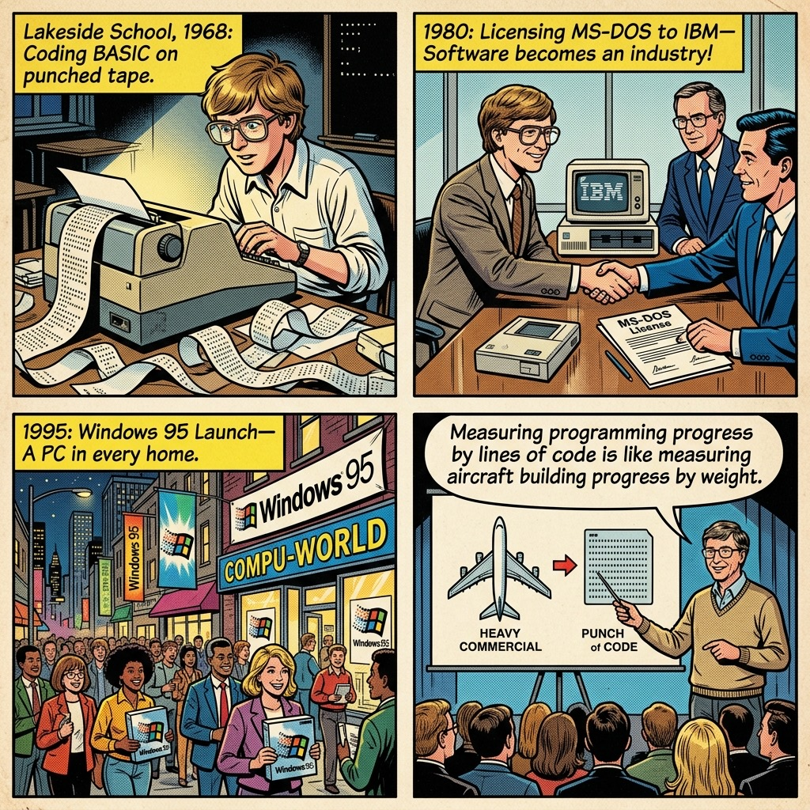

---

## 蓋茲與 IBM 時代「千行代碼 KLOC」的指標荒謬

<strong>比爾·蓋茲 (Bill Gates, 1955–)</strong>：微軟共同創辦人、計算機軟體普及化關鍵推手與慈善家，以敏銳的商業頭腦與極致精煉的底層組合語言編程功力著稱。

  

    

      <h3>✈️ 1982 年對 IBM 「KLOC」考核指標的辛辣嘲諷</h3>
      
早期大型主機時代，IBM 與軍工承包商普遍以「每千行代碼 (KLOC)」來計算專案報價與工程師產能。蓋茲辛辣指出：製造一架先進飛機，工程師追求的是更輕更堅固，難道飛機越笨重越好嗎？

    

    

      <h3>📉 虛榮指標催生臃腫垃圾代碼的逆淘汰</h3>
      
當公司以代碼行數作為績效 KPI，工程師就會傾向拷貝複製貼上、拆碎邏輯、濫用冗長變數名。原本 5 行能優雅解決的邏輯，被生生拉長成 50 行以騙取獎金。

    

    

      <h3>🪓 精簡與高密度邏輯才是頂尖工程師的標誌</h3>
      
蓋茲年輕時親手為 Altair 編寫 BASIC 解譯器，將核心功能壓榨進僅僅 4KB 的記憶體空間中。他深信：最優秀的工程師，產出往往是負的（刪除多餘代碼）。

    

  

  

    
    
早年依賴 KLOC（千行代碼）衡量大型系統專案產能的 IBM 主機時代工坊

  

---

## 1998 發表會藍屏：全球直播的隨插即用當機

  

    

      <h3>📺 1998 年春季全球直播發表會上的「名場面」</h3>
      
在芝加哥 Comdex 大會上，蓋茲自豪地展示 Windows 98 的「隨插即用 (Plug and Play)」功能。當助手剛把掃描器插入 USB 接口時，大螢幕瞬間跳出刺眼的藍屏死機 (BSOD)！

    

    

      <h3>💥 系統複雜度失控與未簽章第三方驅動的噩夢</h3>
      
當時 Windows 為了相容市面上數萬種五花八門的硬體設備，允許第三方廠商在核心態自由載入驅動程式。一行指標錯誤就能讓整個作業系統瞬間暴斃。

    

    

      <h3>🔄 痛定思痛：Windows NT 核心重構與驅動簽章機制</h3>
      
這場世紀尷尬推動微軟加速放棄混亂的 Win9x 核心，全面轉向 Windows NT 架構，並建立嚴格的硬體品質實驗室 (WHQL) 驅動數位簽章機制。

    

  

  

    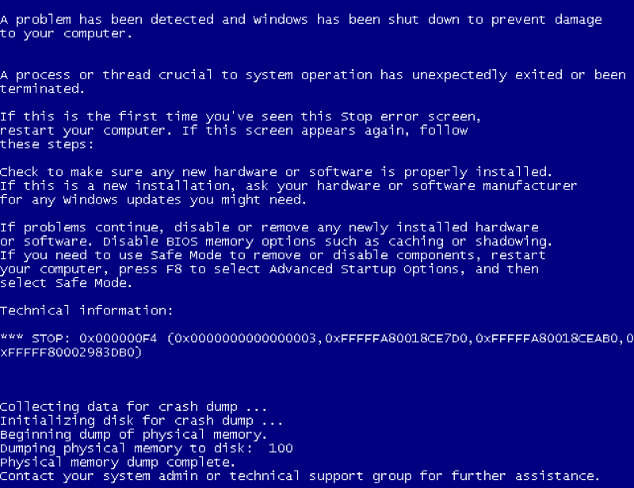
    
1998 年 Windows 98 發表會上當著全球媒體出糗的歷史性藍屏畫面

  

---

## 價值驅動指標：現代軟體工程對虛榮指標的告別

  

    

      <h3>📊 告別代碼行數，擁抱 DORA 現代工程四大核心指標</h3>
      
現代頂尖工程團隊採用 Google DORA 框架衡量團隊表現：<strong>部署頻率、變更前置時間、變更失敗率、服務恢復時間</strong>，聚焦交付效率與系統穩定性。

    

    

      <h3>🎯 成果勝於產出 (Outcome over Output)</h3>
      
軟體工程的衡量維度從「我們寫了多少行代碼」徹底進化為「我們為客戶解決了多大的痛點、節省了多少運算資源、創造了多少商業價值」。

    

    

      💡 <strong>格言深意</strong>：用行數度量代碼，就像用厚度度量一本書的思想。最傑出的軟體工程實踐，往往是在系統中刪除了三千行複雜代碼，卻讓軟體運行得飛快且永不當機。
    

  

  

    
    
現代工程團隊以 DORA 交付頻率與修復指標取代傳統代碼行數虛榮度量

  

---

<!-- _class: quote-hero -->

“Readability counts.”

可讀性至關重要。

— Guido van Rossum (The Zen of Python), 1989

---

<!-- _class: full-comic -->
<!--
【吉多·范羅蘇姆生平四格分鏡解析】
Panel 1：1989 聖誕假期的消遣專案 —— 在阿姆斯特丹為打發無聊假期，編寫一款受 ABC 啟發的優雅腳本語言。
Panel 2：以喜劇團體 Monty Python 為名 —— 拒絕枯燥嚴肅，注入幽默風趣，倡導簡潔優雅的縮排語法。
Panel 3：起草《Python 之禪》引領風騷 —— 「美麗優於醜陋，明確優於隱晦」，確立可讀性為最高哲學準則。
Panel 4：三十年成為 AI 與科學計算基石 —— 榮膺終身仁慈獨裁者 (BDFL)，Python 橫掃全球各大領域奪得王座。
-->

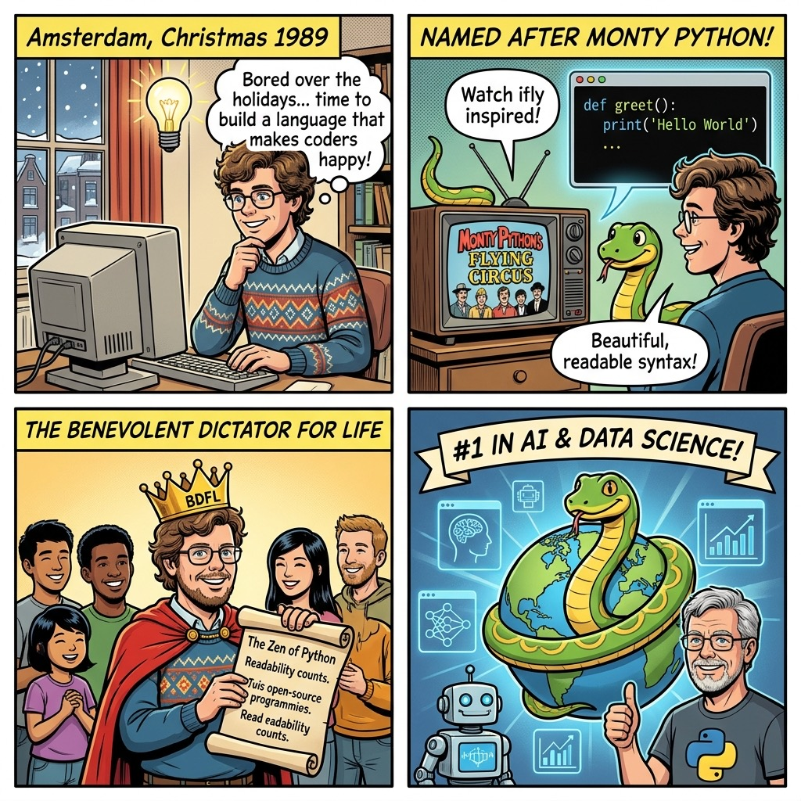

---

## 吉多與 1989 年聖誕假期的優雅誕生

<strong>吉多·范羅蘇姆 (Guido van Rossum, 1956–)</strong>：荷蘭計算機程式設計師、Python 之父，曾長期擔任 Python 社群「終身仁慈獨裁者」(BDFL)，現任微軟傑出工程師。

  

    

      <h3>🎄 1989 年聖誕假期的打發無聊之作</h3>
      
在阿姆斯特丹 CWI 研究機構度過聖誕假期時，吉多的辦公室關門放假。為了找點有趣的事情做，他決定寫一個新的腳本解譯器，作為 ABC 語言的後繼者，並以喜劇短劇命名為 Python。

    

    

      <h3>📜 《Python 之禪》：美麗優於醜陋，明確優於隱晦</h3>
      
吉多反感 C/C++ 繁冗的花括號與 Perl 晦澀的符號黑魔法。他大膽採用強制縮排（Indentation）規範代碼區塊，將「可讀性」拔高為語言的第一公民。

    

    

      <h3>👑 終身仁慈獨裁者 (BDFL) 的長遠社群治理</h3>
      
在掌舵 Python 的三十年間，吉多以無比的耐心與品味引領 PEP 提案評審，守護語言的簡潔本質，拒絕讓各類花俏功能污染語言核心。

    

  

  

    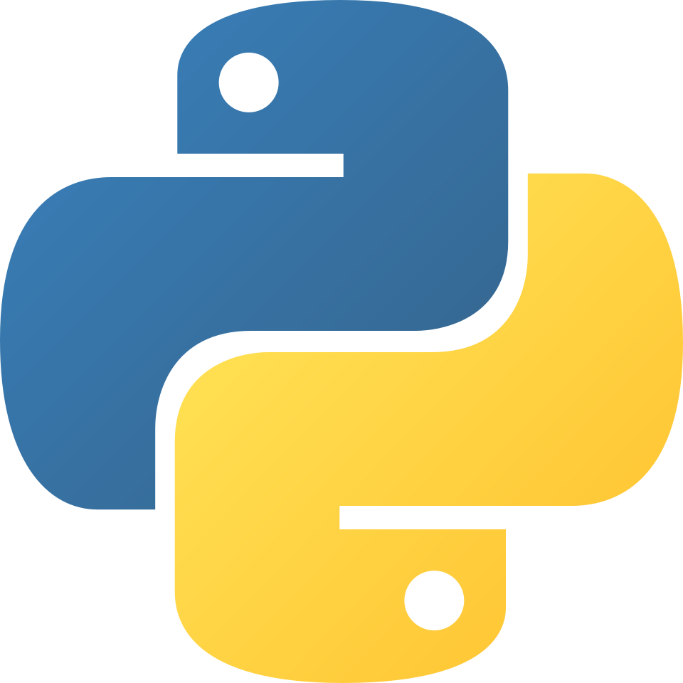
    
Python 官方標誌，象徵著簡潔、優雅與無可比擬的社群包容生態

  

---

## Python 2 到 3 的大遷移：破壞向前相容性的十年陣痛

  

    

      <h3>💔 破壞向前相容性 (Breaking Backward Compatibility) 的代價</h3>
      
2008 年發布的 Python 3 徹底修復了歷史混亂的 Unicode 與二進位字串模型，並將 <code>print</code> 改為函式。這導致現有的 Python 2 代碼庫完全無法在 3.0 上直接執行。

    

    

      <h3>⏳ 社群分裂與長達十餘年的痛苦升級拉鋸戰</h3>
      
龐大的開源函式庫（如 NumPy、Django）與各大科技巨頭的核心系統遲遲無法升級。Python 2 的生命週期硬生生被延長至 2020 年，維護負擔沉重。

    

    

      <h3>📦 現代程式語言升級機制的深刻反思</h3>
      
這場痛苦的十年陣痛成為軟體工程語言演進的警世鐘，促使後來的語言（如 Rust 的 Edition 機制）發明出零摩擦平滑升級的全新範式。

    

  

  

    
    
軟體工程中破壞性變更帶來的巨大升級成本，促使業界更加珍視語法演進的平滑性

  

---

## 現代 AI 的唯一通用母語：從 PyTorch 到大模型時代

  

    

      <h3>🧠 統治深度學習、資料科學與機器學習的天下</h3>
      
從 TensorFlow、PyTorch 到 Hugging Face，當今全球頂級 AI 實驗室與工業界模型，幾乎 100% 以 Python 作為最主要的編程介面。

    

    

      <h3>🚀 「膠水語言」的極致威力：優雅外表與 C/CUDA 鋼鐵核心</h3>
      
Python 允許研究員以如同散文般流暢的兩三行代碼，調動底層數千顆高並發 C++ 與 GPU CUDA 算力叢集，完美實現了可讀性與極限效能的和諧統一。

    

    

      💡 <strong>格言深意</strong>：代碼被人類工程師閱讀的次數，遠遠多於它被撰寫的次數。寫出讓同事與六個月後的自己一目了然的代碼，才是讓軟體得以長青三十年的最大秘密。
    

  

  

    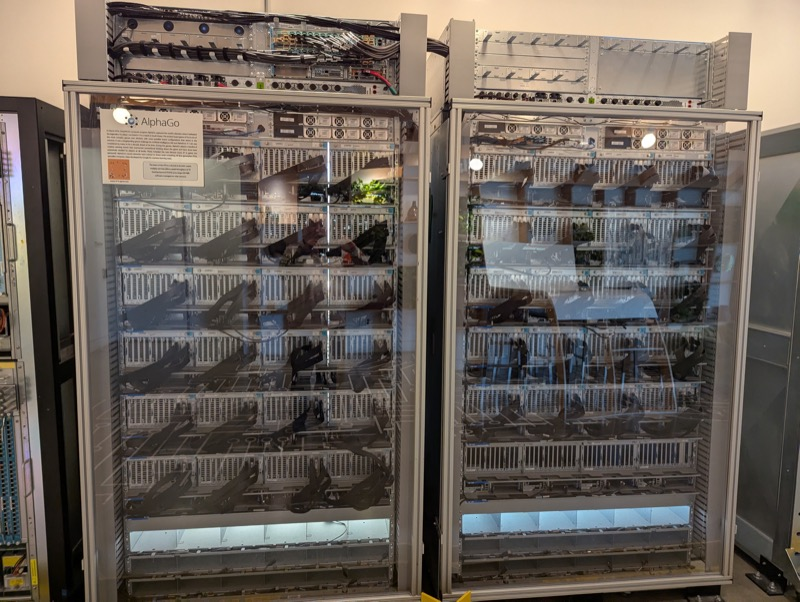
    
全球現代超算與大語言模型訓練叢集，其最頂層的 API 控制代碼皆以 Python 編寫

  

---

<!-- _class: quote-hero -->

“Take the gamble. If everyone thinks you’re crazy, you might be onto something big.”

大膽豪賭吧。如果所有人都認為你瘋了，你很可能正踩在巨星般的發現上。

— Geoffrey Hinton, 2024

---

<!-- _class: full-comic -->
<!--
【傑佛瑞·辛頓生平四格分鏡解析】
Panel 1：跨學科的叛逆學者 —— 涉足生理學、哲學與實驗心理學，堅信人腦神經網絡能破解智慧密碼。
Panel 2：三十年冷板凳與反向傳播 —— 在長達數十年的「AI 寒冬」中孤軍奮戰，堅持推導反向傳播 (Backprop) 演算法。
Panel 3：2012 年 ImageNet 驚世一役 —— 帶領學生以 AlexNet 摧枯拉朽擊敗傳統計算機視覺，深度學習狂潮席捲全球。
Panel 4：榮膺諾貝爾獎與辭職警世 —— 2024 年摘下諾貝爾物理學獎，毅然退出 Google 提醒全球防範 AI 生存危機。
-->

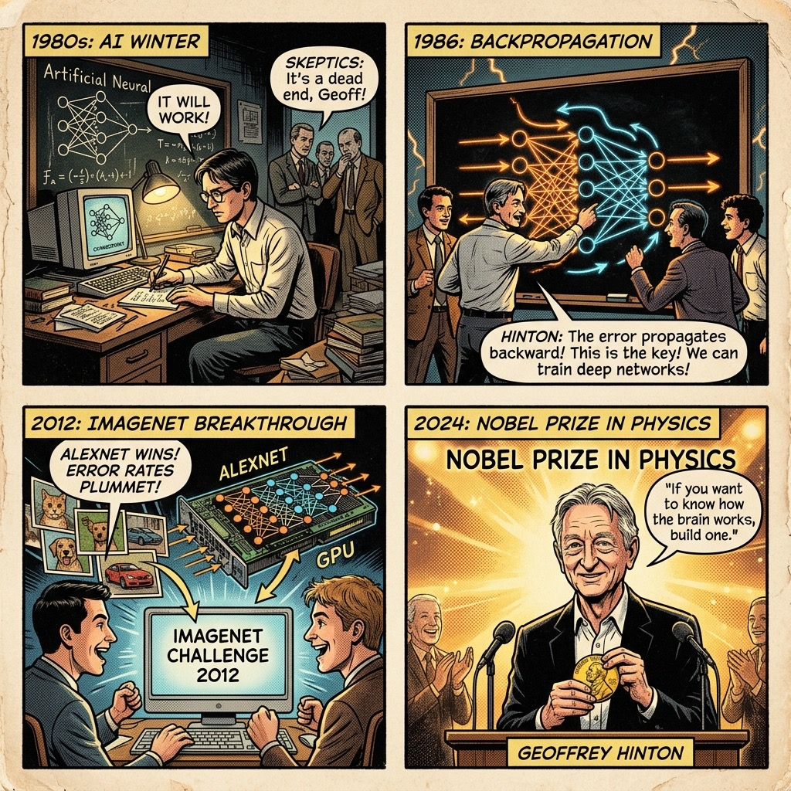

---

## 辛頓與漫長 AI 寒冬中的三十年孤獨堅守

<strong>傑佛瑞·辛頓 (Geoffrey Hinton, 1947–)</strong>：當代「深度學習之父」、圖靈獎得主、2024 年諾貝爾物理學獎得主，以無與倫比的學術信念撐起整個現代 AI 時代。

  

    

      <h3>❄️ 兩次漫長「AI 寒冬」中的無人問津</h3>
      
在 1980 至 2000 年代，以專家系統與符號邏輯為主的學界全面放棄了類神經網路。研究經費被砍、論文被頂級會議拒稿，同儕普遍嘲弄他走在死胡同裡。

    

    

      <h3>🧠 堅持大腦神經元激發模式的崇高信念</h3>
      
辛頓始終深信大腦就是由數百億個簡單神經元與突觸構成。只要給予多層神經網路足夠的運算能力與數據，反向傳播 (Backpropagation) 就能自動學會世界特徵。

    

    

      <h3>🚪 從邊緣冷宮到點燃第四次工業革命</h3>
      
他收容並培育了楊立昆 (Yann LeCun)、本吉奧 (Yoshua Bengio) 等一代名家，最終在加拿大高等研究院的庇護下，迎來了算力與大數據爆發的奇點時刻。

    

  

  

    
    
辛頓堅守數十年的多層人工神經網絡理論，最終孕育出現代人工智慧超級算力體系

  

---

## 2016 年 AlphaGo：深度強化學習擊潰人類圍棋神話

  

    

      <h3>♟️ 4:1 擊潰人類世界圍棋冠軍李世乭</h3>
      
2016 年 3 月首爾，DeepMind 打造的 AlphaGo 利用深度卷積神經網路結合蒙地卡羅樹搜尋，在被視為人類智慧最後堡壘的圍棋對決中取得壓倒性勝利。

    

    

      <h3>💡 傳奇「第 37 手」：超越人類數千年棋譜的直覺</h3>
      
在第二局中，AlphaGo 下出了被所有在場頂尖九段棋士評為「絕對打錯」的第 37 手肩衝。數十手後，人類驚嘆那是一手兼顧全局大局觀的神之一手。

    

    

      <h3>🌐 從棋盤玩具到破解蛋白質結構預測 AlphaFold</h3>
      
這場勝利標誌著深度學習擺脫了人類先驗知識的束縛。數年後，相同的神經網絡架構破解了困擾生物學界半個世紀的蛋白質折疊難題。

    

  

  

    
    
2016 年 AlphaGo 擊敗李世乭，象徵人工神經網絡在非線性高維空間的直覺超越

  

---

## 2024 諾貝爾物理學獎：AI 成為現代科學底座

  

    

      <h3>🏅 物理學獎頒給計算機科學先驅的世紀破天荒</h3>
      
2024 年 10 月，瑞典皇家科學院將諾貝爾物理學獎頒發給辛頓與約翰·霍普菲爾德，表彰他們「以人工神經網絡實現機器學習的基礎性發現與發明」。

    

    

      <h3>⚠️ 退出科技巨頭，向全人類發出 AI 存在性危機警鐘</h3>
      
辛頓辭去 Google 副總裁職務，以便能自由發聲。他沉痛警示：數位智慧的複製與知識共享速度遠超人類大腦生物演化，軟體工程必須迅速建立 AI 安全防護機制。

    

    

      💡 <strong>格言深意</strong>：真正的範式革命在爆發前夕，往往看起來荒誕不經。當全世界都在追逐當紅的常規解法時，有勇氣在無人問津的荒原上孤軍奮戰三十年，才能看見文明的下一個地平線。
    

  

  

    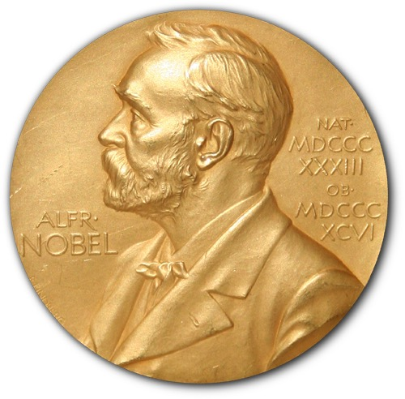
    
2024 年諾貝爾獎獎章，標誌著神經網絡演算法正式登堂入室成為全人類科學基礎

  

---

<!-- _class: quote-hero -->

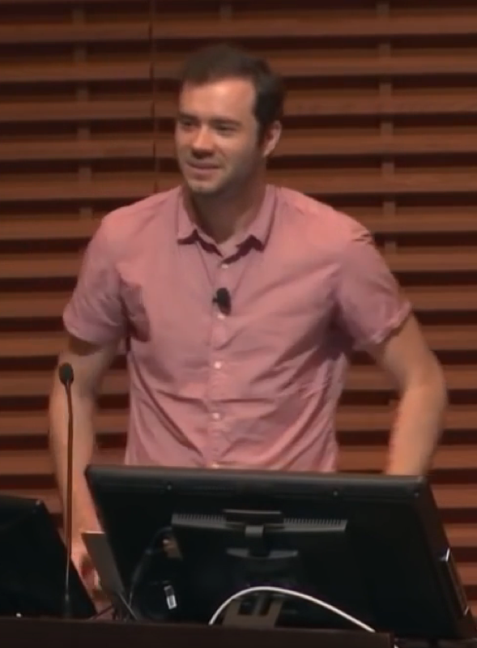

“The hottest new programming language is English.”

當今最熱門的全新程式語言，就是英文。

— Andrej Karpathy, 2023

---

<!-- _class: full-comic -->
<!--
【安德烈·卡帕斯生平四格分鏡解析】
Panel 1：史丹佛 CS231n 傳奇名師 —— 將深度學習演算法以極其生動清晰的方式傳播給全球百萬學生。
Panel 2：OpenAI 創始團隊與 Software 2.0 —— 2017 年撰文宣告代碼寫法典範轉移，權重取代手寫指令。
Panel 3：掌舵特斯拉 Autopilot 純視覺 —— 大膽移除毫米波雷達，以純神經網路大腦接管數百萬輛自駕車。
Panel 4：大模型時代的布道先鋒 —— 喊出「英文是最新程式語言」，引領 AI Agent 與自然語言交互全新紀元。
-->

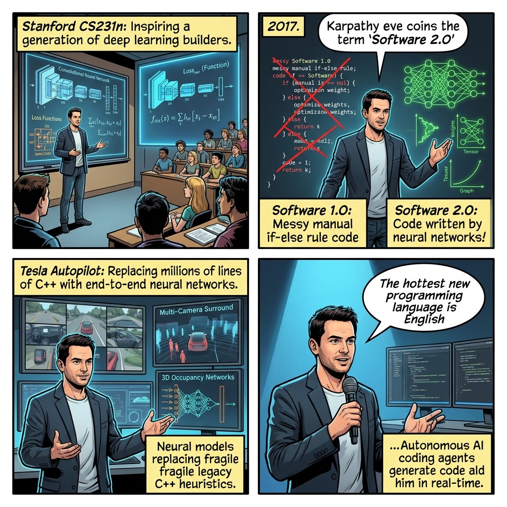

---

## 卡帕斯與「Software 2.0」的典範大轉移

<strong>安德烈·卡帕斯 (Andrej Karpathy, 1986–)</strong>：前特斯拉人工智慧與 Autopilot 總監、OpenAI 創始成員，全球公認最具教學天賦與工程敏銳度的 AI 先驅。

  

    

      <h3>💻 2017 年震撼業界的宣言：Software 2.0 降臨</h3>
      
卡帕斯指出：傳統軟體 (Software 1.0) 是人類工程師逐行敲打 C++、Java 或 Python 邏輯指令；而 Software 2.0 則是由人類定義損失函式與收集數據，代碼本質是由最佳化演算法尋找出的數十億個神經網路權重。

    

    

      <h3>📉 傳統手寫啟發式規則的維護崩潰邊界</h3>
      
面對語意識別、影像感知等高維問題，傳統工程師寫下數萬個 <code>if-else</code> 規則只會讓代碼難以維護且漏洞百出。神經網路能在高維空間中自動尋找全局最優解。

    

    

      <h3>📊 工程師的核心職責從「寫代碼」轉為「資料與評測工程」</h3>
      
在 2.0 時代，工程師不再花費整天除錯指標與語法，而是花費 90% 的時間在資料清洗、標註品質控管、分佈漂移檢測與回歸評測矩陣構建。

    

  

  

    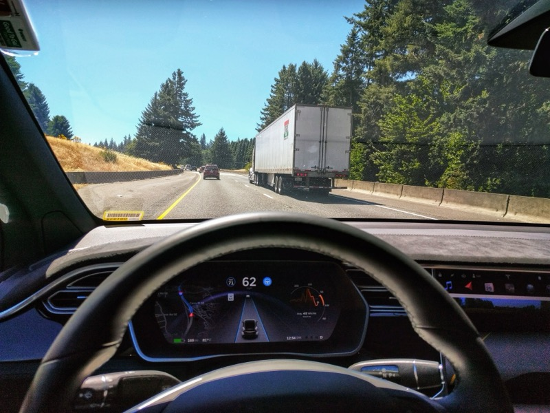
    
特斯拉端到端自動駕駛系統視覺化介面，體現神經網絡權重取代手寫代碼的威力

  

---

## 特斯拉自駕：丟棄數百萬行 C++ 規則的純視覺革命

  

    

      <h3>🚗 告別 C++ 啟發式程式碼的「端到端」大轉身</h3>
      
特斯拉早期 Autopilot 包含龐大的 C++ 狀態機與規則演算法。2023 年 FSD V12 進行史詩級重構：全面丟棄超過 30 萬行手寫控制邏輯，轉向端到端純神經網絡。

    

    

      <h3>👁️ 從「光子輸入」直接映射到「方向盤扭矩輸出」</h3>
      
車輛感測攝影機採集到的光子資訊，未經任何手寫中間幾何圖形重構，直接經由大模型推理輸出轉向、油門與煞車指令，反應平順度如同人類老司機。

    

    

      <h3>📈 代碼庫大幅減肥帶來的系統可靠性躍遷</h3>
      
軟體工程史上罕見地出現了「代碼量減少兩個數量級，功能複雜度與魯棒性反而大幅提升」的奇蹟，徹底驗證了 Software 2.0 的工程優越性。

    

  

  

    
    
特斯拉完全自動駕駛 (FSD) 純視覺神經網絡對複雜路口進行即時三維環境推理

  

---

## 自然語言即代碼：大模型與 AI Agent 的結對編程新時代

  

    

      <h3>🗣️ 2023 年的重磅金句：「最熱門的程式語言是英文」</h3>
      
隨著 ChatGPT、Claude 與 GitHub Copilot 爆發，軟體工程師發現，只要用結構精準、無歧義的自然語言描述需求，大語言模型就能在數秒內生成高品質代碼。

    

    

      <h3>🤖 程式設計師躍升為「技術架構指揮官」</h3>
      
人類工程師的角色從「底層代碼打字員」升級為「意圖架構師與品質把關者」。工程核心在於能否清晰拆解問題、引導 Agent 協同、並對其生成的代碼進行嚴格審核。

    

    

      💡 <strong>格言深意</strong>：軟體工程沒有死亡，而是經歷了歷史上最高層級的抽象躍遷。從組合語言到高階語言，再到今天的自然語言，工程師的本質始終未變——那就是將混亂的現實意圖，精確轉化為解決問題的系統。
    

  

  

    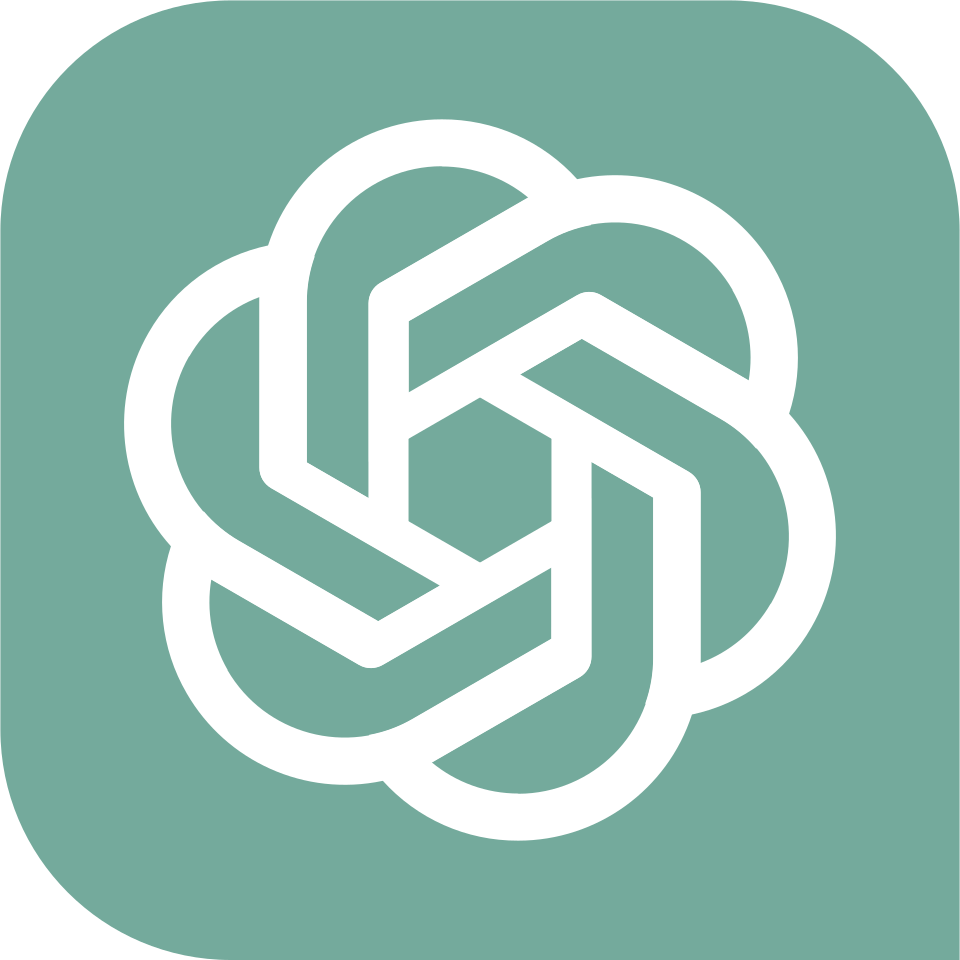
    
以自然語言對話形式進行複雜架構探索、編程實作與單元測試生成的現代 AI 介面

  

---

<!-- _class: quote-hero -->

“The best part is no part. The best process is no process. It weighs nothing, costs nothing, can't go wrong.”

最好的零件就是沒有零件，最好的流程就是沒有流程。它不佔重量、零成本、絕不出錯。

— Elon Musk, 2018

---

<!-- _class: full-comic -->
<!--
【埃隆·馬斯克生平四格分鏡解析】
Panel 1：第一性原理的狂人破局 —— 物理學視角拆解原料成本，挑戰航太與汽車傳統外包腐化模式。
Panel 2：產能地獄睡工廠地板 —— 2018 年睡在弗里蒙特超級工廠，親手拿扳手拆除過度複雜的傳送帶與感測器。
Panel 3：獵鷹九號震撼垂直回收 —— 顛覆人類航太史，以即時姿態控制軟體引導第一級火箭平穩著陸駁船。
Panel 4：五步工程工作法風靡全球 —— 「大膽質疑一切要求、極致刪除零件」，打造全球最精實極速之軟硬體帝國。
-->

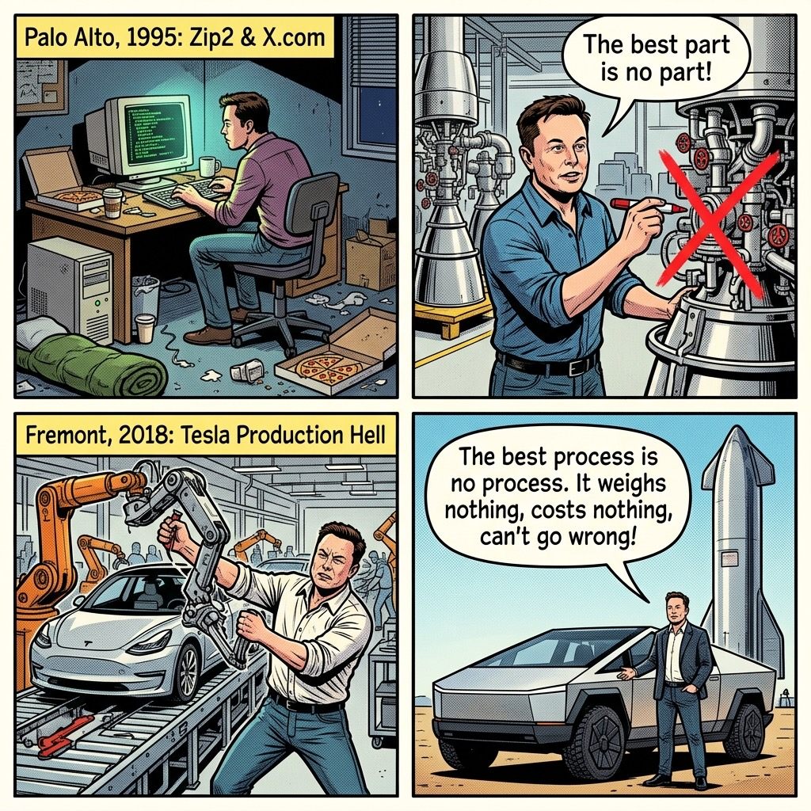

---

## 馬斯克與 Model 3 的「產能地獄」反思

<strong>埃隆·馬斯克 (Elon Musk, 1971–)</strong>：特斯拉與 SpaceX 執行長，以「第一性原理」著稱，推動軟硬體極致垂直整合與極簡工程哲學。

  

    

      <h3>🏭 2018 年過度自動化的狂妄陷阱</h3>
      
特斯拉試圖打造「製造機器的機器 (Alien Dreadnought)」，在工廠布滿了複雜的機器人與傳送帶。結果感測器頻繁誤報、軟體協議死鎖，Model 3 產能徹底癱瘓，公司幾週內瀕臨破產。

    

    

      <h3>🔧 睡在工廠地板上的親自拆解</h3>
      
馬斯克連續數月睡在弗里蒙特工廠地板上。他親自盤查每個工作站，發現團隊甚至安裝了檢測電池防音墊的複雜光學感測器——而那塊防音墊根本毫無用處！

    

    

      <h3>✂️ 第一性原理：最好的零件是沒有零件</h3>
      
馬斯克憤怒地砍掉了防音墊與傳送帶，改由人工直接組裝。他歸納出著名的五步工作法：「如果最後你沒有被迫加回 10% 的東西，代表你刪得還不夠狠！」

    

  

  

    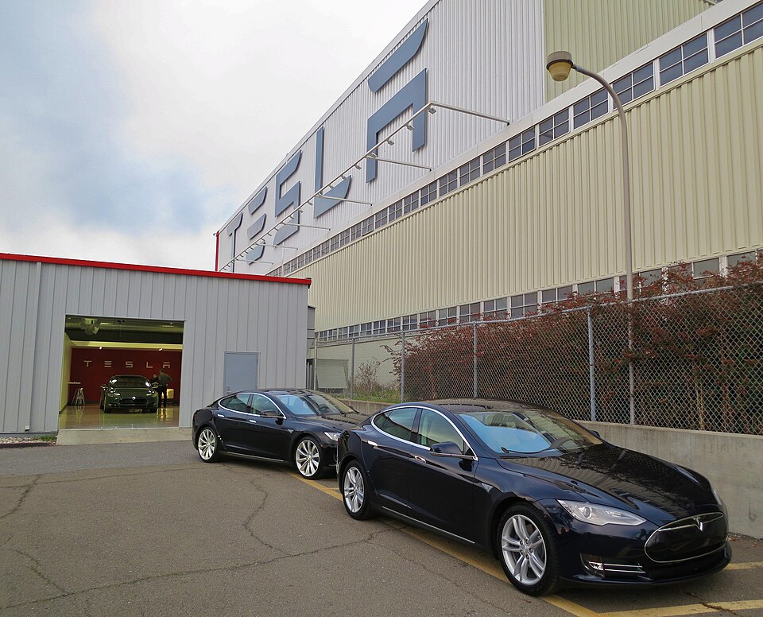
    
特斯拉加州弗里蒙特超級工廠生產線，經歷產能地獄後重構為精實自動化產線

  

---

## 獵鷹 9 號垂直著陸：顛覆航太傳統的極致簡化

  

    

      <h3>🚀 傳統航太拋棄式火箭的沉重枷鎖</h3>
      
半個世紀以來，全球所有火箭發射後第一級皆墜毀大海。傳統航太巨頭認為火箭回收在物理上極其荒謬，系統充斥著層層外包、複雜冗餘與昂貴的不可重複零件。

    

    

      <h3>🌊 駁船精準著陸與火箭重複使用奇蹟</h3>
      
SpaceX 團隊完全自研即時姿態控制軟體，以冷氣推進器、格柵翼與極速點火演算法，實現了第一級火箭在海上無人駁船的完美垂直降落。

    

    

      <h3>📉 發射成本腰斬 90% 的工程壯舉</h3>
      
透過重複使用單枚火箭超過 20 次，SpaceX 打破了航太工業的神話，證明了「消除一切不必要的流程與零件，極致追求重複利用」能創造數量級的效率突破。

    

  

  

    
    
SpaceX 獵鷹 9 號第一級火箭精準著陸於海上回收駁船，創下航太史奇蹟

  

---

## 特斯拉 FSD 端到端神經網路：刪除 30 萬行 C++ 代碼

  

    

      <h3>🚗 規則式自駕系統的「複雜度死穴」</h3>
      
特斯拉舊版自動駕駛累積了超過 30 萬行 C++ 代碼，工程師試圖為每一種路況編寫 <code>if-else</code>。但在面對無窮無盡的現實長尾場景時，系統邏輯相互掣肘。

    

    

      <h3>🧠 FSD V12 端到端大模型接管控制權</h3>
      
馬斯克大膽拍板將感知、路徑規劃全部交給單一大型神經網絡，直接由光子輸入映射到車輛控制指令。30 萬行代碼瞬間歸零，系統流暢度獲得質的飛躍。

    

    

      💡 <strong>格言深意</strong>：工程師最常犯的錯誤，就是精心優化一個根本不應該存在的問題。在動手重構或加速之前，先冷酷地問自己：這個模組、這個流程、這個代碼庫，能否被徹底刪除？
    

  

  

    
    
特斯拉純視覺神經網絡架構，以極致簡約的單一大模型取代複雜堆疊的傳統代碼庫

  

---

<!-- _class: quote-hero -->

“Compute is going to be the currency of the future. It may be the most precious commodity in the world.”

算力將成為未來的貨幣，它可能是世界上最珍貴的商品。

— Sam Altman, 2023

---

<!-- _class: full-comic -->
<!--
【山姆·奧特曼生平四格分鏡解析】
Panel 1：YC 掌門人的商業洞見 —— 執掌矽谷頂尖創業加速器 Y Combinator，培養出對指數級技術爆發的敏銳嗅覺。
Panel 2：創辦 OpenAI 押注 Scaling Laws —— 在大模型遭學界普遍懷疑之際，堅決豪賭上億美元算力叢集。
Panel 3：2022 年底 ChatGPT 突襲上線 —— 低調發布測試，5 天內吸引百萬用戶，引爆人類歷史上最迅猛的 AI 革命。
Panel 4：首屆 DevDay 宣示算力新時代 —— 站在聚光燈下發布 GPT-4 Turbo 與 GPT Store，奠定 AI 平台霸主地位。
-->

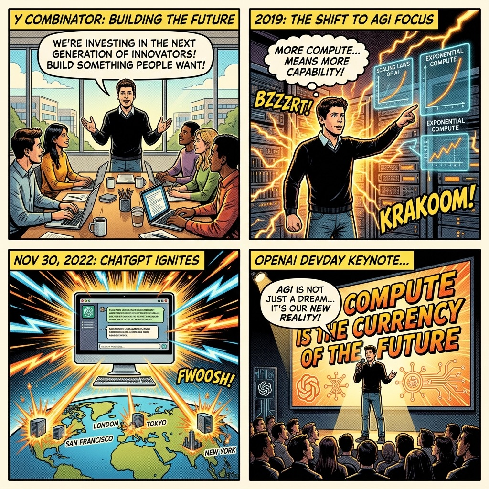

---

## 奧特曼與 ChatGPT 的「奇點時刻」

<strong>山姆·奧特曼 (Sam Altman, 1985–)</strong>：OpenAI 執行長兼共同創辦人，以宏大的戰略格局與堅定的 Scaling Law 信仰，帶領團隊掀起生成式 AI 全球海嘯。

  

    

      <h3>🔮 2015 創立 OpenAI 的非凡豪賭</h3>
      
在眾人認為類神經網路已達瓶頸之時，奧特曼與團隊堅信「規模法則 (Scaling Laws)」——只要持續擴大模型參數量、訓練數據與運算算力，通用人工智慧 (AGI) 的智慧火花就會湧現。

    

    

      <h3>⚡ 2022 年 11 月 30 日 ChatGPT 的低調突襲</h3>
      
ChatGPT 最初只是團隊的一次「低調研究預覽 (Research Preview)」。然而其驚人的對話與編程能力在 5 天內吸引超過百萬用戶，成為史上增長最快消費級應用。

    

    

      <h3>📈 算力即生產力與國家競爭力的核心貨幣</h3>
      
奧特曼指出未來軟體開發本質已徹底轉移：FLOPs（浮點運算次數）與綠色能源不再只是硬體規格，而是衡量企業與國家創造智慧能力的核心硬貨幣。

    

  

  

    
    
2022 年底 ChatGPT 簡潔的對話介面，點燃了全球大語言模型與智慧浪潮

  

---

## 萬億參數 GPT-4：極限工程與分散式叢集

  

    

      <h3>🏗️ 數萬顆 GPU 叢集的分散式系統極限考驗</h3>
      
訓練千億至萬億參數的大模型需要數萬張 GPU 協同運算數月。任何一張網卡故障、光纖抖動或記憶體位元翻轉，都可能導致整場數百萬美元的訓練前功盡棄。

    

    

      <h3>⚙️ 混合專家架構 (MoE) 與超大規模容錯</h3>
      
OpenAI 在 GPT-4 中採用 MoE 架構動態路由啟動專家網絡，並研發出先進的檢查點 (Check-pointing) 與動態節點剔除系統，實現超大規模叢集連續高負載穩定運轉。

    

    

      <h3>🌐 軟體工程師角色的深遠轉移</h3>
      
軟體工程不再局限於手動實現演算法，而是學會與大模型協同——設計 Context 提示架構、建構 RAG 知識庫檢索、並以 Agent 串聯複雜 API 流程。

    

  

  

    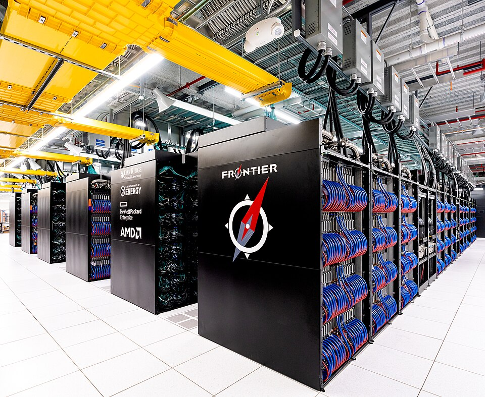
    
支持現代千億與萬億參數大模型訓練的超大規模超級電腦運算機櫃

  

---

## o1 推理模型與測試期計算：算力貨幣的全新維度

  

    

      <h3>⏱️ 測試期計算 (Test-Time Compute) 的破局躍遷</h3>
      
2024 年秋季 OpenAI 發布 o1 系列模型，打破了僅在預訓練階段堆算力的侷限，讓模型在輸出答案前進行深思熟慮的「思維鏈 (Chain of Thought)」自我驗證。

    

    

      <h3>🧩 複雜編程與架構除錯能力的質變飛躍</h3>
      
o1 在競賽級編程難題與複雜重構上超越人類普通工程師，能夠主動反思假設、窮舉邊界情境，並在自我推演中發現並修正深層邏輯 Bug。

    

    

      💡 <strong>格言深意</strong>：當算力可以隨時在推論階段轉換為深思熟慮的邏輯推演，未來的軟體工程師爭奪的不再是敲鍵盤的速度，而是誰能以最高效的架構，將算力貨幣兌換為最高品質的商業價值。
    

  

  

    
    
超大規模資料中心伺服器機櫃，承載現代大語言模型推論與測試期計算的基石

  

---

<!-- _class: quote-hero -->

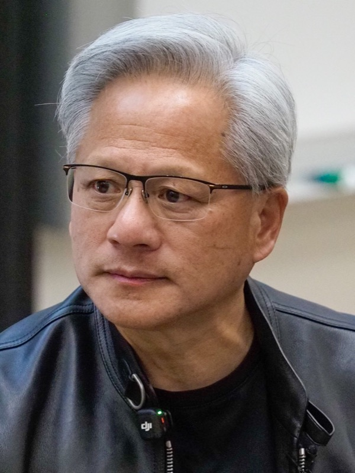

“Software is eating the world, but AI is eating software.”

軟體正在吞噬世界，但人工智慧正在吞噬軟體。

— Jensen Huang, 2017

---

<!-- _class: full-comic -->
<!--
【黃仁勳生平四格分鏡解析】
Panel 1：Denny's 簡餐店的餐巾草圖 —— 1993 年與兩位夥伴在加州平價餐廳畫出 3D 繪圖晶片願景。
Panel 2：2006 年堅持推廣 CUDA 平台 —— 頂著利潤暴跌與華爾街唱衰，堅持每張顯卡都內建平行運算能力。
Panel 3：親手交付第一台 DGX-1 —— 2016 年帶著全球首台 AI 超算親自送到 OpenAI，點燃大模型火種。
Panel 4：黑皮衣戰神手握 Blackwell —— 站在全球 GTC 大會宣布「AI 工廠」降臨，引領全端加速運算革命。
-->

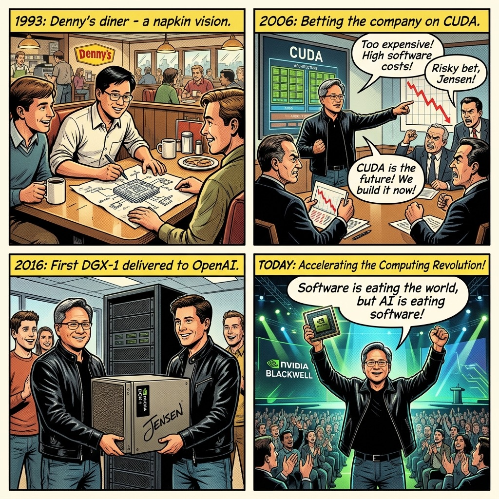

---

## 黃仁勳與 CUDA 孤注一擲的二十年長征

<strong>黃仁勳 (Jensen Huang, 1963–)</strong>：NVIDIA 創始人兼執行長，三十年如一日推動「加速運算」，使 GPU 成為驅動第四次工業革命的心臟。

  

    

      <h3>🎮 1993 年在 Denny's 餐廳創立 NVIDIA</h3>
      
黃仁勳發明了 GPU (圖形處理器) 一詞，推動 PC 3D 遊戲進入硬體加速光影時代，並在市場殘酷淘汰賽中擊敗數十家競爭對手。

    

    

      <h3>💰 2006 年冒著利潤暴跌豪賭 CUDA 平台</h3>
      
黃仁勳決定為每顆 GPU 增加 CUDA 平行運算架構，晶片成本激增且連年虧損數億美元，華爾街分析師猛烈抨擊。但黃仁勳堅信通用並行運算是未來的必經之路。

    

    

      <h3>🌊 全端軟體生態系護城河的築成</h3>
      
歷經十年寒冬，CUDA 演變為囊括 cuDNN、TensorRT、NCCL 的萬里長城，全球無數科研學者習慣了其 API，構建出牢不可破的軟硬體生態護城河。

    

  

  

    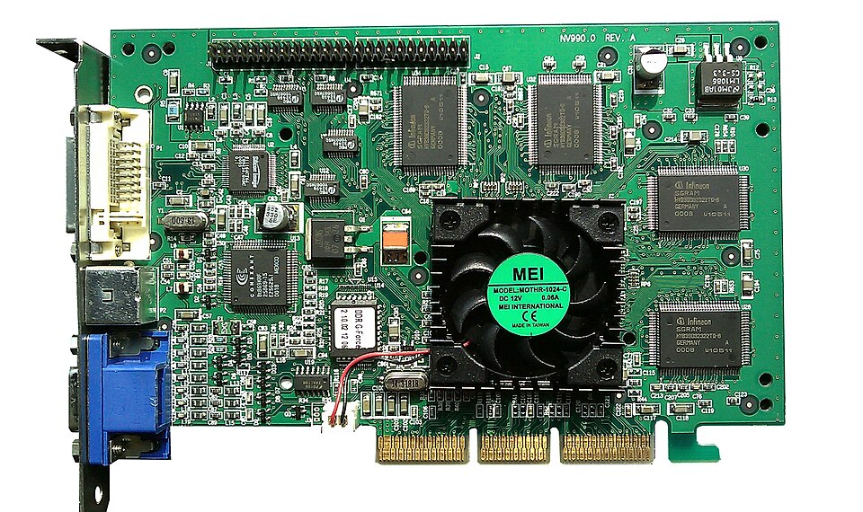
    
開創 GPU 概念與引領平行加速運算革命的 NVIDIA 硬體架構

  

---

## 2012 年 AlexNet 突圍與 2016 年交付 DGX-1

  

    

      <h3>💥 2012 ImageNet 賽場上的驚世驚雷</h3>
      
辛頓的學生 Alex Krizhevsky 僅用兩張消費級 GeForce GTX 580 顯卡訓練卷積神經網絡，以壓倒性優勢奪冠，宣告電腦視覺傳統手寫特徵時代的終結。

    

    

      <h3>🎁 2016 親手簽名交付第一台 DGX-1 給 OpenAI</h3>
      
敏銳察覺 AI 浪潮的黃仁勳，耗資數億美元打造出全球首台專為深度學習設計的超級電腦 DGX-1，並親手將第一台機櫃送到了新成立的 OpenAI 辦公室。

    

    

      <h3>🚀 催生現代大語言模型的核心基石</h3>
      
正是這台被黃仁勳親手交付的「AI 怪獸」，訓練出了初代 GPT 與後續無數里程碑模型，奠定了整個生成式人工智慧時代的算力基座。

    

  

  

    
    
高密度深度學習專用伺服器機櫃，奠定現代大規模分散式模型訓練底座

  

---

## AI Factory 與現代軟體工程範式重構

  

    

      <h3>🏭 從傳統資料中心到「AI 工廠 (AI Factory)」</h3>
      
未來的運算不再是 CPU 依序執行儲存在硬碟上的程式碼，而是由數萬顆 GPU 叢集以電力和巨量數據為原料，24 小時不間斷生產智慧 Token 的 AI 工廠。

    

    

      <h3>⚡ Blackwell 世代與全水冷兆瓦級叢集</h3>
      
單晶片封裝 2080 億晶體，透過 NVLink 實現太字節級晶片間互聯，將萬億參數大模型的推論成本與能耗再度壓縮一個數量級。

    

    

      💡 <strong>格言深意</strong>：馬克·安德森曾說「軟體正在吞噬世界」，黃仁勳則補上了下半句：「AI 正在吞噬軟體」。未來的程式設計師必須理解異質加速運算，學會駕馭神經網路重塑每一個傳統代碼模組。
    

  

  

    
    
當代巨型高密度 GPU AI 運算資料中心，全天候驅動現代工業大模型訓練

  

---

<!-- _class: quote-hero -->

“Talk is cheap. Show me the code.”

光說不練假把戲，把程式碼拿出來給我看。

— Linus Torvalds, 2000

---

<!-- _class: full-comic -->
<!--
【林納斯·托瓦茲生平四格分鏡解析】
Panel 1：1991 芬蘭大學生的業餘貼文 —— 在 Usenet 謙遜宣告「只是個個人愛好，不會搞得像 GNU 那麼大」。
Panel 2：Tux 企鵝與開源市集革命 —— 擁抱全球開源協作，打破傳統軟體大教堂模式，Linux 席捲全球伺服器。
Panel 3：2005 年閉關兩週打造 Git —— 面對 BitKeeper 授權危機，以有向無環圖 (DAG) 顛覆版本控制。
Panel 4：掌舵全球數位命脈的宗師 —— 三十年堅持嚴格代碼審查，成為全球雲端與智慧設備背後的隱形巨人。
-->

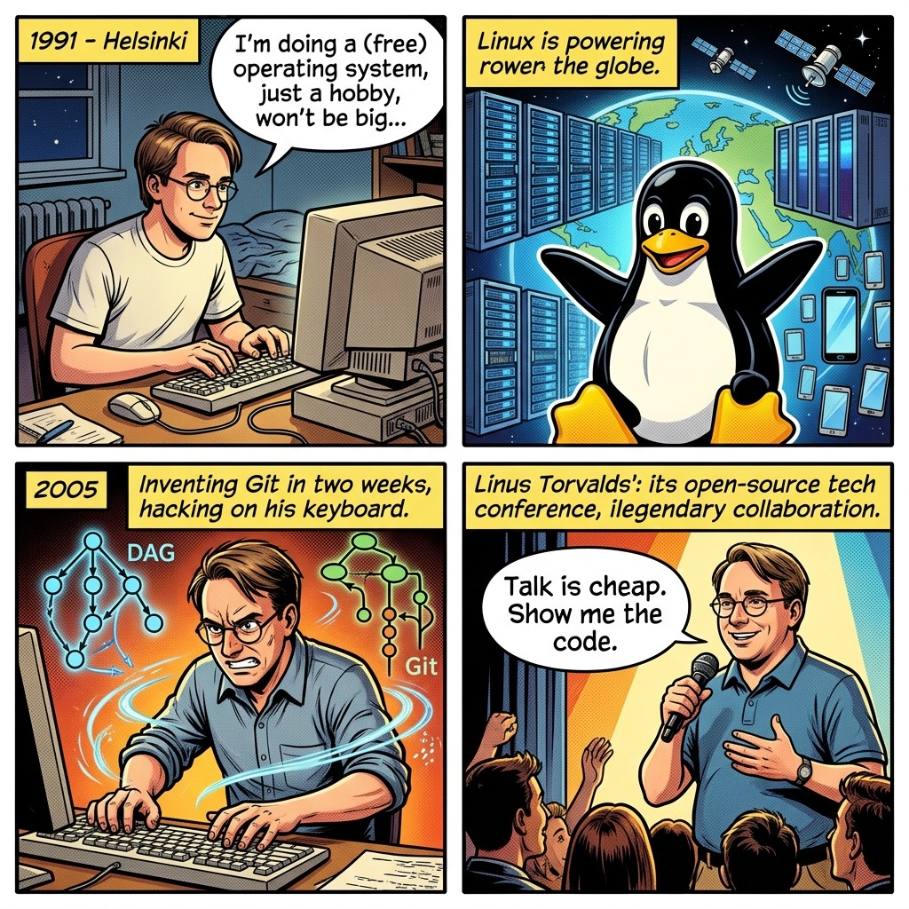

---

## 林納斯與 1991 年那篇「純屬業餘」的公告

<strong>林納斯·托瓦茲 (Linus Torvalds, 1969–)</strong>：Linux 核心與 Git 的創造者，自由開源軟體史上最具實用主義色彩的靈魂人物。

  

    

      <h3>🐧 1991 年赫爾辛基大學生的業餘專案</h3>
      
21 歲的林納斯在 Usenet 發帖：「我正在開發一個自由作業系統，只是一個業餘愛好，不會搞得很大很專業。」未曾想這段代碼竟成為日後全人類數位社會的基石。

    

    

      <h3>💬 郵件列表裡無可撼動的實用主義</h3>
      
面對郵件列表中各路哲學家沒完沒了的架構口水戰，林納斯留下「Talk is cheap. Show me the code」的名言——拒絕空洞的高談闊論，以具體、可運行的程式碼定勝負。

    

    

      <h3>🌍 開源市集模式引爆全球協同開發</h3>
      
林納斯證明了不需要層層官僚架構，只要具備透明的代碼審查機制與卓越的模組解耦，成千上萬互不相識的工程師也能跨越時區共同維護龐大系統。

    

  

  

    
    
Linux 全球開源社群象徵吉祥物 Tux 企鵝，見證了實用主義開源文化的壯大

  

---

## 2005 年 BitKeeper 危機：兩週打造 Git

  

    

      <h3>🔒 授權破裂引發的 Linux 核心維護危機</h3>
      
Linux 核心開發原先依賴專有軟體 BitKeeper 進行補丁管理。2005 年廠商因逆向工程爭議收回免費授權，龐大的核心協同工作面臨停擺危機。

    

    

      <h3>⚡ 兩週閉關寫出分散式有向無環圖 (DAG)</h3>
      
林納斯直接閉關兩週，徹底拋棄傳統中心化版本控制思維，以內容定址物件庫 (Content-Addressable Object Store) 與 DAG 樹重新發明了 Git。

    

    

      <h3>🌟 現代軟體工程協作的絕對標準</h3>
      
Git 極致的分支創建與秒級合併體驗，直接催生了 GitHub，成為全球超過一億開發者每天呼吸般不可或缺的協作平台。

    

  

  

    
    
現代全球軟體版本控制標準 Git 架構，以精妙的 DAG 結構重構工程協同

  

---

## 驅動全人類數位世界的開源基石

  

    

      <h3>📱 統治雲端、超算與 30 億行動裝置</h3>
      
當今全球前 500 大超級電腦 100% 運行 Linux 核心；全球超過 30 億台 Android 手機與絕大多數雲端容器 (Docker/K8s) 底層皆建基於其上。

    

    

      <h3>🛡️ 三十餘年專注代碼整潔與極致審查紀律</h3>
      
林納斯對內核代碼品質與向後相容性近乎苛刻的堅持（「Never break user space!」），證明了專注的工匠精神能夠支撐起跨越數十年的現代文明基石。

    

    

      💡 <strong>格言深意</strong>：在充斥著行銷口號與天花亂墜架構圖的行業裡，托瓦茲的警鐘永遠刺耳：一切抽象的理念如果不能落地為高效、穩定、優雅的程式碼，終究只是不值一文的空談。
    

  

  

    
    
全球頂級超級電腦 100% 採用 Linux 核心，彰顯開源系統強大的極限運算統治力

  

---

<!-- _class: quote-hero -->

“Don't be a know-it-all; be a learn-it-all.”

不要自以為無所不知，要成為永遠渴望學習求知的人。

— Satya Nadella, 2014

---

<!-- _class: full-comic -->
<!--
【薩蒂亞·納德拉生平四格分鏡解析】
Panel 1：2014 接掌深陷泥淖的巨擘 —— 微軟錯失行動網路，內部部門各自為政、封閉內耗。
Panel 2：「Microsoft Loves Linux」大轉身 —— 勇敢擁抱開源對手，將 Azure 雲端推向開放新天地。
Panel 3：75 億美元收購 GitHub —— 贏回全球開發者的心，重塑以工程師為核心的企業文化。
Panel 4：聯手 OpenAI 開創 Copilot 時代 —— 全面賦能全球軟體工程師，成就市值數兆美元的 AI 帝國。
-->

---

## 納德拉接掌微軟與「Microsoft Loves Linux」破冰

<strong>薩蒂亞·納德拉 (Satya Nadella, 1967–)</strong>：微軟第三任執行長，帶領微軟告別封閉壟斷，以「成長型心態」創造科技史上最宏大的企業文化復興。

  

    

      <h3>📉 2014 接手錯失行動時代的疲憊帝國</h3>
      
前任執行長曾公開稱 Linux 是「癌症」，微軟內部充滿官僚壁壘與排他競爭，錯失了智慧型手機與行動網路浪潮，股價與士氣長期在低谷徘徊。

    

    

      <h3>🤝 「微軟愛 Linux」的震撼大轉身</h3>
      
納德拉打破傲慢，在發表會大螢幕打出「Microsoft Loves Linux」，讓 Linux 成為 Azure 雲端的頭等公民，主動開源 .NET 框架並推出 Windows Subsystem for Linux (WSL)。

    

    

      <h3>🧠 從「無所不知」到「持續求知」的心態革命</h3>
      
納德拉引入心理學家卡蘿·杜維克的「成長型心態 (Growth Mindset)」，告別昔日 Windows 壟斷時期的傲慢，要求全體員工承認不足、向對手學習、擁抱開源社群。

    

  

  

    
    
2014 年帶領微軟啟動全面文化轉型與雲端優先戰略的薩蒂亞·納德拉

  

---

## 75 億美元收購 GitHub：贏回全球開發者的信任

  

    

      <h3>💔 長達數十年的開發者信任鴻溝</h3>
      
微軟過去長期被開源社群視為掠奪者與威脅。2018 年當微軟宣布以 75 億美元收購 GitHub 時，全球開發者社群一片嘩然，許多專案甚至憤而搬遷代碼庫。

    

    

      <h3>🛡️ 恪守獨立運營與開源中立承諾</h3>
      
納德拉給予 GitHub 完全的獨立發展空間，傾力支持 VS Code 成為全世界最受歡迎的免費開源編輯器，用持續的開放行動贏回了全球工程師的尊重。

    

    

      <h3>🌐 打造全球最大的軟體工程樞紐</h3>
      
GitHub 如今匯聚了超過一億名全球開發者與四億個代碼倉儲，微軟從「開源死敵」徹底蛻變為全球開源生態最重要的支持者與貢獻者。

    

  

  

    
    
全球最大軟體開源與協作平台 GitHub 象徵圖騰 Invertocat

  

---

## 押注 OpenAI 與 GitHub Copilot 協同編程新時代

  

    

      <h3>💰 早期百億美金豪賭 OpenAI 算力夥伴關係</h3>
      
納德拉展現驚人的戰略魄力，在生成式 AI 爆發前夕即以數十億美元與 Azure 算力深度結盟 OpenAI，將尖端模型無縫注入全線軟體產品中。

    

    

      <h3>🤖 Copilot 掀起全人類程式碼生成典範轉移</h3>
      
GitHub Copilot 成為全球軟體工程師不可或缺的 AI 結對編程夥伴，自動承擔超過 40% 的常規樣板代碼生成，極大釋放了人類工程師的創造力。

    

    

      💡 <strong>格言深意</strong>：在技術迭代日新月異的時代，那些自詡為「無所不知 (Know-it-all)」的專家往往最先被時代淘汰；唯有保持謙遜、永遠渴望學習 (Learn-it-all) 的工程師，才能穿越每一次典範轉移的狂風巨浪。
    

  

  

    
    
微軟 Azure 全球雲端與 AI 基礎架構，全天候賦能 Copilot 開發者生態

  

---

<!-- _class: quote-hero -->

## 軟體工程的歷史，是人類克服傲慢的歷史

從霍普發現的第一隻小飛蛾，到漢密爾頓守護阿波羅登月； 
從布魯克斯反思焦油坑，到林納斯以開源統一世界； 
從吉多對可讀性的執著，到黃仁勳與奧特曼推動 AI 算力革命。

軟體工程從來不是冰冷的機器代碼，而是**人類直面自身思維盲點、以紀律與熱情對抗複雜度的壯麗史詩**。

保持謙遜 · 永遠學習 · 謹守工程品質的底線

