

<!-- _class: lead -->

國立高雄師範大學 · 特邀專題演講（2022/12/08）

# 程式教育的線上學習與其歷程分析

從疫情驅動的 MOOC 數位轉型、多元互動組件與 Online Judge 實踐，到基於 OpenEdu 學習歷程日誌之影片預警、參與度與挫折行為分析

<strong>講者：</strong>薛念林 教授（Prof. Nien-Lin Hsueh） 
<strong>單位：</strong>逢甲大學 資訊工程學系 
<strong>時間與地點：</strong>2022 年 12 月 8 日（四）10:00 · 國立高雄師範大學

<!--
本場特邀演講於 2022 年 12 月 8 日於國立高雄師範大學發表，系統性回顧逢甲大學資訊工程學系推動 Python 程式設計線上化與 MOOCs 課程的多年實戰經驗，以及後續利用 OpenEdu 平台學習日誌（Log Data）進行教育資料探勘（EDM）之實證成果。簡報內容涵蓋兩大主軸：前半部探討「MOOC 之旅與教學設計」（從實體翻轉至全線上非同步課程與多元互動元件）；後半部展示「學習歷程資料分析」（包含影片觀看行為預測及格率、互動模組留存活動力、SP 與 OJ 成績關聯、以及提交挫折度與退選率分析）。
-->

---

## 演講大綱目錄（點擊各項目直接跳轉）

🚀 1. MOOC 之旅：課程型態與演變

<a class="hub-link" href="#3">🌍 時代背景：Learn At Home 全球教育實驗本簡報 #3</a>
<a class="hub-link" href="#4">📈 漸進轉型：MOOC 四階段演進與 13-5 混成本簡報 #4</a>
<a class="hub-link" href="#5">🧱 課程設計：六大單元與單一單元節奏本簡報 #5</a>

🧩 2. 不只是影片：多元互動與評量

<a class="hub-link" href="#6">📊 九大學習組件與學生偏好調查本簡報 #6</a>
<a class="hub-link" href="#7">⚖️ 評量核心、Online Judge 與期末實作專題本簡報 #7</a>
<a class="hub-link" href="#8">💡 提升課程參與度（Engagement）與回饋本簡報 #8</a>

🎬 3. 學習歷程分析：案例一（影片預警）

<a class="hub-link" href="#9">🗄️ More than Dashboard：三層資料與 JSON Log本簡報 #9</a>
<a class="hub-link" href="#10">👀 9 種影片觀看模式（Watching Patterns）本簡報 #10</a>
<a class="hub-link" href="#11">🤖 機器學習早期及格／不及格預測成效本簡報 #11</a>

🧪 4. 學習歷程分析：案例二（互動與挫折）

<a class="hub-link" href="#12">🔥 互動模組活動力（17% vs. 32% / OJ 40%）本簡報 #12</a>
<a class="hub-link" href="#13">📉 程式除錯軌跡與 SP／OJ／Exam 相關性本簡報 #13</a>
<a class="hub-link" href="#14">😓 挫折度分析（Frustration）與退選風險本簡報 #14</a>

<!--
本頁為全場演講之四維度互動目錄，支援現場點擊直接跳轉至對應章節。整體脈絡由教學實務出發（第 3–8 頁：線上課程怎麼設計才能「不只是影片」），進階到資料驅動的實證研究（第 9–14 頁：如何從 OpenEdu 龐大的細粒度事件日誌中提煉出可行動的教學洞察與早期預警模型），最後於第 15 頁收斂為精準學習（Precise Learning）的實踐原則。相關延伸閱讀論文亦收錄於本倉儲之 MyResearch/21Judge（UTAUT2 接受度）與 MyResearch/22Engagement（PLS-SEM 行為投入模型）。
-->

---

## 時代背景：Learn At Home 與線上學習的全面試驗

根據聯合國（UN）統計，COVID-19 疫情期間 13 個國家停課衝擊全球約 **2.9 億名學生**（Learn From Home, LFH），揭露線上教育四大基礎瓶頸：

### 🌐 1. 基礎建設（Infrastructure）
並非所有地區皆具備穩定且可靠的寬頻網路連線。

### 💻 2. 學校科技支援（Technology）
並非所有學校都擁有數位教學所需軟硬體與即時技術支援。

### 👩‍🏫 3. 師資人力（Human Resources）
極少數學校具備足夠教師能量，能產製設計精良的線上教材。

### 🏠 4. 家庭設備（Home Technology）
並非所有學生家庭皆具備線上學習所需之電腦硬體或軟體環境。

<strong>核心反思：</strong> 不管你喜不喜歡，這場疫情迫使全體師生進入一場史無前例的大型試驗，也正好讓我們系統性地驗證<strong>線上程式教育的可能性與極限</strong>。

<!--
本頁呈現 2020–2022 年全球疫情停課（Learn At Home / LFH）對高等教育的衝擊。聯合國報告指出近三億名學生被迫轉向遠距學習，暴露出網路基礎建設、學校技術支援、教師線上教材設計能量與家庭終端設備等四大結構性落差。這場非自願的全面實驗成為逢甲團隊加速推動程式設計課程 MOOC 化、自動化評測與學習歷程資料分析的關鍵轉折點。
-->

---

## MOOC 之旅：課程型態四階段演進

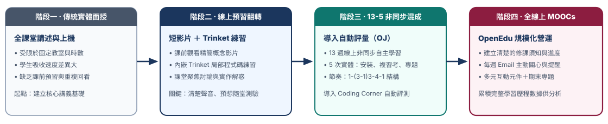

### 🎬 階段二實務：線上預習影片拍攝心法
- **清楚的聲音與畫面**（音質比特效更關鍵）且提早檢查。
- **不要想錄下所有內容**：保持短小精悍、多樣拍攝風格。
- **預想隨堂測驗**：拍攝腳本階段即規劃互動停頓點。

### 📅 階段三實務：13-5 非同步混成（`1-(3-1)3-4-1`）
- **13 週線上非同步**＋**5 次關鍵實體面授**：
  1. 課程說明與軟體安裝操作；2–3. 討論與兩次複習考；
  4. 討論與專題計畫書；5. 期末專題報告與討論。

<!--
本頁展示課程從傳統實體面授漸進演變為全線上 MOOCs 的四個階段：（1）傳統實體課程；（2）線上預習翻轉，結合精簡錄製影片與 Trinket 局部線上程式碼練習；（3）13-5 非同步混成模式（13 週線上搭配 5 次實體聚會，週次結構採 1-(3-1)3-4-1 節奏），並導入 Coding Corner 自動評量系統以減輕助教負擔；（4）全線上 OpenEdu MOOCs 課程，透過清楚的修課須知與每週 Email 主動提醒維繫學習動機。
-->

---

## MOOC 課程設計：六大單元與單一單元標準節奏

### 🗂️ 全課程宏觀架構（OpenEdu）
- **課前起點**：修課須知、環境準備、課前問卷。
- **六大核心單元**：
  - 單元一：Python 程式與資料科學簡介
  - 單元二：程式基本結構與變數運算
  - 單元三：邏輯控制（循序、分支、迴圈）
  - 單元四～六：函式、資料結構與資料分析實作
- **收尾檢核**：期末實作專題、課程問卷、**取得修課證書**。

### 🔁 單一單元微觀學習節奏
每週單元皆採標準化鷹架流程，降低初學者迷失感：
1. **Introduction**：單元動機與生活情境導入
2. **Concept × 3**：拆分為 3 段精簡核心概念短影片
3. **Application**：真實問題應用示範
4. **Online Judge**：立即動手撰寫程式並取得自動回饋
5. **Solution & Test**：解題思維剖析與單元總測驗

<strong>設計理念：</strong> 線上課程最忌諱「將三小時實體錄影直接上架」；必須將知識拆解為可消化之微單元，並把<strong>練習與評量內嵌於每一單元的閉環</strong>之中。

<!--
本頁解析 OpenEdu 線上 Python 課程的雙層設計架構。在宏觀層次上，從課前修課須知到六大循序漸進單元，最終銜接期末實作專題與證書認證；在微觀層次上，每一單元固定遵循「導入（Introduction）➔ 核心概念短片（Concept ×3）➔ 應用（Application）➔ 線上程式評測（Online Judge）➔ 解析（Solution）➔ 單元測驗（Test）」的標準化節奏，確保學生每學完一個概念即能立即驗證吸收成效。
-->

---

## 不只是影片：多元學習組件與學生偏好調查

線上學習絕不能只靠單向看影片；課程整合 **9 大互動組件**，讓學生透過多元感官持續參與：

### 🧰 九大學習組件
聽講影片Quiz in Video電子講義模擬與實驗自我練習記憶卡 Flashcard線上討論（Teams/Line）即時回饋OJ 線上程設

### 📊 學生喜好調查關鍵發現
- 同樣是測驗，<strong>「自我練習」喜好度高於「隨堂測驗」</strong>（無計分壓力更能安心試錯）。
- **OJ 程式練習呈現兩極化**：整體較具挑戰而略不討喜，但<strong>「非常喜歡」的人數比例亦極高</strong>！

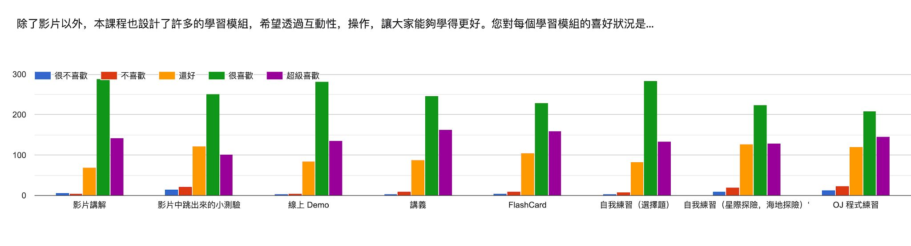

OpenEdu 修課生對各學習組件喜好程度實證調查（懸停可放大檢視）

<!--
本頁回應「二、不只是影片」的核心命題。除了傳統聽講影片與電子講義外，課程設計了影片中彈出隨堂測驗（Quiz in video）、視覺化程式執行模擬、記憶卡（Flashcard）、跨平台社群討論（Teams、Line、Slack、FB）以及 Online Judge 實作題。問卷調查顯示兩個重要教學啟示：（1）學生偏好低壓力的自我練習勝過計分隨堂測驗；（2）OJ 程式題雖因門檻高而出現兩極反應，卻同時擁有極高比例的「非常喜歡」族群，展現真實寫程式帶來的高度成就感。
-->

---

## 評量核心：Online Judge 虛擬助教與期末實作專題

### ⚖️ 雙軌評量與 Online Judge 機制
- **封閉性測驗**：設定合適作答次數，提供**即時答題回饋**。
- **OJ 線上程式評測（虛擬助教）**：
  - 流程：`學生程式` ➔ `雲端執行環境＋測試資料` ➔ `即時回傳得分與狀態`。
  - 結合<strong>星際探險（Star Trek）</strong>等趣味化關卡設計，降低初學者面對語法錯誤的畏懼感。

### 🏆 跨領域真實資料期末專題（20+ 主題）
學生運用所學 Python 分析開放資料，解決生活真實問題：
- **民生交通**：台北／新北 YouBike 分析、停車場剩餘車位、台中市交通事故分析、全台郵局分佈。
- **環境健康**：即時 PM2.5 空氣品質排序、腸病毒就診統計、登革熱年齡分析。
- **金融生活**：**股價自動傳送到 LINE**、購物消費預測、產業薪資分析、以距離推薦旅店。

<strong>教學價值：</strong> Online Judge 扮演全天候待命的「虛擬助教」，補足線上課程缺乏即時回饋的致命傷；期末開放資料專題則讓程式學習真正連結生活應用。

<!--
本頁介紹線上程式課程的評量設計與專題成果。自動評測系統（Online Judge）讓學生提交程式碼後能於數秒內獲得編譯結果與測試資料通過狀態，大幅縮短學習回饋迴圈，並搭配星際探險等趣味化主題提高挑戰意願。期末專題則鼓勵跨科系學生選取政府開放資料（如 YouBike、PM2.5、郵局分佈、登革熱、交通事故）或實作股價自動推播至 LINE 等應用，展現從基礎語法邁向資料科學實作的完整學習成果。
-->

---

## 如何提升課程參與度（Engagement）與學生回饋

### 🎥 Short & Well-Designed Video
影片精簡聚焦，並於觀看途中適時彈出 **Quiz in Video**，有效拉回線上學習專注力。

### 🎮 Gamification 遊戲化
導入「星際探險」等趣味小遊戲與闖關機制，提升非資訊背景學生的探索動機。

### 🔄 多模態互動設計
串聯 **「聽 ➔ 讀 ➔ 操作 ➔ 模擬」** 四種感官體驗，讓學生現學現用、立即驗證理解。

### 💬 修課學生真實回饋摘錄
- 「我學習一般很慢，但**影片能讓我重複播放**，不懂的概念可以重複聽，**影片中的小測驗**則可以加深印象！」
- 「**自我練習 & OJ 練習**讓我學完後立刻可以測試到底了解了沒，真的很棒！」
- 「非常喜歡**星際探險**的部分，利用遊戲化互動讓我更有興趣去學 Python！」

<!--
本頁總結提升線上課程參與度（Engagement）的三大支柱：精簡且含互動測驗的影片、遊戲化機制，以及涵蓋「聽、讀、操作、模擬」的多元互動循環。下方精選自 OpenEdu 課後問卷之學生真實回饋，印證了自主調整觀看節奏、影片內嵌測驗、OJ 即時驗證與星際探險遊戲化設計對不同學習速度學生的實質幫助（後續亦發展為 JITE 2022 之 PLS-SEM 行為投入實證論文）。
-->

---

## 學習資料分析：More than Dashboard

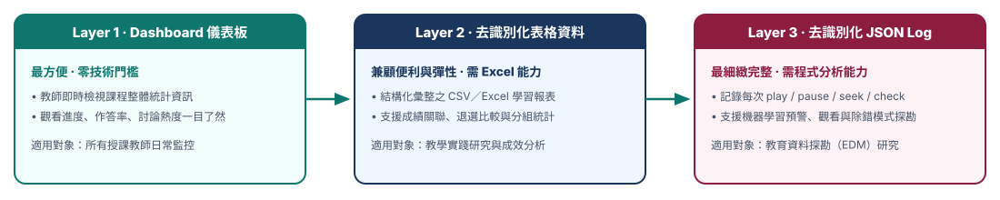

### 📡 OpenEdX 細粒度學習事件（Log Events）
平台全程記錄超過 20 大類互動事件，涵蓋：
- 選課（Enrollment）、頁面導覽（Navigational）
- **影片互動（17 種事件）**：`load_video`、`play_video`、`pause_video`、`seek_video`、`speed_change_video`、`stop_video`
- **題目互動（16 種事件）**：`problem_check`、`showanswer`

### 🧾 JSON 日誌關鍵欄位解析
- **身分與課程**：`user_id`、`course_id`、`session`
- **時間軸**：`time`（事件時間戳）、`currentTime`（影片秒數）
- **行為細節**：`old_time / new_time`（快轉／倒帶區間）、`old_speed / new_speed`（倍速變化）、`event_type`

<!--
本頁切入演講下半場核心主題「學習歷程資料分析」。除了提供教師零門檻檢視的 Dashboard 外，OpenEdu 更進一步開放「去識別化表格資料（適合 Excel 統計）」與「去識別化 JSON 原始日誌（適合程式探勘與機器學習）」。細粒度 JSON 事件完整捕捉了學生每一次播放、暫停、快轉、倒帶、調速與答題行為，為後續兩大實證分析案例奠定資料基礎。
-->

---

## 案例一（上）：影片觀看行為與 9 種觀看模式

**研究問題**：能否僅憑學生在課程初期觀看**前 3 支影片的行為**，即提早預測其最終是否及格（Pass / Fail）？

### 🔍 四大觀看行為維度
由 `play / pause / seek / stop` 日誌萃取：
- **Complete-watch (CW)**：幾乎完整看完影片
- **Partial-watch (PW)**：未看完即提前離開
- **Forward watch (f)**：觀看過程中包含向前快轉
- **Backward watch (b)**：觀看過程中包含向後倒帶重看

### 🧪 實證規模與實驗設定
- **單一課程**（MOM）vs. **180 門跨領域課程**
- **教師引導進度（Instructor-paced）** vs. **自主學習（Self-paced）**

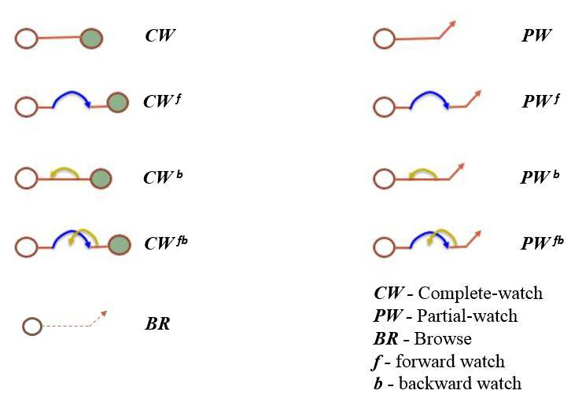

由完整度與快轉／倒帶組合定義之 9 種影片觀看模式（懸停可放大）

<!--
案例一探討如何透過早期影片觀看日誌建構退選／不及格預警模型。研究將原始 JSON 事件經三層前處理（Course/Student ➔ Watching Patterns ➔ Feature Vector），依據「完整看完／部分觀看」與「無跳轉／快轉／倒帶／雙向跳轉」等組合定義出 9 種觀看模式（Watching Patterns），並針對每一組 `<student, course>` 計算各模式佔比作為機器學習特徵向量，目標僅用前 3 支影片的行為即預測最終通過與否。
-->

---

## 案例一（下）：觀看模式分布與機器學習預測成效

採用 **SVM、Neural Network、Random Forest** 並進行 **10-fold Cross-Validation**，其中 **Random Forest** 表現最佳：

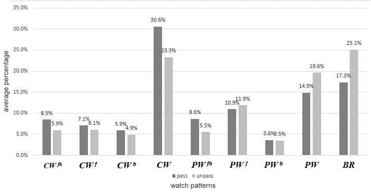

Pass vs. Fail 學生於各觀看模式之比例分布差異

| 實驗設定（Random Forest · 10-fold CV） | Accuracy | Precision | Recall | F1 |
| :--- | :---: | :---: | :---: | :---: |
| **Single Course（單一課程 MOM）** | **0.83** | **0.89** | 0.89 | **0.89** |
| **180 Different Courses（跨課程泛化）** | 0.71 | 0.70 | **0.95** | 0.81 |
| **Instructor-paced（教師引導進度）** | 0.71 | 0.71 | **0.96** | 0.82 |
| **Self-paced（自主學習課程）** | **0.91** | **0.93** | **0.976** | **0.95** |

<strong>關鍵發現：</strong> 即使跨 180 門不同課程，模型對高風險不及格學生的 <strong>Recall 高達 95%–97.6%</strong>；在自主學習（Self-paced）課程中準確率更達 <strong>91%（F1 = 0.95）</strong>，極具早期介入預警價值！

<!--
本頁呈現案例一之實證比較結果。左側圖表顯示及格（Pass）與不及格（Fail）學生在 9 種影片觀看模式上的顯著分布差異；右側表格彙整 Random Forest 經十折交叉驗證的效能指標：在單一課程 MOM 準確率達 0.83（F1 = 0.89），跨 180 門異質課程仍維持 0.95 的高召回率（能精準抓出絕大多數潛在不及格學生），而在最需要自律的 Self-paced 課程上更達到 0.91 準確率與 0.95 F1 分數。
-->

---

## 案例二（上）：互動性教學模組與課程活動力留存

比較不同互動設計程度之學期課程與模組，追蹤學生至第 5 週的**參與活動力留存率**：

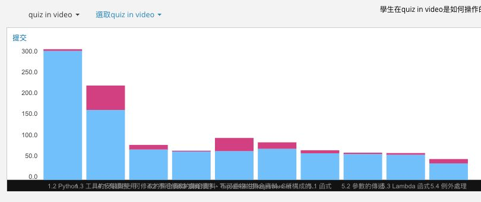

互動較少課程（M2019s） <strong style="color: #8c1d40;">活動力快速衰退至 17%</strong>

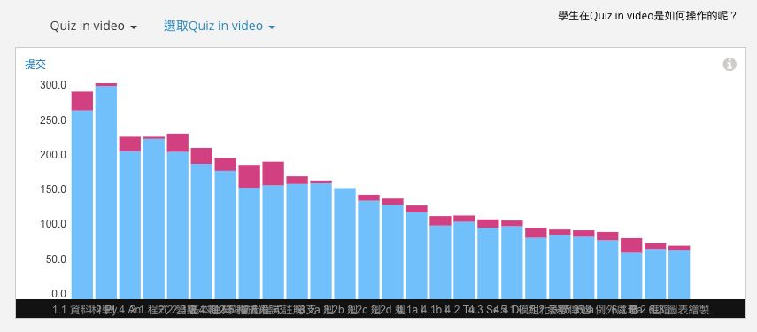

互動較高課程（M2019f） <strong style="color: #0f766e;">活動力穩定維持 32%</strong>

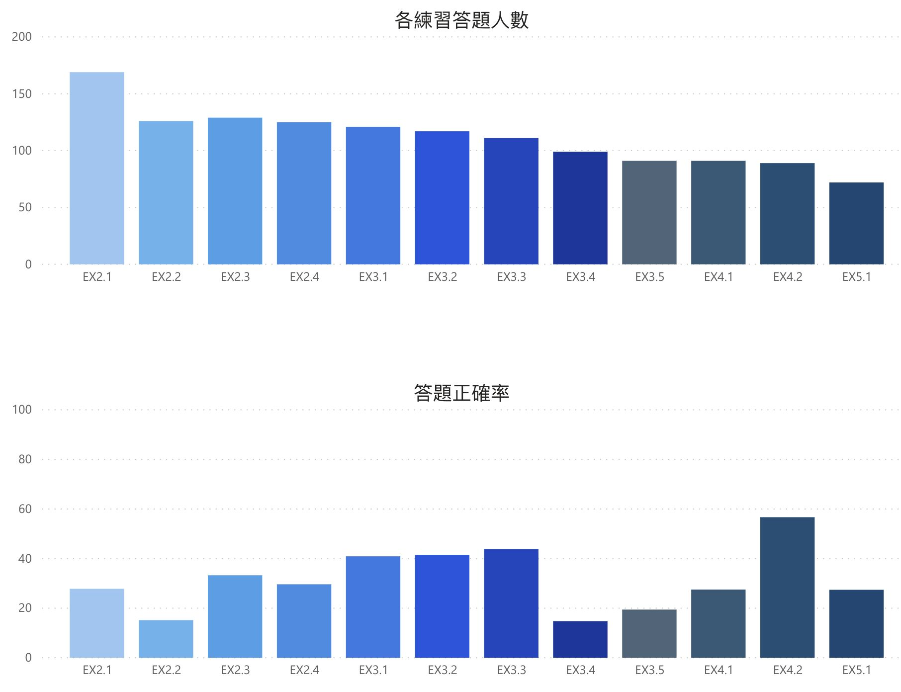

Online Judge 程式實作模組 <strong style="color: #1b365d;">活動力最高達 40%</strong>

<strong>重要觀察：</strong> M2019f 因加入較多互動元素（如星際探險活動力達 <strong>30%</strong>），第 5 週整體留存率約為低互動班的 <strong>2 倍</strong>；<strong>Online Judge</strong> 雖初期參與人數較少，但一旦投入，其留存活動力高達 <strong>40%</strong>，高於所有其他模組！

<!--
案例二聚焦互動式教學模組對學生長期參與活動力的實證影響。比較兩學期開課數據發現：互動元素較少的班級（M2019s）參與度迅速滑落至 15%–17%，而強化互動與星際探險（30%）等元素的班級（M2019f）能穩定維持 30%–32% 活動力。更具啟發性的是，門檻較高的 Online Judge 模組雖然初期起跳人數較少，但持續參與者的留存活動力高達 40%，顯示高挑戰度搭配即時回饋能有效深化學習黏著度。
-->

---

## 案例二（中）：程式除錯軌跡與成績關聯分析（SP vs. OJ）

分析學生提交紀錄（`F1072`）探討「遇到什麼問題、如何除錯」，並比較 **自我練習（SP）** 與 **程式實作（OJ）** 對期末考成績之預測力：

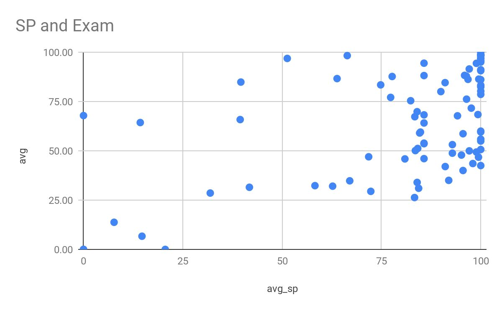

自我練習（SP）vs. 期末考：<strong style="color: #1b365d;">CORR = 0.54</strong>

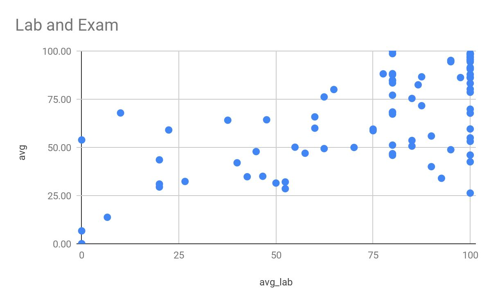

線上程式（OJ）vs. 期末考：<strong style="color: #8c1d40;">CORR = 0.70</strong>

<strong>實證觀察：</strong> ① <strong>SP（選擇題）</strong>因允許無限次反覆作答，高分不必然保證考試高分（<code>r = 0.54</code>）；<strong>OJ 實作得分</strong>與考試成績呈更強正相關（<code>r = 0.70</code>）。② 除錯軌跡顯示初學者常混淆變數、字串串接、引號與 <code>input()</code>，且易陷入<strong>盲目修改程式碼（blind debugging）</strong>的壞習慣！

<!--
本頁結合質性提交軌跡分析與量化成績相關性分析。在質性面上，追蹤學生連續提交的程式碼版本，發現初學者最常卡關在變數型別、字串串接與引號、以及 input 函式使用，且缺乏系統性除錯思維而反覆盲目試誤。在量化面上，比較概念核對選擇題（Self-Practice, SP）與動手實作題（Online Judge, OJ）對期末考（Exam）的相關係數，結果顯示 OJ（r = 0.70）顯著高於 SP（r = 0.54），證實唯有真實動手寫程式才能有效轉化為評量實力。
-->

---

## 案例二（下）：挫折度分析（Frustration, Grade & Dropout）

若學生反覆提交仍不斷失敗（例如第一題簡單 OJ 即有學生**提交 32 次仍失敗**），將累積高度挫折並引發退選風險：

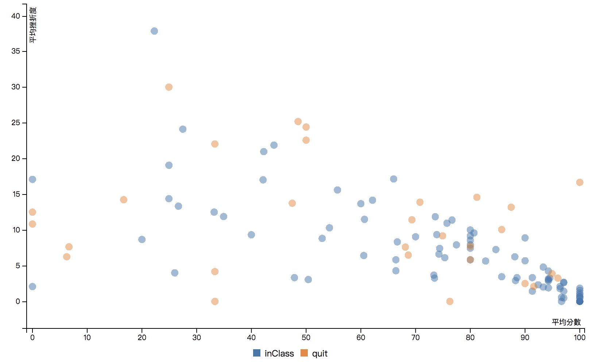

挫折度（Frustration Degree）與成績呈現顯著負相關

| 分組比較指標 | 高挫折／低成績組 | 低挫折／高成績組 |
| :--- | :---: | :---: |
| **依挫折度分組（平均成績）** | `49.29` 分 | **`80.1` 分** |
| **依挫折度分組（退選率 Dropout）** | **`34%`** | `12%` |
| **依 Lab 成績分組（平均 Lab 成績）** | `57` 分 | **`74` 分** |
| **依 Lab 成績分組（平均挫折度 F）** | **`11.1`** | `6.7` |

<strong>教學預警意義：</strong> 挫折率較高的學生，<strong>退選率高出近 3 倍（34% vs. 12%）</strong>且成績明顯偏低；即時偵測「誰卡關、何時需要幫助（Who / When need help?）」是降低退選率的關鍵！

<!--
本頁探討程式學習歷程中的「挫折度分析（Frustration Analysis）」。研究將學生在 OJ 系統上反覆提交失敗的頻率量化為挫折指標（F），實證數據清楚呈現雙向印證：（1）以挫折度分組時，高挫折組平均成績僅 49.29 分、退選率高達 34%，遠劣於低挫折組的 80.1 分與 12% 退選率；（2）反向以實作（Lab）成績分組時，高分組平均挫折度（6.7）亦遠低於低分組（11.1）。此發現直接催生了團隊後續「即時偵測卡關與分層 AI 助教介入」的研究方向。
-->

---

<!-- _class: closing -->

# 結語與教學啟示（Lessons Learned）

<strong style="font-size: 1.08em;">📖 1. Textbook is Necessary</strong> 
影片與互動不能完全取代結構化講義與教科書，系統化文本仍是深度複習的根基。

<strong style="font-size: 1.08em;">🤝 2. Improve Learning Support</strong> 
善用 OJ 虛擬助教、多元互動元件與即時挫折偵測，在學生放棄前伸出援手。

<strong style="font-size: 1.08em;">🎯 3. Precise Learning</strong> 
透過 OpenEdu 學習歷程數據，從「一體適用」邁向資料驅動的「精準個別化教學」。

延伸研究成果：
<a href="../../MyResearch/21Judge/Judge_slide_zh.html" target="_blank" rel="noopener" style="color: #7dd3fc;">21Judge（UTAUT2）↗</a> ·
<a href="../../MyResearch/22Engagement/Engagement_slide_zh.html" target="_blank" rel="noopener" style="color: #7dd3fc;">22Engagement（PLS-SEM）↗</a> ·
<a href="../../Talk2026/NKNU26/nknu26_slide.html" target="_blank" rel="noopener" style="color: #fde68a;">2026 高師大演講（AI &amp; Education）↗</a>

<!--
本頁總結 2022 年高師大演講的三大實務啟示：（1）即便在高度互動的 MOOCs 時代，結構化的教科書與講義（Textbook）依然不可或缺，提供學生系統性查閱與回顧的基礎；（2）透過自動評測、遊戲化與挫折偵測持續改善學習支持與教學介入；（3）以學習歷程分析為基礎，朝向「精準學習（Precise Learning）」演進。底部同時提供連結，方便讀者直接銜接團隊後續之實證論文簡報與 2026 年高師大 AI 時代演講。
-->

