

<!-- _class: lead -->

National Kaohsiung Normal University (NKNU) · Invited Keynote (2022/12/08)

# Online Learning and Process Analytics in Programming Education

From Pandemic-Driven MOOC Transformation, Multi-Modal Interactive Components, and Online Judge Practice to OpenEdu Learning Analytics on Video Early-Warning, Engagement, and Frustration

<strong>Speaker:</strong> Prof. Nien-Lin Hsueh 
<strong>Affiliation:</strong> Dept. of Information Engineering and Computer Science, Feng Chia University 
<strong>Date &amp; Venue:</strong> Dec 8, 2022, 10:00 · National Kaohsiung Normal University (NKNU)

<!--
This invited keynote presented at National Kaohsiung Normal University (NKNU) on December 8, 2022 synthesizes Feng Chia University's multi-year journey transforming introductory Python programming courses into scalable MOOCs and applying Educational Data Mining (EDM) to OpenEdu learning logs. The talk bridges two halves: (1) pedagogical design for online programming education beyond recorded lectures, and (2) empirical learning process analytics covering early pass/fail prediction from video logs, interactive module retention, grade correlation between self-practice and Online Judge, and frustration-driven dropout analysis.
-->

---

## Presentation Outline (Click Any Item to Jump)

🚀 1. MOOC Journey: Course Evolution

<a class="hub-link" href="#3">🌍 Context: Learn At Home Global ExperimentSlide #3</a>
<a class="hub-link" href="#4">📈 Four-Stage Evolution &amp; 13-5 Blended ModelSlide #4</a>
<a class="hub-link" href="#5">🧱 Course Design: 6 Units &amp; Micro-Unit RhythmSlide #5</a>

🧩 2. Beyond Videos: Interactive Components

<a class="hub-link" href="#6">📊 Nine Learning Components &amp; Preference SurveySlide #6</a>
<a class="hub-link" href="#7">⚖️ Assessment, Online Judge &amp; Capstone ProjectsSlide #7</a>
<a class="hub-link" href="#8">💡 Enhancing Engagement &amp; Student VoicesSlide #8</a>

🎬 3. Analytics Case 1: Video Early Warning

<a class="hub-link" href="#9">🗄️ More than Dashboard: 3 Data Tiers &amp; JSON LogsSlide #9</a>
<a class="hub-link" href="#10">👀 9 Video Watching Patterns ClassificationSlide #10</a>
<a class="hub-link" href="#11">🤖 ML Pass/Fail Early Prediction PerformanceSlide #11</a>

🧪 4. Analytics Case 2: Interaction &amp; Frustration

<a class="hub-link" href="#12">🔥 Module Activity Retention (17% vs. 32% / OJ 40%)Slide #12</a>
<a class="hub-link" href="#13">📉 Debugging Traces &amp; SP / OJ / Exam CorrelationSlide #13</a>
<a class="hub-link" href="#14">😓 Frustration Degree, Grades &amp; Dropout RiskSlide #14</a>

<!--
Interactive four-quadrant outline aligning with the Chinese edition page-for-page (#1–#15). Slides 3–8 cover the practical instructional design of MOOCs and Online Judge programming courses; Slides 9–14 present empirical OpenEdu learning log analyses; Slide 15 distills lessons learned toward Precise Learning and links to companion peer-reviewed studies (21Judge and 22Engagement).
-->

---

## Context: Learn At Home &amp; the Forced Online Experiment

According to the United Nations, COVID-19 school closures across 13 countries disrupted **290 million students** (Learn From Home, LFH), exposing four structural bottlenecks:

### 🌐 1. Insufficient Infrastructure
Not every region has stable and reliable broadband internet connectivity.

### 💻 2. School Technology &amp; Support
Not all schools possess the required platforms or technical support staff.

### 👩‍🏫 3. Human Resources
Few institutions have sufficient faculty capacity to craft high-quality online materials.

### 🏠 4. Home Technology
Not all student households have adequate hardware or software environments.

<strong>Key Reflection:</strong> Like it or not, educators and students were propelled into an unprecedented experiment—one that gave us the opportunity to rigorously test the <strong>possibilities and limits of online programming education</strong>.

<!--
During COVID-19, mass remote instruction revealed systemic disparities in broadband infrastructure, institutional IT support, instructional design readiness, and home computing access. Rather than treating remote teaching as a temporary stopgap, the Feng Chia University team leveraged this moment to formalize MOOC courseware design, automated grading, and data-driven learning process analytics.
-->

---

## MOOC Journey: Four-Stage Course Evolution

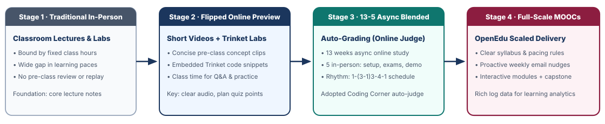

### 🎬 Stage 2 Tips: Recording Pre-Class Videos
- Prioritize **clear audio and visuals**, and test equipment early.
- **Do not try to record everything**: keep clips short and visually varied.
- **Anticipate in-video quizzes** while planning the script.

### 📅 Stage 3 Practice: 13-5 Async Blended (`1-(3-1)3-4-1`)
- **13 async online weeks** + **5 key in-person sessions**:
  1. Course onboarding &amp; tool setup; 2–3. Discussion &amp; two review exams;
  4. Project proposal discussion; 5. Final project demo &amp; Q&amp;A.

<!--
The transition from face-to-face instruction to full-scale MOOCs unfolded across four deliberate stages: (1) traditional classroom delivery; (2) flipped online previews combining concise concept clips with Trinket embedded code snippets; (3) a 13-5 asynchronous blended schedule (13 online weeks and 5 milestone physical meetings structured as 1-(3-1)3-4-1) augmented by Coding Corner auto-grading; and (4) full OpenEdu MOOCs supported by explicit course guidelines and weekly proactive email nudges.
-->

---

## MOOC Course Design: Six Units &amp; Micro-Unit Rhythm

### 🗂️ Macro Course Architecture (OpenEdu)
- **Pre-Course Onboarding**: Course guidelines, environment setup, pre-survey.
- **Six Progressive Units**:
  - Unit 1: Python Programming &amp; Data Science Intro
  - Unit 2: Basic Program Structure &amp; Variables
  - Unit 3: Logic Control (Sequence, Branching, Loops)
  - Units 4–6: Functions, Data Structures &amp; Data Analytics
- **Capstone &amp; Closure**: Final project, post-survey, **Certificate issuance**.

### 🔁 Standard Micro-Unit Learning Rhythm
Every unit follows a predictable scaffolding loop to prevent novice disorientation:
1. **Introduction**: Real-world motivation &amp; scenario framing
2. **Concept × 3**: Bite-sized core concept micro-videos
3. **Application**: Concrete applied walkthrough
4. **Online Judge**: Immediate hands-on coding with auto-grading
5. **Solution &amp; Test**: Solution debrief and unit assessment

<strong>Design Principle:</strong> Effective online courses never dump raw 3-hour classroom recordings online; they decompose concepts into digestible micro-units with <strong>embedded practice and verification loops</strong>.

<!--
On OpenEdu, the Python & Data Science MOOC pairs a macro six-unit progression with a consistent micro-unit rhythm (Introduction -> 3 Concept clips -> Application -> Online Judge -> Solution -> Unit Test). This recurring structure reduces extraneous cognitive load so learners immediately apply each newly introduced concept in code.
-->

---

## Beyond Videos: Nine Learning Components &amp; Student Survey

Online programming education cannot rely on passive video watching alone; the course orchestrates **9 interactive components**:

### 🧰 Nine Learning Components
Lecture VideoQuiz in VideoLecture NotesSimulation &amp; LabSelf-PracticeFlashcardsForum (Teams/Line)FeedbackOnline Judge

### 📊 Key Survey Findings
- Among quizzes, learners **preferred Self-Practice over graded in-video quizzes** (low-stakes experimentation).
- **Online Judge polarized learners**: lower average likability due to difficulty, yet a **remarkably high share of "Strongly Like"** responses.

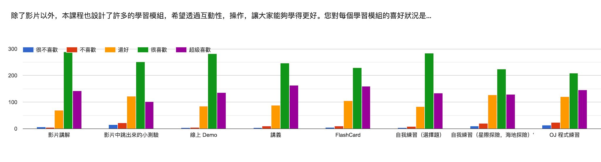

Empirical preference survey across OpenEdu learning components (hover to zoom)

<!--
Survey data from OpenEdu learners highlights two pedagogical nuances: (1) low-stakes self-practice exercises are preferred over graded in-video quizzes because they invite safe trial-and-error; (2) Online Judge coding tasks exhibit a bimodal reception—challenging for novices, yet eliciting strong enthusiasm from learners who value authentic hands-on coding mastery.
-->

---

## Assessment Core: Online Judge Virtual TA &amp; Capstone Projects

### ⚖️ Dual Assessment &amp; Online Judge
- **Closed-Form Quizzes**: Calibrated attempt limits paired with **instant feedback**.
- **Online Judge (Virtual TA)**:
  - Pipeline: `Student Code` ➔ `Sandbox + Test Data` ➔ `Instant Verdict &amp; Score`.
  - Gamified themes such as **Star Trek** lower novice anxiety toward syntax errors.

### 🏆 Real-World Open Data Capstones (20+ Topics)
Students apply Python to public datasets and everyday problems:
- **Urban Mobility**: Taipei/New Taipei YouBike, parking occupancy, Taichung traffic accidents, nationwide post-office mapping.
- **Health &amp; Environment**: Real-time PM2.5 rankings, enterovirus visits, dengue fever age distribution.
- **Finance &amp; Lifestyle**: **Auto stock alerts to LINE**, retail spending prediction, salary analytics, distance-based hotel recommendations.

<strong>Pedagogical Value:</strong> Online Judge acts as a 24/7 "Virtual TA" closing the delayed-feedback gap in online courses, while open-data capstones anchor programming skills in authentic civic and personal problems.

<!--
Automated grading via Online Judge provides immediate compilation and hidden test-case feedback within seconds, compensating for the absence of in-room TAs. Meanwhile, open-data final projects allow cross-disciplinary students to connect Python skills to civic datasets (air quality, YouBike, public health) and personal automation (LINE stock notifications).
-->

---

## Enhancing Course Engagement &amp; Student Feedback

### 🎥 Short, Well-Designed Videos
Focused micro-videos with embedded **Quiz in Video** pop-ups sustain learner attention during asynchronous viewing.

### 🎮 Gamification
Narrative mini-games like **Star Trek** spark intrinsic motivation among non-CS learners.

### 🔄 Multi-Modal Interaction
Combines **Listen ➔ Read ➔ Code ➔ Simulate** so learners immediately test comprehension after watching.

### 💬 Representative Student Feedback
- *"I normally learn slowly, but **replaying videos** lets me revisit tough concepts, and **in-video quizzes** reinforce retention!"*
- *"Combining **Self-Practice &amp; Online Judge** lets me immediately test whether I truly understood each unit."*
- *"Loved the **Star Trek** game—gamified interactions made learning Python genuinely fun!"*

<!--
Three pillars drive sustained engagement in online programming courses: concise interactive videos, gamification, and multi-modal active learning (listen, read, practice, simulate). Student testimonials corroborate how self-paced replay, embedded quizzes, OJ immediate feedback, and Star Trek gamification accommodate diverse learning speeds—insights later modeled via PLS-SEM in JITE 2022.
-->

---

## Learning Data Analytics: More than Dashboard

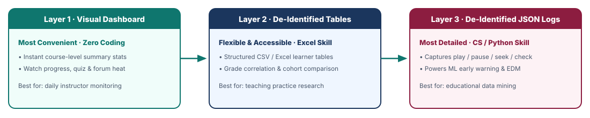

### 📡 OpenEdX Fine-Grained Event Logs
Captures 20+ interaction event categories across the learning lifecycle:
- Enrollment &amp; Navigational events
- **Video Interactions (17 types)**: `load_video`, `play_video`, `pause_video`, `seek_video`, `speed_change_video`, `stop_video`
- **Problem Interactions (16 types)**: `problem_check`, `showanswer`

### 🧾 Key JSON Log Schema Fields
- **Identity &amp; Context**: `user_id`, `course_id`, `session`
- **Timeline**: `time` (event timestamp), `currentTime` (video second)
- **Behavioral Trace**: `old_time / new_time` (seek jumps), `old_speed / new_speed` (playback rate), `event_type`

<!--
Moving beyond summary dashboards, OpenEdu provides three progressive analytics tiers: (1) zero-code visual dashboards for daily monitoring; (2) de-identified tabular exports suitable for Excel-based instructional research; and (3) raw de-identified JSON event logs capturing granular video and problem interactions for machine learning and Educational Data Mining (EDM).
-->

---

## Case 1 (Part 1): Video Watching Behavior &amp; 9 Patterns

**Research Question**: Can we predict whether a student will **Pass or Fail** based solely on their watching behavior during the **first 3 videos**?

### 🔍 Four Core Behavioral Dimensions
Extracted from `play / pause / seek / stop` logs:
- **Complete-watch (CW)**: Watches almost the entire video
- **Partial-watch (PW)**: Leaves before the video ends
- **Forward watch (f)**: Includes forward-seek skips
- **Backward watch (b)**: Includes backward-seek replays

### 🧪 Empirical Evaluation Scope
- **Single Course** (MOM) vs. **180 Diverse Courses**
- **Instructor-paced** vs. **Self-paced** offerings

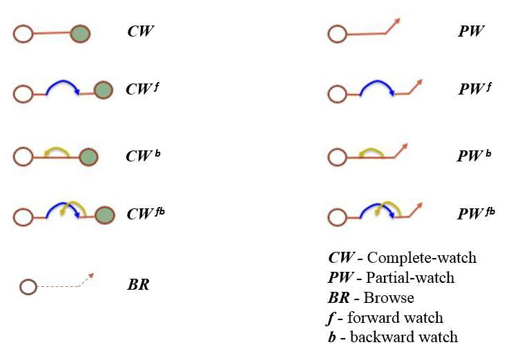

Nine watching patterns derived from completion and seek directions (hover to zoom)

<!--
Case 1 constructs an early-warning prediction pipeline from raw OpenEdX video logs. Through three preprocessing levels, each learner's viewing trace is categorized into 9 watching patterns combining completion (CW vs. PW) with seek behavior (none, forward, backward, bidirectional). Each <student, course> pair is encoded as a feature vector of pattern proportions from the first three videos to predict final pass/fail outcomes.
-->

---

## Case 1 (Part 2): Pattern Distribution &amp; ML Prediction Results

Evaluated **SVM, Neural Network, and Random Forest** via **10-fold Cross-Validation**; **Random Forest** achieved the strongest performance:

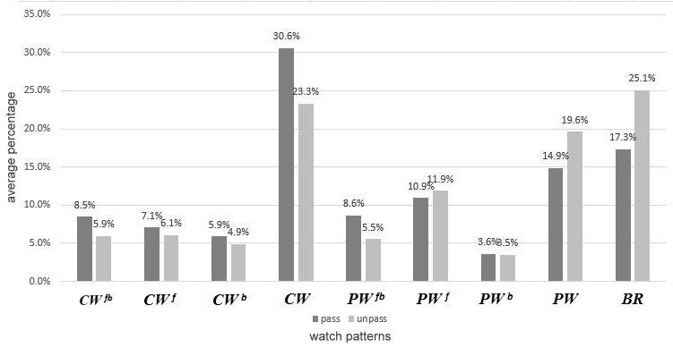

Proportion of 9 watching patterns comparing Pass vs. Fail cohorts

| Setting (Random Forest · 10-fold CV) | Accuracy | Precision | Recall | F1 |
| :--- | :---: | :---: | :---: | :---: |
| **Single Course (MOM)** | **0.83** | **0.89** | 0.89 | **0.89** |
| **180 Different Courses** | 0.71 | 0.70 | **0.95** | 0.81 |
| **Instructor-paced Courses** | 0.71 | 0.71 | **0.96** | 0.82 |
| **Self-paced Courses** | **0.91** | **0.93** | **0.976** | **0.95** |

<strong>Key Finding:</strong> Even across 180 heterogeneous courses, Random Forest achieves <strong>95%–97.6% Recall</strong> on at-risk learners—and reaches <strong>91% Accuracy (F1 = 0.95)</strong> in self-paced courses for early intervention!

<!--
The pattern distribution chart reveals distinct viewing signatures between passing and failing learners. Across 10-fold cross-validation, Random Forest achieves 0.83 accuracy (F1 = 0.89) on a single course, maintains 0.95 recall across 180 diverse courses (capturing nearly all at-risk learners), and peaks at 0.91 accuracy and 0.95 F1 in self-paced courses where early self-regulation is decisive.
-->

---

## Case 2 (Part 1): Interactive Modules &amp; Activity Retention

Tracking learner participation retention through Week 5 across courses and interactive modules:

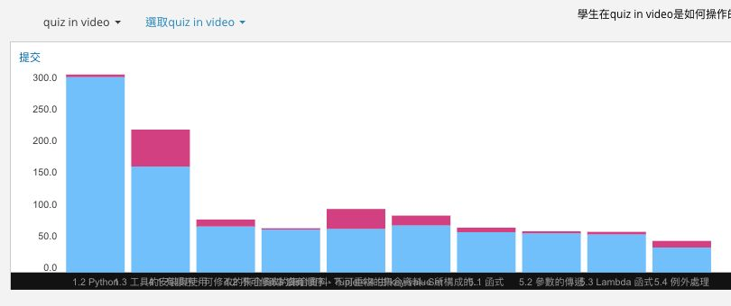

Low-Interaction Course (M2019s) <strong style="color: #8c1d40;">Activity drops sharply to 17%</strong>

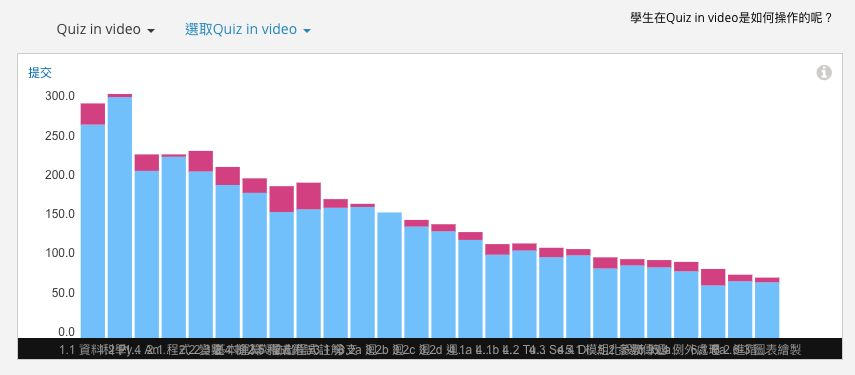

High-Interaction Course (M2019f) <strong style="color: #0f766e;">Activity sustained at 32%</strong>

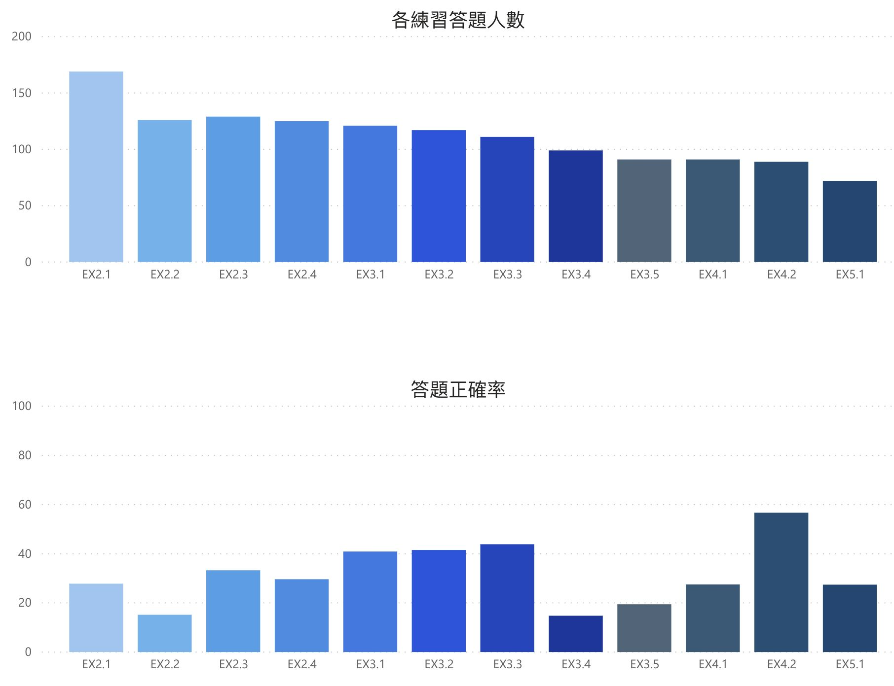

Online Judge Coding Module <strong style="color: #1b365d;">Highest retention at 40%</strong>

<strong>Key Observation:</strong> Adding richer interactive elements in M2019f (e.g., Star Trek at <strong>30%</strong>) roughly <strong>doubled</strong> Week-5 retention over M2019s; although <strong>Online Judge</strong> had fewer initial participants, it retained <strong>40%</strong> activity—higher than any other module!

<!--
Comparing cohorts with differing levels of interactivity demonstrates that richer interactive design sustains participation roughly twice as well by Week 5 (30%–32% in M2019f vs. 15%–17% in M2019s). Notably, while Online Judge has a higher initial barrier, learners who engage with OJ exhibit the highest sustained activity rate (40%) across all instructional modules.
-->

---

## Case 2 (Part 2): Debugging Traces &amp; Grade Correlation (SP vs. OJ)

Analyzing submission histories (`F1072`) to understand *how students debug*, and correlating **Self-Practice (SP)** vs. **Online Judge (OJ)** with **Exam** scores:

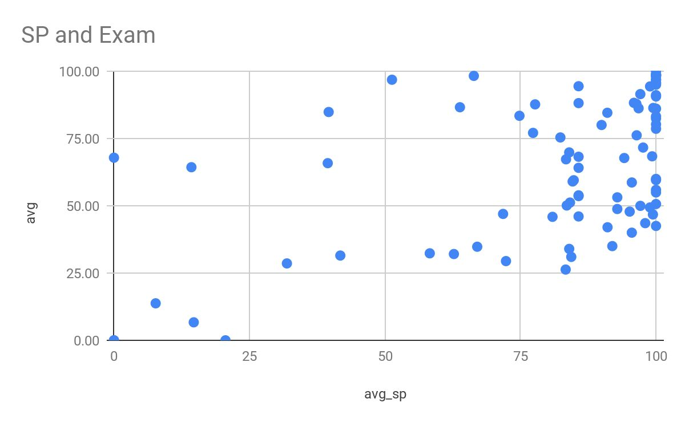

Self-Practice (SP) vs. Exam: <strong style="color: #1b365d;">CORR = 0.54</strong>

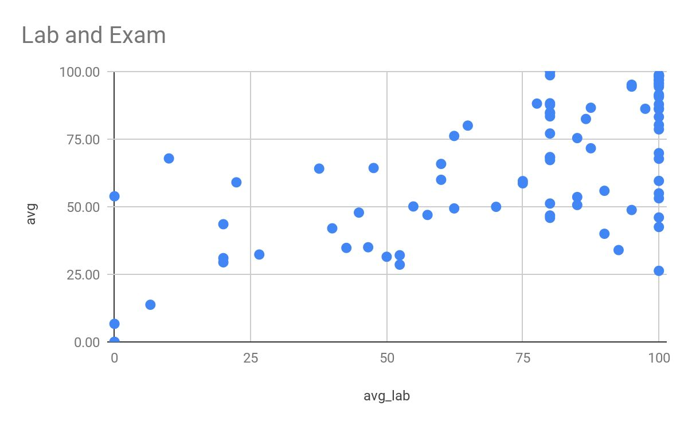

Online Judge (OJ) vs. Exam: <strong style="color: #8c1d40;">CORR = 0.70</strong>

<strong>Empirical Observations:</strong> (1) Because <strong>SP (MCQs)</strong> permits unlimited retries, high SP scores do not guarantee high exam scores (<code>r = 0.54</code>); <strong>OJ hands-on coding</strong> correlates far more strongly with exams (<code>r = 0.70</code>). (2) Submission traces expose persistent novice misconceptions (variables, string quotes/concatenation, <code>input()</code>) and <strong>blind trial-and-error editing</strong>.

<!--
Submission-level trace analysis uncovers both conceptual bottlenecks (variables, string quotation/concatenation, input parsing) and unproductive blind debugging habits. Quantitatively, hands-on Online Judge performance exhibits a substantially stronger correlation with final exam outcomes (r = 0.70) than repeatable multiple-choice Self-Practice (r = 0.54).
-->

---

## Case 2 (Part 3): Frustration Analysis, Grades &amp; Dropout

Repeated failed submissions accumulate severe frustration (e.g., on the very first simple OJ task, one student **submitted 32 versions and still failed**):

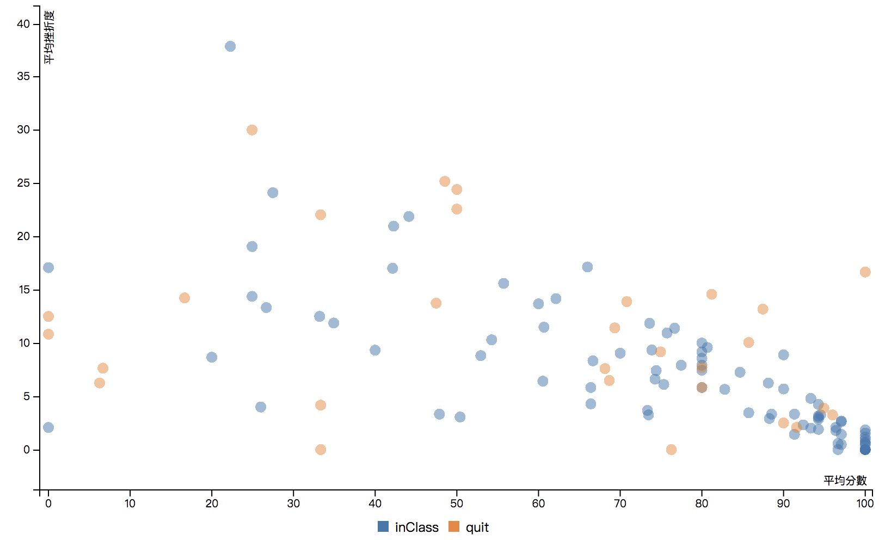

Frustration Degree shows a strong negative relationship with course grades

| Cohort Comparison Metric | High-Frustration / Low-Grade | Low-Frustration / High-Grade |
| :--- | :---: | :---: |
| **By Frustration (Avg. Grade)** | `49.29` | **`80.1`** |
| **By Frustration (Dropout Rate)** | **`34%`** | `12%` |
| **By Lab Grade (Avg. Lab Score)** | `57` | **`74`** |
| **By Lab Grade (Avg. Frustration F)** | **`11.1`** | `6.7` |

<strong>Early Intervention Insight:</strong> High-frustration learners suffer nearly <strong>3× higher dropout (34% vs. 12%)</strong> and far lower grades—detecting <em>who</em> is stuck and <em>when</em> they need help is vital!

<!--
Quantifying repeated submission failures into a Frustration Degree (F) reveals a striking bidirectional pattern: high-frustration learners average 49.29 with a 34% dropout rate (vs. 80.1 and 12% dropout for low-frustration peers), while low-performing lab cohorts exhibit nearly double the average frustration (11.1 vs. 6.7). This empirical evidence directly motivated the team's subsequent work on timely scaffolding and tiered AI tutoring.
-->

---

<!-- _class: closing -->

# Lessons Learned &amp; Takeaways

<strong style="font-size: 1.06em;">📖 1. Textbook is Necessary</strong> 
Videos and interactive widgets cannot fully replace structured textbooks—well-organized written references remain essential for deep review.

<strong style="font-size: 1.06em;">🤝 2. Improve Learning Support</strong> 
Combine Online Judge virtual TAs, multi-modal interactions, and frustration alerts to intervene before learners drop out.

<strong style="font-size: 1.06em;">🎯 3. Precise Learning</strong> 
Leverage OpenEdu process analytics to move from one-size-fits-all teaching toward data-driven, personalized instruction.

Related Research &amp; Talks:
<a href="../../MyResearch/21Judge/Judge_slide.html" target="_blank" rel="noopener" style="color: #7dd3fc;">21Judge (UTAUT2) ↗</a> ·
<a href="../../MyResearch/22Engagement/Engagement_slide.html" target="_blank" rel="noopener" style="color: #7dd3fc;">22Engagement (PLS-SEM) ↗</a> ·
<a href="../../Talk2026/NKNU26/nknu26_slide.html" target="_blank" rel="noopener" style="color: #fde68a;">2026 NKNU Keynote (AI &amp; Education) ↗</a>

<!--
Three enduring lessons synthesize the 2022 NKNU keynote: (1) structured textbooks remain indispensable alongside interactive media; (2) automated grading, gamification, and frustration detection must work together to strengthen learner support; and (3) fine-grained learning process analytics paves the path toward Precise Learning. Links at the bottom connect directly to the team's companion English research decks (21Judge, 22Engagement) and the 2026 NKNU AI & Education keynote.
-->

