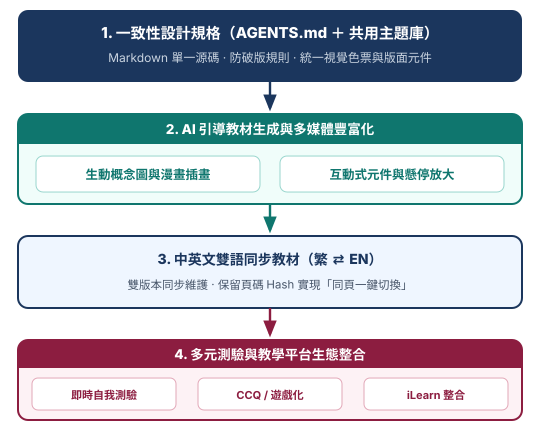
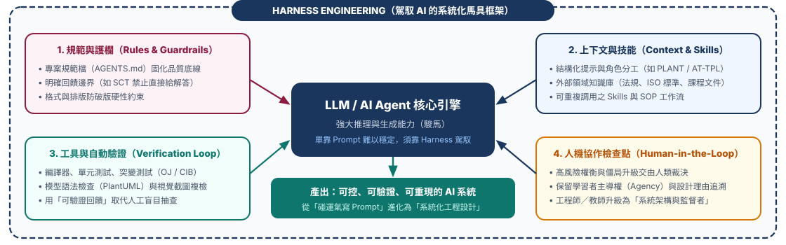

<!-- _class: lead -->

國立高雄師範大學（NKNU）專題演講 · 2026/11/24 13:30–16:30

# AI and Education

從全民 AI 應用出發：探討 AI 時代的程式設計教育、軟體工程研究、互動教材工程與 Harness 設計思維

<strong>主講人：薛念林 教授（Prof. Nien-Lin Hsueh）</strong> 
逢甲大學 資訊工程學系（Department of Information Engineering and Computer Science, FCU） 
<code>nlhsueh@fcu.edu.tw</code> · 教材總門戶：<code>https://nlhsueh.github.io/teach/</code>

<!--
本場演講為國立高雄師範大學（2026/11/24 13:30–16:30，共三小時）之專題講座主軸簡報。全場設計為「中樞導覽（Hub）式簡報」，由生活化的 AI 全民化案例破題，結合現場問卷互動，並透過第 4 頁目錄直接串聯五篇已發表或投稿中之實證研究簡報（Pytutor 測試能力、AT-TPL AI 助教三元模式、SCT AI 稅率與 LADI、LLM UX 測試、PLANT 多代理人需求工程），最後回到第一線教學現場的個人工具實作（NickPocket）、互動題庫（NickEduPocket）、雙語教材工程（Courseware Design）與 Harness Engineering 系統化駕馭 AI 的核心框架。
-->

---

## 破題：一則讓人「下巴掉下來」的 Threads 貼文

@

<strong>threads 熱門分享</strong> · 剛剛 <strong style="color:#8c1d40; font-size:1.08em;">標題：很扯</strong>

•••

昨天搭計程車的時候，發現司機大哥在聽 VK 科技閱讀講 NotebookLM，所以就跟他聊了起來，發現他也有聽曼報，甚至以前也有聽科技島讀，我也跟他分享以前的創業經歷。  
接著更加刷新三觀的是，他說他用 Claude Code vibe coding 做出了一個可以幫助他比較好算跑車收入的 app，還用 Typeless 搭配 Obsidian 串 agent 做了他個人的日記管理系統。  
我整個下巴快掉下來……重點是他是一個<strong>全職計程車司機</strong>。還一直跟我說他覺得他 AI 用得沒有很好，他知道之後自己一定會被無人車取代，所以提早開始學習新科技。  
Oh my god！我跟他說，他的 AI 使用程度絕對是非常頂尖的，甚至贏過非常非常多年輕人跟上班族。我也覺得蠻激動的，感覺真的看到了那種<strong>科技平民化、AI 全民化</strong>的影子。

❤️ 12.4K💬 842🔁 2.1K📤 分享

### 💡 什麼才是「100 分的 AI 使用」？
AI 用得好真的不是要懂什麼艱深的工具或專有名詞，而是**能像這位司機大哥一樣，實際解決工作跟生活的問題**，就是最完美的 100 分！

### 🔍 給教育現場的三個震撼反思
- **危機感驅動自主學習**：面對無人車浪潮，主動提前升級能力。
- **軟體開發門檻崩解**：非資訊背景也能用 Vibe Coding 打造專屬工具。
- **大學教育的重新定位**：當工具人人可用，我們該教學生什麼？

<!--
此真實社群案例（Threads 貼文「很扯」）具體呈現了 2025–2026 年間生成式 AI 普及後的「科技平民化（Democratization of Technology）」現象：一位無資訊工程學歷背景的全職計程車司機，因預見自動駕駛（無人車）對職業的衝擊，主動透過科技 Podcast（VK 科技閱讀、曼報、科技島讀）吸收新知，並進一步以 Claude Code 進行 Vibe Coding 自行開發跑車收入計算 App，再結合語音輸入工具（Typeless）與知識庫（Obsidian）串接 AI Agent 建立個人日記管理系統。此案例對高等教育提出根本挑戰：當「寫出可用軟體」不再是資訊科系的專利，程式設計與軟體工程教育的價值重心必須從純語法記憶轉向問題定義、驗證能力、系統架構與駕馭 AI 的方法論。
-->

---

## 現場互動大問號：你用 AI 做過什麼事？

❓ 大家用 AI 做了什麼事？ 
（寫作業除外！）

### 💭 想想看你的真實日常應用
- **生活與工作自動化**：記帳、旅遊規劃、行程整理、信件草擬？
- **個人知識與學習**：英語閱讀、Podcast 摘要、筆記串接（NotebookLM / Obsidian）？
- **打造專屬小工具**：Vibe Coding 寫一個只給自己用的 App 或腳本？

<strong>問卷連結：</strong> <a href="https://forms.gle/5wdGkgk71ZF6qZkY8" target="_blank" rel="noopener">https://forms.gle/5wdGkgk71ZF6qZkY8</a> 
掃描右側 QR Code 即時填寫，看看現場師生最有趣的 AI 實戰點子！

📱 掃描填寫現場互動問卷

forms.gle/5wdGkgk71ZF6qZkY8

<!--
本頁作為演講破題後的即時互動暖身活動（Google Forms 連結：https://forms.gle/5wdGkgk71ZF6qZkY8）。刻意加上「作業除外」的限制條件，目的是區分「被動應付課業（把 AI 當代寫工具）」與「主動解決真實問題（把 AI 當生產力槓桿）」兩種截然不同的使用心態。收集到的現場回覆可作為後續切入「AI ➔ Good or Bad?」、NickPocket 個人百寶箱以及「AI Tax（評估 AI 依賴度）」等議題的真實課堂素材。
-->

---

## 演講主軸目錄（點擊各項目直接跳轉簡報或實作）

⚖️ 1. AI ➔ Good or Bad?

<a class="hub-link" href="#5">🧰 NickPocket：個人專屬 AI 百寶箱實作本簡報 #5</a>
<a class="hub-link" href="https://nick-pocket.web.app/" target="_blank" rel="noopener">🌐 NickPocket 線上系統直接展示Web App ↗</a>

💻 2. AI ➔ Programming（程式教育）

<a class="hub-link" href="../../MyResearch/23Testability/Testability_slide_zh.html" target="_blank" rel="noopener">🧪 Online Judge &amp; Testability（Pytutor）2023 簡報 ↗</a>
<a class="hub-link" href="../../MyResearch/26Pattern/Pattern26_slide_zh.html" target="_blank" rel="noopener">🧩 From Online Judge to Tutor（AT-TPL）2026 簡報 ↗</a>
<a class="hub-link" href="../../MyResearch/27SCT/SCT_slide_zh.html" target="_blank" rel="noopener">🚕 AI Tax &amp; LADI（Smart Coding Tutor）2026 簡報 ↗</a>

🏗️ 3. AI ➔ Software Engineering

<a class="hub-link" href="../../MyResearch/24UXtesting/UXtesting_slide_zh.html" target="_blank" rel="noopener">🎨 User Experience and AI（LLM UX Testing）2024 簡報 ↗</a>
<a class="hub-link" href="../../MyResearch/26Plant/Plant_slide_zh.html" target="_blank" rel="noopener">🤖 Requirement Engineering &amp; Multi-Agents（PLANT）2026 簡報 ↗</a>

🏫 4. AI ➔ Teaching（教學與教材工程）

<a class="hub-link" href="https://nlhsueh.github.io/nickedupocket/" target="_blank" rel="noopener">🎯 NickPocketEdu 互動隨堂題庫平台Web App ↗</a>
<a class="hub-link" href="#6">📚 Courseware Design（AI 教材工程）本簡報 #6</a>
<a class="hub-link" href="#7">🐴 Harness Engineering（駕馭 AI 框架）本簡報 #7</a>

<!--
本頁為全場演講的四維度架構總覽與超連結中樞，所有條目皆可直接點擊開啟對應之投影片或線上系統：
1. AI ➔ Good or Bad?：透過自建個人工具 NickPocket 展示 AI 賦能的正向價值，同時反思依賴風險。
2. AI ➔ Programming：串聯逢甲團隊四年演進脈絡——從強調學生自寫測試的 Pytutor（Electronics 2023），進化到三元角色分工的 AI 助教模式 AT-TPL（JISE 2026），再到以「AI 稅率（0%–20%）」與「LADI 依賴指標」兼顧學習鷹架與評量鑑別度的 Smart Coding Tutor（SCT）。
3. AI ➔ Software Engineering：展示 LLM 如何深入傳統軟體工程上游與下游——包括結合 Rapi 錄製與 Nielsen 啟發式準則的多模態 UX 自動檢測（Electronics 2024），以及六角色多代理人需求工程平台 PLANT（JISE 2026）。
4. AI ➔ Teaching：聚焦第一線教師如何將 AI 系統化導入教學，涵蓋 NickPocketEdu 互動題庫、雙語互動教材工程（Courseware Design）與 Harness Engineering 設計思維。
-->

---

## AI ➔ Good or Bad? 實作案例：NickPocket 個人百寶箱

以 AI 協作打造的**個人專屬 PWA 行動工具箱**，將日常思考、財務、英語學習與研究管理整合於同一介面，回應「用 AI 解決真實生活問題」的理念：

📝 Musings（隨筆與日記）

即時記錄生活靈感與反思，支援分類檢索，甚至可一鍵打包匯出成 <strong>ePub 電子書</strong>收藏。

📈 Investment（投資配置）

整合銀行現金與投資部位，追蹤保守／穩健／積極配置比例、定期定額（DCA）與 ROI 損益。

📖 Nick English（英語學習）

一鍵抓取今日網路文章、建立個人單字本（文章／日記來源），並內建互動式 <strong>Quiz Game</strong> 複習。

🔬 Research（研究脈絡）

集中收納學術靈感、文獻摘錄與研究構想，隨時跨裝置補充與查閱。

📦 Inventory（物品盤點）

記錄個人設備與生活物品清單，避免重複購買並掌握資產狀態。

💰 Ledger（日常記帳）

輕量化行動記帳模組，快速記錄日常收支並掌握財務流向。

<strong>核心啟示：</strong> 過去需數月團隊開發的個人整合軟體，現在透過 AI 協作即可快速實現為跨平台 PWA（支援 Google 登入與雲端同步）。 
<a href="https://nick-pocket.web.app/" target="_blank" rel="noopener" class="cta-btn" style="margin-top: 8px;">🌐 開啟 NickPocket 線上系統（nick-pocket.web.app）↗</a>

<!--
NickPocket（https://nick-pocket.web.app/）是講者透過 AI 輔助開發建置之個人行動工具箱（Progressive Web App, PWA），整合 Google 身分驗證與雲端即時資料庫，包含六大日常功能模組：Musings（生活隨筆並支援 ePub 電子書匯出）、Investment（資產配置與定期定額 ROI 追蹤）、Nick English（每日文章抓取、單字本與測驗遊戲）、Research（研究構想筆記）、Inventory（個人物品盤點）與 Ledger（日常記帳）。在「AI ➔ Good or Bad?」的脈絡下，NickPocket 作為正向案例展示「個人化微軟體（Personal Software）」時代的來臨——軟體不再只服務大眾市場，個人與教師也能低成本打造高度契合自身工作流的專屬系統。
-->

---

## AI ➔ Teaching：Courseware Design（AI 教材工程）

### 📚 跨課程統一教學門戶與教材特色
- **一致性的風格**：跨課程（SE、UX、SQA、Python、Talk）共用主題與排版規格，消除版面雜亂。
- **引導教材生成，豐富內容**：
  - 結合 AI 產出**生動的圖片與概念示意圖**，將抽象理論視覺化。
  - 打造**互動式教材**（圖片懸停邊界放大、章節下拉導覽、點擊回饋）。
- **中英文雙語同步**：
  - 同步維護**中英文雙語教材**，支援 **`🌐 繁` ⇄ `🌐 EN` 逐頁同頁切換**。
- **多元測驗與平台整合**：
  - 內建**即時自我測驗**、課堂 **CCQ** 與 **Game** 互動。
  - 自動同步題庫至 **NickEduPocket**，並無縫銜接校內 **iLearn** 學習平台。

<a href="https://nlhsueh.github.io/teach/" target="_blank" rel="noopener" class="cta-btn">🏫 造訪課程教材總門戶（nlhsueh.github.io/teach/）↗</a>

<!--
Courseware Design（教材工程）將軟體工程的「單一源碼（Single Source of Truth）」、「版本控制（Git + GitHub Pages）」與「自動化建置管線」導入大學教學教材製作（門戶網址：https://nlhsueh.github.io/teach/）。四大核心設計分別為：（1）以 AGENTS.md 與跨課程 CSS 主題庫確保所有課程簡報與講義具一致視覺規範；（2）透過 AI 輔助生成概念向量圖（SVG）、情境漫畫與互動增強腳本（如不超出投影片邊界的動態懸停放大）；（3）維護完全對齊的中英文雙語 Markdown 簡報，並透過 URL Hash 保留機制達成同頁一鍵語系切換（🌐 繁 ⇄ 🌐 EN）；（4）透過自動化腳本（如 sync_iActivity.py）解析簡報與講義中的隨堂概念測驗（CCQ）與遊戲化活動，自動產出 QR Code 並同步至 NickEduPocket 與學校 iLearn 系統，形成教學與評量閉環。
-->

---

## AI ➔ Engineering：Harness Engineering（駕馭 AI 的設計思維）

模型能力持續暴漲，但**真正決定 AI 系統可靠度與教學品質的關鍵，不在單一 Prompt，而在「Harness（馬具系統）」的設計**。

<strong>貫穿今日演講的共同主軸：</strong> 無論是 <strong>SCT 的分層邊界與 AI 稅</strong>、<strong>PLANT 的調解者與 PlantUML 驗證</strong>，還是 <strong>Courseware 的 AGENTS.md 與編譯檢查</strong>，本質上都是 <strong>Harness Engineering</strong> 的具體實踐！

<!--
Harness Engineering（駕馭工程／馬具設計）是 AI-Augmented Software Engineering（AASD）時代的核心工程方法論。將大型語言模型（LLM）比喻為動力強大但行為具隨機性的「駿馬」，單純依賴人工反覆微調提示詞（Prompt Engineering）難以在複雜任務中維持穩定品質；唯有圍繞模型建構完整的 Harness（馬具框架），包含：（1）規範與護欄（Rules & Guardrails，如 AGENTS.md 防破版規則、SCT 禁止直接輸出完整解答的邊界）；（2）上下文與技能（Context & Skills，如領域法規庫、多角色分工提示詞）；（3）工具與自動驗證迴路（Verification Loop，如編譯器、Online Judge、突變測試、PlantUML 語法驗證與視覺截圖檢查）；（4）人機協作檢查點（Human-in-the-Loop，關鍵決策與僵局升級由人類裁決），才能把 AI 從「不可控的玩具」轉化為「可控、可驗證、可重現的工程與教育系統」。
-->

---

<!-- _class: closing -->

# AI × 教育：從「用工具」邁向「設計系統」

當計程車司機都能用 AI 解決生活問題，高等教育的使命是培養能<strong>定義問題、設計護欄、驗證品質並駕馭 AI 系統</strong>的下一代人才。

<strong>薛念林 教授（Prof. Nien-Lin Hsueh）</strong> · 逢甲大學資訊工程學系 
📧 Email：<code>nlhsueh@fcu.edu.tw</code> 
🏫 課程教材總門戶：<code>https://nlhsueh.github.io/teach/</code> 
🎯 互動隨堂題庫：<code>https://nlhsueh.github.io/nickedupocket/</code> 
🧰 個人百寶箱：<code>https://nick-pocket.web.app/</code>

教材總門戶

<!--
結語總結本場三小時演講之核心論點：在生成式 AI 全面普及的時代，教育現場不應停留於「禁止或放任 AI」的二元對立，而應透過個人賦能（NickPocket）、分層可控輔助（SCT / AT-TPL）、多代理人專業協作（PLANT / LLM UX Testing）、雙語互動教材工程（Courseware Design）與系統化駕馭架構（Harness Engineering），引導學生從單純的「AI 工具使用者」成長為具備問題定義、品質驗證與系統設計能力的「AI 系統駕馭者」。右側提供教材總門戶（https://nlhsueh.github.io/teach/）QR Code 供與會師生課後持續瀏覽與交流。
-->

